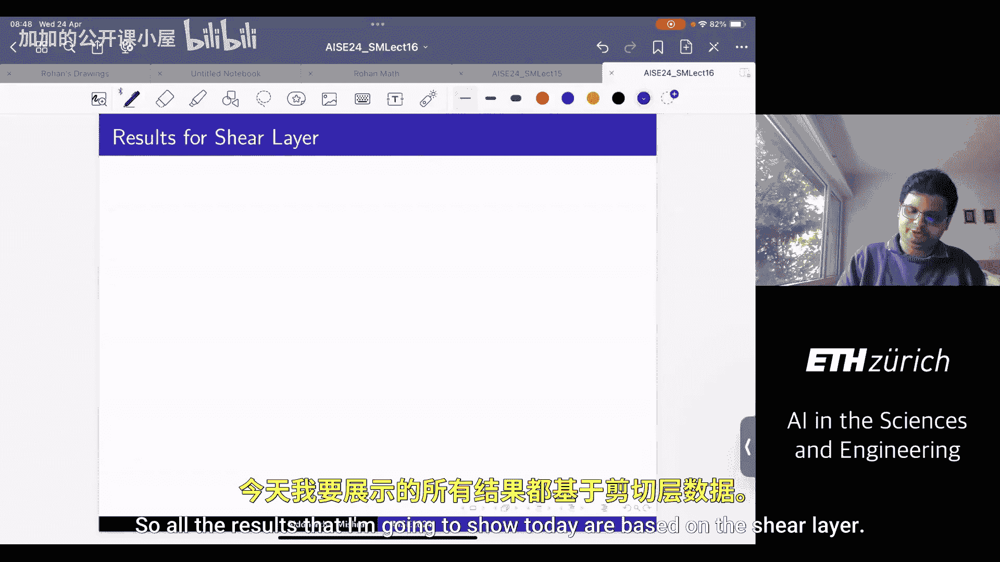
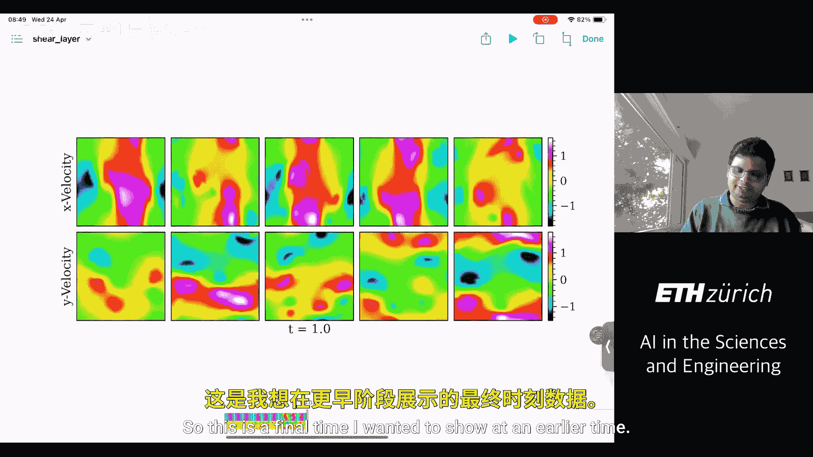
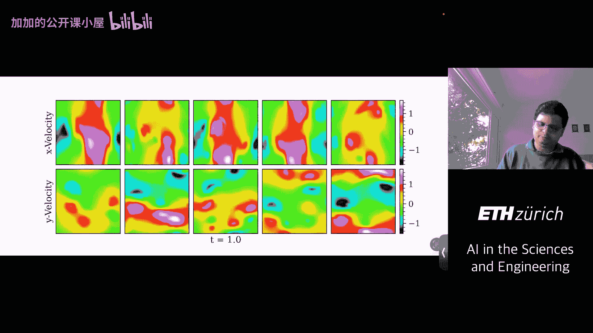
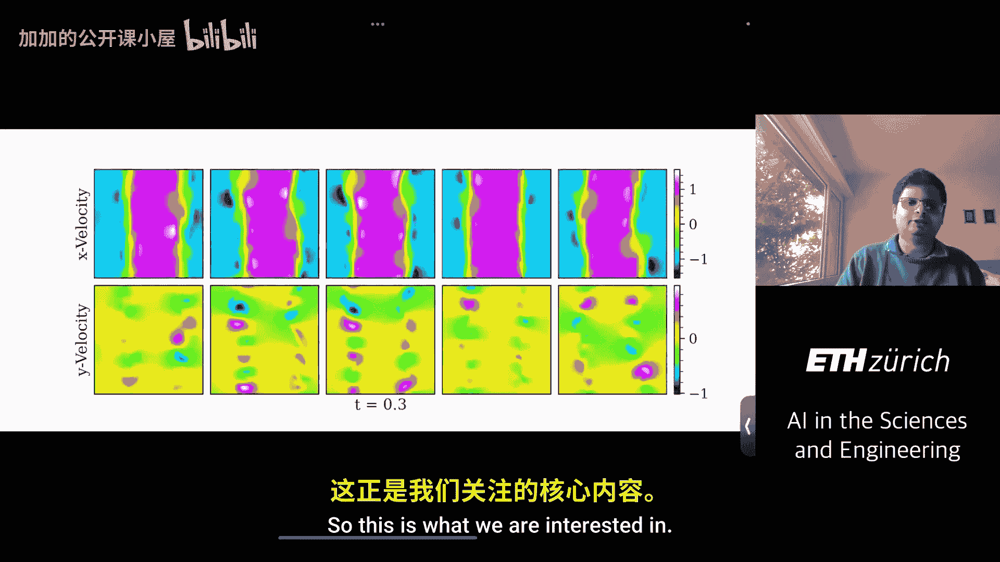
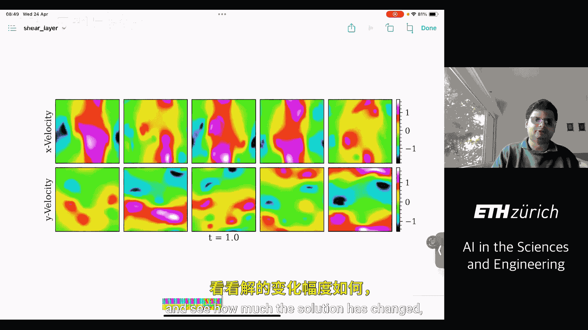
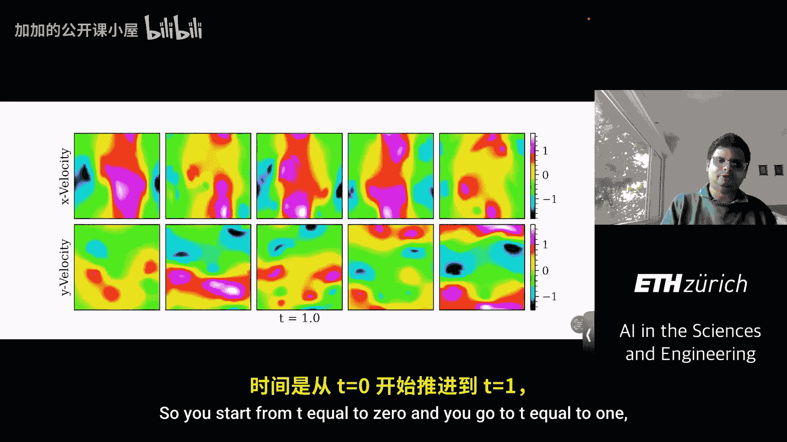
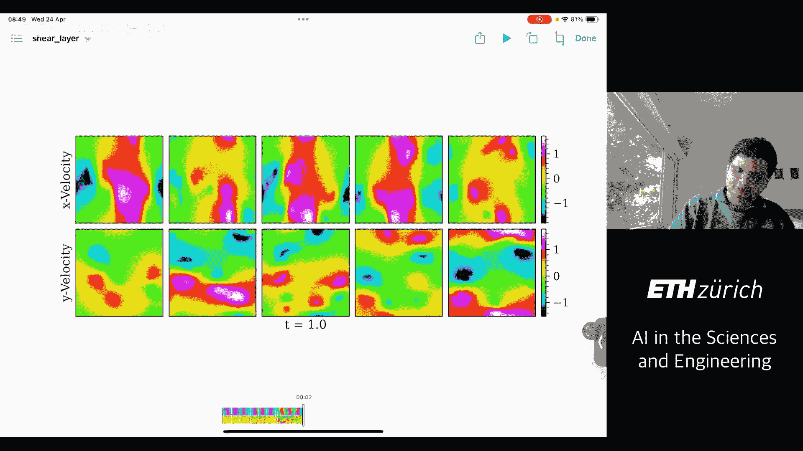
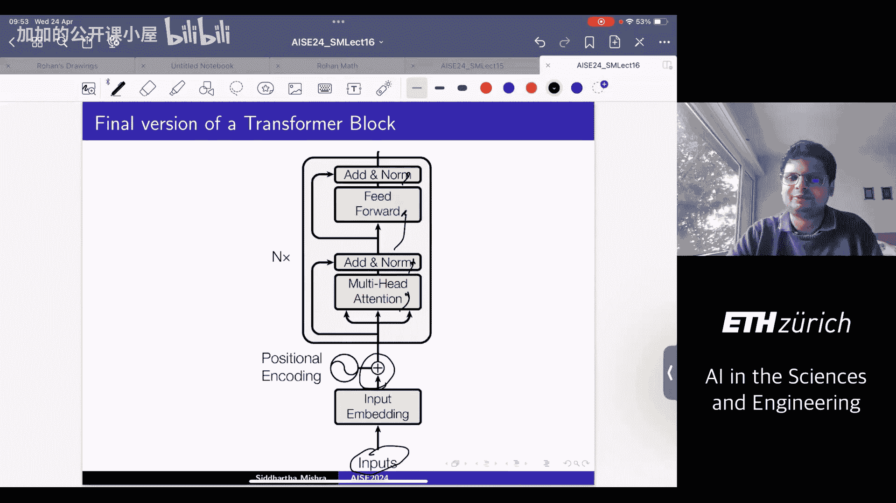

# 016：大规模神经算子

## 概述
在本节课中，我们将学习如何将神经算子应用于时间依赖的偏微分方程求解。我们将重点介绍一种称为“前导时间条件化”的技术，它允许神经算子将时间作为输入，从而能够预测任意时刻的解。此外，我们还将探讨两种不同的训练策略：“逐一训练”和“全对全训练”，以及它们在提升模型性能和利用数据方面的优势。最后，我们将初步了解Transformer架构及其核心组件——注意力机制，为后续深入学习打下基础。

---

## 时间依赖问题与解算子

上一节我们介绍了多种算子学习算法。本节中，我们来看看如何处理时间依赖的问题。

时间依赖问题基于时间依赖的偏微分方程。其抽象形式如下：
```
∂u/∂t = F(u, t)
```
其中，`u` 是未知函数，`t` 是时间，`F` 是某个微分算子。

一个典型的例子是热方程：
```
∂u/∂t - ∇²u = 0, u(x,0) = u₀(x)
```
另一个例子是波动方程，它可以通过引入新变量（如速度）转化为一阶时间导数的系统形式。

对于时间依赖的PDE，我们感兴趣的是学习**解算子** `G`。这个算子将初始条件 `u₀` 和时间 `t` 映射到该时刻的解 `u(t)`：
```
G: (u₀, t) → u(t)
```
在实际中，我们通常拥有的是解在离散时间点上的轨迹数据。

---

## 前导时间条件化

为了将时间信息整合到神经算子中，我们采用**前导时间条件化**技术。其核心思想是：不仅将时间作为初始输入的一部分，还要将其信息贯穿到网络的每一层。

具体操作分为两步：
1.  **初始输入**：将时间 `t` 作为一个额外的输入通道，与初始条件 `u₀` 一起输入神经算子 `S*`。
2.  **层间条件化**：在网络的每一层（特别是归一化层）中，将时间 `t` 作为条件输入，以调制该层的输出。

神经网络的归一化层（如实例归一化、批归一化、层归一化）通常形式为：
```
输出 = γ * ( (输入 - μ) / σ ) + β
```
其中 `μ` 是均值，`σ` 是标准差，`γ` 和 `β` 是可学习的缩放和平移参数。

在时间条件化中，我们将这些参数 `γ` 和 `β` 改为时间 `t` 的函数，通常通过一个小型多层感知机（MLP）来实现：
```
γ(t) = MLP_γ(t), β(t) = MLP_β(t)
```
这样，时间信息就能优雅地“烙印”在整个神经网络的每一层中，使网络能够学习与时间演化过程相关的特征。

---

## 训练策略：逐一训练与全对全训练





在训练时间依赖的神经算子时，我们有两种主要的策略可以利用轨迹数据。











### 逐一训练
在逐一训练中，对于每条轨迹，我们使用初始条件 `u₀` 和不同的目标时间 `t_k` 来生成多个训练样本。

损失函数构造如下。对于第 `i` 条轨迹，其损失 `L_i` 为：
```
L_i = (1/K) * Σ_{k=1}^{K} || u_i(t_k) - S*(u_i(0), t_k) ||^2
```
其中 `K` 是时间步数。总损失是所有轨迹损失之和。

这种方法的优点是简单直接，每条轨迹提供了 `K` 个训练样本。

### 全对全训练
全对全训练则更充分地利用了PDE解算子的**因果性**（或半群性质）。其思想是：从轨迹上的任何一个时间点 `t_i` 出发，都可以预测其之后任意时间点 `t_j` (j > i) 的解。

因此，对于一条有 `K` 个时间点的轨迹，我们可以构造的训练样本对数量从 `K`（逐一训练）大幅增加到 `K(K+1)/2`。

损失函数相应地变为：
```
L_i = Σ_{i=1}^{K} Σ_{j>i}^{K} || u_i(t_j) - S*(u_i(t_i), t_j - t_i) ||^2
```
全对全训练通过利用解算子的内在性质，实现了数据的“免费”扩增，通常能带来更好的模型性能，尽管训练成本会更高。

---

## 推理策略

训练好时间条件化的神经算子后，在推理（预测）阶段我们有多种策略可以选择：

1.  **直接推理**：直接将目标总时间 `T` 和初始条件 `u₀` 输入算子，一步得到最终时刻的解。这种方法最廉价，但可能因预测步长过长而误差较大。
2.  **自回归推理**：
    *   **单步自回归**：从 `t=0` 开始，反复使用算子预测下一个时间步的解，并将预测结果作为下一步的输入，直到达到目标时间 `T`。这种方法误差可能累积，但每一步的预测任务相对简单。
    *   **多步跳跃自回归**：结合直接推理和自回归的优点。例如，先做几个大时间步的预测，再在接近终点时用小步长细化。这种启发式方法通常在精度和成本之间取得较好平衡。

选择哪种推理策略取决于具体问题、对误差的容忍度以及计算预算。

---

## 数值实验与结果分析

我们以Shear Layer流问题为例，展示了上述方法的有效性。

关键观察结果如下：
*   **数据缩放律**：随着训练轨迹数量的增加，测试误差以可预测的速率下降（例如，指数约为-0.33）。这种缩放律在不同目标时间上都成立，尽管误差常数会随时间增长而增大。
*   **连续时间预测**：模型能够预测训练时未见过的中间时刻（如t=0.5, 0.7）的解，实现了真正的连续时间预测能力。
*   **训练策略对比**：全对全训练 consistently 优于逐一训练，因为它利用了更多的数据对。
*   **推理策略对比**：多步跳跃自回归推理策略通常能在直接推理和单步自回归之间找到最佳平衡点，显著降低预测误差。

这些结果表明，通过时间条件化架构、全对全训练策略以及灵活的推理方式，神经算子在处理复杂时间依赖PDE问题时表现出强大的能力和良好的可扩展性。

---

## 迈向Transformer：注意力机制简介

观察到神经算子在数据与模型规模上存在一致的缩放规律后，我们受到自然语言处理领域成功的启发，开始探索**Transformer**架构在科学计算中的应用。其核心是**注意力机制**。

### 注意力机制原理
与卷积神经网络（CNN）的局部感受野不同，注意力机制是全局且数据依赖的。

考虑一个离散的输入序列（例如，空间离散化后的函数值）`V = [v1, v2, ..., vK]`，每个 `vi` 是一个 `n` 维特征向量。

注意力层的输出 `U` 在位置 `k` 的值 `u_k` 计算如下：
```
u_k = Σ_{j=1}^{K} ( softmax( (Q v_k)^T (K v_j) / √d ) ) * (V v_j)
```
其中：
*   `Q`, `K`, `V` 是可学习的线性变换矩阵（查询、键、值）。
*   `softmax` 函数将点积分数转化为权重，表示位置 `j` 对位置 `k` 的“关注”程度。
*   求和是对所有位置 `j` 进行的，实现了全局信息混合。

### 函数视角下的注意力
从连续函数的角度看，注意力可以看作一个非线性积分算子：
```
(Attention(v))(x) = ∫ κ(x, y; v) v(y) dy
```
其中核函数 `κ` 本身依赖于输入函数 `v`，通过查询 `Q` 和键 `K` 的运算实现：
```
κ(x, y; v) ∝ exp( ∫ (Q v(x))(z)^T (K v(y))(z) dz )
```
这使得注意力机制比固定的卷积核更灵活、更强大。

### Transformer块的基本结构
一个标准的Transformer编码器块通常包含以下组件：
1.  **多头自注意力**：将上述注意力机制并行执行多次（多个“头”），每个头学习不同的关注模式，最后将结果拼接或求和。
2.  **层归一化**：对每个位置的特征向量进行归一化，稳定训练过程。公式为：
    ```
    LayerNorm(x) = γ * (x - mean(x)) / std(x) + β
    ```
    在时间依赖问题中，`γ` 和 `β` 可以成为时间的函数。
3.  **前馈神经网络**：一个应用于每个位置的点式多层感知机（MLP），提供非线性变换能力。
4.  **残差连接**：将每个子层（MSA, MLP）的输入加到其输出上，有助于梯度流动和深层网络训练。
5.  **位置编码**：由于注意力机制本身是排列不变的，我们需要注入位置信息。通常是在输入特征上加上一个与位置相关的编码向量 `PE(pos)`。可以是固定的（如正弦/余弦函数），也可以是可学习的。

一个Transformer块的计算流程可简述为：
```
U = LayerNorm( v + MSA(v) )
输出 = LayerNorm( U + MLP(U) )
```

---

## 总结



本节课中我们一起学习了处理时间依赖PDE的先进神经算子方法。我们掌握了如何通过**前导时间条件化**将时间整合到网络架构中，并深入探讨了**逐一训练**和**全对全训练**两种策略，后者通过利用解算子的因果性显著提升了数据利用效率。我们还分析了不同**推理策略**（直接、自回归）的权衡。实验结果表明，这些方法在复杂流体力学的预测任务中表现出了良好的缩放规律和精度。最后，我们引入了**Transformer**架构和**注意力机制**的基本概念，为构建更强大、可扩展的神经算子奠定了基础。在接下来的课程中，我们将进一步探索如何将Transformer有效地应用于科学计算问题。