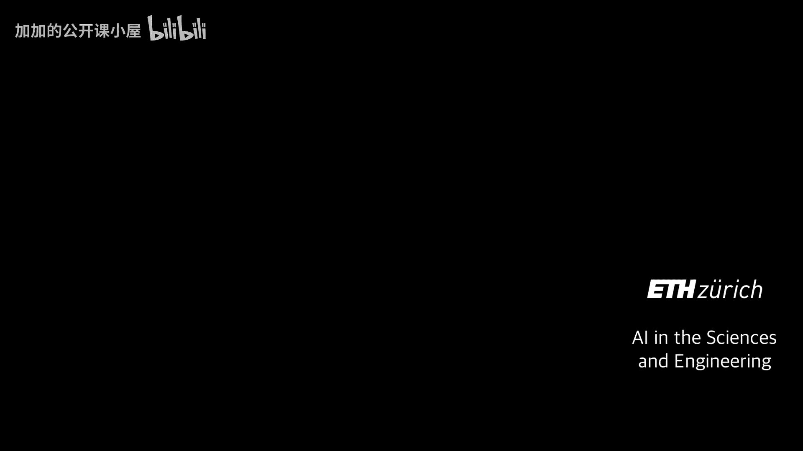
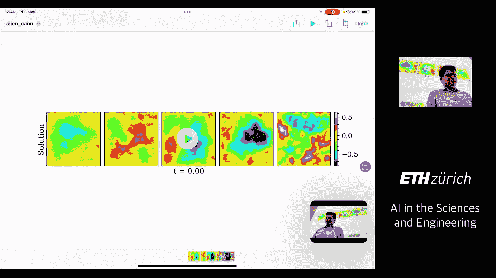
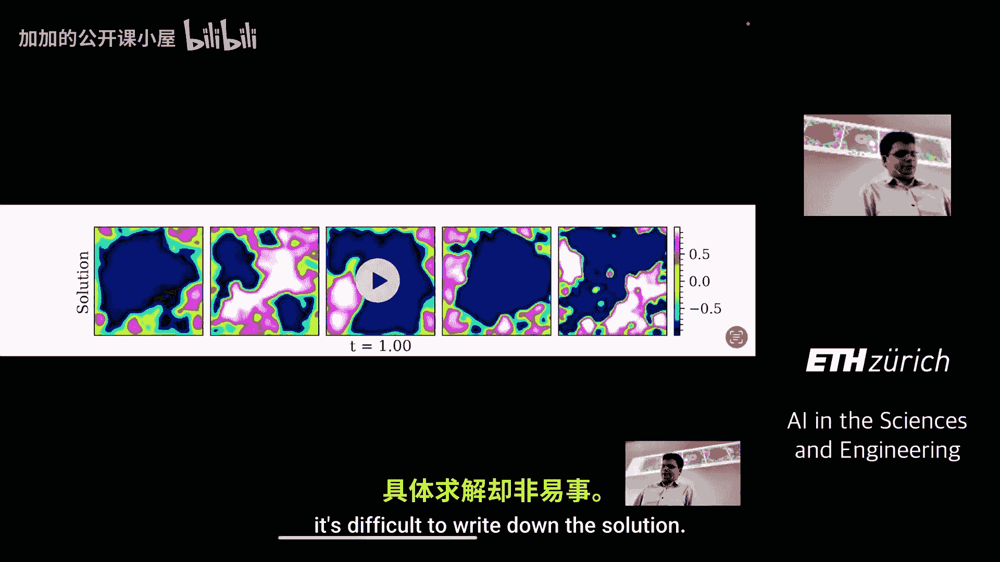
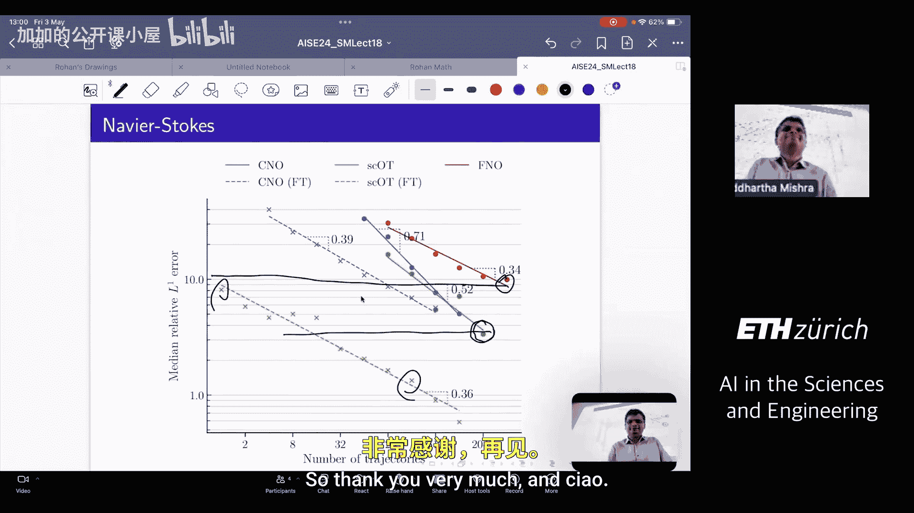

# 018：窗口注意力与缩放定律

在本节课中，我们将学习如何通过引入**窗口注意力**机制来改进Transformer模型的计算效率，并探讨不同神经网络算子（如FNO、CNO和Transformer）在求解偏微分方程时的性能与**缩放定律**。

---

## 回顾：Vision Transformer与计算挑战

上一节我们介绍了Vision Transformer及其通过**图像分块**来降低计算成本的方法。然而，即使分块后，注意力机制的计算复杂度仍然是**二次方**的，即 `O(N^2)`，其中 `N` 是块（token）的数量。对于高分辨率图像或三维问题，这依然计算量巨大。

## 核心创新：窗口注意力

为了进一步降低计算成本，我们引入**窗口注意力**机制。其核心思想是将图像块进一步分组到**非重叠的窗口**中，并限制注意力计算仅在每个窗口内部进行。

以下是窗口注意力的数学描述。对于传统注意力，我们计算所有点对之间的关联：

`Attention(Q, K, V) = softmax(QK^T / sqrt(d_k)) V`

在窗口注意力中，对于位于点 `x` 的查询，我们只考虑位于同一窗口 `W(x)` 内的点 `y`：

`WindowedAttention(Q, K, V) = softmax( Q(x) * K(y)^T / sqrt(d_k) ) * V(y), 其中 y ∈ W(x)`

这种方法将计算复杂度从全局的 `O(N^2)` 降低到了 `O(M * (N/M)^2)`，其中 `M` 是窗口数量。这显著提升了计算效率。

### 窗口注意力的潜在问题与解决方案

然而，只在一个窗口内计算注意力会限制信息的**全局混合**能力。为了解决这个问题，我们采用了一个非常自然的想法：**在连续的层之间移动窗口的位置**。

具体操作如下：
*   在第一个Transformer块中，我们使用一种窗口划分方式。
*   在下一个块中，我们将整个窗口网格进行**平移**（例如，向右下角移动半个窗口大小）。
*   通过这种层间的窗口移动，原本在不同窗口中的块在后续层中进入了同一个窗口，从而建立了信息传递的路径。

这个过程有效地减少了信息在不同块之间传播所需的**路径长度**，使得模型在保持计算高效的同时，仍能整合全局信息。

## Swin Transformer 块架构

结合了窗口注意力与窗口移动机制的Transformer块被称为**Swin Transformer块**。其工作流程如下：

以下是Swin Transformer块的单层数据处理流程：

1.  输入经过**层归一化**。
2.  进行**窗口多头自注意力**计算。
3.  与输入进行**残差连接**。
4.  再次进行**层归一化**。
5.  通过一个**多层感知机**。
6.  再次进行**残差连接**，得到输出。
7.  将输出传递给下一层，并在下一层**移动窗口**后重复上述过程。

## 为缩放而做的改进

为了构建更大、更强大的模型，研究人员对基础注意力机制做了一些改进以优化缩放性能：

以下是几项关键的改进措施：
*   **缩放余弦注意力**：用余弦相似度替代点积，实现自动归一化。公式为 `CosineSimilarity(A, B) = (A·B) / (||A|| * ||B||)`。
*   **相对位置编码**：不再使用绝对坐标，而是对块之间的相对位置取对数进行编码，这有助于模型更好地理解空间关系。
*   **层归一化位置**：根据具体问题调整层归一化在残差连接中的位置（前置或后置），以改善训练稳定性。

## 构建多尺度层次化架构

正如我们在CNO中看到的，对于科学计算问题，**多尺度信息处理**至关重要。我们将Swin Transformer块嵌入到一个层次化的编码器-解码器架构中，形成了**可缩放算子Transformer**。

以下是该架构的关键组件：
*   **Patch Merging**：在编码器部分，将相邻的小块合并成更大的块，从而**降低空间分辨率**，同时**增加通道数**，以捕获更抽象的特征。
*   **Swin Transformer Blocks**：在多个分辨率级别上应用Swin Transformer块进行特征处理。
*   **Patch Expansion**：在解码器部分，执行与合并相反的操作，**提升空间分辨率**并**减少通道数**，以重建高分辨率输出。
*   **跳跃连接**：在不同尺度之间添加连接，确保细节信息不会丢失。

这种设计使得模型能够像CNO一样，有效地在不同尺度上处理和融合信息。

## 性能实验与缩放定律分析

我们在多个PDE问题上测试了FNO、CNO和可缩放算子Transformer的性能，主要关注它们随训练数据量增加的**误差下降趋势**（即缩放定律）。

以下是几个关键实验的观察结果：

### 泊松方程
*   **问题**：`-∇²u = f`，学习从源项 `f` 到解 `u` 的映射。
*   **结果**：Transformer模型（SCOTT）在数据量足够大时，性能与CNO相当或略优，但明显优于FNO。在小数据量下，CNO更具样本效率。

### 亥姆霍兹方程
*   **问题**：`-∇²u + c²(x)u = 0`，学习从系数场 `c(x)` 到解 `u` 的映射。
*   **结果**：几种模型性能相近，Transformer并未显示出决定性优势。所有模型都需要相当数量的数据才能达到较低误差。

### 波动方程
*   **问题**：`u_tt - c²(x)∇²u = 0`，学习从系数 `c(x)` 和初始条件到时空解 `u(x,t)` 的映射。
*   **结果**：CNO和Transformer性能相似，且都优于FNO。在数据量较大时，Transformer显示出略好的缩放趋势。

### 艾伦-卡恩方程与纳维-斯托克斯方程
*   **观察**：在这些更复杂的非线性时间演化问题上，几种先进的算子学习方法（CNO和Transformer）表现处于同一水平，它们都显著优于基础的FNO，但彼此之间没有数量级的差异。

**核心结论**：在当前的数据规模下，引入Transformer架构并未带来性能上的颠覆性突破。其优势在于**高度并行化的计算**，但模型性能仍然严重受限于**训练数据的数量和质量**。

## 未来方向：物理信息与基础模型

为了突破数据瓶颈，我们探索了两个方向：

1.  **物理信息神经算子**：在损失函数中同时加入数据拟合项和物理方程残差项。然而，这与PINNs类似，存在训练困难的问题，尚未根本解决。
2.  **基础模型**：这是目前最有希望的方向。其理念是：
    *   **预训练**：在**大规模、多样化**的PDE数据集（不同类型方程、不同参数分布）上训练一个超大型模型。
    *   **微调**：在面对特定新任务时，只需使用**少量样本**对这个预训练模型进行微调，即可快速获得高性能。

初步实验表明，一个在多种流体问题上预训练的大型Transformer模型，在微调后，仅用**8个样本**就能达到与之前用**2048个样本**训练的小型模型相近的性能。这展示了**基础模型**在提升样本效率方面的巨大潜力。

---

本节课中我们一起学习了如何通过**窗口注意力**机制构建高效的Swin Transformer，并将其应用于PDE求解。我们通过实验对比发现，尽管Transformer在计算上具有优势，但其在算子学习领域的性能与CNO等模型相当，且都受限于数据。最后，我们展望了通过构建**PDE基础模型**来实现少样本高效学习这一充满前景的未来研究方向。