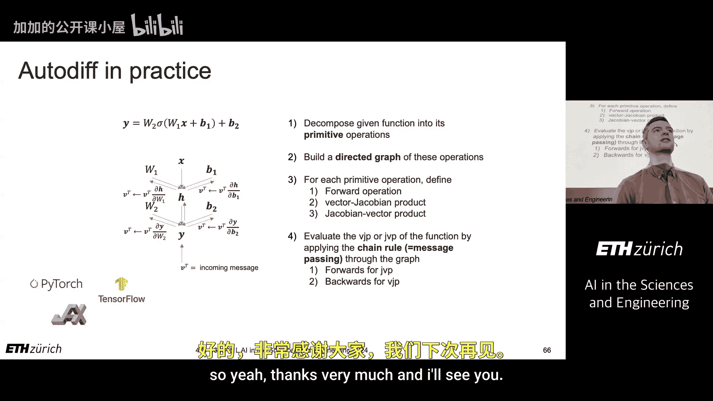

# 019：混合工作流导论（第一部分）


在本节课中，我们将学习一种新的科学机器学习技术——混合工作流。我们将首先回顾之前学过的物理信息神经网络和神经算子等方法的局限性，从而引出为何需要采用混合方法。接着，我们将详细探讨什么是混合工作流，并了解其不同的类型。最后，我们将深入理解自动微分这一关键技术，它是训练所有科学机器学习模型（包括混合工作流）的核心工具。

## 回顾现有科学机器学习技术的局限性

上一节我们介绍了课程的整体结构，本节中我们来看看之前学过的两种主要技术：物理信息神经网络和神经算子。了解它们的优缺点将有助于我们理解为何需要转向混合方法。

### 物理信息神经网络

物理信息神经网络使用神经网络来求解偏微分方程。其核心思想是，神经网络直接近似PDE的真实解，并通过损失函数进行训练。损失函数包含两项：一项确保边界条件得到满足，另一项则强制PDE在定义域内处处成立。

**优势：**
*   **无网格方法**：无需创建网格即可求解微分方程，对于网格生成成本高的问题非常有益。
*   **适用于复杂问题**：在同时拥有观测数据并希望学习PDE信息或求解方程本身的问题上表现良好。
*   **主要无监督**：通常不需要带标签的训练数据，仅需定义域内的坐标点（配置点）即可训练。

**局限性：**
*   **训练成本高**：尤其是仅用于模拟时，训练可能非常昂贵。
*   **优化困难**：不保证总能收敛到损失函数的局部或全局最小值。
*   **难以扩展**：受神经网络频谱偏差影响，难以求解高频问题。

### 神经算子

神经算子学习一个将函数映射到函数的算子。例如，在求解PDE时，可以将初始条件或某个场（如达西定律中的渗透率场）映射到另一个函数（通常是PDE的解）。

**优势：**
*   **推理速度快**：一旦训练完成，神经算子通常比传统模拟方法快数个数量级，可作为高效的代理模型。
*   **快速预测**：给定新输入（如新的渗透率场），可以快速预测响应。

**局限性：**
*   **需要大量训练数据**：作为监督学习的神经网络，通常需要大量训练数据。
*   **泛化能力有限**：当输入超出训练分布时，性能可能显著下降。
*   **离散化假设**：在将连续函数离散化以进行计算时，需要对所映射函数的正则性做出假设。

## 何时在科学工作流中使用深度神经网络？

基于以上回顾，我们需要审慎思考何时应在科学工作流中使用深度神经网络。这并非总是最佳选择。

深度神经网络的优势在于其**速度快**，并且能够学习**高度非线性函数**。然而，其局限性也很明显：需要大量训练数据、优化困难、难以解释、泛化能力弱。即使我们将科学理解融入机器学习算法（如通过损失函数或网络架构），这些局限性依然存在。

以下是关于在科学工作流中使用深度神经网络的一般性建议：

*   **用于加速工作流**：当工作流非常缓慢时（例如有限元或有限差分模拟），可以考虑使用深度神经网络来加速。
*   **用于理解不足的部分**：当对模型中的某些物理过程理解不足，或不确定如何离散化模型时，可以用神经网络来学习这些部分。

如果无法明确规划深度神经网络在工作流中的具体作用，那么使用它可能并非明智之举。必须批判性地权衡其优势与劣势。

## 混合科学机器学习工作流简介

上一节我们讨论了深度神经网络的适用场景，本节中我们来看看混合科学机器学习方法的核心思想。

混合方法的核心在于，**不抛弃传统的科学工作流**（如模拟算法、反演算法、去噪算法等），而是将神经网络紧密地**嵌入**到这些算法的某个部分中，而不是用神经网络完全替代整个流程。

我们可以将科学机器学习方法视为一个光谱：最左端是没有任何科学理解的纯机器学习方法，最右端是不使用任何机器学习工具的传统方法。混合方法则更靠近右侧，即在传统工作流中巧妙地融入机器学习组件。

## 最简单的混合工作流：残差建模

让我们从最简单的混合工作流开始，即残差建模方法。

假设我们有一个物理模型（可以是任何模型），它接收输入 `X` 并产生输出 `Y`（例如，`X` 是模拟的初始条件，`Y` 是模拟的输出）。我们面临的情况是，可能对模型中的某些物理关系理解不完全，或者完整的物理模型运行成本太高。

残差建模的思路是：用神经网络来建模我们未知的物理关系或 `Y` 与 `X` 之间的残差。我们将最终解表述为物理模型的输出加上神经网络的输出：

`Y_hat = Y_physics + NN(X)`

这种方法在以下情况有用：
1.  对物理过程理解不完整。
2.  完整物理模型运行成本过高，可以使用一个更快速但近似的模型。

与朴素的端到端机器学习相比，这是一个更简单的任务。因为神经网络只需要学习物理模型输出与真实解之间的**残差**，这通常比学习从输入到输出的整个复杂映射要容易得多。此外，残差方法通常比单一的黑箱模型更具可解释性。

### 如何训练残差模型？

训练方法与训练普通神经网络类似：使用带标签的训练数据来匹配整个工作流的输出。

假设我们有一些真实的 `(X, Y)` 数据对。我们使用一个简单的损失函数（如均方误差）来匹配预测值 `Y_hat` 和真实值 `Y`：

`Loss = MSE(Y_hat, Y) = MSE(Y_physics + NN(X), Y)`

整理后，损失函数变为匹配神经网络输出与残差 `(Y - Y_physics)`。这意味着我们可以预先计算物理模型的预测和残差，然后将其作为训练数据来训练神经网络。

### 实例：机翼升力预测

我们设计一个残差建模方法来估计机翼上的升力。这是一个重要的设计任务，输入包括机翼形状（由N个坐标指定）、攻角和雷诺数。目标是预测升力。

传统的高保真方法（如CFD模拟）非常昂贵。我们可以使用一个更快但更近似的物理模型（如Hess-Smith面板法）来获得初步的升力预测。

残差模型将近似物理模型的预测、机翼形状、雷诺数和攻角作为神经网络的输入，网络输出一个修正值，与物理模型预测相加得到最终的升力预测。

**训练数据**：使用少量高保真CFD模拟数据作为真实标签。
**损失函数**：均方误差残差损失。

研究结果表明，与不使用物理模型预测作为输入的纯黑箱神经网络相比，残差模型的预测精度更高，并且通过集成方法估计的预测不确定性也更小。

值得注意的是，在这个实例中，神经网络并未与物理模型预测直接相加，而是将物理预测整合到了网络的最后一个隐藏层中。这提供了比简单相加更灵活的非线性组合方式。

## 更复杂的混合工作流：在算法内部嵌入学习组件

上一节我们介绍了最简单的残差建模，本节中我们来看更复杂的混合工作流。我们不再将物理模型视为黑箱，而是**打开现有工作流**，将神经网络**直接插入**到工作流的中间环节。

我们将以求解不可压缩纳维-斯托克斯方程的有限差分求解器为例，展示如何嵌入可学习组件以改进低精度求解器的准确性。

### 传统求解器概述

不可压缩纳维-斯托克斯方程描述了流体的运动。求解目标是在给定初始条件下，预测流速和压力随时间的变化。

一种流行的求解方法是算子分裂法。其算法伪代码的核心是一个时间步进循环：

```python
初始化 U_0, P_0
for t in range(num_steps):
    # 步骤1：计算中间速度 U_star (基于当前时间步的U_t, P_t)
    U_star = compute_U_star(U_t, P_t, rho, nu)
    # 步骤2：求解压力泊松方程，得到下一时间步压力 P_{t+1}
    P_{t+1} = solve_pressure_equation(U_star, P_t)
    # 步骤3：更新速度，得到下一时间步速度 U_{t+1}
    U_{t+1} = compute_U_next(U_star, P_{t+1}, P_t)
```

数值模拟的精度强烈依赖于离散化网格的精细程度。使用粗网格（低精度）模拟速度快但误差大；使用细网格（高精度）模拟精度高但计算成本急剧增加（可能耗时数千倍）。我们的目标是：**创建一个既保持低精度求解器速度，又具有高精度求解器准确性的模型**。

### 设计混合求解器

我们通过在传统求解器的每个时间步后添加一个**残差修正**来构建混合求解器。

**算法流程：**
1.  执行一个标准的低精度时间步，得到 `(U_t_low, P_t_low)`。
2.  将低精度步的结果输入一个神经网络，网络学习一个修正量。
3.  将修正量加到低精度步的结果上，得到更接近高精度解的 `(U_t_corrected, P_t_corrected)`。
4.  将此修正后的结果作为下一个时间步的输入，重复此过程。

伪代码修改如下（新增部分已高亮）：

```python
初始化 U_0, P_0
for t in range(num_steps):
    U_star = compute_U_star(U_t, P_t, rho, nu)
    P_{t+1} = solve_pressure_equation(U_star, P_t)
    U_{t+1} = compute_U_next(U_star, P_{t+1}, P_t)
    # --- 新增：神经网络残差修正 ---
    [U_{t+1}, P_{t+1}] = [U_{t+1}, P_{t+1}] + NN_theta([U_{t+1}, P_{t+1}])
```

### 如何训练混合求解器中的神经网络？

训练的关键在于损失函数的设计，这关系到网络在推理时的稳定性。

**方案一：逐时间步匹配（可能不稳定）**
*   **训练数据**：收集许多时间步的样例。对每个样例，从同一个初始状态 `S_t` 出发，分别进行低精度步和高精度步，得到 `S_{t+1}_low` 和 `S_{t+1}_high`。
*   **损失函数**：让神经网络学会将 `S_{t+1}_low` 修正到 `S_{t+1}_high`。
    `Loss = MSE(S_{t+1}_low + NN(S_{t+1}_low), S_{t+1}_high)`
*   **问题**：网络在训练时只看到纯低精度步的输出。但在实际推理（混合求解器运行）时，网络的输入是**已经被之前网络修正过的**低精度步输出。这种训练与推理的输入分布差异会导致误差随时间累积和放大。

**方案二：多时间步展开训练（更稳定）**
*   **方法**：不是孤立地训练单个时间步，而是将混合求解器在多个时间步上**展开**，并将最终（或所有）输出与高精度求解器对应时间步的输出进行比较。
*   **损失函数**：例如，`Loss = MSE( Hybrid_Solver(S_0, steps=N), HighFidelity_Solver(S_0, steps=N) )`。
*   **优势**：在这种端到端训练中，神经网络在训练阶段就会看到“已被修正过的”输入，从而学会了纠正其先前步骤产生的误差，减少了分布偏移，使得长时间模拟更加稳定。

### 实现训练的关键：自动微分

无论采用哪种训练方案，要优化混合求解器中的神经网络参数 `θ`，我们需要计算损失函数 `L` 关于 `θ` 的梯度：`dL/dθ`。

混合求解器包含复杂的传统数值步骤（如矩阵求解）。为了获得梯度，我们需要能够**对整个工作流进行微分或反向传播**。这正是**自动微分** 的威力所在。

现代深度学习框架（如PyTorch、JAX）的自动微分机制不仅限于神经网络，它是一个通用工具，可以微分我们定义的几乎任何函数或算法。

**类比神经网络训练：**
1.  定义前向函数（对于神经网络是 `y = f_NN(x, θ)`，对于混合求解器是 `y = f_hybrid(x, θ)`）。
2.  计算损失 `L = loss(y, y_true)`。
3.  调用 `autograd.grad(L, θ)` 获取梯度。

从框架的角度看，`f_NN` 和 `f_hybrid` 都是将输入 `(x, θ)` 映射到输出 `y` 的函数。只要前向计算中的每个操作都是可微的，自动微分就能通过链式法则计算梯度。这使得我们可以像训练神经网络一样，训练包含复杂物理模拟的混合工作流。

### 混合求解器结果与局限性

采用“端到端多时间步展开训练”的混合方法（如论文“Solver-in-the-Loop”所示）能够有效提升低精度求解器的准确性，同时保持其速度。

**局限性：**
*   **分辨率固定**：混合求解器通常针对特定网格分辨率进行训练和运行。
*   **泛化能力**：如果初始条件或流动参数与训练分布差异很大，网络的性能仍会下降。误差仍会随时间累积，尽管端到端训练使其比逐时间步训练更稳定。

## 自动微分深入解析

上一节我们看到了自动微分在训练混合工作流中的关键作用，本节中我们将更深入地了解自动微分的工作原理，理解其为何如此强大和高效。

自动微分是训练所有科学机器学习模型（PINNs、神经算子、混合工作流）的核心使能技术。它允许我们微分复杂的损失函数，并通过任意算法反向传播梯度。

### 将程序视为向量值函数

大多数科学计算程序都可以看作**向量值函数**。它将一个输入向量 `x`（可能由多个输入拼接、展平而成）通过一系列**基本操作**（如加、乘、三角函数、矩阵运算等）的复合，映射到一个输出向量 `y`。

数学上可写为：`y = f(x) = f_n( ... f_2( f_1(x) ) ... )`

我们的目标是计算该函数输出 `y` 关于输入 `x` 的梯度，即**雅可比矩阵** `J`，其元素为 `J[i,j] = dy_i / dx_j`。对于复合函数，我们可以应用**多元链式法则**来计算雅可比矩阵，即一系列雅可比矩阵的乘积。

### 向量-雅可比积与雅可比-向量积

自动微分库高效计算的两个核心量是：
1.  **向量-雅可比积**：给定向量 `v`，计算 `v^T · J`。
2.  **雅可比-向量积**：给定向量 `u`，计算 `J · u`。

在训练神经网络时，我们想要标量损失 `L` 关于参数 `θ` 的梯度 `dL/dθ`。根据链式法则：
`dL/dθ = (dL/dy) · (dy/dθ)`
其中 `dL/dy` 是一个行向量，`dy/dθ` 是雅可比矩阵。这正是一个**向量-雅可比积**！因此，反向传播本质上就是计算一系列向量-雅可比积。

### 计算效率：计算顺序与雅可比稀疏性

计算链式法则时，乘法的顺序会影响计算和内存成本。

*   **从右向左计算（反向模式）**：即先计算 `(dL/dy) · (dy/dg)` 得到一个行向量，再与 `(dg/dθ)` 相乘。这始终进行**向量-雅可比积**，避免了早期出现巨大的矩阵-矩阵乘法，通常更高效，尤其当输出维度远小于输入维度时（如损失函数是标量）。
*   **利用雅可比稀疏性**：许多基本操作的雅可比矩阵是稀疏的或具有特殊结构。例如，对于线性层 `g = W·x`，雅可比 `dg/dW` 非常稀疏。高效的自动微分库不会构造完整的雅可比矩阵，而是直接实现该操作的、利用其稀疏性的**向量-雅可比积**核函数。例如，`g = sin(x)` 的雅可比是对角阵 `diag(cos(x))`，其向量-雅可比积就是向量 `v` 与 `cos(x)` 的点乘，复杂度为 O(n) 而非 O(n²)。

正是通过**反向模式**计算和**利用雅可比稀疏性**，自动微分才能高效地训练拥有数百万甚至数十亿参数的模型。

### 前向计算图与自动微分实践

在使用PyTorch等框架时，当我们定义前向函数并执行涉及可微分张量的运算时，框架会在背后构建一个**计算图**，记录所有基本操作及其依赖关系。

每个基本操作（如加法、乘法、`sin`）不仅定义了前向计算规则，还定义了其高效的**向量-雅可比积**（用于反向模式）和**雅可比-向量积**（用于前向模式）实现。

当调用 `loss.backward()` 时，框架从损失节点开始，沿着计算图反向传播，在每个节点处执行相应的向量-雅可比积，通过消息传递的方式高效地计算所有参数的梯度。

## 总结

本节课中我们一起学习了混合科学机器学习工作流的基础知识。

我们首先回顾了物理信息神经网络和神经算子的局限性，认识到需要更精细地整合机器学习与科学计算。然后，我们引入了混合工作流的概念，其核心思想是将神经网络嵌入到传统科学算法中，而非完全替代。

我们探讨了最简单的混合形式——残差建模，并通过机翼升力预测的实例加以说明。接着，我们深入研究了更复杂的混合工作流，以纳维-斯托克斯方程求解器为例，展示了如何在算法循环内部插入神经网络进行残差修正，并讨论了端到端训练的重要性。

最后，我们深入剖析了实现这一切的关键技术——自动微分。我们了解到自动微分通过将程序视为可微的向量值函数，利用反向模式和雅可比矩阵的稀疏性，能够高效地计算任意复杂算法的梯度，从而使得训练包含物理模拟的混合模型成为可能。



这为我们后续学习可微分物理和更高级的混合工作流奠定了坚实的基础。