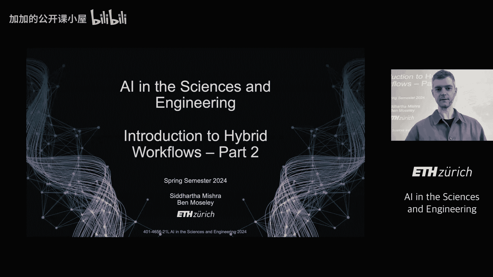
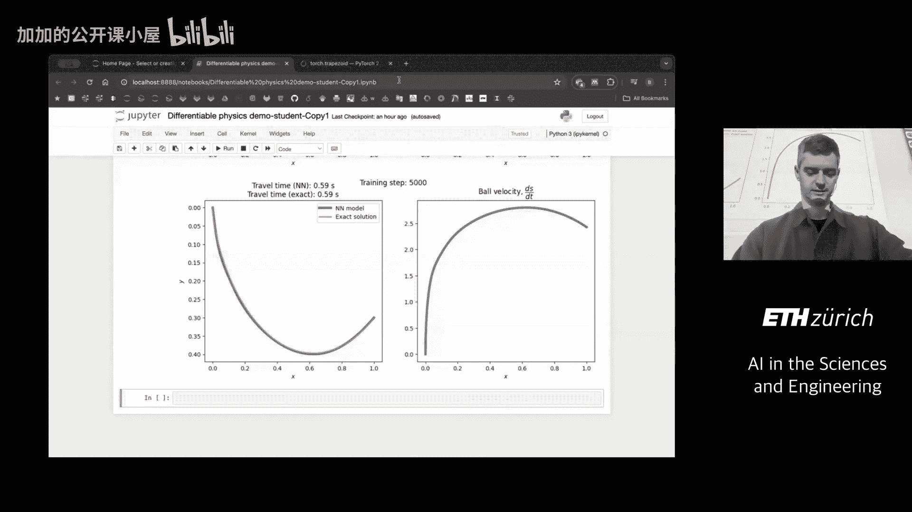
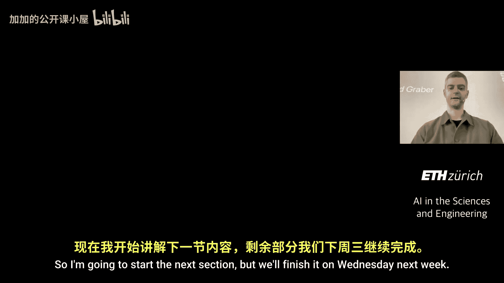
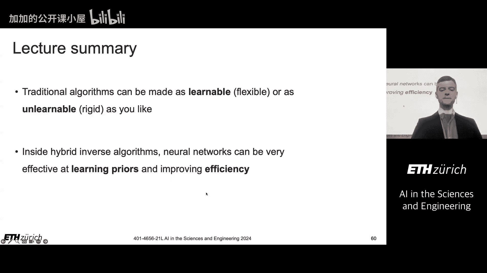

# 020：混合工作流导论（第二部分）

在本节课中，我们将继续学习混合工作流。我们将深入探讨自动微分（Autograd）的机制，并通过一个具体的物理问题（最速降线问题）的代码演示，展示如何将神经网络嵌入科学计算流程中。最后，我们将介绍一个更高级的混合工作流应用：解决计算机断层扫描（CT）中的逆问题。

## 自动微分（Autograd）回顾与深入

上一节我们介绍了混合工作流的基本概念。本节中，我们首先来回顾并完成关于自动微分的讨论。

在上一讲中，我未能完全讲完自动微分，因此我想继续解释并完成这一部分。

我在这里准备了一些回顾内容。周三我试图向你们展示或解释的是，我们编写的大多数科学程序虽然可能非常复杂，但可以简单地视为向量函数。程序通常接收许多参数，但这些参数通常只是向量、矩阵、标量等。其输出也类似，可能是标量、向量或张量。

因此，从数学上讲，我们可以将整个科学程序写为一系列向量函数的复合。我们输入一个向量 **x**，顺序应用许多函数，最终得到输出向量 **y**。

我们称这些中间函数为**原始函数**。即使在这个例子中（例如我们看过的混合斯托克斯求解器）包含许多复杂的矩阵求解等操作，我们也可以将其分解为最基本的操作，通常是乘法、除法、三角函数变换等。因此，这里的 **n** 通常是一个非常大的数字。

我在周三告诉你们的是，自动微分是通过深度学习库开发的一个超级强大的工具，它允许我们高效计算以下两个量：
*   **向量-雅可比积**：即 **v^T * J**，其中 **J** 是雅可比矩阵。
*   **雅可比-向量积**：即 **J * v**。

我真正想告诉你们的是，虽然我们开发自动微分主要是为了训练神经网络，但它在科学机器学习中如此强大的原因在于，我们也可以使用自动微分来对这些复杂的科学程序进行微分，从而开始学习这些程序中的组件。

例如，这是一个学习混合斯托克斯求解器的伪代码。这是一个用于进行流体模拟的传统数值求解器。但在求解器内部，我们有一个神经网络，它应用一些可学习的修正。为了训练那个神经网络，我们只需使用自动微分来获取某个损失函数相对于网络参数的梯度，并将网络参数视为这个科学程序的额外输入。

那么，这个 `torch.autograd.grad` 块在幕后做什么呢？它正在计算这个有效的雅可比积。在这种情况下，**dL/dθ** 不是一个完整的雅可比矩阵，因为 **L** 只是一个标量值。因此，这个量的向量-雅可比积只是一个数字乘以那个向量。

接着，我讨论了如何计算这些向量-雅可比积，即自动微分实际上是如何工作的，其背后的机制。我们得到向量-雅可比积的方法是利用链式法则将雅可比矩阵分解，从而得到所有这些中间原始操作的雅可比矩阵。

实际的算法工作方式非常简单。你从一个向量开始，然后在这里从左到右进行所谓的**反向模式微分**，应用许多向量-雅可比积。这些现在是这些原始操作的向量-雅可比积。

因此，要编写一个自动微分包或库，你需要做的首先是定义所有这些原始操作的前向传播路径。然后，我们需要定义如何应用向量-雅可比积，以便在反向传播通过计算图时迭代计算链式法则。

我谈到的另一个技巧是，我们通常不需要完全填充或显式计算这些雅可比矩阵。通常原始操作非常简单，它们的雅可比矩阵是稀疏的，我们可以利用这一点来设计一个高效的自动微分求解器。

这就是我讲到的地方，我在描述我们实际上如何进行自动微分实践。像 PyTorch、TensorFlow 和 JAX 这样的自动微分框架是这样工作的。

例如，让我们考虑通过一个神经网络层或两层进行微分或反向传播。你要做的第一件事是，当你在 PyTorch 或 TensorFlow 中定义这个函数并运行前向传播时，它会计算这些操作的有向图。你可以把这个函数看作一个有向图，其中所有中间元素都有线连接，取决于先前的哪些向量或张量计算了它们。

然后，正如我所说，这些包为我们应用的每个原始操作定义了高效的向量-雅可比积和雅可比-向量积版本。

然后，根据你是在计算向量-雅可比积（进行反向模式自动微分），还是在计算雅可比-向量积（进行前向模式自动微分），你通过这个图进行消息传递，以迭代计算整个函数的向量-雅可比积。

对于反向模式，它看起来是这样的：你从某个传入向量开始，记住我们是从左到右反向进行，所以我们只是进行一些消息传递，然后将该向量与 **dy/db** 和 **dy/dW2** 相乘，然后继续向后通过图，直到最终得到输出相对于第一个权重的梯度。

这是前向模式，完全相同，只是我们通过网络向前传播。我们再次从某个传入向量开始，然后当我们进行计算时，我们同时进行该计算的向量-雅可比积，就像这样，当我们通过计算的前向部分时更新这个向量。

我认为讨论关于自动微分内存需求的问题非常有趣。我有一个问题：有谁能回答，所需内存如何随着前向计算的深度而缩放？对于反向模式和前向模式，内存缩放方式是否不同？

让我再展示一下这些动画。当我们进行反向传播时，为了能够计算例如 **dy/dW**，我们需要知道之前 **y** 的值，因为那是雅可比矩阵的一部分。类似地，当我们向后通过图时，我们需要存储 **H**、**b** 和 **W1** 的值，以便能够向后通过图。

因此，要进行反向模式自动微分，我们需要在开始反向传播之前计算并存储图中所有的中间计算结果。这对大家来说有道理吗？那么，在这种情况下，内存如何随深度缩放呢？是的，所需的内存量取决于前向计算的深度，因此是线性相关的。

现在，如果我展示前向模式的图，有谁能告诉我内存有何不同？现在我们向前进行，我们从一个向量开始，进行第一组原始操作，更新向量-雅可比积，然后继续。在这种情况下我们需要多少内存？是的，我们不需要存储这些中间激活值，因为我们已经在向前传播的同时更新了乘积。

所以，一个并不总是被认识到但非常有趣的点是：当我们进行反向传播时，我们必须存储中间计算结果，并且这与深度线性相关；而当我们进行前向模式时，我们完全不需要依赖深度来存储中间值。这是一个非常有趣的差异，可以非常有效地利用，特别是当我们有非常长的计算函数时，根据你想要的梯度，有时前向模式可能比反向模式更好。

所以，我已经详细解释了自动微分是什么。但在实践中，你不需要担心这些东西，对吧？我们可以把这些交给 PyTorch 或 TensorFlow。这些深度学习库如此惊人的地方就在于，它们在幕后处理所有这些事情。在 PyTorch 中，这等价于调用 `loss.backward()`，它会为我们更新梯度。

如果你查看 `torch.autograd.grad` 的文档，你可以看到它做的正是我们一直在讨论的事情。它计算输出相对于输入的向量-雅可比积，而这里输出的 `grad` 就是我们在该计算中使用的向量。

希望现在你们能完全理解这个函数是如何工作的了。另外，关于自动微分是什么或不是什么，还有一些其他误解，现在你们应该明白了：自动微分绝对不是符号微分，它也不是在做有限差分。当我们运行自动微分时，我们得到的是精确梯度。它只是一种高效计算精确梯度的方法。

这个向量就是你应用的那个向量。当你进行这个向量-雅可比积时，它就是那个传入的消息。记住，回到第一张幻灯片。一般来说，我们有一个向量函数，然后自动微分得到向量-雅可比积。这可以给你一个向量输出。但实际上，当我们通常想要损失相对于 **θ** 的梯度时，你可以将其视为一个雅可比矩阵，但它只有一行，因为损失是一个标量值，对吧？单行的向量-雅可比积只是那个标量乘以该行。在 PyTorch 中调用 `loss.backward()` 时，我们总是选择那个标量为 1。通常我们甚至不指定它，因为它被假定为 1。

但是，如果你要微分的输出不是标量，而是一个向量，那么你需要定义一个实际的向量来计算向量-雅可比积。通常，当我们做 `loss.backward()` 时，它只是 1。在我们继续之前还有其他问题吗？

## 混合方法：动机与示例

好的。在上次讲座中，我介绍了混合方法。我说过，到目前为止，在整个课程中，我们主要专注于用神经网络替换我们的科学工作流，该神经网络通过损失函数或架构对科学理解有一些有趣的认识。

但现在我们真正关注这些混合方法，我们保留传统算法，而是将可学习组件非常紧密地放入这些算法中。我在上一讲中向你们展示了如何使用自动微分来端到端地训练这些可学习组件。

那么，我们为什么要这样做？为什么混合方法有用？正如我所说，深度神经网络当然有其优势，但它们也有一些很大的缺点，例如，它们需要大量难以优化的训练数据等。

因此，这些混合方法的关键思想是：我们为什么不直接将神经网络或某些可学习组件纳入我们的算法中，以加速工作流程，或者学习我们不了解的算法部分，或者也许允许我们学习尚未纳入程序的不完整物理知识？

我还向你们展示了这个混合纳维-斯托克斯求解器。我们研究了模拟流体，并意识到传统数值算法存在离散化误差问题。或者换句话说，这些模拟的精度强烈依赖于你使用的网格单元数量。因此，使用少量网格单元，我们会得到非常不准确的模拟。

因此，我们研究了这个混合方法，我们采用了低保真度求解器，但添加了一个可学习组件来尝试提高其精度。该可学习组件所做的只是将神经网络放入混合求解器的内部循环中。网络接收每个低保真度步骤，并尝试学习一个修正，使其看起来更像对应的高保真度步骤。

是的，这是混合求解器的伪代码，它在代码中间有一个神经网络，我们使用自动微分通过整个算法进行微分，端到端，使用一个损失函数，该函数将混合求解器的最终输出与一些真实的高保真度模拟进行匹配。

是的，这就是混合技术的关键思想。我们也称之为**可微分物理**，即使用自动微分进行微分和学习物理算法。希望现在你们能完全理解并领会这个关键思想。

## 实践混合方法：四步指南

那么，在实践中我们如何做到这一点？或者，你如何将其推广到任何你想学习的科学程序？这超级简单，这是我给许多想自己尝试混合方法的人的建议，基本上只需要四个步骤。

**第一步**是获取你的传统科学算法，并将其重写到一个自动微分框架中。这通常是最困难的步骤，根据你的传统代码，这可能需要很长时间。例如，考虑到高性能代码很多是用 Fortran 或 C++ 等编写的，因此这可能需要很多努力，但一旦完成，你会获得很大的收益。例如，PyTorch 或 JAX（我们将在接下来的讲座中介绍 JAX）。

**第二步**是打开这个算法，使其更加灵活。我的意思是在该算法中的某个地方放入可学习组件。例如，学习离散化数值求解器的修正，或者甚至更简单，可能只是学习单个标量值，比如时间步长值等。

**第三步**，获取一些训练数据，即你期望该算法输出的数据。这是你的真实世界数据进入实践的地方，我们需要从某种数据中学习这些算法。

**第四步**，使用自动微分训练你的算法。只需计算输出的损失函数，然后让自动微分为你获取梯度。

还有一个额外的好处。所有这些深度学习库都设计用于执行并行矩阵运算，它们在 GPU 上运行得更好。好处是，一旦你重写了传统工作流，它也将在 GPU 上运行，并且根据执行的计算类型，它可能比 CPU 实现快一个数量级，有时甚至更多。

是的，混合方法在传统算法中插入可学习组件，而自动微分不仅是混合方法的关键推动者，也是我谈到的所有其他科学机器学习方法的关键推动者。

## 实例演示：最速降线问题

现在我将继续讲解混合工作流的第二部分，这部分由两部分组成。

首先，我将进行一些实时编码，向你们展示在 PyTorch 中编写科学程序、通过它进行微分以及学习科学过程的某些方面是多么容易。

然后，我还有另一个混合工作流的例子，它更复杂，真正展示了混合建模的极限。这个工作流用于解决逆问题，即我们不进行前向模拟，而是尝试学习系统的一些底层参数。

如果这次讲座讲不完，我们将在下次讲座继续。希望到这部分结束时，你们应该能够使用代码自己在 PyTorch 中尝试混合方法，并理解高级混合方法。

那么，我要做的是切换到我的屏幕标签。我想确认一下 Zoom 里的人能看到我的 Jupyter 笔记本吗？好的，很好。你们可以看到这里，好的。

我们要做的是研究这个问题。以前谁见过这个问题？它被称为最速降线问题。好的，几乎所有人都见过。我猜它在网上出现很多，这是一个很好的交互式演示，可以用来教人们。

这是一个非常有趣的问题，即：如果一个球要通过沿斜坡滚下来从一点到达另一点，斜坡的形状应该是什么，才能使球在最短的时间内到达第二个位置？在我看来，这并不直观明显，比如应该是直线、非常陡峭的线还是中间的某种线。

长话短说，有一条特殊的曲线叫做**摆线**，就是这里的这个形状，它能让球最快到达那里。有一些非常漂亮的数学可以用来证明这一点或推导出那条曲线的形状。

但我们在这里要做的是，我们说，好吧，我们没有那条曲线的方程，我们只想尝试使用神经网络来近似那条线来学习它。

是的，问题再次出现：一条曲线是什么形状，使得一个从静止开始、受重力加速的球在无摩擦的情况下从一点滚到另一点所用的时间最少？

我们要做的是，我们说我们不知道这条曲线是什么，我们称之为 **y** 是 **x** 的函数，在这个二维设置中。我们让初始位置为原点，第二个位置为 **(x2, y2)**。

是的，我们的方法将是尝试用神经网络学习这个函数是什么。我们将说神经网络直接近似球行进的那条线。

那么我们如何训练这个网络？你将如何训练或尝试学习这样一个网络？答案就在那里。是的，没错。我们要最小化我们想要最小化的东西，即模拟的时间。这很重要，对吧？我们不会给网络提供线的示例。我们将最小化我们真正关心的另一个量，即从那条线计算出来的某个量。

这就是混合建模的来源。我们要做的是，给定一条线，我们将使用物理求解器计算球沿着那条线滚动所需的时间，然后通过该求解器进行微分来学习网络。你可以看到这个五步方法是如何设计的。

那么我们如何计算任意线的总行进时间？我们只需使用距离等于速度乘以时间，但我们需要进行积分，因为线不是直线。我不会详细讨论这个，但推导行进时间关于 **f(x)** 的一种方法就是使用能量守恒，代入并重新整理这个积分，最终得到行进时间就是这个积分，它取决于线的梯度、线本身以及重力常数。

因此，我们需要做的是能够在 PyTorch 中评估这个积分，给定网络的输出。以便能够计算行进时间，然后通过整个计算进行微分，以学习网络的权重。在我讨论代码之前，关于整体方法还有什么问题吗？我们使用的损失函数有意义吗？是的。损失函数是网络值和梯度的某种积分，这有意义吗？好的。

关于损失函数有几个有趣的地方：我们不仅需要线的值，还需要梯度，那么我们如何计算呢？自动微分，是的，实际上我们将使用两次自动微分：我们将使用自动微分来获取线的梯度，并且我们还将使用自动微分来获取假设的梯度。就像我们在物理信息神经网络中看到的那样，我们可以以组合方式使用自动微分，多次应用它，这非常强大。

是的，精确解，如果你感兴趣，可以在之后点击这个链接。有一个参数化解。我们将在得出结果时与之比较。

首先，我们将导入 torch，并定义一个摆线，以便与精确解进行比较。然后我想做的第一件事是定义这个表示球将要行进路径的灵活函数。

我们将使用一个神经网络。这条线直接由网络近似。因此，网络应将 X 坐标作为输入，并给我 Y 值作为输出，对吧？这就是它给我的线。

我有一个简单的全连接网络，它有一个输入（X 值）和一个输出（Y 值），带有多个层。现在在我的前向调用中，给定 X 值，它将返回 Y。

我在这里还做的是给前向调用 **x2** 和 **y2** 的值，这是球最终要到达的点。这只是为了归一化我的输入，记住我们必须确保为神经网络提供良好的归一化输入，所以这将帮助我归一化 X。

现在我要做一些比直接说 Y 等于 X 的神经网络更聪明的事情。实际上，我将使用一个残差模型。就像我们在混合方法中讨论的那样，如果我们对线应该是什么样子有假设，我们不必学习整个东西，我们可以只学习线的残差部分。

那么，一个好的初始猜测是什么？例如，如果我不知道这条线是什么，我可以说，好吧，让我们从一条直线开始，然后让网络学习对该直线的修正，也许这比学习整条线更容易。

因此，我们将线的假设表述为这样：我们将假设线是线性的，然后我们将以加法方式让网络学习一些残差修正。这其实很简单。首先，我们只计算我们的线性线会是什么。给定球从原点开始，它只是梯度乘以 x：**y = m*x + c**。这就是这里的线性部分。

然后我们需要计算网络将要学习的残差部分，即对线性线的修正。然后我们只需将 X 通过我们的神经网络。我在这里犯了一个错误。然后到最后，我们只需将线性模型加到网络输出值上。你可以看到我们是如何应用这种修正的。

我们需要做一些其他技巧来确保它快速收敛。首先，我要确保网络的输入是归一化的。目前，根据我定义的问题，x 的范围将从 0 到 x2。我们应该将神经网络的输入归一化到什么范围？是的，-1 到 1。所以我可以这样做：**x_norm = 2 * (x / x2) - 1**。现在你可以看到，当 x 从 0 到 x2 时，我已将其归一化到 -1 到 1。我认为只要数量级正确，一半也可以。

然后我要做的最后一件事是这个：我将最终输出乘以 **torch.tanh(x) * torch.tanh(x - x2)**。有谁能猜出这是做什么的？为什么这是一件有用的事情？为什么这有意义？我取网络的残差预测，并将其乘以 **tanh(x)** 和 **tanh(x - x2)**。为什么不呢？

好的，这样做是为了断言我们问题的条件，对吧？我们知道球必须通过 (0,0)，并且必须结束于 (y2, x2)。我们设计了我们的线性线，记住，我们说线是线性线加上神经网络修正。我们已经设计了线性线，使其通过 (0,0) 和 (x2, y2)，只需使用这个线性线方程。那么网络在起点和终点需要添加什么值？零，是的。那么这在 **x = x2** 和 **x = 0** 时做什么呢？是的，更准确地说，它只是说，无论网络在 **x = x2** 时的输出是什么，这个因子都将是 0，在 **x = 0** 时，这也将是 0。所以它将强制这个残差修正需要为零。很好的发现，谢谢。

让我接受这个，我认为除了这里都很好。好的，我们创建了那个。

现在我们要做的是训练网络。我在这里设置的是一个简单的 PyTorch 训练循环，就像你们之前说的那样。创建模型，我们有 8 个隐藏状态和 2 层，所以这是一个非常小的网络。我们创建一个 Adam 优化器来训练网络，这都是标准的东西。

现在我们需要做的就是计算行进时间，因为记住，我们将最小化行进时间相对于网络的权重，以尝试学习这条曲线。所以我们必须想出一种方法来计算这个积分。那么我们如何评估一个积分？我们如何数值计算这个？有谁有什么想法吗？是的，求积法。是的，我们需要离散化它以便计算。我可以使用梯形法则，这是一个更简单的方法，当然你也可以用更好的方法。

我这里要做的是，我们将在整个范围内采样 x 以计算那个积分，我们需要采样许多 x 值。所以我们将对 x 进行线性采样。然后我们将计算模型的输出，这是整条线的预测。

这里我们需要做的是计算行进时间。我需要的第一个东西是 **dy/dx**，也就是 `torch.autograd.grad`。所以是 y 和 x，然后我们需要雅可比积的因子，所以我们将对 x 使用 `ones_like`。我必须获取该输出的第零个输出。

这就是我们使用自动微分在时间值中获取 **dy/dx** 的地方。一旦我们得到了这个，我们就需要计算我们正在积分的函数。我将写这个平方根。我们将说 **f = torch.sqrt((1 + (dy/dx)**2) / (2 * g * y))**，像这样。然后我们将使用梯形法则进行积分，或者基本上将 X 的值相加。在这种情况下解析的？是的，很可能，如果你能解析地写出它，那当然更好。否则，求积法、蒙特卡洛采样或其他方法，还有其他计算方式。

好的，我们将使用梯形法则。torch 有一个叫做 `torch.trapezoid` 的函数，这使得它超级简单。它只计算梯形法则，所以它将用这些点来近似那个积分。我只需要做 **t = torch.trapezoid(f, x, dim=0)**。我认为这差不多就是全部了，剩下的只是调用 `t.backward()`，进行反向传播以获取网络的梯度，然后我们进行优化器步骤，我们在循环中这样做，然后我们将绘制学习过程中的曲线。

我漏掉了一件事，那就是我们需要创建图，以便我们也可以微分那个梯度图。看看它是否运行。我认为运行得不错，好的。我这里有两个图。一个是整条线的预测，这是线性模型加上神经网络修正。这非常有趣，这是在我们进行任何训练步骤之前。所以你可以看到，它看起来像一个线性模型，这就是为什么我们将线性模型作为初始猜测。这里有一个小凸起，所以也许网络从其随机初始化中做了一点修正。而且它通过了那两个点，所以我们做了这些硬边界约束，这非常好，所以无论网络学到什么，它总是会通过这两个点。

橙色曲线是摆线，这是精确解。然后你还可以绘制球行进时的速度，看起来很有趣。是的，当我们优化网络时，我们减少了它所花费的行进时间，这是我们正在优化的东西，我们开始越来越接近这个精确解。

就是这样，这是一个在物理工作流中使用神经网络的例子，一个计算行进时间的工作流，并通过整个工作流进行微分以学习该程序的一个组件。

是的，概括来说。是的，我认为我们应该测试一下，这可能取决于拉格朗日量，但有趣的是，如果你编写一个通用代码，可以接受任何拉格朗日量作为输入。顺便说一下，有一些叫做哈密顿神经网络的东西，它们试图学习哈密顿量，这是一个完全不同的主题，但人们也在尝试在这种更高层次的抽象上学习，我认为这些技术非常有趣。

还有其他问题吗？好的。

## 高级混合工作流：解决逆问题

我们还剩五分钟，所以我要开始下一部分，但如果没有讲完，我们将在下周三继续。

我们要做的是描述最后一个混合方法，可能是我要告诉你们的最先进的混合方法。我们将设计一个混合算法来解决这个问题，这是计算机断层扫描。谁以前见过这个？或者这种一般性问题？好的。

这是一个逆问题，目标是，计算机断层扫描用于医学诊断，可能每个人一生中都做过 X 光扫描。当我们看到扫描图像时，是这些图像，但这实际上不是仪器在你进行 X 光扫描时记录的东西。

仪器实际记录的是这些称为**正弦图**的东西，这些非常有趣的波浪状图像。那么 X 光或计算机断层扫描中实际发生了什么？你有一些介质，例如某人的头部或身体的其他部位，你有一个 X 射线源，你可以将其视为一个点源。这些 X 射线沿着介质的直线传播，最终在某个屏幕上被检测到。我们实际检测到的是 X 射线穿过整个介质后在屏幕上的强度。

这个正弦图显示的就是沿这个轴的强度。我们在实验中做的另一件事是旋转介质，并记录强度随旋转的变化，所以这是这个图像的另一个维度，即旋转角度。这个小图展示了如果你记录通过该介质的强度，你会得到什么。

我们记录的强度是变化的，它只取决于介质本身的吸收。你可以认为大脑的每个部分对 X 射线的吸收不同。我们最终想要得到的是这个吸收图像，所以这个吸收是 x 和 y 的函数。我们可以利用我们对物理的理解用数学来写这个，我们知道强度实际上只是吸收函数或吸收图像沿 X 射线行进路径的简单积分，即线积分。

这个问题以及我们想要如何解决它，从这些观测数据到我们想要的实际底层图像，有意义吗？好的。

是的，这就是逆问题，正如我所描述的，前向问题只是跨所有这些线和角度对图像进行积分。但逆问题是，给定一些观测到的正弦图，我们能否回到图像？这并不总是容易的，事实上很多时候非常困难。

是的，我在第一讲中谈到了这种高级框架，我说，许多问题都可以归结为这样：我们有一个物理系统，有一些输入/初始条件，我们有一个该系统的前向模型，然后我们得到一些结果属性/速度。

逆问题是给定 **B** 来确定 **A** 是什么或找出 **A** 是什么。我将告诉你们我们传统上如何做到这一点，然后在下次讲座中讨论混合方法。

传统上，我们通常将逆问题框架化为优化问题，从根本上说是一个搜索问题。给定 **B**，我们想要找到可能的 **A** 值，使得 **F(A)** 接近 **B**。

我们可以将其写为一个优化问题，只是一个最小化问题，我们尝试猜测 **A** 是什么，对系统进行一些前向模拟，并尝试使其与观测数据匹配。这是一个目标函数或损失函数，我们可以像训练神经网络一样使用梯度下降来学习 **A**，获取这个损失函数相对于 **A** 的梯度，然后进行梯度下降步骤来学习 **A**。

这要求我们的前向模型（即如果我给你一个图像，你有一个产生正弦图的算法，执行 X 射线的前向模拟）必须是可微分的，以便我们可以通过 **F** 进行微分，以获取损失函数相对于 **A** 的梯度。

我们将使用自动微分通过我们的前向求解器进行微分，就像我们之前做的那样，就像我之前描述的那样。到目前为止大家都跟得上吗？好的。

让我把它画成一个图表，这是同样的事情，梯度下降画成图表。我们从图像的某个初始猜测开始，然后使用简单的前向模拟进行前向建模，然后我们有一些从实验中观察到的真实数据，在我进行 X 光之后，这是我们实际接收到的数据。然后我们创建损失函数，将我们的预测图像与真实数据匹配，然后我们获取损失函数相对于图像的梯度，然后更新图像。

我们这样做数百次，也许数千次，最终得到一些最终模型。我认为我就停在这里，我们将在下次讲座中讨论如何改进这个工作流并学习其中的某些东西。

是的，也许这个标签有点多余，它只是模拟的输出。是的，你可以只有这个框。好的。谢谢大家，下周三见。