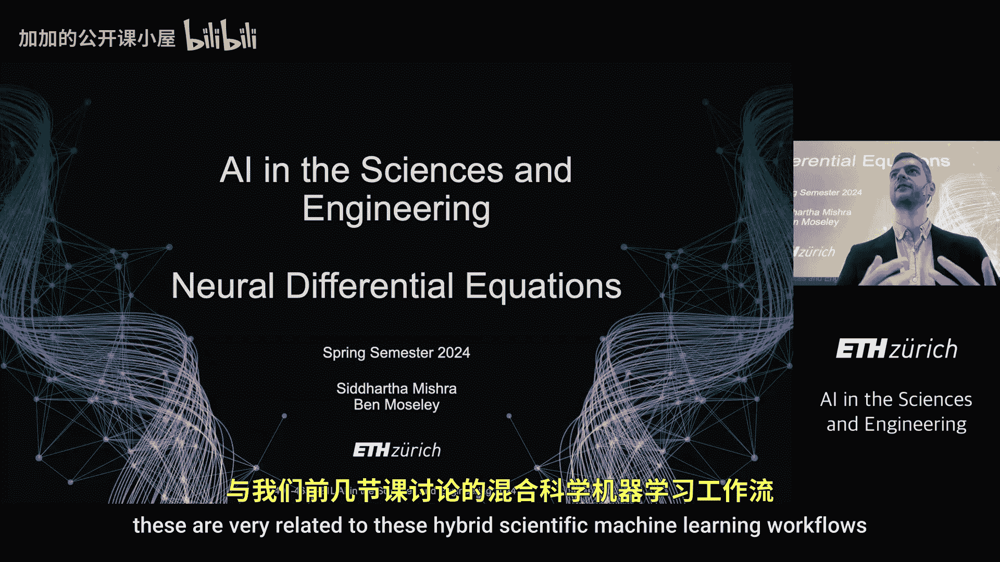
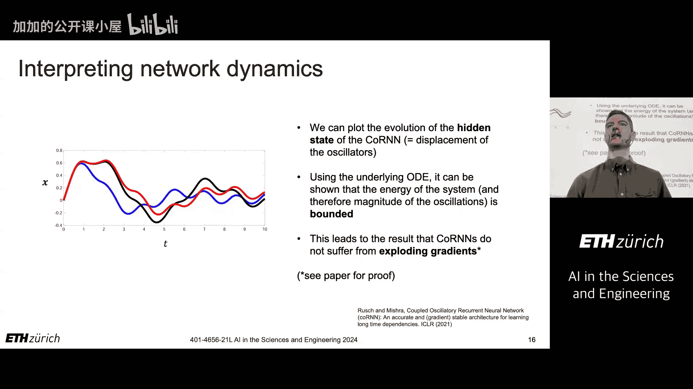

# 021：神经微分方程



在本节课中，我们将要学习神经微分方程。这是一个在科学机器学习领域非常流行的方向。其核心思想是将神经网络融入传统的科学工作流程中。你会发现，这与我们在前几节课中讨论的混合科学机器学习工作流密切相关。

## 什么是神经微分方程？

首先，我们来定义什么是神经微分方程。神经微分方程是指微分方程（可以是常微分方程或偏微分方程）中的某些项由神经网络表示。

例如，考虑一个经典的捕食者-猎物模型——洛特卡-沃尔泰拉系统。其常微分方程如下：

```
dx/dt = αx - βxy
dy/dt = δxy - γy
```

其中，`x` 和 `y` 分别代表猎物和捕食者的种群数量。传统上，系数 `α`、`β`、`δ`、`γ` 是固定的。然而，这个模型包含了许多假设（例如，捕食者完全依赖猎物生存），可能无法反映真实的生物系统。

神经微分方程的思路是：我们并不完全确定方程右侧的函数形式。因此，我们可以用可学习的神经网络来替代其中某些项。例如，我们可以将方程改写为：

```
dx/dt = f_θ(x, y)
dy/dt = g_φ(x, y)
```

其中，`f_θ` 和 `g_φ` 是神经网络，`θ` 和 `φ` 是它们的参数。这样，整个微分方程系统就变成了一个神经微分方程。

## 如何求解与训练神经微分方程？

上一节我们介绍了神经微分方程的概念，本节中我们来看看如何数值求解并训练它们。

### 数值求解

即使方程中包含了神经网络，我们仍然可以使用传统的数值方法来求解。以最简单的欧拉方法为例。对于常微分方程 `du/dt = f(u, t)`，其离散化形式为：

```
u_{n+1} = u_n + Δt * f(u_n, t_n)
```

当 `f` 是一个神经网络时，求解过程完全一样：在每个时间步，我们调用神经网络来计算 `f(u_n, t_n)`，然后更新状态 `u`。从代码角度看，这只是一个在循环中调用神经网络的前向传播过程。

### 训练方法

训练神经微分方程需要数据。假设我们有一些系统状态随时间变化的观测数据。训练的目标是调整神经网络的参数，使得微分方程数值解的输出与观测数据相匹配。

因此，我们可以定义一个简单的损失函数，例如均方误差：

```
Loss = Σ ||u_pred(t_i) - u_obs(t_i)||^2
```

其中，`u_pred(t_i)` 是神经微分方程求解器在时间 `t_i` 的预测输出，`u_obs(t_i)` 是观测数据。

关键之处在于，我们可以使用自动微分技术，通过求解器反向传播梯度来更新神经网络的参数。这使得训练包含复杂数值求解过程的模型成为可能。

## 神经微分方程与神经网络架构的深刻联系

我们已经了解了神经微分方程的基本概念和训练方法。现在，让我们探讨一个非常深刻的见解：神经微分方程的解算器与标准的神经网络架构之间存在直接对应关系。

考虑使用欧拉方法求解神经常微分方程 `du/dt = f_θ(u)`。其单步更新公式为：

```
u_{n+1} = u_n + Δt * f_θ(u_n)
```

如果我们忽略时间步长 `Δt`（可以将其吸收到网络参数中），这个公式变成了：

```
u_{n+1} = u_n + f_θ(u_n)
```

这正是残差网络（ResNet）中一个残差块的计算形式！其中，`u_n` 是当前层的激活值，`f_θ` 是一个神经网络层（如全连接层或卷积层）。

因此，**一个使用欧拉方法求解的神经常微分方程，等价于一个深度残差网络**。更一般地说，不同的数值求解器（如龙格-库塔法）对应着不同的、更复杂的神经网络架构。

这种联系是双向的：
1.  **从微分方程到网络设计**：我们可以利用对微分方程性质（如稳定性、收敛性）的理解，来设计具有优良特性的神经网络架构。
2.  **从网络到微分方程**：我们可以将成功的网络架构（如Transformer）解释为某种微分方程的离散化，从而用新的视角理解其工作原理。

## 应用示例：耦合振荡器RNN用于人类活动识别

上一节我们建立了微分方程与神经网络的理论联系，本节中我们来看一个具体的应用案例：使用神经微分方程设计一个用于时间序列分类的递归神经网络。

### 任务背景

人类活动识别任务要求根据智能手表加速度计记录的时序数据 `(a_x, a_y, a_z)(t)`，判断人的活动类型（如走路、上楼）。

处理时序数据的经典方法是递归神经网络。一个标准的RNN单元按以下方式更新隐藏状态 `h_t`：

```
h_{t+1} = σ( W * [h_t, input_t] + b )
```

其中 `σ` 是激活函数。但选择何种内部结构（如简单RNN、LSTM、GRU）通常依赖于经验和调优。

### 基于物理的架构设计

我们观察到人体运动（如走路）具有振荡特性。因此，我们可以尝试用一个**耦合阻尼谐振子**的微分方程来构建RNN单元，将物理直觉融入架构设计。

耦合谐振子系统方程可以写为（经过一些简化和非线性化）：

```
M * d²x/dt² + C * dx/dt + K * x = F_ext
```

将其转化为一阶系统并离散化（例如用欧拉法），我们可以得到一个更新公式，用于计算下一时间步的位置 `x` 和速度 `v`。

以下是该更新计算的关键特性：
*   `x` 和 `v` 共同构成了RNN的**隐藏状态** `h_t = [x, v]`。
*   外部驱动力 `F_ext` 对应于RNN的**输入** `input_t`（即当前时刻的加速度）。
*   方程中的质量 `M`、阻尼 `C`、刚度 `K` 等矩阵成为了可学习的**权重参数**。

这样，我们就得到了一个名为“耦合振荡器RNN”（coRNN）的定制化RNN单元。它的设计受到了物理系统的启发。

### 优势与性能

这种基于微分方程设计的架构具有一些理论优势：
*   **可控的动力学**：谐振子系统具有能量守恒或耗散的特性，这有助于防止RNN训练中常见的梯度爆炸或消失问题。
*   **可解释性**：隐藏状态 `[x, v]` 具有明确的物理意义（位移和速度），其演化过程可以直观理解为振荡过程。

在人类活动识别等时序分类任务上，coRNN展示了与LSTM、GRU等先进模型相媲美的性能。这表明，将领域知识（如系统的振荡特性）通过微分方程的形式编码到神经网络架构中，是一种有效且具有解释性的模型设计方法。

## 总结

本节课中我们一起学习了神经微分方程的核心内容。

我们首先定义了神经微分方程，即用神经网络表示微分方程中的未知部分。接着，我们讲解了如何使用数值方法求解神经微分方程，并利用自动微分和观测数据来训练它们。

随后，我们探讨了神经微分方程与深度学习架构之间深刻的理论联系，认识到残差网络等结构本质上是特定微分方程求解器的离散化形式。这一桥梁使得我们可以利用微分方程理论来设计网络，或通过网络理解微分方程。

最后，我们通过“耦合振荡器RNN”的案例，展示了如何将物理知识（谐振子方程）转化为一个新颖的、用于时间序列分类的递归神经网络单元，并取得了良好的效果。



神经微分方程巧妙地将物理建模的严谨性与神经网络的灵活性结合在一起，为科学机器学习和可解释的AI模型设计提供了强大的工具。