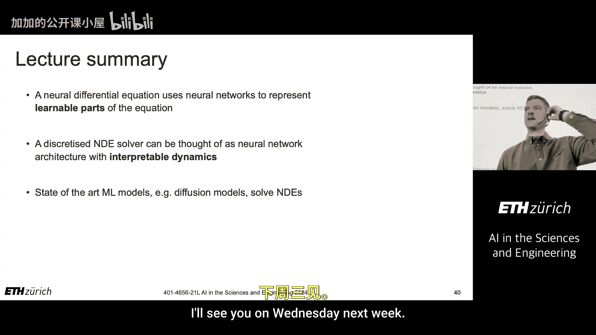

# 022：扩散模型入门 🧠

在本节课中，我们将要学习扩散模型的基本概念。扩散模型是目前最先进的图像生成模型之一，例如DALL-E和Stable Diffusion。我们将探讨扩散的物理和数学定义，理解其如何与神经微分方程相关联，并学习如何训练一个扩散模型来生成图像。最后，我们将看到一个扩散模型如何被应用于解决科学问题，例如计算机断层扫描（CT）图像重建。

---

## 扩散模型的基本概念 🌪️

上一节我们介绍了神经微分方程及其与神经网络架构的联系。本节中，我们来看看什么是扩散模型。

扩散是粒子从高浓度区域向低浓度区域的随机运动过程。例如，气体粒子在容器中随机碰撞并扩散到更大的空间。在图像处理中，我们可以将每个像素值视为一个“粒子”，通过向其添加高斯噪声来模拟扩散过程。这意味着，从任何一张图像开始，经过足够长时间的噪声添加，最终都会得到一个简单的分布（通常是高斯分布）。

---

## 扩散的数学描述 📐

为了更精确地描述应用于图像的扩散过程，我们需要使用概率分布和随机微分方程。

我们从一个数据分布 \( P_0(x) \) 中采样得到初始图像 \( x_0 \)。通过一个扩散过程，我们最终得到一个简单的先验分布 \( P_T(x) \)，例如高斯分布。这个过程可以用一个随机微分方程来描述：

\[
dx = f(x, t) dt + g(t) dW
\]

其中：
*   \( dx \) 是像素值的微小变化。
*   \( f(x, t) \) 是漂移函数，描述确定性变化。
*   \( g(t) \) 是扩散函数，控制噪声的强度。
*   \( dW \) 是维纳过程，代表每一步添加的高斯噪声。

---

## 逆向过程与图像生成 🔄

一个非常了不起的数学结果表明，存在一个对应的逆向随机微分方程。如果我们从先验分布（噪声）中采样，并沿着时间反向求解这个方程，就可以得到一个来自原始数据分布 \( P_0(x) \) 的图像样本。

更进一步的发现是，还存在一个对应的**常微分方程**。求解这个逆向ODE同样可以从噪声生成图像，并且这个过程是**确定性的**。其形式如下：

\[
dx = \left[ f(x, t) - \frac{1}{2} g(t)^2 \nabla_x \log p_t(x) \right] dt
\]

这个方程与逆向SDE相似，但少了随机项。其中，\( \nabla_x \log p_t(x) \) 被称为**分数函数**，它是概率分布对数关于 \( x \) 的梯度。

---

## 训练扩散模型：学习分数函数 🎯

上一节我们看到了逆向生成过程依赖于分数函数 \( \nabla_x \log p_t(x) \)。然而，这个函数非常复杂，我们无法直接获得。

因此，训练扩散模型的核心目标就是：**使用一个神经网络 \( s_\theta(x, t) \) 来近似这个分数函数**。网络的输入是带噪图像 \( x_t \) 和时间步 \( t \)，输出是一个与 \( x_t \) 维度相同的“图像”，即估计的分数。

那么，如何训练这个网络呢？以下是训练一个扩散模型的关键步骤：

1.  **收集数据**：获取大量你想要建模的图像（例如自然图像、医学图像）。
2.  **定义前向过程**：选择一个具体的SDE形式来描述扩散过程，并推导出其转移概率 \( p(x_t | x_0) \)。
3.  **定义损失函数**：一个常用且有效的损失函数是去噪分数匹配。经过推导，它可以简化为一个非常直观的形式：让网络预测添加到图像上的噪声。
4.  **训练网络**：通过最小化损失函数来优化神经网络的参数 \( \theta \)。
5.  **生成图像**：训练完成后，从先验分布（如高斯分布）中采样一个随机噪声图像，然后使用训练好的分数网络 \( s_\theta(x, t) \)，通过求解逆向ODE或SDE来生成新图像。

---

## 扩散模型在科学中的应用：CT图像重建 🏥

扩散模型不仅是强大的生成工具，还能用于解决科学中的逆问题。我们以CT图像重建为例。

在CT扫描中，我们观测到的是正弦图数据，目标是重建出内部的吸收图像。传统的逆问题求解方法可能面临不适定性或需要强先验。

一种新颖的方法是将预训练的扩散模型作为**图像先验**。具体流程如下：

1.  在大量CT图像上训练一个无条件扩散模型，使其学会生成逼真的CT图像。
2.  在生成（推理）阶段，我们不仅进行逆向扩散去噪，还在每个时间步**穿插一个优化步骤**。
3.  这个优化步骤计算当前中间图像 \( x_t \) 对应的**预期正弦图**与**实际观测数据**之间的误差梯度，并用它来“微调” \( x_t \)，使其更符合观测数据。

这样，生成过程同时受到两个力的引导：一是扩散模型将其拉向逼真的CT图像分布（先验），二是数据一致性项将其推向阳满足观测结果。这种方法将生成模型与传统优化巧妙地结合在一起。

---

## 总结 📝

本节课中我们一起学习了扩散模型的核心思想。我们从扩散的物理概念出发，理解了其数学描述——随机微分方程。我们看到了如何通过学习和求解逆向过程（无论是SDE还是ODE）来从噪声生成图像，其关键在于用神经网络近似分数函数。最后，我们探讨了扩散模型如何超越单纯的生成任务，通过引入数据一致性约束，应用于像CT重建这样的科学逆问题，展示了其强大的灵活性和潜力。扩散模型建立了与神经微分方程的深刻联系，是当前人工智能在科学与工程应用中的一个重要前沿。