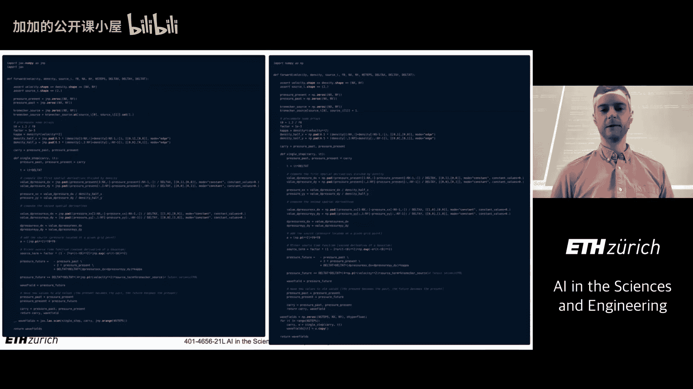
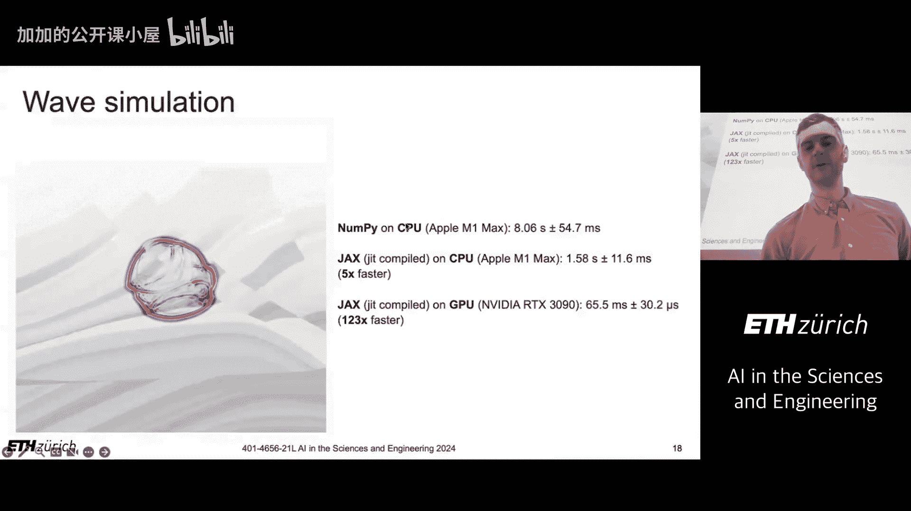
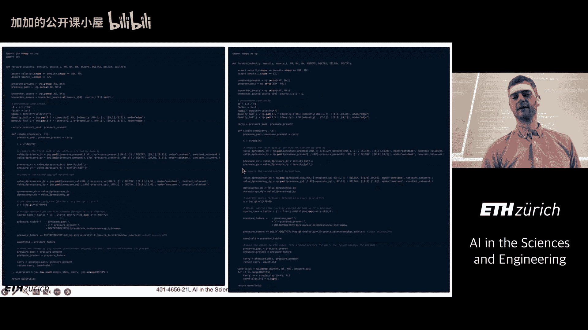
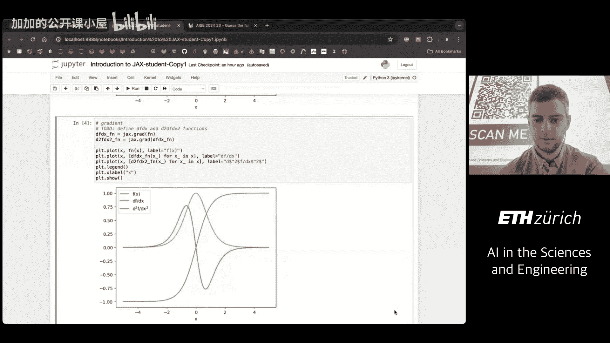
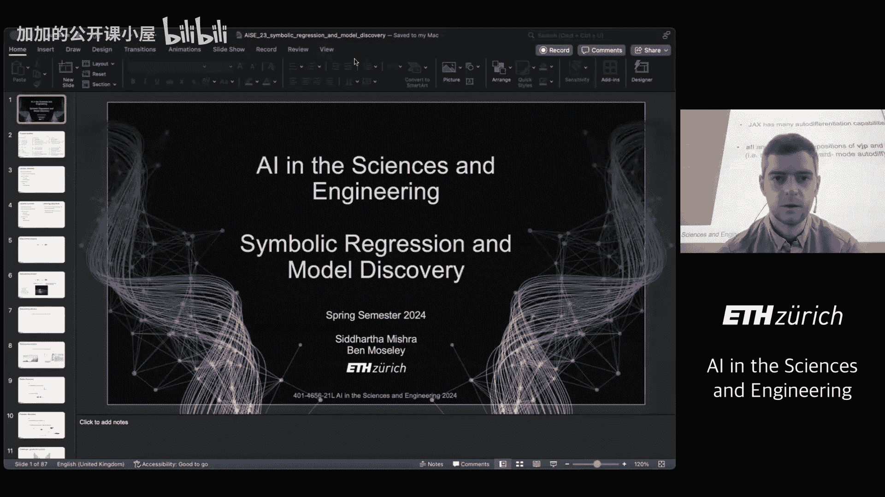
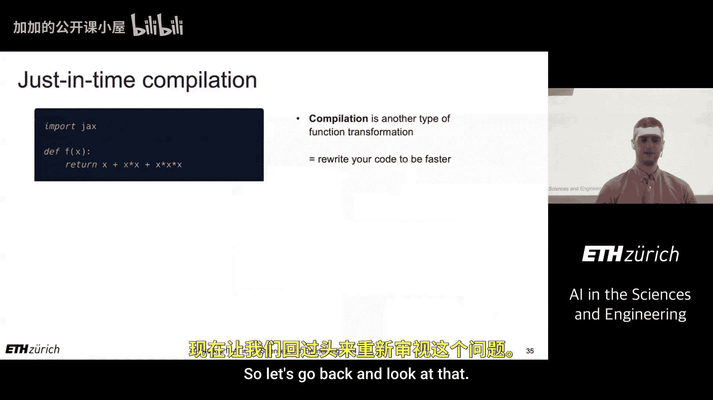
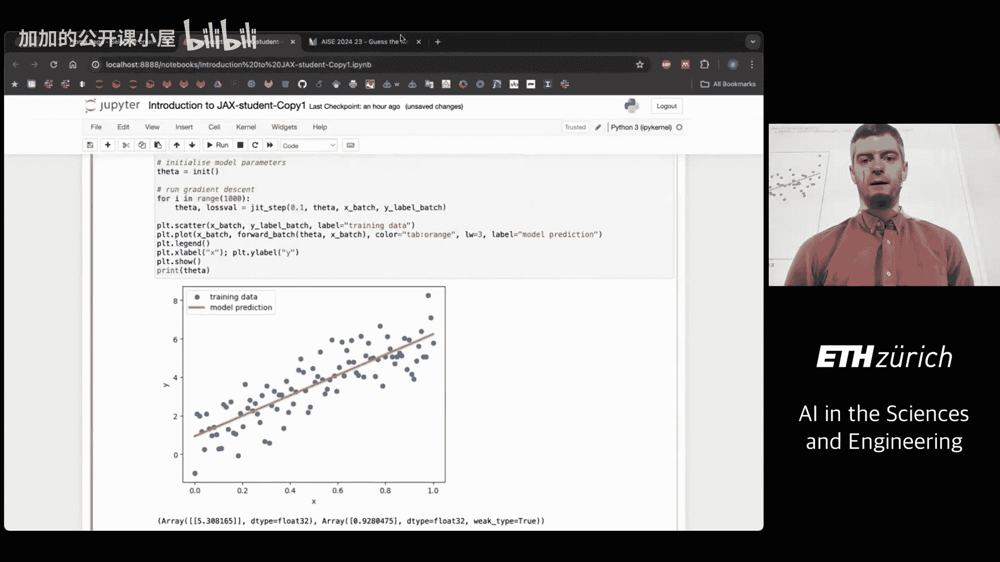
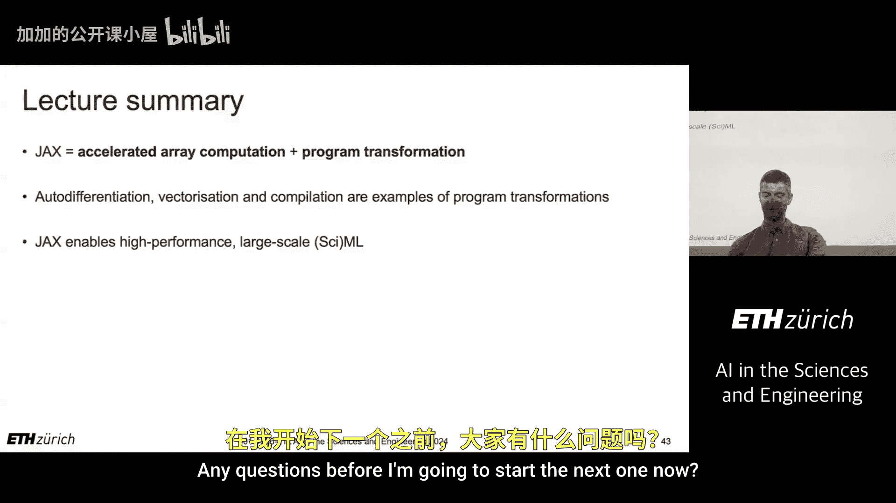

# 023：JAX 入门教程 🚀


在本节课中，我们将要学习 JAX，一个用于科学计算和机器学习的 Python 库。我们将了解其核心概念、功能，以及它如何通过加速数组计算和强大的程序变换能力，帮助我们高效地构建和训练科学机器学习模型。

---

## 什么是 JAX？🤔

JAX 是一个 Python 库，它主要做两件事：
1.  **加速数组计算**：它允许在 GPU 和 TPU 等加速器上高效执行线性代数运算，充分利用现代硬件的并行能力。
2.  **程序变换**：这是 JAX 设计的核心。它可以将一个 Python 函数变换成另一个具有新功能的函数，例如自动求导或向量化。

这两个特性结合在一起，使得 JAX 非常适合构建高性能、可扩展的科学机器学习算法，甚至是传统的科学计算任务。

---

## 为什么选择 JAX？💡

JAX 已被用于构建一些最大规模的机器学习模型和前沿的科学计算项目，例如：
*   **Gemini**：谷歌的大型语言模型，使用 JAX 在数千个 GPU 上进行训练。
*   **AlphaGo**：DeepMind 的围棋算法，其底层实现使用了 JAX。
*   **AlphaFold**：用于预测蛋白质三维结构的模型。
*   **Brax**：用于机器人强化学习的刚体模拟库。
*   **气候模拟**：使用 JAX 在 16 个 A100 GPU 上 24 小时内完成海洋表面流速的大规模模拟。

这些例子展示了 JAX 在解决大规模、高性能计算问题方面的强大能力。

---

## 加速数组计算 ⚡

JAX 可以简单地看作是“运行在 GPU 上的 NumPy”。其核心模块 `jax.numpy` 的语法与 NumPy 几乎完全相同，但代码可以自动在 GPU 上运行。

### CPU 与 GPU 的差异

为什么 GPU 上的矩阵乘法比 CPU 快得多？
*   **CPU**：拥有少量（如 16 或 32 个）但非常强大的核心，擅长**串行计算**（顺序执行任务）。
*   **GPU**：拥有数千个较小的核心，专为**并行计算**设计，非常适合同时处理大量相同的简单运算（如矩阵元素相乘）。


深度学习中的大部分计算（如矩阵运算）都是高度并行的，因此 GPU 能极大地加速这些任务。

### 实际案例：波动方程模拟

考虑一个使用有限差分法模拟波动方程的科学计算代码。原始的 NumPy 实现涉及大量的数组操作。

通过 JAX 加速，我们只需：
1.  将 `import numpy as np` 替换为 `import jax.numpy as jnp`。
2.  使用 JAX 的 `jax.lax.scan` 等原语替代 Python 原生的 `for` 循环，以便更好地编译。







性能对比结果如下（在同一台设备上）：
*   **优化后的 NumPy (CPU)**：8 秒
*   **JAX 编译后 (CPU)**：1.5 秒 （提速约 5 倍）
*   **JAX 编译后 (GPU)**：0.065 秒 （提速约 123 倍）

这个例子表明，即使是纯粹的数值模拟，JAX 也能通过 GPU 并行和编译优化带来巨大的性能提升。

---

## 程序变换：JAX 的核心魔法 ✨

上一节我们介绍了 JAX 如何加速数组计算。本节中，我们来看看其更强大的特性：程序变换。这是 JAX 区别于其他库（如 PyTorch）的关键。

### 什么是程序变换？

程序变换是指**将一个函数作为输入，并返回一个新函数**的操作。这个新函数实现了原始函数的某种变换。

一个最经典的例子是自动求导（`grad`）。

**定义原始函数**：
```python
def f(x):
    return x ** 2  # 计算 x 的平方
```
**应用 `grad` 变换**：
```python
from jax import grad
grad_f = grad(f)  # grad_f 是一个新函数
```
现在，`grad_f(x)` 不再计算 `x**2`，而是计算其梯度 `2*x`。你可以像调用普通函数一样在任何点 `x` 上调用 `grad_f` 来获取该点的梯度。

### 与 PyTorch 的差异

在 PyTorch 中，你通常需要：
1.  设置张量 `x` 并指定 `requires_grad=True`。
2.  执行计算 `y = f(x)`。
3.  调用 `y.backward()` 来计算梯度，梯度会存储在 `x.grad` 中。

PyTorch 的自动微分与特定的计算图和张量值绑定。而 JAX 的 `grad` 变换直接给你一个**可以随处调用的梯度函数**，这在概念上更清晰，也更容易组合。

### 变换的底层原理

JAX 通过以下步骤实现变换：
1.  将 Python 函数转换为一个中间表示（JAXPR），这是一种更底层的函数描述。
2.  将变换规则（如求导规则）应用到这个中间表示上。
3.  生成一个新的、变换后的函数（及其新的中间表示）。





这本质上是一种“元编程”：程序能够生成新的程序。


### 变换的组合

JAX 的强大之处在于，这些程序变换可以**任意组合**。例如，你可以对梯度函数再次求导，以获得二阶导数（Hessian）。
```python
from jax import grad
grad_f = grad(f)      # 一阶导数函数：2*x
grad_grad_f = grad(grad_f) # 二阶导数函数：2
```

---

## 其他重要的程序变换 🛠️

除了 `grad`，JAX 还提供了其他强大的变换，它们共同构成了其灵活性的基础。

### 向量化变换 (`vmap`)

`vmap`（向量化映射）用于**自动并行化**一个函数。假设你有一个处理单个样本的函数，但你想批量处理许多样本。

**定义处理单个样本的函数**：
```python
def layer(w, b, x):
    # w: 权重矩阵， b: 偏置向量， x: 单个输入向量
    return jnp.dot(w, x) + b
```
**使用 `vmap` 进行向量化**：
```python
from jax import vmap
# 指定对 `x` 的第0轴进行批处理，其他参数不变
batched_layer = vmap(layer, in_axes=(None, None, 0))
```
现在，`batched_layer` 可以接受一个批量的 `x`（形状为 `[batch_size, ...]`），并返回批量的输出。JAX 会自动将其重写为高效的矩阵运算，而不是低效的 Python 循环。




### 即时编译 (`jit`)

`jit`（即时编译）将你的函数编译成针对目标硬件（CPU/GPU/TPU）高度优化的版本，通常能显著提升运行速度。

**编译带来的优化**：
*   **内核融合**：将多个连续的小操作融合成一个大的操作，减少内存读写开销。
*   **其他优化**：利用 XLA（加速线性代数）编译器进行各种底层优化。

**使用方式**：
```python
from jax import jit
compiled_func = jit(my_slow_function)
result = compiled_func(my_input) # 第一次调用会编译，后续调用极快
```
**注意**：编译有初始开销，因此通常只对需要反复调用的函数（如神经网络训练循环中的梯度更新步骤）使用 `jit`。

---

## 综合示例：使用 JAX 进行线性回归 📈

现在，让我们将学到的所有概念——`grad`、`vmap`、`jit`——组合起来，解决一个简单的线性回归问题。

我们的目标是拟合一条直线 `y = w*x + b` 到一组数据点。

**步骤 1：定义模型和损失函数**
```python
import jax
import jax.numpy as jnp

# 1. 前向模型（单样本）
def forward(w, b, x):
    return w * x + b

# 2. 使用 vmap 对模型进行批处理
batched_forward = jax.vmap(forward, in_axes=(None, None, 0))

# 3. 损失函数（均方误差）
def loss(params, x_batch, y_batch):
    w, b = params
    y_pred = batched_forward(w, b, x_batch)
    return jnp.mean((y_pred - y_batch) ** 2)
```

**步骤 2：获取梯度函数**
```python
# 4. 获取损失函数关于参数 (w, b) 的梯度函数
grad_loss = jax.grad(loss)
# value_and_grad 可以同时返回损失值和梯度
loss_and_grad = jax.value_and_grad(loss)
```

**步骤 3：定义梯度下降更新步骤并编译**
```python
# 5. 定义单次梯度下降更新函数
def update_step(params, x_batch, y_batch, lr):
    current_loss, grads = loss_and_grad(params, x_batch, y_batch)
    # 使用树映射更新参数元组 (w, b)
    new_params = jax.tree_map(lambda p, g: p - lr * g, params, grads)
    return new_params, current_loss

# 6. 编译更新函数以提升速度
compiled_update_step = jax.jit(update_step)
```

**步骤 4：运行训练循环**
```python
# 初始化参数
params = (1.0, 0.0)  # (w, b)
learning_rate = 0.01

for epoch in range(100):
    params, current_loss = compiled_update_step(params, x_data, y_data, learning_rate)
    if epoch % 20 == 0:
        print(f"Epoch {epoch}, Loss: {current_loss:.4f}")
```
通过这个例子，你可以看到 JAX 如何以清晰、可组合的方式，将自动微分、向量化和编译无缝集成到一个简洁的工作流中。

---




## JAX 在科学机器学习中的应用 🧪

JAX 的上述特性使其成为科学机器学习（SciML）的理想工具。SciML 旨在将机器学习与传统的科学计算（如求解微分方程）紧密结合。

已经有许多优秀的库构建在 JAX 之上：
*   **优化**：`optax`（梯度下降优化器库）。
*   **神经网络**：`Flax`, `Haiku`（定义和训练神经网络）。
*   **微分方程**：`Diffrax`（求解常微分方程/随机微分方程，支持可学习组件）。
*   **概率编程**：`NumPyro`（贝叶斯推断）。
*   **物理信息机器学习**：`DP-CFD`。
*   **分子动力学**：`JAX, MD`。
*   **计算流体动力学**：`JAX-CFD`。

### 示例：波动方程反问题

一个典型的 SciML 问题是反演。例如，在地球物理中，给定观测到的地震波场，推断地下介质的速度模型。

使用 JAX，我们可以：
1.  用 JAX 编写波动方程的正向模拟器（如前所述）。
2.  定义损失函数，衡量模拟波场与观测波场的差异。
3.  使用 `jax.grad` 计算损失函数关于速度模型的梯度。
4.  使用 `optax` 中的优化器（如 Adam）更新速度模型。

关键优势在于，**只需在正向模拟代码基础上增加约10行代码**，就能实现这个复杂的反演流程，并且整个过程受益于 GPU 加速和自动微分，无需手动推导复杂的梯度公式。

---

## 总结 🎯

本节课中，我们一起学习了 JAX 的核心概念：
1.  **加速数组计算**：JAX 提供了类似 NumPy 的接口（`jax.numpy`），但能自动在 GPU/TPU 上运行，极大加速了科学计算。
2.  **程序变换**：这是 JAX 的灵魂。通过 `grad`、`vmap`、`jit` 等变换，我们可以轻松实现自动微分、自动向量化和即时编译。
3.  **组合性与清晰性**：这些变换可以任意组合，使得代码既强大又易于理解和维护。
4.  **科学机器学习**：JAX 的设计非常适合 SciML 任务，有丰富的生态系统支持，能够高效地将机器学习与科学模拟相结合。



JAX 通过将“函数变换”作为一等公民，为研究人员提供了构建下一代高性能、可微分科学计算应用的强大工具。