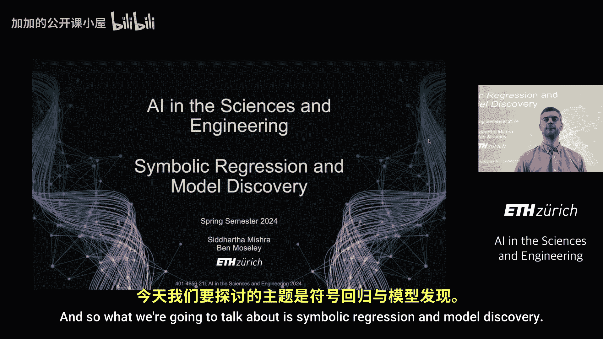
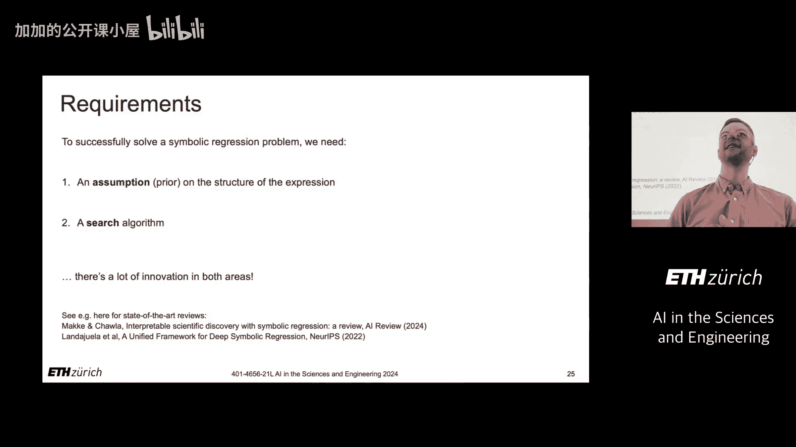
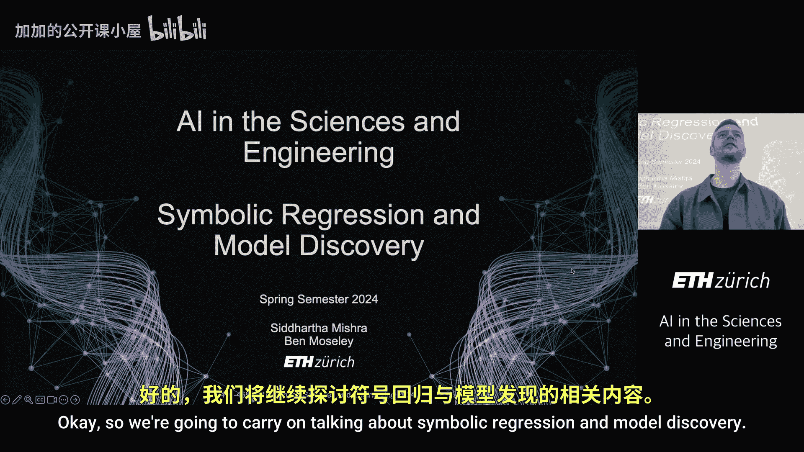
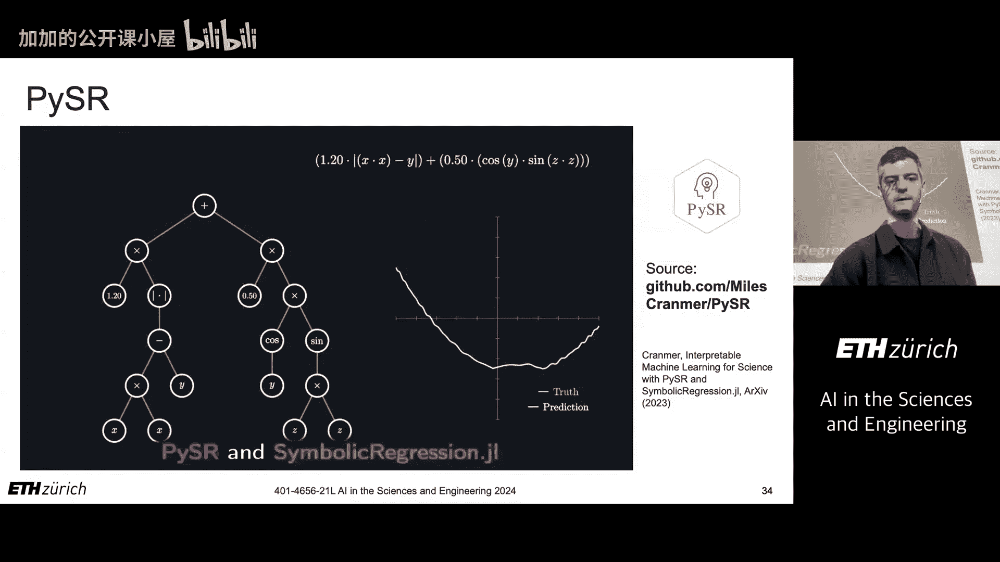
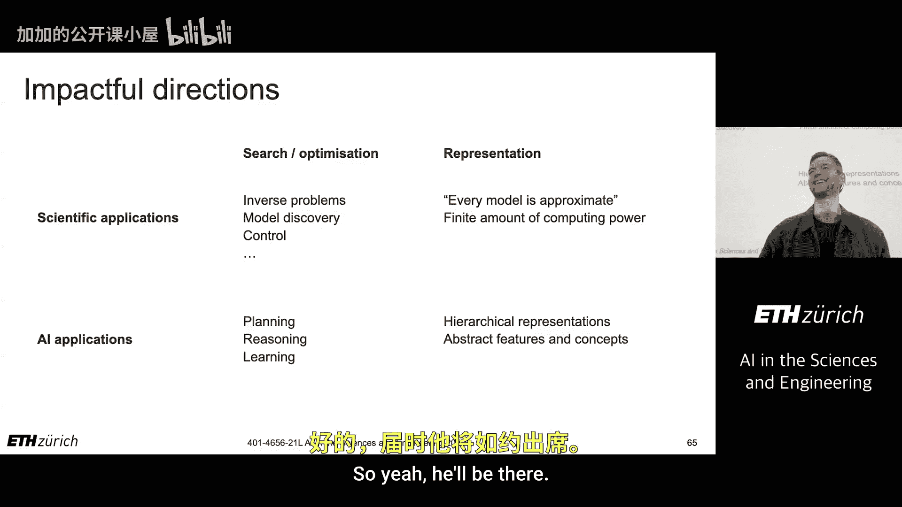

# 024：符号回归与模型发现



在本节课中，我们将要学习符号回归与模型发现。我们将了解什么是模型发现，如何定义它，以及符号回归作为解决模型发现任务的一种方法。我们将深入探讨符号回归面临的挑战，以及为什么这是一项艰巨的任务。我们还将讨论函数发现这一概念上更简单的任务，并了解当前最先进的模型发现系统。课程结束时，你将理解符号回归算法的工作原理、设计要点以及其中的重要概念和挑战，并掌握如何将符号回归用于函数和模型发现。

---

## 模型发现的愿景

上一节我们介绍了课程背景，本节中我们来看看模型发现的宏伟目标。

爱因斯坦的场方程是物理学中最著名的方程之一。它描述了时空曲率与其中物质、能量和动量之间的关系。这节课要探讨的核心问题是：未来，人工智能能否帮助我们做出这类突破性的物理发现？虽然目前我们尚未达到这一水平，但这仍是一个激动人心的领域，我们正朝着利用人工智能帮助发现物理或其他基本科学现象的目标迈进。

人工智能在科学发现中可能非常有用，原因有二：
1.  当今实验产生的数据量巨大，例如欧洲核子研究中心每月记录的数据量已达数千太字节，人类无法手动处理。
2.  我们研究的科学问题日益复杂，例如新冠病毒的演化，其中可能隐藏着人类难以察觉的模式。

那么，人工智能能否帮助我们处理这些数据和问题呢？

---

## 任务定义：模型发现与函数发现

上一节我们提出了愿景，本节中我们来具体定义两个任务。

我们将定义两个利用机器学习帮助我们的任务。第一个是**模型发现**。
*   给定对一个科学或物理系统的观测（例如阻尼谐振子的位置随时间变化），目标是找到描述该系统的**底层模型**（例如一个常微分方程），而不仅仅是对曲线的函数拟合。

第二个是概念上更简单但仍具挑战性的**函数发现**。
*   给定某个函数的一些观测样本（假设该函数具有解析表达式），目标是找出其**实际的数学表达式**，这与标准的函数拟合不同。

以下是物理学中一些著名的函数表达式示例：
*   理想气体定律：`PV = nRT`
*   相对论性能量：`E = mc²`
*   普朗克黑体辐射定律
*   欧姆定律
*   斯涅尔定律
*   费米-狄拉克分布

---

## 符号回归的挑战

上一节我们定义了任务，本节中我们来看看实现这些任务的主要方法——符号回归，以及它为何如此困难。

我们通过一个猜函数游戏来引入。给定函数在区间 [-3, 3] 上的图像，其实际表达式为 `y = x * cos(π * x²)`。人类可能会通过观察振荡频率随x增加而增加、振幅线性增长等特征来猜测。

这里需要明确**符号回归**与**函数拟合**的区别：
*   **函数拟合**：假设一个数学表达式的形式（如神经网络），仅学习其中的系数（权重和偏置）。
*   **符号回归**：目标是发现完整的数学表达式，包括运算符和结构。

那么，为什么符号回归通常比函数拟合更难？原因如下：
1.  **需要学习整个表达式，而不仅仅是系数**，且表达式的长度可能未知。
2.  **搜索空间通常是指数级的**。如果将数学表达式视为由基本运算符组成的字符串，那么所有可能的组合数是 `S^n`，其中 `S` 是运算符库大小，`n` 是表达式长度。
3.  **搜索空间通常是不可微的**。如何对运算符（如加法、除法）进行微分？这没有明确意义。
4.  **给定有限数量的观测点，可能存在许多有效的表达式**，这导致问题是不适定的，容易过拟合。

---

## 表达式的树形表示





上一节我们了解了挑战，本节中我们来看看如何通过选择合适的表示来帮助搜索。

为了高效搜索，选择合适的表示至关重要。一种有效的方法是将数学表达式视为**树**。
*   **根节点**：代表整个表达式，对其进行求值可得到结果。
*   **内部节点**：代表运算符（如 `+`, `*`, `cos`, `^`）。
*   **叶节点**：代表系数或变量（如 `x`, `2`, `π`）。

例如，表达式 `x * cos(π * x²)` 可以表示为以下树结构：
```
        (*)
       /   \
      x    (cos)
            |
           (*)
          /   \
         π    (^)
              / \
             x   2
```

大多数运算可以分解为单目或双目运算。树的深度是一个重要属性。

即使对于深度仅为2、且运算符库非常有限（仅包含 `x`, `+`, `*`, `^2`, `+`）的树，可能的表达式数量也已达到约65个。随着深度或运算符库的增加，搜索空间将急剧膨胀至无法遍历的程度。

---

## 简化搜索：剪枝与假设

上一节我们看到搜索空间巨大，本节中我们来看看如何通过剪枝和假设来简化问题。

我们无法以组合方式枚举所有可能的表达式并测试其与数据的匹配度。因此，**必须对树的结构做出假设以剪枝搜索空间**。这本质上是在概率上定义一个**先验**，即我们期望表达式满足的所有可能结构中的某个子集。

这引出了**奥卡姆剃刀原则**：最简单的解释通常是最好的。在机器学习中，这类似于偏差-方差权衡：随着模型复杂度增加，误差可能下降，但过拟合风险（方差）上升。我们需要选择模型复杂度的“最佳点”。

因此，成功解决符号回归问题需要两个高层级要素：
1.  **对表达式结构的假设**：以避免组合式搜索。
2.  **高效的搜索算法**：能够在定义的可能结构空间中搜索并收敛到拟合数据的表达式。

这是一个广阔的研究领域，有许多关于搜索算法和先验假设的创新。

---

## 利用隐藏的简洁性：AI Feynman 方法

上一节我们讨论了通用策略，本节中我们来看一个具体的先验假设方法：寻找函数中隐藏的简洁性。

**AI Feynman** 是一种在运行搜索算法之前，先寻找函数底层简化规律的方法。以牛顿万有引力定律为例：
`F = G * m1 * m2 / r²`
这个函数有哪些简洁性？
1.  **量纲一致性**：等式两边的物理量纲必须匹配。利用量纲分析，我们可以将函数重写为一个无量纲常数乘以一个变量更少的无量纲函数，从而减少搜索变量数。
2.  **平移对称性**：力仅取决于两物体间的距离 `r`，而非绝对位置。通过变量代换（如 `dx = x2 - x1`），可以减少函数依赖的变量数。
3.  **乘法可分离性**：函数可以写成几个只依赖于部分变量的函数的乘积。例如，`F ∝ (m1*m2) * (1/r²)`。这允许我们对更简单的子函数进行独立搜索。

AI Feynman 算法的工作流程如下：
1.  从一个神秘函数（如 `F(G, m1, m2, x1, y1, z1, x2, y2, z2)`）开始。
2.  依次进行量纲分析、对称性测试、可分离性测试，逐步简化函数形式，减少变量。
3.  对最终简化后的函数（变量数已大大减少）使用搜索算法（如暴力搜索）来发现其数学表达式。
4.  将所有简化步骤反向代入，得到原始变量的最终表达式。

该算法中，神经网络仅用于拟合观测数据以提供任意点的函数查询（插值），便于进行上述测试，其本身并不直接发现符号表达式。

此方法的局限在于，如果目标函数不具备这些隐藏的简洁性，则测试会失败，最终仍需依赖暴力搜索。

---

## 遗传算法搜索

上一节我们讨论了如何通过先验简化问题，本节中我们来看看一种更智能的搜索算法：遗传算法。

除了暴力组合搜索，我们可以使用启发式方法更有效地搜索树空间。**遗传算法**是一种受进化论启发的梯度自由搜索方法。

核心思想是：如果某个表达式树能较好地拟合数据，那么通过对其施加小的遗传操作，可能得到更接近真实解的表达式。主要遗传操作有：
1.  **变异**：随机改变树中的一个节点（运算符或叶节点）。例如，将 `+` 变为 `*`。
2.  **交叉**：随机选择两棵树的子树进行交换。这类似于在数学抽象层面进行重组。

遗传搜索算法的伪代码如下：
```
1. 初始化：随机生成一个表达式树种群。
2. 循环直到满足收敛条件：
   a. 选择：根据适应度（如测试误差）选择当前种群中最优的树。
   b. 遗传操作：对选出的树应用变异和交叉操作，产生新树。
   c. 淘汰：移除适应度低（或“年老”）的个体。
   d. 更新种群：将新生成的树加入种群。
```

一个著名的符号回归库 **PySR** 就使用了遗传算法，并进行了改进，例如在循环中随机加入常数优化步骤。该算法还支持并行化，多个线程独立演化子种群，然后进行交叉，形成更复杂的演化策略。

---

## 其他搜索算法概览


上一节我们深入了解了遗传算法，本节中我们快速浏览一些其他有潜力的搜索算法。

目标仍然是给定数据集 `D` 寻找函数 `f`。
*   **直接学习**：不进行显式循环搜索，而是直接将观测数据作为输入，训练一个模型来输出表达式。**Transformer** 模型很有潜力，因为数学表达式可以看作一种具有语法（运算符）的语言，Transformer 的注意力机制可以处理这种结构。
*   **强化学习**：将构建树的过程建模为一个环境，智能体根据当前树的状态和测试误差等，选择添加下一个节点（运算符）。智能体通过最终是否匹配表达式获得奖励进行训练。
*   **经典树搜索算法**：如深度优先搜索、广度优先搜索等，但需注意这里的搜索目标是构建整棵树，而非在固定树中搜索节点。



这些方法各有优劣，选择取决于具体问题。

---

## 从函数发现到模型发现

上一节我们聚焦于函数发现，本节中我们将其扩展到更复杂的模型发现。

**模型发现**的目标是发现支配系统的实际模型（如微分方程），而不仅仅是静态函数。我们仍然可以使用符号回归方法，但需要在运算符库中加入**微分算子**（如 `d/dt`），这使得问题更加复杂，通常需要添加额外的领域约束来帮助收敛。

一个著名算法是 **SINDy**。它用于发现形式为 `dx/dt = f(x)` 的动力系统方程。其关键假设是：我们拥有系统状态 `x` 及其导数 `dx/dt` 的许多观测数据。这样，问题就转化为寻找向量值函数 `f`，这可以看作一个符号回归任务。

SINDy 进一步对 `f` 的结构做出强假设：它假设 `f` 可以由一个预设的函数库（如多项式、三角函数等）的线性组合构成。设 `Θ(X)` 为库函数矩阵，`Ξ` 为系数矩阵，则有 `dX/dt = Θ(X) Ξ`。由于 `Θ(X)` 可以从数据 `X` 计算，`dX/dt` 已知，因此求解 `Ξ` 就变成了一个**稀疏线性回归**问题（如 LASSO），因为我们期望只有少数库函数是活跃的。

SINDy 的扩展甚至可以从原始观测（如摆锤的视频）中自动学习状态编码，并同时发现动力学方程。

---

## 课程总结

在本节课中，我们一起学习了符号回归与模型发现。我们探讨了如何利用人工智能从数据中发现数学表达式和物理模型，理解了符号回归的巨大挑战（如指数级搜索空间、不可微性），并介绍了应对这些挑战的策略，包括利用隐藏简洁性（如 AI Feynman）、高效的启发式搜索算法（如遗传算法），以及针对微分方程等特定模型的发现方法（如 SINDy）。

回顾整个课程，我们涵盖了科学机器学习中的众多主题：物理信息神经网络、算子学习、Transformer、混合工作流、可微分方程与模型发现。贯穿始终的核心思想是，可以将科学理解以多种方式融入机器学习工作流，例如通过损失函数、架构设计，或更紧密地集成到传统科学工作流程中。

使用深度学习存在利弊，需要谨慎评估而非盲目使用。但总体而言，将科学理解融入机器学习通常会提升我们解决科学问题的能力。

展望未来，在科学与人工智能交叉领域，有两个高层次的核心方向具有巨大研究潜力和影响力：
1.  **搜索与优化**：许多科学问题（反问题、模型发现、控制）和AI问题（规划、推理、学习）本质上都是搜索优化问题。设计具有良好先验知识的高效搜索算法至关重要。
2.  **表示学习**：在科学中，选择何种近似表示（如PDE的基函数、网格离散化）对计算效率和精度有根本性影响。在AI中，表示学习（如LLM的抽象推理、分层规划）同样是核心挑战。深入思考表示问题将对这两个领域产生深远影响。



希望本课程能为你提供启发，并鼓励你在这一充满活力的领域继续探索。