# 025：人工智能在化学与生物学中的应用（第一部分）

在本节课中，我们将学习人工智能如何应用于蛋白质和小分子的工程化设计。我们将从基础知识开始，了解蛋白质和小分子的基本概念，然后探讨基于文本和基于结构的AI模型如何帮助解决这一领域中的关键挑战，例如新药开发和酶设计。

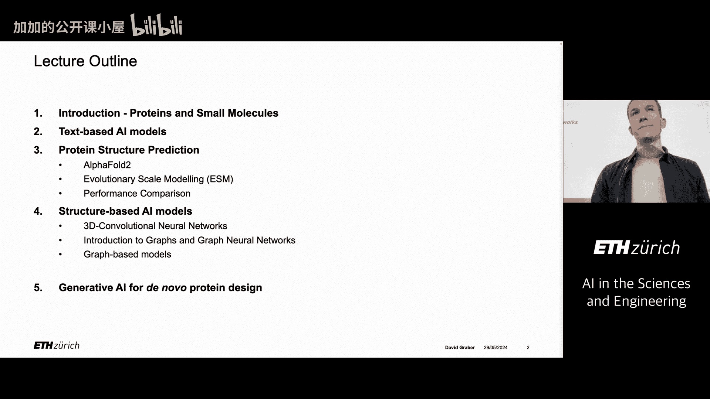

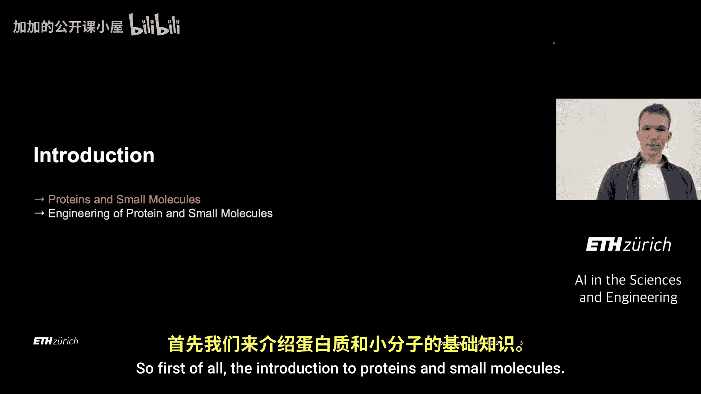

## 蛋白质与小分子简介

首先，我们需要了解蛋白质和小分子的基本概念，以便为后续讨论奠定共同的基础。

小分子是有机化合物，分子量较低，通常由少于100个原子组成。生物体可以产生小分子，例如作为代谢物或信号分子。例如，皮质醇是一种应激激素，可以驱动我们的新陈代谢。这些小分子通常可以轻松地穿过细胞膜，并与蛋白质相互作用，从而影响其功能。因此，大多数药物都是小分子，因为它们可以进入细胞并与蛋白质相互作用，从而改变某些疾病通路。由于小分子结构简单，通常可以在化学实验室中进行合成。

蛋白质是由一组固定的构建单元组成的大型链状分子。这些链会折叠成一个确定的三维结构，称为蛋白质的天然构象。这种结构决定了蛋白质的功能。蛋白质可以是酶（催化特定化学反应的蛋白质）、结构成分、信号分子或转运蛋白。总的来说，蛋白质是生命的基本组成部分，在几乎所有生命必需的过程中都扮演着关键角色。

蛋白质由氨基酸构成，共有20种标准氨基酸。所有氨基酸都有一个共同的骨架（氨基和羧基），它们通过这个骨架连接成链。不同氨基酸之间的区别在于它们的侧链，侧链决定了氨基酸的化学性质。

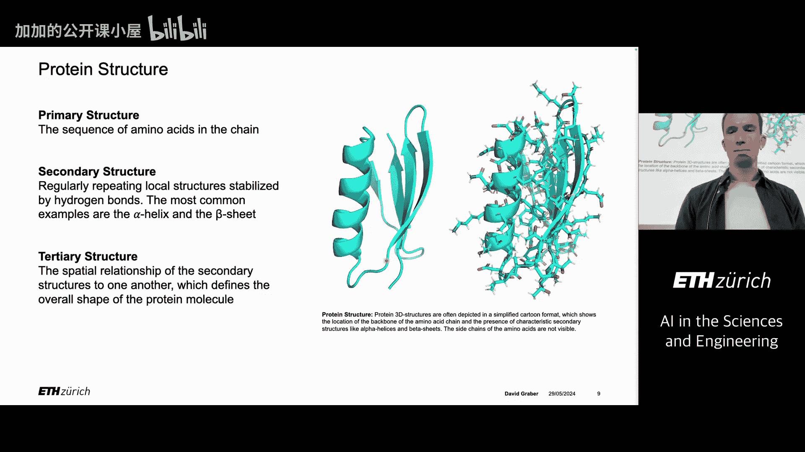

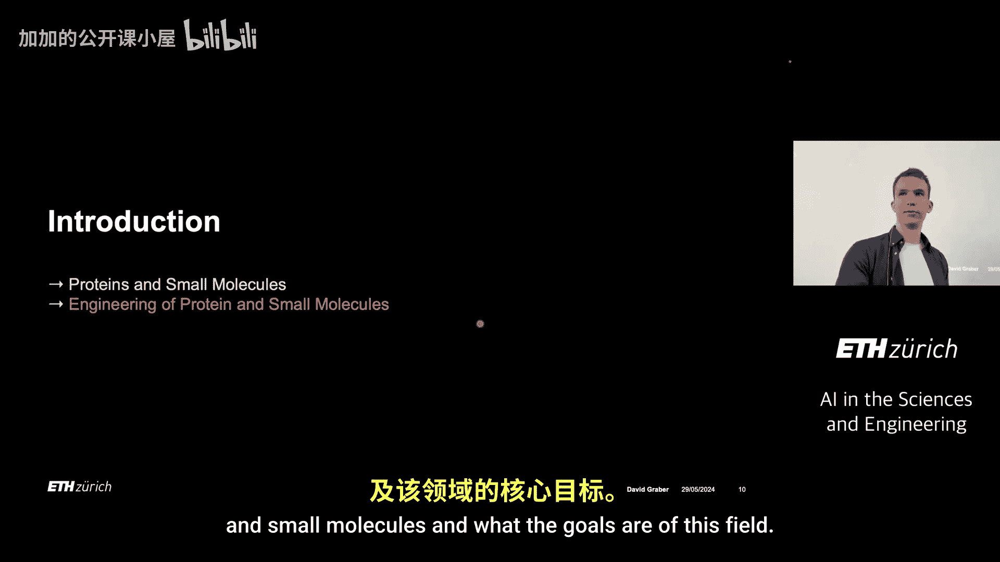

我们的DNA决定了蛋白质的氨基酸序列。DNA被读取并转录成RNA，然后RNA被翻译成氨基酸链。一旦氨基酸链合成，它就会折叠成一个有序的三维结构，从而定义蛋白质的生物学功能。这种折叠是由氨基酸及其侧链之间的相互作用（例如疏水相互作用、氢键或范德华力）引导的自发能量最小化过程。

描述蛋白质时，我们可以考虑三个结构层次：
1.  **一级结构**：氨基酸在链中的序列。
2.  **二级结构**：由氢键稳定的规则重复的局部结构，例如α螺旋或β折叠。
3.  **三级结构**：这些二级结构在三维空间中的空间关系。

蛋白质通常以卡通图的形式展示，这种图可以很好地可视化二级结构（如螺旋和折叠），但只显示氨基酸骨架的位置，而不显示侧链。

## 蛋白质与小分子工程的目标

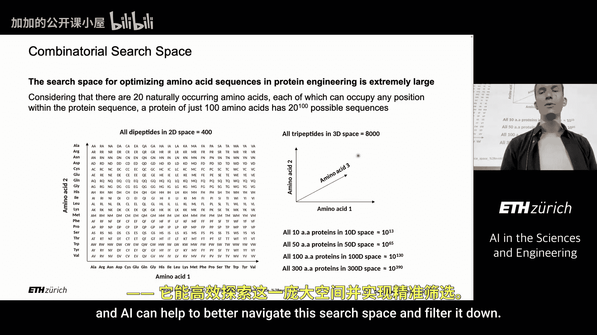

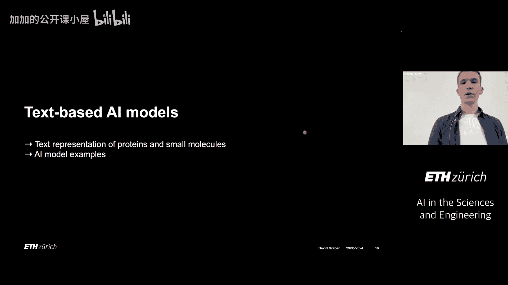

上一节我们介绍了蛋白质和小分子的基础知识，本节中我们来看看工程化设计它们的目标是什么。

正如前面提到的，大多数药物是小分子，它们可以结合蛋白质并影响生物过程。这些小分子的化学结构和组成决定了它们的功能和结合偏好。因此，小分子药物通常被设计用于与特定的目标相互作用，通过结合来抑制或调节疾病通路。例如，小分子可以抑制酶或阻断受体。工程化小分子通常通过改变这些有机化合物的大小和组成来获得所需的性质和结合偏好。

在蛋白质工程中，核心是改变氨基酸链的序列，以实现特定功能。例如，在生物催化领域，可以改变酶的氨基酸序列，使其能够接受新的底物。在治疗领域，一个常见的例子是改变抗体的序列，使其能够结合特定的目标，例如新冠病毒的刺突蛋白。

以下是几种常见的蛋白质工程策略：
*   **理性设计**：利用对蛋白质或系统的详细知识来进行有针对性的改变。
*   **半理性设计**：在认为重要的氨基酸位点上，尝试所有可能的氨基酸替换，构建一个组合变体库。
*   **定向进化**：从一个已有功能的蛋白质开始，引入随机突变，从生成的变体池中筛选出功能最好的，然后重复这个过程，这是一种加速的进化过程。

然而，这些工程任务的主要挑战在于优化蛋白质和氨基酸序列的搜索空间极其巨大。对于一个长度为100的氨基酸链，考虑到有20种天然氨基酸，可能的序列数量是 `20^100`。而蛋白质通常由数百甚至数千个氨基酸组成。这就是人工智能可以发挥作用的地方，AI可以帮助更好地导航和过滤这个巨大的搜索空间。

## 基于文本的AI模型

现在，我们开始讨论基于文本的AI模型。之所以称为“基于文本”，是因为这些模型的输入是蛋白质和小分子的文本表示。

对于蛋白质，文本表示非常直接，就是氨基酸序列。对于机器学习，氨基酸序列可以被编码成数值表示，例如使用独热编码或其他标记化方法，将每个氨基酸视为一个单独的标记，类似于文本处理中的单词。

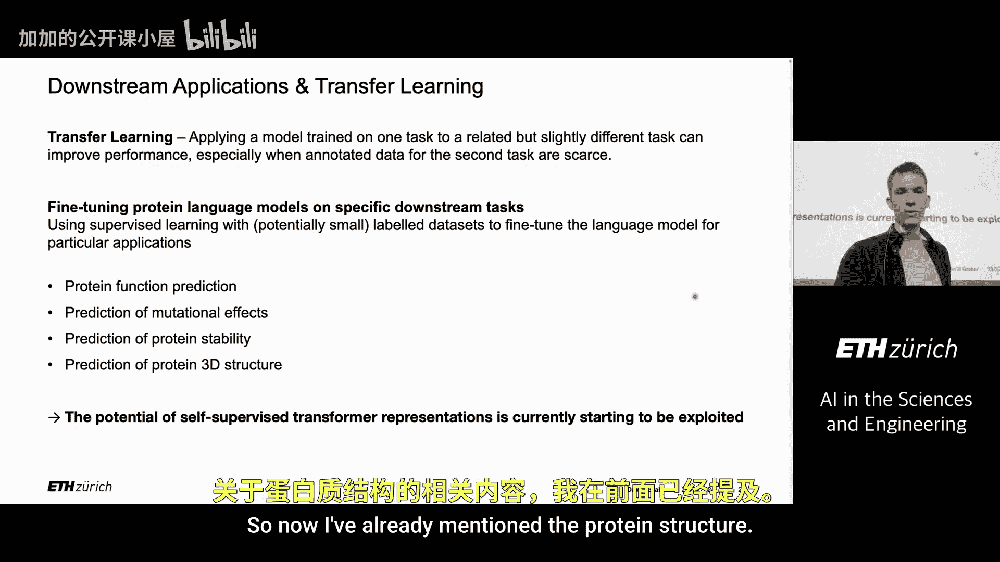

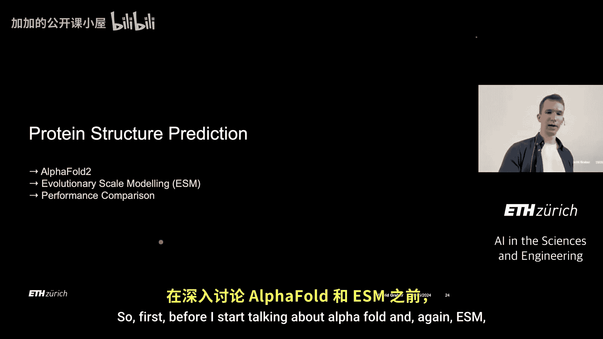

对于小分子，情况稍微复杂一些。常用的表示方法是SMILES代码，这是一种使用字符表示分子结构的线性符号。原子用其化学符号表示，单键通常省略，双键用等号表示，分支用括号描述，环用数字表示连接点。对于机器学习，这些SMILES代码同样会被标记化并映射到一个固定的词汇表。

你可能已经注意到，这种标记化和文本表示听起来很像自然语言处理。这些方法对该领域产生了巨大影响，因为语言的构建单元与蛋白质和小分子的构建单元之间存在类比关系。蛋白质序列有自己的“语法”，也包含长程依赖关系。SMILES代码也是由固定词汇组成的线性序列，并遵循特定的书写规则。因此，蛋白质序列和SMILES代码都与设计用于处理此类线性序列的语言模型架构兼容，这就是为什么NLP的方法经常被应用于蛋白质和小分子。

接下来，我们来看一个具体的例子。这是一个由苏黎世联邦理工学院的化学家开发的Transformer模型，用于预测分子的温度依赖性极限活度系数。输入是溶质和溶剂的SMILES代码，输出是预测的活度系数。SMILES代码被标记化并嵌入为输入矩阵，温度信息也被添加到这个输入矩阵中。然后，Transformer块转换这个输入嵌入，并将新的表示输入到一个回归头中，输出代表预测活度系数的单个值。该模型在实验数据上进行了监督训练，并且能够很好地泛化到未见过的分子。

另一个著名的例子是ESM模型，它是由Meta公司训练的。这是一个基于掩码语言模型目标在蛋白质序列上进行自监督学习的模型。它使用了2.5亿个蛋白质序列进行训练。模型的工作原理是：输入序列的一小部分氨基酸被掩码替换，然后模型需要预测哪些氨基酸被掩码了。如果模型能持续在这个任务上表现良好，就意味着它必须了解很多关于蛋白质序列和结构的知识。事实证明，在这个模型生成的隐藏状态表示中，编码了大量的内在生物学特性和蛋白质结构信息。这使得这些表示对于下游应用（如蛋白质功能预测、突变效应预测、蛋白质稳定性预测甚至3D结构预测）非常有用。通过微调，可以将这个预训练的语言模型应用于特定的、可能数据量较小的监督学习任务。

## 蛋白质结构预测

上一节我们提到了蛋白质结构，现在让我们过渡到蛋白质结构预测这个主题。

首先，我们需要了解为什么蛋白质结构如此重要。简单来说，蛋白质结构指的是蛋白质在其折叠状态下所有原子的三维坐标。了解结构非常重要，因为它能帮助我们更好地理解蛋白质，正如之前所说，结构决定了功能。了解结构有助于我们发现蛋白质的生物学作用。在药物发现中，了解蛋白质结构可以帮助我们识别一些活性位点或口袋，这些位点可能是小分子药物的靶点。

然而，多年来，研究人员一直依赖非常耗时的实验方法（如X射线晶体学或核磁共振）来解析蛋白质结构。最近发布的深度学习模型在无需实验程序的情况下预测结构方面取得了巨大进展。

从序列预测蛋白质折叠是一项极其困难的任务，因为氨基酸在其骨架键和侧链键周围有很多旋转自由度，即使是一个很小的蛋白质，其可能的结构数量也是天文数字。折叠还受到氨基酸侧链之间各种相互作用（如氢键、疏水相互作用、范德华力）的驱动，这些相互作用很难建模。此外，还存在长程依赖关系，即折叠可能受到序列中相距很远但在三维折叠中却靠得很近的氨基酸之间的相互作用的影响。

由于这个任务非常重要，有一个名为“蛋白质结构预测关键评估”的比赛每隔几年举行一次，邀请研究人员和机器学习专家尝试从序列预测蛋白质折叠。AlphaFold2在第14届比赛中以很大优势获胜。其预测的Cα原子（每个氨基酸骨架三角的尖端）的均方根偏差仅为0.96埃（碳原子的宽度约为1.4埃），预测非常精确。这是一个结构生物信息学领域的突破。

接下来，我们简要了解一下AlphaFold的架构。模型的输入是想要折叠的蛋白质序列。模型首先在遗传数据库中搜索相似序列，生成多序列比对。同时，它还在结构数据库中搜索已知结构的类似蛋白质作为模板，并基于这些模板生成氨基酸对之间距离的初步猜测。然后，模型从多序列比对和成对距离矩阵生成MSA表示和配对表示。这两个表示被传递到Evoformer（AlphaFold架构的核心），这个Transformer模型通过注意力机制和类卷积操作更新这些表示。更新后的表示被传递到结构模块，该模块将其转换为空间坐标，预测所有残基对之间的距离和蛋白质中的键角，从而构建蛋白质的3D模型。模型还应用了“回收”概念，这是一个迭代精炼过程，结构模块的输出被多次反馈回Evoformer，以帮助改进预测。模型训练使用了多个结构目标损失项，以及一个额外的“蒸馏”目标（随机掩码部分多序列比对并要求网络重建）。此外，还应用了自蒸馏原则：首先在已知结构的实验数据集上训练模型，然后用训练好的模型预测大量未知结构蛋白质的序列，将预测结构与实验结构合并，从头开始重新训练模型，这可以重复多次，有效利用了未标记的序列数据。

在休息之前，我们谈到了用AlphaFold预测蛋白质结构。现在，让我们回顾一下之前提到的ESM模型。这个自监督模型在2.5亿个序列上以掩码语言模型目标进行训练。作者表明，在这个模型生成的隐藏状态表示中，也包含了蛋白质结构的信息。模型无法直接观察蛋白质结构，但结构是影响序列模式的隐藏变量，因此模型仍然可以从序列中学习到蛋白质结构的信息。他们通过一个简单的逻辑回归分类器，使用隐藏状态表示作为输入，来预测每个氨基酸属于哪种二级结构（螺旋、折叠或卷曲），并取得了很高的分类准确率，这证明了这一点。

随后，发布了ESM模型的第二个版本ESM2。他们在ESM模型的基础上增加了一个“折叠头”，可以从ESM模型的隐藏状态表示中提取原子坐标。他们在这个预训练模型上进行了微调，添加了折叠Transformer块，也应用了类似AlphaFold的回收策略，并在30万个实验确定的PDB蛋白质结构上进行了训练，达到了与AlphaFold相似的预测精度。这个模型的显著之处在于，它移除了AlphaFold中最耗时的部分：不需要访问数据库寻找模板或进行多序列比对。这使得模型预测蛋白质结构的速度比AlphaFold快约60倍，并且是完全独立的，只需输入序列即可输出结构。

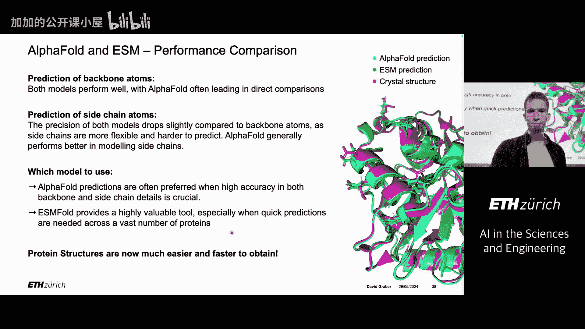

在性能比较方面，两个模型在预测骨架原子位置上都表现得很好，AlphaFold通常略好一些。在预测侧链原子位置方面，两者性能都有所下降，因为侧链通常更灵活，AlphaFold在定位侧链方面通常仍然表现更好。因此，如果对骨架和侧链的高精度要求至关重要，建议使用AlphaFold。但如果需要对大量蛋白质进行快速预测，ESM和ESMFold提供了非常有价值的工具。总的来说，获得蛋白质结构因这些模型而变得容易得多。但需要注意的是，它们仍然只是接近实验精度，并且对于动态的蛋白质，这些模型通常给出的是一个平均构象，可能无法捕捉到蛋白质的灵活性。

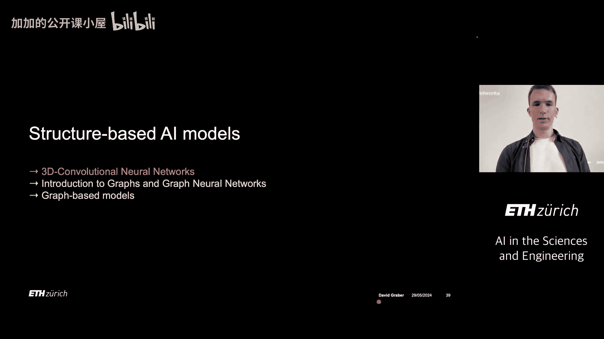

## 基于结构的AI模型：3D CNN与图神经网络

现在我们已经知道如何用深度学习预测蛋白质结构，接下来我们来讨论使用结构信息作为输入的AI模型。首先，我们将讨论3D卷积神经网络，然后是图基模型。但在讨论这些之前，我们需要先简要介绍一下图和图神经网络的基础知识。

如果我们有一个包含几百个氨基酸的蛋白质，用AlphaFold预测结构可能需要15分钟左右，而用ESM可能不到一分钟，对于小蛋白质可能只需几秒钟。

首先，重复一下关于蛋白质结构的概念。蛋白质结构决定了其功能，蛋白质折叠成复杂的形状，使其能够与其他分子相互作用。单独的蛋白质序列不提供原子在三维空间中实际排列的信息。因此，结合了结构信息的模型在需要理解残基物理位置的任务（如相互作用预测或酶活性预测）上应该更优越。然而，使用结构数据也存在挑战，例如结构数据的可用性较低，而基于序列的方法通常更简单、计算效率更高。

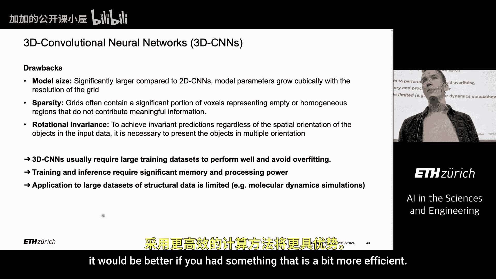

关于3D CNN，我们解释一下一般流程以及如何用它处理蛋白质。要将原子坐标转换为适合3D CNN的形式，需要将蛋白质周围的空间划分为体素的网格。然后，可以使用不同类型的原子属性来定义输入数据中的多个通道（例如碳通道、氮通道、氧通道）。接着，使用卷积和池化从这些三维网格中提取相关信息。最后，通过全连接层进行全局预测。这类3D CNN已被证明在蛋白质稳定性预测等任务中表现良好。

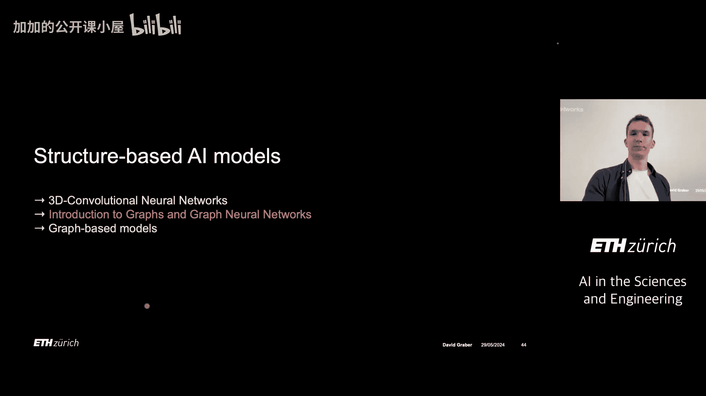

这里有一个例子是苏黎世联邦理工学院研究人员开发的3D CNN，用于预测蛋白质-配体亲和力。配体指的是结合到蛋白质上的小分子。亲和力指的是这种相互作用的强度。他们的做法是：以配体的几何中心为中心建立一个网格，将每个原子的位置映射到一个体素中，并使用额外的化学属性定义更多通道。然后使用卷积神经网络将这个3D网格缩减为一个代表亲和力预测的pKd值。这类3D CNN是首个在基于结构的亲和力预测上超越基于序列方法的模型。

然而，3D CNN也有一些缺点。模型参数量通常比2D CNN大得多，且随着网格分辨率和尺寸的增加，参数量呈立方增长。稀疏性也是一个问题，网格中的许多体素可能代表空的或均匀的区域，不包含有意义的信息，但模型仍然会处理这些体素，导致效率低下。此外，旋转不变性也是一个问题，为了实现与输入数据中3D物体空间方向无关的预测，通常需要以多种方向呈现物体，这使得模型训练的计算成本更高。因此，3D CNN通常需要大型训练数据集来避免过拟合，并且训练和推理需要大量的内存和处理能力。

图神经网络是3D CNN的一个潜在替代方案。图描述了一组称为节点的对象以及这些对象之间的连接（称为边）。图中的信息可以存储在每个节点和每条边中，还可以有一个与整个图相关的全局上下文向量。这是一种非常强大的数据表示形式，特别适用于非欧几里得和无序的数据，例如社交网络、引文网络或分子中的原子。图神经网络就是为处理此类图结构而开发的神经网络。

将图传递给神经网络时，需要将节点特征、边特征、连接性和全局上下文信息转换为矩阵格式。节点特征存储在节点特征矩阵中，每个节点的特征占据一行。连接性通常用邻接矩阵表示，但由于连接通常远少于矩阵中的条目数，邻接矩阵通常非常稀疏。因此，更常用的是一种更节省内存的表示方法：边索引（一种邻接列表），它只列出相连的节点对。边特征可以按照边索引的顺序存储在边特征矩阵中。全局上下文向量也以矩阵格式存储。

图神经网络可以解决多种任务：
*   **图级任务**：预测整个图的单个属性（例如，一个分子是否是抗生素）。
*   **节点级任务**：预测图中每个节点的属性（例如，社交网络中每个成员的忠诚度预测）。
*   **边级任务**：预测图中边的属性或是否存在（例如，Facebook的好友推荐）。

图神经网络本质上是对图所有属性的可优化变换，它遵循“图进图出”的原则，逐步转换节点、边和全局上下文的嵌入，而不改变图的连接性。如果要进行节点级的预测，可以对变换后的节点嵌入应用线性分类器。

为了更新和变换节点、边和全局上下文向量中的特征，图神经网络通常应用消息传递神经网络框架。相邻的节点或边相互交换信息，并影响彼此更新后的嵌入。这使得学习到的嵌入能够感知图的连接性和节点的邻域信息。消息传递分为三个步骤：从目标节点的邻居那里收集消息，使用聚合函数（如求和）聚合这些消息，然后通过一个更新函数（通常是一个小型神经网络）生成节点的新嵌入。这个过程与图像上的卷积有相似之处，都是聚合和处理元素邻居的信息来更新元素的值。因此，图上的消息传递过程也被称为图卷积。与CNN类似，我们可以堆叠多个图卷积层，这样经过几层之后，一个节点就能获得距离它几步之遥的节点的信息。

常用的图卷积层有几种类型，每种都有不同的聚合函数。例如，图卷积网络层使用一个包含归一化项的公式来更新节点特征。图注意力网络层则使用基于两个节点特征及其之间边的特征计算出的注意力分数来加权聚合邻居信息。

## 基于图的AI模型应用示例

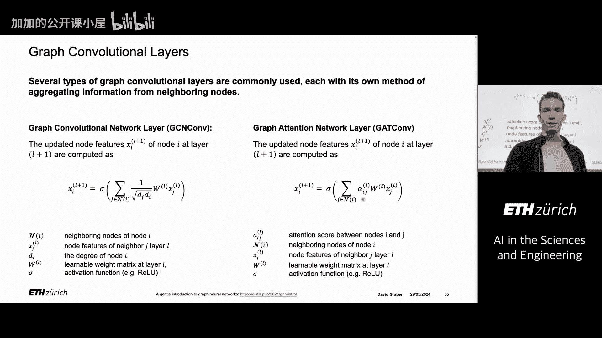

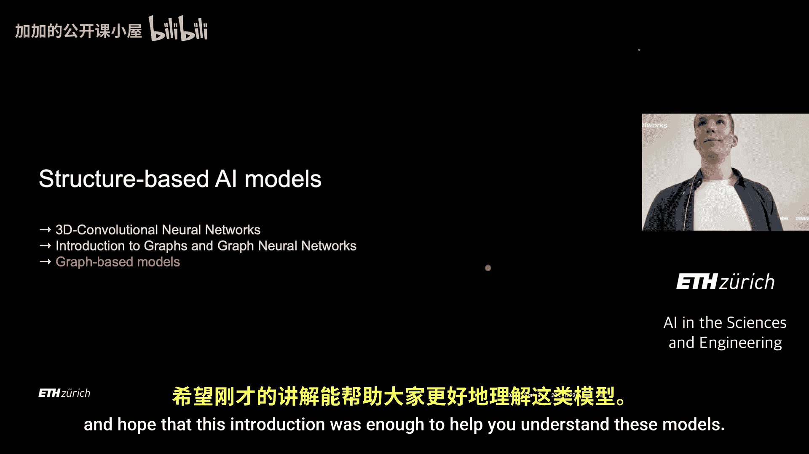

现在，我们继续讨论基于图的AI模型，并给出一些应用示例。

这是一篇2020年的优秀论文，研究人员训练了一个图神经网络来预测分子是否具有抗生素效果。这是一个图级的二元分类任务。他们为数据集中的分子生成图表示，并将化学数据添加到节点和边中。节点特征包括原子类型、电荷等信息；边特征包括化学键类型（单键、双键、是否在环内等）。他们使用这些带有化学信息的图表示来训练一个图神经网络。训练集包含2560个结构多样的药物分子，其中120个已知对大肠杆菌有生长抑制作用（即已知抗生素）。他们对这些分子进行简单的图卷积操作，然后进行全局池化，将所有节点和边的特征聚合成一个单一表示，再输入到一个神经网络中，输出预测的抑制概率。训练好模型后，他们将其应用于一个包含6000个分子的大型药物分子库进行推理。在模型预测概率最高的99个分子中，有51个确实显示了对大肠杆菌的生长抑制。而在模型预测概率最低的63个分子中，只有2个显示抑制。这是一个非常显著的结果。这项研究还导致了一种名为Halicin的新抗生素的发现，它对多种细菌具有杀菌作用。有趣的是，这种新抗生素与已知抗生素的结构相似性较低，这表明模型具有一定的泛化能力，能够发现新的抗生素化学结构。

这项研究将小分子建模为图，但理论上也可以扩展到蛋白质，因为蛋白质本质上是由固定构建单元组成的大分子。你可以将整个蛋白质建模为图。上面这个例子是在原子级别进行图建模，但接下来这项研究采用了一种不同的、更粗粒化的方法。这是一个用于预测蛋白质功能的图卷积神经网络。它接收蛋白质结构，并将其建模为氨基酸的点云（将每个氨基酸简化为其Cα原子）。然后，如果两个Cα原子之间的距离小于10埃，就将它们连接起来，从而得到一个表示蛋白质结构的互连图（一种接触图）。他们使用从蛋白质语言模型（如ESM）获得的嵌入来特征化这些氨基酸节点。然后，他们使用带有跳跃连接的三层图卷积，接着进行全局自适应池化，将所有节点的表示聚合成一个单一的表示向量，最后输入到一个全连接神经网络中，输出蛋白质属于各个功能类别的概率。这个简单的GCN在许多蛋白质功能分类的机器学习工具中表现优异。据推测，其主要原因是这种对蛋白质结构的图建模使得卷积能够在序列上相距很远但在三维结构中靠得很近的残基之间传递消息，从而使模型对蛋白质结构有更好的感知。

图神经网络为建模和处理三维物体（如分子）提供了许多优势。它们可以处理定义在不规则域中的数据，而无需将其映射到规则网格上。图表示对平移和旋转具有不变性。与之前讨论的体素网格相比，图表示更加稀疏。此外，图神经网络在数据集成方面有很多可能性，可以将数据保存在节点、边和全局上下文向量中，并在更新机制中整合这些信息。因此，图卷积神经网络在理解数据结构和互联性至关重要的任务中表现良好，并且通常可以用相对较少的参数取得很好的效果。

## 总结

本节课中我们一起学习了人工智能在蛋白质和小分子工程中的应用。

基于文本的AI模型方面，蛋白质和小分子可以用文本表示，并可以用自然语言处理方法高效处理。在这些文本表示上训练的语言模型可以生成信息丰富的潜在空间表示，甚至能够预测蛋白质结构。

基于结构的AI模型通常在需要空间位置信息的任务中表现更好。图是建模和处理此类非欧几里得、无序数据（如分子和社交网络）的理想选择。

总的来说，蛋白质和小分子的工程化设计极具挑战性，因为搜索空间极其巨大。本节课展示的这类AI模型，现在以及未来，将极大地帮助导航这个搜索空间，并加速新药或新功能酶等开发过程。

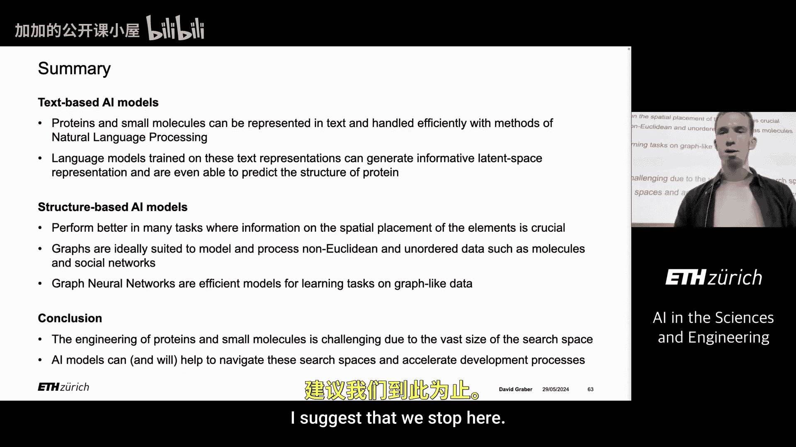

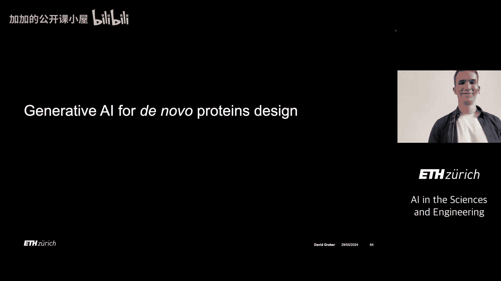

在下节课（周五），我们将讨论关于蛋白质从头设计的、非常新的生成式AI模型，例如使用扩散过程从零开始生成新的蛋白质结构。