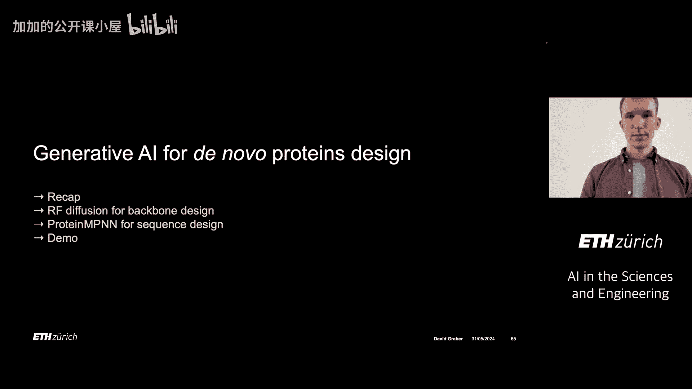
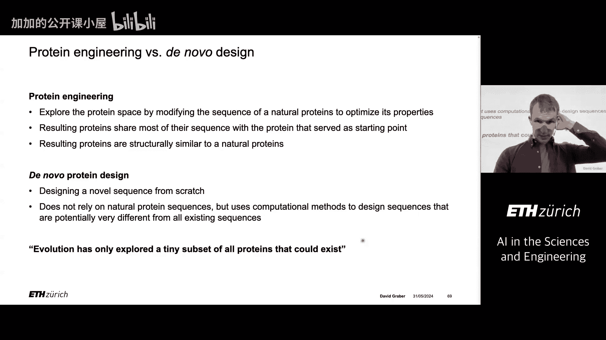
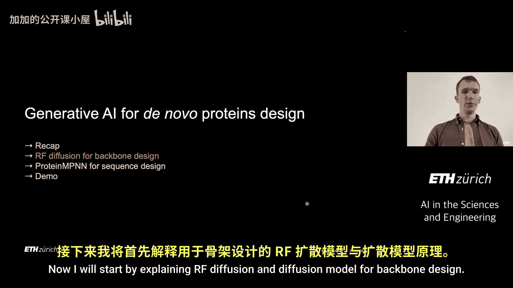
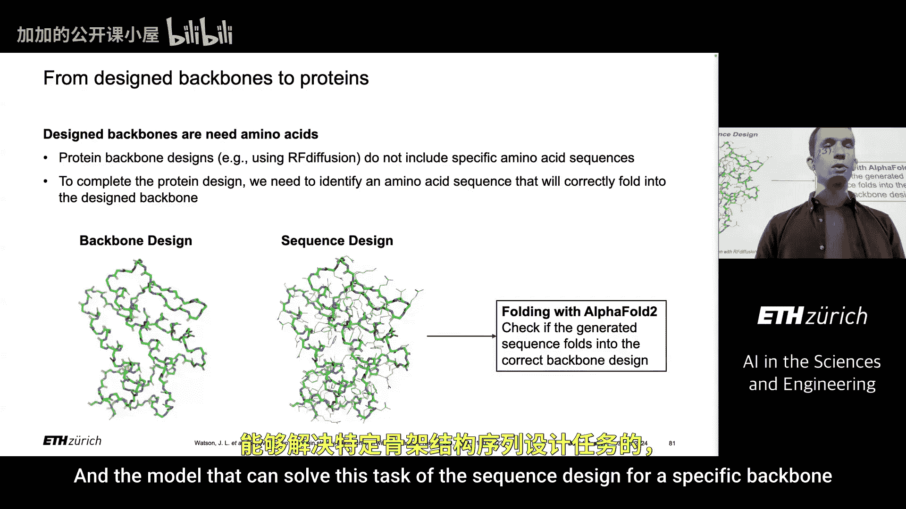
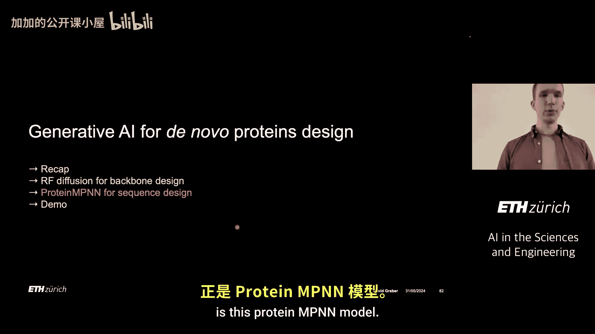
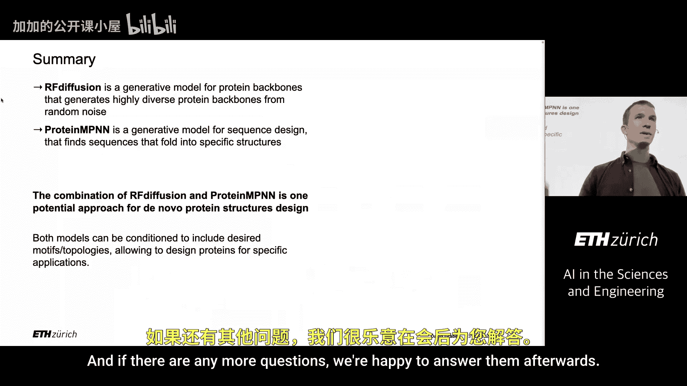

# 026：AI在化学与生物学中的应用（第二部分）🎯

在本节课中，我们将学习用于蛋白质从头设计的生成式人工智能模型。我们将首先回顾理解这些模型所需的核心概念，然后深入探讨用于蛋白质骨架设计的RF扩散模型，以及用于序列设计的Protein MPNN模型。最后，我们将通过一个简短的演示来展示这些模型的强大能力。

## 回顾：蛋白质结构与预测模型

上一节我们介绍了蛋白质的基本知识，本节中我们来看看理解新模型所需的关键背景。

蛋白质是由氨基酸组成的链，它们根据氨基酸间的相互作用折叠成复杂的三维结构。一个蛋白质的骨架由相连的**N、Cα和C原子三角形**构成。所有20种氨基酸的区别仅在于连接在Cα原子上的侧链，而这个**N-Cα-C三角形**是所有氨基酸共有的。

我们还学习了AlphaFold2等折叠模型，它们能够从氨基酸序列预测蛋白质结构。AlphaFold的流程是：输入序列 -> 进行遗传数据库搜索（生成多序列比对）和结构数据库搜索（生成初始结构预测）-> 利用复杂的模型架构生成最终精修的结构预测。

此外，我们了解了图神经网络，它非常适合建模像蛋白质或蛋白质骨架这样的无序数据。在图神经网络中，通过图卷积进行消息传递，可以转换存储在节点和边中的数据，最终生成的节点和边嵌入将包含关于节点或边的连接性和邻域信息。

上周课程主要关于蛋白质工程，即通过修改现有天然蛋白质的序列来探索蛋白质空间，以优化其特性。工程化得到的蛋白质通常与起始蛋白质共享大部分序列，并且在结构上也相似。

## 蛋白质从头设计简介

今天，我们将讨论**蛋白质从头设计**。这指的是从零开始设计全新的序列，不依赖于天然蛋白质序列，而是使用计算方法来设计可能与所有现有蛋白质都大不相同的序列。

有一个著名的观点认为，进化只探索了所有可能存在的蛋白质中一个极小的子集。因此，在氨基酸所有可能的组合空间中，只有一小部分已经存在，还有巨大的空间可以用来生成从未见过或表征过的新蛋白质。

## RF扩散模型：用于骨架设计的扩散模型

现在，我将开始解释用于骨架设计的RF扩散模型。

首先，快速回顾一下我们在之前课程中学到的关于扩散模型的原理。这些模型在图像生成领域已展现出最先进的性能。其基本思想是：从图像开始，经过多个时间步逐渐增加噪声，最终得到与原始输入毫无相似性的纯噪声图像。然后，训练一个神经网络来逆转一步去噪过程。如果成功，就可以从已知的高斯分布中采样纯噪声，输入模型，经过反复去噪步骤，最终得到一个与训练数据分布高度相似的输出，即生成一张逼真的图像。

同样的概念可以应用于蛋白质结构。具体流程是：以蛋白质结构作为训练数据，对这些从蛋白质数据库获取的结构添加噪声，然后训练模型从带噪声的输入中恢复真实结构。如果成功训练了这些模型，就可以通过从随机噪声开始的迭代去噪过程生成新的结构。

为了理解RF扩散模型，我们需要讨论如何向蛋白质结构添加噪声。AlphaFold和RF扩散都使用了一种基于框架的蛋白质骨架建模方法。在这种方法中，我们将骨架视为由**N、Cα、C原子组成的三角形**。每个这样的三角形都可以用一个**平移向量**和一个**旋转矩阵**来描述。因此，一个蛋白质骨架本质上就是**L个平移和L个旋转的集合**，其中L是蛋白质的长度或氨基酸数量。

然后，我们可以向平移向量添加三维高斯噪声（即扰动Cα坐标），并在旋转矩阵流形上使用布朗运动。这种加噪策略将原本沿蛋白质骨架整齐排列的三角形集合，转变为随机分布和随机朝向的状态。接着，训练一个神经网络来逆转这个过程，目标是从这些结构的噪声版本中恢复原始的蛋白质结构。

以下是RF扩散的一个训练步骤：在每个时间步t，模型以当前坐标**X_t**（初始为随机噪声）作为输入，直接预测真实结构**X_0**。然而，模型下一时间步的坐标输入并不是这个预测的真实结构，而是**X_t**和**X_0**之间的一个插值。模型沿着其真实预测的方向前进一步。这个插值结果被传递到模型的下一个时间步。同时，这个真实预测也不会被丢弃，它也会被传递到下一个时间步。这就是所谓的**自条件**策略，模型既可以使用当前时间步的坐标位置，也可以使用前一时间步预测的真实坐标。这种策略显著提高了RF扩散的性能。

另一个有趣的点是，该模型基于一个名为RosettaFold的蛋白质结构预测模型（折叠模型）。它的思路与AlphaFold非常相似，也能从输入序列准确预测蛋白质结构。其背后的想法是，通过利用这些蛋白质结构预测模型中所蕴含的对蛋白质结构的深刻理解，我们可以获得改进的蛋白质设计扩散模型。因此，RF扩散是通过微调RosettaFold结构预测网络而开发的。

RosettaFold的输入与AlphaFold非常相似：它接收需要折叠的输入序列，在数据库中搜索同源蛋白质以获取模板结构，并基于这些同源蛋白质生成初步的蛋白质结构预测（以残基对距离矩阵和基于框架的骨架表示形式）。然后，它输出该序列的预测结构。

RF扩散几乎原封不动地重用了这个架构，只有两点改变：
1.  输入到折叠模型的序列现在被**掩码**，因为我们不再有输入序列。
2.  原本初步的基于框架的骨架表示，现在被**扩散坐标**（即噪声坐标）所取代；而原本的残基对距离矩阵，则被来自自条件的、前一时间步预测的真实坐标**X_0**所取代。

因此，这原本是一个结构预测模型，但现在使用相同的架构进行微调，以预测蛋白质结构，但输入是噪声坐标。

RF扩散模型是一个用于蛋白质骨架的生成模型。从随机噪声开始，它确实可以生成高度多样化的蛋白质骨架。许多不受约束的设计与训练中见过的结构相似性很低，这表明该模型能够真正泛化到其训练数据之外。实验表征也表明，大多数这样生成的蛋白质确实稳定且可溶。

## 条件化设计与应用示例

目前解释的只是非条件化设计。RF扩散可以通过添加外部势能和微调模型，针对特定的设计挑战进行**条件化定制**。这就像在迭代去噪过程的每一步中，引导轨迹朝向特定的设计目标。

例如，RF扩散曾以一个硫氧还蛋白桶状蛋白的结构作为条件，从而能够生成具有大致相同整体拓扑结构的多样化设计。

另一个有趣的实验是构建支架或骨架来承载一个期望的**基序**。以P53蛋白为例，它是一种抑制癌症生长的蛋白质。在癌细胞中，MDM2蛋白经常过度表达，它会结合P53并阻止其启动细胞死亡。他们面临的设计任务是设计一种能与MDM2结合的竞争性蛋白质，使得MDM2无法再结合P53。

他们的做法是：将P53中与MDM2结合的螺旋结构**固定**在他们的新设计中。然后，使用在蛋白质复合物上微调过的RF扩散模型，并**条件化**其包含这个螺旋。最终，他们生成了能够强效结合MDM2的设计，这有可能成为一种候选抗癌药物。

## 从骨架到完整蛋白质：序列设计问题

有些人可能会疑惑，因为以上都是关于骨架设计的。一个骨架还没有氨基酸，我们只是设计了骨架的结构，但它还不包含任何特定的氨基酸序列。

为了完成蛋白质设计，我们需要找到一个能够真正折叠成这个骨架结构的氨基酸序列。流程如下：首先设计一个骨架，然后运行一个模型为该骨架设计序列，最后用AlphaFold进行验证——将设计出的序列输入AlphaFold生成结构，看这个由序列衍生的结构是否真的具有所设计的骨架。

能够解决为特定骨架设计序列这一任务的模型，就是**Protein MPNN**模型。

## Protein MPNN：用于序列设计的生成模型

Protein MPNN也是一个生成模型，但用于序列设计。它遵循**从结构到序列**的目标，即输入一个固定的骨架，设计一个能折叠成该骨架的序列。这被称为**逆折叠问题**。

该模型在其架构内部也使用了基于图的骨架结构表示。它将骨架结构建模为一个图：
*   **节点**代表固定结构中（未知的）氨基酸，更具体地说是Cα原子的位置。
*   **边**连接每个节点与其**32个最近邻**节点。
*   **节点特征**初始化为零。
*   **边特征**包含一系列距离信息，这些距离计算自连接的两个氨基酸三角形之间的各种原子间距，编码了这些氨基酸的空间取向。

模型的第一部分是**消息传递神经网络**（图卷积）。通过在图结构上进行消息传递（本例中循环三次），关于节点空间环境的信息被编码到其节点特征中，边特征也同样被更新。

模型的第二部分是**解码器**，它执行一种自回归分解。它运行次数与氨基酸数量相同。每次，它都利用边特征、节点特征以及**已预测出的部分序列**，为下一个氨基酸位置预测一个20种氨基酸的类别概率分布，并从中采样。

该模型的训练数据是已知序列和实验解析结构的蛋白质。从这些解析结构中移除侧链，只保留骨架，然后由Protein MPNN重新发现氨基酸身份。训练损失基本上是所有氨基酸位置的分类交叉熵。

该模型的训练性能（序列恢复率）约为50%。虽然这个数字看起来很低，但必须记住，对于蛋白质结构中的许多位置，可能有几种氨基酸都是可能的解决方案。因此，关键步骤是进行**结构验证**：将Protein MPNN生成的序列，通过AlphaFold预测其结构，并检查预测结构是否与输入骨架匹配。

## 演示与工作流程整合

以下是一个演示工作流程：
1.  输入一个结构（例如癌症示例中的MDM2蛋白）。
2.  提取其骨架，移除所有侧链。
3.  使用Protein MPNN为这个骨架重新设计氨基酸身份（生成多个新序列）。
4.  将这些新序列输入AlphaFold2，预测其结构。
5.  比较AlphaFold预测的结构与原始输入骨架的匹配程度。

演示表明，即使生成的序列与原始MDM2蛋白的序列同一性只有约44%，AlphaFold预测的结构仍然与期望的骨架结构高度吻合。这证明了不同序列可以折叠成相同的三维结构。

同样，在Protein MPNN中也可以**包含期望的基序**，只需将序列的一部分固定即可。回到P53-MDM2相互作用的例子：使用RF扩散生成包含该螺旋的骨架结构后，在使用Protein MPNN设计序列时，可以固定该螺旋区域的氨基酸，让模型只设计固定部分周围的序列，以确保其仍能结合MDM2。

## 总结与展望

本节课中我们一起学习了：
*   **RF扩散**是一个用于蛋白质骨架的生成模型，能够从随机噪声生成高度多样化的蛋白质骨架。
*   **Protein MPNN**是一个用于序列设计的生成模型，能够为特定结构找到能折叠进去的序列。

RF扩散和Protein MPNN的结合，是蛋白质从头设计的一种强大方法。它们允许包含期望的基序或拓扑结构，从而能够针对特定应用设计蛋白质，这使得它们更具吸引力。

需要指出的是，本讲座绝非对该领域的详尽概述。蛋白质设计领域发展极其迅速，新论文层出不穷。但这两个模型非常有趣，因为它们效果很好，并且对所有人公开可用。

---

**本节课中我们一起学习了用于蛋白质从头设计的两种关键生成式AI模型：RF扩散用于骨架生成，Protein MPNN用于序列设计。它们的结合为创造具有特定功能的全新蛋白质提供了强大的计算工具。**