# 1：引言与概述 🚀

在本节课中，我们将开启大数据课程的学习。首先，我们将了解课程的总体安排，并探讨“大数据”这一概念的核心定义、历史背景及其重要性。我们还会通过一些有趣的类比，帮助你理解处理海量数据所面临的挑战。

## 欢迎与课程介绍

欢迎大家来到课堂，无论是现场、通过Zoom在线参与，还是未来观看录像的同学。今天是本学期的第一堂课，我们将不会立即深入技术细节，而是先为大家准备一份“开胃菜”。我将带领大家回顾数据库的精彩历史，探讨大数据的驱动力，并简要介绍本学期我们将要学习的内容。

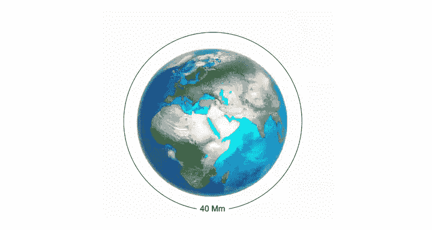

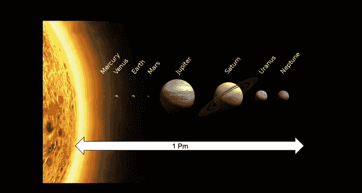

从下周开始，我们将正式学习云存储、对象存储等核心材料。此外，本周我们还将复习SQL。许多同学在本科阶段已经学习过关系型数据库管理系统和SQL，但为了确保所有同学，包括那些可能没有相关背景的同学，都能跟上进度，我们将进行复习。因为在课程中，我们会大量使用SQL。

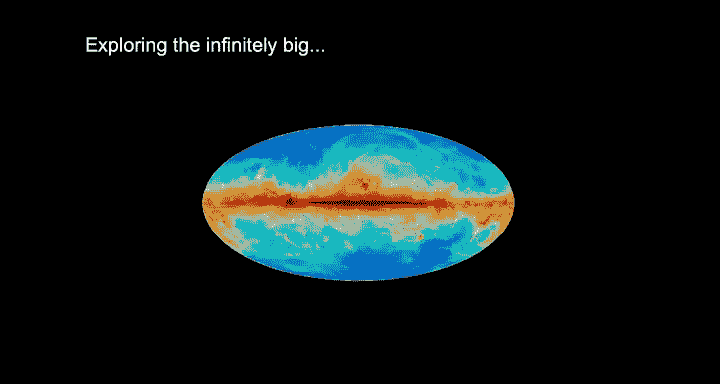

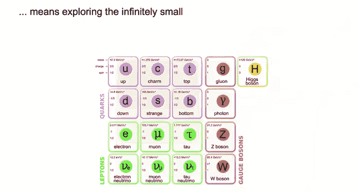

## 什么是大数据？🤔

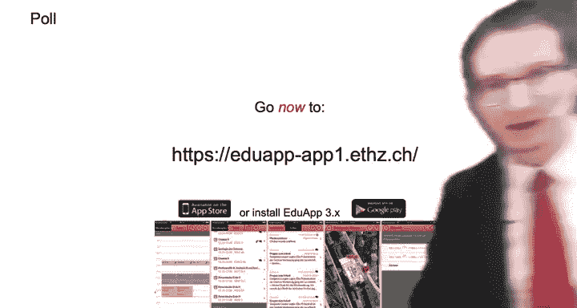

我们主要将学习两件事：
1.  如何查询海量的、可能并非完全结构化或表格化的数据。
2.  解释这些数据处理引擎背后的“魔法”是如何实现的。当你执行一个查询时，结果看似神奇地出现，但这背后是数十年来无数工程师努力的成果。学完本课程，你将了解这些系统幕后的工作原理，甚至可能为下一代系统做出贡献。

课程中会涉及一些关键技术名词，例如Hadoop、Apache Spark，以及由苏黎世联邦理工学院开发的RumbleDB等。

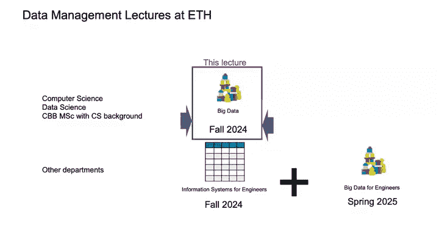

## 规模的概念：从宇宙到数据 🌌

在大数据中，“规模”是一个核心概念。我们可以通过探索宇宙的尺度来类比理解数据的规模。

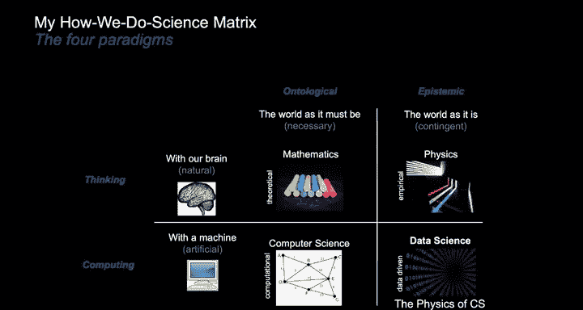

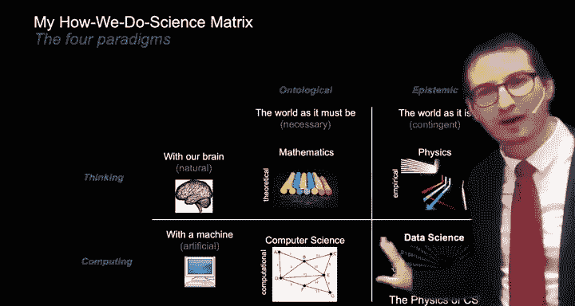

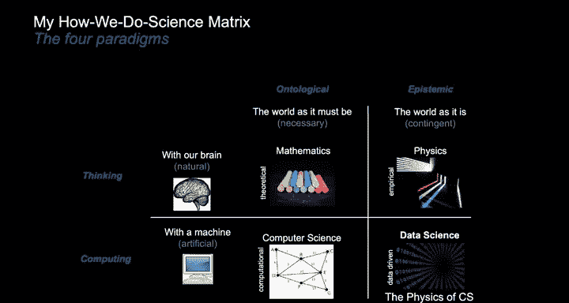

从我们身边的米级尺度开始，向外扩展：地球的周长约4万公里（即4万千米）。继续向外，太阳到地球的距离是1.5亿公里，即150吉米（Gigameter）。再到木星的距离则达到了太米（Terameter）级别。整个太阳系的规模大约是拍米（Petameter）级别。

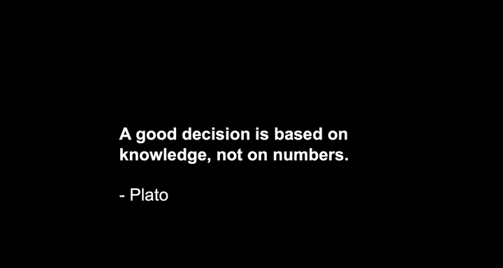

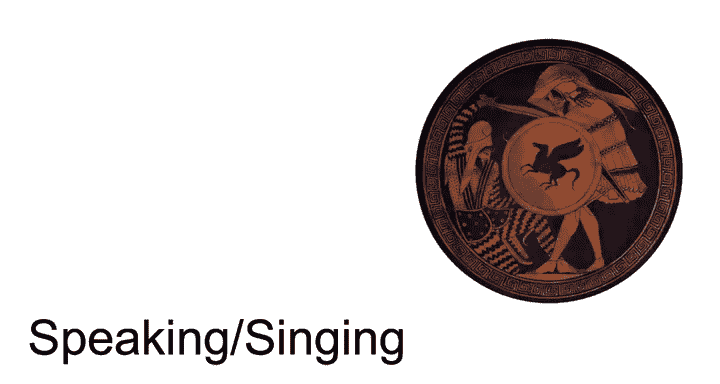

10拍米大约等于1光年。银河系的尺度大约是10艾米（Exameter）或1泽米（Zettameter）。而可观测宇宙的尺度达到了138尧米（Yottameter）。

这个探索过程揭示了一个重要道理：研究宏观宇宙的科学家，同样需要研究微观粒子（如夸克、电子）。这和数据科学非常相似：我们既要审视数据的宏观规模，也要深入探究其微观结构。数据操作与化学中处理分子的方式有异曲同工之妙。

## 课程背景调查 📊

为了了解大家的背景，我们将使用一个由苏黎世联邦理工学院开发的课堂互动应用EduApp。请通过浏览器访问指定地址或安装该应用，并回答关于你所在专业的问题。

调查结果显示，绝大多数同学来自计算机科学专业，其次是数据科学和计算生物学等专业。

本课程主要面向计算机科学、数据科学和计算生物学硕士项目的学生。其他项目的同学可以选修春季学期开设的《工程师大数据》课程，或者本学期的《工程师信息系统》课程，后者涵盖了数据库的基础知识。

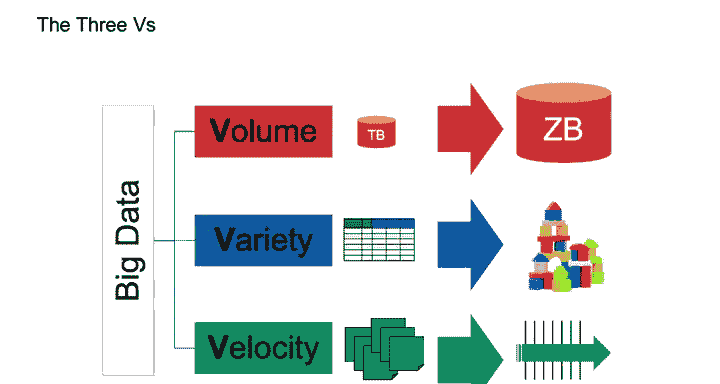

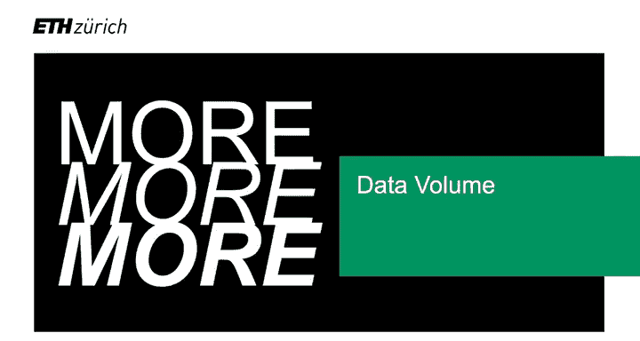

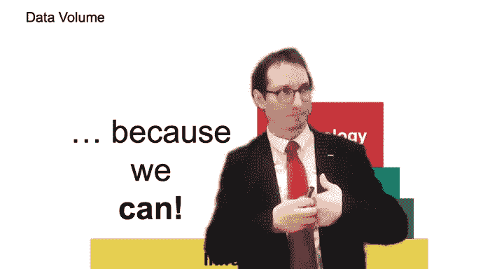

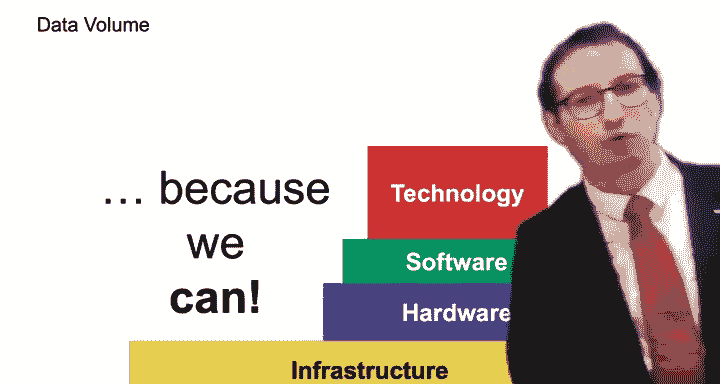

## 数据科学与物理学的类比 ⚛️

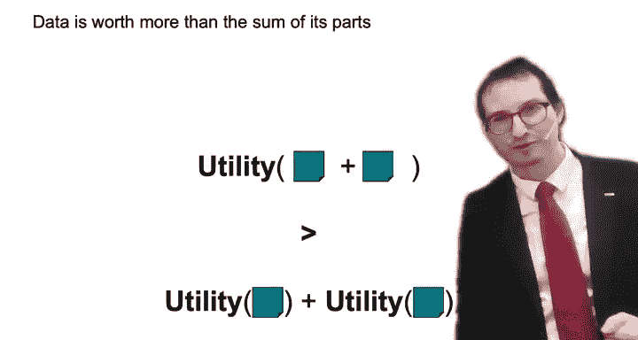

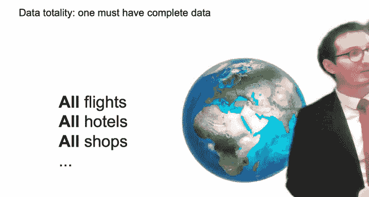

我们可以通过一个类比来理解数据科学：理论计算机科学类似于数学，是基于逻辑和推理的；而数据科学则类似于物理学，它基于从现实世界收集的实验数据（即数据）进行分析，以发现世界的运行规律。因此，数据科学可以说是“计算机科学中的物理学”。

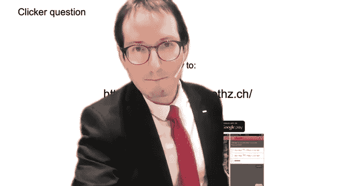

## 数据库简史 📜

数据管理的历史悠久：
*   **史前时期**：通过口述故事来传递信息，但容易出错和遗忘。
*   **书写革命**：数千年前，人类发明了文字并将其刻在泥板上，使信息得以长期保存。
*   **最早的“数据库”**：一块4000年前的泥板，它实际上是一个具有行列结构的表格，用于记录库存和贸易信息。这表明表格是人类理解数据最自然、最通用的形式之一。
*   **印刷术**：解决了信息复制和规模化传播的问题。
*   **计算机时代**：带来了数据处理能力的飞跃。早期计算机使用打孔卡进行编程和数据输入。
*   **文件系统**：1960年代，人们通过目录和文件在硬盘上管理数据。
*   **关系型数据库革命**：埃德加·科德（Edgar Codd）提出，应该将数据以表格的形式呈现给用户，而将底层的复杂性隐藏起来。这标志着1970年代初关系型数据库时代的开始。
*   **后续发展**：出现了键值存储、图数据库、文档存储等多种数据模型，以应对不同场景的需求。

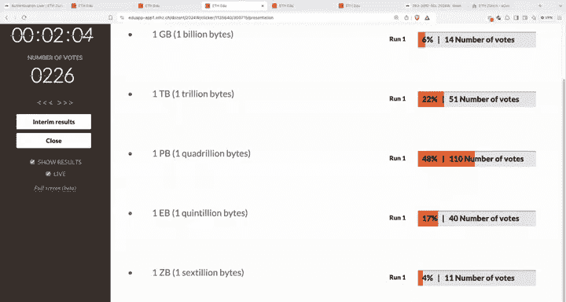

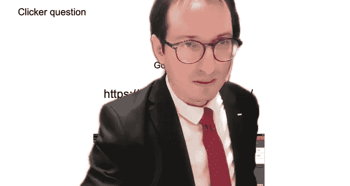

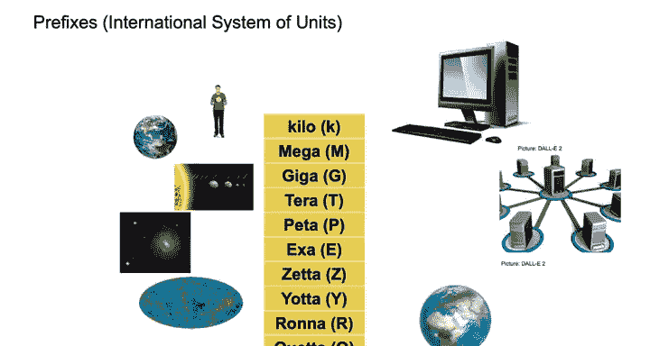

## 定义大数据：三个V 📈

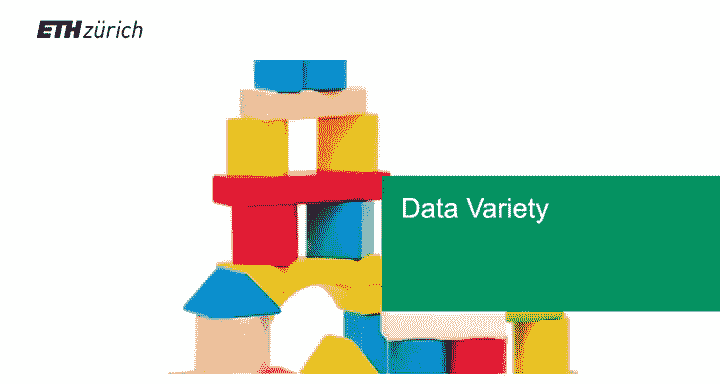

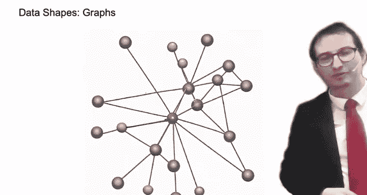

“大数据”是一个流行词，其核心特征通常用“三个V”来概括：
1.  **数据量（Volume）**：数据规模巨大，可达PB（Petabyte）甚至EB（Exabyte）级别。
    *   **驱动力**：存储成本下降、云基础设施普及。
    *   **数据价值**：数据能产生洞察，提升生产力。合并多个数据集（连接操作）能产生“1+1>2”的价值。
    *   **数据完整性**：某些服务（如航班预订）需要完整的数据集才有意义。
    *   **规模前缀**：你需要熟悉表示数据规模的国际单位前缀，从千（Kilo, 10³）到尧（Yotta, 10²⁴）。记住这些前缀的一个技巧是联想希腊数字（如Tera对应“四”，Peta对应“五”，指三零的组数）。

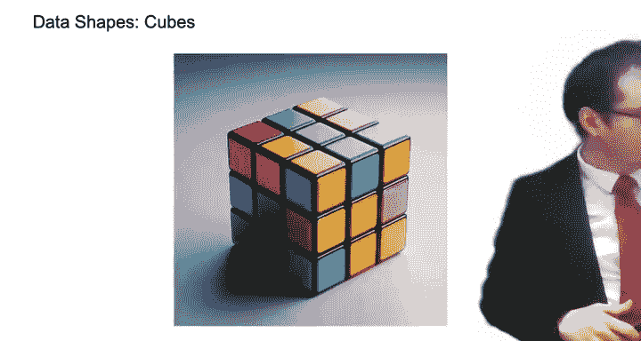

根据课堂调查，大多数人认为数据量达到PB级别时，就开始进入“大数据”范畴，因为这通常意味着数据无法存储在单台机器上。

2.  **多样性（Variety）**：数据具有多种形态。
    *   **表格**：行列结构。
    *   **树形**：层次化结构。
    *   **图形**：网络关系结构。
    *   **立方体**：用于商业智能的多维分析。
    *   **非结构化/文本**：如今，向量数据库常被用于处理此类数据，特别是在大语言模型场景中。

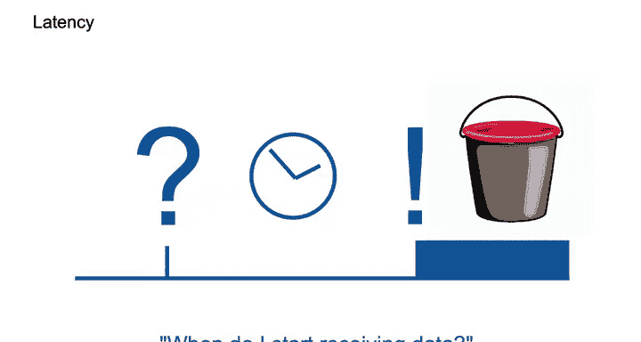

3.  **速度（Velocity）**：涉及数据生成和处理的速度。这里需要理解三个关键指标：
    *   **容量（Capacity）**：存储设备能 hold 多少数据，单位是字节（Bytes）。
    *   **吞吐量（Throughput）**：读取或传输数据的速度，单位是字节/秒（Bytes/s）。
    *   **延迟（Latency）**：开始接收数据前需要等待的时间，单位是秒（s）。

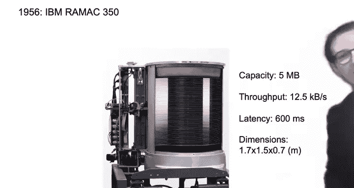

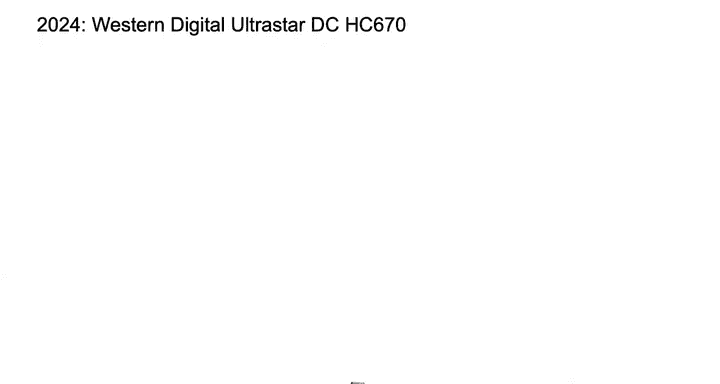

通过对比1956年（5MB容量，600ms延迟）和2024年（26TB容量，4ms延迟）的硬盘，我们发现：**容量的增长远远超过了吞吐量的增长，而延迟的降低相对有限**。

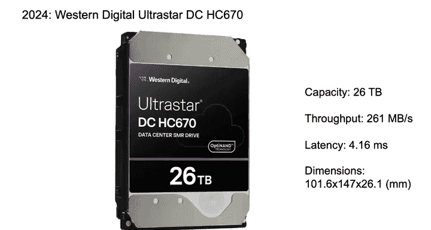

这种不均衡的进化导致了核心问题：如果今天要读完整个硬盘的数据，所需时间相比几十年前呈爆炸式增长。这正是驱动大数据技术发展的根本矛盾。

## 大数据的解决方案 💡

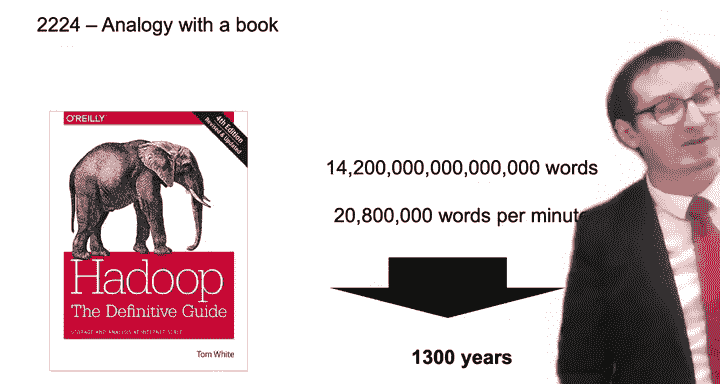

为了解决上述矛盾，主要发展出两种思路：
1.  **并行化（Parallelization）**：将巨大的任务（如读取那本“未来的书”）分割成小块，分发给数百万台机器或人员同时处理。这样，总处理时间可以大幅缩短。数据中心使用大量机器正是为了并行处理。
2.  **批处理（Batch Processing）**：将大量操作集中起来，一次性高效处理，这将在后续课程中详细讲解。

因此，**大数据可以定义为为了解决容量、吞吐量和延迟进化不均衡问题而诞生的一系列技术方案**。

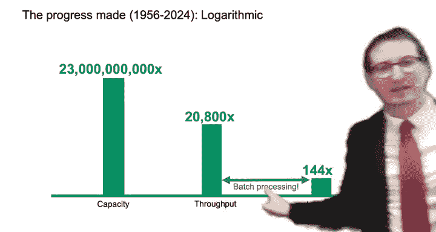

## 大数据的应用领域 🌍

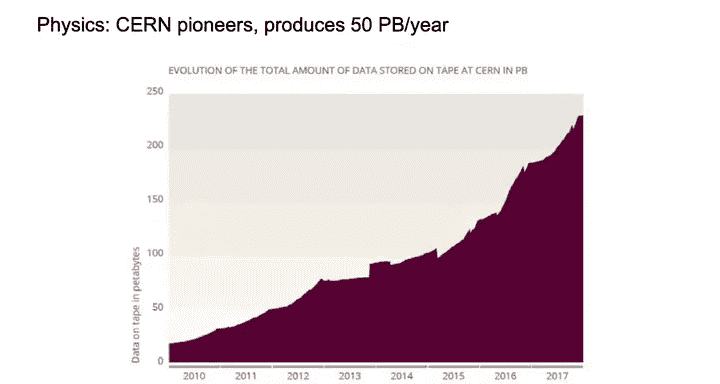

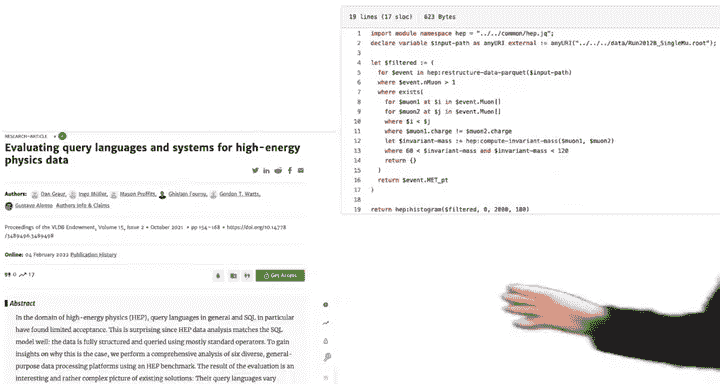

大数据技术已广泛应用于各个领域：
*   **科学领域**：例如欧洲核子研究中心（CERN）使用大数据技术处理粒子对撞产生的海量数据，希格斯玻色子的发现本质上就是一个数据库查询问题。
*   **天文学**：系统性地编录天空中的所有天体，寻找系外行星和生命迹象。
*   **基因组学**：编辑DNA、合成蛋白质（如mRNA疫苗），甚至将DNA作为一种极具潜力的未来数据存储介质。

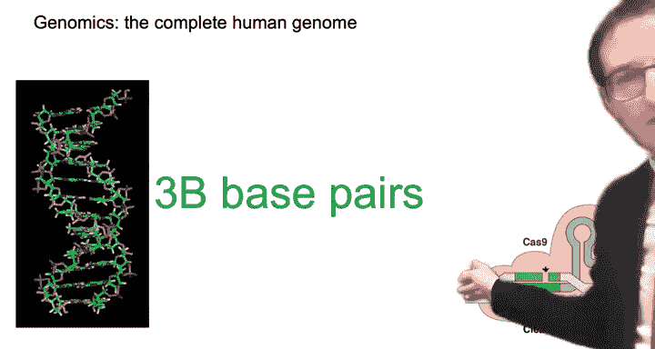

## 课程内容与团队介绍 👨‍🏫👩‍🏫

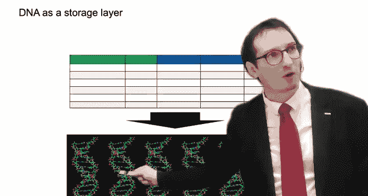

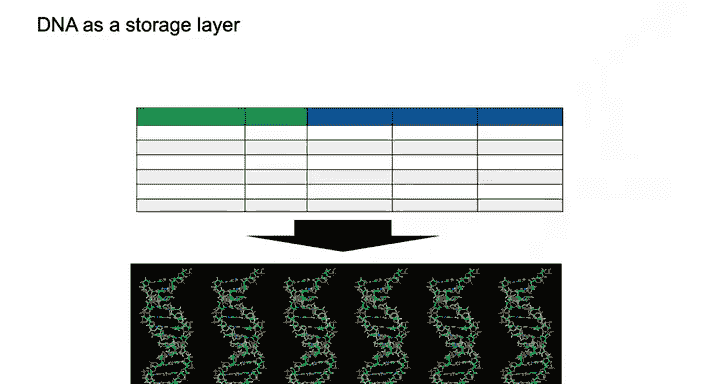

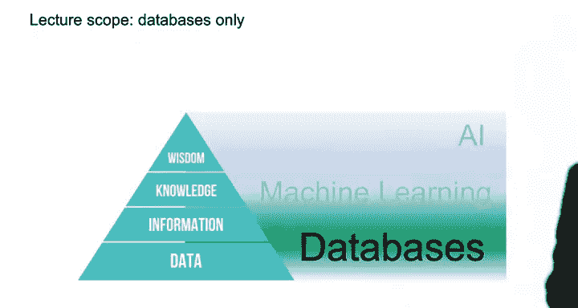

本课程聚焦于数据科学和大数据中的数据库层面。我们将学习：
*   **数据存储与编码**：如S3、HDFS、JSON、Parquet、Avro等格式。
*   **数据模型**：如HBase、Cassandra等键值存储，以及DataFrame的严格定义。
*   **数据处理流程**：第一代的MapReduce，资源管理，第二代的Apache Spark。
*   **数据管理**：如MongoDB等文档数据库。
*   **查询语言**：SQL、JSONiq等，区分查询语言与API（如Pandas是API）。

我们的教学团队由多位助教组成，他们将负责组织练习课、提供支持并参与考试相关工作。

此外，我们还有一个特殊的“学生”——**Ethel**。它是一个基于教科书训练的大型语言模型，你可以通过ETH账户登录相关平台向它提问课程内容相关问题。

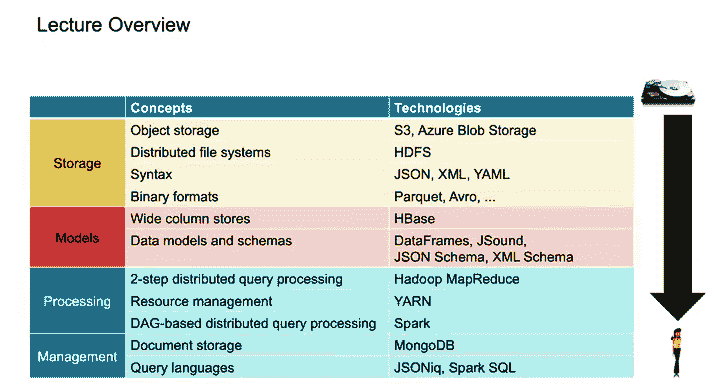

## 课程安排与考核 📅

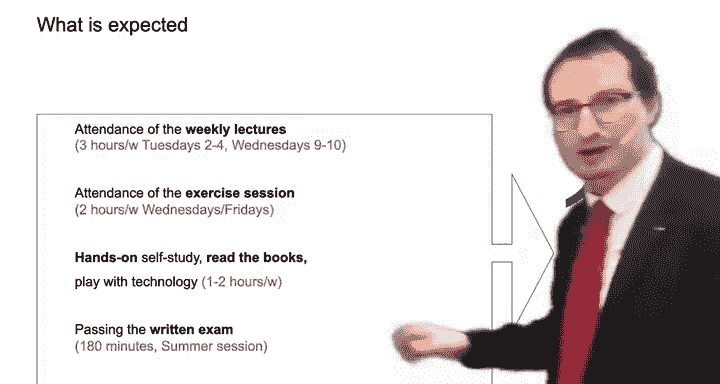

*   **每周讲座**：周二14:00-16:00。
*   **练习课**：从下周开始，每周三和周五，每次2小时（本周无练习课）。我们将扩容以满足需求。
*   **自学与实践**：预计每周投入3-4小时进行阅读、练习和实验。
*   **期末考试**：3小时笔试，最多60道题（选择题、填空题等）。会提供往年试题参考。
*   **加分机会**：本学期共有25次在线小测验（Module Quizzes）。每通过一次可获得0.01分的加分。这些加分会在最终成绩计算前加入，提高你获得更好成绩的可能性。

---

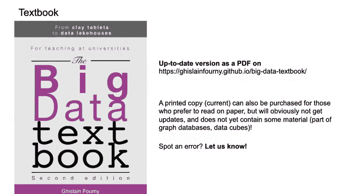

**本节课总结**：我们一起开启了大数据课程的学习。我们了解了课程的目标是学习处理海量、多样数据的方法及其背后原理。通过宇宙尺度的类比，我们理解了“规模”的意义。回顾了从泥板到现代数据库的演进历史，并深入探讨了定义大数据的三个V（Volume， Variety， Velocity），特别是容量与吞吐量进化不均衡所带来的核心挑战及其解决方案（并行化与批处理）。最后，我们预览了课程的主要内容、认识了教学团队，并清楚了课程的时间安排与考核方式。下节课我们将开始更具体的技术学习。