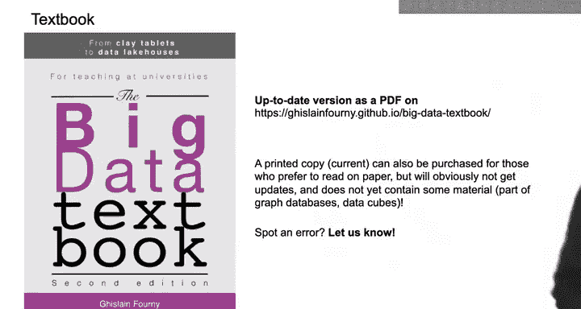
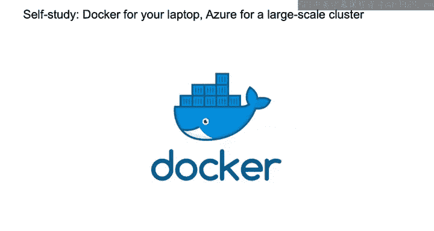
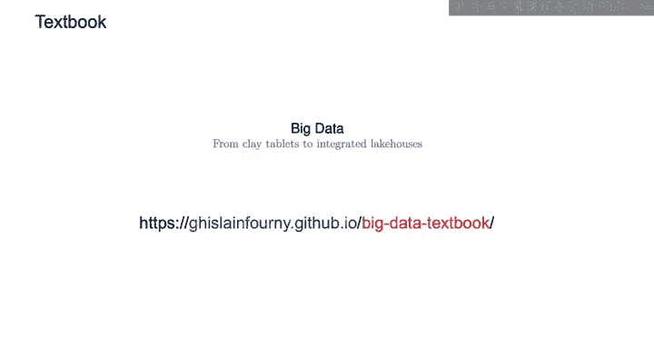
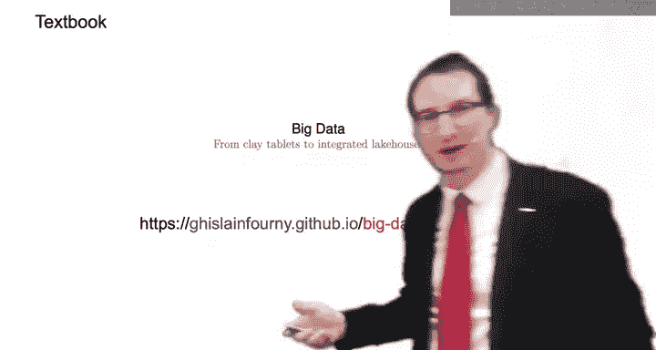
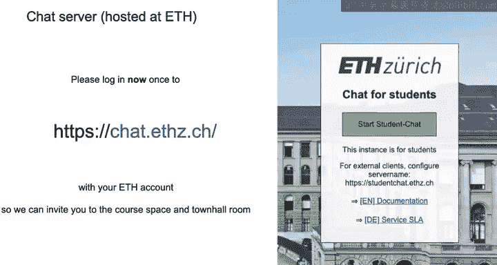
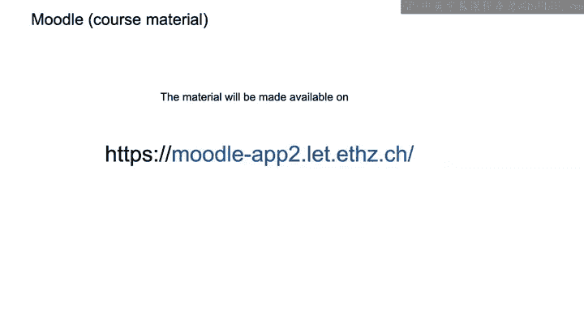

# 课程 02-1：引言 (2/2) 📚

在本节课中，我们将继续介绍《大数据》课程的相关信息，包括课程教材、实践练习工具、在线交流平台以及课程材料获取方式。

## 课程教材 📖

上一节我们介绍了课程的基本信息，本节中我们来看看课程教材的安排。

几年前我开始这门课程时，在互联网上没有找到合适的教科书。因此，我参考了大量书籍和章节，并编写了一本教材。由于学生普遍希望有一本教科书，我便为这门讲座编写了一本，并将其发布在网上。你可以直接下载PDF版本，无需任何费用。

对于喜欢纸质版教材以便打印和阅读的人，我也将其放在了亚马逊上。这是截至八月底的第二版。如果你喜欢印刷版，可以选择购买，但由于使用了彩色墨水印刷，价格会稍高一些。不过，你完全不必购买，直接下载PDF即可。

PDF版本的一个好处是，当你指出错误时，我可以持续更新。我会修正错误，并在致谢部分添加指出错误的学生姓名。如果你想留下名字，就请帮忙找出错误。这个在线版本将始终保持最新，而纸质书则难以做到这一点。

目前教材尚未完全完成。图数据库章节的前半部分已经完成，后半部分仍在编写中；数据立方体章节也尚未加入。我希望能在本学期将其添加到在线教材中。

以下是获取教材的步骤：
1.  访问提供的URL。
2.  下载PDF文件。它存放在ResearchGate上，这是一个存放研究论文的网络平台，但你可以通过链接直接访问。

教材大约有400多页，厚度可观。

## 实践练习与Docker 🐳

接下来，我们谈谈实践练习。我们将使用一个名为Docker的工具。

Docker本质上是一种解决助教团队头疼问题的方法，即无需在不同操作系统上支持软件的安装。我们的做法是将所需的所有软件打包到一个Docker文件中。你可以在笔记本电脑上下载Docker桌面应用程序，然后运行一个简单的命令，它就会为你创建好所需的环境。这就是我们将要使用的方式。

其中一个Docker镜像是考试Docker，它包含了过去所有考试的数据集。此外，还会为练习创建其他Docker镜像供你们使用。

如果遇到任何问题，请及时告知我们。我们使用Docker已有一段时间，对大多数人来说应该都能正常运行。早些时候，苹果M系列芯片的电脑可能有些问题，但新版本的Docker应该已经解决了。所以，请尽管尝试，如果本周我们提供了相关材料，你可以提前测试以确保在你的笔记本电脑上运行正常。

关于“自带笔记本电脑”的规定：从法律角度我不太确定，但技术上，第一年的硕士生可能有义务配备笔记本电脑。我不确定第二年的学生是否也有此要求。无论如何，即使你是第二年学生，如果没有笔记本电脑，也可以在ETH的计算机房运行相关软件。

看起来每个人都有笔记本电脑，这很好。如果有任何问题，请告诉我们。基本上，Docker是我们将使用的主要工具，所有内容都会打包在里面。Docker这个名字来源于航运中用于全球运输货物的集装箱。

## 在线交流平台 💬

现在，我们来介绍在线交流平台。

请访问这个页面：`chat.ethz.ch`。点击右侧的“学生聊天”，使用你的ETH用户名和密码登录。正常情况下，你应该能看到一个名为“Town Square BDHS 2024”的房间。这是本讲座的聊天室。

你可以在这里交流、分享表情包。前几年，这里分享了很多关于大数据的表情包，这完全没问题。我知道你们可能也使用其他服务器，如Discord等，学生使用那些也完全可以，但我们不直接参与其中。如果你想与助教和我们互动，这里就是合适的地方。

此外，还有Moodle论坛，你也可以在那里提问。助教团队会告知他们在哪个渠道保证回复，可能是这个聊天室，也可能是Moodle，但两者你都可以使用。

如果无法使用，请告诉我们。我手动邀请了440人，可能有些邀请没有成功送达。请检查是否对您有效，如果无效请告知。

顺便提一下，既然我看到聊天室有活动，我应该告诉你们，你们可以随时提问并打断我，因为这是讲座，你们在学习。没有所谓的愚蠢问题。在Zoom上也可以这样做：如果你在Zoom聊天中键入问题，我们的助教负责人Zika会代表你打断我，向我转述问题，然后我可以回答。这样，讲座就不仅是面向讲堂里的人，也是互动的。如果你害羞，也可以像这样举手，或者在Zoom上打字，举手也是完全可以的。

对于在YouTube上观看我们视频的人，你可以通过发送电子邮件给助教团队或在Moodle论坛发帖来提问。

顺便说一句，我不知道是否有人在考前几周，比如一月份，以倍速观看视频来备考。我们在这里是为了帮助你们，所以请给我们发邮件，查看Moodle论坛。当然，我希望你们大多数人在本学期跟随讲座学习，这对大脑长期保持知识要好得多。

## 课程材料与问答 🗂️

最后，关于课程材料。

课程目录上有一个链接，所有材料都放在课程的Moodle页面上。在那里，你可以找到讲义的PDF幻灯片、练习、以及Ehel的链接（如果尚未提供）。这是整个讲座互动的中心点。

如果点击没有反应，那可能是因为内容正在上传。我想第一部分就到这里。到目前为止有什么问题吗？

（关于学生聊天室是否工作的提问与解答环节）

如果聊天室对某些人无效，我们会想办法解决。如果你们中有几个人能私下给我发邮件说明情况，以便我调查，这可能与我生成ID的方式有关。请给我们发邮件，我可能会收到200封邮件，但我们会尽力解决，让所有人都能连接。

还有其他问题吗？在Zoom上，课程也是如此。如果没有问题，我将继续讲座的第二部分。

（讲师说明需要停止并重新开始录制，以便在YouTube上保持内容组织有序。）

本节课中我们一起学习了课程教材的获取与特点、实践练习将使用的Docker工具、在线交流平台的使用方法以及课程材料的集中获取位置。这些是保障课程顺利进行的基础设施，请务必熟悉。