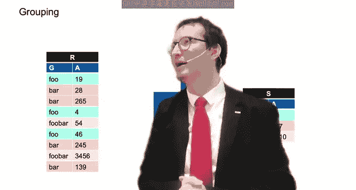

# 3：经验教训 (1/3) 📚

在本节课中，我们将回顾关系型数据库的核心概念。这些知识虽然源于几十年前，但对于理解现代大数据技术至关重要。通过学习历史经验，我们可以避免重复过去的错误，并加速对新知识的掌握。

上一节我们介绍了大数据的基本概念，本节中我们来看看关系型数据库的基础知识。

## 数据独立性：现代数据库的基石 🧱

埃德加·科德被认为是现代关系型数据库之父。他的核心贡献是提出了**数据独立性**的概念。

**数据独立性**是指将数据的逻辑视图（如表）与物理存储和实现细节分离开来。用户只需与表格交互，就像使用Excel等电子表格软件一样，而无需关心数据在硬盘上是如何存储或实现的。

这个原则可以用一个简单的分层模型来表示：
*   **逻辑层**：用户看到的表格和SQL查询。
*   **物理层**：数据在磁盘上的存储方式（如C++、Java实现）。

数据独立性的美妙之处在于，你可以在不同的物理层上实现相同的逻辑层。无论是单机硬盘、数据中心集群，甚至是DNA存储，只要逻辑层保持不变，用户体验就是一致的。这个原则将贯穿我们整个学期的学习。

## 聚焦表格：关系模型的核心 📊

在众多数据形态（树、表、立方体、图、非结构化文本）中，本节课我们专注于**表格**。表格的处理可以概括为四个层次：
1.  **存储层**：以比特形式存储数据。
2.  **计算层**：如CPU，负责处理数据。
3.  **模型层**：描述表格是什么。
4.  **语言层**：如SQL查询语言。

模型层是数据独立性发挥作用的地方，它清晰地划分了逻辑路径和物理路径。

定义一个数据模型需要两个核心组件：
1.  **数据结构**：描述数据看起来是什么样子（例如，一个表格）。
2.  **数据操作**：定义可以对数据做什么（例如，查询、筛选、连接）。

这类似于烹饪：你需要定义食材（数据结构）和烹饪方法（数据操作，如煎、炒、煮）。

## 数据独立性的演进：从单机到大数据 🚀

数据独立性如何工作？让我们看看它的演进：
*   **20世纪70年代**：在单台计算机、单个硬盘和CPU上实现关系表和SQL。
*   **近10-20年**：保持顶部的逻辑层和模型层不变，但将底部的存储和计算层替换为数据中心。用户体验不变，但性能大幅提升。
*   **大数据时代**：我们延续了这一思想，继续在更复杂的物理架构上构建相同的逻辑抽象。

在本科数据库课程中，你主要学习的是单机架构。而本课程将探索如何将同样的逻辑模型应用于分布式的大数据环境。

## 解剖一张表：基本构成 🧩

一张表看起来非常直观。它也被称为**关系**、**集合**或**关系表**。

以下是表格的核心组成部分：
*   **行**：水平方向的一组值。也称为**记录**、**业务对象**、**元组**、**实体**或**文档**。
*   **列**：垂直方向的一组值。也称为**属性**、**字段**或**键**（注意与“主键”区分）。
*   **单元格**：行与列的交点，存储单个值。
*   **主键**：一个或多个能唯一标识表中每条记录的列。例如，社会保障号、车牌号（可能由“州”和“号码”两列共同构成）。在NoSQL中常被称为`_id`。

## 关系的数学定义与更优定义 🧮

为什么叫“关系”型数据库？一种常见的教科书定义是：一个表是**域**的笛卡尔积的一个子集，即一组**元组**的集合。
*   **元组**：从每个域中取一个值构成的有序序列。
*   **关系**：一组元组的集合。

但这个定义有局限性（例如，它隐含了列的顺序，而实际数据库中列的顺序不重要）。我更喜欢另一种定义，它更能自然地过渡到大数据领域。

一个关系表可以定义为：
*   **模式**：一组属性的集合，例如 `{PID, Last, First, Country}`。
*   **外延**：表的内容，即一组元组的集合或列表。

元组本质上是一个将属性映射到值的函数。例如，元组 `{PID: 2, Last: “Ramanujan”, First: “Srinivasa”, Country: “India”}`。

关于“一组元组”的语义，有三种可能：
*   **集合**：元组无序且不重复。（纯关系模型理论）
*   **包**：元组无序但允许重复。
*   **列表**：元组有序。（实际数据库系统中更常见）

我们可以简单地说：一个表是**行**的**集合**。

## 关系表的三大完整性规则 ✅

并非任何元组集合都能构成有效的关系表。必须满足三条完整性规则：

以下是三条核心的完整性规则：
1.  **关系完整性**：表中所有元组必须具有完全相同的属性集。这确保了表结构的统一性。
2.  **原子性完整性**：每个单元格中的值必须是**原子**的，即不可再分的基本数据类型（如字符串、数字、日期），而不能是另一个表、对象或数组等嵌套结构。
3.  **域完整性**：同一列（属性）下的所有值必须属于相同的数据类型（如整型、字符串型）。

这三条规则的交集，定义了经典的、严格的关系型数据库世界（如SQL）。然而，在本课程中，我们将逐一打破这些规则，探索NoSQL等更灵活的数据模型。

## 关系代数：操作表格的“数学” 🔢

对于满足上述三条规则的“规整”表格，我们有一套形式化且强大的操作工具，称为**关系代数**。就像数字有加减乘除，表格也有其专属的操作。

以下是一些核心的关系代数操作：
*   **选择**：根据条件筛选出特定的行（类似于Excel中的筛选）。
*   **投影**：选择特定的列，隐藏其他列。
*   **分组**：根据某列的值将行分组，并对组内数据进行聚合计算（如求和、求平均）。这是数据分析中极其重要的操作。
*   **连接**：将两个或多个表基于相关列合并在一起。

我们将在后续课程中详细探讨这些操作。

## 总结 📝

本节课我们一起学习了关系型数据库的基石。我们首先理解了**数据独立性**这一核心设计原则，它分离了逻辑视图与物理存储。接着，我们剖析了**关系表**的构成（行、列、主键），并从数学和实用角度探讨了其定义。我们明确了构成有效关系表的三大**完整性规则**：关系完整性、原子性完整性和域完整性。最后，我们简要介绍了用于操作表格的**关系代数**。这些经典概念为我们后续学习大数据技术，特别是理解如何以及为何要突破这些传统规则，奠定了坚实的基础。

下节课，我们将继续深入，探讨数据库设计中的“范式”理论。