# 大数据课程笔记 - 第05-2讲：经验总结与SQL回顾 🗂️

在本节课中，我们将继续复习SQL的核心概念，并初步了解云存储。课程将从几个互动问题开始，然后回顾关系型数据库的基础知识，包括数据独立性、SQL查询结构、ACID属性等，最后引出大数据领域将如何打破这些传统规则。

---

## 欢迎与课程安排 👋

欢迎大家来到课堂，也欢迎在Zoom上以及未来的同学们。

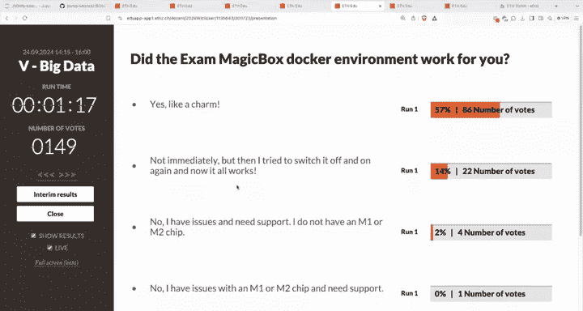

今天的课程安排是：我们将继续**SQL复习**，然后开始探讨**云存储**。

---

## 互动问答环节 ❓

首先，我们通过几个问题来回顾和引入一些概念。

以下是关于数据基本形态的问题。哪一种不属于数据的基本形态？

*   立方体
*   表格
*   树
*   圆形

答案是**圆形**。我们会在云存储中看到圆形和环形的概念，但这并非数据的基本形态。立方体是数据分析中常见的形态，而表格绝对是基础。

下一个问题：对一张表进行反规范化后，通常会得到什么形态的数据？是立方体、树、图还是文本？

答案是**树**。这正是我们打破关系型数据库规则、进入NoSQL世界时会得到的结果。本课程将花大量时间探讨这一点。

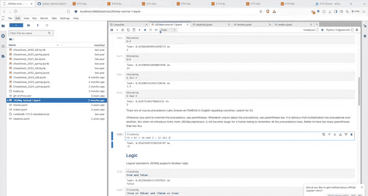

---

## 课程工具与环境设置 ⚙️

关于Magic Box（可能指Docker环境），如果大家在使用中遇到问题，请在专门的Docker支持频道中反馈，助教团队会提供帮助。常见解决方案包括删除镜像、容器和卷，然后重新运行 `docker-compose up`。

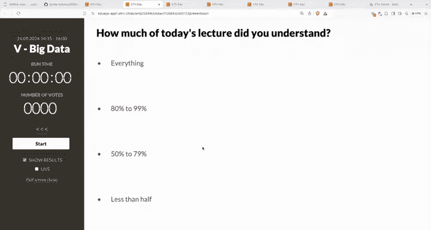

此外，今年我们引入了**JupySQL**的语法高亮功能，这是由一位硕士生实现的改进，能让SQL关键字更清晰地显示。大家使用的Docker环境即将更新为Jupyter Lab版本，它比传统的Jupyter Notebook在文件导航上更方便。我们也会提供往期考试的完整Notebook环境，供大家提前熟悉。

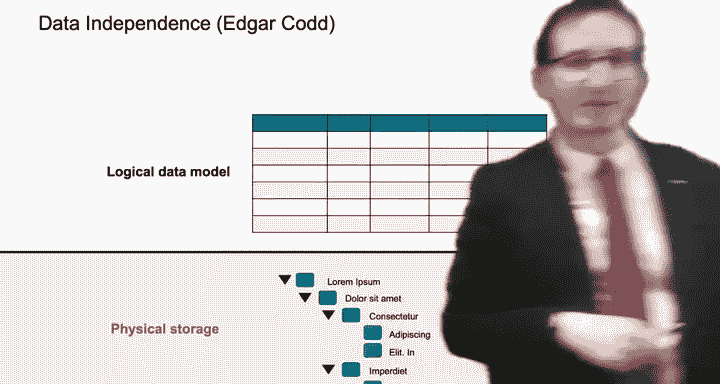

关于考试时间，之前口误说成了8月，正确时间是在**1月20日至2月14日之间**，具体日期将在11月或12月公布。

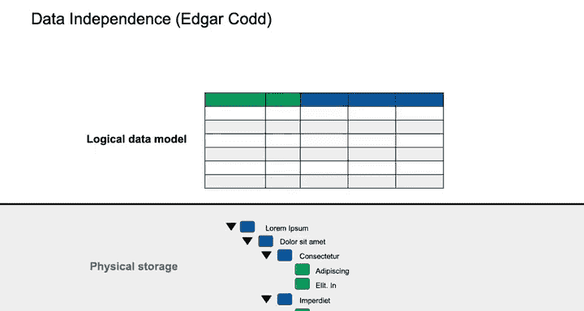

---

## 积分测验说明 📝


我们有一个奖励积分系统。你共有25次测验机会，每次测验通过可获得0.01分的考试加分。

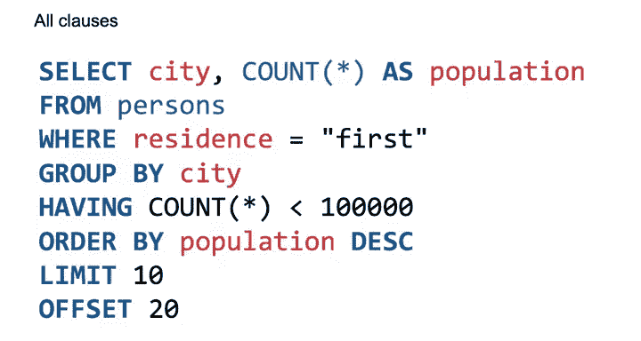

积分计算方式是：从考试原始分数（介于4到6分之间）开始，加上你获得的奖励积分，然后四舍五入到最近的0.25分。因此，奖励积分越多，你最终获得更高ETH成绩的概率就越大。

请注意，这些计分测验与不计分的练习册是独立的。测验通常在Moodle上进行，为选择题。如果你对评分有异议，可以与助教团队讨论。为了鼓励理解而非盲目尝试，通常**每周有两次测验机会，每次允许尝试1到2次**。如果需要更多尝试，需邮件联系助教团队。

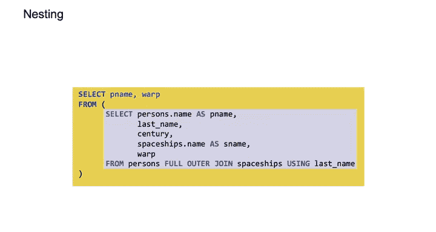

---

## 核心概念回顾：关系型数据库与SQL 🔄

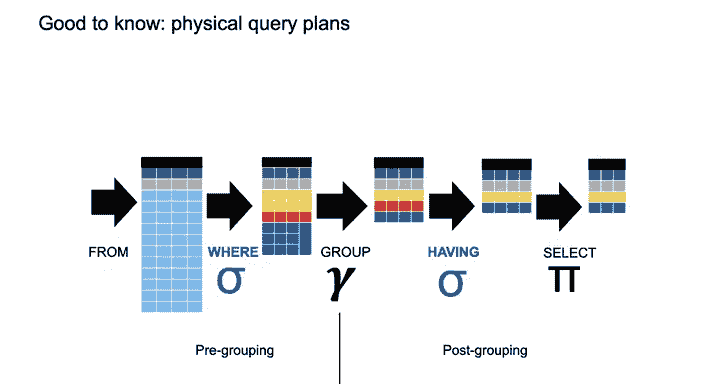

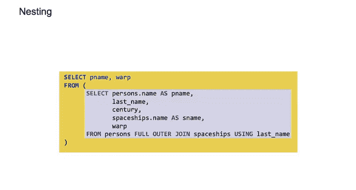

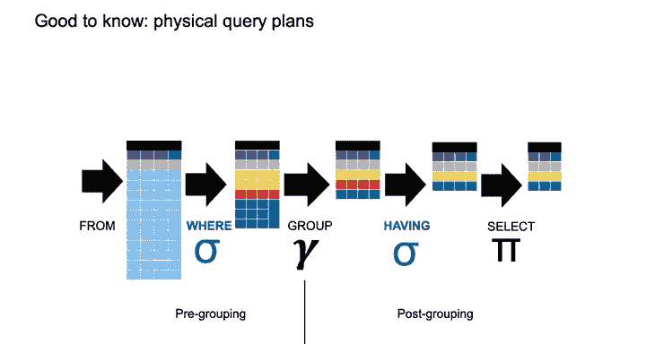

上一节我们通过问答互动引入了数据形态的概念，本节我们来系统回顾关系型数据库的核心思想。

### 数据独立性

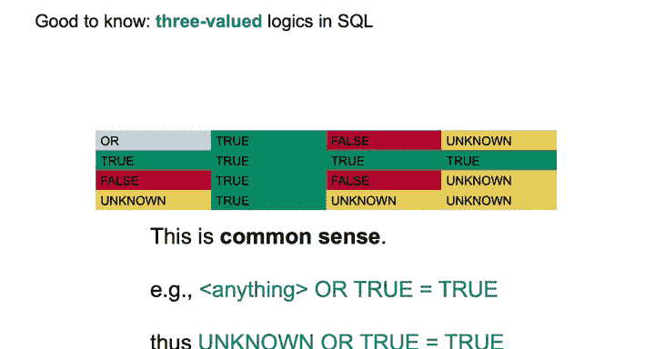

这是关系型数据库一个非常重要的概念，其核心思想是**将物理存储层与逻辑表示层解耦**。用户看到和操作的是表（逻辑层），而底层的存储方式（物理层）——无论是在数据中心、量子计算机还是其他介质上——对用户是完全隐藏的。

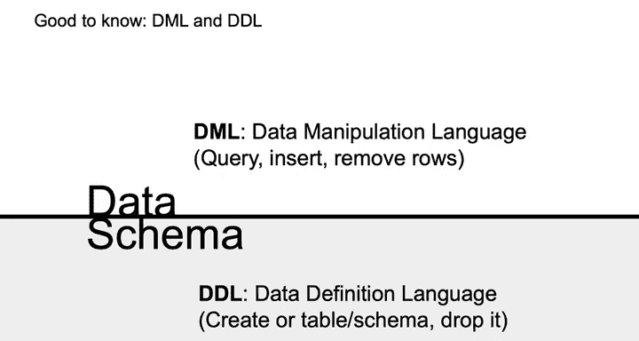

### 关系表的约束

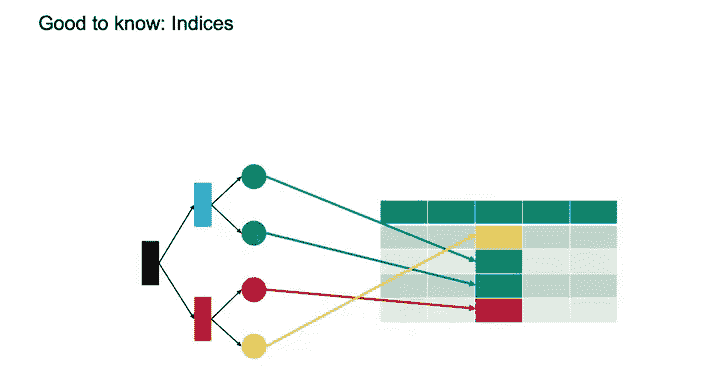

当我们定义关系表（由元组/记录组成的集合）时，遵循三条核心约束：
1.  **关系完整性**：所有元组拥有相同的属性集，从而能整齐地排列成表格形状。
2.  **域完整性**：每一列中的数据都具有相同的数据类型（例如，一列全是整数，另一列全是日期）。
3.  **原子性完整性**：表中不能嵌套表（即不允许“表中的表”）。

这三条规则共同构成了传统SQL的美丽世界。而当我们打破这些规则时，就进入了**NoSQL**的领域。

### SQL查询骨架

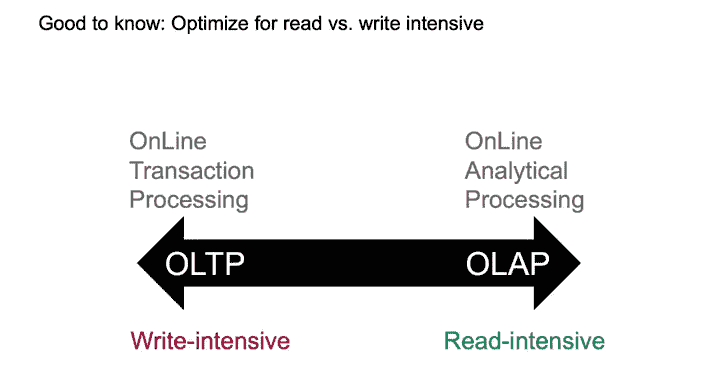

以下是必须掌握的SQL基本查询结构，其执行顺序如下：
```sql
SELECT ... FROM ... WHERE ... GROUP BY ... HAVING ... ORDER BY ... LIMIT ... OFFSET ...
```
它包含了选择（WHERE）、投影（SELECT）、分组（GROUP BY）、分组后筛选（HAVING）、排序（ORDER BY）和分页（LIMIT/OFFSET）等所有操作。大家需要通过大量练习来熟悉它。

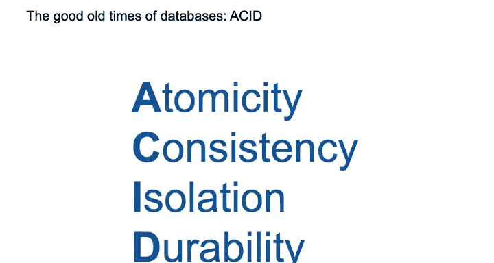

SQL的功能远不止于此，它支持**查询嵌套**。你可以在FROM子句或WHERE子句中嵌套另一个SELECT查询。一个典型用例是计算“最大值对应的记录”（argmax），例如在WHERE子句中嵌套一个求最大值的子查询。这允许构建非常复杂、甚至长达数百行的查询。

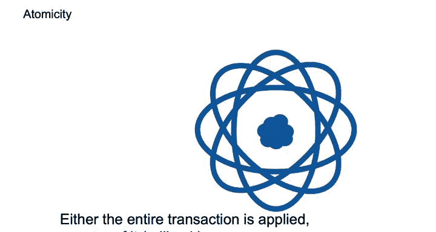

### 关系代数与三值逻辑

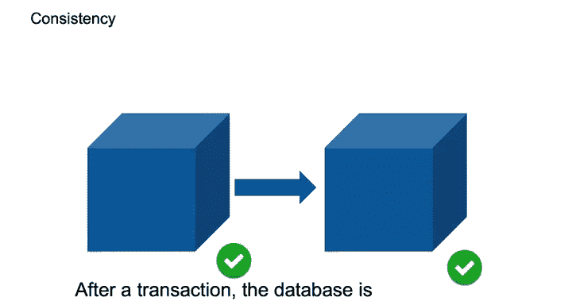

在数学上，关系代数常用希腊字母表示，如 σ (sigma) 代表选择，γ (gamma) 代表分组，π (pi) 代表投影。SQL就是对这些关系代数操作的程序化实现。数据库管理系统会将你的SQL查询转换为一个**迭代器树（也称查询计划）**，并可能进行重排优化以提升速度，但由于数据独立性，你无需关心这些底层细节。

SQL中的逻辑是**三值的**：真（TRUE）、假（FALSE）和未知（UNKNOWN）。这符合常识，例如 `FALSE OR UNKNOWN` 的结果是 UNKNOWN，而 `TRUE OR UNKNOWN` 的结果总是 TRUE。这与 `NULL` 值的处理密切相关。

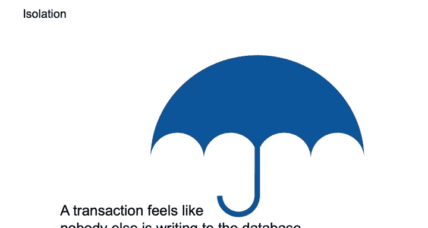

### DML、DDL与索引

*   **DML**：数据操作语言，用于查询和操作数据（如SELECT, INSERT）。
*   **DDL**：数据定义语言，用于定义数据的结构或模式（如CREATE TABLE, ALTER COLUMN）。

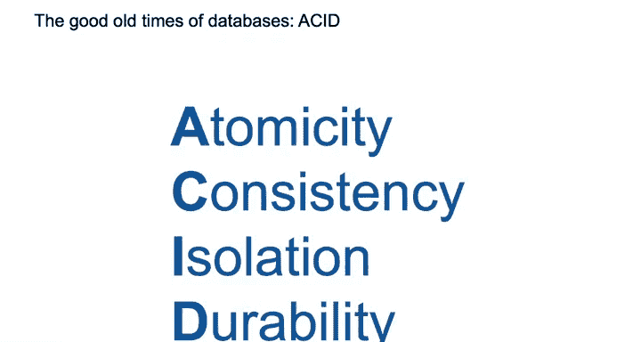

**索引**是数据库中用于加速查询的“魔法”结构，类似于书籍末尾的索引。它通过创建额外的数据结构，能将查询时间从数小时缩短到毫秒级，对用户透明且功能强大。

### OLTP 与 OLAP

数据库有两种主要使用场景：
*   **OLTP**：在线事务处理。特点是**写入密集**，例如电商网站不断处理新订单、更新库存。
*   **OLAP**：在线分析处理。特点是**读取密集**，例如下载一个数据集后主要进行查询分析，而不修改数据。在大数据中常见，这种场景允许我们对数据进行**反规范化**以优化读取性能。

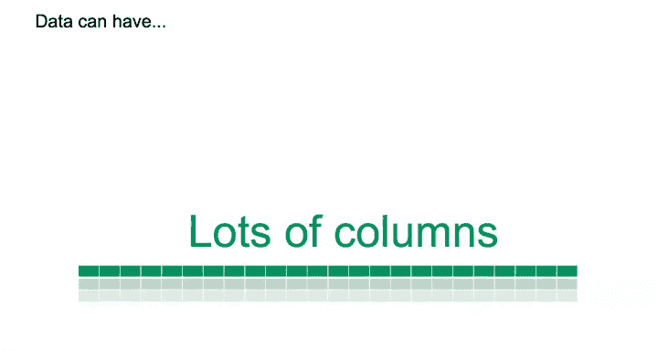

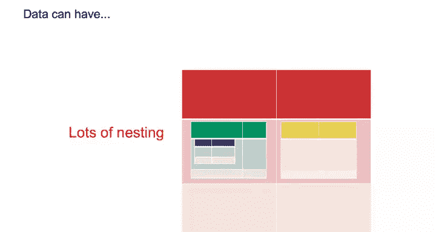

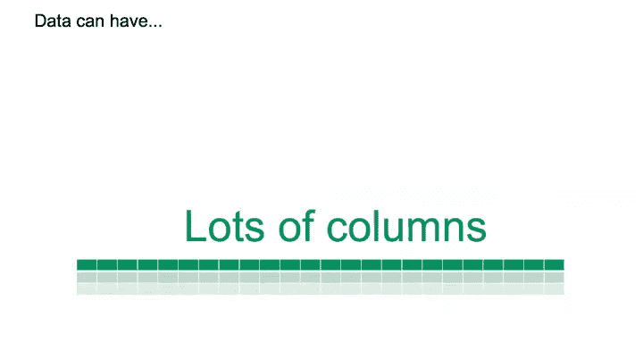

### ACID 属性

传统关系型数据库（如PostgreSQL）通过ACID属性保证可靠性：
*   **原子性**：事务中的所有操作要么全部完成，要么全部不完成。例如，ATM取款时，扣款和出钞必须同时成功或失败。
*   **一致性**：事务必须使数据库从一个一致状态转变到另一个一致状态。所有预定义的数据约束（如账户余额不能为负）在事务前后都必须成立。
*   **隔离性**：并发执行的事务彼此隔离，互不干扰。即使有成千上万人同时订票，每个用户也感觉自己是唯一操作者。
*   **持久性**：一旦事务提交，其对数据的修改就是永久性的，即使系统故障也不会丢失。

在大数据领域，由于规模巨大，完全保证ACID属性变得非常困难，我们将看到范式的转变。

---

## 迈向大数据：打破规则的三个维度 🚀

上一节我们回顾了关系型数据库的经典规则，本节我们来看看大数据如何从三个维度上突破这些限制。

传统SQL数据库在处理以下情况时会面临挑战，而这正是大数据的用武之地：
1.  **海量行**：表有数百万、数十亿甚至数万亿行。
2.  **海量列**：表有数百万列，且数据非常稀疏（大部分单元格为空）。
3.  **深度嵌套**：数据具有复杂的嵌套结构（“表中的表”）。

本课程后续的每周内容，基本上都将围绕这三个维度中的一个或两个展开：
*   **对象存储、分布式文件系统** → 解决**海量行**的问题。
*   **列式存储** → 解决**海量行和海量列**的问题。
*   **数据模型、文档存储** → 解决**深度嵌套**的问题。
*   **大规模文件处理** → 解决**海量行**的问题。
*   **嵌套数据查询** → 解决**深度嵌套**的问题，并引入如**JupySQL**等新的查询语言。

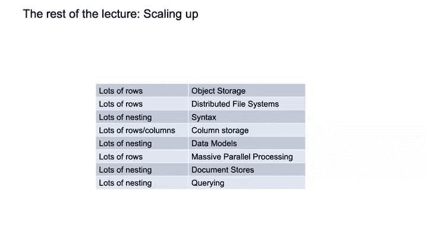


---

## 总结 📚

本节课中，我们一起学习了以下内容：
1.  回顾了关系型数据库的核心理念：**数据独立性**和**关系表的三大约束**。
2.  掌握了**SQL查询的基本骨架**和**嵌套查询**的强大能力。
3.  理解了数据库的两种主要场景：**OLTP**（写密集）和**OLAP**（读密集）。
4.  学习了保证数据可靠性的**ACID属性**（原子性、一致性、隔离性、持久性）。
5.  探讨了大数据时代突破传统规则的三个方向：处理**海量行**、**海量列**和**深度嵌套**数据。

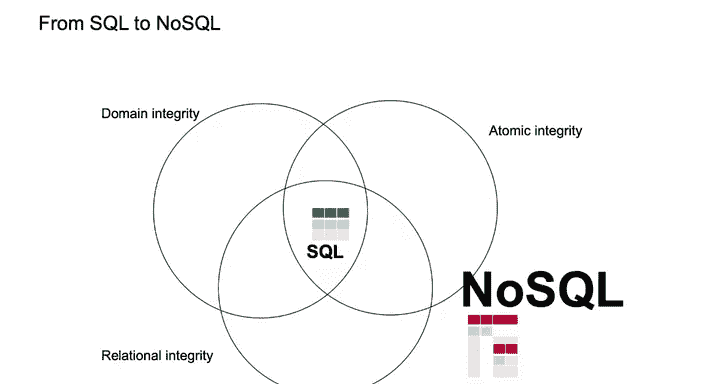

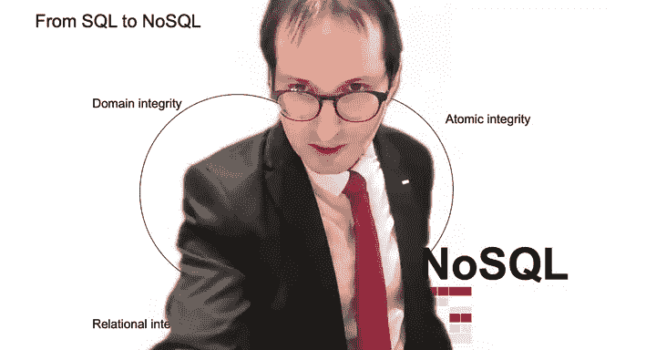

这为我们后续深入探讨云存储、NoSQL数据库及各类大数据技术奠定了坚实的基础。