# 课程 06-3：云存储 (1/4) 💾

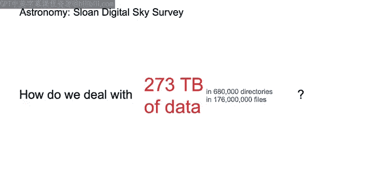

在本节课中，我们将要学习如何存储海量数据。我们将从一个具体问题出发：如何存储和处理像宇宙地图这样包含数百TB数据和数亿个文件的数据集。这标志着我们从单机关系型数据库转向分布式存储和处理系统的开始。

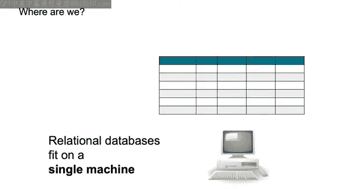

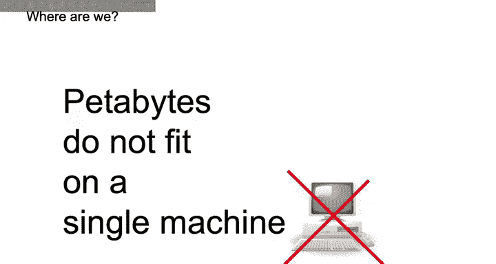

## 从单机到多机：存储的挑战

上一节我们介绍了关系型数据库。这些数据库运行在单台机器上。单台机器的存储容量有限，例如，可能最多只有30TB。这对于存储273TB的宇宙地图数据来说远远不够。

所以，我们首先得出的结论是：**我们需要多台机器**。

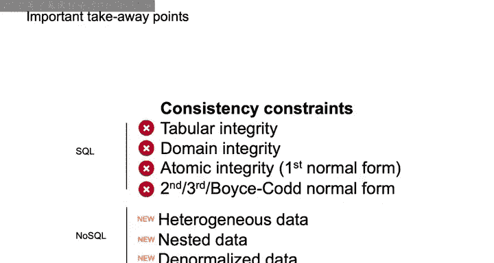

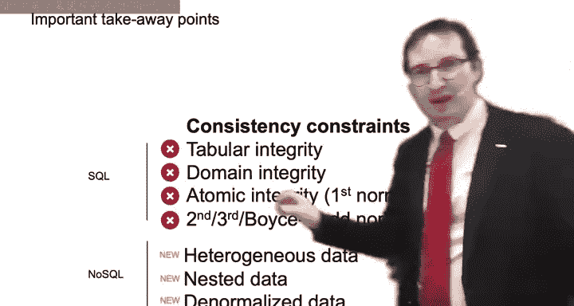

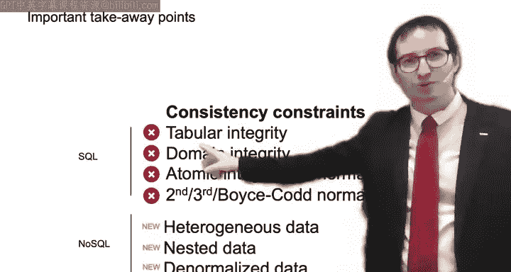

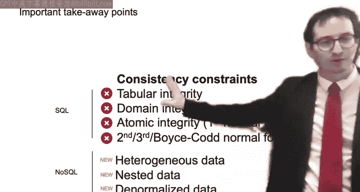

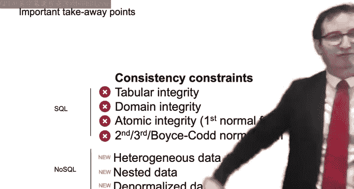

## 继承与革新：关系型数据库的遗产

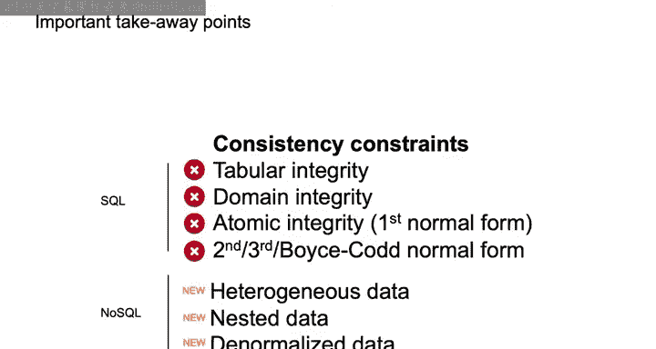

虽然我们将转向一个全新的、不同于传统关系型数据库的系统，但好消息是，我们仍然可以复用这些系统的许多核心思想。我甚至可以说，我们之前学到的99%的知识都可以被复用。

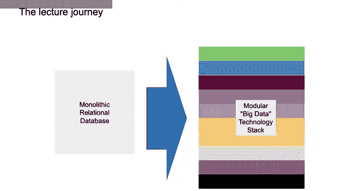

以下是我们可以继续使用的概念：
*   **操作**：选择（Selection）、投影（Projection）、分组（Grouping）、连接（Joining）等操作在处理海量数据时依然存在。
*   **结构**：具有行、列、主键的表结构依然可以存在。
*   **规则**：数据库设计的三大范式（1NF, 2NF, 3NF）依然有意义，你可以选择遵守或打破它们。
*   **语言**：像SQL这样的声明式查询语言依然适用。
*   **优化**：查询计划的优化、执行引擎等概念依然至关重要。

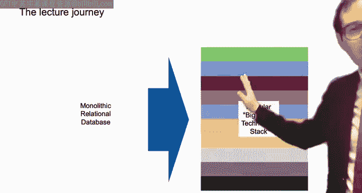

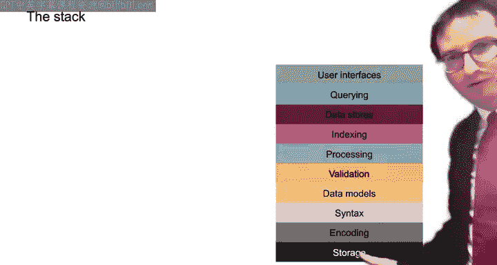

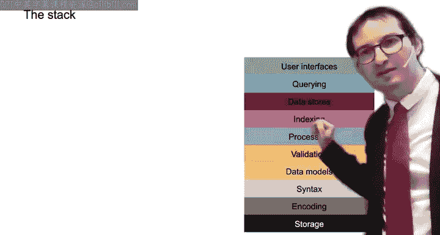

这意味着你在本科阶段学习的关于关系型数据库的知识，在大数据领域依然有价值。

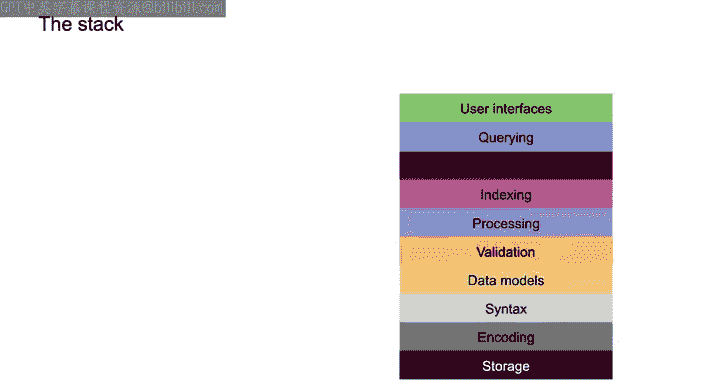

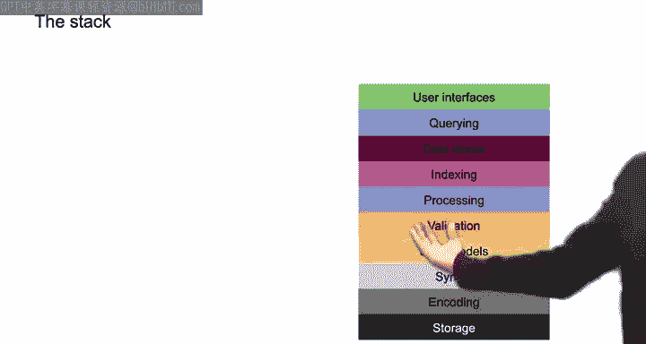

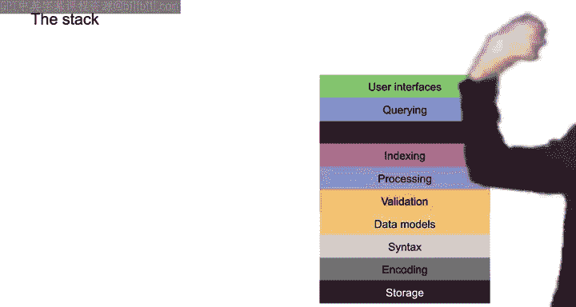

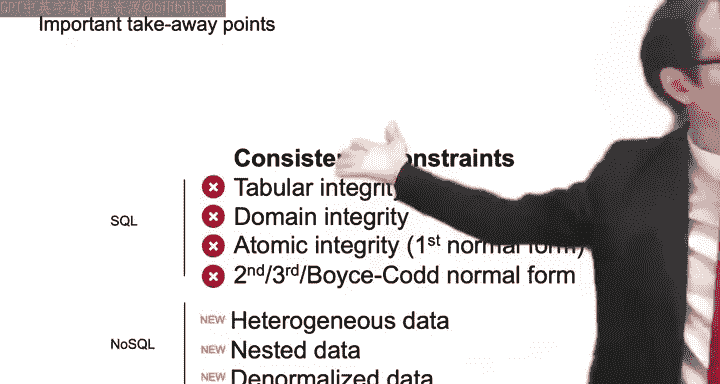

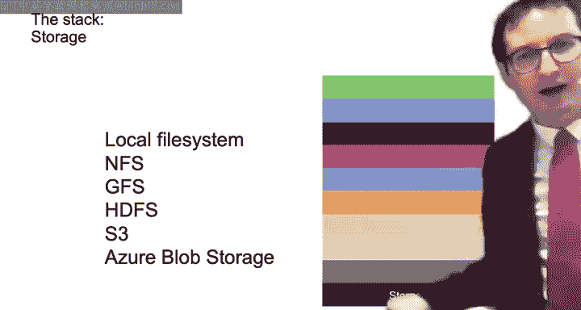

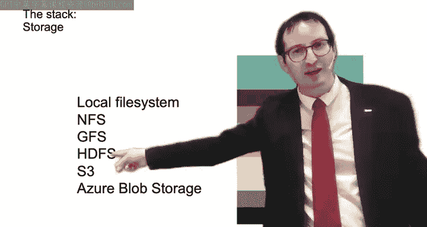

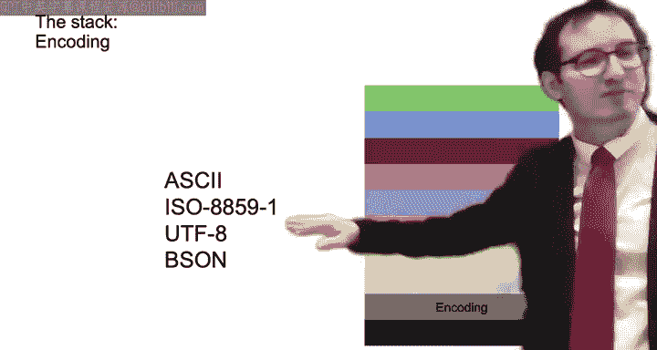

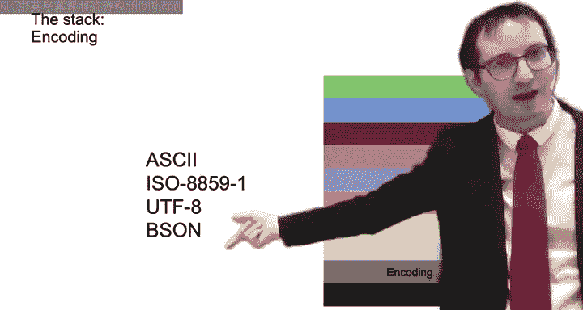

然而，有一些东西我们将无法完全带入这个新领域：
*   **完整性约束**：关系完整性、域完整性、原子性完整性等约束可以被舍弃。我们将考虑没有这些约束的系统，这通常被称为 **NoSQL**。
*   **范式化**：第二范式、第三范式、BCNF等范式化的要求可以放宽。
*   **数据结构**：我们将处理**异构数据**（没有固定模式的数据）和**嵌套数据**（表中有表），这可以被视为打破了原子性完整性。我们还将大量使用**反规范化**技术。

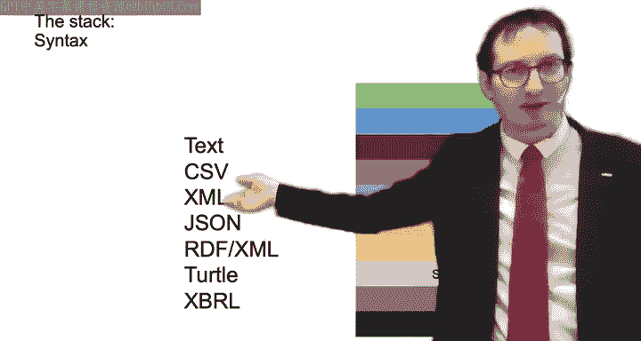

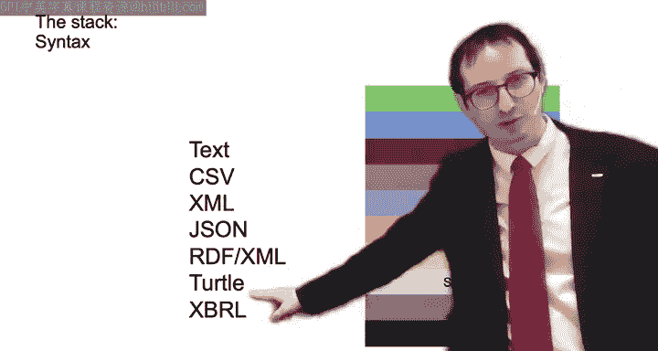

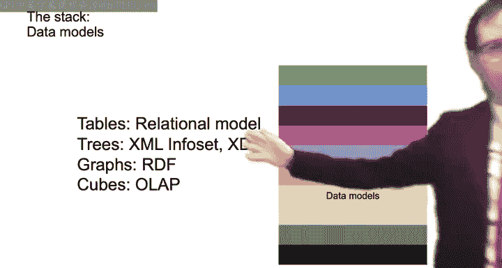

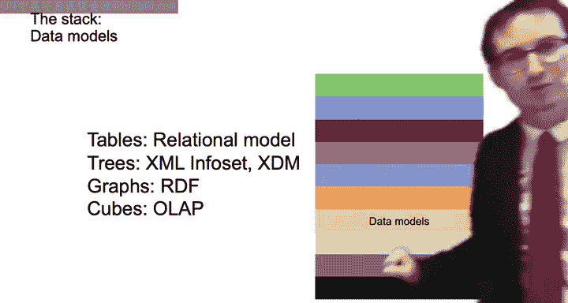

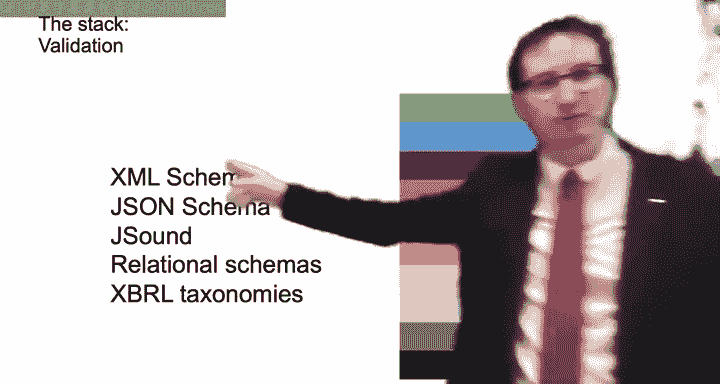

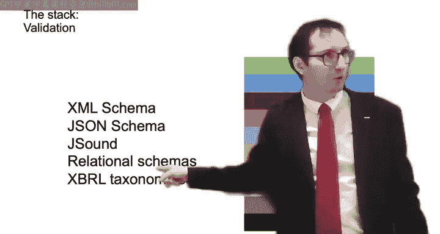

## 系统架构：从单体到模块化

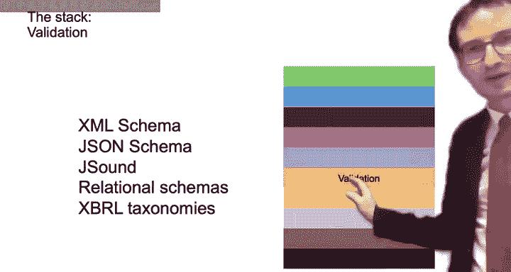

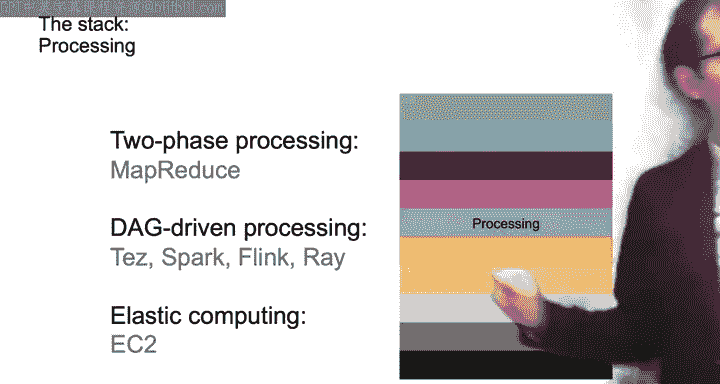

关系型数据库被认为是**单体式**的，即它是一个安装在单台机器上的单一软件。我们将以**模块化**的方式重建一个功能类似的系统，但让它运行在数据中心上。

以下是我们要重建的整个技术栈组件：
*   **存储**
*   **语法与数据模型**
*   **验证**
*   **处理**
*   **索引**
*   **数据存储**
*   **查询**
*   **用户界面**

在本学期，我们将自底向上地学习这些组件，最终构建出一个功能相近（略有差异）的系统。今天，我们首先聚焦于**存储**。

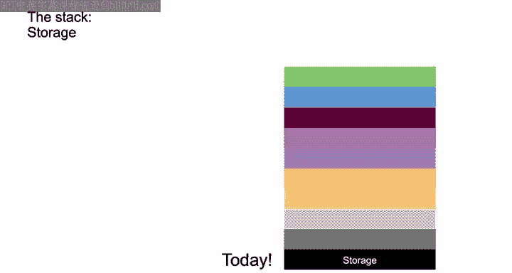

## 数据存储的两种范式

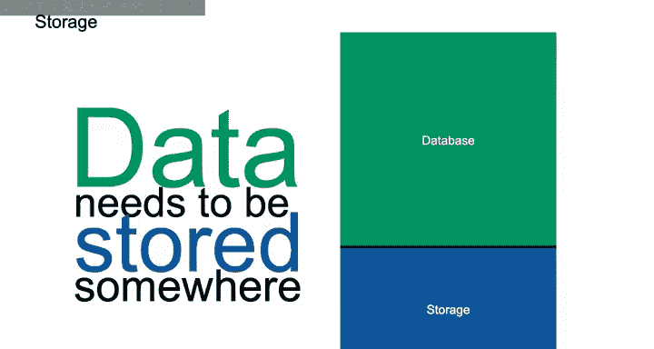

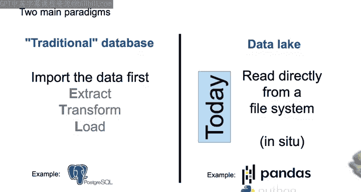

在存储海量数据时，主要有两种范式。

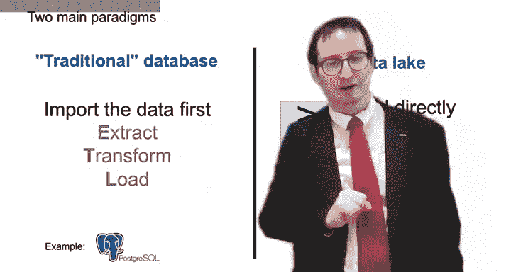

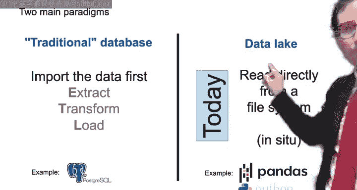

**第一种范式：数据库导入**
这种范式类似于你在 PostgreSQL 中的操作。你需要使用 **ETL**（提取、转换、加载）过程将数据导入数据库。之后，数据库系统负责管理数据在磁盘上的存储方式，这对用户是透明的。这是传统的存储方式。

**第二种范式：数据湖**
这是一种更现代的方法。在数据湖中，你直接将数据（如 CSV、XML、JSON 文件）存储在文件系统上，将其视为文件和目录。然后，你可以直接查询这些数据，而无需先将其导入另一个系统。这种方法也被称为 **In-situ** 查询。

数据湖非常适用于**只读**场景。然而，修改数据会变得非常困难，原因如下：
1.  **一致性维护困难**：直接操作文件容易导致数据不一致。
2.  **随机写入性能差**：大数据系统擅长流式写入大文件，但不擅长在大型文件中随机修改一小部分数据。
3.  **并发控制复杂**：处理多用户同时访问和修改需要复杂的事务机制，而这正是传统数据库的强项。

> **注意**：存在像 **Delta Lake** 这样的系统试图解决数据湖的更新难题，但这本身是一项复杂的技术。

本节课，我们将重点关注**数据湖**范式，即如何“倾倒”数据并直接在其上进行操作。

## 总结

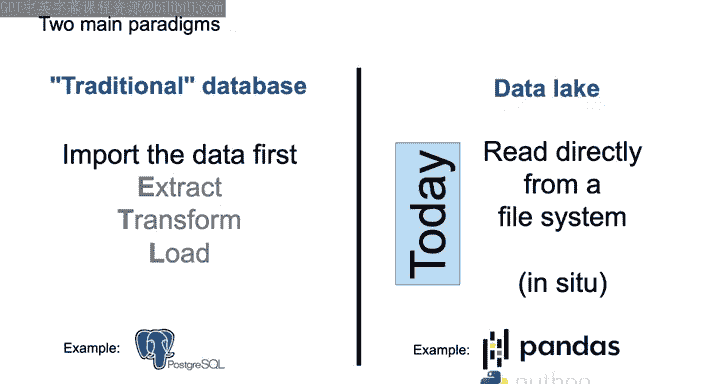

本节课中，我们一起学习了面对海量数据存储挑战时，从单机关系型数据库转向分布式系统的必要性。我们了解到，许多关系型数据库的核心概念（如SQL、查询优化）依然可以复用，但需要放弃严格的完整性约束并接受反规范化。我们介绍了构建模块化大数据系统技术栈的蓝图，并重点对比了**数据库导入**和**数据湖**两种核心数据存储范式，分析了数据湖在只读场景下的便利性以及在数据修改方面的挑战。从下一节课开始，我们将深入探讨具体的存储系统。