# 大数据课程 - ETH Zurich - Fall 2024 📚
## 第九讲：云存储 (4/4) ☁️

在本节课中，我们将要学习分布式键值存储系统如何处理网络分区和一致性冲突，特别是通过向量时钟（Vector Clocks）这一机制。我们还将回顾云存储的核心概念，并比较不同云服务提供商的特点。

---

### 课程回顾与最佳实践 🎯

上一节我们介绍了分布式哈希表（DHT）和一致性哈希。本节中，我们来看看在分布式系统中处理故障和数据一致性的高级机制。

首先，我们来回顾一个关于系统扩展的最佳实践问题。

**问题：** 当系统性能不足时，最佳实践的执行顺序是什么？
1.  先尝试横向扩展（Scale Out），不行再优化代码，最后纵向扩展（Scale Up）。
2.  先尝试优化代码，然后横向扩展，最后纵向扩展。
3.  先尝试纵向扩展，然后横向扩展，最后优化代码。
4.  顺序无关紧要，可以尝试所有方法。

**正确答案是第二种：先优化代码，再横向扩展，最后纵向扩展。**

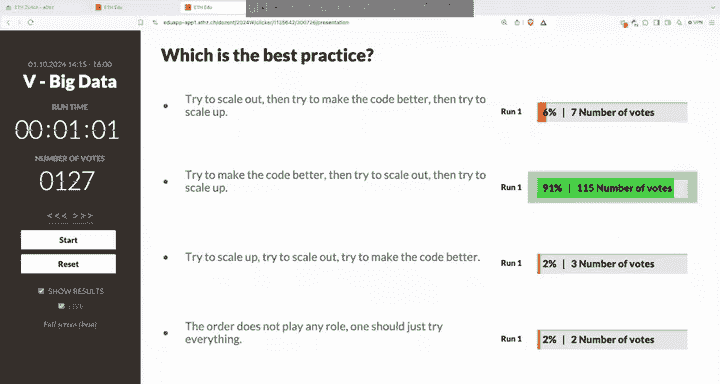

以下是具体解释：
*   **优化代码：** 首先应在本地（如笔记本电脑）使用一小部分数据（如1/100的数据集）优化代码效率。如果优化后代码能在单机上运行，这是最经济的方法。
*   **横向扩展（Scale Out）：** 如果数据无法在单机容纳，则扩展到多台廉价机器上并行处理。许多云服务商（如Amazon AWS）可以自动根据负载动态调整机器数量。
*   **纵向扩展（Scale Up）：** 为单机增加更多内存、CPU等资源。这是最后考虑的手段，因为成本增长通常是非线性的（例如，将内存从32GB升级到320GB的成本远高于10倍）。

这是一个通用指导原则，实践中需要根据具体情况（如成本、现有硬件、任务复杂度）进行批判性思考。例如，如果只是略微超出旧笔记本的能力，租用云机器一小时可能比购买新笔记本更划算。技术上，增加一台新机器是横向扩展，替换一台更强大的机器是纵向扩展。

---

### 处理节点故障与弹性 🛡️

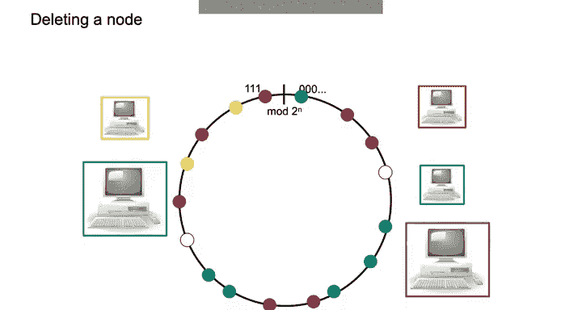

现在回到我们的一致性哈希环。通过引入“虚拟节点”或“令牌”（Tokens），我们可以让一台物理机器对应哈希环上的多个点（令牌）。

**公式表示：**
假设机器 `M_i` 的性能权重为 `w_i`，那么它可以被分配大约 `w_i` 个令牌，随机分布在哈希环上。

这样做的好处是：
1.  **负载均衡：** 令牌分布更均匀，数据分布也更均匀。
2.  **弹性：** 高性能机器可以分配更多令牌，承担更多负载；低性能机器分配较少令牌。
3.  **容错：** 当一台机器（如图中的绿色节点）失效时，它的令牌所负责的数据区间会被环上顺时针方向的下一个有效节点接管。由于数据通常在不同机器的多个令牌上有副本（复制因子 > 1），数据不会丢失，新节点可以从其他副本同步数据。
4.  **扩容：** 添加新机器时，只需将现有的一部分令牌重新分配给新机器即可。

---

### CAP定理与最终一致性 ⚖️

上一讲我们提到了CAP定理，它指出在网络分区（Partition）发生时，系统只能在一致性（Consistency）和可用性（Availability）中二选一。

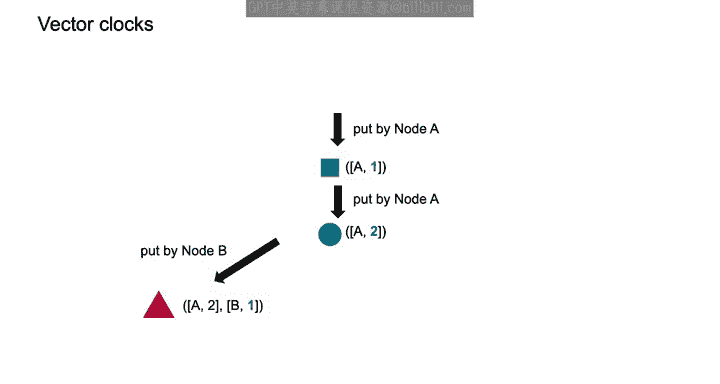

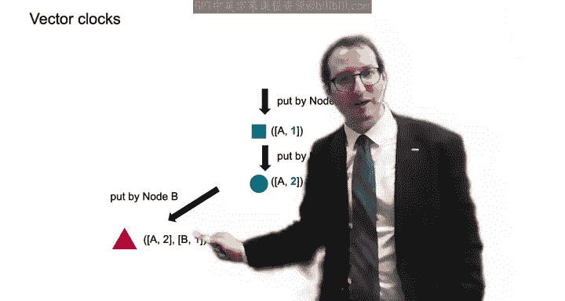

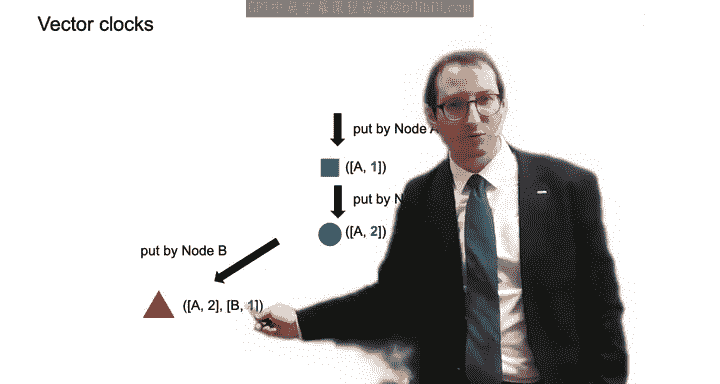

在像Dynamo这样的系统中，选择的是 **AP**（可用性和分区容错性），牺牲了强一致性，实现了最终一致性。

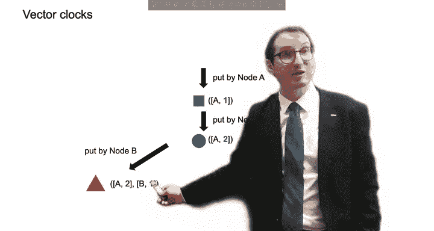

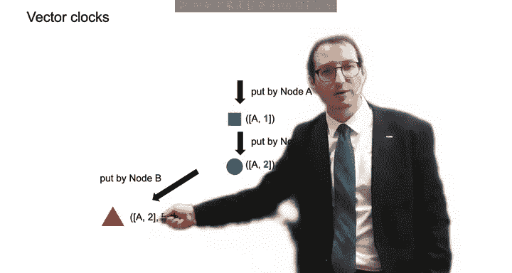

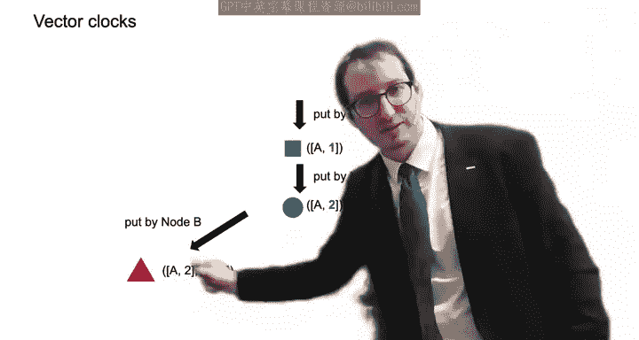

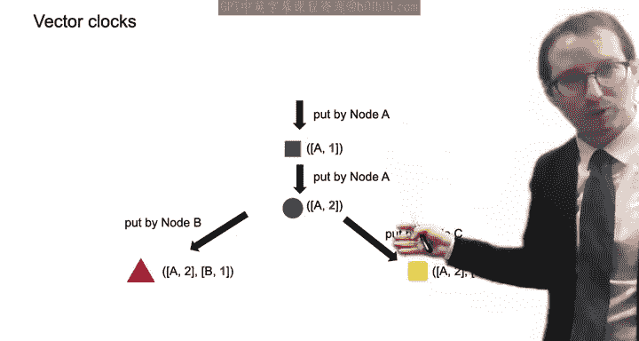

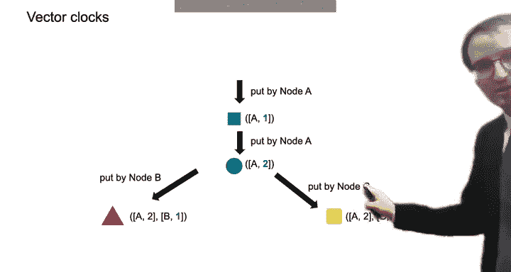

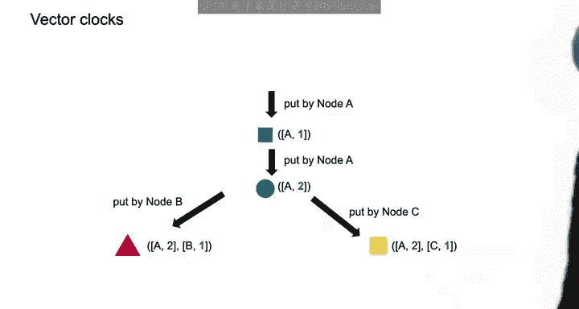

这意味着在网络分区期间，系统不同部分的数据版本可能发生分歧，形成“分支”。这打破了线性时间轴的概念，引入了类似时空的结构。为了解决这种多版本冲突，我们需要一个能表达部分顺序（Partial Order）的机制，这就是**向量时钟**。

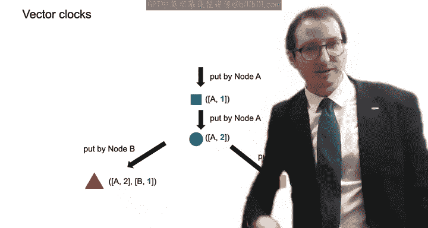

---

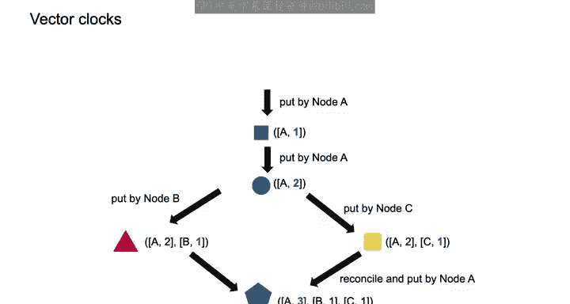

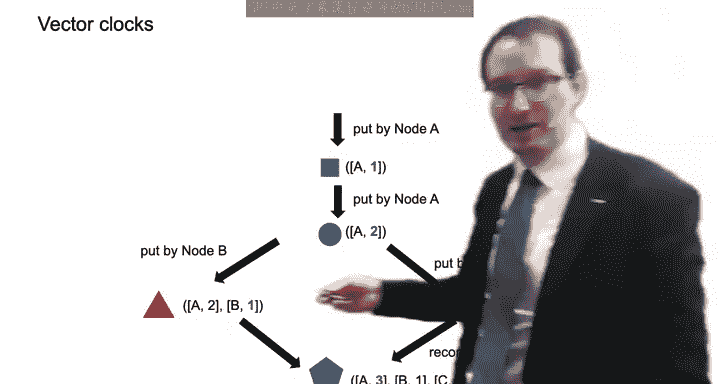

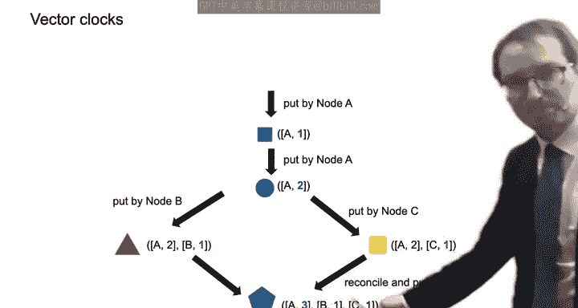

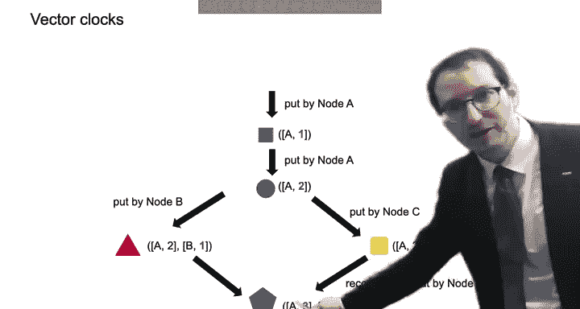

### 向量时钟：追踪因果历史 🕰️

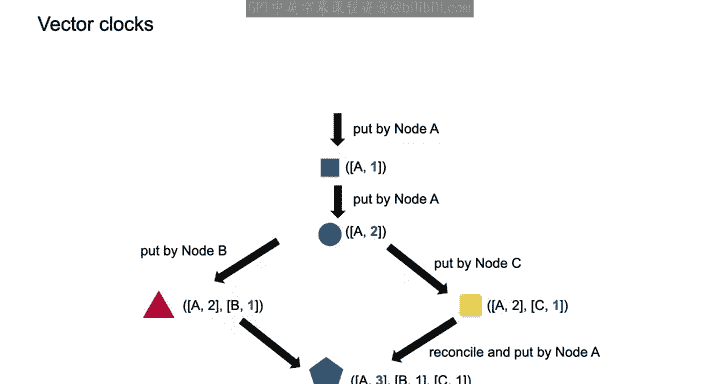

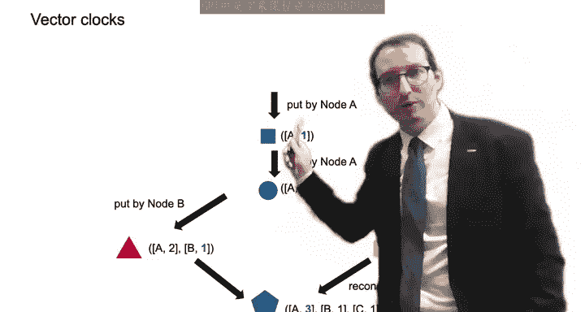

向量时钟由苏黎世联邦理工学院（ETH）的教授提出，被Amazon Dynamo等系统广泛采用。它不是单一计数器，而是为系统中每个可能处理数据的节点维护一个计数器序列。

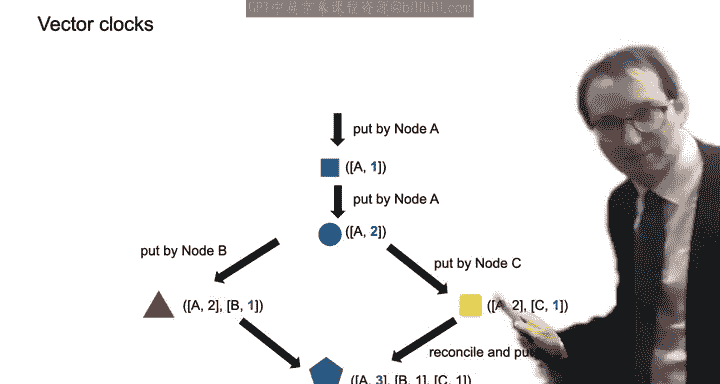

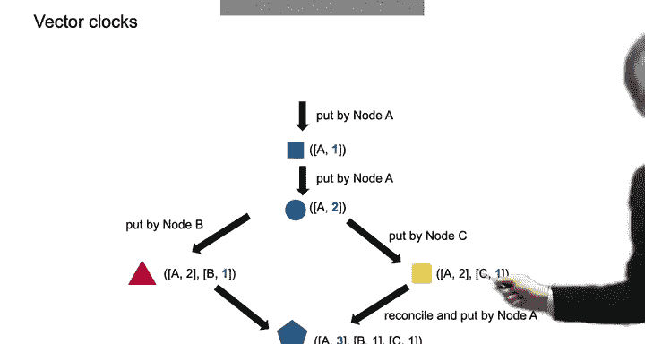

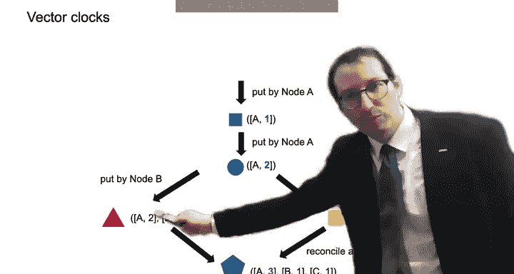

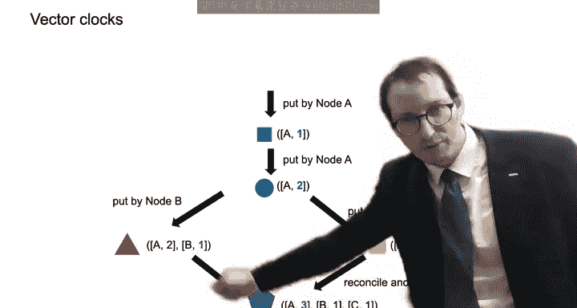

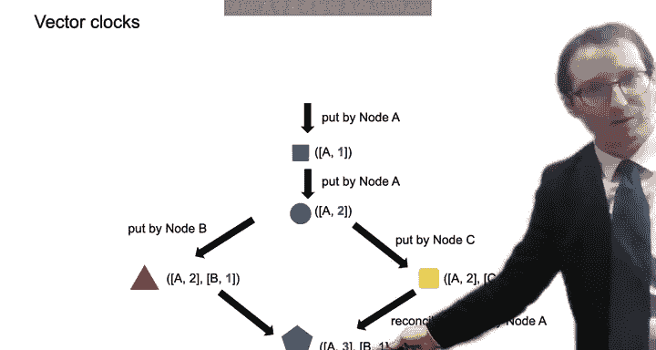

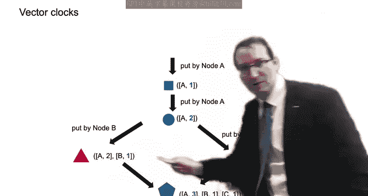

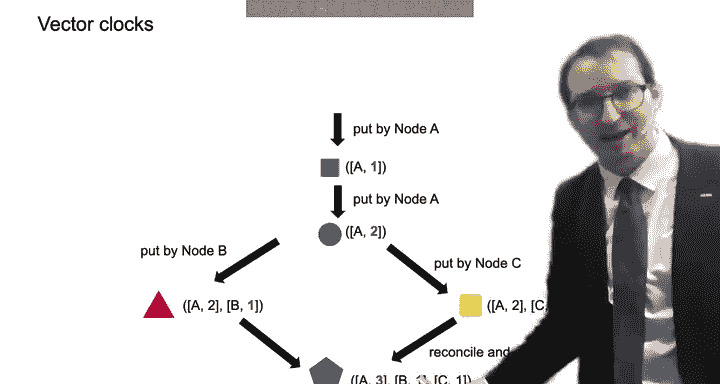

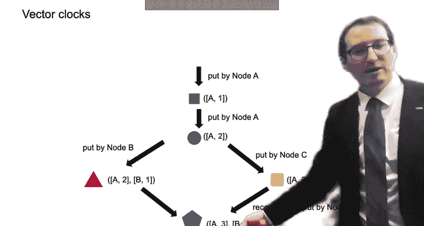

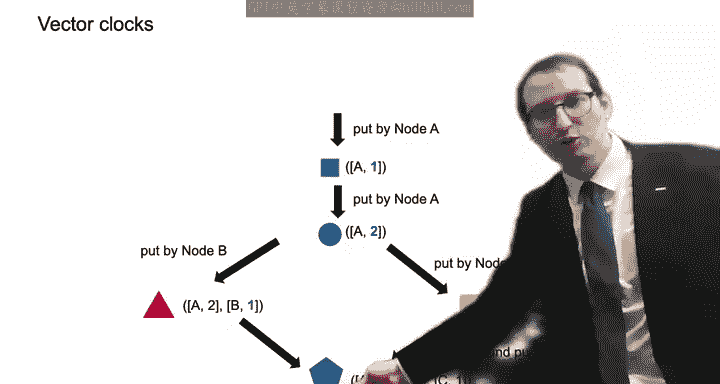

**工作原理：**
1.  每个数据版本都关联一个向量时钟。
2.  当节点 `N_i` 首次创建或更新某个数据时，它将向量时钟中对应自己的分量 `c_i` 加1。
3.  向量时钟记录了数据版本被哪些节点修改过的历史。

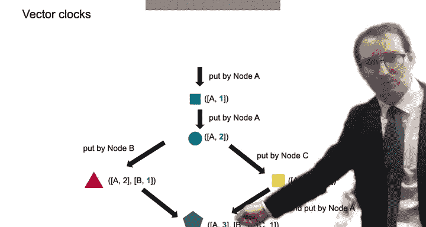

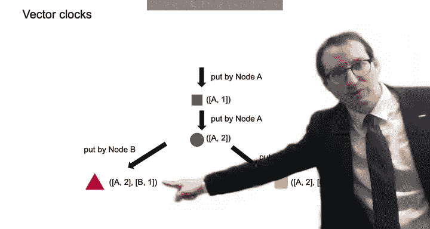

**代码/结构表示：**
一个向量时钟可以表示为一个字典或元组：
`VC = {‘N1’: 2, ‘N2’: 1, ‘N3’: 1}`
这表示数据被节点N1处理过2次，被节点N2和N3各处理过1次。

**比较规则（形成偏序关系）：**
对于两个向量时钟 `VC_a` 和 `VC_b`：
*   如果 `VC_a` 在所有节点上的计数器值都**大于或等于** `VC_b`，并且至少在一个节点上**严格大于**，则 `VC_a` > `VC_b`（`VC_a` 是更新的版本）。
*   如果 `VC_a` 和 `VC_b` 在某些节点上互有大小，则两者**无法比较**。这表示发生了**冲突**，即数据出现了分支版本。

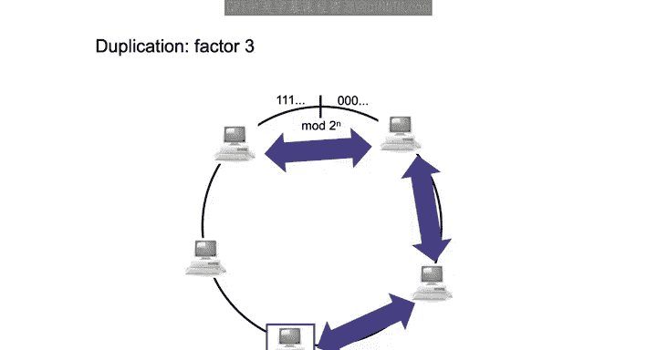

在网络分区恢复后，系统可能会同时发现两个无法比较的向量时钟（即两个“最大元素”），这时就需要解决冲突。

---

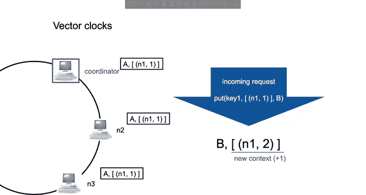

### Dynamo操作流程示例 🔄

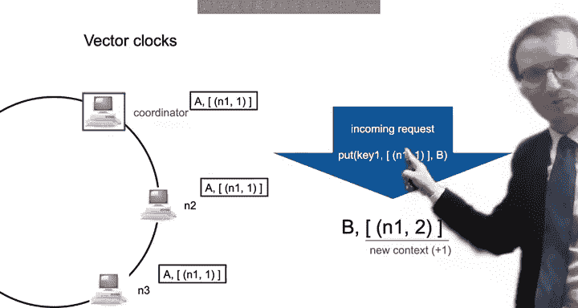

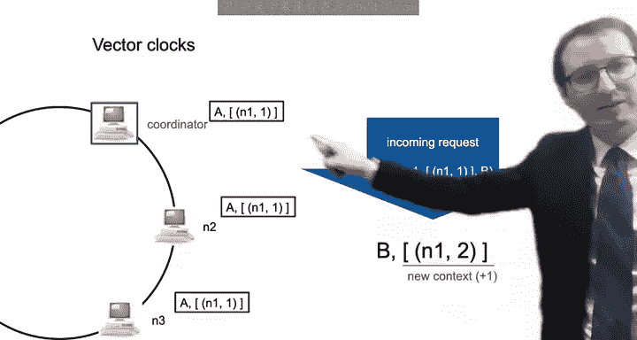

让我们通过一个动画示例（此处用文字描述）来理解Dynamo的 `get` 和 `put` 操作如何利用向量时钟。

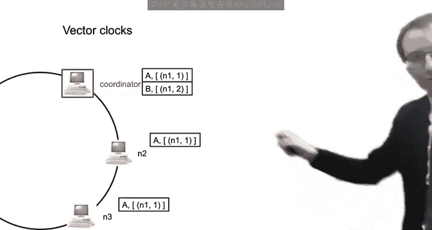

**系统设置：** 复制因子为3，键 `K1` 由节点 `N1`, `N2`, `N3` 负责。

1.  **初始写入：** `put(K1, value=A)`
    *   请求由 `N1` 处理。`N1` 创建向量时钟 `{N1:1}`，存储 `(A, {N1:1})`。
    *   `N1` 将数据复制到 `N2`, `N3`。
2.  **正常更新：** `get(K1)` 返回 `(A, {N1:1})`。用户据此发起 `put(K1, value=B, context={N1:1})`。
    *   `N1` 处理，验证上下文匹配最新版本。创建新向量时钟 `{N1:2}`，存储 `(B, {N1:2})` 并复制。
    *   后续 `get(K1)` 会收集所有版本，但通过比较向量时钟，只返回最新的 `(B, {N1:2})`。
3.  **网络分区与冲突：**
    *   用户通过 `N1` 再次 `put(K1, value=C, context={N1:2})`，创建 `(C, {N1:3})`。
    *   **此时发生网络分区**，`N1` 与 `N2`、`N3` 断开。`(C, {N1:3})` 无法复制到 `N2`, `N3`。
    *   另一个用户从仍可访问的 `N2` 获取数据，得到 `(B, {N1:2})`，然后发起 `put(K1, value=D, context={N1:2})`。
    *   `N2` 处理，创建 `(D, {N1:2, N2:1})` 并在分区内复制到 `N3`。
4.  **分区恢复与冲突解决：**
    *   网络恢复。此时系统存在多个版本：`A({N1:1})`, `B({N1:2})`, `C({N1:3})`, `D({N1:2, N2:1})`。
    *   用户发起 `get(K1)`。系统收集所有版本，并寻找“最大元素”。
    *   `C` 和 `D` 的向量时钟无法比较（`{N1:3}` vs `{N1:2, N2:1}`），因此两者都被作为冲突版本返回给用户。
    *   **冲突由用户（应用层）解决**。用户决定新值应为 `E`。
5.  **提交解决方案：**
    *   用户发起 `put(K1, value=E, context=merge({N1:3}, {N1:2, N2:1}))`。合并上下文取各节点计数最大值，得到 `{N1:3, N2:1}`。
    *   假设由 `N1` 处理，它将自己的计数加1，最终写入 `(E, {N1:4, N2:1})`。这个版本在偏序关系上大于所有之前版本，成为新的唯一最大元素，冲突得以解决。

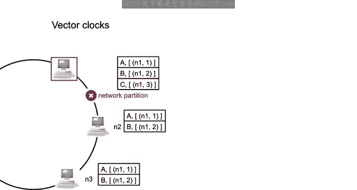

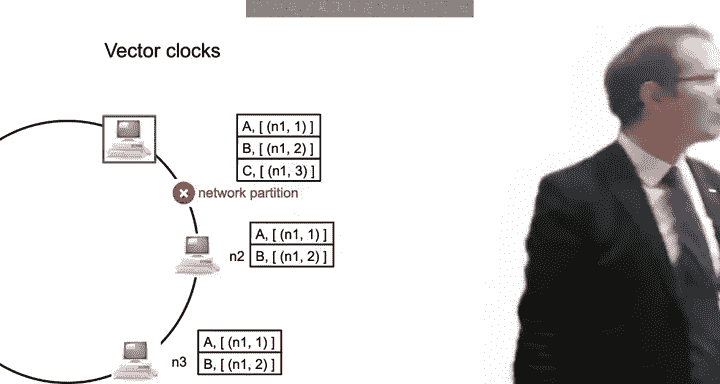

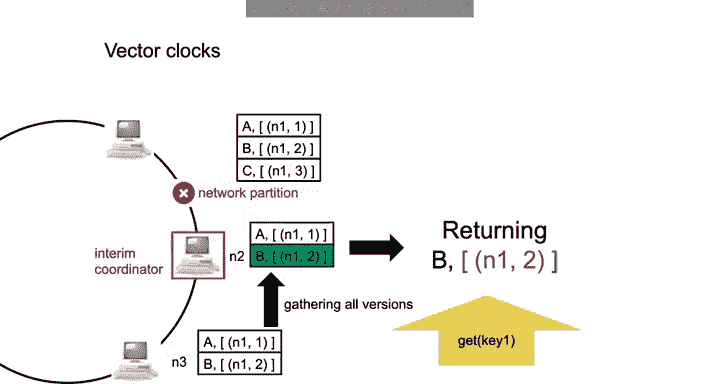

系统可以定期清理那些不是最大元素的旧版本数据（如A和B）。

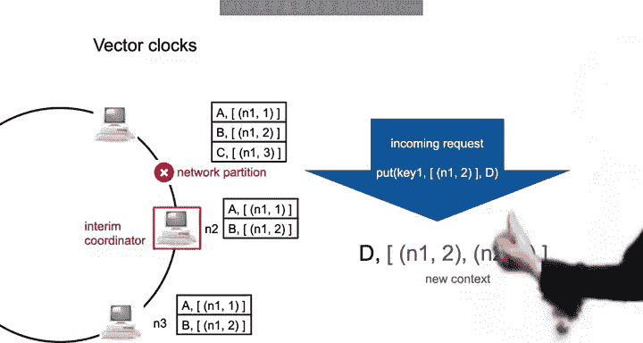

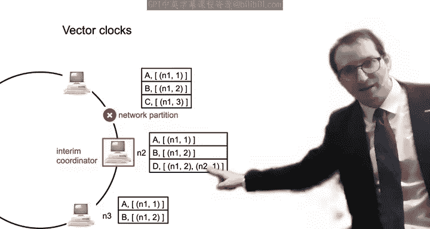

---

### 主要云提供商对比 🌐

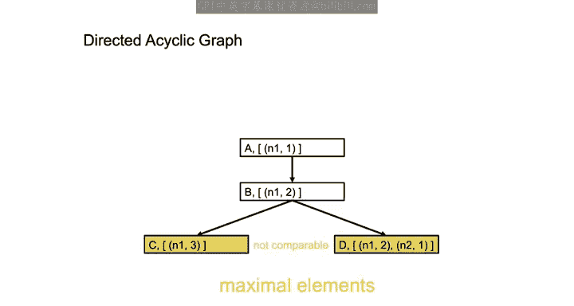

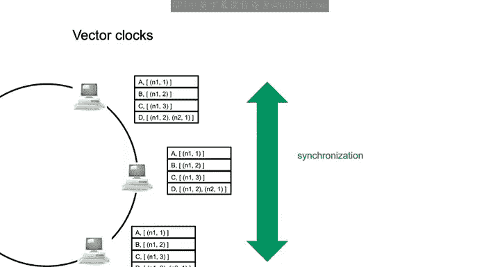

最后，我们简要对比一下主要云服务提供商在存储服务方面的风格：

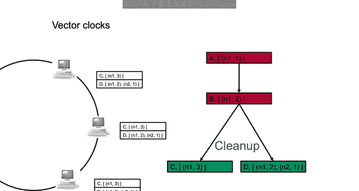

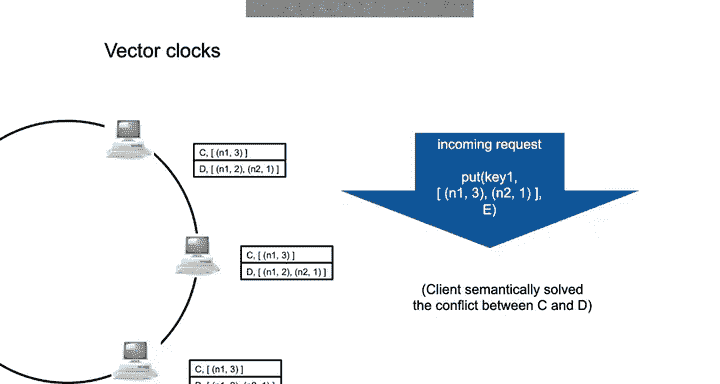

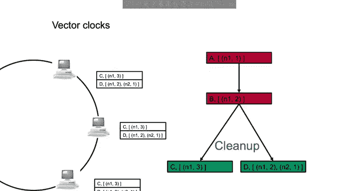

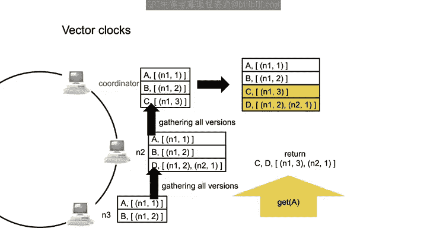

*   **Amazon Web Services (AWS)：** 倾向于提供大量**单一功能、细粒度**的服务。例如，S3（对象存储）、RDS（关系数据库）、EC2（虚拟机）、Route 53（DNS）等，各有专门的服务。用户通过控制台组合使用这些服务。
*   **Microsoft Azure：** 风格略有不同，提供一些**功能更集成、更统一**的产品。例如，Azure Cosmos DB 作为一个多模型数据库，可以处理文档、键值、图、宽列等多种数据形态，代表了将不同数据模型统一起来的研究方向。

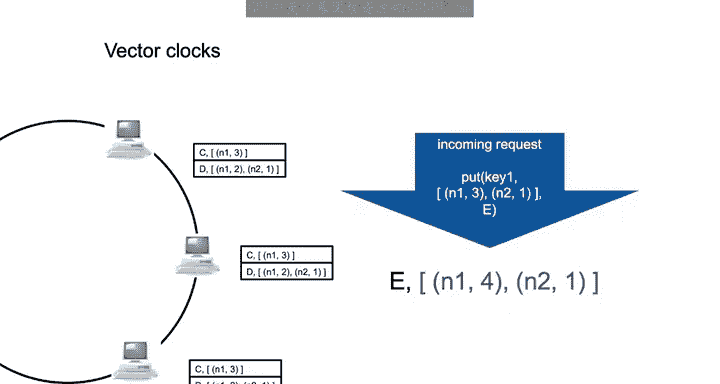

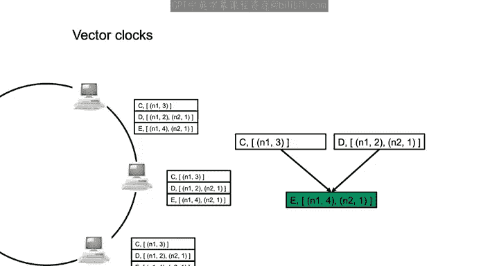

---

### 本节总结 📝

本节课中我们一起学习了分布式键值存储如何实现高可用性和最终一致性。

1.  **扩展最佳实践**是优先优化代码，其次横向扩展，最后纵向扩展。
2.  通过**虚拟节点（令牌）** 可以实现更好的负载均衡和弹性伸缩。
3.  根据**CAP定理**，Dynamo类系统选择AP，允许网络分区期间出现数据不一致。
4.  **向量时钟**是追踪数据版本因果历史、识别冲突的核心机制。它形成一个偏序集，可以判断版本的新旧或检测冲突。
5.  Dynamo的 **`get`** 和 **`put`** 操作需要携带**上下文（即向量时钟）**，用于验证和协调更新。冲突的最终解决通常需要**用户/应用层干预**。
6.  不同的云提供商（如AWS和Azure）在服务设计哲学上有所不同，有细粒度单功能服务和集成多功能服务之分。

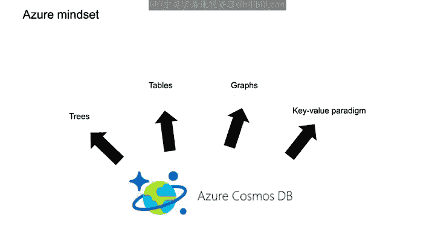

至此，关于云存储的核心内容就介绍完毕了。