# 10：分布式文件系统 (1/4) 📂

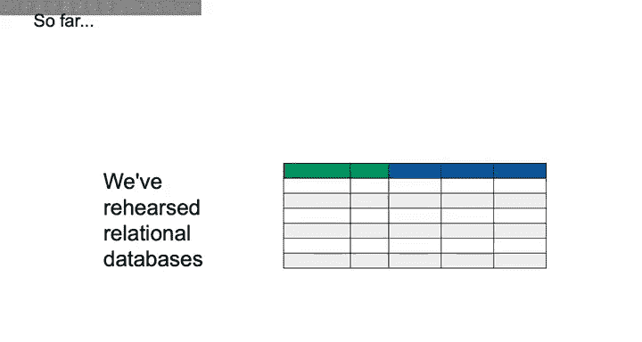

在本节课中，我们将要学习分布式文件系统的基本概念、设计需求以及它与之前所学存储模型的区别。我们将从单机数据库扩展到集群存储，并探讨如何设计一个能够处理海量数据、容忍机器故障且适合大数据分析场景的文件系统。

---

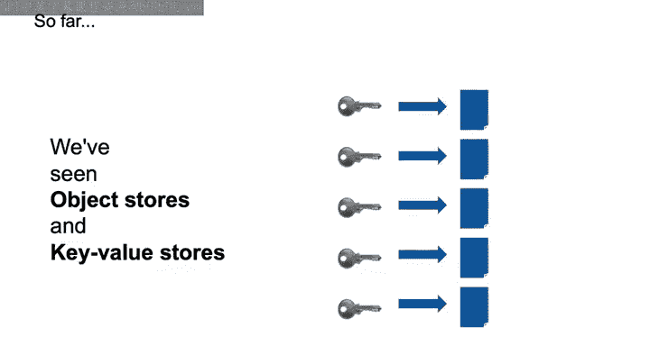

## 从单机到集群存储 🔄

上一节我们介绍了关系型数据库和单机存储。现在，我们来看看如何通过横向扩展，将存储从单台机器扩展到整个集群。

在横向扩展的模型中，我们可以存储海量的对象或键值对。需要注意的是，键值模型既适用于对象存储（如S3），也适用于键值存储（如Dynamo）。但需注意，虽然两者都使用键值模型，但“键值存储”通常特指存储较小值、具有低延迟特性的系统。人们通常不将S3称为键值存储，因为其存储的对象过大。不过，其底层模型依然是键值模型，即你为数据分配一个键。

这种存储可以作为驱动器或数据集存储。当你开始查询和提取数据信息时，通常会经历以下流程：原始数据可能来自传感器或其他来源，这是你积累的初始数据。随后，你执行查询并得到衍生数据，这是通过你自己的代码对原始数据进行修改后得到的结果。

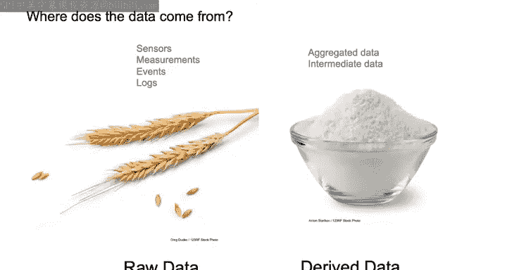

现在的问题是，衍生数据应该存放在哪里？尤其是当它也有PB级别时。答案是，它可以存回与原始数据相同类型的存储介质中。例如，原始数据在S3上，衍生数据也可以写回S3。我们稍后在讨论数据处理系统时会再回到这一点。核心思想是，你从云存储（例如）读取数据，并将结果写回云存储。

---

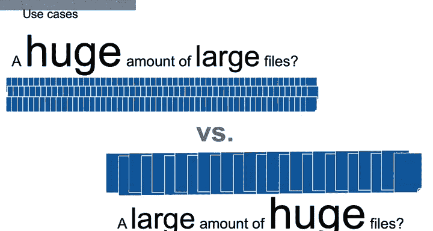

## “大数据”的不同形态 📊

但是，“大数据”也有不同的形态。为了简化理解，你可以拥有海量的大文件，也可以拥有大量的超大文件。这两种情况对你将要使用的系统架构有实际影响。

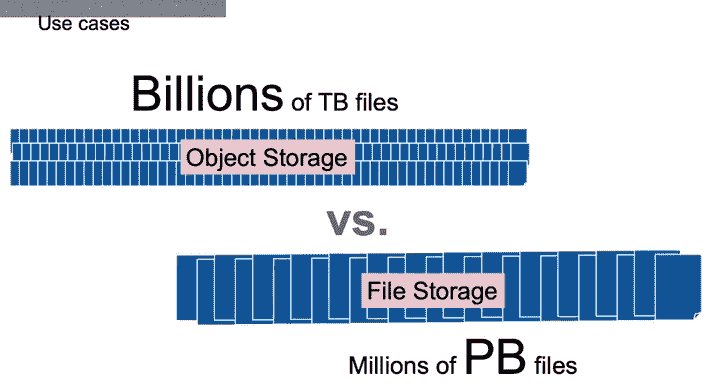

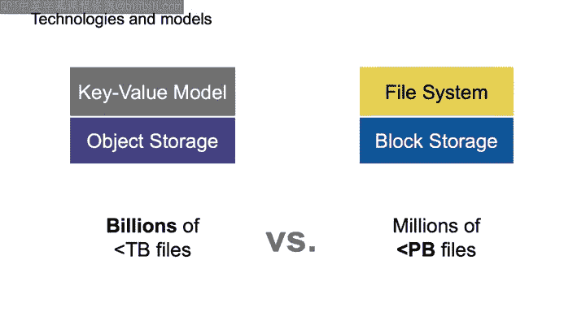

以下是两种形态的对比：

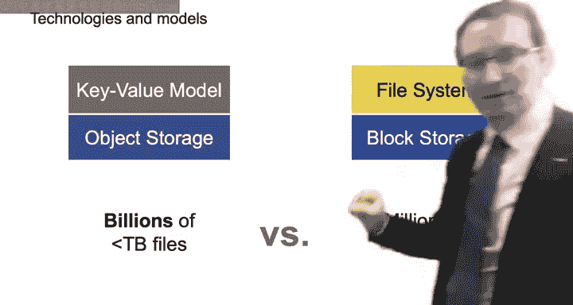

*   **海量大文件**：指的是数十亿个TB级别的文件。例如，Netflix作为全球服务存储在S3上的剧集，这就是对象存储。文件数量巨大，因为全球用户都使用同一个存储介质。
*   **大量超大文件**：指的是数百万个PB级别的文件。文件本身可以大得多，但文件数量相对较少。这种文件存储不会像S3那样是全球性的存储系统，而是你部署在自己集群上、由自己负责的系统。这是你本地的文件存储，可以存储数百万个PB级文件。

重申一下，顶部（海量大文件）是我们上周讨论的内容，基本上是Amazon S3或对象存储。我们今天要看的是文件存储，处理的是大量超大文件。

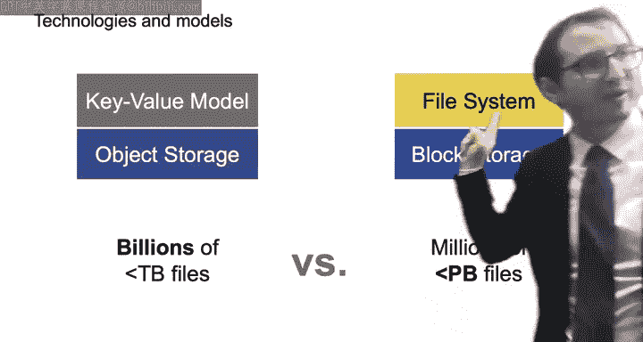

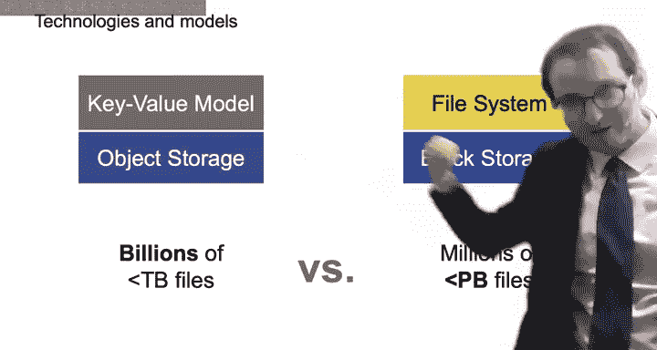

---

## 存储模型的演变：从对象到文件系统 🗂️

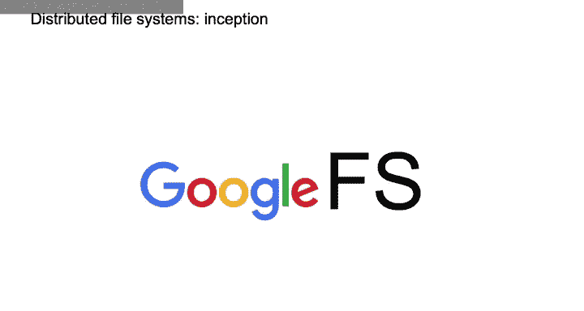

为了在脑海中清晰地整理这些概念，我们进行如下对比：

当我们使用Amazon S3时，它采用**扁平化的键值模型**，没有层级结构。用户界面中的“/”并非模型的一部分，键名本身就是扁平的。这被称为**对象存储**，因为数据是高达5TB的“黑盒”。

而我们现在要看的系统，将拥有一个类似传统文件系统的**层级结构**，包含目录和文件。它不再是扁平的键值模型，并且将涉及**块存储**的概念，就像你笔记本电脑硬盘上的4KB数据块一样，块在这里会变得很重要。

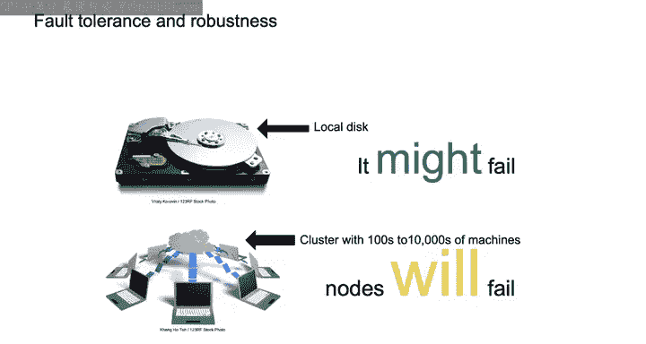

---

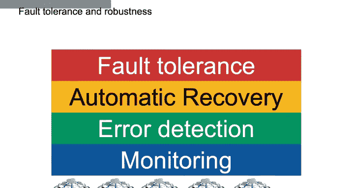

## 分布式文件系统的起源与需求 🏗️

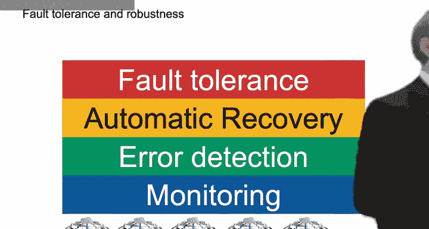

这一切实际上始于21世纪初，大约2004年，在Google。他们开始注意到在存储数据时遇到了麻烦，当时没有技术能够将数据存储在更大的驱动器上。他们达到了单个驱动器的极限，于是思考：我们需要一种方法来模拟一个巨大的驱动器，但将其分散到我们的机器集群中。通过横向扩展，我们可以拥有1000台机器，并需要模拟出一个单一文件系统的外观，让用户感觉不到本地计算机文件系统和集群文件系统之间的差异。他们称之为Google文件系统（GFS）。

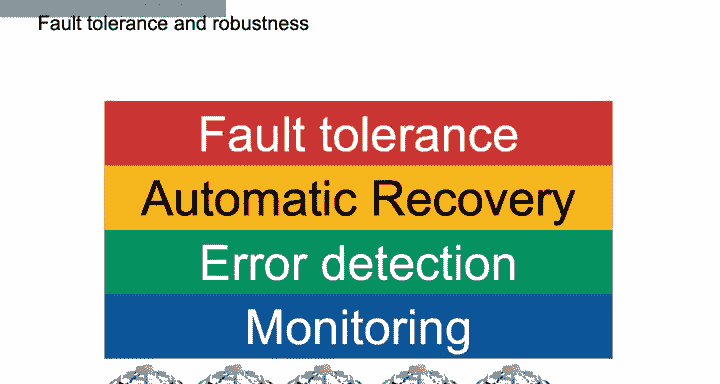

然而，这并不像看起来那么简单，因为有些情况发生了变化。例如，你的笔记本电脑可能偶尔会崩溃，有些人可能因此丢失过数据。但是，当你拥有数百、数千甚至数万台机器的集群时，问题不再是“它是否会故障”，而是“它何时会故障”。机器会持续故障，数据中心有全职员工四处奔波更换故障部件。这意味着在设计系统时，必须将这些因素考虑在内。

基于我们最近几周所学，你可能已经有一些想法，例如**复制数据**。如果将数据存储在多个位置，就可以从故障中恢复。这一点我们稍后会详细讨论。

---

## 核心设计目标 🎯

我们想要一个系统，即使机器偶尔故障，它也能持续工作。因此，首先需要一种**监控故障**的方法，以便感知错误。其次，需要一种能够**自动从这些错误中恢复**的方法，因为故障随时都在发生。

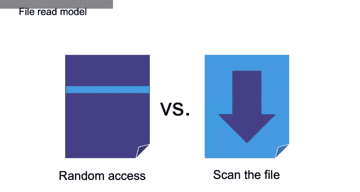

这被称为**容错性**，意味着它是自动的，不需要人工干预来替换故障部件。系统应该持续工作，当人们用新硬盘替换旧硬盘后，系统就能继续工作，甚至拥有更多硬盘。恢复必须是自动的，无需人工干预。

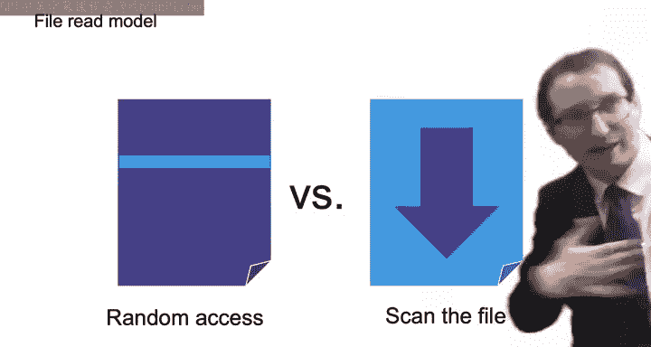

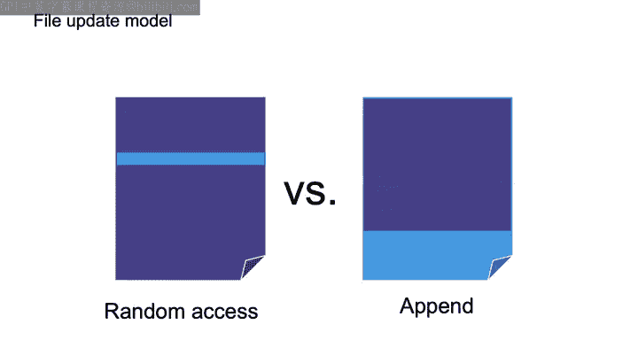

以下是系统需要满足的其他要求，主要涉及访问模式：

*   **随机访问 vs. 顺序扫描**：在你的笔记本电脑上，你可以使用电子表格软件或编辑文件，可以访问硬盘上的任何位置。硬盘是为随机访问设计的。但对于我们用于大数据分析的分布式文件系统，我们真的需要随机访问吗？实际上，在大数据场景中，我们通常不需要随机访问。大数据意味着我们下载数据，将其存放在某处，然后并行处理，最后输出结果。当你写入查询输出时，你不需要随机访问，你只是从头到尾线性地写入一个新文件。所以，对于用于数据分析的系统，答案是我们**不需要随机访问**。这实际上很棒，因为如果不需要随机访问，系统设计会更容易。
*   **高效顺序读写**：我们设计的系统在随机访问方面会表现很差，效率低下。但我们希望它在**扫描数据**或**从头到尾写入文件**时非常高效。
*   **高效追加写入**：我们还希望它能高效地**追加数据**。你有一个文件，想在末尾写入更多内容。想象一下日志文件，你只是不断在末尾追加。这也是我们想要的功能。

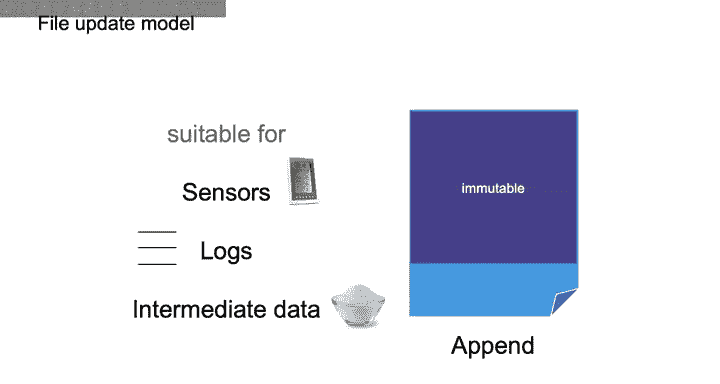

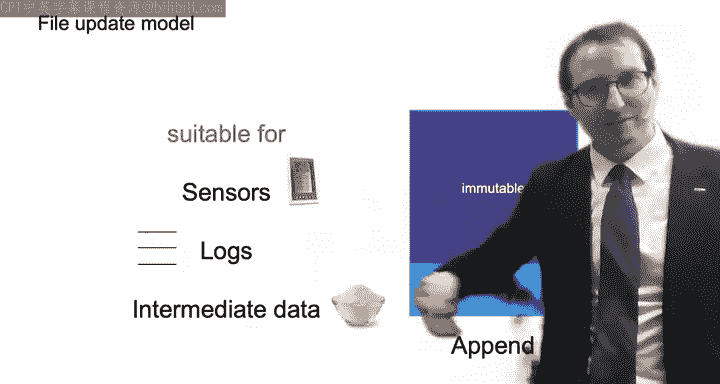

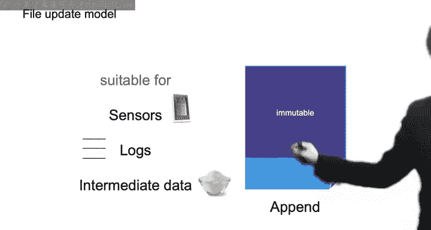

为什么需要追加写入？考虑一下数据来源的用例：数据可能来自传感器、对撞机（如LHC）、日志等。这些数据持续流入系统，每秒都在产生新数据。因此，你希望你的文件能够被追加写入，不断添加新数据。一旦数据被写入，它就是不可变的，但你仍然希望添加新数据。

考虑带有温度和压力等传感器的物联网设备，你每秒都在向数据中添加新内容。中间数据也将以这种方式工作，我们只是不断写入输出。在学习了MapReduce等内容后，你会更好地理解这一点。

---

## 并发与性能考量 ⚙️

现在，我们有了更多需求。但关于扫描数据和追加数据的整个操作，必须在**数百人同时进行时仍然有效**。

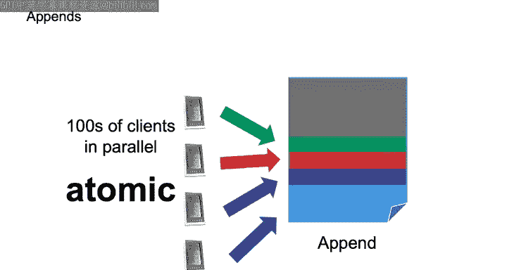

如果你有数百人（也许是所有收集数据的传感器）同时写入，它必须能工作。请注意，我说的是数百，而不是数百万或数十亿。这同样不是一个像S3那样全球数十亿人访问的服务。这只是一个服务，比方说，一个公司规模的集群。每个公司都有自己的这种集群。连接到这个系统的将是公司的员工，例如数百人。操作需要是**原子性**的，你要么成功追加数据，要么完全不执行。

接下来是性能考量。还记得两周前我提到的容量、吞吐量和延迟吗？我展示了从50年代到今天，容量增长了很多，吞吐量增长了一些但没那么多，而延迟下降得更少。吞吐量和延迟的概念在考虑大数据系统时至关重要。

作为提醒：
*   **吞吐量**：想象数据流经网络电缆的比特数，即单位时间内流动的数据量。
*   **延迟**：从发起请求到收到第一个响应之间的等待时间。

通常，其中一个是瓶颈。要么是延迟问题（下载很快但等待时间长），要么是吞吐量问题（等待时间短但数据传输慢）。对于我们想要构建的分布式文件系统，在正常巡航模式下，我们希望看到的是数据在电缆中流动，这是我们希望看到的。我们不希望看到电缆上没有数据流动，所有人都在等待数据，那将是延迟问题，不是我们想要的。直观地说，我们希望通过让尽可能多的比特流过电缆来优化，以充分利用网络带宽。

这只是对我两周前展示内容的回顾。最终，我们将通过这个系统做两件事：
1.  **并行化**：以解决容量和吞吐量之间的差距。
2.  **批处理**：以解决延迟和吞吐量之间的问题。

关于并行化，你将在MapReduce中看到；关于批处理，我们将在HBase中看到。届时，我会花时间详细讲解其工作原理。

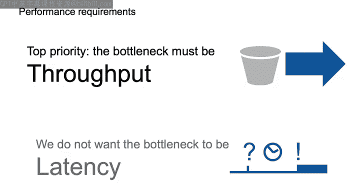

---

## Hadoop：开源实现 🐘

最后简单提一下，Hadoop是相同理念的开源版本。在Google开发相关技术大约两年后，Yahoo启动了Hadoop项目（名字来源于一只玩具象）。它始于2006年，由三个组件构成：
*   GFS的开源版本称为 **HDFS**。
*   MapReduce的开源版本称为 **Hadoop MapReduce**。
*   Bigtable的开源版本称为 **HBase**。

它们只是名称不同，但本质上是开源实现。我们将使用这些开源实现进行学习。

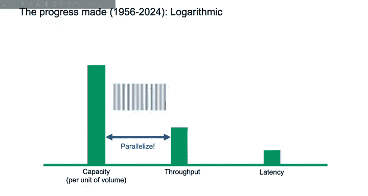

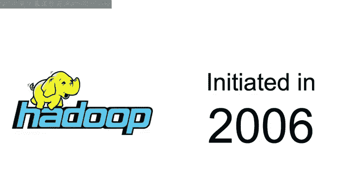

---

## 总结 📝

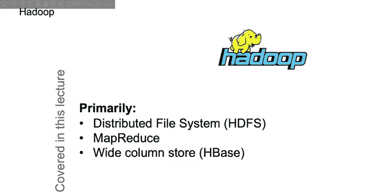

本节课中，我们一起学习了分布式文件系统的基本概念。我们了解了从单机存储扩展到集群存储的必要性，区分了对象存储（海量大文件）和分布式文件存储（大量超大文件）的不同应用场景。我们探讨了分布式文件系统的核心设计目标：容错性、适合顺序读写和追加写入的访问模式、支持数百并发以及优化吞吐量。最后，我们简要介绍了Hadoop作为相关技术的开源实现。下一节，我们将深入探讨HDFS的具体架构和工作原理。