# 12：分布式文件系统 (3/4) 📚

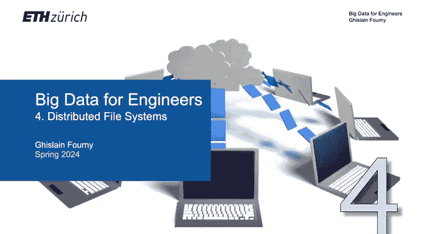

在本节课中，我们将深入学习HDFS的物理架构、通信协议以及数据读写流程。我们将重点关注客户端、名称节点和数据节点之间如何交互，并探讨数据块复制的策略。

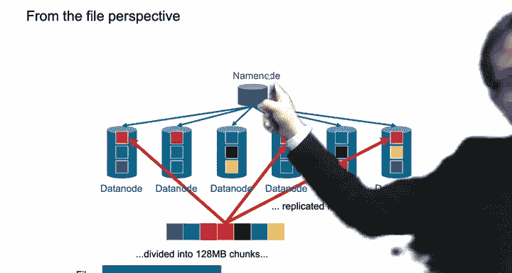

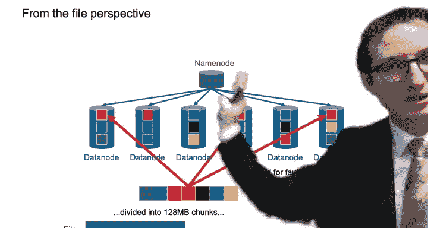

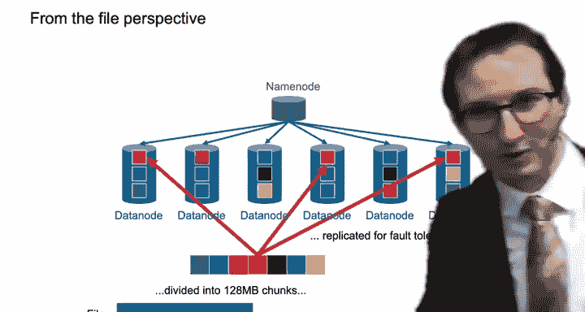

---

## 物理架构回顾 🏗️

上一节我们介绍了HDFS的基本数据模型。本节中，我们来看看其物理架构的具体实现。

HDFS的数据模型可以概括为：目录和文件以树形层次结构组织，包含访问控制。文件被分割成固定大小的块（Block），默认大小为128 MB，远大于个人电脑上的块大小。

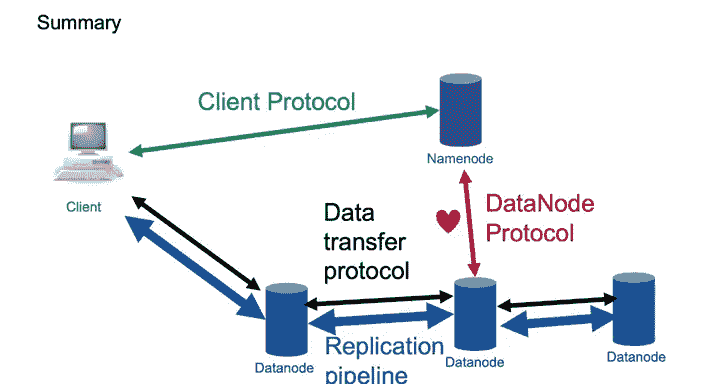

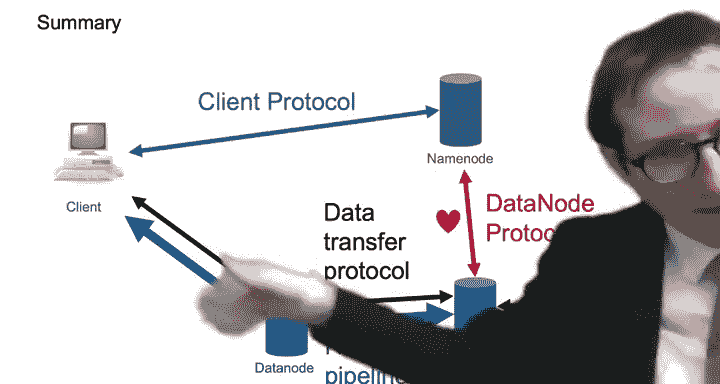

这些文件块（在Google GFS中称为Chunk，在HDFS中称为Block）会被复制并分散存储到不同的数据节点上。默认情况下，每个块有三个副本，这些副本之间没有主从之分，只是三个完全相同的副本。HDFS没有像云存储那样的5TB单文件大小限制，实践中可以通过创建多个小于此限制的文件来规避。

HDFS采用集中式架构，包含一个名称节点（NameNode）和多个数据节点（DataNode）。名称节点是协调者，负责管理整个系统的元数据。

在名称节点内部，主要存储三部分信息：
1.  **文件命名空间**：整个目录和文件的树形层次结构以及访问控制信息。这是系统的瓶颈，限制了HDFS无法像S3那样成为全球性服务，通常用于公司内部。
2.  **文件到块ID的映射**：将每个文件映射到其组成块的ID列表（块ID为64位）。
3.  **块的位置信息**：记录每个块（通常有三个副本）存储在哪些数据节点上（即数据节点的IP地址）。

需要说明的是，“数据节点”通常既指运行该进程的物理机器，也指进程本身。严格来说，数据节点是运行在机器上的一个进程。一台机器上通常只运行一个数据节点进程。

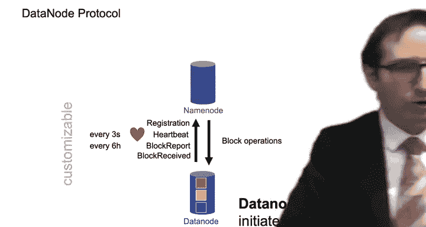

---

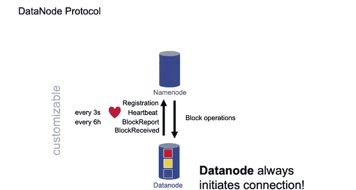

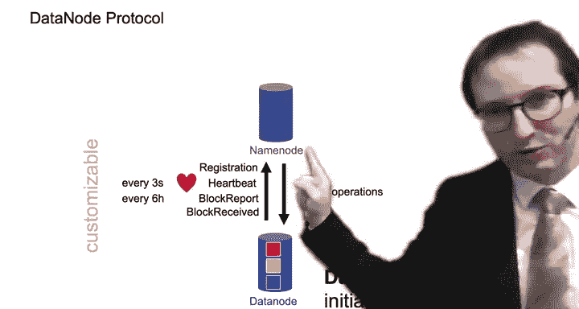

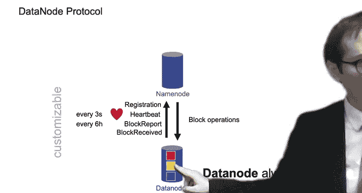

## 通信协议 🤝

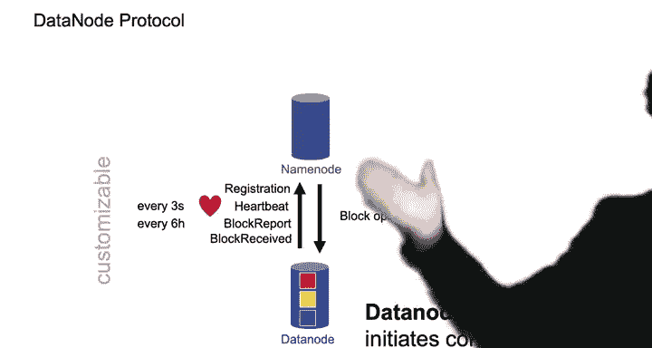

理解了基本架构后，我们来看看系统中的各个组件是如何通信的。

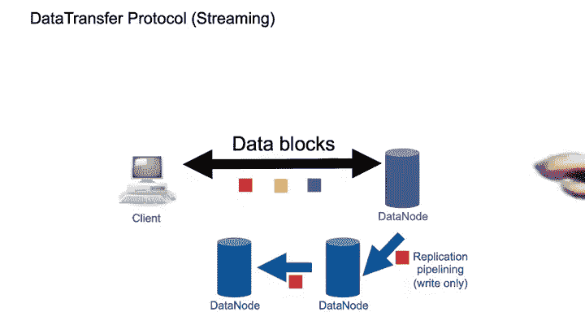

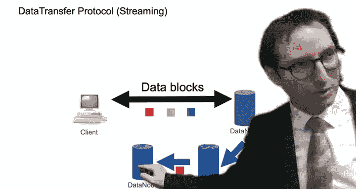

整个系统包含名称节点、数据节点和客户端。客户端可以是外部的笔记本电脑，也可以是数据中心内的一台机器（用户通常通过SSH连接到其中一台机器进行操作）。客户端与名称节点和数据节点通信，而实际的数据流只发生在客户端与数据节点之间，以及数据节点相互之间，名称节点不处理任何实际数据。

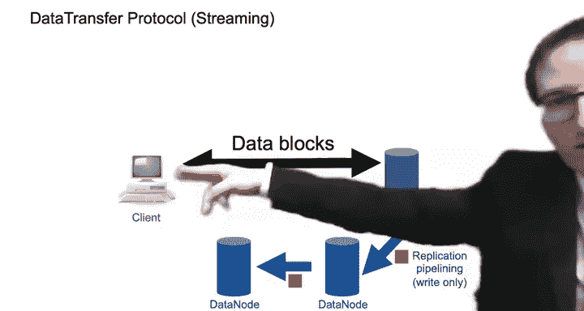

以下是系统中使用的关键协议：
*   **客户端协议**：用于客户端与名称节点之间的通信。
*   **数据节点协议**：用于名称节点与数据节点之间的通信。
*   **数据传输协议**：用于实际的数据块传输。
*   **复制管道**：用于在数据节点之间复制数据块，这与之前学习的块存储复制协议类似。

接下来，我们详细探讨每一个协议。

### 客户端协议

客户端协议是用户执行任何操作时的第一入口。与Amazon Dynamo的随机负载均衡不同，HDFS中客户端总是首先连接到唯一的名称节点。

客户端向名称节点发送请求，例如创建目录、删除文件、读取文件等。名称节点则响应客户端所需的信息，例如数据块的位置、块ID等。这个协议通常通过Java实现（使用远程过程调用RPC），但也提供REST API等其他接口。

### 数据节点协议

数据节点协议管理着名称节点与数据节点之间的通信。在计算机通信中，总是由客户端发起连接到服务器。在这里，**数据节点是客户端，名称节点是服务器**。数据节点会定期主动连接名称节点。

以下是数据节点与名称节点交互的关键操作：
*   **注册**：新数据节点加入集群时，会向名称节点注册。
*   **心跳**：每3秒，数据节点向名称节点发送心跳，确认其存活。如果名称节点长时间未收到某个数据节点的心跳，则认为该节点故障，其上的数据块可能已丢失。
*   **块报告**：每6小时，数据节点向名称节点报告其存储的所有数据块列表。名称节点据此构建块位置映射。
*   **块接收确认**：当数据节点从客户端接收到新数据块时，会向名称节点确认。
*   **名称节点指令**：名称节点可以要求数据节点执行操作，例如复制副本不足的块。**重要**：名称节点从不主动发起新连接下达指令，而是在数据节点发送心跳时，将指令作为心跳响应返回。

### 数据传输与复制

客户端如何与数据节点通信并写入数据呢？

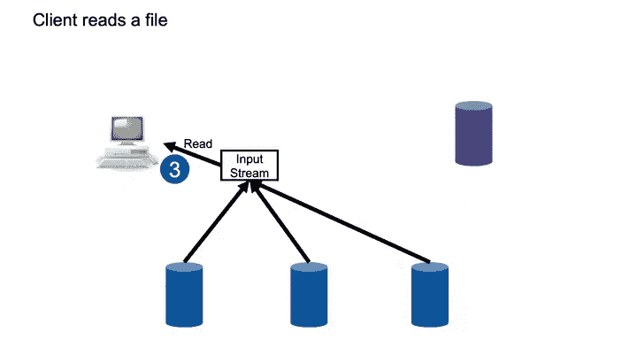

客户端将数据块（128 MB）通过网络发送给一个数据节点。为了实现复制，客户端会指示该数据节点将块传递给其他两个数据节点，从而形成一个复制管道。第一个数据节点负责组织管道，将块传递给第二个，第二个再传递给第三个。每个新块都会选择三个不同的数据节点组成新的管道。

关于安全性的问题：HDFS设计用于可信的内部环境（如公司防火墙内），它假设所有机器和软件都是受控且善意的。访问控制由名称节点管理，客户端在从名称节点获得授权后，可能会获得一个安全令牌，用于在连接数据节点时证明其权限。数据节点本身不直接验证客户端是否与名称节点通信过，但未经授权的块上传是无效的，因为块ID必须由名称节点分配并映射到文件才有意义。

---

## 文件读写流程详解 📖

了解了协议之后，我们通过动画来具体看看文件的读取和写入过程。

### 读取文件

以下是客户端读取一个已存在文件的步骤：
1.  **联系名称节点**：客户端向名称节点发送请求，意图读取指定路径的文件。
2.  **获取元数据**：名称节点检查客户端权限（可能涉及用户身份和加密令牌）。若授权通过，则回复该文件所有块的ID及其存储位置（多个数据节点地址）。位置列表按网络距离排序（距离最近的数据节点排在最前），以提高效率。
    *   *注意*：“按距离排序”在客户端位于数据中心内部时才最有意义。如果客户端是外部笔记本电脑，则所有数据节点距离都远，此优化效果有限。
3.  **读取数据块**：客户端根据列表，依次从每个块对应的最近数据节点下载数据块（128 MB）。如果第一个节点失败，则尝试列表中的下一个。
4.  **抽象层**：在Java客户端库中，这一切被封装在一个高级的`InputStream`中。对用户来说，就像在读取一个连续的巨型文件，而库内部则处理了与不同数据节点连接、按块切换的复杂逻辑。

### 写入文件

现在，让我们看看写入一个新文件的步骤：
1.  **创建意图**：客户端联系名称节点，请求创建新文件。
2.  **获取授权与资源**：名称节点进行访问控制检查。若通过，则为文件的第一个块分配一个新ID，并指定三个数据节点作为复制目标，可能同时提供一个安全令牌。
3.  **建立管道并传输**：客户端联系第一个数据节点，组织复制管道，开始发送数据。数据被分成网络数据包（如64 KB）传输。管道中，数据从客户端到第一个节点，再到第二个，最后到第三个。确认信息也沿管道返回。
4.  **写入后续块**：如果文件大于一个块，客户端重复步骤2和3，为第二个、第三个块等获取新的块ID和新的三个数据节点（通常不同），并建立新的管道。这个过程不断重复。
5.  **关闭与确认**：所有块发送完毕后，客户端通知名称节点关闭文件（释放写锁）。名称节点等待每个块达到**最小复制因子**（默认为1），即至少有一个数据节点确认成功写入。
6.  **最终确认与异步复制**：一旦每个块都至少有一个确认，名称节点就同步回复客户端“写入完成”。之后，系统在后台异步地将所有块的副本数补充到预设值（如3）。如果过程中有节点故障导致副本不足，名称节点也会在后台调度新的复制任务。

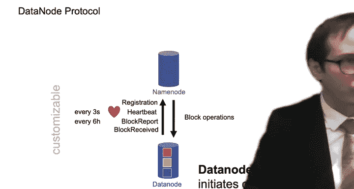

关于确认的时机：名称节点对客户端的最终确认发生在所有块都至少有一个副本确认之后，这是在客户端调用“关闭”操作时同步完成的。而达到完整副本数（如3）则是异步的、持续进行的过程，即使几天后有机柜故障导致副本数下降，系统也会自动修复。

---

## 数据块复制策略 🔄

我们知道了数据会被复制，但具体复制到哪些机器上呢？这有一套智能的策略。

默认复制因子为3。复制策略需要考虑网络带宽、数据分布和容错。核心思想是**避免数据过度集中**，同时优化写入和读取性能。

策略基于“节点距离”的概念，距离通常由网络跳数（经过的交换机和电缆数量）衡量。例如，同一机柜内的两个节点距离近，不同机柜的节点距离远，不同数据中心的节点距离更远。

以下是默认的三副本放置策略：
1.  **第一个副本**：放在客户端所在的节点上（如果客户端是集群内的一个数据节点）。这样写入最快。如果客户端在集群外，则随机选择一个节点。
2.  **第二个副本**：放在与第一个副本**不同机柜**的某个节点上。
3.  **第三个副本**：放在与第二个副本**相同机柜**的另一个节点上。

此外，还有两个基本原则：
*   **一个节点最多放一个副本**：防止该节点故障导致多个副本同时丢失。
*   **一个机柜最多放两个副本**：防止整个机柜故障导致数据不可用。

**为什么这样设计？**
*   将第二、三个副本放在同一机柜，可以优化它们之间的复制管道速度（网络距离短）。
*   避免将所有副本或前两个副本都放在客户端所在机柜，是为了防止数据过度集中在该机柜，形成单点风险。通过将副本分散到不同机柜，提高了数据的可靠性和读取的并行性。

---

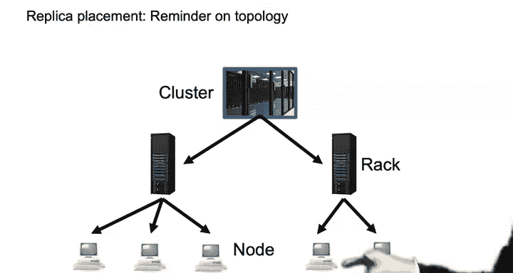

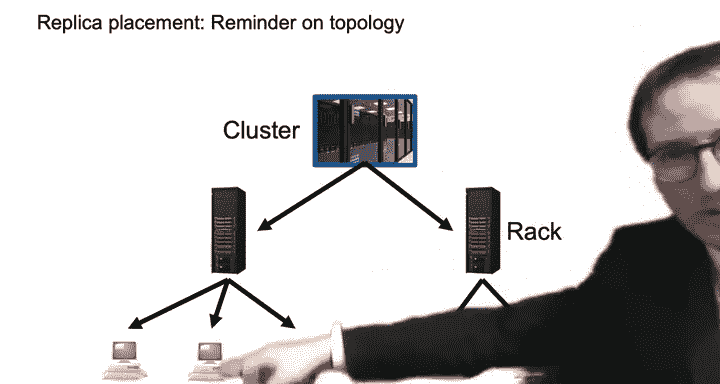

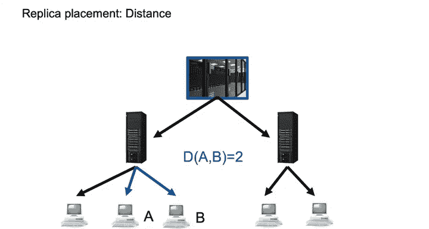

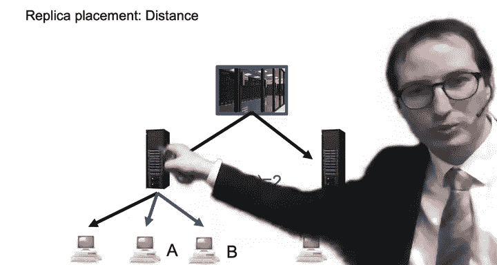

## 总结与预告 📝

本节课我们一起深入探讨了HDFS的物理架构和通信机制。我们学习了：
*   HDFS的集中式架构，包括名称节点（管理元数据）和数据节点（存储数据块）。
*   客户端、名称节点和数据节点之间用于元数据操作、心跳、数据传输和复制的各种协议。
*   文件读取和写入的详细步骤，从客户端发起请求到数据块的实际传输与确认。
*   智能的数据块复制策略，它平衡了性能、可靠性和数据分布。

我们还遗留了一个重要问题：名称节点作为单点，如果发生故障怎么办？这将是下一节课要解决的“悬念”。

**课后思考/作业**：
1.  HDFS访问控制的具体实现细节是什么？客户端如何向数据节点证明其已获得名称节点授权？
2.  在建立复制管道时，是客户端直接联系所有三个数据节点，还是只联系第一个，由第一个节点负责联系后续节点？

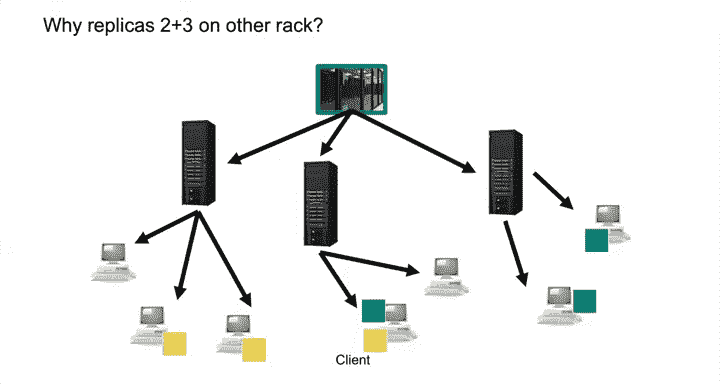

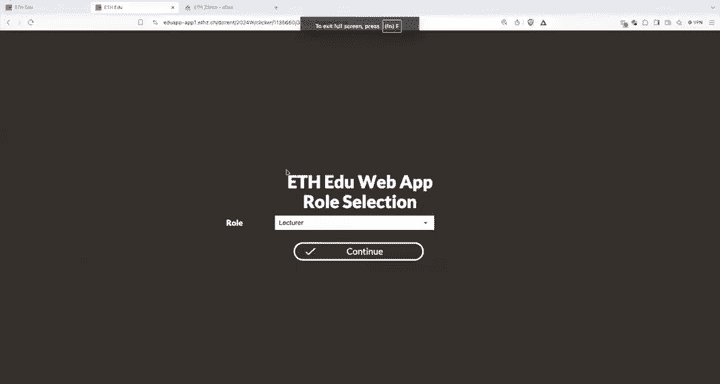

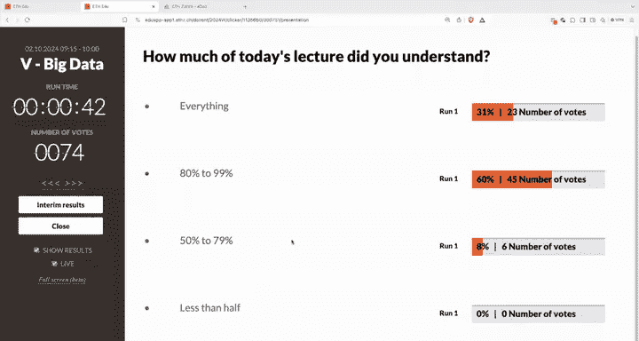

我们将在后续课程或资料中探讨这些问题。