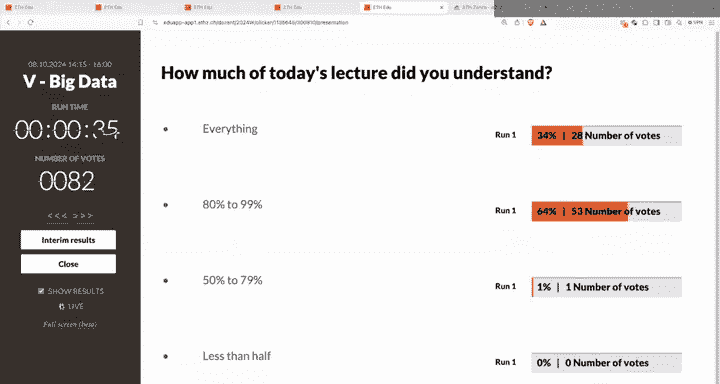

# 14：语法（1/3）🌲

在本节课中，我们将要学习数据表示中的语法，特别是文本格式。我们将探讨为何在“大数据”场景下，我们倾向于使用如JSON和XML这类半结构化格式，而不是传统的、高度规范化的表格。课程将从字符编码的基础知识开始，逐步深入到JSON的具体语法。

## 概述：为何需要语法？

在上一节中，我们介绍了数据存储的基础设施。本节中，我们来看看如何将数据表示为文本。

将数据存储为文本主要有两个目的：
1.  **人类可读性**：人类可以直接阅读和修改文本文件，这非常方便。从长远来看，文本格式也更容易被未来的研究者解读。
2.  **网络传输**：文本格式（如XML和JSON）是许多网络协议（如REST API）的标准数据交换格式。

当然，也存在更高效的二进制格式，但对于需要长期存档或广泛交换的数据集，文本格式通常是首选。

## 字符编码基础

在将文本存储为文件（即比特流）之前，我们需要一个将字符映射到比特的协议，这被称为**字符编码**。

以下是几种重要的编码方式：

*   **ASCII**：最早的编码之一，仅包含128个字符，基于英文字母表。
*   **Latin-1等扩展**：为了支持其他语言（如西欧语言）而出现的多种扩展编码。
*   **Unicode**：一个旨在包含全世界所有字符的庞大目录。它为每个字符分配一个唯一的**码点**（一个数字）。
*   **UTF-8**：一种对Unicode码点进行编码的变长方式。它是目前最推荐使用的编码，因为它兼容ASCII，并且能高效地表示各种字符。

**UTF-8编码规则**：
*   如果码点值小于等于7位，则用1个字节（8位）编码。
*   如果码点值小于等于11位，则用2个字节编码。
*   如果码点值小于等于16位，则用3个字节编码。

字节中的特定比特位（如上文图中的红色标记）用于指示这是单字节字符，还是多字节字符的起始或后续字节。

对于新软件，强烈建议从一开始就使用UTF-8编码，以避免后续迁移的麻烦。

## 从表格到树：反规范化

在传统数据库（OLTP）中，我们通过**规范化**将数据拆分到多个表中以避免冗余和异常。但在大数据分析（OLAP）场景下，我们通常执行一次写入、多次读取的操作。

因此，我们倾向于**反规范化**数据：将多个表合并成一个大表，甚至是一个嵌套的结构。这样做的好处是：
*   **避免连接操作**：连接操作在分布式系统中可能非常昂贵。一个大的、扁平化或嵌套的表可以直接被查询。
*   **适应数据异构性**：真实世界的数据（如日志文件）可能随时间变化模式（Schema），嵌套结构能更好地容纳这种不一致性。

反规范化使我们从**扁平、同质**的关系表世界，进入**嵌套、异质**的半结构化数据世界。JSON和XML正是为表示这类数据而设计的。

## JSON语法详解

JSON（JavaScript Object Notation）是当前非常流行的半结构化数据格式。它由六种基本语法构件组成。

### 原子值

以下是JSON中的四种原子值类型：

1.  **字符串**：必须使用双引号包围。特殊字符需要使用反斜杠转义。
    *   公式：`"<characters>"`
    *   示例：`"Hello\nWorld"`, `"\u0041"` (表示字符 ‘A’)

2.  **数字**：直接书写，无需引号。支持整数、小数和科学计数法。
    *   公式：`[”-“]<digits>[”.”<digits>][(“e”|”E”)[”+”|”-“]<digits>]`
    *   示例：`42`, `-3.14`, `2.9979e8`

3.  **布尔值**：直接使用 `true` 或 `false`。

4.  **空值**：使用 `null` 表示。

### 复合结构

为了实现嵌套，JSON提供了两种复合结构：

5.  **数组**：表示一个有序的值列表，使用方括号 `[]` 定义，值之间用逗号分隔。数组内的值可以是任何JSON类型，允许异质。
    *   代码：`[<value1>, <value2>, ...]`
    *   示例：`[1, true, "text", {"key": "value"}]`

6.  **对象**：表示一个键值对集合（映射），使用花括号 `{}` 定义。键必须是字符串，值可以是任何JSON类型。
    *   代码：`{"<key1>": <value1>, "<key2>": <value2>, ...}`
    *   示例：`{"name": "Alice", "age": 30, "hobbies": ["reading", "hiking"]}`

### JSON重要规则与最佳实践

以下是关于JSON格式的一些关键点：

*   **键名引号**：对象中的键**必须**是带双引号的字符串。虽然有些解析器较宽松，但生产数据时应严格遵守。
*   **键的唯一性**：在同一个对象内，键名不应重复。标准中此为“建议”而非“强制”，但为保障兼容性，应视作强制规则。
*   **格式化**：为了人类可读，JSON可以包含换行和缩进（美观打印）。但在存储为数据集时（如JSON Lines格式），通常每行只放一个紧凑的JSON对象，以节省空间并便于流式处理。

### JSON数据示例

一个扁平表（如CSV）可以用JSON Lines表示，即每行一个JSON对象。

一个嵌套表（违反第一范式）可以自然地用JSON表示，其中子表被表示为父对象中某个键对应的数组，数组内包含多个对象。

## 格式标准化的重要性

XML和JSON之所以重要，不仅因为其技术特性，更因为它们是**标准**。W3C标准化了XML，ECMA标准化了JSON。

标准化的好处在于：
*   **互操作性**：有成千上万的库和工具支持这些标准，确保数据能在不同系统间交换。
*   **生态成熟**：尤其是XML，在企业级和政府系统中有着深厚且成熟的生态系统。

## 概念辨析：格式良好 vs 有效

在本课程中，区分以下两个概念至关重要：
*   **格式良好**：一个文档是否符合JSON或XML的基本语法规则。这是一个“是/否”问题，由解析器检查。
*   **有效**：一个格式良好的文档是否符合某个特定的模式（Schema）定义（例如，值是否在特定范围内）。这将在后续课程中讨论。

目前，我们只关注语法层面的“格式良好”。

## 总结

本节课中我们一起学习了数据表示语法的核心概念。我们从为什么需要文本格式开始，回顾了字符编码（尤其是UTF-8）的基础。然后，我们深入探讨了在大数据背景下**反规范化**数据的动机，这引出了对**半结构化数据**（如树形结构）的需求。接着，我们详细剖析了**JSON**的六种语法构件：字符串、数字、布尔值、空值、数组和对象，并通过示例展示了如何用JSON表示扁平表和嵌套表。最后，我们强调了**标准化**格式（如JSON和XML）的重要性，并厘清了“格式良好”与“有效”这两个关键术语的区别。

理解这些语法基础，是我们后续学习如何查询和处理这些半结构化数据的必要前提。