# 16：XML语法（3/3）📚

在本节课中，我们将完成对XML语法的学习，重点探讨命名空间的概念、其实际应用，以及如何将数据表示为XML格式。我们还会将XML与JSON等其他数据格式进行比较，并介绍一个实用的XML编辑器。

---

## 概述 📋

本节课我们将深入理解XML命名空间，了解它们如何在全球范围内帮助组织和区分不同的数据标准。我们还将学习如何使用XML表示表格和嵌套数据，并比较XML与JSON在不同场景下的适用性。

---

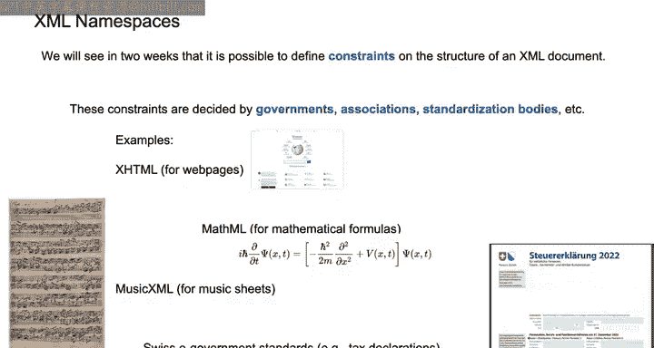

## 命名空间的用途与类比 🔗

上一节我们介绍了XML的基本结构。本节中，我们来看看**命名空间**。命名空间用于避免来自不同领域（如数学公式、音乐乐谱）的XML元素名称发生冲突。

可以将XML命名空间理解为Python中的模块导入。

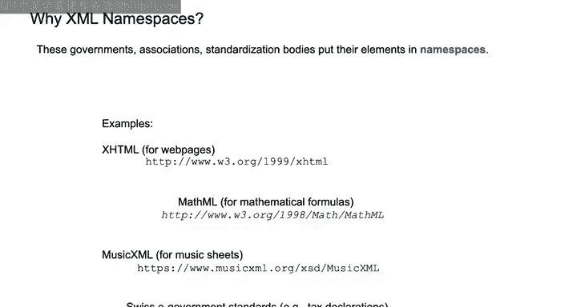

*   **带前缀的命名空间** 类似于 `import pandas as pd`。在XML中，我们声明一个前缀（如 `m:`）并将其绑定到一个唯一的URI（如MathML的命名空间）。
    ```xml
    <m:math xmlns:m="http://www.w3.org/1998/Math/MathML">
        <m:mi>x</m:mi>
    </m:math>
    ```
*   **默认命名空间** 类似于 `from pandas import *`。它为该元素及其所有子元素（除非被覆盖）设置一个默认的命名空间，无需使用前缀。
    ```xml
    <math xmlns="http://www.w3.org/1998/Math/MathML">
        <mi>x</mi>
    </math>
    ```

添加命名空间后，XML处理器可以依据该命名空间对应的模式（Schema）来验证文档结构的正确性，我们将在后续课程中详细学习。

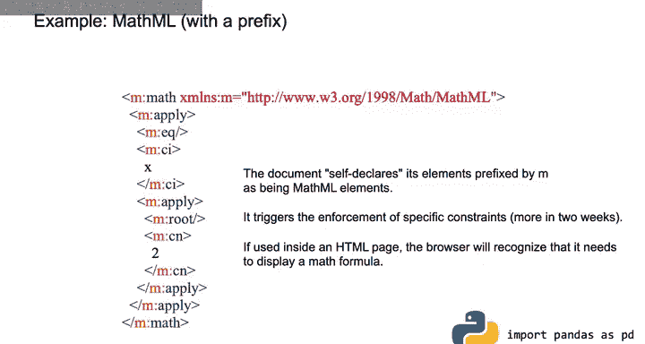

---

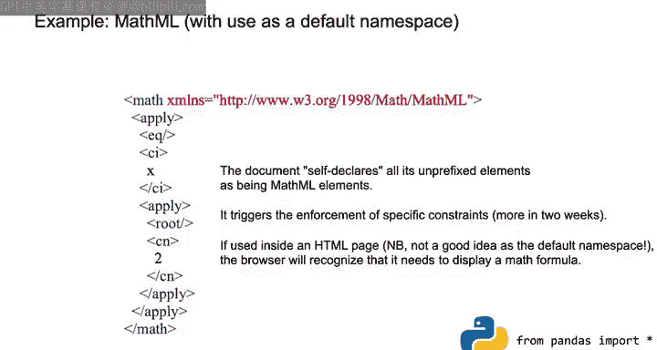

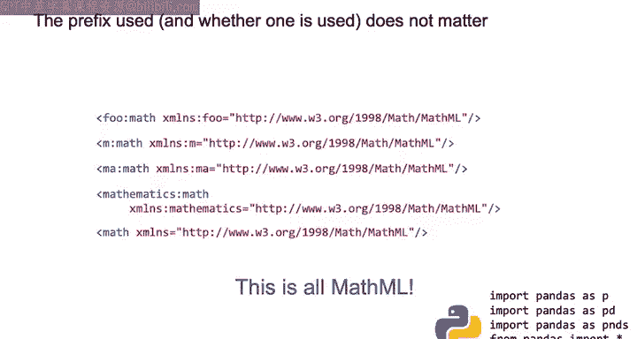

## 命名空间的实际应用示例 🌐

以下是一个在HTML网页中嵌入MathML公式的实例，展示了多命名空间的混合使用：

```xml
<html xmlns="http://www.w3.org/1999/xhtml">
  <head><title>Example</title></head>
  <body>
    <h1>一个公式</h1>
    <math xmlns="http://www.w3.org/1998/Math/MathML">
      <msup><mi>a</mi><mn>2</mn></msup>
      <mo>+</mo>
      <msup><mi>b</mi><mn>2</mn></msup>
      <mo>=</mo>
      <msup><mi>c</mi><mn>2</mn></msup>
    </math>
  </body>
</html>
```

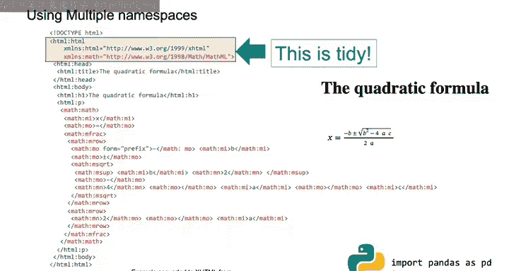

*   整个文档默认命名空间是XHTML。
*   `<math>` 元素及其子元素则位于MathML的命名空间中。
*   浏览器能识别并正确渲染出公式 **a² + b² = c²**。

---

## 推荐的命名空间使用模式 ✅

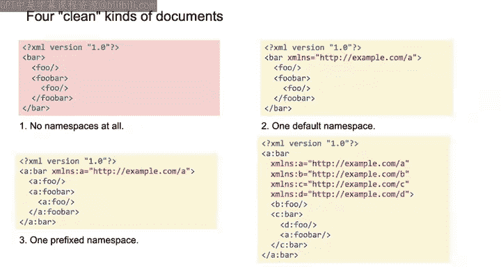

为了避免混乱，请遵循以下清晰的模式：

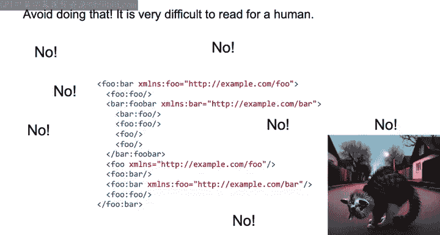


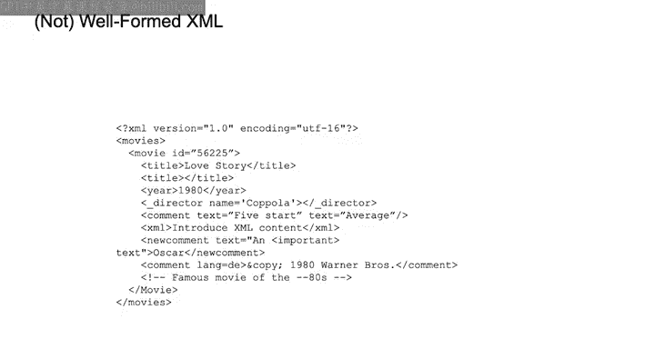

以下是几种清晰且推荐的命名空间使用方式：

1.  **无命名空间**：用于简单的、不涉及外部标准的数据。
2.  **默认命名空间**：整个文档主要遵循一种标准时使用。
3.  **单一前缀命名空间**：引入一个外部标准时使用（如 `pd` 对应 `pandas`）。
4.  **多前缀命名空间**：引入多个外部标准时使用，每个都有清晰的前缀。

**切勿**在同一个文档中为同一个命名空间使用多个不同的前缀，或随意混合默认命名空间和前缀命名空间，这会导致代码难以理解和维护。

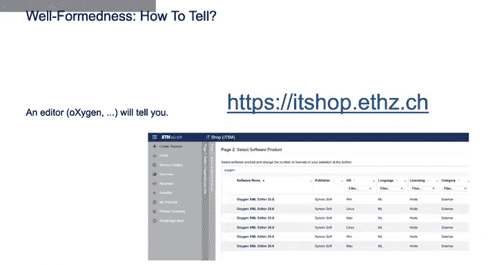

---

## 实用工具：Oxygen XML Editor 🛠️

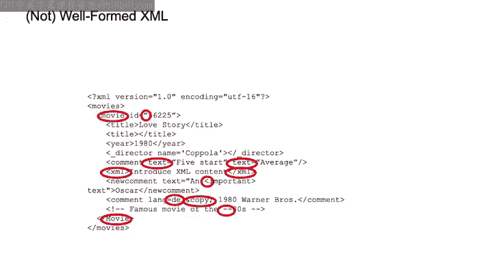

处理XML时，一个强大的编辑器非常有用。苏黎世联邦理工学院为学生提供了 **Oxygen XML Editor** 的站点许可证。

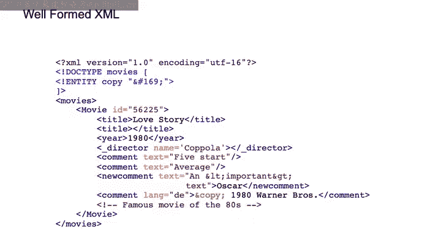

你可以从IT商店（itshop.ethz.ch）免费下载。它不仅能高亮显示语法，还能：
*   检查XML的格式是否良好（Well-formedness）。
*   帮助修复常见错误，例如标签不匹配、属性未加引号、使用了无效的转义字符等。

---

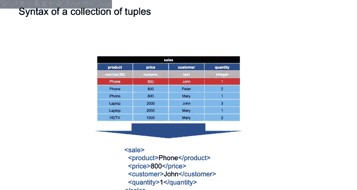

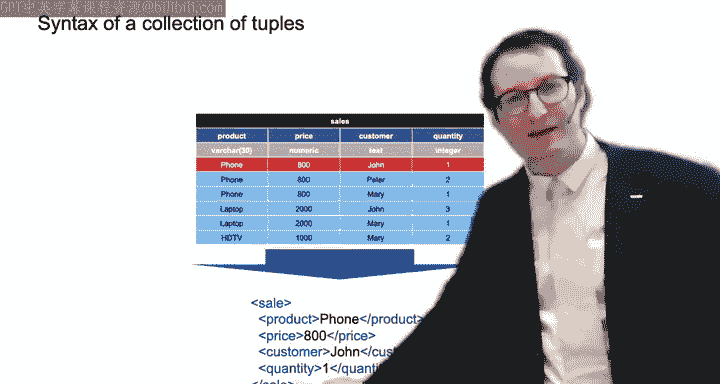

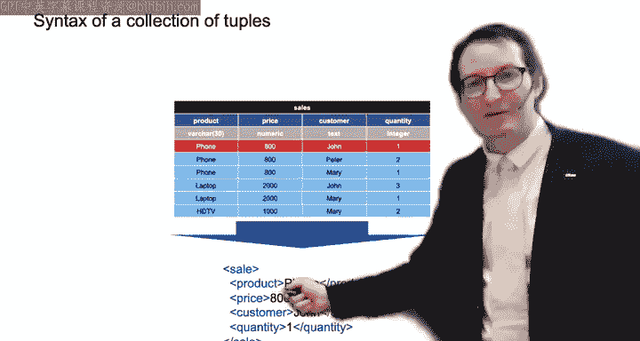

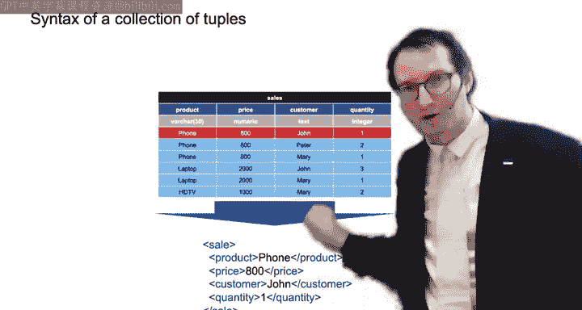

## 在XML中表示数据表 📊

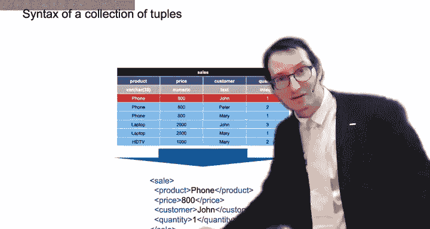


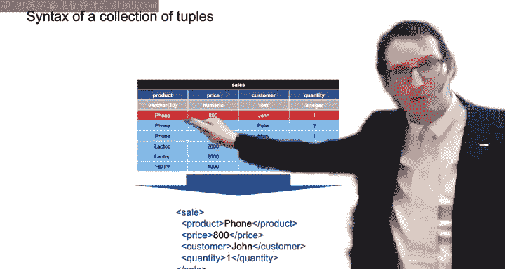

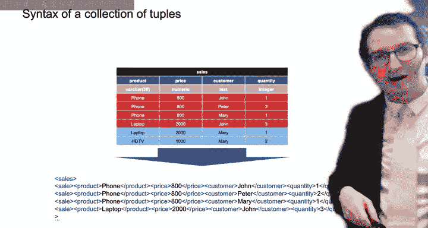

理解了语法和工具后，我们来看看如何用XML表示关系型数据。

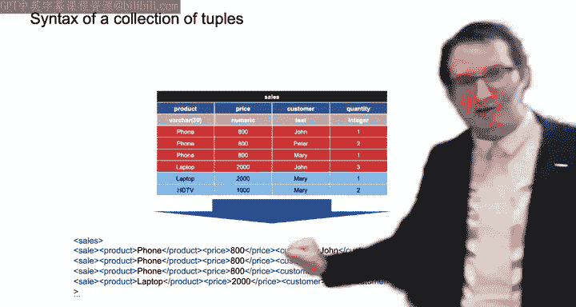


一个简单的销售数据表：

| product | price | customer | quantity |
| :------ | :---- | :------- | :------- |
| Apple   | 5     | Alice    | 10       |

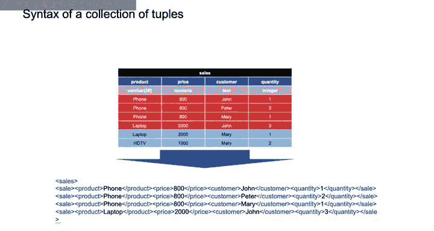

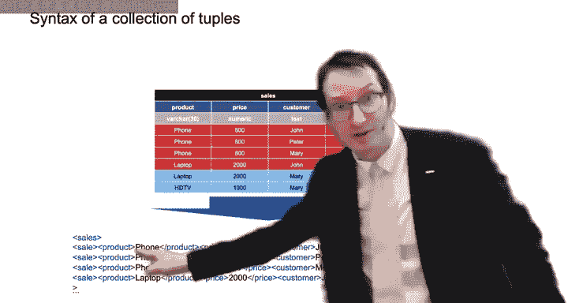

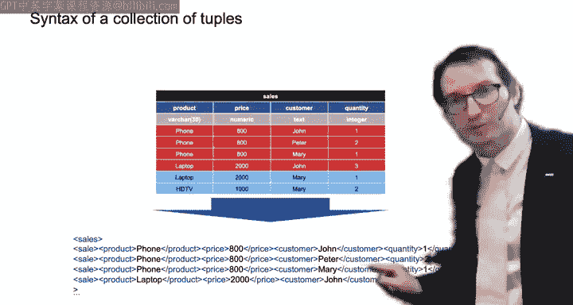

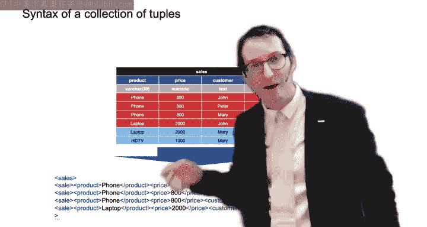


在XML中，通常按行进行嵌套表示，并使用复数/单数形式来区分集合与个体：

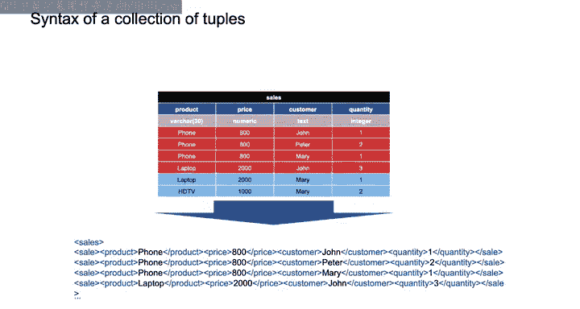

```xml
<sales> <!-- 表名（复数），表示整个数据集 -->
  <sale> <!-- 行（单数），表示一条记录 -->
    <product>Apple</product>
    <price>5</price>
    <customer>Alice</customer>
    <quantity>10</quantity>
  </sale>
  <!-- 可以添加更多 <sale> 元素来表示其他行 -->
</sales>
```

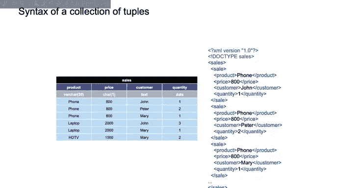

---

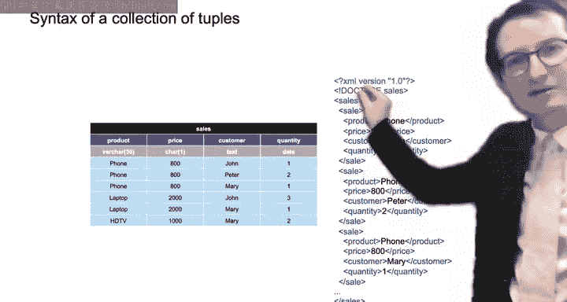


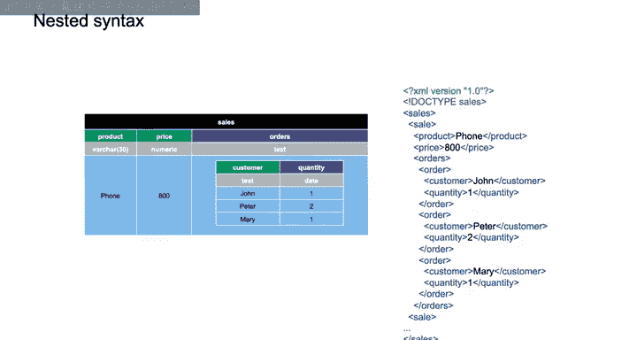

## 在XML中表示嵌套数据 🌲

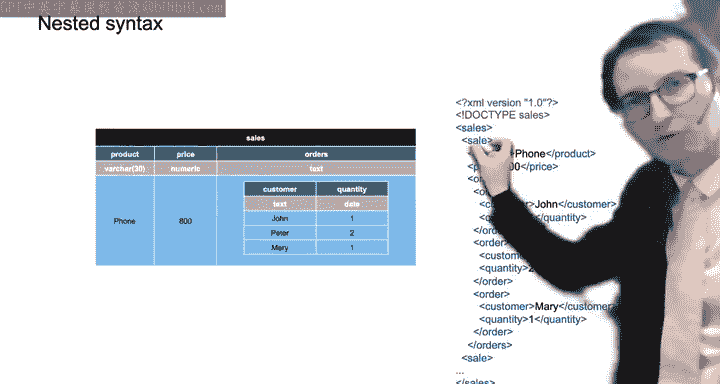

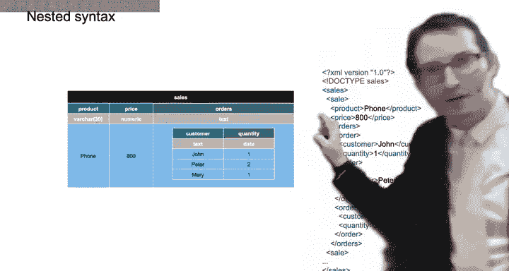

对于嵌套数据（例如，一个订单包含多个商品项），XML通过多层嵌套元素来自然地表示：


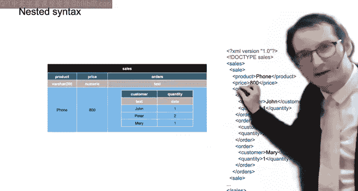

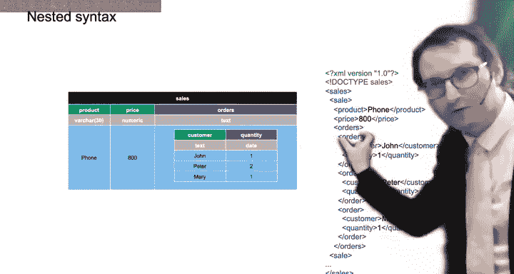

```xml
<table>
  <sale>
    <product>Laptop</product>
    <orders> <!-- 嵌套的列表 -->
      <order>
        <component>RAM</component>
        <quantity>1</quantity>
      </order>
      <order>
        <component>SSD</component>
        <quantity>2</quantity>
      </order>
    </orders>
  </sale>
</table>
```


这种结构对应了JSON中的对象内嵌数组，或数据模型中的树形结构，是CSV等扁平格式无法直接表达的。

---

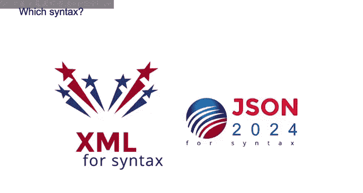

## XML vs. JSON vs. YAML ⚖️

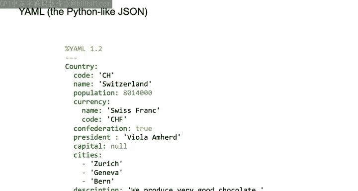


作为计算机科学家，不应武断地认为某种格式更好，而应根据使用场景选择。

以下是几种数据格式的简要比较：

*   **XML**：
    *   **优势**：非常适合表示**带标记的文本流**（如书籍、文档），生态系统成熟，企业级工具支持完善。
    *   **示例场景**：出版业、政府数据标准（如Swiss eGovernment）、需要严格验证的复杂数据交换。
*   **JSON**：
    *   **优势**：语法与编程数据结构（对象、数组）高度一致，非常适合表示**业务数据记录**，在Web API中占主导地位。
    *   **示例场景**：Web服务接口、配置文件、与JavaScript交互。
*   **YAML**：
    *   **优势**：对人类阅读和编辑非常友好，通过缩进表示结构，无需大量括号。
    *   **示例场景**：Kubernetes配置、Docker Compose文件、强调可读性的配置文件。

从数据模型的角度看，它们都能表示树形结构，本质上是相通的。

---

## 总结 🎯

本节课中我们一起学习了：
1.  **XML命名空间**的核心概念及其与Python模块导入的类比，理解了它如何通过URI唯一标识数据标准。
2.  如何遵循清晰的**命名空间使用模式**来编写可维护的XML文档。
3.  如何使用 **Oxygen XML Editor** 来高效地编辑和验证XML。
4.  如何将**表格数据**和**嵌套数据**转换为XML格式。
5.  对 **XML、JSON和YAML** 进行了比较，明确了它们各自适用的场景，核心在于根据数据特性（是文档文本还是业务记录）和生态系统需求来选择。


关键结论是：当我们需要表示超越扁平表格的**树状结构数据**时，XML、JSON和YAML等格式提供了强大的能力，而CSV则仅限于平面表格。