# 大数据课程 - 第17讲：宽列存储 (1/4) 📊


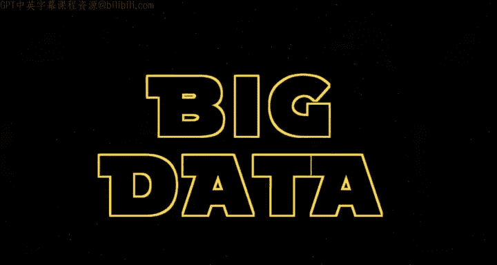


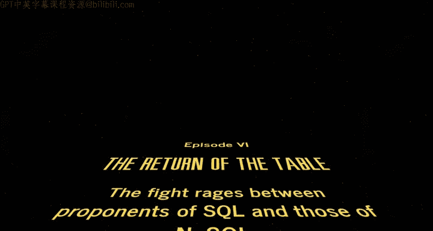

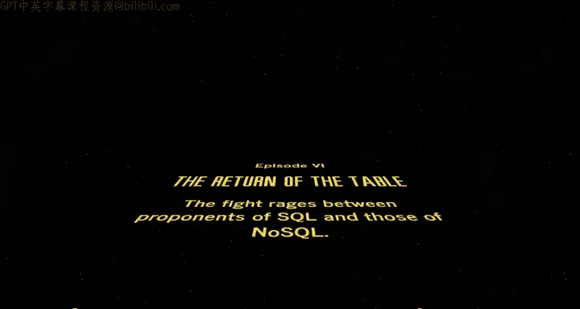

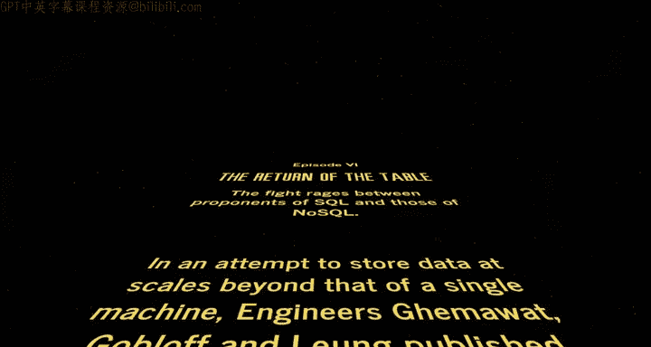

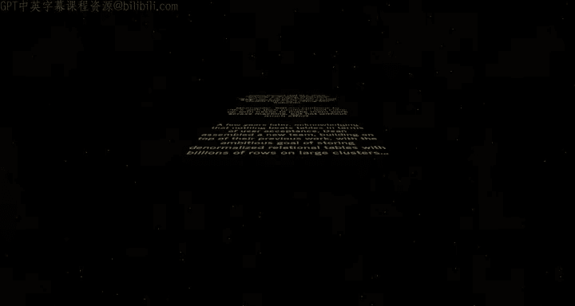

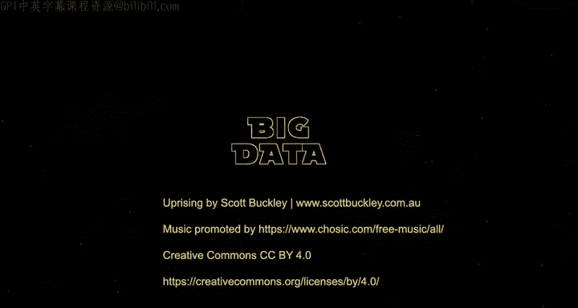

在本节课中，我们将要学习一种新型的数据存储模型——宽列存储。我们将从理解其诞生的背景和动机开始，然后深入探讨其逻辑模型和基本操作。这种模型旨在解决传统数据存储系统在可扩展性、吞吐量和灵活性方面的局限性。

---

## 概述：为何需要宽列存储？🤔

上一节我们介绍了各种数据存储格式，本节中我们来看看数据模型。传统的关系型数据库管理系统（RDBMS）设计用于单机环境，使用如SQL这样的高级语言，并管理着严格的模式。然而，当数据量超过单台机器的存储能力时，就会遇到瓶颈。

虽然可以通过升级硬件（纵向扩展）来应对，但这终究会遇到物理极限。大约20年前，Google和Yahoo等公司开始尝试另一种方法：购买数百台普通商用计算机，并在每台机器上安装PostgreSQL等关系数据库，然后手动编写程序来跨机器分布和复制数据。这类似于GFS（Google文件系统）的理念。

但这种方法设置复杂、维护成本高昂，并非长久之计。工程师们意识到，需要一种原生为集群环境设计的数据存储系统。于是，Google的BigTable应运而生。它在运行GFS的集群之上，提供了一个逻辑上类似于关系表的数据模型。由于BigTable和GFS是专有技术，开源社区随后发展出了Hadoop生态系统，其中HDFS是GFS的开源版本，而HBase则是BigTable的开源版本。

---

## 现有系统的局限性 ⚠️

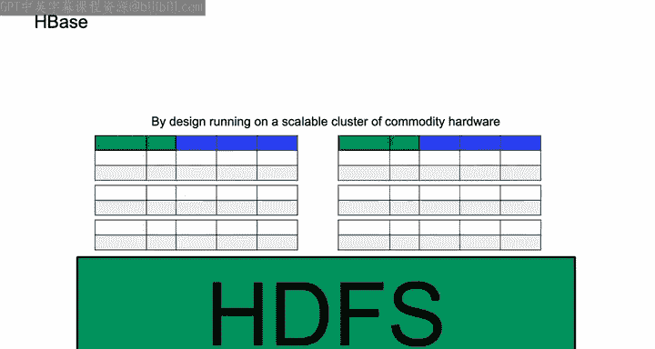

为了理解宽列存储的价值，我们先看看现有系统的不足。以下是各类存储系统的关键短板：

*   **对象存储**：缺乏低延迟访问，因为更新大对象通常需要重写整个对象，不支持原地修改和随机访问。
*   **关系型数据库管理系统（RDBMS）**：缺乏高吞吐量（虽然支持毫秒级的随机读写），且最初的版本难以扩展到单机之外。
*   **HDFS**：缺乏低延迟（操作如提交命令可能有数秒延迟），不支持原地更新（必须删除并重写文件），读取时的随机访问性能极差。
*   **键值存储**：缺乏高吞吐量（主要设计用于简单的`get`、`put`、`delete`操作），并且不支持存储过大的值（通常限制在几百KB以内）。

可以看到，没有一个现有系统能满足所有需求。而像HBase和BigTable这样的宽列存储系统，目标正是同时提供**高吞吐量**、**低延迟**、**原地更新**、**支持大值存储**和**随机访问**能力。

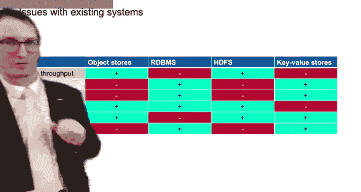

---

## 逻辑模型：从反规范化开始 🧱

现在，让我们采用与讲解HDFS时类似的“数据独立性”方法，首先忽略集群和物理实现，专注于HBase的逻辑模型。

其核心思想是：为了获得高吞吐量和高效查询，我们需要将那些会被一起访问的数据存储在一起。这其实并不新鲜，其本质就是避免连接（Join）操作。在传统RDBMS中，为了满足高阶范式（如第三范式），数据被拆分到多个表中。当需要查询时（例如，在网页上显示订单及其产品信息），就必须通过连接操作将多个表的数据合并。

连接操作成本较高。因此，对于需要极快响应的场景（如网站），进行**反规范化**（Denormalization）通常是有益的。反规范化可以粗略地理解为预先计算连接，将来自不同源的数据“挤压”到同一张表中。

虽然这会导致不符合传统的关系型设计范式（例如，出现不期望的函数依赖），但对于数据查询和分析的目的而言，我们并不关心。相反，反规范化能显著加快查询和分析速度。当然，运行网站的事务处理可能仍需要在传统的RDBMS集群上进行。

这种反规范化的结果就是“宽表”——它不仅行数多，列数也很多。这就是“BigTable”（大表）名称的由来之一。

---

### 深入模型细节 🔍

宽列存储的逻辑模型看起来像一张表，但有一些关键区别。

**行键（Row ID）**
表中的一列是特殊的，称为**行键（Row ID）**。与PostgreSQL可以选择主键不同，在HBase中，你必须有一个专门的行键列，且每个表只有一个。表中的记录按照行键进行排序。行键本质上是一个字节序列。

> **注意**：HBase只使用一个列作为主键（行键）。其他系统如Cassandra（HBase的竞争对手）支持由多个列组成的复合主键。

从某种意义上说，这已经是一个键值模型：行键是键，该行的其余部分（所有列的值）共同构成了值。

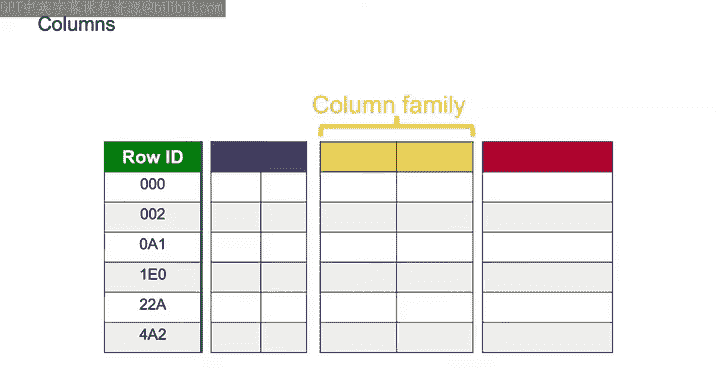


**列族（Column Families）**
与传统关系表的主要区别在于，列被分组到**列族（Column Families）**中。你可以将列族理解为反规范化之前那些独立表的遗留。例如，合并前的左表可能对应黄色的列族，右表对应红色的列族。反规范化后，它们被放在同一张宽表中，但仍保留着列族的区分。

**列名（Column Names）**
列名本身也是字节序列（在实践中常编码为UTF-8字符串）。一个强大的特性是：在创建表并存入大量数据后，你可以随时动态地创建新的列名，而不会带来任何性能损失。

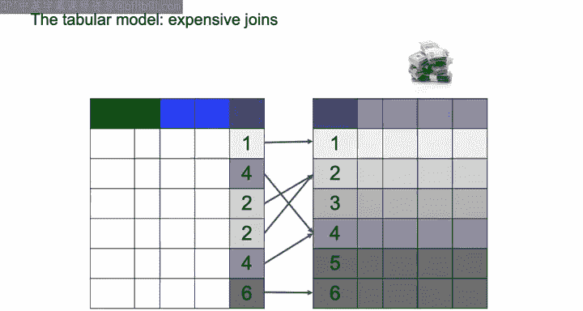

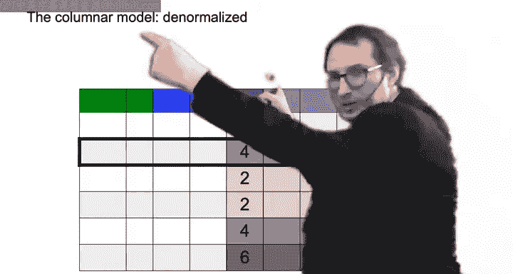

这与传统关系数据库形成鲜明对比：在传统数据库中，向大表添加新列可能需要很长时间（例如一小时）。在HBase中，插入新记录时，可以即时插入之前不存在的列名，这完全没问题。

这会导致表变得非常稀疏，很多单元格是空的，因此它不遵循传统的关系完整性约束。

**关于列族与列名的操作区别**
在已存在的列族内，动态创建新列名非常容易。然而，创建或删除列族本身是可能的，但这不是弹指之间就能完成的操作，它相对更“重”一些。

---

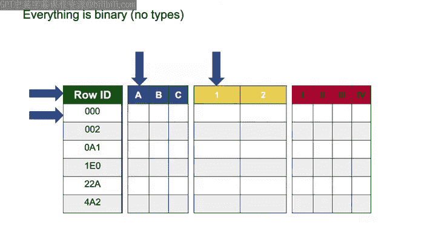

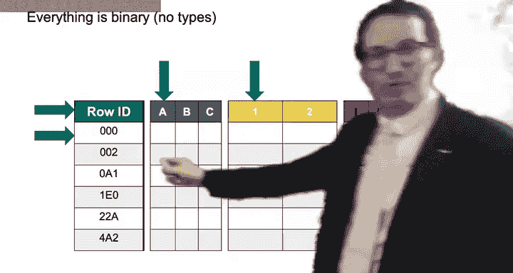

### 一切都是字节 🔢

需要再次强调：在这个模型中，所有组成部分都是二进制值，即字节序列。
*   行键是字节序列。
*   列族是字节序列。
*   列名是字节序列。
*   单元格的值也是字节序列。

换句话说，它不像Java这样的高级编程语言或SQL这样的查询语言，提供字符串、整数、日期等多种数据类型。HBase底层只有字节。当然，访问HBase的库和驱动会提供便利的函数和方法，帮助你将整数、字符串等类型转换并存入，但在物理层面，它们最终都只是字节。

**关于大小限制**
*   **值（Value）**：在传统RDBMS中，值通常很小（符合第一范式）。在HBase中，你可以轻松地将值的大小推到10MB甚至更大。你可以存放图片、XML/JSON文档、YAML文件、HTML页面等。这本身也可以看作一种反规范化，因为一个10MB的BLOB很难被认为是“原子”值，这甚至不符合第一范式。但HBase可以很好地处理，性能在10MB范围内仍然不错。
*   **行键、列族、列名**：对这些部分的大小需要更谨慎。我们将在学习物理实现时看到，它们在数据存储中被大量重复，因此不应让它们变得过大（例如10MB），而应保持相对“原子”和小巧。

---

## 基本操作：低层级的API ⚙️

由于模型本身比较接近物理层（操作对象是字节），HBase提供的查询接口不是一个完整的SQL语言，而是一个相对低层级的访问方式，类似于键值存储的`Get`/`Put`/`Delete`以及REST API。

以下是主要的四种操作：

**1. Get（获取）**
`Get`操作允许你根据特定的行键检索数据。
```
Get(row_id)
```
你可以获取该行所有列族和列的值。也可以进行定制，只获取特定列族（如紫色或黄色列族）的值，这通常更快，因为列族在物理上是分组存储的。

**2. Put（放置）**
`Put`操作用于插入新数据或更新现有数据。
```
Put(row_id, values)
```
你可以插入一个具有新行键的新行及其值，也可以更新已存在行的部分值。同样，`Put`操作也可以只针对特定的列族进行。

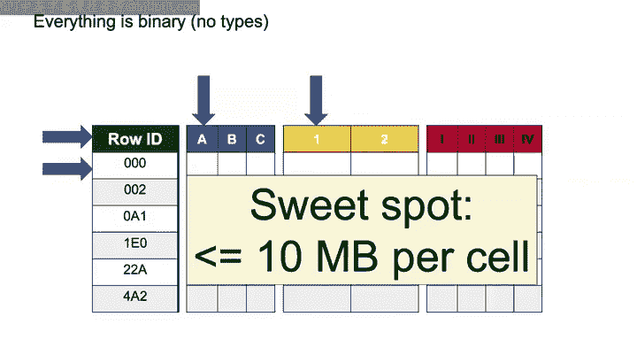

**3. Scan（扫描）**
`Scan`操作是面向大数据分析的新功能。它允许你遍历多行数据。
```
Scan(start_row_id, end_row_id)
```
你可以控制扫描的行数范围（通过指定起始和结束行键），也可以限制只扫描特定的列族。然后，你可以通过迭代器的方式逐批获取结果。


**4. Delete（删除）**
`Delete`操作用于删除数据。你可以删除整行数据，也可以删除行中特定列族或列的数据。

所有这些操作（`Get`, `Put`, `Delete`, `Scan`）都可以通过高级语言（如Java、Python）或Shell中的API来调用。

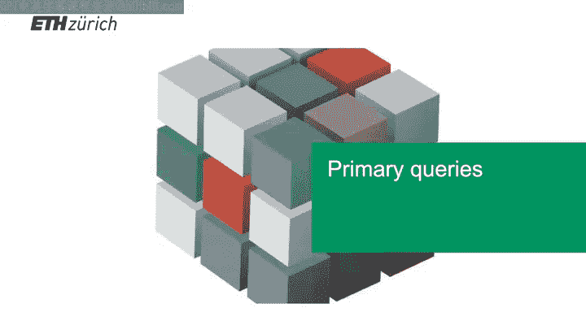

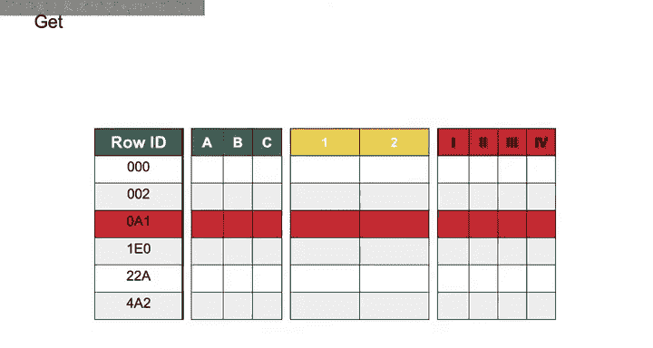

---


## 关键术语总结 📝

在结束本节之前，我们来澄清几个关键术语：

*   **键值模型（Key-Value Model）**：我们已经看到，行键（Row ID）作为键，整行数据作为值，这符合键值模型。S3、各种键值存储、JSON对象的属性、XML元素的属性等都遵循这种模型，本质上它就是一种映射或关联数组。
*   **列式存储（Column-Oriented Storage）**：**不要与“宽列存储”混淆**。列式存储指的是在物理磁盘上，数据按列（而不是按行）的方式存储。新一代的数据库系统采用这种方式，当查询只涉及特定列时，可以带来巨大性能优势。
*   **宽列存储（Wide Column Stores）**：这就是我们本节讨论的核心。其特点是拥有**列族**的概念，可以看作是列式存储的一种扩展，允许在列族内动态创建大量列，形成非常“宽”的表。

---

## 本节总结 🎯

本节课中我们一起学习了宽列存储的初步知识。我们首先了解了传统数据存储系统在扩展性上的局限，以及宽列存储（如Google BigTable和Apache HBase）诞生的背景和动机。接着，我们深入探讨了其核心逻辑模型，包括：
*   强制性的**行键（Row ID）**及其排序特性。
*   数据按**列族（Column Families）**分组的概念。
*   可以动态创建的**列名（Column Names）**。
*   **所有组成部分（行键、列族、列名、值）本质上都是字节序列**这一重要事实。

最后，我们介绍了HBase提供的四种基本低层级操作：`Get`（检索）、`Put`（插入/更新）、`Scan`（范围扫描）和`Delete`（删除），并区分了“键值模型”、“列式存储”和“宽列存储”这几个关键术语。

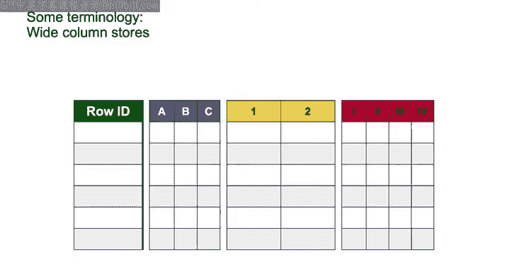

下一节，我们将揭开神秘面纱，探讨HBase是如何在物理上实现这个强大的逻辑模型的。