# 课程 20：宽列存储 (4/4) 📚

在本节课中，我们将完成关于宽列存储（即 HBase 或 BigTable）的讲解。之后，我们将转向数据建模，特别是数据框架和验证。

---

## 概述

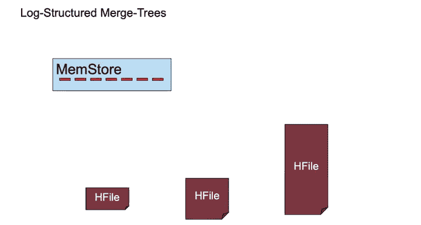

上一节我们介绍了 HBase 的低延迟之谜。本节中，我们将深入探讨其内部机制，包括缓存、优化、启动流程、数据本地性，并简要了解其演进方向。

---

## 缓存机制详解

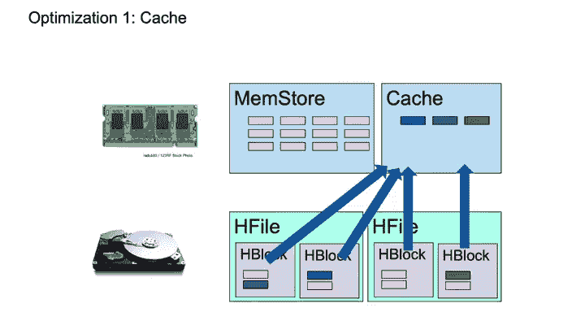

HBase 的低延迟读写能力，建立在其数据存储于 HDFS 之上这一事实。HDFS 本身不具备低延迟特性，那么 HBase 是如何实现的呢？

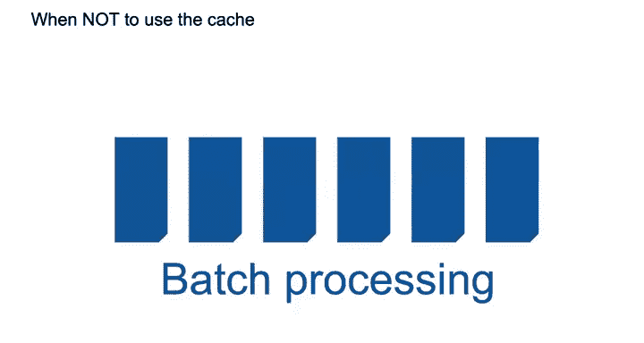

关键在于，**最近写入的数据（新鲜数据）被保存在内存中的 MemStore 里**。只有当内存满了，MemStore 才会将排序后的键值对序列一次性刷新（Flush）到 HDFS 上。随后，系统会通过合并（Compaction）将大量小文件整合成越来越大的文件。

上一节有同学问及这与 CPU 的 L1/L2 缓存有何关联。你可以将 **MemStore 视为一种“写缓存”**，它暂存了尚未持久化到 HDFS 的数据。

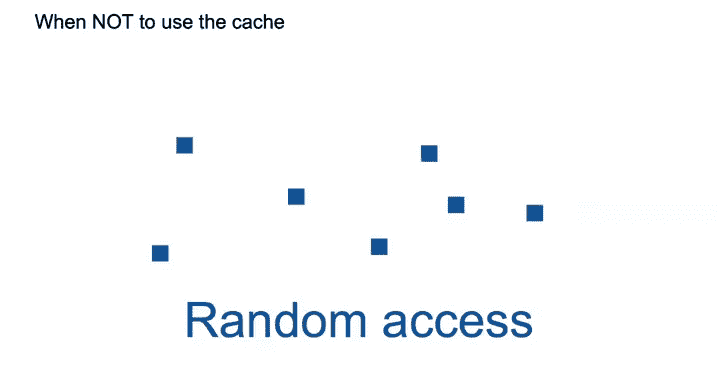


同样，系统也存在“读缓存”。一些经常被访问或最近访问过的、已经存储在 HDFS 上的旧数据块（HFile Block）会被保留在内存中。这样，读取时就不必再从 HDFS 加载，从而提升了速度。需要注意的是，缓存是以 **HFile 块** 为单位进行的，而非单个键值对。


---

## 缓存失效的场景

然而，读缓存在某些场景下可能完全无效。

以下是两种主要情况：
1.  **批处理**：当你需要读取整个数据集（例如使用 MapReduce）时，所有数据都必须被访问一次，缓存无法提供帮助。
2.  **完全随机访问**：如果数据访问没有热点（即某些区域被频繁读写），访问模式是完全随机的，那么缓存命中率会很低，同样无效。


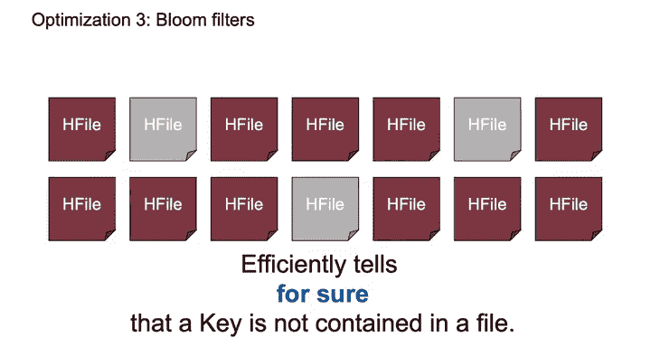

因此，是否需要以及如何利用缓存，完全取决于你的具体用例和访问模式。

---

## 读取优化策略

由于读取时可能需要在 MemStore 和所有 HFile 中查找目标键值，性能可能成为瓶颈。为了优化，HBase 采用了两种主要策略来跳过无关的 HFile。

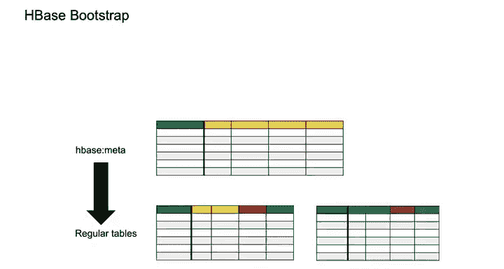

以下是两种优化方法：
1.  **键值范围信息**：每个 HFile 都记录了其包含的键值范围（最小键和最大键）。如果要查找的键不在这个范围内，就可以安全地跳过整个文件。
2.  **布隆过滤器**：布隆过滤器是一种概率数据结构，它可以**确定地告诉你某个键“肯定不在”某个 HFile 中**（真阴性）。如果它说“可能在”，那只是一个“可能”的答案（可能为真阳性，也可能是假阳性）。这允许我们安全地跳过那些肯定不包含目标键的文件。

布隆过滤器通常使用多个哈希函数和一个位图来实现。其核心特性是：如果查询结果为“否”，则键一定不存在；如果结果为“是”，则键可能存在。

```python
# 布隆过滤器原理示意（非实际代码）
class BloomFilter:
    def __init__(self, size, hash_functions):
        self.bitmap = [0] * size
        self.hash_funcs = hash_functions

    def add(self, key):
        for h in self.hash_funcs:
            index = h(key) % len(self.bitmap)
            self.bitmap[index] = 1

    def might_contain(self, key):
        for h in self.hash_funcs:
            index = h(key) % len(self.bitmap)
            if self.bitmap[index] == 0:
                return False  # 肯定不存在
        return True  # 可能存在
```


这种利用额外信息来避免读取所有文件的优化思想，在大数据领域非常普遍。

---

## 系统启动与元数据表

理解了数据存储和读取后，一个自然的问题是：客户端如何知道哪个 RegionServer 负责哪个数据区域（Region）？

直觉上，你可能认为 HMaster 掌管这一切，就像 HDFS 中 NameNode 记录数据块位置一样。但事实并非如此。HMaster 主要负责表的创建、删除等管理任务，而**记录 Region 位置信息的职责被委托给了一个特殊的表——元数据表**。


元数据表（Meta Table）也是一个 HBase 表，但它有两个关键不同点：
*   它非常小（通常只有几MB），因此可以完整地存放在一台机器上，无需分片。
*   集群中的所有节点都知道这个表的位置。这是通过一个名为 **ZooKeeper** 的分布式协调服务实现的。ZooKeeper 使用类似 Paxos 的共识算法，让集群能够就“元数据表在哪里”这个事实达成一致。

因此，客户端要查询数据时，流程如下：
1.  通过 ZooKeeper 找到持有元数据表的 RegionServer。
2.  查询元数据表，获取目标键所在 Region 及其对应的 RegionServer 地址。
3.  直接连接到该 RegionServer 进行读写操作。

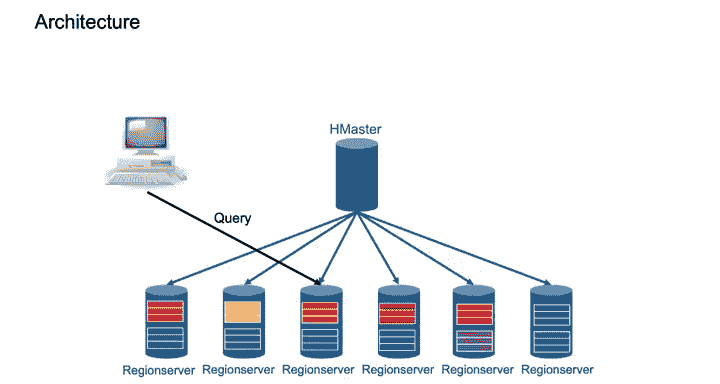

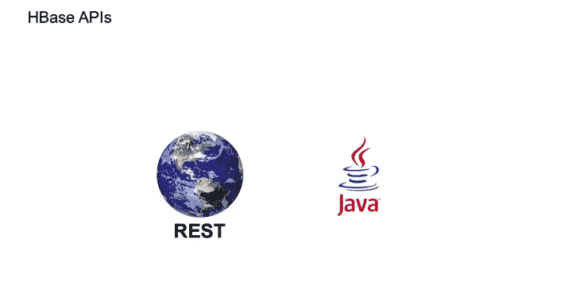

元数据表的结构大致如下，它存储了所有 Region 的映射信息：
*   Region 所属的表
*   Region 的键值范围（起始行键）
*   负责该 Region 的 RegionServer 地址
*   该 Region 的状态（如是否正在分裂）

---

## Region 分裂的高效处理

当某个 Region 变得过大时，RegionServer 会将其分裂成两个。这个过程被设计得非常高效，并非原子性地立即完成。

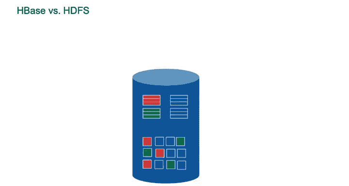

分裂过程大致如下：
1.  RegionServer 决定分裂一个 Region。
2.  它首先更新元数据表，标记原 Region 为“正在分裂”，并添加两个新 Region 的条目及其负责的 Server（可能暂时还是自己）。
3.  客户端查询元数据表后，会看到分裂状态，并根据要访问的键，连接到对应新 Region 的（临时）地址。
4.  此时，新的 RegionServer 实际上仍从旧的、未分裂的 HFile 集合中读取数据，只是会忽略不属于自己那部分键范围的数据。
5.  分裂操作是异步的。在后续的 Flush 或 Compaction 过程中，旧的 HFile 会被逐步清理，并真正为两个新 Region 生成独立的 HFile。

这种方式避免了在分裂时立即进行大量数据移动，保证了服务的持续可用性和高性能。

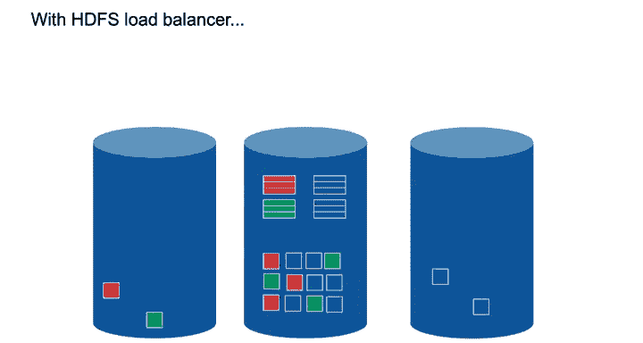

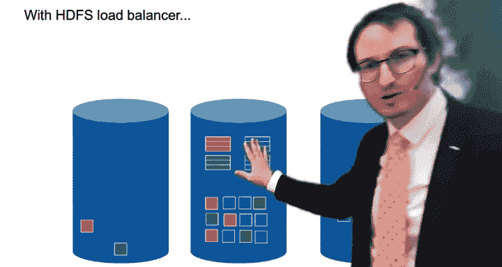

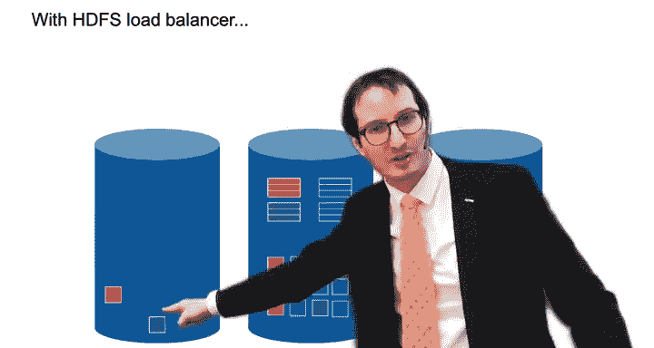

---

## 数据本地性

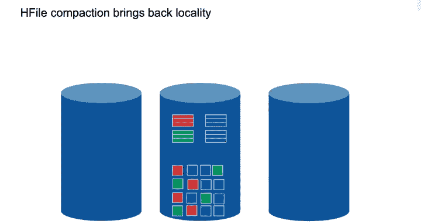

HBase 的另一个重要性能优势是**数据本地性**。HBase 的 RegionServer 和 HDFS 的 DataNode 通常部署在同一组机器上。

当 RegionServer 执行 Flush 或 Compaction 写入新的 HFile 到 HDFS 时，HDFS 客户端（即 RegionServer 本身）会遵循“第一个副本写入本地”的策略。因此，这些数据块的第一份副本就存储在该 RegionServer 所在的本地磁盘上。

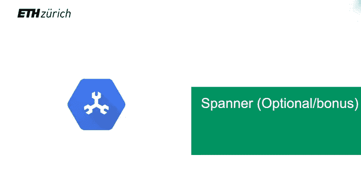


当该 RegionServer 需要读取这些数据时，它可以直接从本地磁盘读取，无需经过网络。这被称为**短路读取**，它打破了 HDFS 客户端必须通过 DataNode 协议读取数据的常规，但由于它们同属 Hadoop 生态，这种“作弊”是被允许的，能极大提升读取速度。


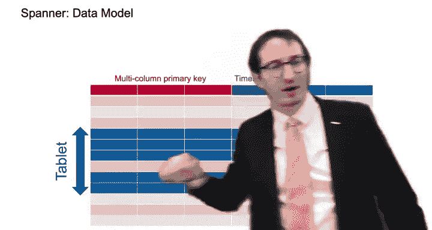

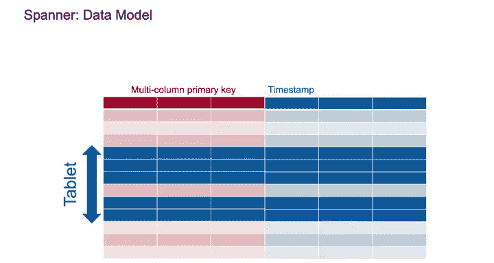


当然，HDFS 的负载均衡机制可能会将数据块副本移动到其他机器，破坏本地性。但下一次该 Region 发生 Compaction 时，新写入的文件又会将第一副本拉回本地机器，从而重新获得本地性优势。

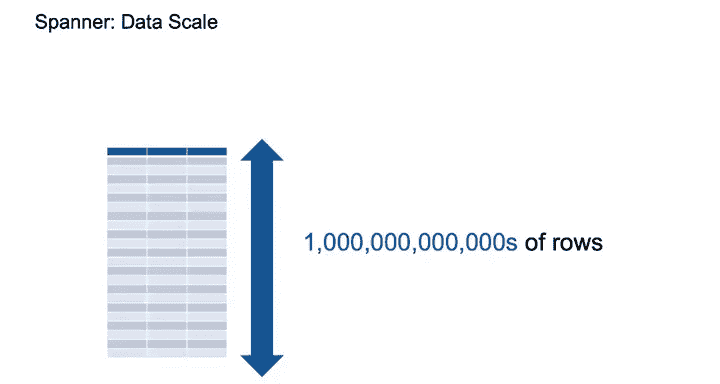

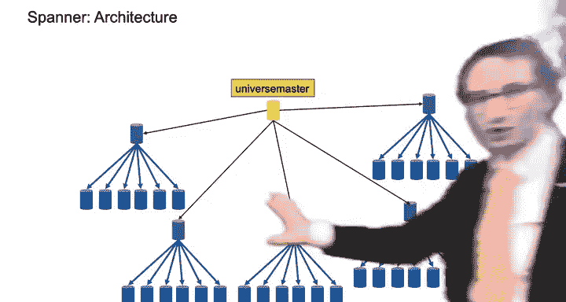

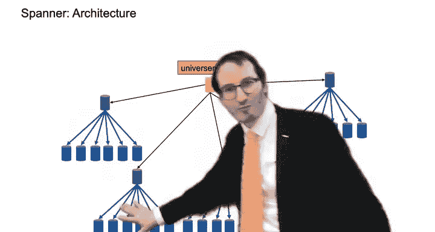


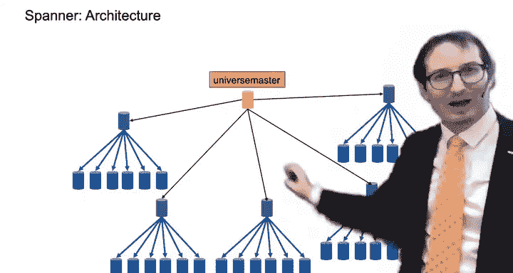

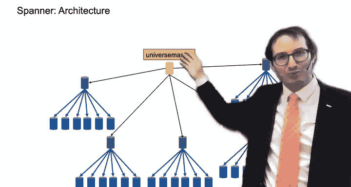

---

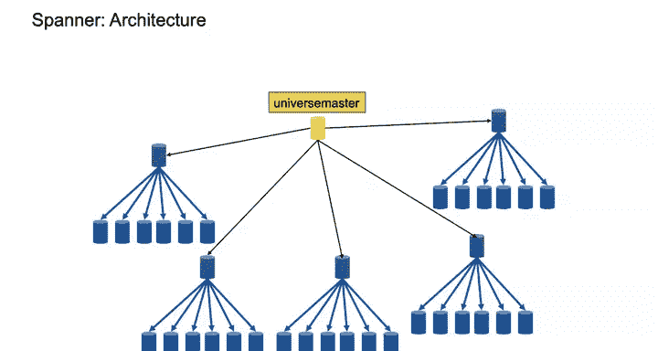

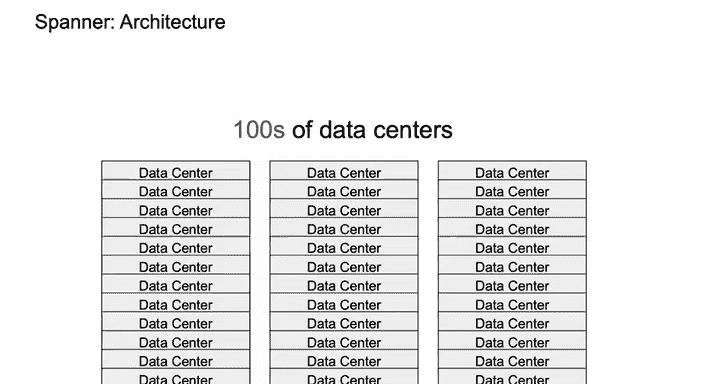

## 演进方向：Spanner 简介

HBase 和 BigTable 的设计理念持续演进。例如，Google 的 **Spanner** 就是 BigTable 的进化版，它解决了一些 HBase 的限制，并支持全球级分布式部署。

以下是 Spanner 的一些关键改进：
*   **多列主键**：HBase 的行键（RowKey）是单一列。Spanner 支持由多列组成的复合主键。
*   **Tablet 而非 Region**：Spanner 的管理单元是 Tablet。一个 Tablet 可以包含多个不连续的键值区间，这比 HBase 的连续区间 Region 更灵活，便于分裂与合并。
*   **全球分布**：Spanner 设计用于跨多个数据中心乃至全球部署，通过一个全局的“Universe Master”进行协调，能够管理数万亿行数据、数百万台机器构成的集群。


---

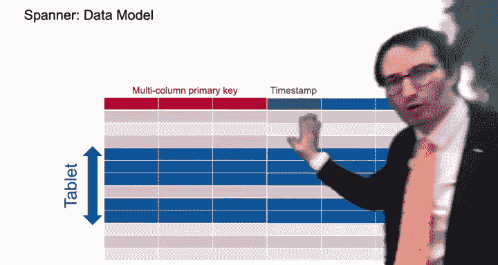

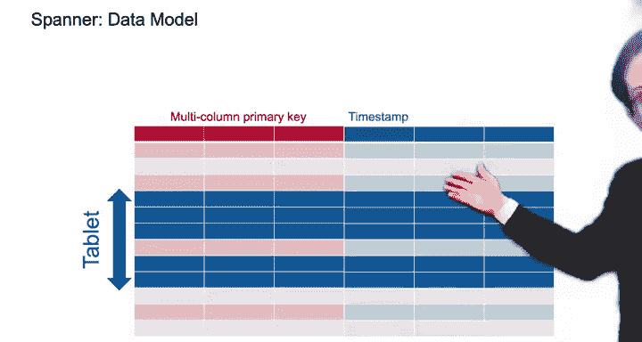

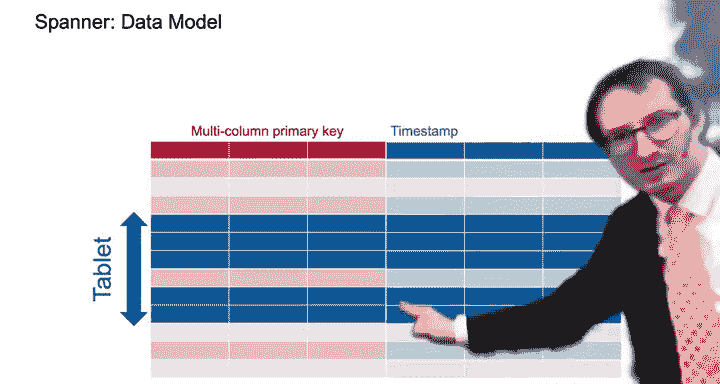

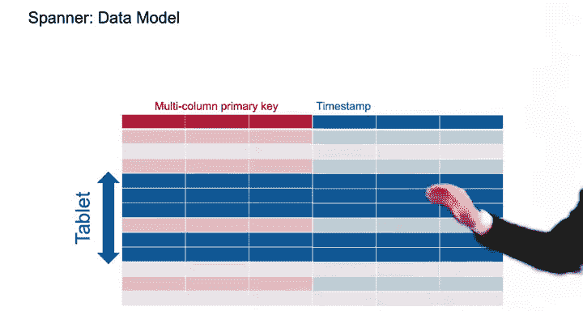

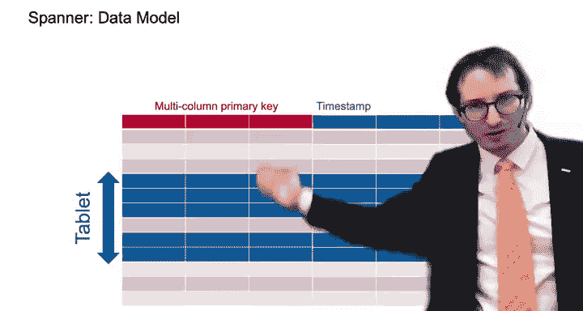

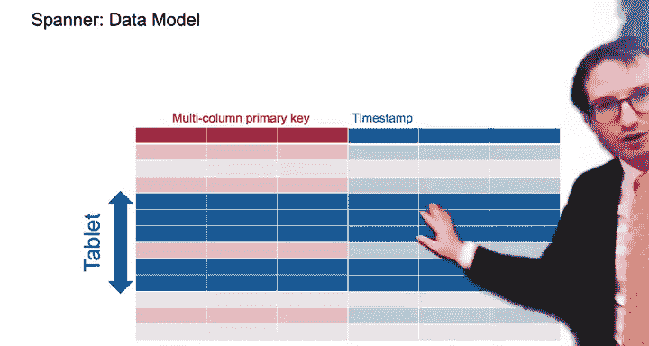

## 问答精选

**问：为什么需要如此巨大的表（如 Spanner），而不直接使用对象存储？**

答：宽列存储与对象存储的关键区别在于**数据索引的维度**。对象存储（如键值存储）通常是一维的（桶ID+对象ID）。而宽列存储将数据组织在一个二维网格中（行键 × 列族/列限定符），适合存储大量稀疏的、结构类似但内容不同的中小型数据（如 JSON、XML 文档）。对于真正的海量单体大文件（如视频），对象存储更合适。


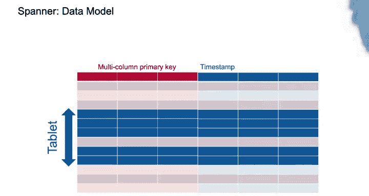

**问：将元数据表放在一个 RegionServer 上，是否引入了单点故障？**

答：不会。首先，元数据本身也存储在 HDFS 上，数据不会丢失。其次，如果持有元数据表的 RegionServer 宕机，**ZooKeeper 的选举机制会迅速在集群中选出另一台可用的 RegionServer 来接管并服务元数据表**。这个过程很快，确保了高可用性。之所以不放在 HMaster 上，是因为 HMaster 进程内没有服务表数据的代码逻辑，而 RegionServer 本身具备服务任何表（包括元数据表）的能力。


---

## 总结

本节课中，我们一起深入学习了 HBase 的核心机制。我们探讨了其实现低延迟的缓存策略（MemStore 和读缓存），了解了通过键值范围和布隆过滤器进行的读取优化。我们解析了客户端如何通过 ZooKeeper 和元数据表定位数据的启动流程，以及 Region 分裂的高效异步处理方式。我们还分析了 HBase 利用数据本地性实现短路读取的性能优势。最后，我们展望了宽列存储的演进方向，以 Google Spanner 为例，了解了多列主键、灵活 Tablet 和全球级分布式等高级特性。

重要的是，学习这些具体系统时，应着眼于其高层设计思想和权衡取舍，因为技术总是在不断演进。

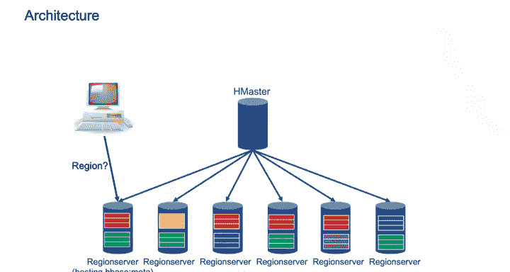


