# 21：数据模型（1/4）🌳

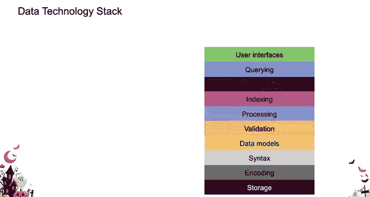

在本节课中，我们将学习数据模型的概念，特别是如何将XML和JSON等语法结构抽象为逻辑上的树形模型。我们将从回顾已学知识开始，逐步理解语法与数据模型之间的关系，并最终掌握将JSON和XML视为树形结构的方法。

---

## 回顾与高层次总结

在深入数据模型之前，我们先从高层次总结一下从HDFS和HBase中学到的经验。

以下是十个关键经验：

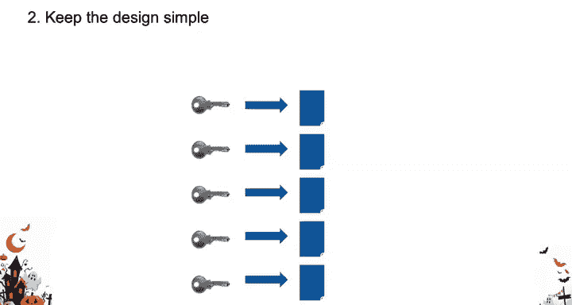

**第一课：借鉴过去**
即使我们试图构建替代传统关系型数据库（如PostgreSQL）的系统，我们仍然保留了数据独立性的思想。例如，我们仍然使用表的概念，在HBase中我们也会看到编程语言等。借鉴过去是基础。XML和JSON的发展就是一个例子：最初因为觉得XML太复杂而独立开发了JSON，但后来发现JSON同样需要模式、指针、导航和查询等功能。这导致JSON的发展可能延迟了十年。因此，借鉴过去的经验可以加速发展。

**第二课：保持设计简单**
以对象存储（如S3）为例，其模型非常简单：桶（Bucket）和对象ID（Object ID）标识一个对象，操作只有获取、放置和删除。这种简单性在构建大规模系统时尤为重要，也是数据独立性精神的体现——暴露简单的API，而将复杂的物理实现隐藏起来。

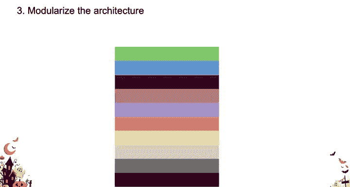

**第三课：架构模块化**
作为计算机科学家，我们知道模块化能使代码更优雅、程序更好。通过模块化，我们可以重用组件，并以人类大脑能够理解的方式组织系统。例如，我们有独立的存储、语法、验证和查询语言等层次，它们相互构建。就像硬盘连接到运行Linux操作系统的计算机，再通过网络在数据中心连接，之上是HDFS，再之上是HBase。这种分层设计远比将所有功能塞进一个单一的代码库要清晰和可管理。

**第四课：大规模同质性与小规模异质性**
为了扩展到超大规模，系统需要在高层保持同质性。例如，从远处看HDFS，你只看到文件和目录组织块；看S3，只看到与键关联的对象；看HBase，只看到行ID、列族和列值。但当你放大看一个特定对象或HBase表中的单元格时，会发现它们与邻居不同，这就是小规模的异质性。例如，HBase的同一列中可以存放具有不同模式的XML或JSON文档，S3的对象可以存放数据集、文件、图片等任何内容。这种高层同质性与底层细节多样性的对比，赋予了系统在大规模下的灵活性。

**第五课：数据独立性**
我们需要抽象出一个独立于物理实现的逻辑模型。这意味着，当你看关系表时，不应关心比特如何存储在磁盘上，你只看到行和列。看HDFS时，不应关心块如何实际存储在磁盘上，你只看到逻辑块和目录文件的逻辑层次结构。这些细节被数据节点在幕后隐藏处理。同样，HBase暴露列族和行ID，独立于HDFS。当你处理HBase时，不再关心HDFS。有趣的是，我们上周视为逻辑层的HDFS，相对于HBase突然变成了物理层。这说明了层次之间的相对性。保持层次间清晰的API对于维持系统清晰度至关重要。

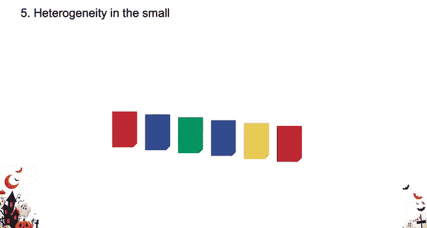

**第六课：数据分区（分片）**
我们到处都在构建数据分区，即分片。在HDFS中，我们有128MB的块；在HBase中，我们按区域和列族进行分区。分片有很多名称：分片、块、拆分、分区等。我们不仅将数据切割成这些块，还会复制每个块。在HDFS中，默认复制因子是3。然后，我们将所有这些块分散到众多机器上。想象一下，将数据切成许多小块（如100MB），复制它们，然后像将水倒入杯子一样，让这些块均匀地散布在整个集群的机器上。这种粒度使得每台机器上都有数千个块，从而实现平滑的数据分布。

**第七课：使用大量廉价机器**
我们不需要更强大的单个机器，而是需要大量机器。在一个数据中心，你可能拥有成千上万台机器，甚至数十万、百万台。关键是使用大量廉价硬件。我们将复制的分片分散到这些廉价硬件上，这是实现大规模处理的基础。

**第八课：批处理**
我们采用批处理。例如，在HBase中，我们不是每次用户创建新单元格时就写入磁盘（这样效率很低），而是将键值对累积在内存中，直到形成足够大的批次，然后一次性写入（刷新）到HDFS。这就是批处理。我们稍后会在MapReduce和Spark中再次看到这种模式。

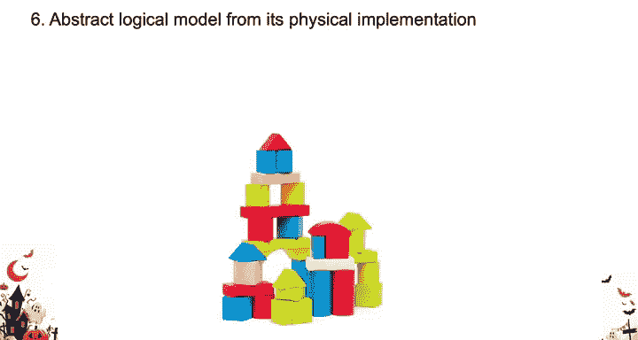

---

## 语法与数据模型的联系

现在，我们来看看语法和数据模型之间的联系。以CSV为例，这是最直观的。

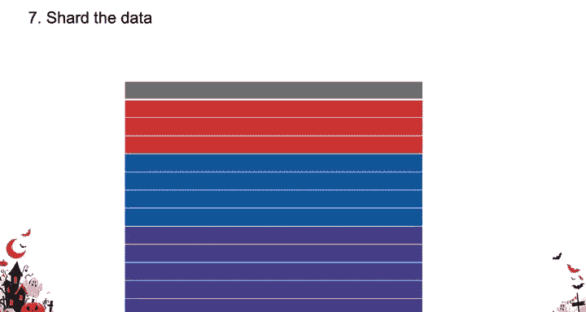

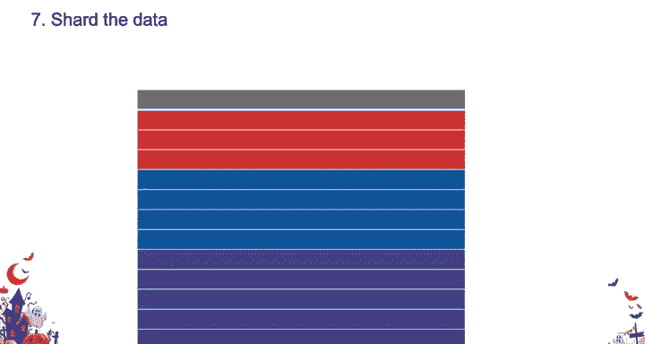

当你有一个CSV文件时，它是文本。通常，它使用逗号分隔单元格，使用换行符分隔行。但如果你以抽象的视角看，你应该看到一个表格。这正是电子表格软件打开此类文件时显示的内容：一个抽象的表格。

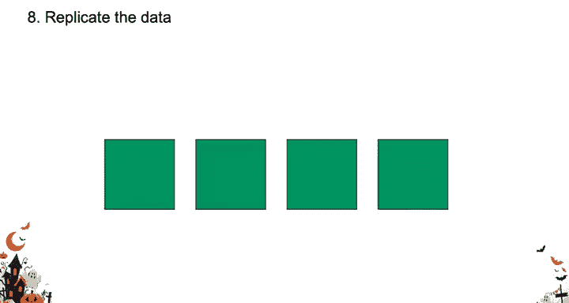

本讲座的目标是，让你在看完后，能够像看CSV看到表格一样，看XML或JSON时能看到**树**。

---

## 将JSON视为树🌲

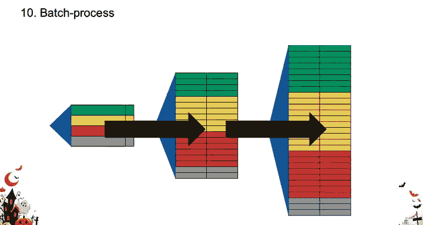

首先，我们以JSON为例，因为它是最简单的。

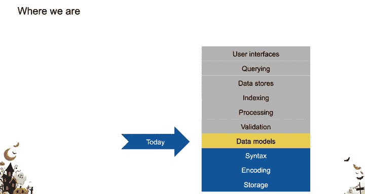

回想一下关于JSON的语法，它有六个构建块：**字符串**、**布尔值**、**数字**、**null**、**对象**和**数组**。

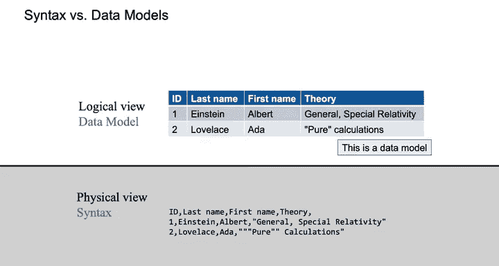

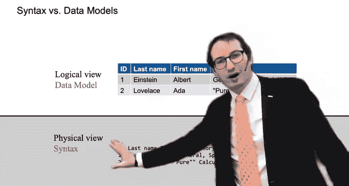

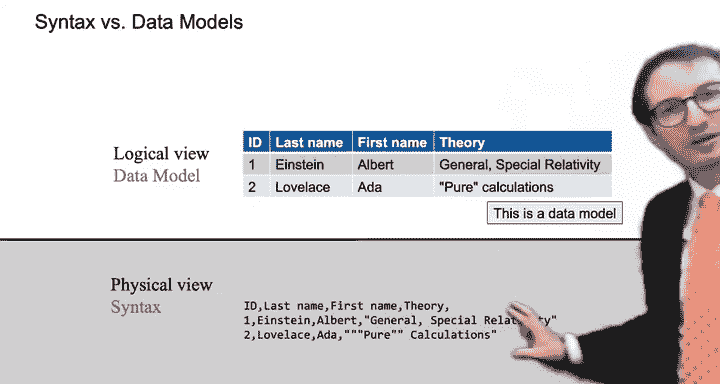

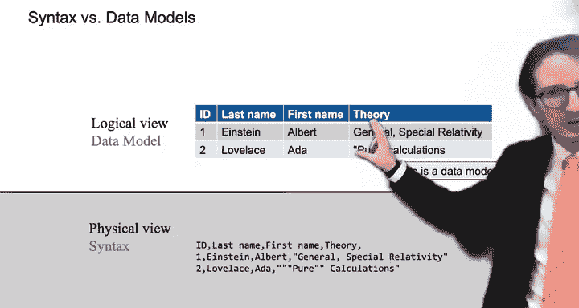

两周前，我将它们呈现为语法构建块，展示了对象使用花括号`{}`，数组使用方括号`[]`。但现在，我希望你能从中看到一棵树。

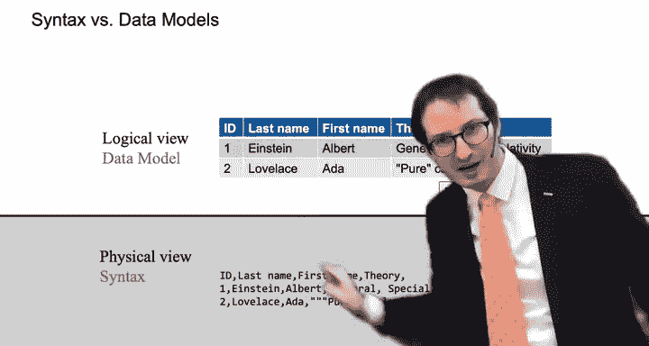

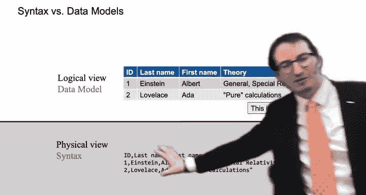

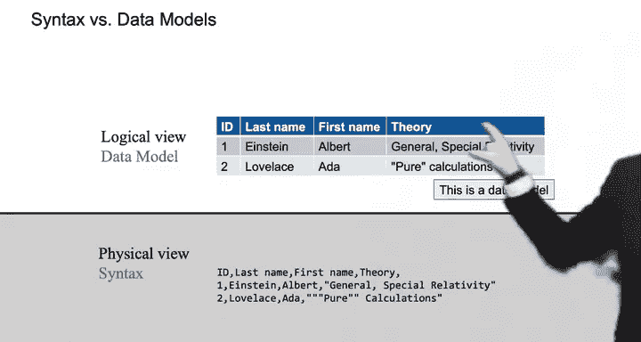

我的第一个问题是：在座的各位，谁已经能看到一棵树了？（现场和Zoom上都有一些人举手）。谁还看不到树？没关系，在接下来的时间里，我会展示如何从JSON构建出树形结构。我的目标是让这成为你的本能——只要你看到JSON或XML，就会自发地看到一棵树，因为从本质上讲，它们就是树。而且，我们将看到这是关系表的一种非规范化形式。

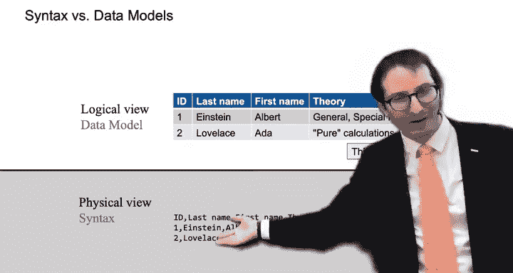

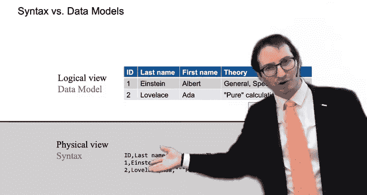

---

## 总结

本节课中，我们一起回顾了从HDFS和HBase中学到的十个高层次经验，包括借鉴过去、设计简单化、架构模块化、平衡同质性与异质性、数据独立性、数据分区、使用廉价硬件和批处理。接着，我们探讨了语法（如CSV文本）与逻辑数据模型（如表格）之间的联系。最后，我们引入了本节课的核心目标：学习将JSON和XML语法抽象为树形数据模型。在接下来的部分，我们将深入具体方法，掌握这种重要的数据视角。

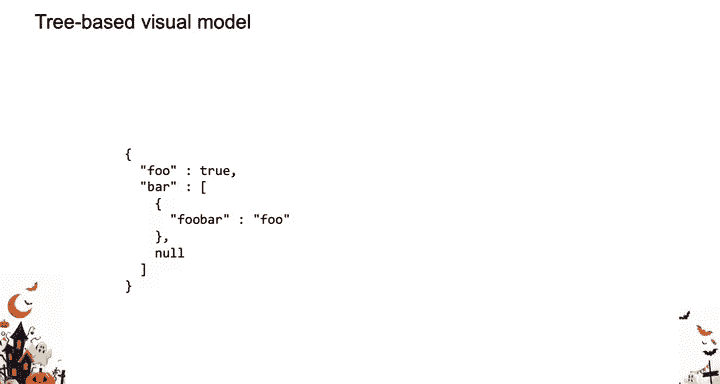

---
**注意**：课程内容在此处暂停，教授宣布休息15分钟，后续将继续讲解如何具体将XML和JSON视为树形结构。