# 26：MapReduce (1/3) 🗺️➡️🧮

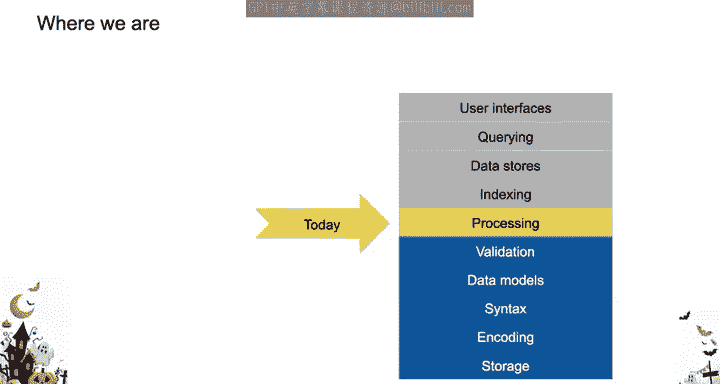

## 概述

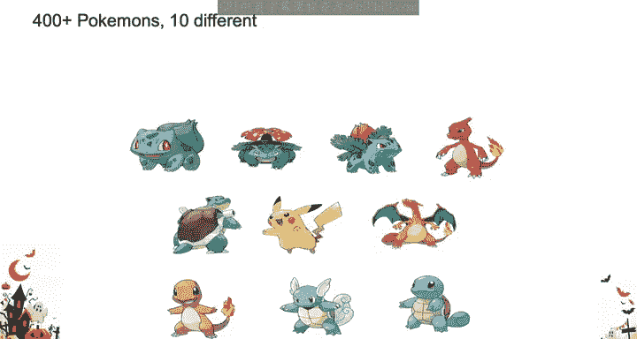

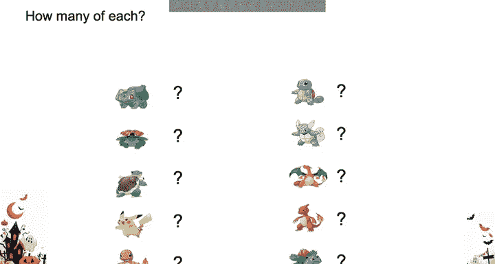

在本节课中，我们将通过一个生动有趣的“宝可梦计数”课堂活动，来学习大数据处理的核心范式——MapReduce。我们将看到如何将一项庞大的计数任务分解、并行处理，并最终汇总结果。

---

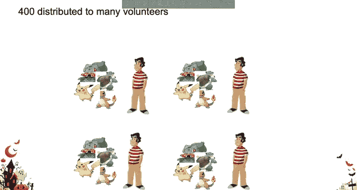

## 从串行到并行的思维转变

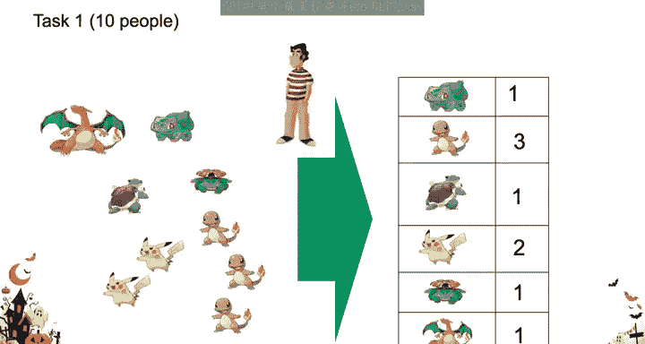

上一节我们讨论了数据的存储与验证。本节中，我们来看看如何查询和分析大规模数据。查询数据是大数据中最精彩的部分，而这一切从MapReduce开始，它也被称为大规模并行处理。

假设我捕获了数百只宝可梦，需要统计每种宝可梦的数量。如果我自己一只一只地数，会非常耗时。但我有500名学生，我可以利用这个“基础设施”来并行处理这个任务。

## MapReduce 实战演练：课堂活动解析

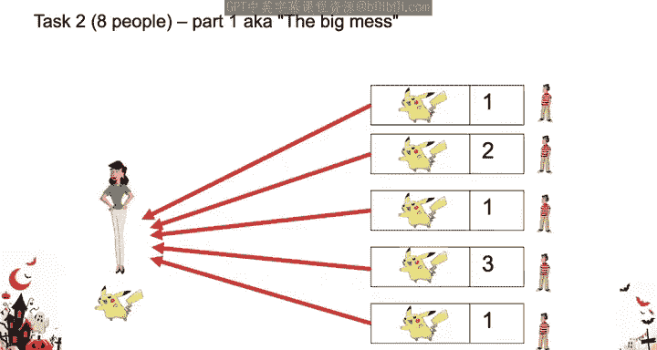

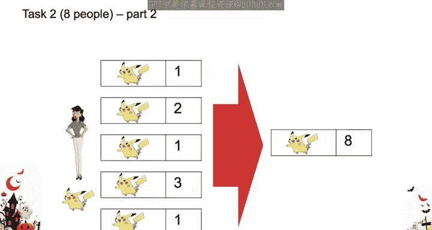

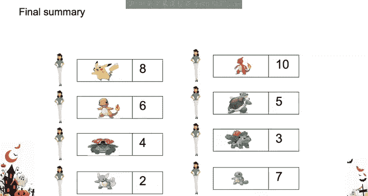

我们通过一个课堂活动来模拟MapReduce过程。活动需要两类志愿者：**Mapper（映射器）**和**Reducer（归约器）**。

### 第一步：映射阶段

以下是映射阶段的任务说明：
*   将全部宝可梦卡片分发给8位Mapper志愿者，每人获得一个数据块。
*   每位Mapper需要独立统计自己手中**每种**宝可梦的数量。
*   统计完成后，将结果（例如“皮卡丘: 5”）写在纸条上。

此时，所有Mapper在**并行**工作，这是速度提升的关键。

### 第二步：洗牌阶段

映射阶段完成后，进入洗牌阶段。我们还需要8位Reducer志愿者。
*   每位Reducer被分配负责一种（或两种）特定的宝可梦。
*   Mappers需要将记录着统计结果的纸条，按照宝可梦种类“撕开”，并分发给对应的Reducer。
*   例如，所有包含“妙蛙种子”数量的纸条片段都需要交给负责“妙蛙种子”的Reducer。

这个阶段会出现“意大利面条式”的混乱通信，每个Mapper都需要与每个Reducer通信。其算法复杂度是**O(n²)**，在大数据场景中，这常常是性能瓶颈。

### 第三步：归约阶段

以下是归约阶段的任务说明：
*   Reducer收集齐所有属于自己负责的宝可梦的纸条片段。
*   然后，Reducer将所有片段上的数字相加，得到该种宝可梦的最终总数。
*   最后，将所有Reducer的最终结果汇总给我。

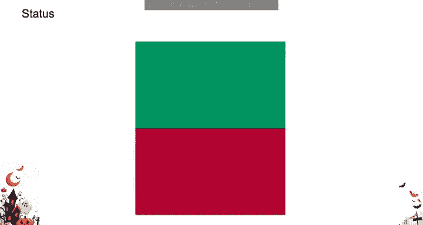

在这个例子中，归约操作（求和）是**可结合**且**可交换**的，这允许Reducer在收到部分数据时就可以开始累加，而不必等待所有数据到齐。

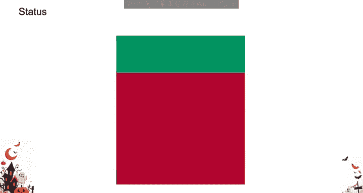

整个活动耗时约12分钟，比我自己一个人计数快得多。

---

## 关键观察与讨论

活动结束后，我们总结了以下重要观察点：

**关于瓶颈**
> 洗牌阶段是主要的瓶颈。Mapper和Reducer之间的全连接通信导致了二次方的复杂度。

**关于负载均衡**
> 并非所有Mapper同时完成工作。有些人的数据块可能更大或更复杂，导致他们花费更长时间。这被称为“拖后腿者”问题。

**关于进度监控**
> 活动中的进度条是粗略估计。在真实集群中，可以通过已完成Mapper任务的比例来更精确地显示进度。

**关于资源分配**
*   **Mapper数量**：通常设置为数据分块数量的数倍（例如3-5倍），以更好地平衡负载，避免因个别慢任务阻塞整个流程。
*   **Reducer数量**：通常与中间键（本例中的宝可梦种类）的数量相关。Reducer数量不应少于键的数量，但可以动态调整任务分配以优化性能。

---

## 总结

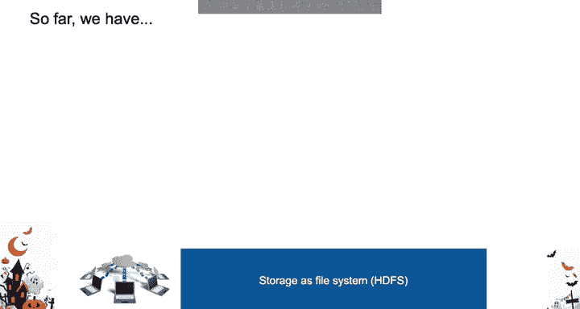

本节课中，我们一起通过一个生动的人类模拟实验，学习了MapReduce的基本工作流程。我们看到了**映射**、**洗牌**、**归约**这三个核心阶段，并讨论了其中的性能瓶颈（洗牌）、负载均衡以及资源分配策略。MapReduce的核心思想是 **“分而治之”**，通过将大任务分解为可在多台机器上并行执行的小任务，来高效处理海量数据。下一讲，我们将深入探讨如何在计算机集群中实现这一范式。