# 27：MapReduce (2/3) 🗺️➡️🧮

在本节课中，我们将学习MapReduce框架如何从逻辑概念走向物理实现。我们将探讨数据在分布式系统中的存储形态，理解MapReduce的逻辑工作流程，并深入了解其在大规模集群上的物理执行架构。

---

## 数据存储回顾 📂

上一节我们介绍了MapReduce的基本思想。在深入其实现细节之前，我们先回顾一下数据在分布式系统中的存储方式，因为一切计算都始于数据存储。

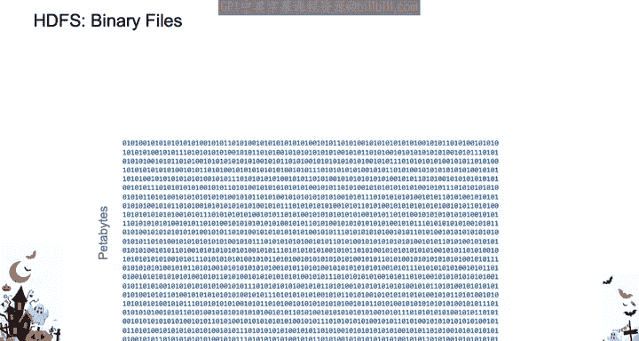

数据可以存储在各种文件系统中，例如HDFS、S3或HBase。这些系统是存储无关的，MapReduce可以在它们之上运行。

数据文件的内容可以是多种格式：
*   **纯文本**：例如，包含数十亿行的文本文档。
*   **结构化文本**：例如CSV（逗号分隔值）文件，每行代表一条记录。
*   **固定宽度格式**：某些领域（如气象学）使用固定字符长度的格式，无需分隔符。
*   **键值对文本**：每行包含一个键和一个值，用空格等分隔。
*   **JSON行**：每行是一个独立的JSON对象，支持异构数据结构。
*   **二进制列式存储**：例如Parquet格式。当数据具有稳定模式时，可以转换为内存中的数据框（DataFrame），并存储为Parquet文件。这种格式更紧凑，且支持按列读取，能显著提升性能。

一个数据集通常不会只是一个单一的大文件。

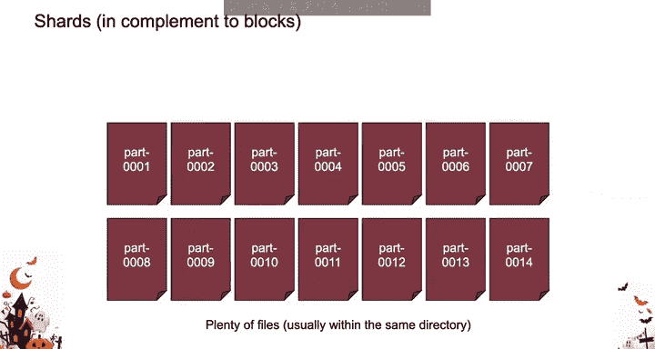

以下是数据集通常被分片（Sharded）存储的两个主要原因：
1.  **便于上传**：上传一个超大文件（如5TB）到S3或HDFS时，网络中断可能导致整个上传失败。而将其分片成许多小文件后，可以单独上传和重试失败的部分，更为可靠高效。
2.  **并行输出**：许多数据集本身就是并行计算（如MapReduce或Spark作业）的输出结果。这些计算框架会自然地将结果并行写入多个文件。

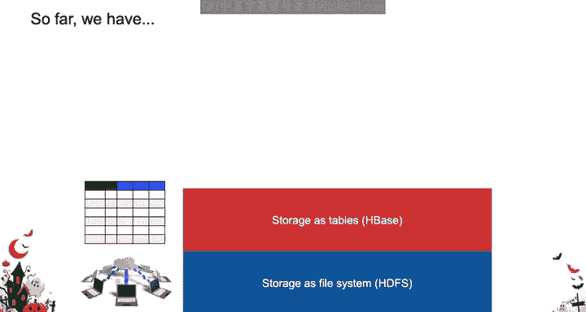

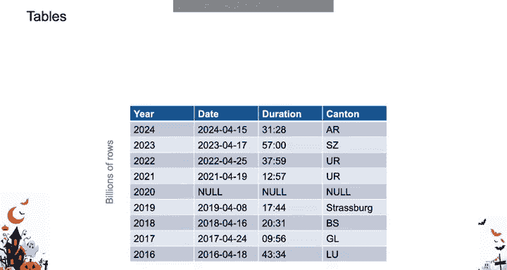

因此，数据集在HDFS上通常表现为一个包含许多分片文件（如 `part-00001`, `part-00002`）的目录。

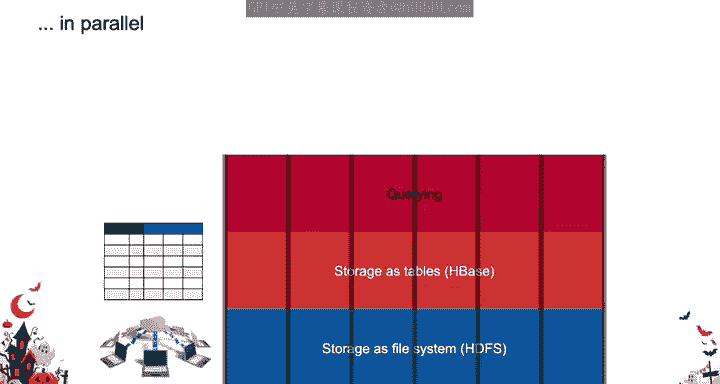

另一种存储方式是HBase，它可以看作是一个二维的数据索引。我们可以在HBase的单元格中存储各种数据，包括XML、JSON文档甚至二进制文件。例如，可以将每行数据存储为一个XML文档，并使用模式（Schema）进行验证。

---

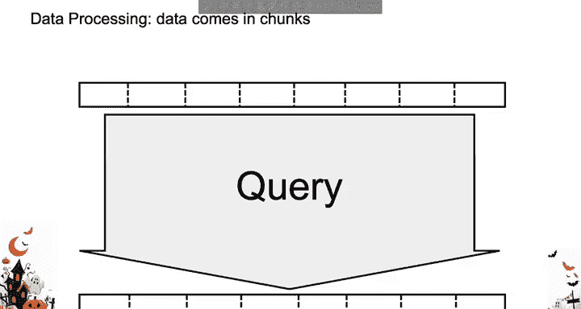

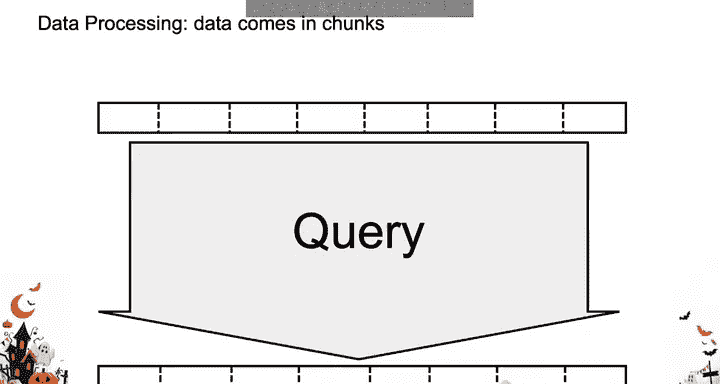

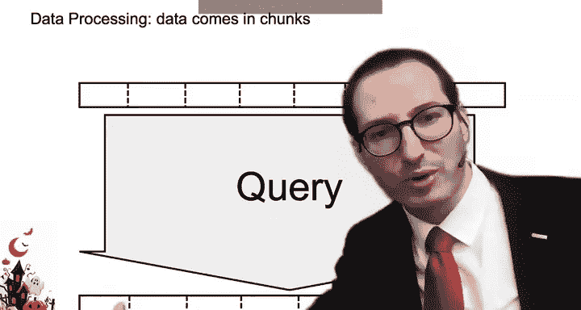

## MapReduce 逻辑工作流程 🧠

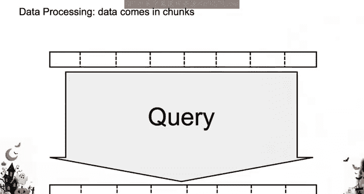

回顾了数据存储后，我们回到今天的核心：查询处理。MapReduce的关键在于并行处理，这非常自然，因为数据本就分布在集群的成千上万台机器上。

MapReduce诞生于约20年前，其核心目标是提供一种**通用、简单**的并行计算模式。它采用声明式视角：给定输入数据，应用某个查询，得到输出数据。

理想情况下，我们希望每个输入分区能独立映射到一个输出分区，实现100%的并行化。这对于**投影**（Projection）和**过滤**（Filter）这类操作是可行的。

然而，对于**排序**、**分组**或**聚合**这类操作，每个输出分区可能依赖于多个输入分区，无法实现完全独立的并行。

MapReduce的巧妙之处在于，它发现许多计算可以分解为两个阶段：
1.  **一个完全并行的阶段**（映射阶段）。
2.  **一个需要数据重组的阶段**（混洗阶段）。
3.  **另一个完全并行的阶段**（归约阶段）。

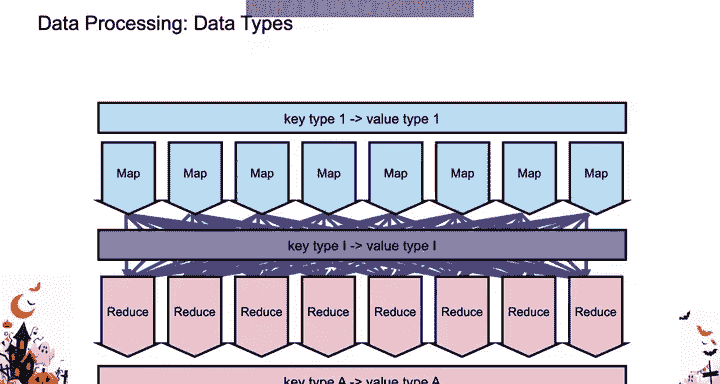

这就是 **Map（映射） -> Shuffle（混洗） -> Reduce（归约）** 的模式。它简单却异常强大，足以解决大量数据处理问题，例如为整个互联网建立索引。

在MapReduce范式中，所有数据都被视为**键值对（Key-Value Pairs）**的集合。输入、中间数据和输出都是键值对集合，尽管它们的键值类型可以不同。

以下是MapReduce逻辑工作流程的详细步骤：

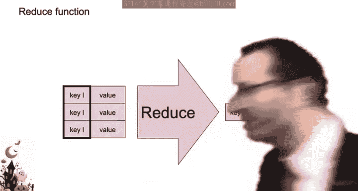

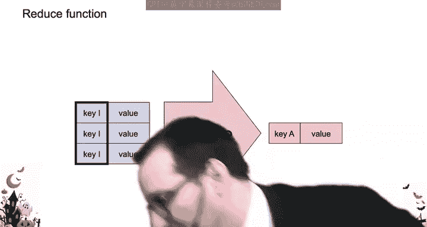

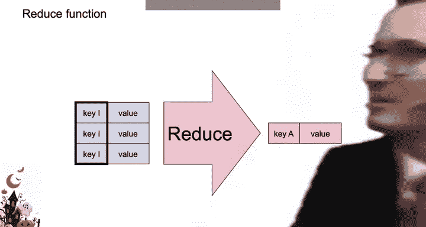

**步骤 1: 映射 (Map)**
*   定义：`map: (k1, v1) -> list((k2, v2))`
*   系统对输入集合中的每一个输入键值对 `(k1, v1)` 应用**映射函数**。
*   映射函数会输出零个、一个或多个中间键值对 `(k2, v2)`。

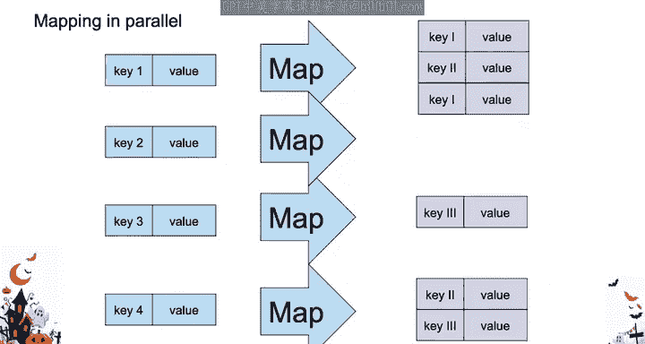

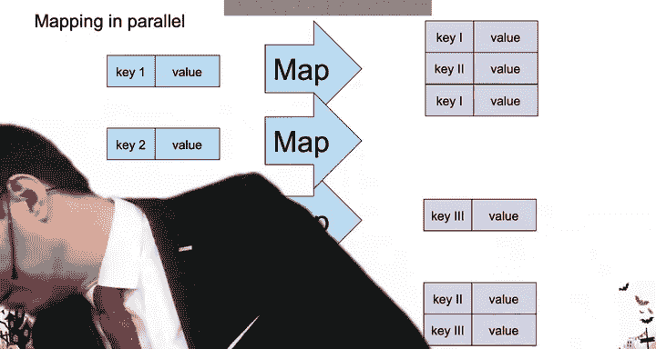

**步骤 2: 排序与分组 (Sort & Group)**
*   系统收集所有映射阶段产生的中间键值对。
*   然后，系统根据中间键 `k2` 对所有中间键值对进行**逻辑排序**。
*   排序后，拥有相同键 `k2` 的所有值会被**分组**在一起。

**步骤 3: 归约 (Reduce)**
*   定义：`reduce: (k2, list(v2)) -> list((k3, v3))`
*   系统对每一个唯一的中间键 `k2` 及其对应的值列表 `list(v2)` 调用**归约函数**。
*   归约函数会输出零个、一个或多个最终输出键值对 `(k3, v3)`。

在约80%的情况下，中间键值对 `(k2, v2)` 和输出键值对 `(k3, v3)` 的类型相同。此时，归约函数通常保持键不变（`k3 = k2`），并对值列表进行聚合操作（如求和、求平均、求最大值等），公式可简化为：`reduce: (k, list(v)) -> (k, aggregate(list(v)))`。

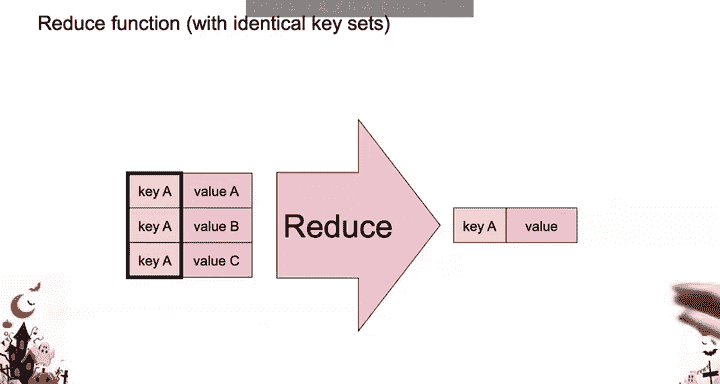

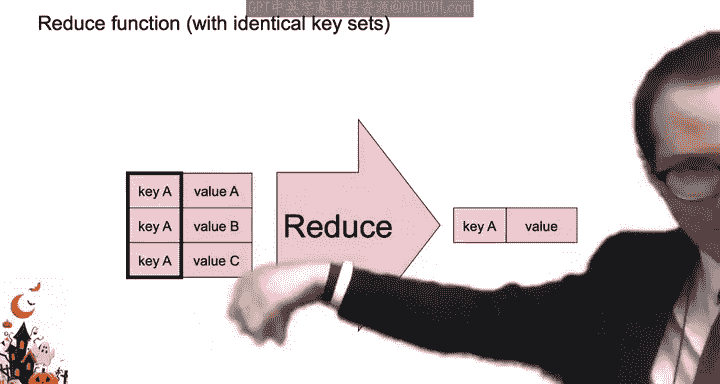

---

## MapReduce 物理实现 ⚙️

理解了逻辑模型后，我们来看MapReduce如何在真实的数据中心集群上物理执行。我们以Hadoop MapReduce第一代架构为例。

物理架构建立在存储层之上。在HDFS集群中，我们有NameNode和DataNode进程。MapReduce框架会引入额外的进程：
*   **JobTracker**：运行在协调节点（常与NameNode同机），负责协调整个MapReduce作业。
*   **TaskTracker**：运行在每个数据节点（与DataNode同机），负责执行具体的计算任务。

这种“将计算带到数据身边”的架构至关重要，它避免了大规模数据移动，是性能的关键。

物理执行的核心概念是**分片（Split）**。输入数据在逻辑上被划分为多个分片，每个分片包含一批键值对。通常，一个HDFS数据块（Block，如128MB）就对应一个分片。

以下是物理执行步骤：

**步骤 1: 映射阶段执行**
*   JobTracker将各个输入分片分配给空闲的**映射槽位（Map Slot）**（即TaskTracker上的执行线程）。
*   分配时会优先考虑“数据本地性”，即尽量将分片分配给存储该分片数据副本的机器上的映射槽位。
*   每个映射槽位读取其分配的分片，并为分片中的每个键值对调用映射函数。
*   产生的中间键值对首先缓存在内存中。当内存缓存满时，会被**排序后溢写（Spill）**到本地磁盘（非HDFS），形成有序的临时文件。

**步骤 2: 混洗阶段执行**
*   每个**归约槽位（Reduce Slot）** 被分配负责处理一部分中间键（例如通过哈希）。
*   归约槽位需要从所有映射槽位那里“拉取”（Pull）属于自己负责的键的中间键值对。
*   由于映射槽位输出的临时文件已按键排序，归约槽位可以高效地通过网络（HTTP）从各个映射槽位获取所需数据。这个过程就是**混洗（Shuffle）**，是网络密集型操作。

**步骤 3: 归约阶段执行**
*   归约槽位从各个映射槽位拉取到所有相关的中间键值对后，在本地进行合并和排序，确保每个键对应的所有值都分组在一起。
*   然后，归约槽位对每个键及其值列表调用归约函数。
*   最终，每个归约槽位将输出结果写入HDFS，通常每个槽位生成一个输出文件（如 `part-r-00000`）。所有输出文件共同构成最终的分片数据集。

---

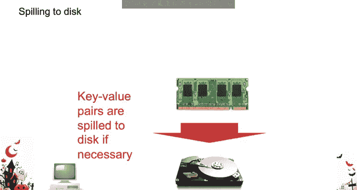

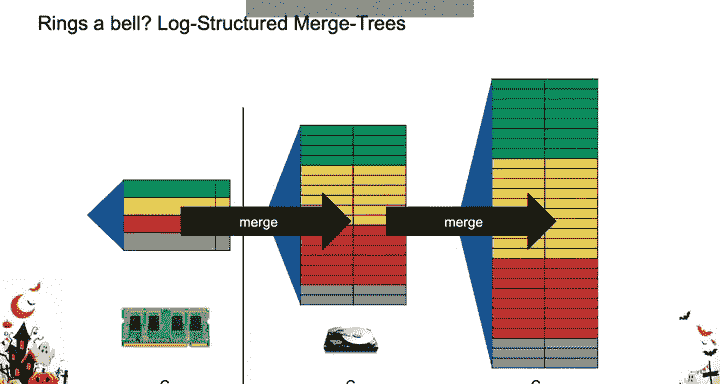

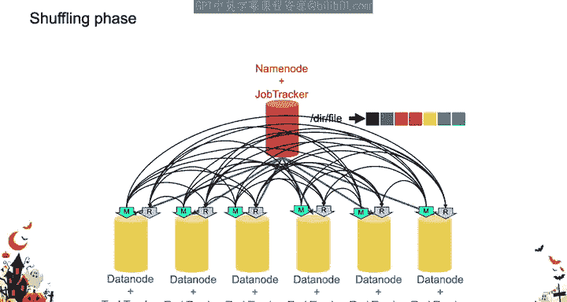

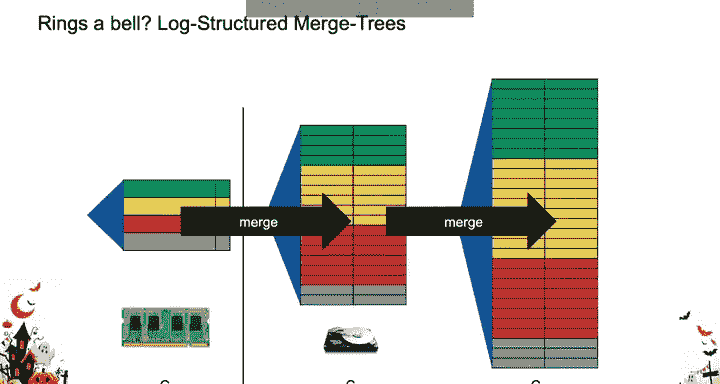

## 输入/输出格式适配 🔧

MapReduce要求输入和输出都是键值对集合。但现实中的数据格式多样，因此需要“输入格式”和“输出格式”来进行适配。

以下是如何将常见格式转化为键值对的示例：
*   **数据库表**：很直接，可以将行ID（或主键）作为键，整行数据（或其他列）作为值。
*   **文本文件**：一种常见方式是将文件的字节偏移量作为键，将每一行的文本内容作为值。
*   **键值对文本文件**：如果每行已经是“key value”格式，可以直接解析。
*   **SequenceFile**：这是Hadoop的一种二进制格式，专门用于高效存储键值对序列，类似于HFile。

通过定义不同的 `InputFormat` 和 `OutputFormat`，MapReduce可以灵活地处理各种数据源和数据目的地。

---

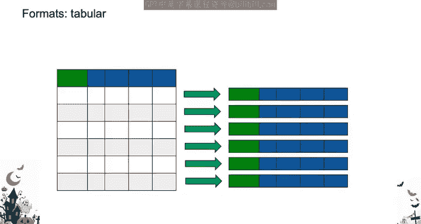

## 总结 📝

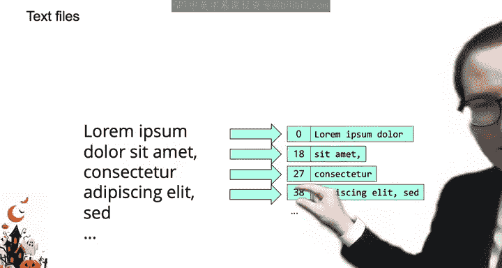

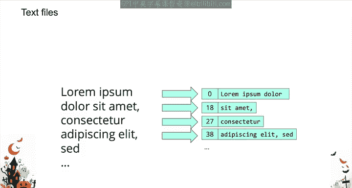

本节课我们一起深入学习了MapReduce框架。
*   我们首先回顾了数据在HDFS、S3、HBase等系统中的存储方式，理解了数据集分片的原因。
*   接着，我们剖析了MapReduce的**逻辑工作流程**，即“Map -> Shuffle -> Reduce”三个阶段，以及其将一切数据视为键值对的核心抽象。
*   然后，我们探讨了MapReduce的**物理实现架构**，包括JobTracker和TaskTracker的角色，以及映射、混洗、归约三个阶段在集群中是如何具体执行的，特别是“数据本地性”和“溢写排序”等关键优化。
*   最后，我们了解了输入/输出格式如何将各种数据源适配到MapReduce的键值对模型。

MapReduce通过一个简单而强大的抽象，实现了对海量数据并行处理的通用支持，是大数据处理领域的基石之一。