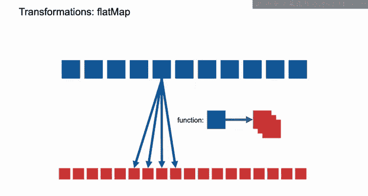

# 29：从MapReduce到Spark (1/4) 🚀


在本节课中，我们将要学习大数据处理框架的演进，从MapReduce的局限性出发，了解其改进方案YARN，并最终引入下一代处理框架Spark的核心概念。


## 从MapReduce到YARN 🔄


上一节我们介绍了MapReduce的基本执行模型。本节中我们来看看其早期版本（v1）在架构上存在的一些问题。


MapReduce v1采用主从架构，包含一个**JobTracker**进程（与NameNode协同部署）和多个**TaskTracker**进程（与DataNode协同部署）。其核心理念是“将计算带到数据身边”，即Map任务应尽量在存储其输入数据块的机器上执行，以实现本地读取。


然而，这个设计存在几个关键问题：

以下是MapReduce v1的主要问题：
1.  **JobTracker职责过重**：它同时负责资源管理、任务调度、故障监控和作业生命周期协调，这导致其成为单点瓶颈和性能瓶颈。
2.  **可扩展性有限**：该架构大约能扩展到4000个节点和40000个任务。
3.  **资源利用低效**：Map槽位和Reduce槽位是静态预先分配的。在Map阶段，Reduce槽位闲置；在Reduce阶段，Map槽位闲置。
4.  **职责混杂**：调度和监控是完全不同的任务，由一个进程处理难以做到完美。


## YARN：通用的集群资源管理器 🧠


为了解决上述问题，出现了**YARN**。YARN是一个通用的集群资源管理平台，其核心思想是将资源管理与具体的应用逻辑解耦。

YARN的架构包含以下核心组件：
*   **ResourceManager (RM)**：整个集群的资源总管，负责最终的资源分配。
*   **NodeManager (NM)**：每个节点上的代理，负责管理本节点的资源并向RM报告。
*   **Container**：资源的抽象单位，封装了特定量的CPU核心、内存等资源。应用在Container中运行。
*   **ApplicationMaster (AM)**：每个应用特有的“管家”。当客户端提交作业后，RM会为一个Container授予AM角色。AM随后向RM申请运行任务所需的其他Container，并负责监控和管理这些任务。

这种设计的优势在于：
*   **职责分离**：RM只做资源调度，AM负责应用管理。
*   **多租户与资源共享**：多个应用（如MapReduce、Spark）可以共享集群，动态申请和释放资源。
*   **资源利用率提升**：资源按需动态分配，避免了MapReduce v1中的静态槽位闲置问题。
*   **可扩展性增强**：可支持约10000个节点和100000个任务。


关于资源分配的公平性，YARN采用了如**主导资源公平性**等算法。其基本思想是：对于每个用户，计算其请求的各类资源（CPU、内存）占集群总资源的比例，其中比例最大的资源称为“主导资源”。调度器会确保每个用户获得的主导资源份额是公平的。


## 引入Spark：超越MapReduce ⚡


尽管YARN改善了资源管理，但MapReduce编程模型本身仍有局限：一次作业只能进行一次Shuffle。复杂的算法往往需要串联多个MapReduce作业，编写和管理不便。


Spark应运而生，它提出了更通用的**有向无环图**数据处理模型。


在Spark中，核心抽象是**弹性分布式数据集**。RDD是一个不可变、可分区的数据集合，可以跨机器分布式存储。


Spark程序的逻辑通常遵循以下模式：
1.  **创建RDD**：从数据源（如HDFS文件、本地集合）创建初始RDD。
2.  **转换RDD**：通过一系列**转换**操作，从一个RDD派生出新的RDD。转换是惰性的，只记录计算逻辑，不立即执行。
3.  **触发计算**：通过**行动**操作（如将结果输出到屏幕、保存到文件）触发整个DAG的实际计算。


以下是一个简单的PySpark示例，展示了创建、转换和行动：


```python
# 1. 创建RDD (Creation)
# 将一个本地Python列表并行化为一个RDD，此时并未真正分发数据
rdd1 = sc.parallelize(["hello world", "hi"])
# 2. 转换RDD (Transformation)
# 使用flatMap转换，将每个字符串拆分为单词。此时仍是惰性计算
rdd2 = rdd1.flatMap(lambda line: line.split(" "))
# 3. 行动操作 (Action)
# countByValue是一个行动操作，它会触发前面所有转换的实际执行
# 结果会返回到驱动程序并打印出来
print(rdd2.countByValue())
```


## Spark的核心转换操作 🛠️


Spark提供了丰富的转换操作符。以下是几个基本且重要的转换：


**filter转换**：根据条件过滤数据。它接受一个返回布尔值的函数，只保留函数返回`True`的元素。
```python
# 保留所有大于10的元素
rdd_filtered = rdd.filter(lambda x: x > 10)
```


**map转换**：对RDD中的每个元素应用一个函数，产生一个**一对一**映射的新RDD。
```python
# 将每个元素加1
rdd_mapped = rdd.map(lambda x: x + 1)
```


**flatMap转换**：对每个元素应用一个函数，该函数返回一个序列（0个、1个或多个元素），然后将所有序列“压平”成一个新的RDD。**这对应了MapReduce中的Map函数**。
```python
# 将每行文本拆分为单词，一行可能对应多个单词
rdd_words = rdd_lines.flatMap(lambda line: line.split(" "))
```


## 总结 📚


本节课中我们一起学习了大数据处理框架的演进路径。
1.  我们首先分析了早期MapReduce（v1）在可扩展性、资源利用和架构职责上的局限性。
2.  接着，我们深入了解了**YARN**如何通过引入ResourceManager、NodeManager、Container和ApplicationMaster等概念，将资源管理与应用逻辑解耦，实现了更好的多租户资源共享和可扩展性。
3.  最后，我们引入了**Spark**作为下一代处理框架。Spark的核心在于**RDD**抽象和**DAG**执行模型，它通过丰富的转换和行动操作提供了比MapReduce更灵活、更强大的编程接口，并且计算是惰性执行的，直到遇到行动操作才会触发实际计算。



下一讲，我们将继续深入Spark，探索其更丰富的API、执行优化以及高级特性。