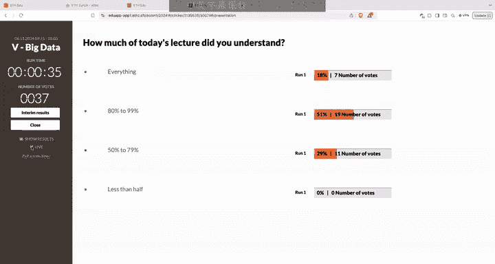

# 30：Spark (2/4) 🚀

在本节课中，我们将继续学习Apache Spark的核心概念，重点介绍RDD的各种转换（Transformations）和行动（Actions）操作，并深入探讨其物理执行模型，特别是阶段（Stage）的划分与窄依赖（Narrow Dependency）的重要性。

---

## 概述：RDD操作菜单与物理执行

上一节我们介绍了RDD的基本概念。本节中，我们将详细查看Spark提供的丰富操作“菜单”，并理解这些逻辑操作在集群中是如何被高效执行的。

## RDD转换操作（Transformations）

转换操作将一个RDD转换为另一个RDD，它们是惰性执行的。

### 作用于单个RDD的转换

以下是几个关键的转换操作。

#### FlatMap 🗺️

`flatMap` 操作与MapReduce中的Map阶段最为对应。每个输入值可以被映射为零个、一个或多个输出值。
**公式**： `flatMap: RDD[T] => RDD[U]`，其中函数 `f: T => TraversableOnce[U]`。

与MapReduce的一个区别是，在Spark中，输入不一定必须是键值对，可以是任意类型的值。

#### Distinct 🔍

`distinct` 转换用于去除RDD中的重复元素。它通过比较元素的相等性来实现。
**代码示例**： `rdd.distinct()`

需要注意的是，这个操作通常涉及数据混洗（Shuffling），因为它需要将相同值的元素汇聚到一起进行比较。

#### Sample 🎲

`sample` 转换根据给定的比例随机抽取RDD中的一部分数据。它接受一个分数作为参数，决定保留多少比例的数据。
**代码示例**： `rdd.sample(withReplacement=False, fraction=0.1)`

这个操作基于伪随机数生成器，不涉及数据混洗，因为每个元素独立地根据概率被选择。

### 作用于两个RDD的转换

在关系代数中，我们可以对表进行并集、连接等操作。Spark RDD也支持类似的二元操作。

以下是几个基于集合操作的转换：

*   **Union（并集）**： 将两个RDD合并，不消除重复元素。它不涉及数据混洗。
*   **Intersection（交集）**： 返回两个RDD中共有的元素。此操作需要数据混洗。
*   **Subtraction（差集）**： 返回存在于第一个RDD但不在第二个RDD中的元素。此操作也需要数据混洗。

#### Cartesian Product（笛卡尔积） ⚠️

笛卡尔积会生成所有可能的元素对，一个来自左侧RDD，一个来自右侧RDD。
**公式**： `RDD[A] × RDD[B] => RDD[(A, B)]`

这是一个非常危险的操作。如果左侧RDD有一百万个元素，右侧有十亿个，结果将产生一千万亿个元素。因此，Spark默认禁止此操作，需要显式配置参数才能启用。

---

## RDD行动操作（Actions）

行动操作会触发实际计算，并返回结果给驱动程序或将其写入外部存储系统。

#### Collect 与 Materialization 💾

`collect` 操作将分布在整个集群中的RDD数据拉取到驱动程序，形成一个本地集合（如Python列表）。
**代码示例**： `rdd.collect()`

这个过程称为 **物化（Materialization）**。只有当RDD数据量足够小，能够放入驱动程序内存时，才应使用此操作。

#### Count 🔢

`count` 操作统计RDD中元素的总数。它是无害且高效的，因为每个机器先进行本地计数，然后只传输计数结果进行汇总。
**代码示例**： `rdd.count()`

#### Take 与 Top 📥

*   `take(n)`： 返回RDD中的前n个元素。
*   `top(n)`： 返回RDD中的后n个元素（基于默认排序）。
两者都将结果作为本地列表返回。

#### Reduce ➕

`reduce` 操作使用一个满足结合律和交换律的二元运算符，将RDD中的所有元素归约为一个值。用户需要提供该运算符的“零值”（中性元）。
**代码示例**： `rdd.reduce(lambda a, b: a + b)`
对于加法，零值是0；对于最大值，零值是负无穷。

---

## 键值对RDD（Pair RDD）的专用操作

当RDD中的元素是键值对时，可以使用一些专用操作。

#### 键与值的提取

*   `keys()`： 返回一个仅包含键的RDD。
*   `values()`： 返回一个仅包含值的RDD。

#### ReduceByKey 与 GroupByKey

*   `reduceByKey`： 对每个键关联的所有值进行归约操作（如求和）。这对应于MapReduce中的Reduce阶段。
    **代码示例**： `pairRdd.reduceByKey(lambda a, b: a + b)`
*   `groupByKey`： 将每个键关联的所有值分组到一个集合（如列表）中。与SQL的GROUP BY不同，它不进行聚合。
    **代码示例**： `pairRdd.groupByKey()`

这两个操作以及 `sortByKey` 都需要数据混洗，因为需要将相同键的数据发送到同一台机器。

#### Join 🤝

`join` 操作接收两个键值对RDD，并基于相同的键进行连接，输出三元组（键，左值，右值）。
**代码示例**： `rdd1.join(rdd2)`
它允许键重复，如果左RDD和右RDD有多个相同键，会输出所有组合。

---

## Spark物理执行模型 ⚙️

理解了逻辑操作后，我们来看看Spark是如何在物理集群上执行这些操作的。

### 窄依赖与任务执行

如果一个转换操作的每个输出分区只依赖于**单个**输入分区，则称为**窄依赖**（Narrow Dependency），例如 `map`、`filter`。
窄依赖允许在同一个机器上（甚至同一个CPU核心上）以流水线（pipeline）方式连续执行多个转换，无需数据移动，效率极高。

### 阶段（Stage）划分

Spark将作业（Job）划分为多个**阶段（Stage）**。阶段的边界就是需要数据混洗的地方（宽依赖，如 `reduceByKey`、`join`）。
在一个阶段内部，所有由窄依赖连接的转换会被合并，并在同一个任务（Task）中连续执行。中间RDD不会被物化，数据在CPU寄存器或内存中流式传递，直到需要输出或混洗。

这种优化是Spark比MapReduce模型更高效的关键原因之一。

### 执行器（Executor）与资源分配

任务在**执行器（Executor）** 中运行，执行器通常是YARN容器。每个执行器可以分配多个CPU核心和一定量的内存。
通过 `spark-submit` 提交作业时，可以指定执行器数量、每个执行器的核心数和内存量，从而进行集群资源规划。

---

## 总结

本节课中我们一起学习了：
1.  Spark RDD丰富的转换和行动操作“菜单”，包括针对普通RDD和键值对RDD的操作。
2.  理解了 `reduceByKey` 与MapReduce的对应关系，以及 `groupByKey`、`join` 等操作的含义。
3.  深入探讨了Spark的物理执行模型，核心在于**窄依赖**与**阶段划分**。通过将多个窄依赖转换流水线化在一个阶段内执行，避免了不必要的中间结果物化和数据移动，从而大幅提升性能。
4.  了解了作业通过执行器在集群中运行的基本资源分配概念。

掌握这些逻辑和物理层面的知识，有助于编写出更高效、合理的Spark应用程序。