# 32：Spark (4/4) 🚀

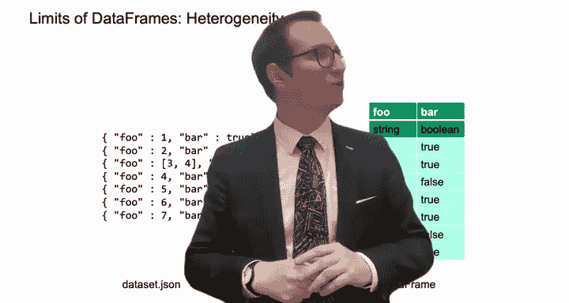

在本节课中，我们将继续探讨Spark，特别是关注当数据不完全符合DataFrame的严格模式（Schema）要求时会发生什么。我们将看到Spark如何处理异构数据，并理解DataFrame和SQL的适用边界。

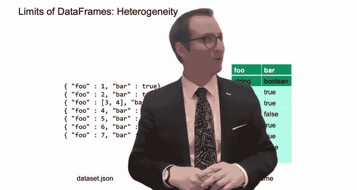

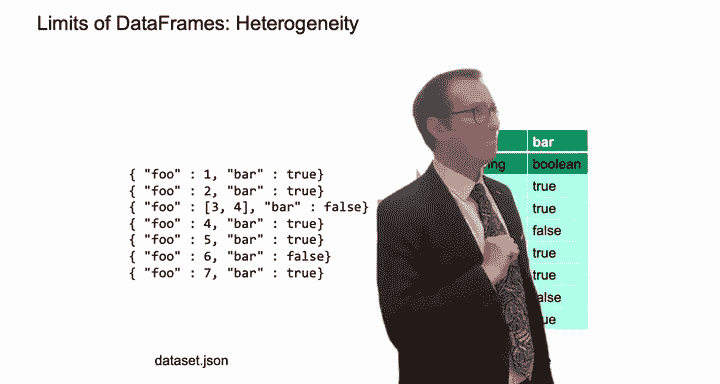

---

上一节我们介绍了DataFrame对嵌套和结构化数据的强大处理能力。本节中，我们来看看当数据变得“异构”时会发生什么。

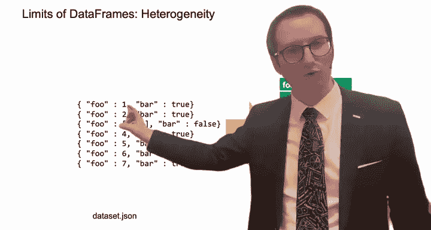

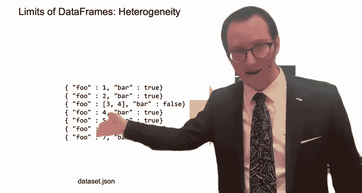

你注意到这里的数据是异构的。本质上，你没有固定的模式（Schema），也无法定义一个模式。

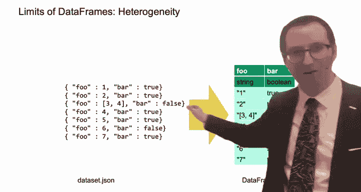

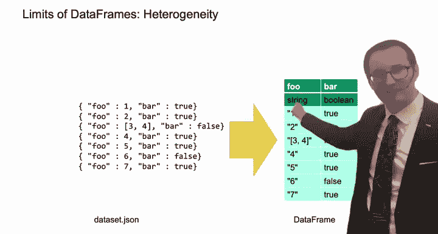

这并不奇怪。如果非要定义一个模式，它可能会非常复杂，例如需要定义一个整数和数组的联合类型，或者一个可以容纳任何内容的“任意”类型。但这并不是一个能让DataFrame正常工作的有效模式。

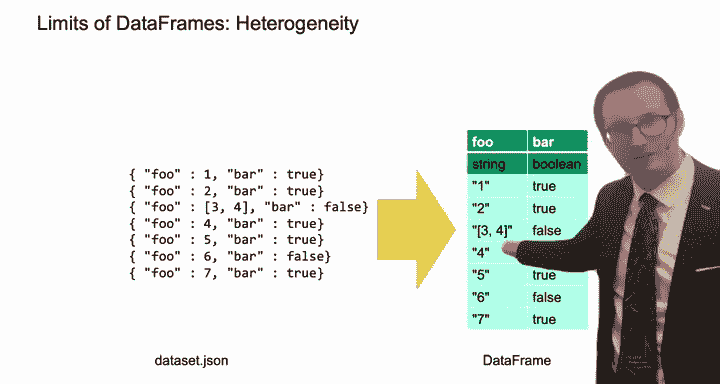

这对Spark来说不是问题。Spark会采取一种强硬的方式处理，结果就是你得到了一个DataFrame。

但如果你仔细观察，这里发生的情况是：`color`字段是一个字符串。

并且这里的所有内容都是字符串。这个值是字符串，那个值也是字符串，所有内容都是字符串。

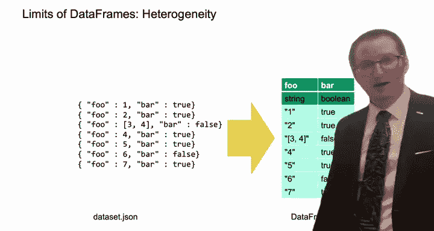

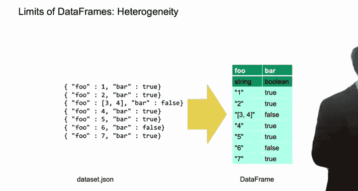

我加上引号是为了更清晰（引号本身不是字符串的一部分），但我想说明的是，即使是数组也被存储为字符串。我们知道，这个字符串的内容是数组的序列化表示（例如JSON字面量）。我们见过这种序列化方式。所以发生的情况是，这里的数组被序列化为一个字符串，然后所有内容都变成了字符串。

乍一看，这似乎很棒，因为我们确实把数据放进了DataFrame。看起来我们总能这样做。

问题在于，你基本上是在告诉用户：“这不是我的问题，是你的问题。”因为你现在是在说：“祝你好运处理它吧。”用户现在可能需要重新解析这些数据，可能得写一个Python脚本，判断如果能解析为字符串就做这个，如果能解析为数组就做那个。但这无法再用SQL完成，用户必须实际编写Python代码，可能需要10行代码来区分不同的情况，这变得相当复杂。

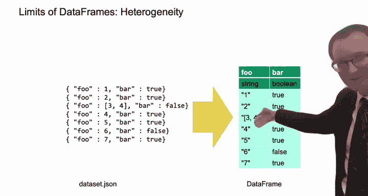

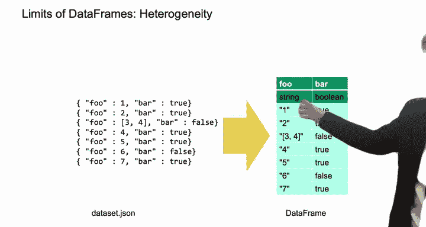

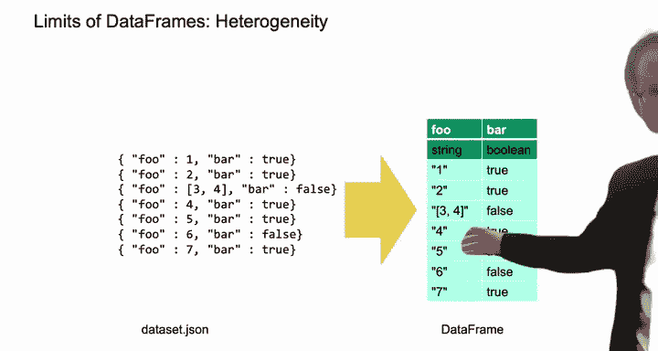

确实，你无法对任何内容进行“展开”（explode）操作，因为这里都是字符串。

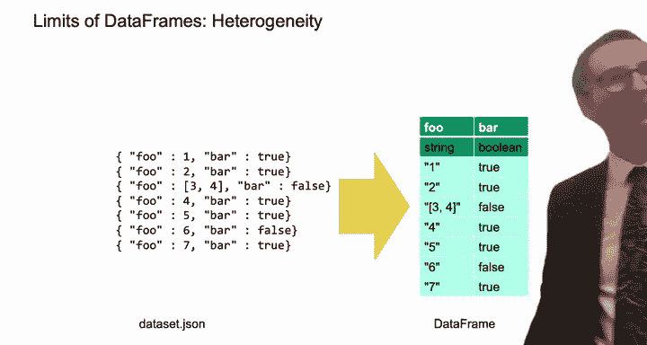

这里没有数组。之前展开操作能成功，是因为我们处理的是数组类型。当你有数组类型时，你可以像这样展开它。

这里的根本问题是，没有数组，它只是一个序列化后的数组，但现在它是一个字符串，所以我们无法这样做。

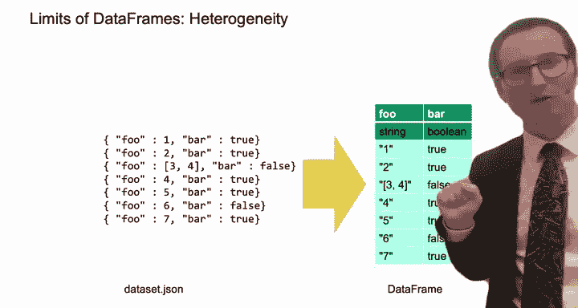

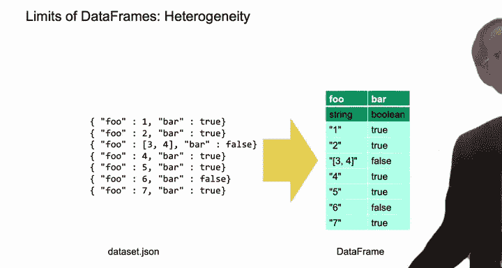

我们稍后会看到，使用`json_tuple`之类的函数可以处理JSON字符串，但这里它确实只是一个字符串。你必须将其视为字符串，并需要在Python中做一些额外的工作。

这是一个例子，说明了我们正在触及DataFrame和SQL能力范围的边界。我们基本上是在尝试将DataFrame用于它们本不擅长的场景。

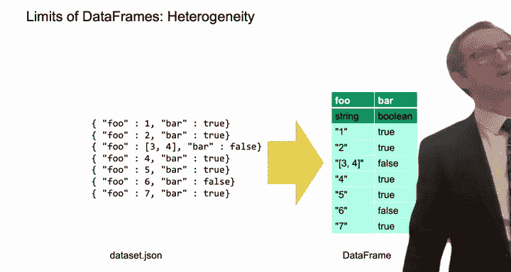

因为左边的数据显然不完全适合DataFrame。这将是我们在接下来几周要探讨的问题。我会向你们解释对于这类情况，我们有哪些其他的解决方案。

这是一个通用的提示，不仅适用于数据库，也适用于计算机科学。每当你学习一项技术、一个算法或一种范式时，你都需要理解它的“有用性领域”。

总有一些用例它表现得非常出色，而另一些用例你或许可以用“锤子”强行让它工作，但效果并不理想。因此，你需要理解的是：如果数据足够同构，DataFrame是非常出色的；嵌套结构也没问题，它很擅长处理嵌套（如果你接受这种表示方式的话）。但如果数据是异构的，情况就会复杂得多。

最终的解决方案真的取决于具体的用例。如果你以后在公司工作，没有通用的答案。SQL并非适用于一切，`json_tuple`并非适用于一切，Spark也并非适用于一切。你真的需要审视每一个具体的用例：数据量有多大、数据看起来是什么样子、存储格式是什么等等。然后你才能决定使用哪些技术，使其既高效又有良好的性能。

现在，最后这张幻灯片是为了说明，如果你愿意，可以将DataFrame转换为RDD，也可以将RDD转换为DataFrame。

将DataFrame转换为RDD很容易，因为它本质上就是一个由Row对象组成的RDD。这个路径很简单。

但反过来就不那么容易了。如果你有一些数据项想放入DataFrame，这需要更多努力。你需要确保数据项的结构符合你的要求，并且你需要提供一个模式（Schema）。

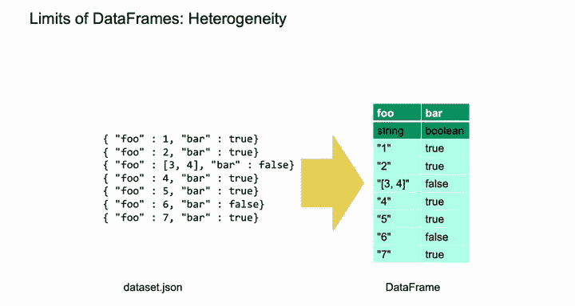

然后你才能将其转换为DataFrame。所以这个过程稍微复杂一些，不是自动完成的。不像加载JSON时Spark会自动推断模式，这里你真的需要做一些工作并明确指定模式。

我认为，这结束了关于Spark的这一章。有任何问题吗？

很好，这让我很高兴。那么我将在这里中断录制。

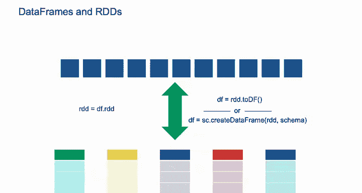

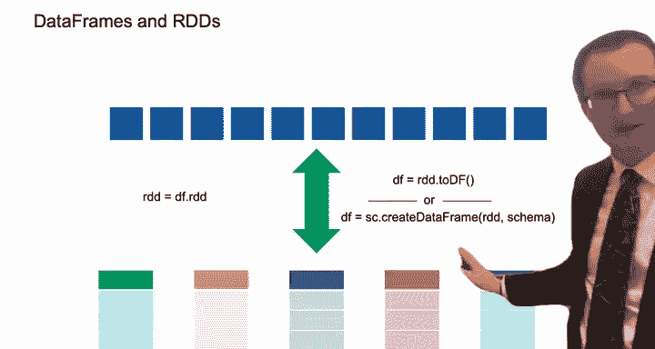

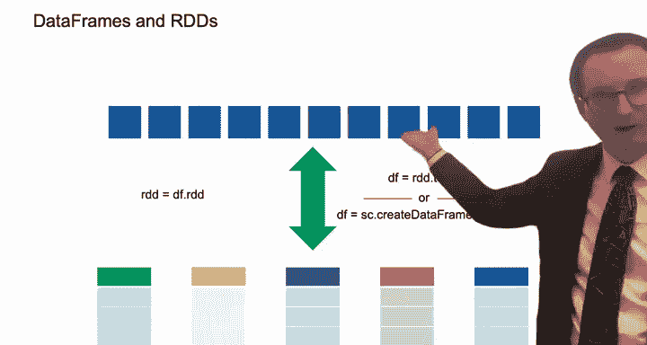

---

**本节课总结**

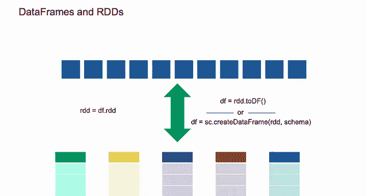

本节课我们一起学习了Spark在处理异构数据时的局限性。我们看到，当数据没有统一模式时，Spark会将其所有字段强制转换为字符串类型，这虽然能创建DataFrame，但丧失了数据的原始结构，使得后续处理（如展开数组）变得困难。这揭示了DataFrame和SQL并非万能工具，其“有用性领域”在于处理同构或结构良好的数据。对于高度异构的数据，可能需要结合其他技术或编写更复杂的代码。最后，我们了解到DataFrame和RDD之间可以相互转换，但从RDD创建DataFrame需要手动提供模式。理解每种技术的边界是选择合适工具的关键。