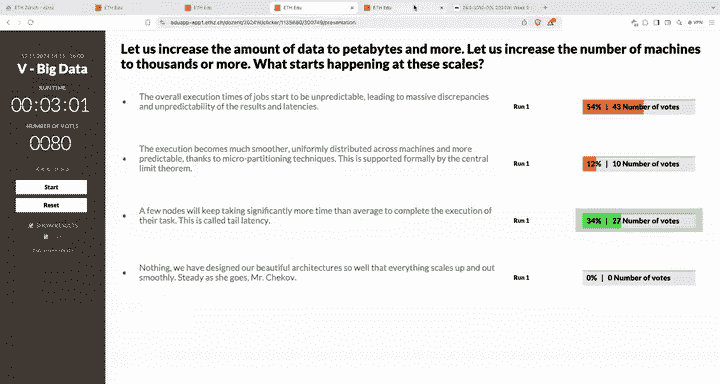
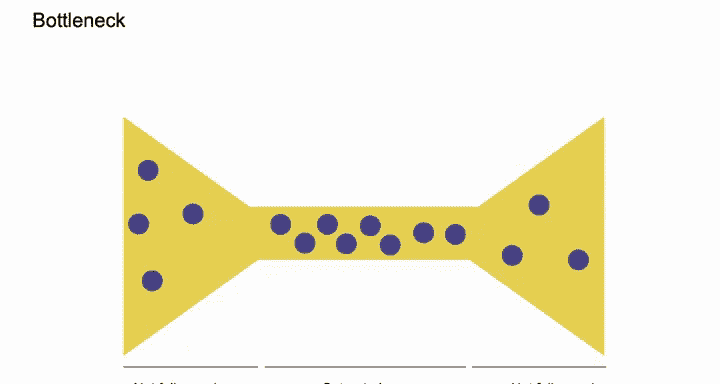
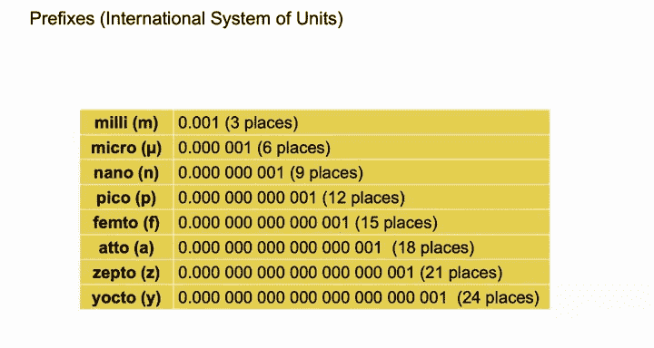
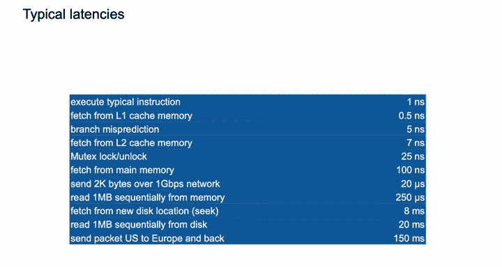
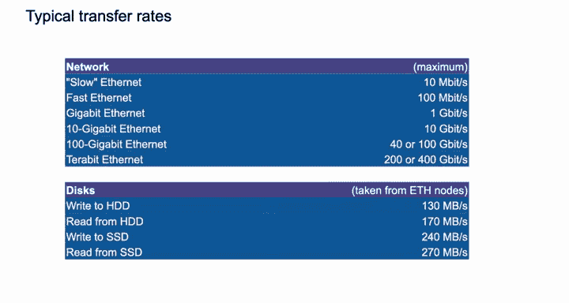
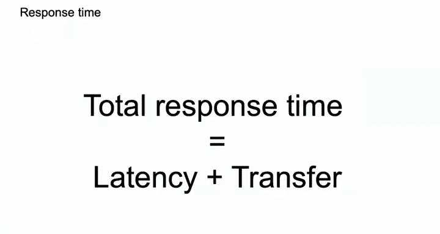
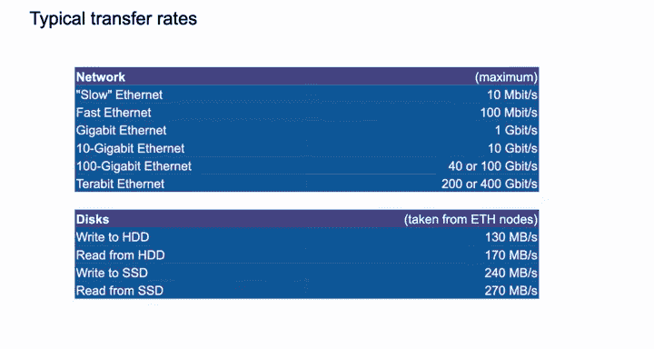
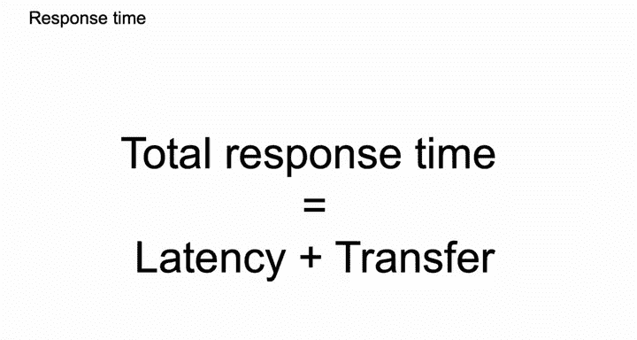
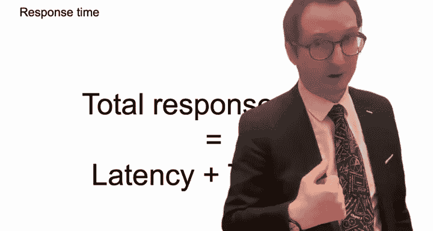

# 33：大规模性能优化 (1/2) 🚀

在本节课中，我们将学习如何分析和优化处理海量数据（如太字节或拍字节）的程序性能。我们将探讨性能瓶颈的概念、识别方法以及针对不同瓶颈的优化策略。

---

欢迎回来。现在我们进入一个有点特殊的新主题。这不是一项新技术，而是退一步思考，当你需要构建处理太字节或拍字节数据的程序，并使用 Spark、MapReduce 等技术时，如何使其运行得更快。我将重点讨论与计算相关的性能和生产力。

但在开始之前，我有一个问题要问大家。当尺度变得非常小时，世界会量子化。当速度非常快时，一些事物会扭曲。我基本上是在问关于海量数据的相同问题：如果你拥有巨大的数据量，它的行为是否仍然相同，还是开始以奇怪的方式发生？

以下是几个可能的答案：
1.  作业的整体执行时间开始变得不可预测，导致结果和延迟出现巨大差异和不可预测性。
2.  相反，由于微分区技术，执行变得更加平滑，均匀分布在机器上，并且可以预测，这得益于中心极限定理。
3.  少数节点完成其任务执行所需的时间将明显长于平均水平。这被称为“尾部延迟”。
4.  我们的架构设计得非常完美，一切都能平稳、顺利地扩展。

那么，你认为哪个是正确的？大多数人选择了第三个答案：少数节点花费的时间明显更长。这不是结果的可预测性问题，结果本身是正确的。这实际上是一个延迟问题。

我将在接下来的讲座中解释原因。你可能已经观察到，在我们进行现场 MapReduce 演示时，有些学生需要更长的时间来完成映射任务。今年不太明显，但在往年，通常有一两个学生花费了很长时间，这很好，因为这正是我想说明的观点。

---

现在，让我们开始学习“大规模性能优化”。到目前为止，我们已经涵盖了存储（包括语法、XML 和 JSON）、数据模型（XML 集合、JSON 数据模型）、数据帧、验证、JSON 模式、XML 模式、通用类型系统，以及使用 MapReduce 和 Spark 进行处理。我们即将结束本学期，已经用 SQL 进行了一些查询（仅针对表和数据帧），并将继续学习 JSONiq。

现在是时候稍作停顿，思考一下性能问题。

---

## 识别性能瓶颈 🔍

通常，当你决定向集群提交一个作业时（无论是 Spark、MapReduce，甚至只是一个本地 Java 程序，任何复杂度的计算机程序），可以肯定的是，**某个地方总是存在瓶颈**。

我们称之为瓶颈，是因为你可以在脑海中形成这样的视觉图像：系统的某些部分没有被充分利用，而其他部分则被完全用满，这正是导致性能问题的原因。

理解这一点是性能调试的基础——不是为了正确性，而是为了性能。你有一个计算机程序，想让它更快，你需要做的第一件事就是**找到瓶颈**。如果你在其他地方下功夫，而瓶颈依然存在，那完全是徒劳的。你必须找到瓶颈，并集中精力解决它。

如今，即使在计算机科学领域，也没有人能理解所有东西。系里有很多人研究硬件，但我对硬件一无所知。我只知道在抽象层面上，有内存、CPU、磁盘和网络。事实上，对于数据管理的目的来说，知道这些就足够了。基本上，这就是我们在大数据性能问题上关注的抽象层次：内存、CPU、磁盘、网络。

我可以肯定地告诉你，任何运行缓慢的作业，原因都出在这四个方面之一。你必须找出是哪一个。可能是 CPU 瓶颈，你怎么发现？例如，你可以通过 SSH 登录到机器，查看 CPU 使用率，发现它一直处于 100%。而内存使用率虽高但未满，磁盘似乎没有满负荷，从磁盘读取的带宽也正常，网络基本空闲。这就是 CPU 瓶颈的情况。我们使用的术语是 **CPU 受限**。这意味着你需要对你的代码做些调整，这是一个计算问题。

或者，你登录机器，发现 CPU 使用率是 80%、60%，没有完全利用；内存也没有完全利用；网络在传输数据，但没有达到网络带宽上限；但你注意到磁盘正在疯狂地读写，实际上是以可能的最大速度进行读写。这是 **I/O 瓶颈**，更具体地说是**磁盘 I/O 受限**。

也可能是**内存受限**。你连接到机器，CPU 使用率 60%，磁盘没有全速读写，网络电缆没有过载，但你的内存完全满了，满到开始使用交换空间，系统尽力执行你的作业。这是最糟糕的情况之一，因为当开始触及内存交换时，实际上会拖慢甚至终止你的执行。例如，在 MapReduce 或 Spark 中，可能开始将数据刷出内存，因为内存装不下了。

或者是**网络 I/O 受限**。这意味着 CPU 没有完全利用，内存没有满，磁盘没有以最大速度读写，但数据正在网络上疯狂地洗牌，这显然是通信或洗牌阶段的问题。

我可以肯定地告诉你（我不称之为定理，因为它更偏向实践），瓶颈总是这四个中的一个，不可能有两个瓶颈。同时出现两个瓶颈的几率非常小，总是有一个主要的瓶颈。它可能非常明显，也可能不那么明显，但总有一个瓶颈。

当你试图让作业更快时，只需识别出瓶颈，然后你就知道该修复什么。同样，如何识别？你真的必须登录到机器，查看 CPU、内存等，看看问题出在哪里。还有其他技巧，例如，当你尝试执行一个复杂的数据查询时，你想做的是：一方面，测量执行查询所需的时间；另一方面，测量另一个只读取数据的查询所需的时间（可能写回点什么，但仅此而已）。然后你观察两者的差异。如果你注意到存在显著差异，那么这可能不是磁盘 I/O 问题，很可能是 CPU 或内存问题。然而，如果你的查询速度（所花费的时间）与从磁盘读取数据的时间大致相同，那就意味着这是一个磁盘 I/O 瓶颈。这些是你可能得到的线索。这有点像侦探工作，你必须进行调查，找出瓶颈所在，这确实需要一些思考和跳出框框。顺便说一下，还有性能分析工具，可能会有帮助。

---

## 使用 MapReduce/Spark 的核心原因 💡

现在，我要说一些极其重要的话。这非常重要，以至于可能是使用 MapReduce 时的首要经验。这也是很多人没有理解的一点。

你应该使用 MapReduce 或 Spark 的首要原因是，如果你的问题是**磁盘 I/O 瓶颈**。这是你使用 MapReduce 或 Spark 的主要原因。为什么？因为一旦你达到了笔记本电脑上单个磁盘的极限，并且以最大速度读取它，你做的任何事情都是无用的。你可以改进代码，可以做任何你想做的事，但完全没用。所以你被磁盘 I/O 卡住了，这时转向集群才有意义，因为你可以并行地从多个磁盘读取，数据中心的磁盘 I/O 能力是叠加的。这一点非常重要。

因为有些人即使问题不是磁盘 I/O 瓶颈，也在使用 Spark 或 MapReduce。我想到的例子是气象学或气候学，当你尝试进行 CPU 密集型工作时，不应该使用 Spark 或 MapReduce，因为预测天气时，问题不是从磁盘读取数据，而是使用 CPU 计算模型，这属于高性能计算（HPC）范畴。你必须牢记这一点：如果你使用 Spark 或 MapReduce，但你的问题不是磁盘 I/O 瓶颈，那么可能有其他解决方案。你可以减少机器数量，可能节省一些钱来改进它。我只是想确保这一点非常清楚。

---

## 性能度量与数量级 📏

为了进行测量，当你在调查以找到瓶颈并了解是否以及如何修复它时，你需要考虑我之前告诉你的这些概念：延迟、吞吐量、容量。这些都是你需要牢记的。

关于延迟，当你开始接收数据时，我给了你这个完整的尺度。你还记得所有的前缀吗？现在应该有一半人能记住了。如果你不记得，仍然应该学习它们，但你必须熟记。这里还应该再添加两个，即 10^-27 和 10^-13，这些是微观层面的等效单位：毫、微、纳、皮、飞、阿、仄、幺。知道它们也是个好主意，尽管在大数据中你可能还看不到仄和幺，但在其他领域，比如飞米（femtocell）你可能听说过，阿秒在物理学中也是我们设法达到的时间尺度。

但无论如何，为了大数据的目的，你至少需要知道与计算机系统相关的这四个前缀。

现在，我将给出一些数量级，但你真应该把它们当作数量级来看，因为这确实取决于计算机、时间间隔等。但基本上，你必须记住，如果你查看 CPU 及其寄存器和汇编代码等，那么你基本上是在看纳秒级的典型时间。一旦你开始查看缓存，可能会增加一位数或更高。然后当你查看内存时，是几十或几百纳秒。接着是网络，是微秒级。你看，你现在看的是更大的尺度，网络已经是以米为单位，而不仅仅是在 CPU 内部。从内存读取比如 1 兆字节的数据，需要几百微秒。磁盘则更慢，当你从磁盘读取时，现在是毫秒级。如果你考虑数千公里，比如发送数据到北美再返回，那就是几百毫秒或更多。顺便说一下，这不是光速，互联网实际上比光速慢，因为它不是直线传播。

你必须记住这一点，这也是为什么在使用数据中心时，你希望尽量让数据在附近（比如在苏黎世），而不是在美国，如果你从这里处理的话。这些只是数量级，我不是要求你死记硬背，但至少如果我告诉你，你测量到某物往返美国只需一纳秒，那肯定是物理定律出了问题。你真的不应该不知道数量级，因为当你思考瓶颈时，你可以在餐巾纸上快速计算。你可以查看数据大小，做一些简单的除法（就像小学数学），快速估算出非常粗略的数量级，然后与实际发生的情况进行比较。这对于识别瓶颈非常有用。

然后是数据传输速度，这些只是一些例子，比如网络的典型速度。现在我们处于千兆比特时代，有 10 吉比特、100 吉比特，我认为甚至太比特网络也正在到来。对于硬盘和固态硬盘，现在可能甚至更高，但当我上次测量时，SSD 大约是每秒几百兆字节。当然，从驱动器读取和写入的速度也取决于它是顺序访问还是随机访问，这对于硬盘尤其是个问题，因为有一个旋转的磁头，对于 SSD 则问题较小。

好了，只是给你数量级的概念。磁盘速度在 MapReduce 和 Spark 的情况下可能最有用，因为知道读取速度，如果你有一个 1GB 或 10GB 的数据集，只需简单除法就能粗略估计读取全部数据所需的时间，这为你查询时间的测量提供了一个基线。因为如果你已经达到了这个基线，那么你就知道不可能比这更好了，除非你添加更多磁盘。

---

## 延迟与总响应时间 ⏱️

在词汇方面，你必须记住，“延迟”可以以不同的方式使用。我在讲座的上下文中使用“延迟”，这只是定义问题，指的是接收到第一个数据位所需的时间，即开始下载前的等待时间。有些人使用“延迟”指从发送请求到接收最后一个位所需的总时间，这只是约定俗成。但你必须心中有数，这里我们得到的是总响应时间，而不是延迟。总响应时间包括等待第一个位的时间，再加上传输时间。

当你查看瓶颈时，你感兴趣的是总响应时间，这通常是你想在论文中展示的漂亮图表中测量的东西。

---

## 性能改进与加速比定律 📈

现在，当你最终找到瓶颈并知道如何修复，然后去修复它时，你会想测量差异。所以你要测量改进前后的总响应时间。

然后你做一个除法：旧时间除以新时间。出于某种原因我在这里写了“延迟”，因为我脑子里想的是那些用它的人，也许我应该写成“总响应时间”。但我这里的意思确实是总响应时间除以总响应时间。

举个例子，假设在改进之前，你的查询总共花了 3 秒（从开始到结束的总响应时间）。在你实施修复或做了某些改进后，现在只需要 2 秒。那么你可以通过除法估算加速比。这里你会说加速了 50%，即 1.5 倍。

现在，如果我把它应用到一个特殊案例中：你有一个非最优的查询，你尝试通过并行化来修改你的代码。假设查询中 30% 的部分是可并行化的，70% 是不可并行的（可能是洗牌阶段）。在可并行化的部分，你通过某种方式（比如增加机器数量）使其速度提高了一倍。那么，这 30% 的部分会变短。现在你看到这个公式：之前以 1 为基准，改进后，我有 `(1 - p)`，这是不可并行化的部分，加上 `p / s`，因为现在我提高了执行速度。所以不是 `(1 - p) + p`，而是 `(1 - p) + p / s`，这是我进一步并行化的部分。举个例子，如果 30% 的部分获得了 2 倍的加速，那么就是 `1 / ((1 - 0.3) + 0.3/2) = 1 / (0.7 + 0.15) = 1 / 0.85 ≈ 1.18`。你看，这没那么令人印象深刻了，因为一开始我告诉你我在可并行化部分使速度提高了一倍，听起来很厉害。但现在整体来看，只提高了 18%。原因是不是所有东西都是可并行化的。所以当你修复一个瓶颈时，要记住，如果你进行并行化，并非所有部分都会受到影响，只是一部分，所以这要相对来看。

这是阿姆达尔定律。但还有另一个人，古斯塔夫森先生，他说不，计算加速比应该是 `(1 - p) + s` 而不是 `(1 - p) + p / s`。让我们再用这个公式计算一下：`(1 - 0.3) + 2 * 0.3 = 0.7 + 0.6 = 1.3`。现在我得到了完全不同的公式，它们说的不是一回事。这里我得到 18% 的提升，这里得到 30% 的提升。那么问题来了，谁是对的？他们有两个公式，给出了不同的结果。事实上，答案是：在一种情况下（阿姆达尔定律），你有一个特定的问题（比如矩阵对角化），你找到了一种让它更快的方法，那么它可能从一小时变成 50 秒，你只是让这个特定问题更快解决了。如果是这种情况，那么使用阿姆达尔定律。古斯塔夫森定律有不同的视角，事实上，这是你在现实生活中观察到的：当你让某物更快时，人们会更多地使用它。所以发生的情况是，如果你设法提高了速度（例如，将气象模拟所需的时间减半），气象学家首先想做的可能就是提高精度，以便在原始时间内计算更多东西。所以现在，他们不是在一小时内得到答案，而是在半小时内得到相同的答案，而是仍然花费一小时（原始时间），但会得到更好的结果、更多的工作负载、更多的工作。如果你从这个角度来看，即计算能力保持不变，你继续使用整个集群一小时，但你设法做了更多事情，那么就应该使用这个公式。明白了吗？这就是区别：你是一个问题现在更快了，还是你用相同的资源做了更多事情？左边是恒定问题规模，右边是恒定计算能力。

---

## 优化策略：横向扩展与纵向扩展 ⚙️

如果你想调整以修复性能问题，你已经知道横向扩展（增加机器数量）对于并行化效果很好。纵向扩展（提升单机性能）也可能有效，在某些情况下，如果你用尽了选项并且内存是问题，但你需要更多资源，有时（尤其是在使用亚马逊云服务时）直接换一台更大的机器更容易。但你必须小心不要滥用，因为你应该总是先尝试改进代码。这些是简单的按钮：按一个按钮，你就有更多机器；按一个按钮，你就有更大的机器。这是最后的手段，尤其是因为这会花费更多钱。所以如果你是一家初创公司，从投资者那里获得资金，你必须非常小心，因为这会消耗更多资金。

但你能做的是先尝试改进代码。在很多地方，人们常常意识到，他们原本认为需要集群才能完成的工作，其实在笔记本电脑上就能运行。这在资源消耗上有相当大的差异。

基本上，如果你想避免纵向扩展（比如内存不足），你能做什么？一种方法是使用数据帧而不是 RDD，使用值对象，使用数据帧，然后你立即会看到内存消耗减少。另一种方法是投影掉未使用的字段。如果你的查询只使用了数据帧中的一半列（比如有 10 列，但只读取了 5 列），那就去掉它们，甚至不要从磁盘读取它们。这就是数据帧能够做到的。在面向对象编程中，你也需要发现那些被实例化数十亿次的类。例如，在 RumbleDB 中，我们有一个 Java 实现，我们花了很多时间仔细检查 Item 类，这个类存储原子值、对象和数组，因为有数十亿个它的副本。所以我们需要在这个类上花很多时间，因为我们从这个类中减少的每一个比特，在内存消耗上都会乘以十亿倍。

所以你可以，例如，花时间（这需要一些调查）找出在 Java 中哪种 Map 实现（TreeMap、HashMap 等）使用的比特数最少，这可能也取决于你的用例。或者，你可能有多余的东西，冗余可以使某些东西更快，但会占用内存。所以如果你移除冗余，可能会变慢，但至少你减少了内存消耗。

然后，我知道你们中许多人上过软件工程最佳实践课，当开始从事系统工作时，我们不得不告诉你们，这通常是一个巨大的失望。当然，软件工程很美好，它在可重用性、模块化等方面有很多好处。但问题是，当你在数据中心工作，处理被复制数十亿次的类，并且你关心性能时，你就没有这种奢侈了。然后你会做一些可能让某些人尖叫的事情，但你必须尽量避免使用过多的继承，避免使用多态。你会在一些系统代码实现中看到（比如 C++ 或 Java），人们会使用一个大的 switch 语句，而不是使用多态和派生类，这会让面向对象编程的人尖叫。但在系统中，这就是你的做法，因为这样才能让它更快，才能减少内存占用等等。这当然需要对所使用的语言有深刻的理解。所以花时间去理解内存中的结构，精确到每一个比特，是非常值得的。但这与软件工程中的一些最佳实践相比，是非常反直觉的。

关于 CPU，这里有很多技巧。例如，你可能有过多的方法调用。有这样一种说法，在系统中每个方法应该有 25 行。不一定每个方法调用都有成本，因为它并不总是被编译器内联。所以你必须确保在执行过程中没有太深的调用栈。特别是如果你有很多单行函数，这在工程上看起来很漂亮，但会导致巨大的调用栈，使执行变慢。调用被重写的方法是有成本的。是的，我想你喜欢提到编译器通常比任何程序员都更擅长做这些优化。绝对正确，很多编译器能够优化，但它们不一定能一直优化到底。在某些时候，当你为了节省最后一点内存或最后几微秒的执行时间而绞尽脑汁时，你必须手动做一些事情，不能完全盲目地信任编译器。但我同意编译器随着时间的推移会变得更好。但你知道，优化执行的问题从未解决，你总是可以做得更好、更好、更好。当你有一个特定的用例时，编译器是为广泛的通用用例设计的。当你想调整一个非常具体的系统到最后一个比特或最后一微秒时，就值得开始研究这些东西了。

在一些风格指南中，比如谷歌的 C++ 风格指南（可能不是），但在 Java 中，你可以使用接口但不能使用继承，你不能使用异常，除非它们真的是异常或错误，但你不能滥用异常。你必须小心类层次结构。据我所知，在苏黎世联邦理工学院的实验室里，当你们中的一些人开始编写系统代码时，常见的情况是代码运行缓慢，然后我们查看调用栈或类的层次结构，