# 34：大规模性能优化（第二部分）🚀

在本节课中，我们将继续探讨大规模数据处理时的性能优化策略。我们将深入理解如何配置Spark作业资源，以及如何应对在超大规模集群中出现的尾部延迟问题。

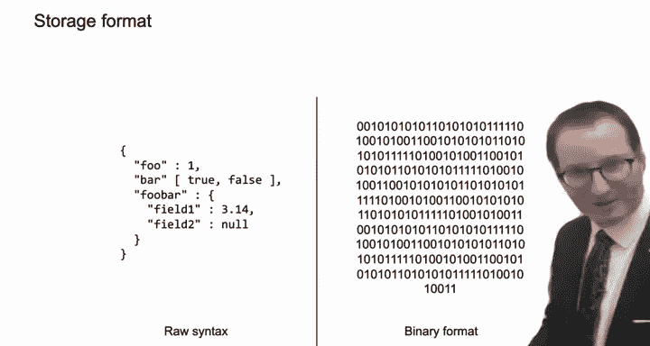

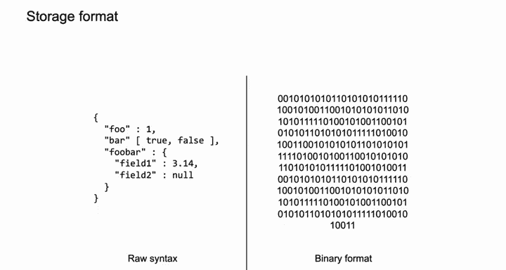

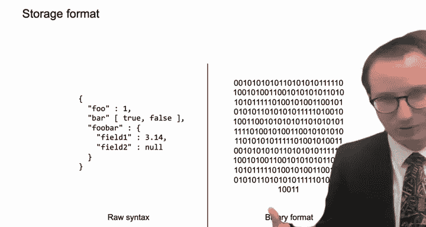

上一节我们介绍了性能瓶颈的四种类型（CPU、内存、磁盘I/O、网络I/O）以及通过二进制格式和谓词下推等基础优化手段。本节中我们来看看如何配置Spark集群资源，并理解一个在大规模集群中无法避免的数学现象。

## 集群资源配置 🧮

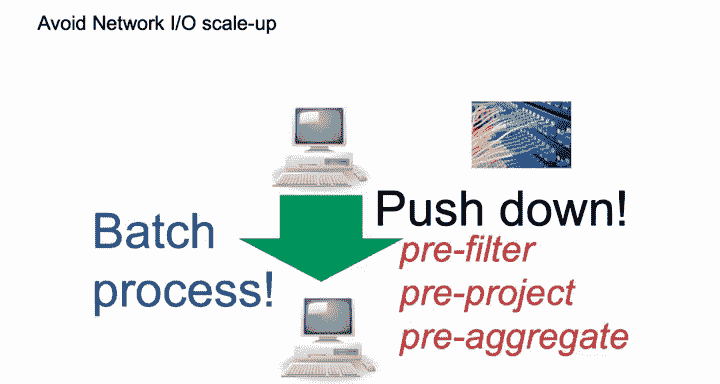

当你准备为一个Spark作业预订集群资源时，你需要决定需要多少台机器、每台机器需要多少内存和CPU核心。这需要对集群架构有直观的理解。

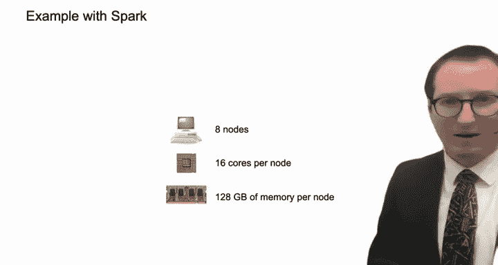

假设我们有一个由8个工作节点组成的集群，每个节点有16个CPU核心和128GB内存。那么总资源为：
*   **总核心数**：`8 节点 * 16 核心/节点 = 128 核心`
*   **总内存**：`8 节点 * 128 GB/节点 = 1024 GB (1 TB)`

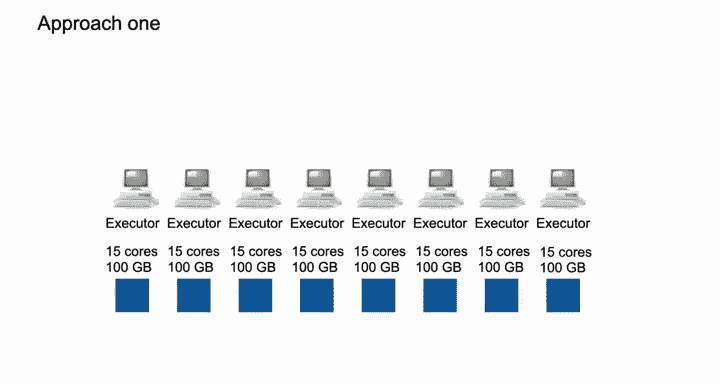

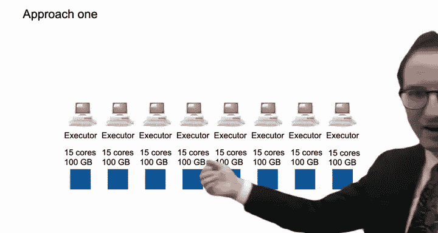

在配置Spark执行器（Executor）时，有两种极端方式：

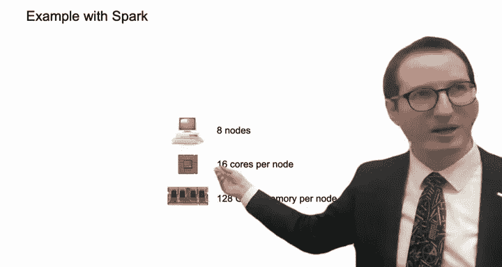

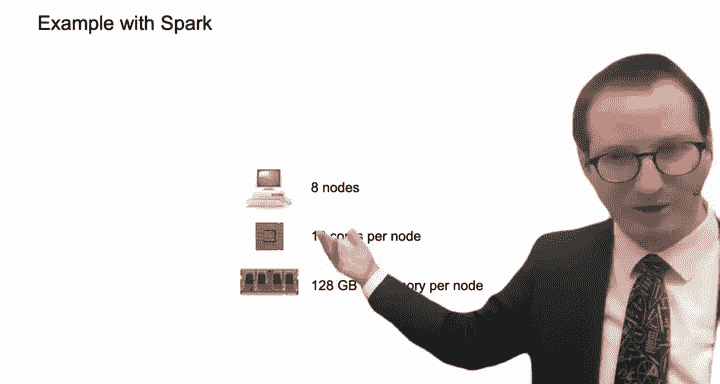

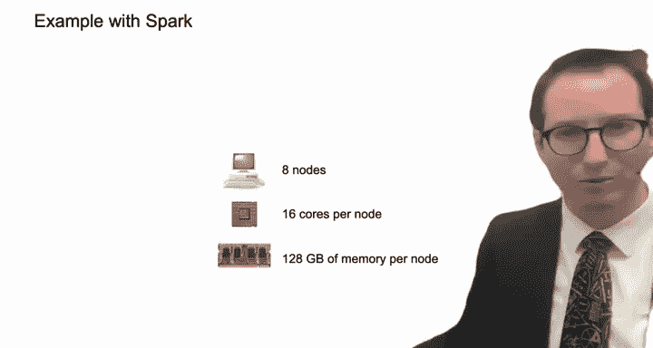

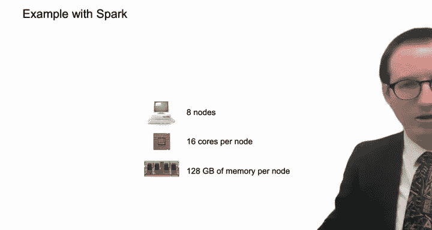

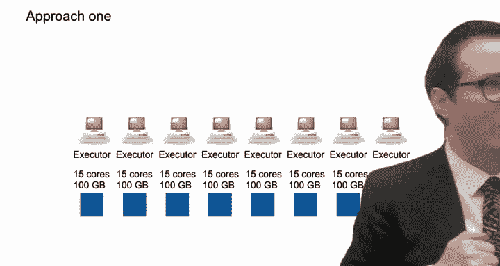

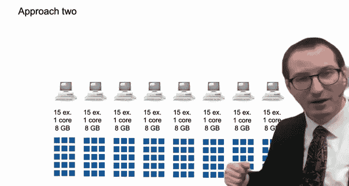

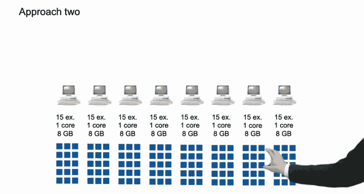

以下是两种极端的执行器配置策略：

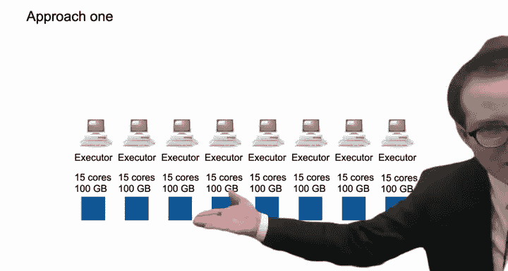

1.  **一个大型执行器**：在每个节点上只运行一个执行器。例如，每个执行器使用15个核心（留1个给系统）和100GB内存。这样你总共有8个执行器，每个能并行运行15个任务。
2.  **许多小型执行器**：在每个节点上运行多个执行器，例如15个。每个执行器只使用1个核心和约8GB内存。这样你总共有120个执行器（8节点 * 15），每个执行器运行1个任务。

在实践中，这两种极端配置通常都不是最优的。第一种配置（大型执行器）可能导致内存浪费，因为任务对内存的需求不同，一个任务用不完的内存无法被其他任务利用。第二种配置（许多小型执行器）则会因为进程过多而引入不必要的开销。

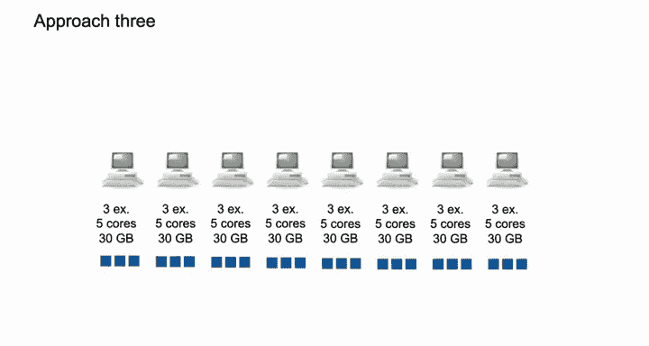

一个经验法则是，将每个节点上的执行器数量设置为节点核心数的平方根左右。例如，对于16核的机器，可以配置大约4个执行器，每个执行器分配4个核心。这样可以在资源利用和开销之间取得平衡。

## 分区与并行度的平衡 ⚖️

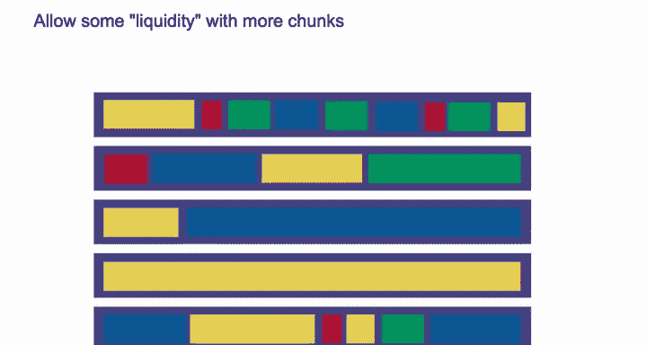

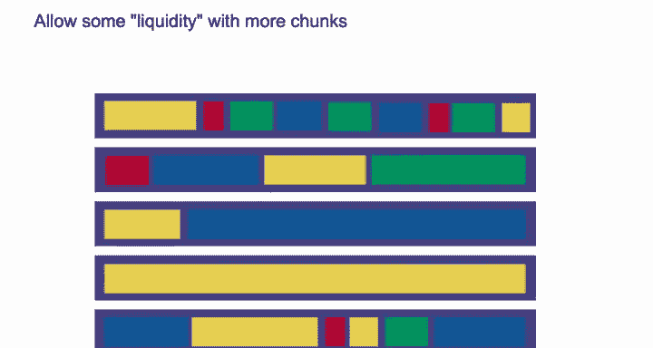

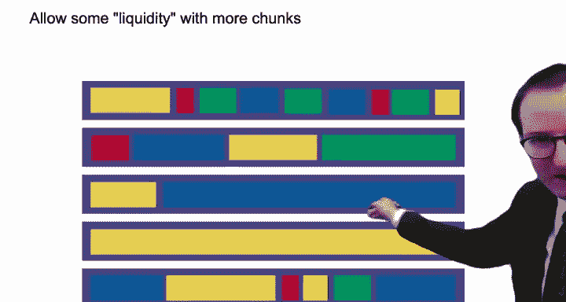

任务分区数量与执行器槽位（Slot）数量的关系也至关重要。理想情况下，我们希望每个槽位处理一个分区，并且所有任务同时完成。但这在现实中几乎不可能，因为数据分布和处理难度总是不均匀的。

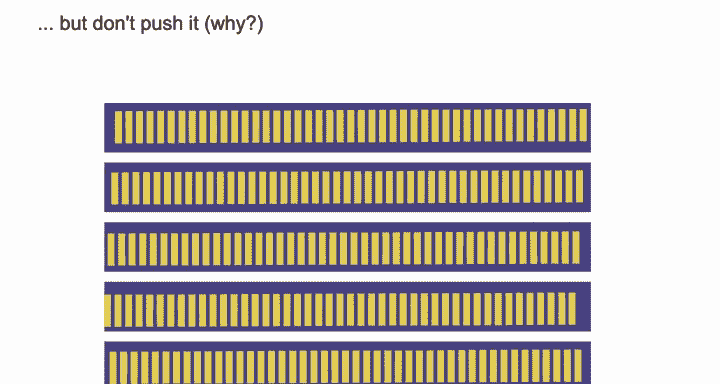

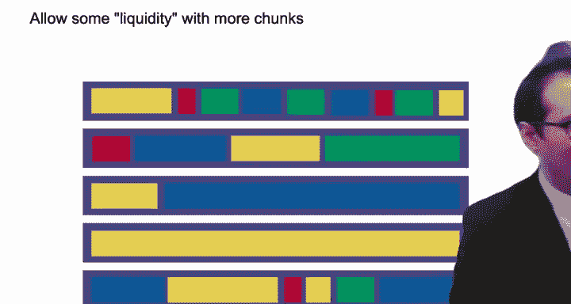

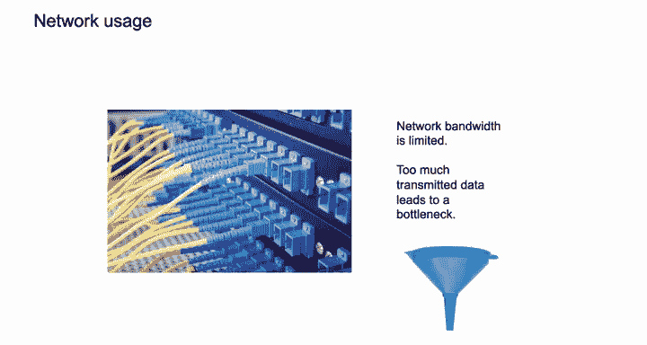

如果分区数等于槽位数，可能会出现“长尾任务”问题：大部分槽位很快空闲，而少数几个槽位需要处理特别慢的任务，导致整体资源浪费和作业时间延长。

为了解决这个问题，我们通常设置分区数量是槽位数量的数倍（例如3倍、5倍或10倍）。这样，当一个槽位完成当前任务后，可以立即从任务池中领取下一个任务。处理速度快的槽位会处理更多任务，从而动态平衡负载，避免因等待慢任务而造成资源闲置。

当然，分区也不是越多越好。如果分区过小、数量过多，启动和管理大量小任务的开销（任务调度、序列化等）会变得显著，反而降低整体效率。因此，需要在“分区过少导致负载不均”和“分区过多导致开销过大”之间找到平衡点。

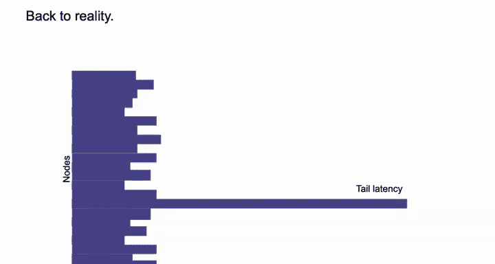

## 尾部延迟：一个数学难题 📈

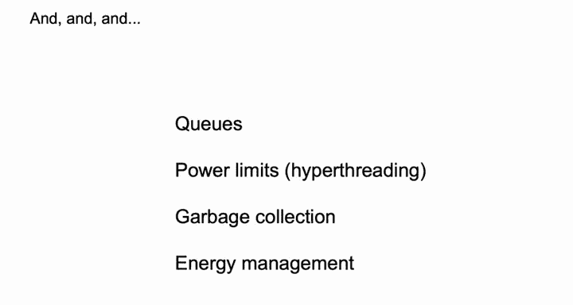

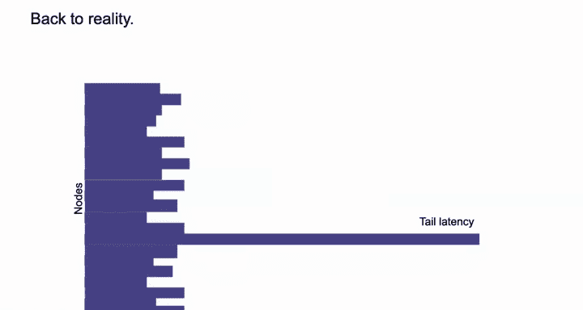

当我们把集群规模扩展到成千上万个节点，处理PB级数据和海量任务时，会遇到一个更深层次的问题：**尾部延迟**。这种现象表现为，绝大多数节点都很快完成了任务，但总有那么一两个节点“卡住”，需要异常长的时间，拖慢了整个作业。

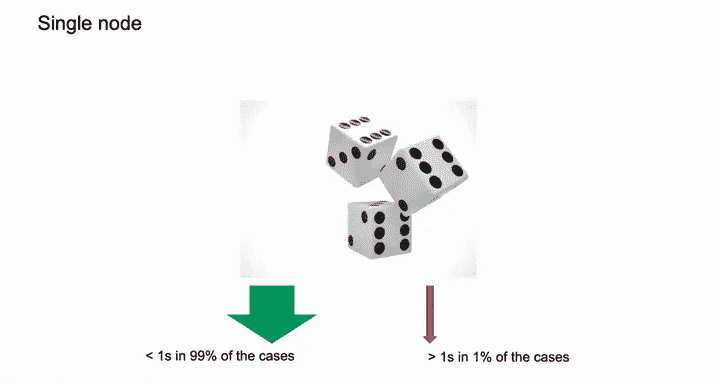

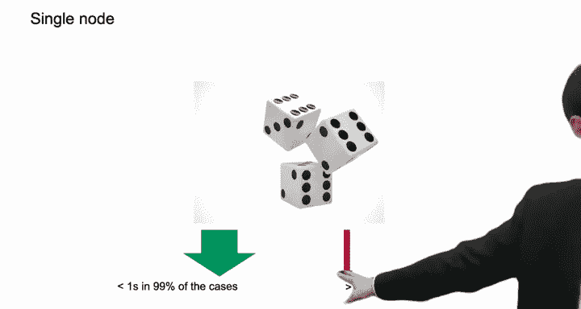

你可能会想，通过优化代码或调整配置来解决。但关键在于，**这个问题无法通过常规的应用层优化来根除**。它是一个由概率和系统底层不可预测性导致的数学现象。

其根本原因在于大规模分布式系统中的“噪声”：机器上运行的其他进程、操作系统后台任务、Java垃圾回收、网络瞬时拥堵、共享资源争用、甚至电源管理策略等。这些因素使得单个任务完成时间存在不可预测的波动。

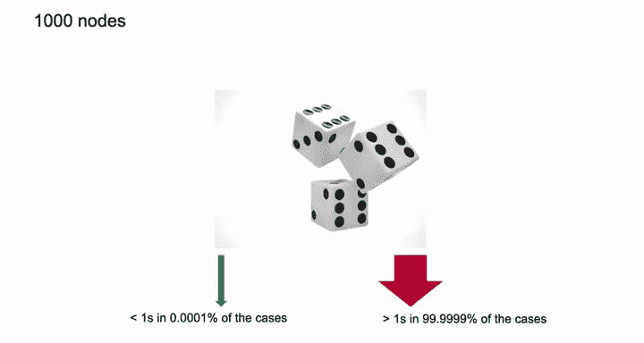

我们可以用概率模型来理解。假设单个任务在99%的情况下能在1秒内完成（成功概率 `1-p = 0.99`），但有1%的概率（`p = 0.01`）会超时。

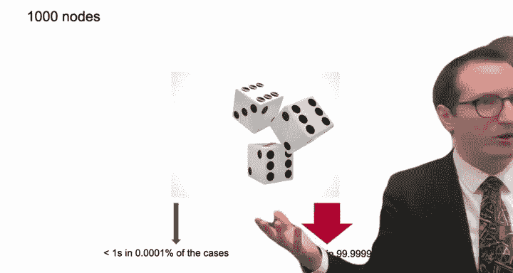

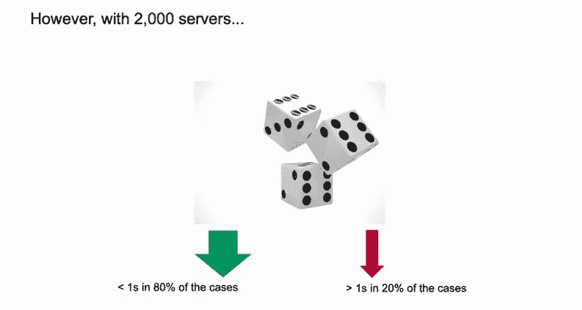

*   对于**单个节点**，只有1%的几率出问题，影响不大。
*   对于**10个节点**，所有节点都成功的概率是 `(0.99)^10 ≈ 0.904`。这意味着有大约9.6%的概率至少有一个节点会超时。尚可接受。
*   对于**100个节点**，所有节点都成功的概率骤降至 `(0.99)^100 ≈ 0.366`。超过63%的概率会至少有一个节点出问题。
*   对于**1000个节点**，概率几乎为零。几乎可以肯定会有节点超时。

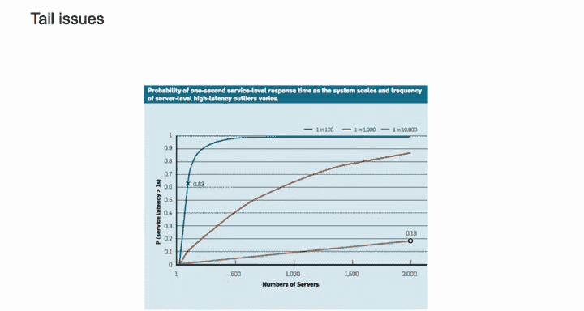

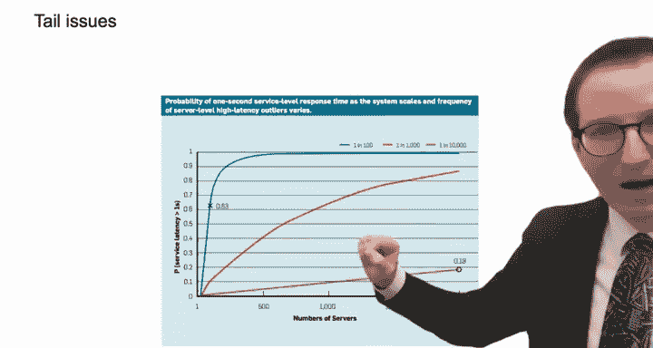

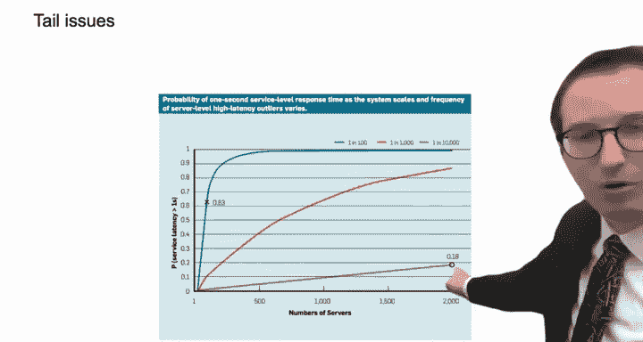

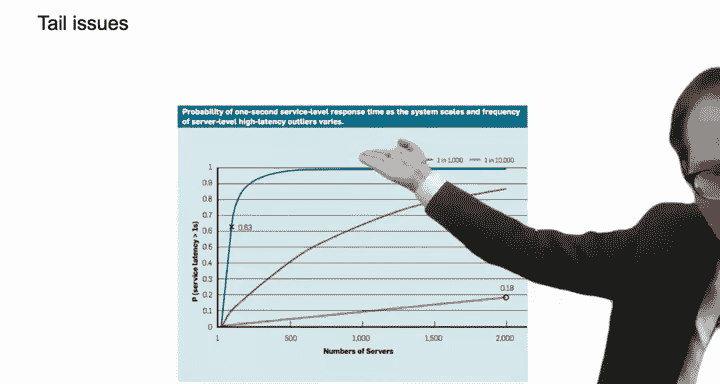

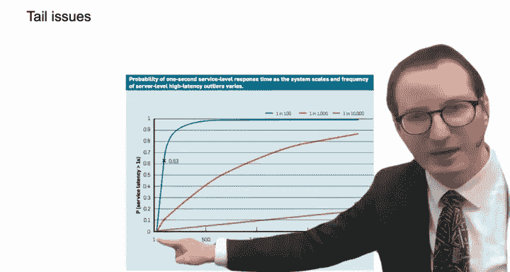

计算公式为：**至少一个节点失败的概率 = `1 - (1 - p)^n`**。即使我们将单个节点的失败概率 `p` 降低到万分之一（0.0001），当节点数 `n` 增加到2000时，整体失败概率又会回升到约18%。问题的核心在于节点数量 `n` 在指数项上，只要规模足够大，小概率事件几乎必然发生。

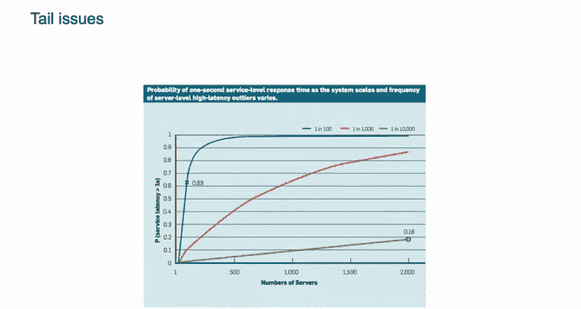

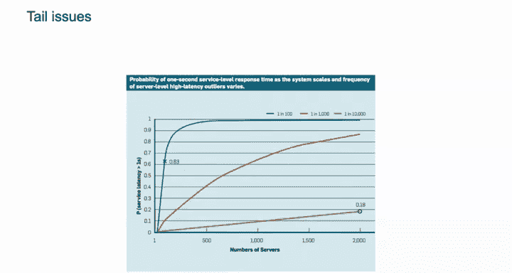

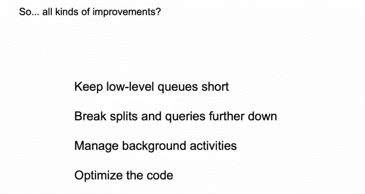

## 应对尾部延迟的策略 🛡️

既然无法消除尾部延迟，工程师们设计了一些策略来缓解其影响：

以下是两种有效的策略：

1.  **任务对冲请求**：主动将每个任务复制一份，发送到两个不同的节点上执行。哪个先完成就采用哪个结果，并取消另一个。这种方法效果最好，但代价是计算资源开销几乎翻倍。
2.  **任务推测执行**：不主动复制任务。而是监控所有任务的执行进度。根据历史数据设定一个阈值（例如95分位点的完成时间）。当某个任务的执行时间超过这个阈值时，系统就认为它可能“掉队”，于是自动在另一个节点上启动一个相同的备份任务。最终取先完成的结果。这种方法只对少数“慢任务”进行重试，资源开销更小，是Spark等系统内置的机制。

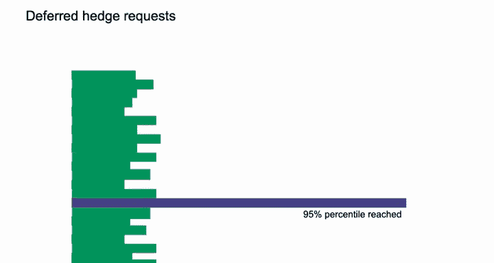

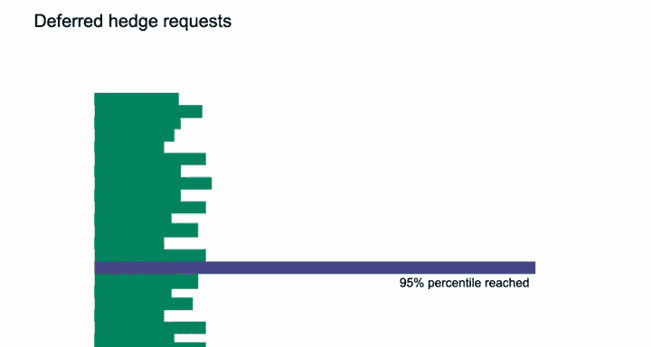

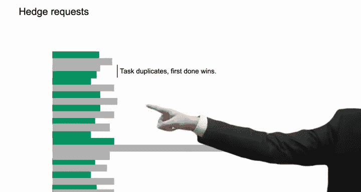

这些策略的本质是利用冗余计算来对抗不确定性，它们是在系统架构层面，而非应用代码层面，解决大规模分布式计算固有问题的有效手段。

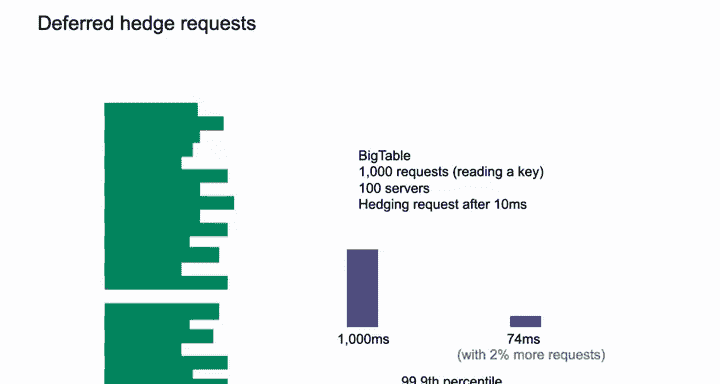

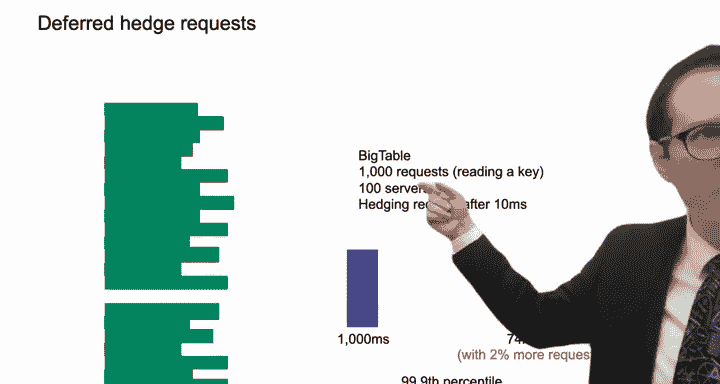

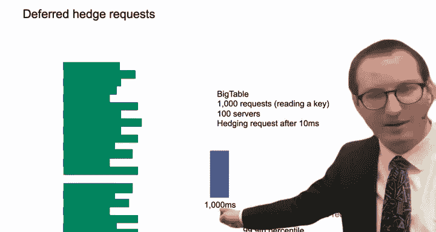

本节课中我们一起学习了如何合理配置Spark资源以平衡效率与开销，并深入探讨了在大规模集群中由概率决定的尾部延迟现象及其工程解决方案。理解这些底层原理，有助于我们更好地驾驭大数据处理系统，并在遇到性能瓶颈时，能准确判断问题所在并采取正确的优化方向。

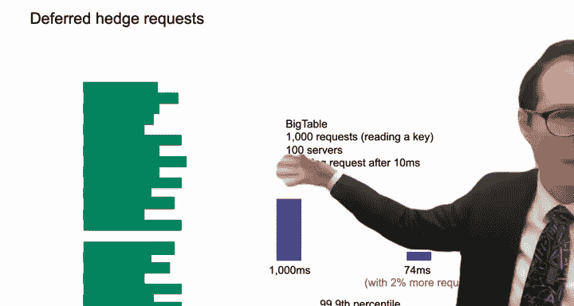

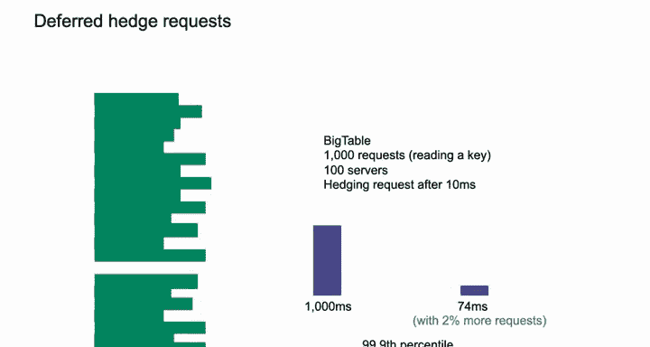

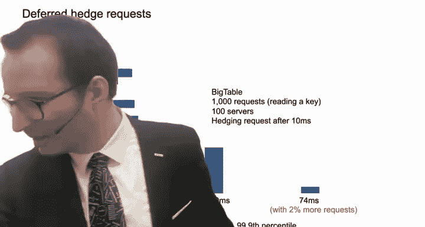

---
**核心概念公式总结**：
*   总核心数：`节点数 × 每节点核心数`
*   总内存：`节点数 × 每节点内存`
*   尾部延迟发生概率：`P(至少一个慢任务) = 1 - (1 - p)^n`
    *   `p`: 单个任务执行过慢的概率
    *   `n`: 并行任务总数（或节点数）