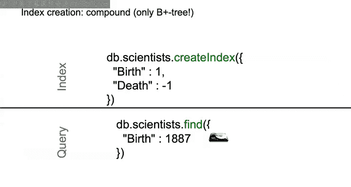
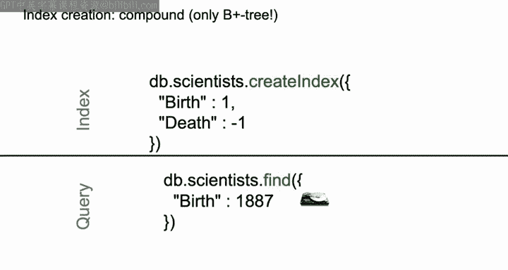
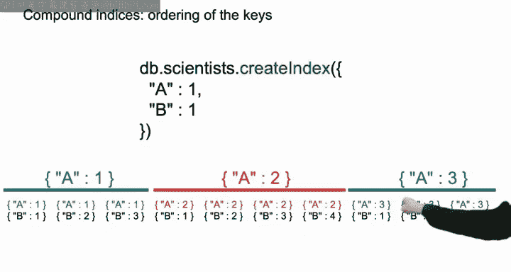
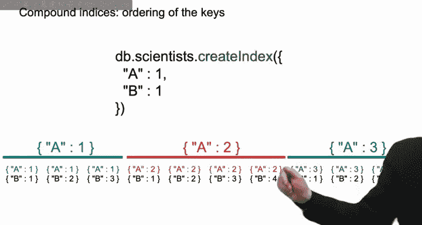
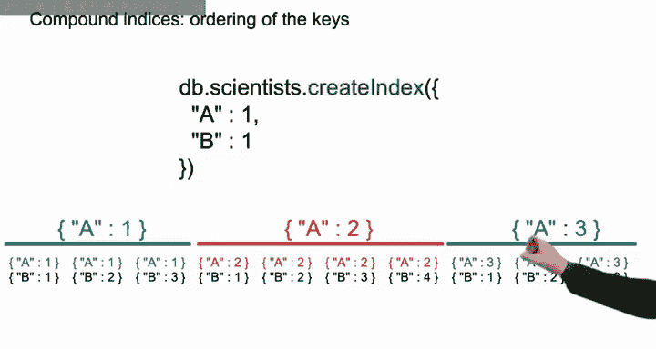
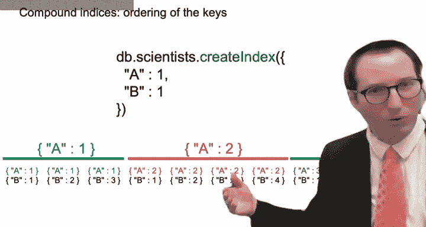
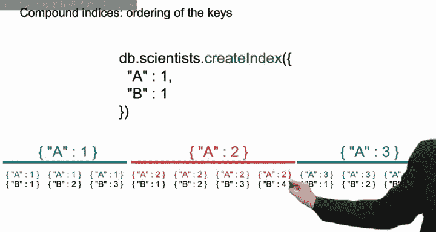
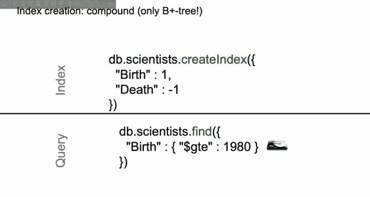
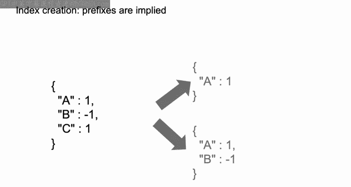
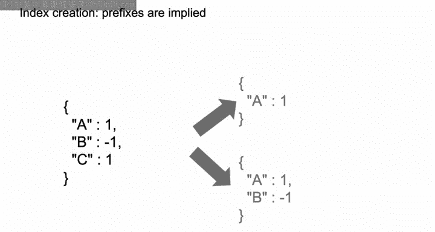

# 38：文档存储（4/4）📄

在本节课中，我们将学习文档存储系统（如MongoDB）的物理存储机制、复合索引的工作原理及其在实际应用中的最佳实践。我们将重点关注索引如何提升查询性能，以及如何根据查询模式高效地设计索引。

---

上一节我们介绍了文档存储的基本概念和API。本节中，我们来看看文档在物理层面是如何存储的。


在开始之前，我有一个问题：像MongoDB这样的文档存储系统，是如何在物理层面存储文档的？


以下是几个可能的选项：
1.  文本文件。JSON行文件，因为集合就是JSON对象的集合。
2.  MongoDB查询会自动转换为针对数据湖的MapReduce或Spark查询。
3.  一种称为BSON的优化二进制格式，存储在本地硬盘上。JSON类型和数组对象被高效存储，基本原子类型也是。
4.  文本文件JSON存储在本地磁盘上，通过一种称为即时解析的高效技术或众包方式动态解析。
5.  在南极洲有一个文档中心，文档被整齐地分类存放在架子上。

当然，最后一个选项是开玩笑的。这是“邓宁-克鲁格效应”。




事实上，大多数人的选择是第三种：优化二进制格式。这正是MongoDB的实现方式。


我想强调的是，从数据独立性的角度来看，只要系统对外暴露的是文档集合和查询语言，前四个答案实际上都是可行的。如果你上过信息检索课程，就会知道我在南极确实有很多对概率计算非常有用的服务器。


---

现在，让我们回到幻灯片内容。

我们几乎要讲完了。这是我上次留下的内容，我们有一个索引。大家还记得这是一个哈希索引还是树索引吗？



如果我用这种方式创建索引，大家认为是什么？
```javascript
db.collection.createIndex({ birth: 1, death: -1 })
```
是树索引，没错。这里的`1`和`-1`分别代表升序和降序。否则，它就会是字符串哈希索引。所以，这确实是一个树索引。

更准确地说，这是一个基于由多个相邻字段（`birth`和`death`）组成的复合键的树索引，我们使用了字典序。




这在一定程度上与JSON模型有些冲突，因为在JSON对象中，`birth`和`death`这两个键之间本应没有顺序。然而，正如我之前所说，这是模型的一个“泄漏”。在MongoDB的API中，实际上存在一个顺序，API会先看第一个键，再看第二个。



也许你们中有些人会疑惑，为什么下面的查询仍然有效，即使查询条件与索引的键不完全相同。我为此制作了一张新幻灯片来解释原因。


---









因为当你创建一个基于复合键（比如按顺序排列的A和B）的索引时，想象一下集合中所有不同的复合键都被放入索引中。创建这样的索引基本上意味着先按A排序，再按B排序。所以你会有所有A1的记录，然后在A1内部按B排序，接着是所有A2的记录，在A2内部按B排序，以此类推。这被称为字典序。

关键在于，因为我们这里有一个顺序，并且A排在前面，所以所有A1的记录在一起，所有A2的记录在一起，所有A3的记录在一起。这就是为什么如果你使用这个索引并专门查找A2，它们全都在这里。所以，A2实际上是一个范围，介于`(A2, B1)`和`(A2, B4)`之间。现在大家明白了吗？




好的，这就是为什么如果我只查询索引的一个前缀（比如只查询A），它仍然有效。所以下面的查询也有效，因为它本质上是对A的一个范围查询。

但是，如果像下面这样只查询第二个键B，它就不起作用。要理解为什么不起作用，你需要看到，当我查询索引的第二个键时，这些B值并没有聚集在一起。如果你查找B1，它们会分散在所有不同的A值中，这效率非常低，无法有效利用索引。

所以，它只在查询A时有效。更一般地说，你应该记住的核心要点是：




**当你基于复合键创建树索引时，就相当于你也拥有了基于该复合键所有前缀的索引。**

例如，如果你有一个基于`(A, B, C)`的索引，就相当于你拥有了基于`(A)`的索引和基于`(A, B)`的索引。只是需要注意，你不能改变`1`和`-1`所定义的排序方向。但基本思想就是这样。

这在实践中很重要，因为人们常犯一个错误。为了给你一些背景，现实中当你使用MongoDB时，你会向其中存储数据，可能是TB甚至PB级别。通常，人们不会仅仅通过连接到一个JavaScript shell并发出查询来操作数据。首先，你看到了API有多复杂。实际上，API是在计算机程序中被调用的。例如，你有一个网站，用户通过互联网访问，网站后端使用Node.js或Python等语言编写，所有对MongoDB的请求实际上都是由程序自动发出的，以处理那个API。

这意味着，根据你编写的网站，到达MongoDB的查询通常遵循特定的模式，这取决于你的网站。例如，如果你有一个电商网站，查询模式可能是很多用户搜索产品并分页浏览。因此，当你设置数据库系统时，未来的工程师（也就是你们）需要坐下来思考：为了让网站正常运行，我们需要创建哪些索引？

这意味着你必须弄清楚由你为网站编写的计算机程序通常运行哪些查询，并相应地设置索引。这是一门科学和艺术。你需要理解模式，需要合理数量的索引。你不能只是创建100个索引，首先是因为这会占用空间，硬盘空间不是无限的；其次，理想情况下，你希望索引能放入机器的主内存中，这样效率更高，因为你可以直接跟随内存指针在索引中查找。因此，你不能创建太多索引。

很多人犯的一个错误是，他们会创建一个基于`(A, B, C)`的索引，同时还会创建一个基于`(A, B)`的索引。这是一个错误，是资源浪费。如果你理解了我刚才展示的内容，就会知道如果你创建了基于`(A, B, C)`的索引，你就免费获得了基于`(A, B)`的索引。这样你就可以节省内存和资源，甚至不需要单独创建基于`(A, B)`的索引。

具体如何操作取决于你的网站，取决于你将使用Node.js或Python代码来发出查询，你必须找出能让查询变快的索引。

---

那么，我们来总结一下。使用像MongoDB这样的文档存储，我们得到了什么？

现在，如果你有TB或PB级别的数据，一次查询、一次查找可以在2毫秒内完成。只需2毫秒，你就可以通过索引（如果是哈希索引则更快）查找到数据。这就是它的魔力，是我们在MapReduce时代所没有的。因为之前我们在数据湖范式下使用MapReduce，必须进行并行全表扫描，虽然也是扫描，但所需时间远远超过2毫秒。这就是使用文档存储（通过ETL将数据放入其中）的好处。

MongoDB的缺点是它有一个API，但没有查询语言。这就是为什么下一讲是关于查询语言的。有了查询语言，你就不必再担心这些奇怪的API和任意约定，你可以像使用SQL一样在更高层次上思考，只不过它不是用于表，而是用于树状结构。

---

有任何问题吗？我看到你有问题。

是的，如果我们创建了像`(A, B, C, D)`这样的索引，我们是否也能免费获得`(A, B, C)`的索引？那我们是否能获得像`(A, C)`这样的索引呢？这是如何工作的？

**只有前缀有效。** 如果你创建了基于`(A, B, C, D)`的索引，你会免费获得基于`(A)`、`(A, B)`和`(A, B, C)`的索引。

你不能免费获得`(A, C)`索引的原因是，如果你查找A和C，会遇到和之前类似但更复杂的问题。因为如果你查找A和C，结果会分散在不同的B值中，又回到了同样的问题。明白了吗？




这就是为什么我使用“前缀”这个词。它必须是`(A, B, C)`意义上的前缀，即仅仅是A，或者A和B。

好的，那我们继续下一部分。

---


本节课中，我们一起学习了文档存储的物理存储原理，深入探讨了复合索引的字典序特性及其前缀查询的高效性。我们了解到，合理设计索引是平衡查询性能与存储资源的关键，并强调了在实际应用中根据查询模式创建索引的重要性。下一讲，我们将进入更高级的查询语言世界。