# 大数据课程 P39：查询树结构 (1/4) 🌳


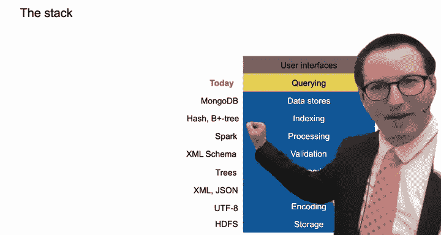

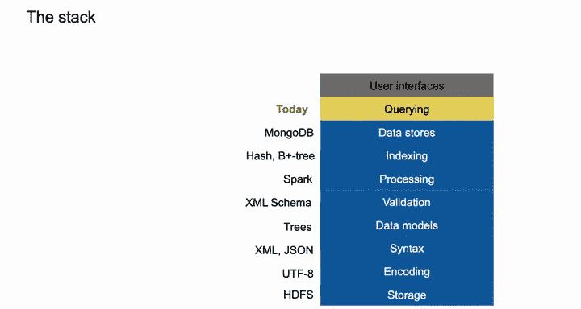

在本节课中，我们将学习如何查询树形结构数据，这是大数据处理中的一个重要主题。我们将回顾本学期学到的许多概念，并引入一种专门为处理嵌套和异构数据（如JSON）而设计的查询语言——JSONiq。

---

## 数据独立性的回顾

上一节我们介绍了数据处理的整体架构。本节中，我们来看看数据独立性这一核心原则。

数据独立性是由Ed Codd在1970年提出的原则。其核心思想是：用户应该只处理易于理解的数据模型（例如具有行和列的表、树的集合），并使用为该数据模型设计的查询语言。至于查询如何物理执行，则无关紧要。

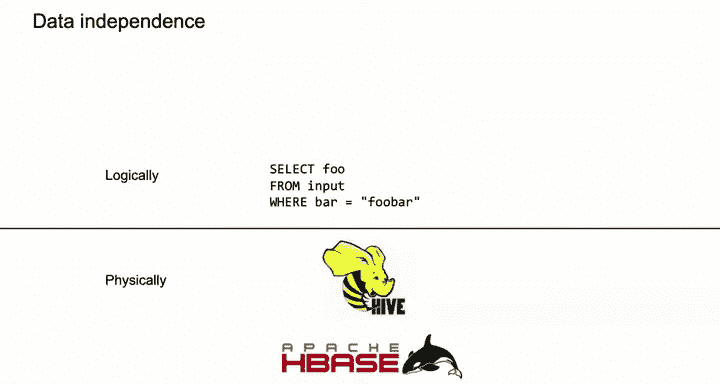

例如，用户可以编写一个SQL查询。这个查询可以在PostgreSQL数据库上执行，也可以在HBase上通过Hive执行，甚至可以通过Spark SQL执行。关键在于，**语言是相同的**，这就是数据独立性的美妙之处：你可以切换底层实现，而无需改变上层的查询逻辑。

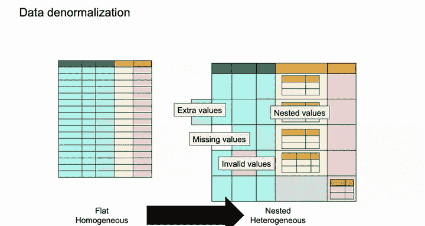

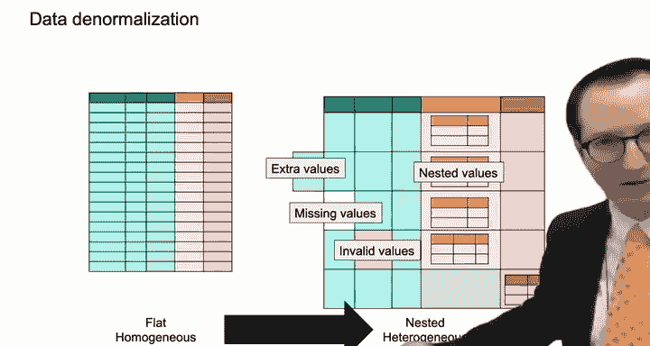

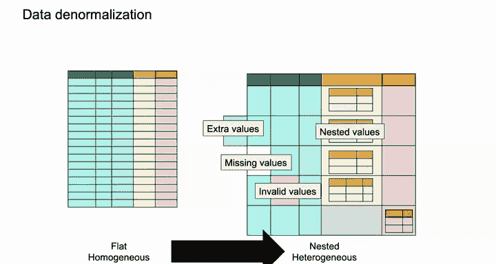

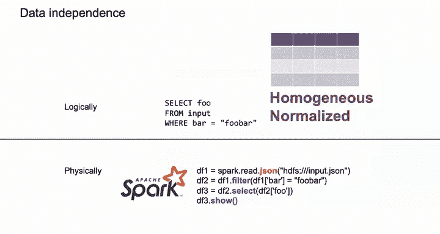

关于索引选择，存在一个优化权衡。创建索引（例如在字段`A`和`B`上）会占用额外的存储空间和维护成本。因此，决策取决于资源约束和实际需求：
*   如果查询只需要字段`A`，那么只创建在`A`上的索引更节省空间。
*   每次对集合进行插入或更新时，所有索引都需要更新，因此索引越多，写操作越慢。

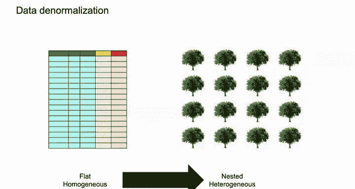

所以，索引策略是在**内存、磁盘空间和读写性能**之间的优化。

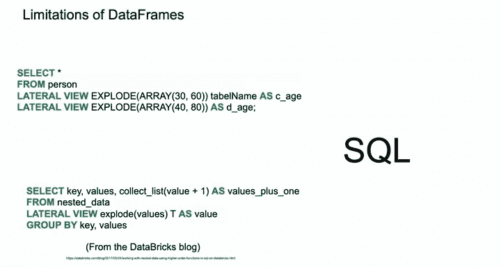

---

## 现实世界数据的挑战：超越扁平表格

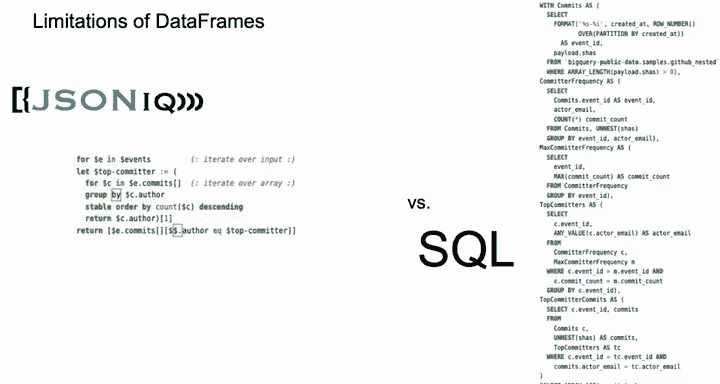

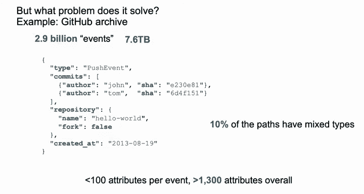

在理想的关系型数据库世界中，数据是扁平且同构的。然而，在大数据场景中，我们常常需要处理数十年来积累的数据，其模式会发生变化，现实数据往往更加复杂。

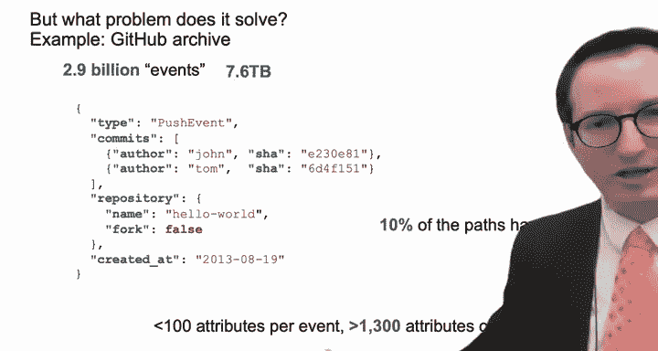

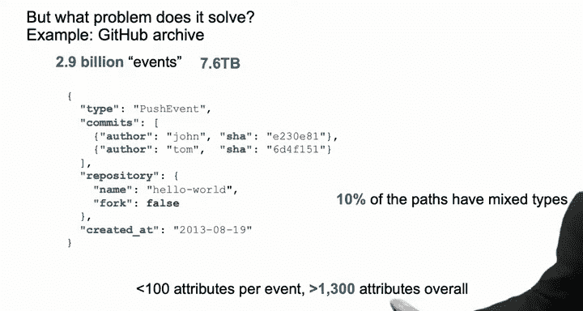

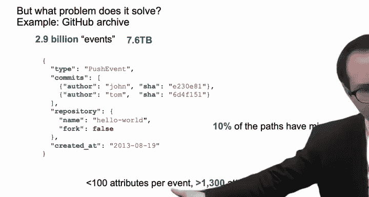

现实数据可能具有以下特征：
*   某些对象有额外字段，而其他对象则缺少字段。
*   存在嵌套结构（表中有表）。
*   同一列中可能包含不同类型的值（异构性）。

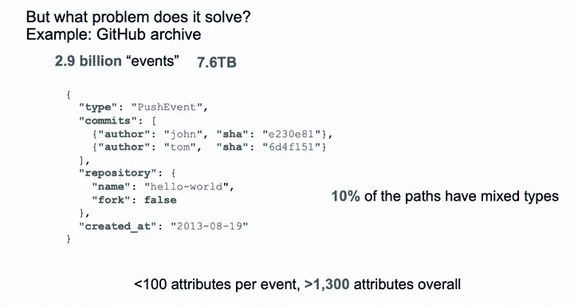

这些复杂性使得传统的SQL处理起来非常困难。虽然可以通过`EXPLODE`、`LATERAL VIEW`等技术处理嵌套，但对于异构数据，SQL显得力不从心，代码会变得复杂且难以维护。

例如，在Spark中使用DataFrame API处理包含对象和字符串混合类型的JSON字段时，Spark会将其统一序列化为字符串类型。这迫使开发者编写额外的Python代码来解析和转换，增加了开发负担。

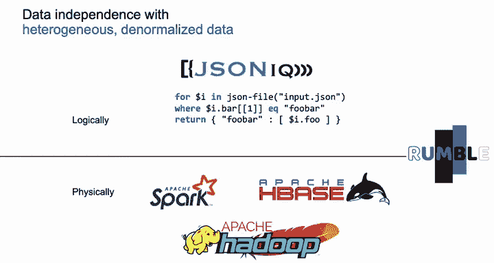


一个更具体的例子是，在GitHub事件数据中，一个简单的查询（如查找每个项目的顶级贡献者）在SQL中可能需要编写非常冗长和复杂的语句，这是因为SQL与嵌套的、半结构化的数据模型之间存在“阻抗失配”。

---

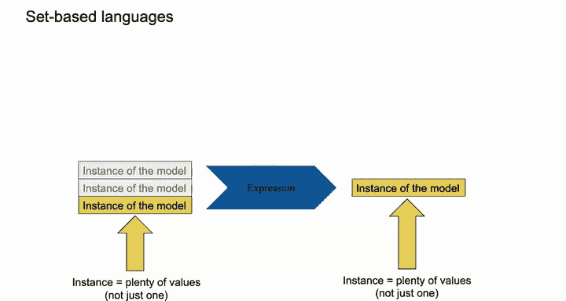

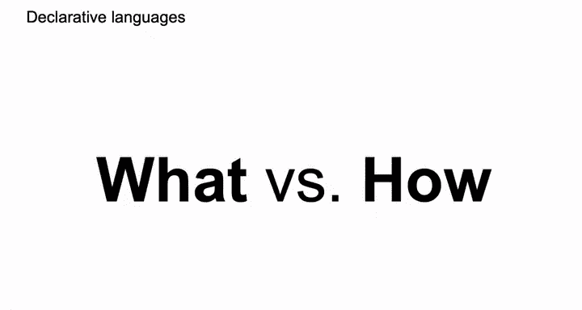

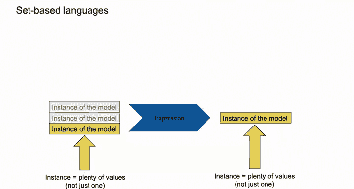

## 引入JSONiq：为嵌套数据设计的查询语言

为了解决上述问题，我们引入了JSONiq。它的理念与SQL类似：它是一种高级查询语言，拥有清晰的数据模型和设计，易于学习和使用，并且可以运行在Spark、HBase、Hadoop等多种引擎上，这得益于数据独立性。

在本课程中，我们将使用一个名为RumbleDB的引擎，它由苏黎世联邦理工学院开发，专为教学和展示JSONiq原理而设计。

JSONiq是一种声明式、函数式和基于集合的语言：
*   **声明式**：你只需描述“想要什么”，而不是“如何一步步获取”。
*   **函数式**：由表达式构成，每个表达式接受输入并产生输出，可以视为数学函数，通常没有副作用。
*   **基于集合**：能够同时操作数十亿条记录或文档，而不是一次处理一个值。

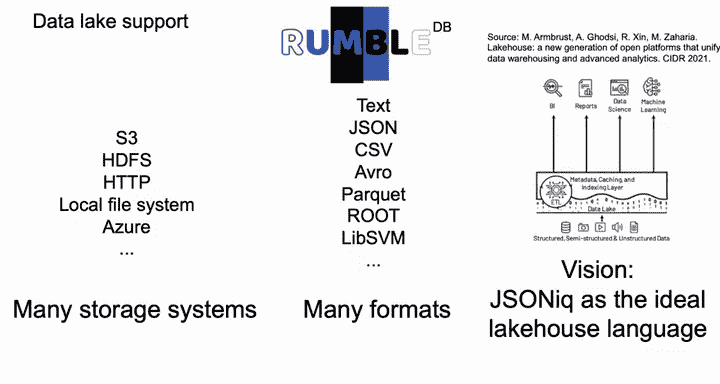

这与SQL的特性是一致的。

可以将JSONiq视为一个乐高游戏。它提供了约37种基础表达式（“乐高颗粒”），你可以以任意方式组合它们来构建复杂的查询。

RumbleDB引擎支持从多种数据源和格式读取数据：
*   **数据源**：S3, HDFS, HTTP, 本地文件系统等。
*   **数据格式**：文本文件、JSON行、CSV、Avro、Parquet等。

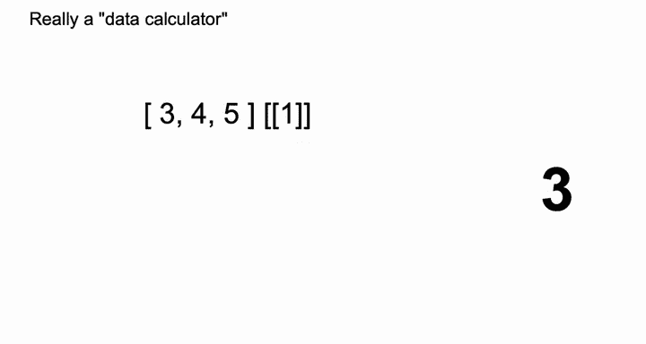


这使得RumbleDB像一个“数据计算器”或瑞士军刀，能够灵活地处理和转换不同来源、不同格式的数据。这种愿景符合“湖仓一体”的概念，即在一个系统中同时支持数据湖的灵活性和数据仓库的高效查询与管理能力。


---

## JSONiq基础：语法初探

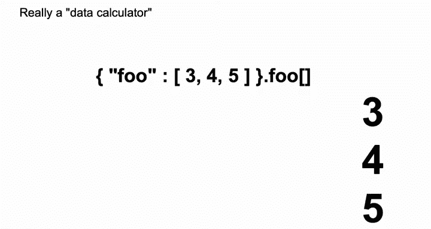

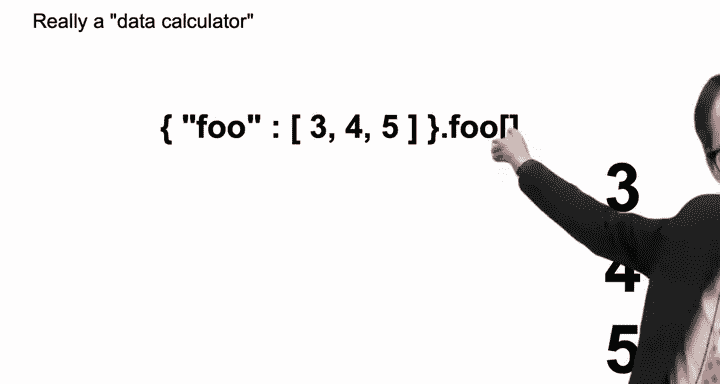

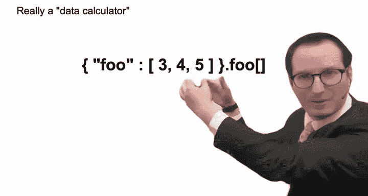

以下是JSONiq的一些基础表达式示例，它们展示了语言的直观性：

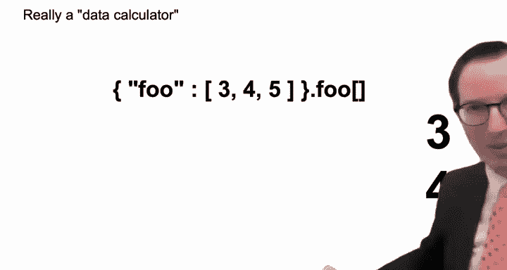

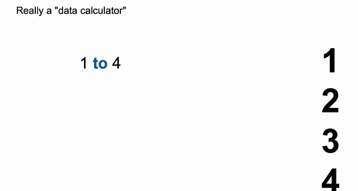

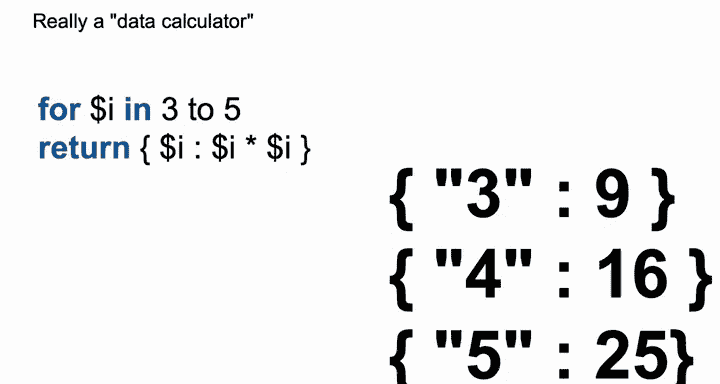


*   **基本运算**：就像计算器一样。
    ```jsoniq
    1 + 1
    ```
    **结果**：`2`

    ```jsoniq
    3 + 2 * 4
    ```
    **结果**：`11`

    ```jsoniq
    2 < 5
    ```
    **结果**：`true`

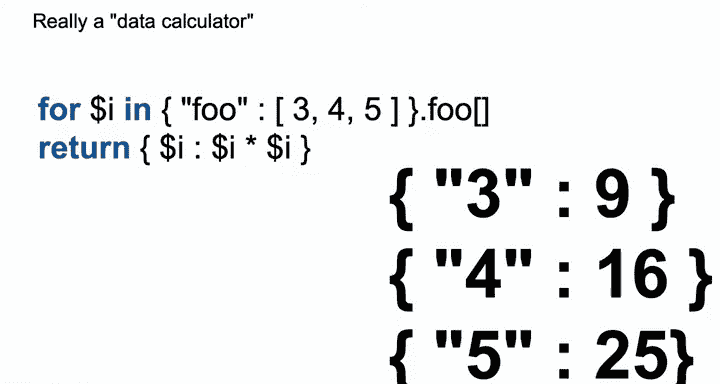

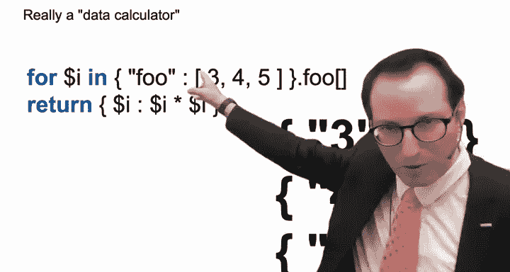

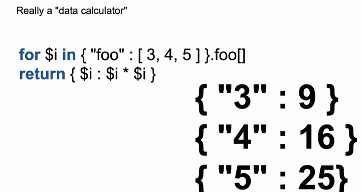

*   **LET表达式（绑定变量）**：以声明式方式绑定变量。
    ```jsoniq
    let $i := 2
    return $i + 1
    ```
    **结果**：`3`


*   **直接使用JSON值**：任何有效的JSON本身就是一个JSONiq查询，会返回自身。
    ```jsoniq
    { "name": "John", "age": 30 }
    ```
    **结果**：`{ "name": "John", "age": 30 }`

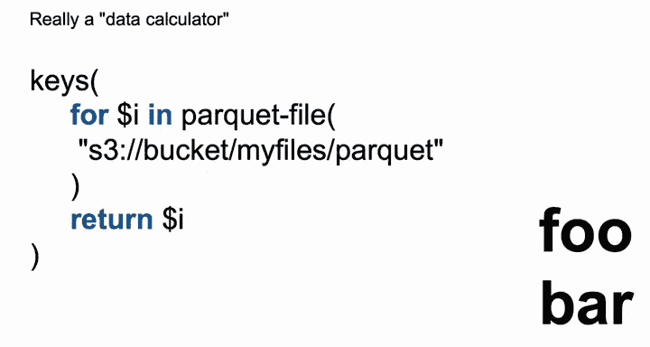

*   **点操作符导航**：访问对象中的字段。
    ```jsoniq
    { "a": { "b": 1 } }.a.b
    ```
    **结果**：`1`


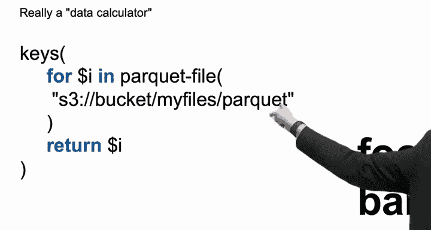


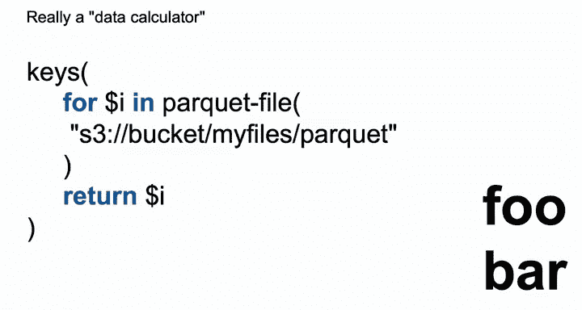


*   **数组查找**：使用双括号`[[ ]]`按索引（从1开始）访问数组元素。
    ```jsoniq
    [10, 20, 30][[1]]
    ```
    **结果**：`10`

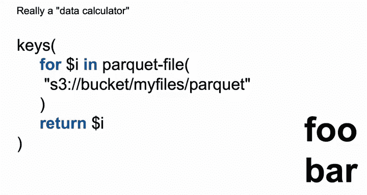

*   **展开数组**：使用单括号`[]`将数组展开为值的序列。
    ```jsoniq
    { "food": [3, 4, 5] }.food[]
    ```
    **结果**：序列 `3, 4, 5`

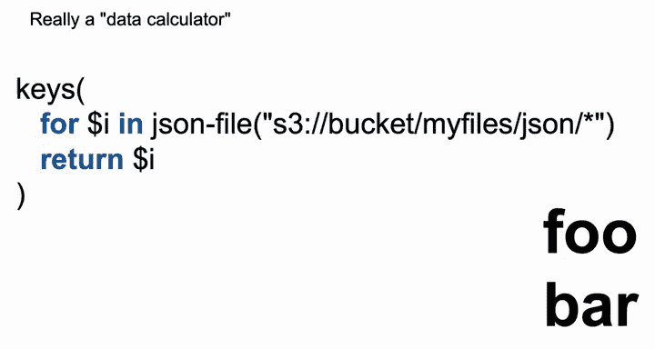

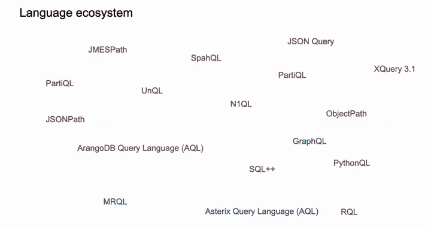

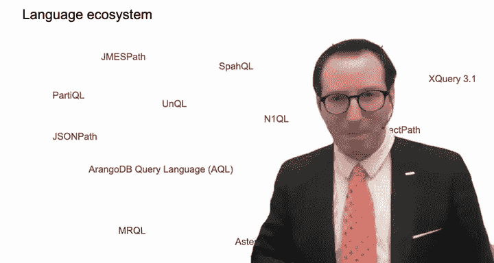

*   **范围表达式**：生成一个数字序列。
    ```jsoniq
    1 to 4
    ```
    **结果**：序列 `1, 2, 3, 4`

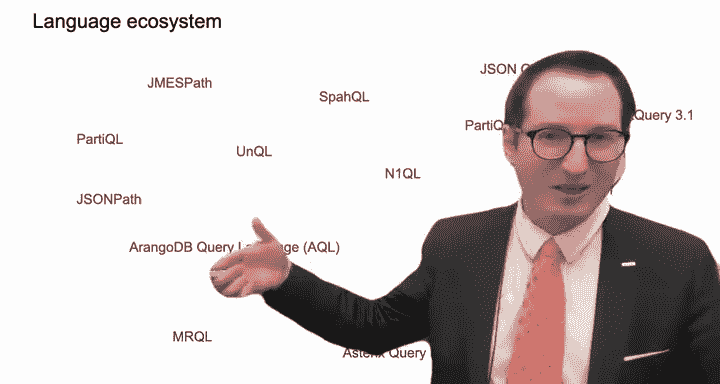

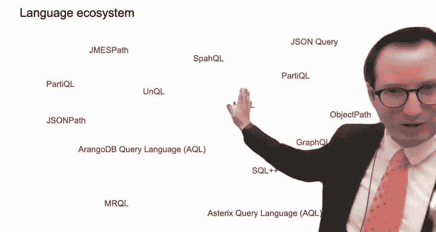

*   **FLOWR表达式**：这是JSONiq的核心，用于迭代和转换序列，类似于SQL的`SELECT-FROM-WHERE`。
    ```jsoniq
    for $i in 3 to 5
    return { "value": $i }
    ```
    **结果**：序列 `{ "value": 3 }, { "value": 4 }, { "value": 5 }`

*   **组合查询**：表达式可以任意嵌套。
    ```jsoniq
    keys(
      for $item in { "foo": [ { "who": 1 }, { "bar": 2 } ] }.foo[]
      return $item
    )
    ```
    **结果**：序列 `"who", "bar"` （获取所有对象的键）

*   **读取外部数据**：查询可以指向外部数据文件。
    ```jsoniq
    keys( json-file("s3://mybucket/data.json") )
    ```
    **结果**：返回该JSON文件中所有对象的键。

**数据独立性的优势体现**：同样的`keys()`查询，针对JSON文件和Parquet文件，虽然语法相同，但性能可能天差地别。对于Parquet这种列式存储格式，引擎可能只需要读取文件头部的元数据（schema）就能获知所有键，而无需扫描整个文件数据，这使得查询几乎可以瞬间完成。

---

## JSONiq的起源与设计哲学

JSONiq并非凭空出现，它源于更早的XML查询语言标准——XQuery。随着JSON的流行，基于XQuery的设计理念和成熟基础，将其数据模型中的XML节点替换为JSON对象和数组，从而诞生了JSONiq。这种“站在巨人肩膀上”的设计哲学是一个重要经验：在制定新标准或API时，应尽可能复用已有的、经过验证的设计，以减少任意性并促进互操作性。

例如，数组索引从1开始而不是0，这个决定就直接继承了XQuery标准。虽然对于计算机科学家来说从0开始更自然，但标准化的首要目标是达成广泛共识，而非追求局部最优。

目前，针对JSON的查询语言众多，未来可能需要一个类似SQL那样的统一标准。但无论哪种语言胜出，只要掌握了JSONiq的核心思想（声明式、函数式、基于序列），学习其他类似语言都会非常容易。例如，后来出现的Google SQL的Pipes语法，就与JSONiq的FLOWR表达式思想高度相似。

---


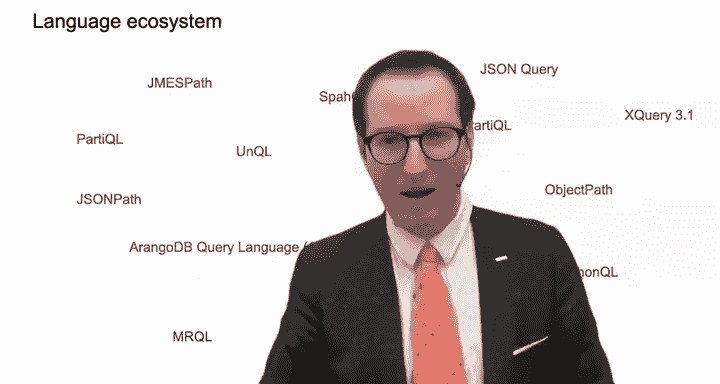

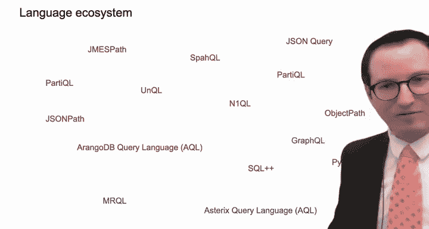

## JSONiq数据模型的核心：万物皆序列

在深入细节前，理解JSONiq的数据模型至关重要。其核心理念是：**一切都是项目（Item）的序列（Sequence）**。

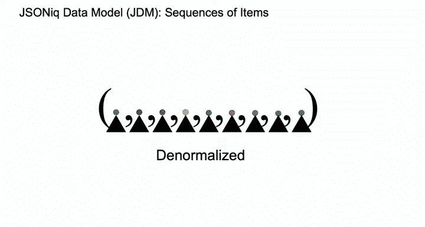

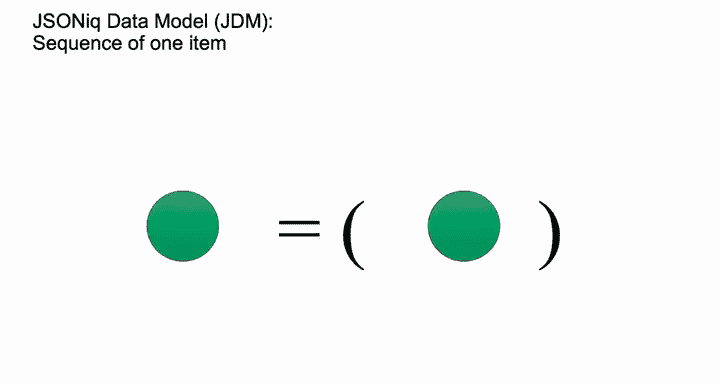

*   **项目**：可以是六种JSON基本类型中的任何一种（对象、数组、字符串、数字、布尔值、null），在JSONiq中它们都被称为“原子值”，此外对象和数组也是项目。
*   **序列**：是项目的**平坦的、有序的**集合。序列可以包含零个、一个或多个项目。
*   **异构性**：一个序列中的项目可以是不同类型的，例如：`(1, "hello", { "a": 2 }, [3, 4])` 是一个有效的序列。
*   **单项目序列等价于该项目**：项目 `1` 和序列 `(1)` 在大多数上下文中被视为等同。
*   **空序列**：不包含任何项目的序列，写作 `()`。

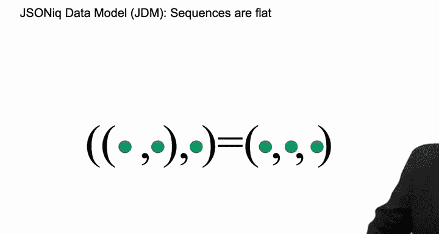

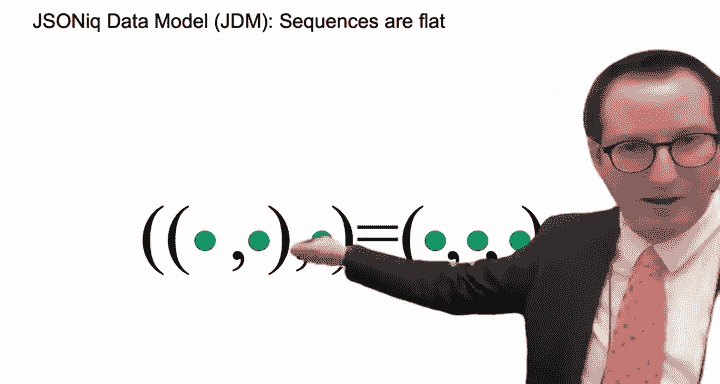

你可以将**序列**类比为Spark中的**RDD**，它代表了一个可能包含大量、可能异构的数据项的集合。所有JSONiq表达式都接受序列作为输入，并产生新的序列作为输出。

---

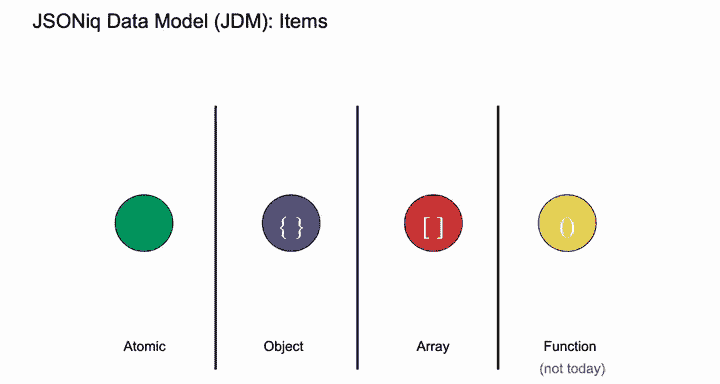

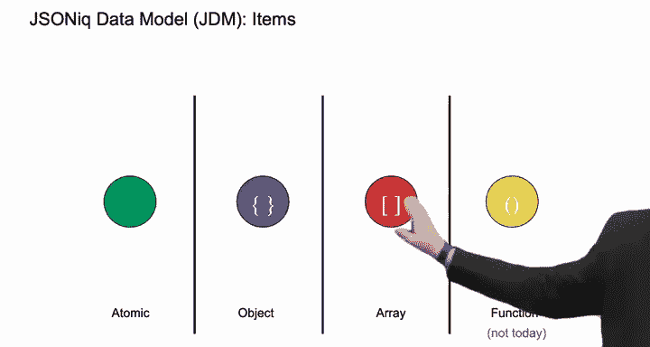

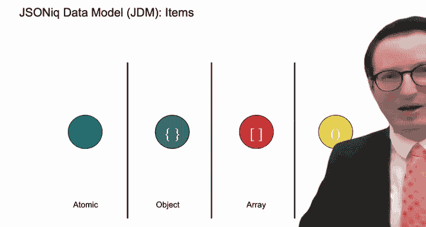


本节课中我们一起学习了查询树形结构数据的动机，认识了传统SQL在处理嵌套异构数据时的局限，并引入了JSONiq这一解决方案。我们探讨了JSONiq的声明式、函数式和基于集合的特性，通过多个例子初步领略了其简洁而强大的语法，并理解了其“万物皆序列”的核心数据模型。下一节课，我们将继续深入探索JSONiq语言的更多细节。