# 41：查询树（3/4）🌳


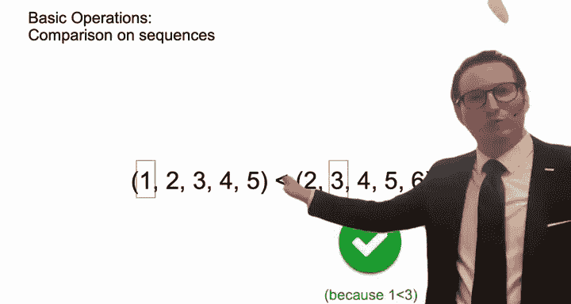

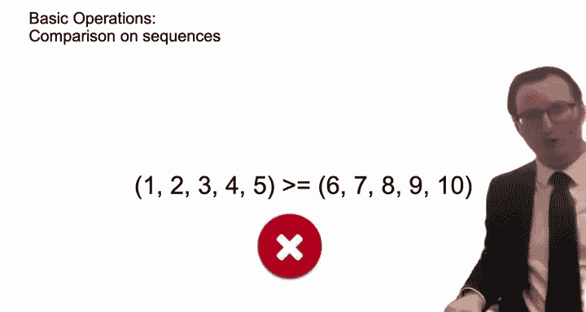

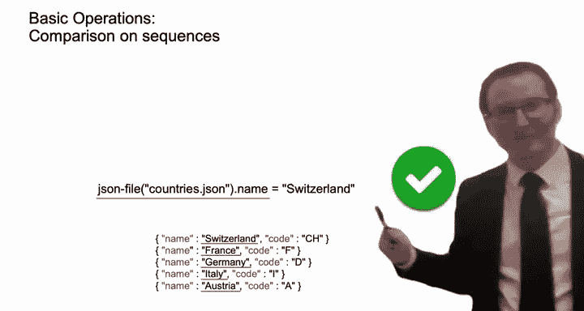


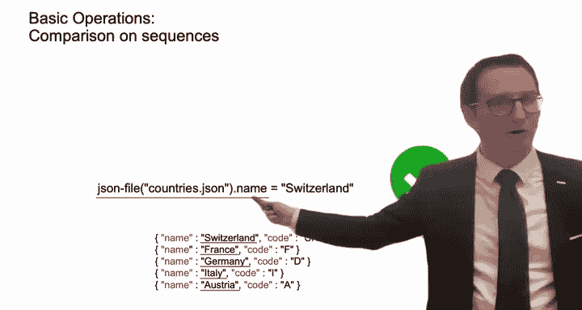

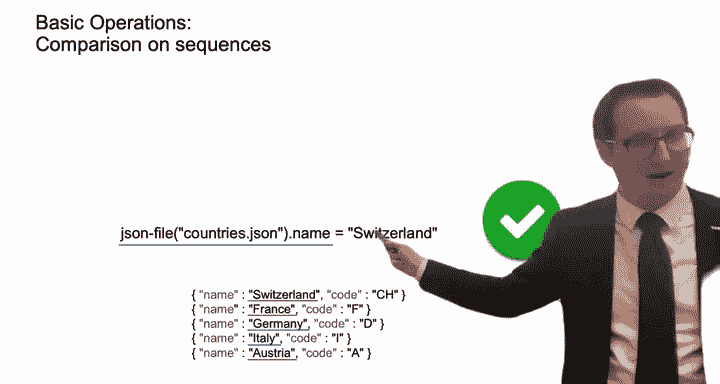

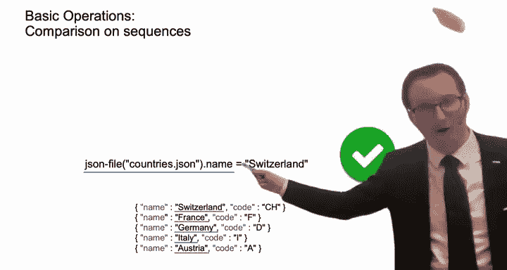

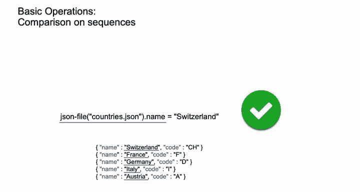


在本节课中，我们将继续学习JSONiq查询语言，深入探讨其表达式组合、逻辑运算、FLWOR表达式以及如何高效地处理异构数据。我们将看到JSONiq如何像搭积木一样组合查询，并理解其背后强大的数据操作能力。


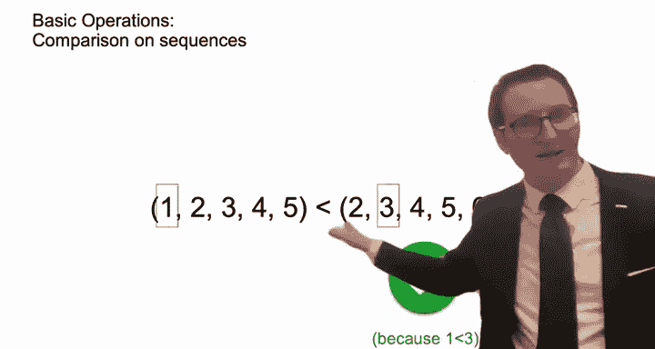

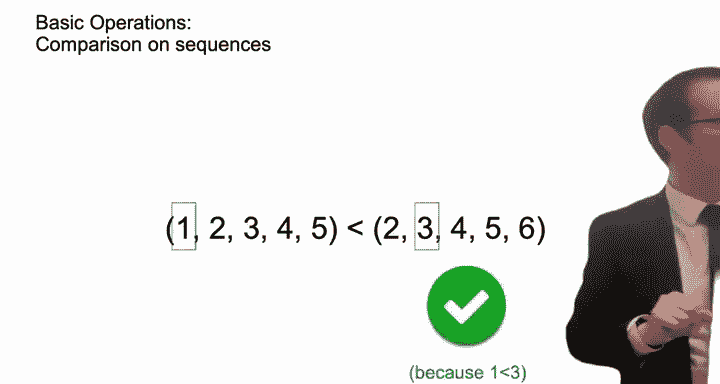


---

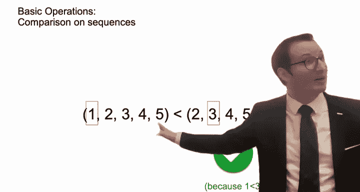

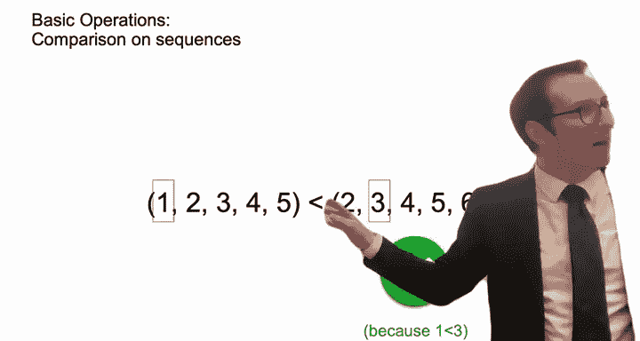

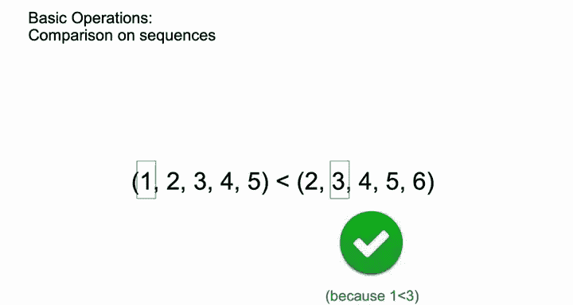

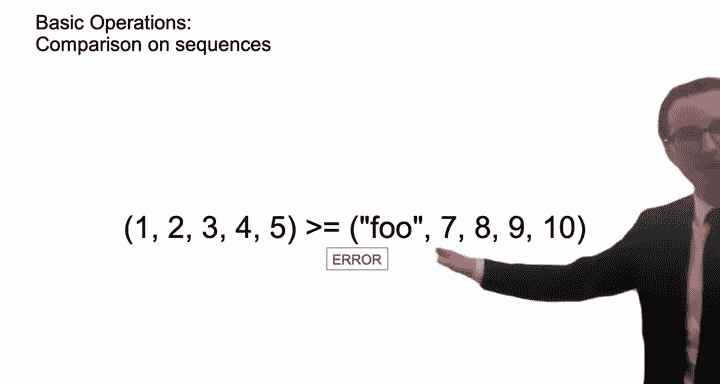

## 表达式组合与逻辑运算

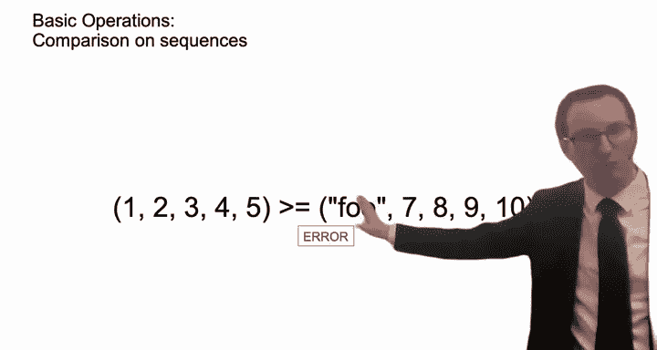

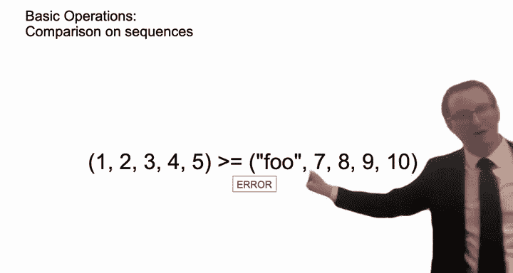

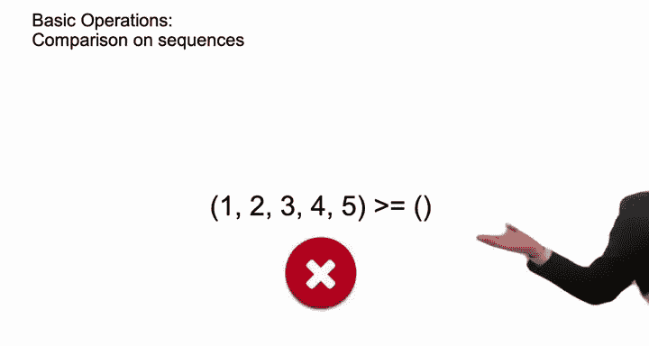

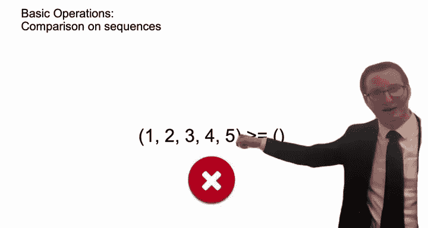

上一节我们介绍了JSONiq的基本表达式。本节中我们来看看如何将这些表达式像乐高积木一样组合起来，并理解其逻辑运算规则。

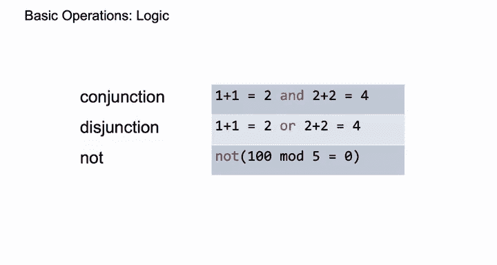


JSONiq允许将任何表达式嵌套到另一个表达式中。例如，一个复杂的查询可以逐步求值。

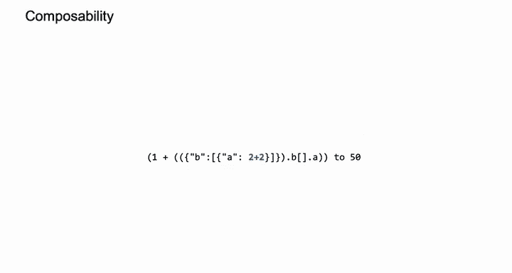

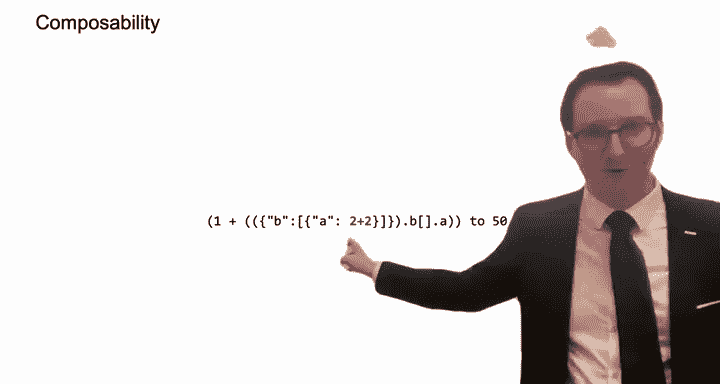

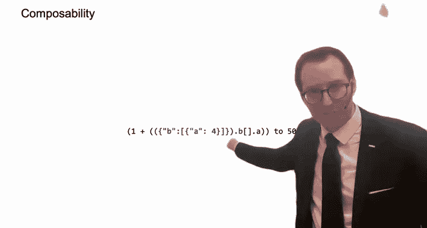


```jsoniq
1 + ([2 + 2].b.a)
```
这个表达式的求值过程如下：
1.  `2 + 2` 得到 `4`。
2.  `[4]` 创建一个包含数字4的数组。
3.  `[4].b` 尝试从数组中提取键`b`，但数组没有键，此操作返回空序列。
4.  `([4].b).a` 从空序列中提取键`a`，仍然返回空序列。
5.  `1 + (空序列)` 在JSONiq中，空序列在算术运算中通常被视为0（或根据上下文返回错误），但更常见的是，这种导航链会因为路径不存在而返回空序列，导致最终结果为空或错误。原例旨在说明组合性，实际路径需有效。

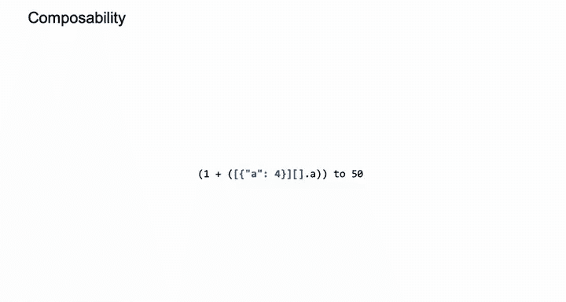

更实用的例子是动态构建数据：
```jsoniq
{ "key": 6, "value": [ 1 to 10 ] }
```
这里，键`"value"`对应的值是通过表达式`[ 1 to 10 ]`动态计算生成的数组。

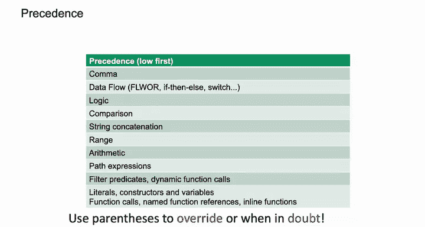

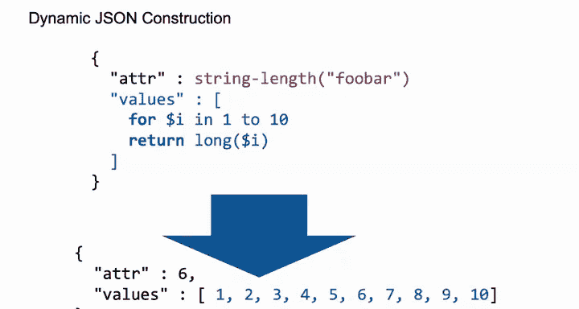


### 逻辑与比较运算的便捷性


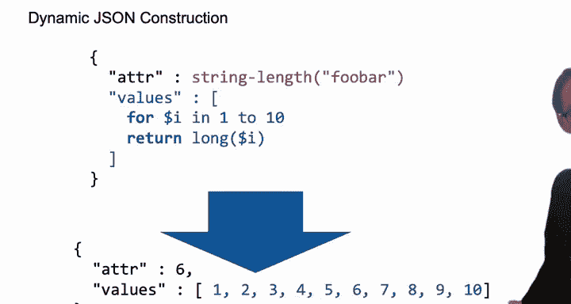


JSONiq为比较运算设计了一个便捷特性：当比较运算符（如`=`， `!=`， `<`， `>`等）的一边是单值，另一边是序列时，它的含义是“存在至少一个序列中的元素满足该比较关系”。这是一种存在量词的简写。

例如，假设 `adjacent_objects.name` 是一个包含数百万字符串的序列：
```jsoniq
adjacent_objects.name = "Switzerland"
```
这条查询的含义是：检查序列中**是否存在至少一个**名字等于“Switzerland”。如果存在，则返回 `true`。这相当于一个存在量词（∃）查询，使得代码非常简洁。

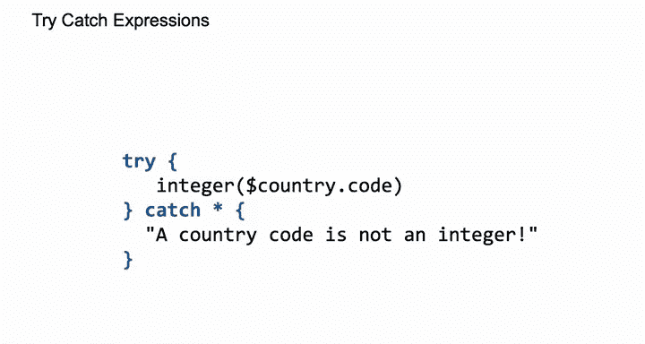

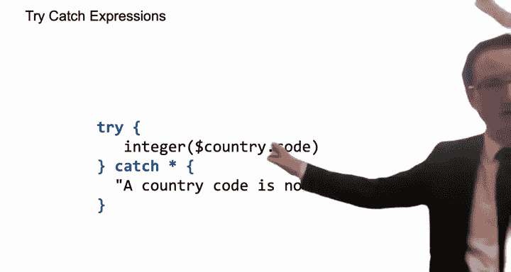


**公式**：`sequence = value` 等价于 `∃ x ∈ sequence (x = value)`

这个设计的优势在于支持**惰性求值**。系统在遍历序列时，一旦找到第一个匹配项，就可以立即返回 `true` 并停止计算，无需检查剩余的亿万条数据，这极大地提升了查询效率。

反之，其否定形式“不存在任何元素满足条件”则等价于全称量词的否定。

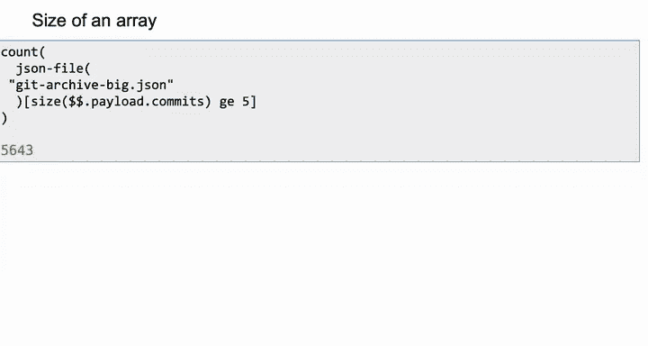


**公式**：`not(sequence = value)` 等价于 `∀ x ∈ sequence (x ≠ value)`

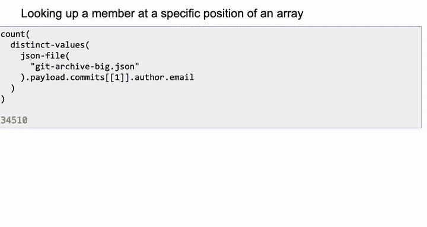


对于空序列，存在量词查询总是返回 `false`，因为空集中不存在任何元素。


### 逻辑运算符

JSONiq支持标准的逻辑运算符：`and`, `or`, `not`。
*   它们遵循短路求值原则。
*   与一些语言类似，JSONiq对非布尔值有灵活的“真值”判断：
    *   数字 `0` 视为 `false`，非零数字视为 `true`。
    *   空字符串 `""` 视为 `false`，非空字符串视为 `true`。

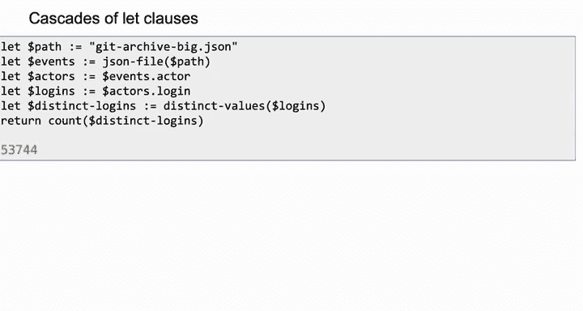

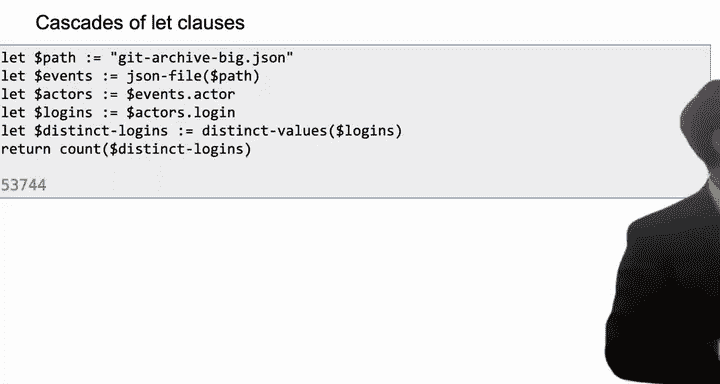

### 运算符优先级

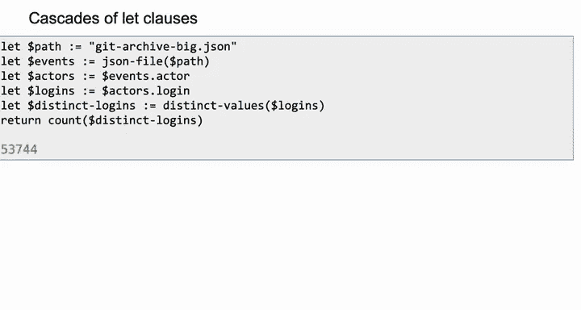

与算术运算一样，JSONiq的表达式有优先级。例如，乘法优先级高于加法。如果无法记住优先级，最安全的方法是使用括号`()`来明确指定运算顺序。

---

## 控制流表达式

为了构建更复杂的逻辑，JSONiq提供了多种控制流表达式，它们也是“乐高积木”的一部分。

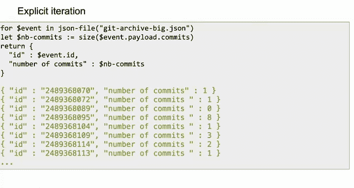

以下是几种核心的控制流结构：

*   **条件表达式 (`if-then-else`)**：根据条件返回不同的值。
    ```jsoniq
    if ($x > 10) then "large" else "small"
    ```
*   **Switch表达式**：基于一个值匹配多个条件，返回第一个匹配的分支结果。它比嵌套的`if-then-else`更清晰。
    ```jsoniq
    switch ($type)
      case "A" return "Type A"
      case "B" return "Type B"
      default return "Unknown"
    ```
*   **Try-Catch表达式**：以函数式风格捕获动态错误（如除零错误）。如果`try`子句求值产生错误，则返回`catch`子句的结果。
    ```jsoniq
    try { 10 div 0 } catch { "Error occurred" }
    ```

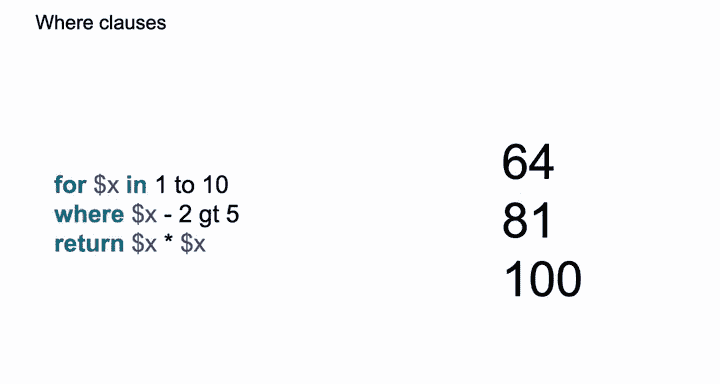


---

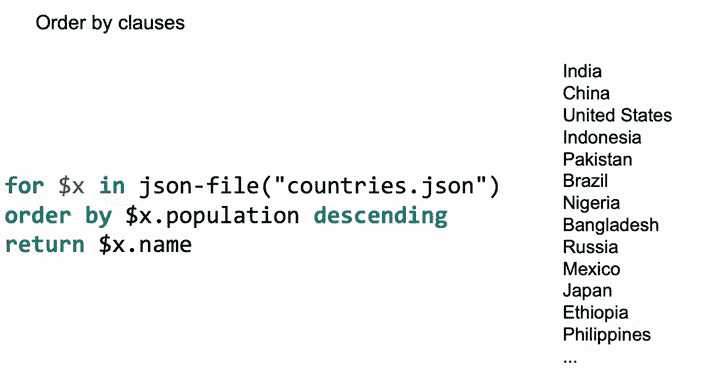

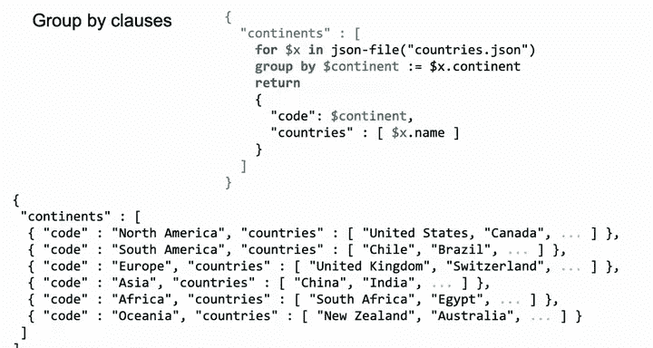

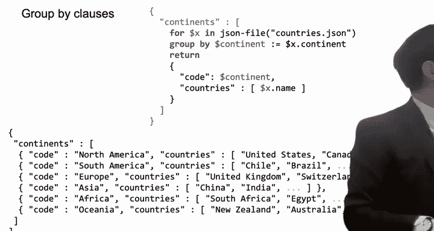

## FLWOR表达式：强大的查询核心

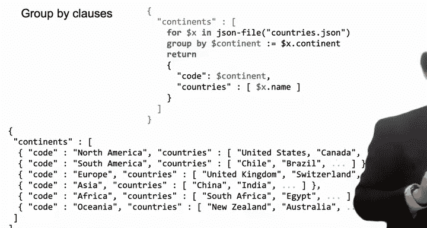

FLWOR（读作“flower”）表达式是JSONiq进行复杂数据转换和查询的基石，其功能远超SQL的`SELECT-FROM-WHERE`。

FLWOR表达式由以下子句自由组合构成：
*   **`for`**：迭代一个序列，将变量依次绑定到每个元素。
*   **`let`**：将变量绑定到一个表达式的结果（可以是序列）。
*   **`where`**：过滤掉不满足条件的变量绑定。
*   **`order by`**：对变量绑定进行排序。
*   **`group by`**：根据指定键对变量绑定进行分组。
*   **`return`**：为每个保留的变量绑定构造一个输出值。

FLWOR表达式必须以`for`或`let`开始，以`return`结束，中间的子句可以**任意顺序、多次出现**，这比SQL固定的子句顺序灵活得多。

### FLWOR表达式示例

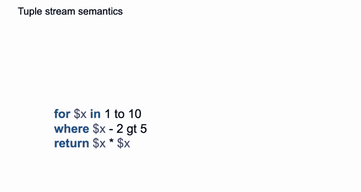


1.  **简单迭代与映射**：将数字序列映射为其平方。
    ```jsoniq
    for $x in 1 to 10
    return { "number": $x, "square": $x * $x }
    ```
2.  **使用`where`过滤**：仅保留大于7的数字。
    ```jsoniq
    for $x in 1 to 10
    where $x > 7
    return $x * $x
    ```
3.  **使用`let`绑定**：计算中间值。
    ```jsoniq
    for $x in 1 to 5
    let $y := $x - 2
    return $x * $y
    ```
4.  **使用`group by`分组**：按奇偶性分组并列出数字。
    ```jsoniq
    for $x in 1 to 5
    group by $y := $x mod 2
    return { "group": $y, "numbers": $x }
    ```
    结果会是：`{ "group": 1, "numbers": [1, 3, 5] }` 和 `{ "group": 0, "numbers": [2, 4] }`。注意，分组后`$x`在每组内变成一个序列，这比SQL更灵活。

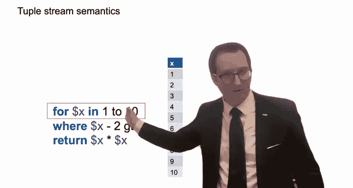


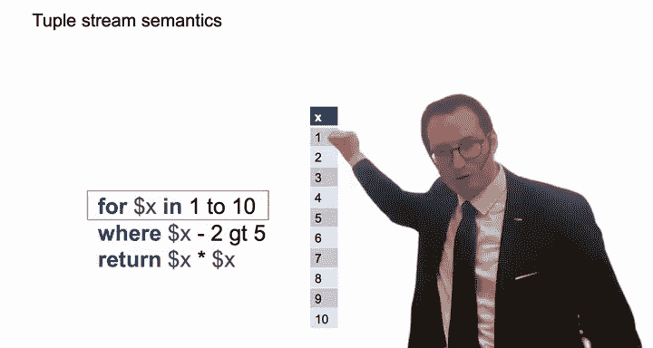

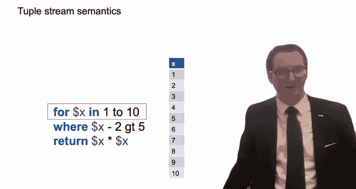

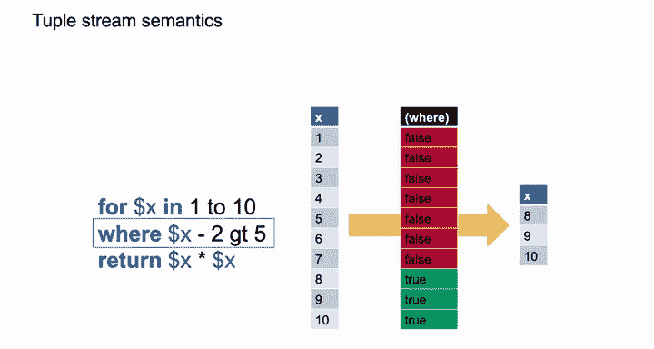

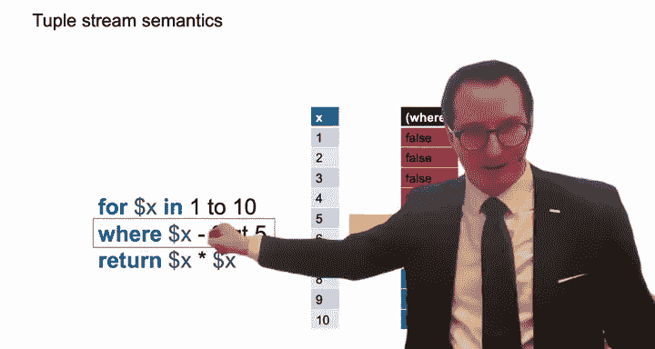


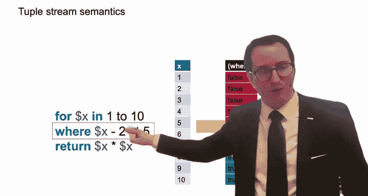

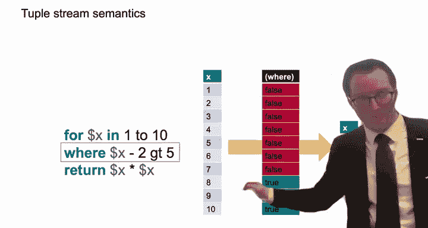

### FLWOR的形式化理解

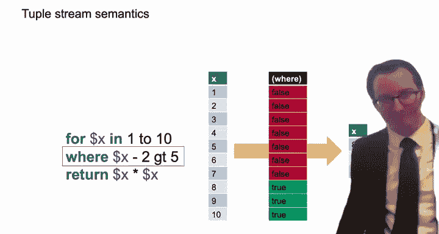

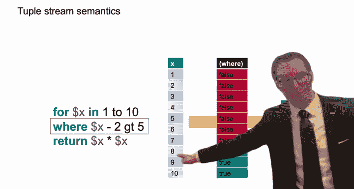

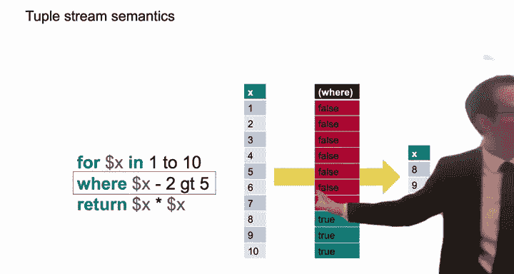

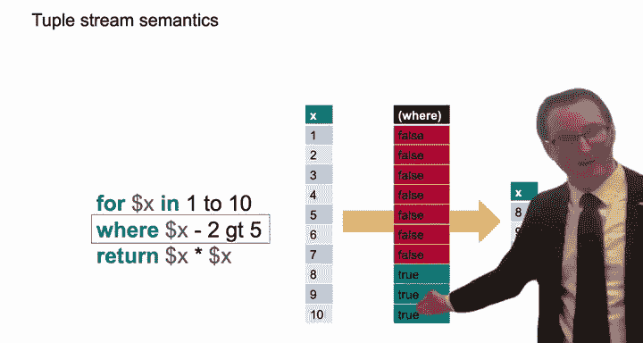


理解FLWOR执行过程的一个有效方法是将其想象为**逐步构建和操作一个数据框**。


考虑以下查询：
```jsoniq
for $x in 1 to 10
where $x - 2 >= 5
return $x * $x
```
其内部执行可以可视化如下：
1.  **`for`子句**：生成初始绑定集，像一张单列表。
    | $x |
    |----|
    | 1  |
    | 2  |
    | ...|
    | 10 |
2.  **`where`子句**：为每一行计算条件`$x - 2 >= 5`，得到一个布尔值数组，并过滤掉`false`的行。
    | $x | 条件 ($x-2>=5) |
    |----|----------------|
    | 8  | true           |
    | 9  | true           |
    | 10 | true           |
3.  **`return`子句**：为剩余每一行计算`$x * $x`并输出。
    | 结果 |
    |------|
    | 64   |
    | 81   |
    | 100  |


虽然用户看不到这个“数据框”，但RumbleDB在内部正是利用类似数据框的抽象，在Spark集群上并行处理数十亿行的绑定，实现了极高的效率和数据独立性。


---


## 在真实数据上应用查询


让我们将所学应用于一个真实的GitHub事件JSON数据集。


以下是几个查询示例：

*   **筛选与统计**：找出`payload.commits`数组长度至少为5的事件数量。
    ```jsoniq
    count(
      json-file("gharchive.json")
      [size(payload.commits) >= 5]
    )
    ```
*   **提取与去重**：获取所有事件中第一个提交者的邮箱，并统计不同的邮箱数。
    ```jsoniq
    count(
      distinct-values(
        json-file("gharchive.json").payload.commits[[1]].author.email
      )
    )
    ```
    这里，`[[1]]`获取每个数组的第一个元素（如果存在）。
*   **使用FLWOR进行转换**：为每个事件创建一个新对象，包含ID和计算出的提交数。
    ```jsoniq
    for $event in json-file("gharchive.json")
    let $num_commits := size($event.payload.commits)
    return { "id": $event.id, "commits": $num_commits }
    ```
*   **模拟关系代数操作**：
    *   **选择 (Selection)**：使用谓词过滤。
        ```jsoniq
        json-file("products.json")[$$.store_id = 1]
        ```
    *   **投影 (Projection)**：使用`project`函数选择特定键，甚至可以动态生成键。
        ```jsoniq
        for $p in json-file("products.json")
        return project($p, ["id", "type"])
        ```
    *   **连接 (Join)**：通过双`for`循环实现笛卡尔积，再用`where`子句定义连接条件。
        ```jsoniq
        for $product in json-file("products.json")
        for $store in json-file("stores.json")
        where $product.store_id eq $store.id
        return { "product_name": $product.name, "store_location": $store.location }
        ```
        尽管这种写法看起来是朴素的嵌套循环，但RumbleDB查询优化器能够识别出这是一个等值连接，并将其转换为高效的分布式连接算法执行，用户无需担心性能问题。


---


## 总结


本节课中我们一起深入学习了JSONiq查询语言的核心部分。我们了解到：
1.  JSONiq表达式具有强大的组合性，可以像搭乐高一样构建复杂查询。
2.  比较运算对序列的支持提供了存在量词查询的便捷写法，并天然支持惰性求值以提升性能。
3.  FLWOR表达式是进行数据转换、过滤、分组和排序的通用且强大的工具，其灵活度超越了传统的SQL。
4.  通过形式化地将FLWOR理解为对变量绑定“数据框”的逐步操作，我们可以清晰地推理任意复杂查询的执行过程。
5.  JSONiq能够以声明式、简洁的语法表达选择、投影、连接等所有关系代数操作，并且系统会在底层进行高效优化，处理从GB到TB乃至PB级别的异构数据。


掌握这些概念后，你就能利用JSONiq和RumbleDB的强大能力，轻松应对大规模、半结构化数据的查询与分析任务。