# 43：图数据库 (1/3) 🧠

在本节课中，我们将要学习图数据库。我们将告别表格和条目，转而探索另一种数据结构——图。我们将了解图数据库的核心概念、数据模型以及它们为何在某些场景下比关系型数据库更高效。

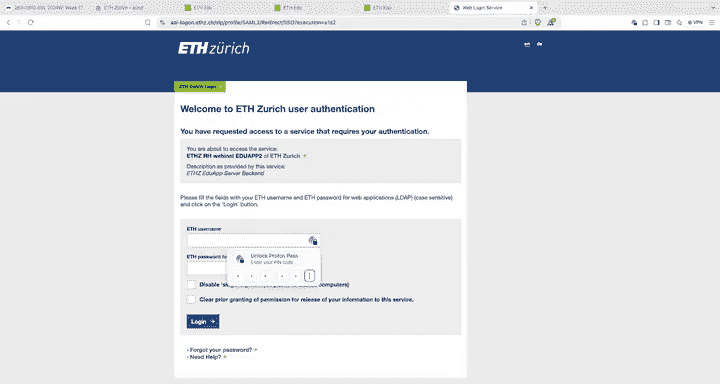

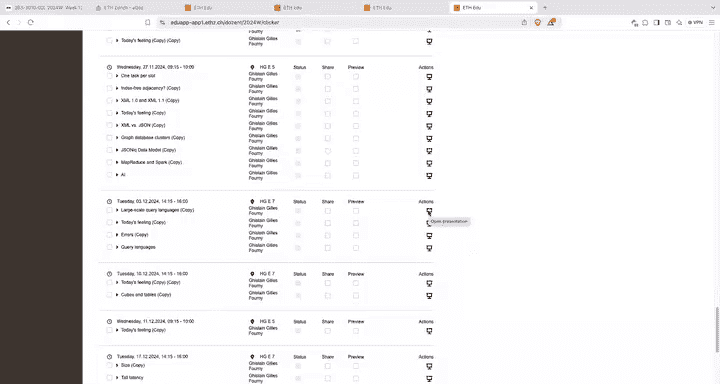

---

## 课程概述

我们整个学期都在讨论表格和条目。今天，我们将暂时停止思考表格条目，转而关注另一种称为“图”的形状。这就是图数据库的精彩世界。

我完全重新设计了这次讲座，并尝试从与去年不同的视角进行讲解。我今天的目标有两个。第一个目标当然是向你们介绍图数据库，以便你们能够使用它们。第二个目标是在整个图数据库讲座中，与我们之前学习的树和表格建立联系。因为我希望你们看到，其原理是相同的：语法、建模语言、数据类型等等。下周我们将讨论数据立方体，这是另一种形状，但同样是数据独立性的相同理念。希望在学期结束时，你们能理解我们所学习的内容，尽管是针对特定技术和特定形状的，但实际上在未来几十年内都是有效的。因为几乎所有可能被发明或添加到组合中的形状都将遵循相同的一般原则。我希望你们在学习SQL和Jsoniq之后，会发现学习今天的语言——称为Cypher——实际上并不那么困难，因为你们会注意到你们已经完成了工作中最难的部分。

---

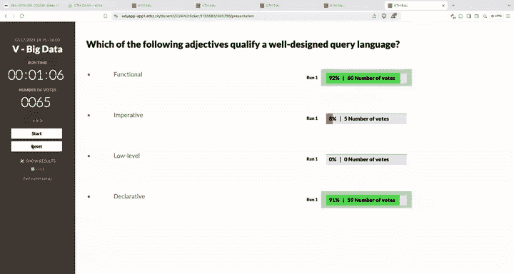

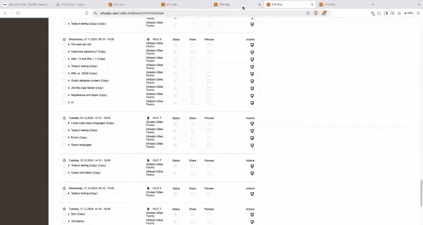

## 为什么需要图数据库？

上一节我们介绍了关系型数据库在处理复杂关系时的局限性，本节中我们来看看为什么需要图数据库。

关系型数据库基本上由表格组成，它被称为“关系型”是因为数学上的关系，表格基本上就是一个关系。但事实上，“关系”也意味着联系。通常，在本科阶段教授关系型数据库时，也会包含实体-关系模型。其思想是，你有表达实体的表格，比如课程、人员、产品等。然后你有将这些表格链接在一起的关系。关系本身也可以是表格。例如，讲师和课程。然后你有一个只有两列的表格，将讲师链接到课程。这就是一个关系。

这一切都有效，整个实体-关系模型之所以有效，是因为我们努力实现高范式，拥有许多各自独立工作的表格。然后你如何将这些表格组合在一起？你**连接**它们。在关系型数据库中，你必须连接所有表格，就像在SQL中使用JOIN子句一样。

问题是，连接操作可能很昂贵。当然，有些人可能会反驳说，连接操作可以在线性时间内完成。是的，等值连接如果使用哈希表，可以在线性时间内完成。但并非所有连接都如此，如果你有更通用的谓词，情况就不总是这样。而且它们在关系处理上效率相当低，因为连接的本质是什么？连接的本质是，例如，你有一个值，你想把它与另一个值关联起来，因为那可能是一个主键，而这是一个指向该主键的外键。所以连接的本质实际上是连接行与行。

但当你想要进行连接时，你实际上需要构建一个更大的表格，将所有表格合并在一起，技术上称为笛卡尔积，然后进行选择谓词，这就是你的连接。即使你可以高效地实现它，因为没有人会通过实际进行笛卡尔积和选择来实现连接。当然，你会使用更好的算法。但尽管如此，这仍然相当低效。你基本上是在用大炮打蚊子。

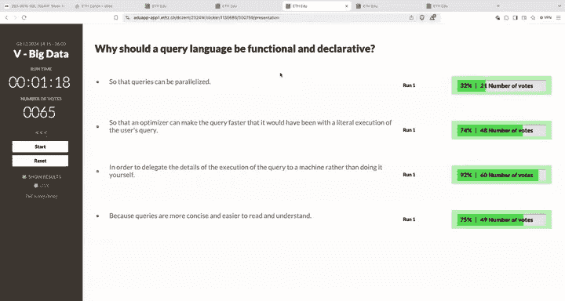

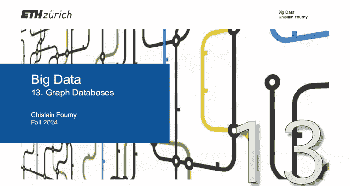

因此，为了处理关系，我们可以做得更好。为此，我们尝试基本上避免连接。

---

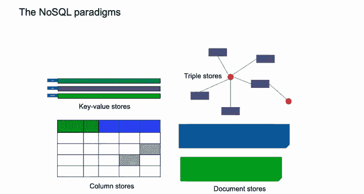

## 为什么规范化/反规范化不够？

上一节我们讨论了连接的效率问题，本节中我们来看看通过反规范化（使用文档存储）是否足够。

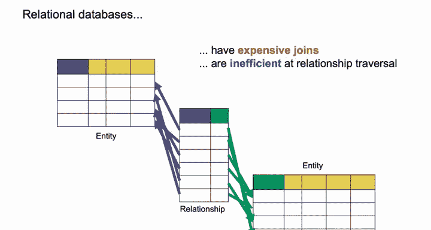

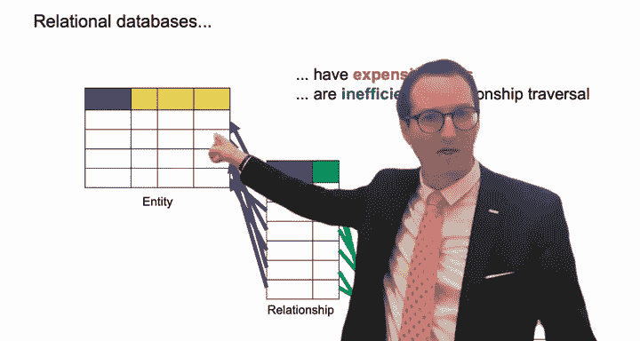

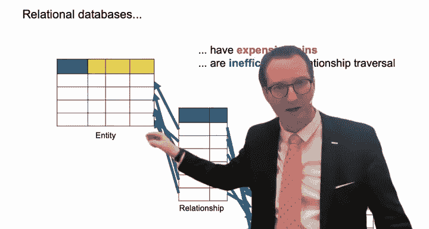

因为连接在关系处理上效率不高。这应该让你想起一些事情，因为这不是我第一次告诉你们我们想避免连接。为了避免连接，我们进行反规范化。然后你可能会想，好吧，我们使用树，因为当你反规范化时，你基本上得到的是树。所以我们可以直接反规范化，然后使用文档存储。问题就解决了，我可以回家了，我的讲座结束了。但事情没那么简单，因为当你反规范化时，反规范化基本上等同于在非常浅的层面上进行连接。但你有不止一种连接方式。所以当你像这样反规范化时，你是以特定方式进行的，因为你预期这是用户实际需要的连接。但实际上，如果你与行业参与者交谈，例如Databricks前几周的讲座，工程师Samuel解释的是，在许多情况下，你当然可以提前预测需要什么样的连接，然后通过反规范化预计算连接，但在某些情况下，你无法提前知道用户将需要什么样的连接，因为连接数据的方式太多了。所以这有其局限性，有时你必须在运行时动态进行，而不是在运行前静态地反规范化表格。我们需要一种动态连接单元格的方法。

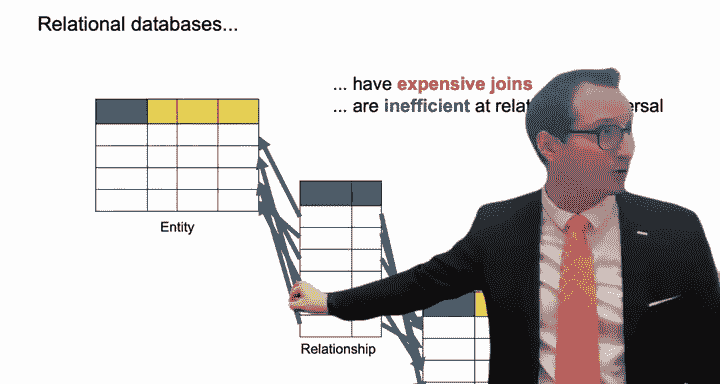

更糟糕的是，在实践中，如果你开始拥有一个包含大量表格的非常大的数据库，你甚至可能遇到在同一查询中需要进行大量连接的使用案例。一个例子是你拿一个家谱，试图找到你的曾曾曾曾曾曾曾曾祖父母。现在，想象一下我们有一个人员表格，亲子关系只是通过自连接来实现。这就是你通常的做法。但如果你想找到你的曾曾曾曾祖父母，那涉及的连接次数就和你“曾”字的数量一样多。所以基本上，如果你试图同时连接这么多表格，性能会更差。试图为一个查询连接许多表格对数据库系统来说实际上是一个相当大的挑战。

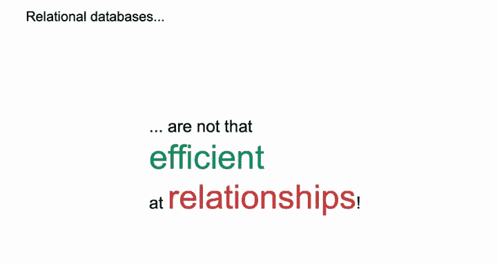

还有更糟糕的情况，因为还有比这更糟糕的。当你进行这样的连接时，通常是因为你有一个外键和一个主键。例如，你有一个指向该主键的外键。然后你有一个指向该主键的外键。你有一个指向该主键的外键。如果你想做相反的事情怎么办？你有一个主键，你想搜索所有具有指向该主键的外键的记录。这是反向模式。你试图以相反的顺序遍历数据库。现在你可能会想，好吧，如果我们不寻找整个连接，而只是寻找特定的记录，我们如何处理？我们只想遍历，比如说，这里的这些特定记录。现在你可能会想，好吧，我们不需要连接它们。我们只使用索引。我们有一个索引。基本上，我们有那条记录。我们获取外键，使用哈希索引直接获取那条记录，O(1)，哈希索引，然后O(1)，等等。但问题是哈希索引只在一个方向上有效。在另一个方向上，通常你在主键上有一个哈希索引或树索引。但你可能在外键上没有哈希索引或树索引。这意味着在另一个方向上会很慢。当然，除非你在外键上建立索引。但那样你需要建立很多索引来准备。然后你面临的问题是它占用了大量空间。谁看到了我们在这里面临的挑战？我们被困住了。

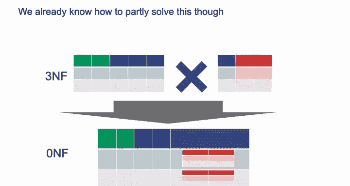

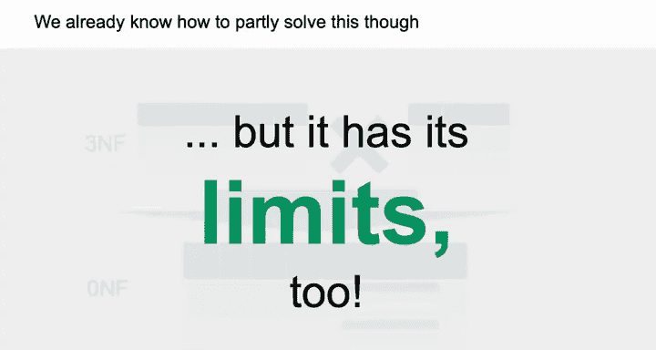

所以基本上，这里的教训是关系型数据库对此不够好。但即使只是反规范化数据并使用文档存储，甚至可能使用哈希索引，仍然不够好。所以现在我们确实有理由想要做一些新的事情，因为现有系统就是无法完成这项工作。

---

## 图数据库的核心思想：指针

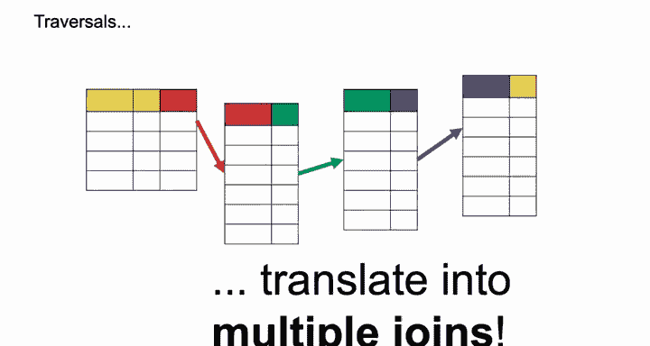

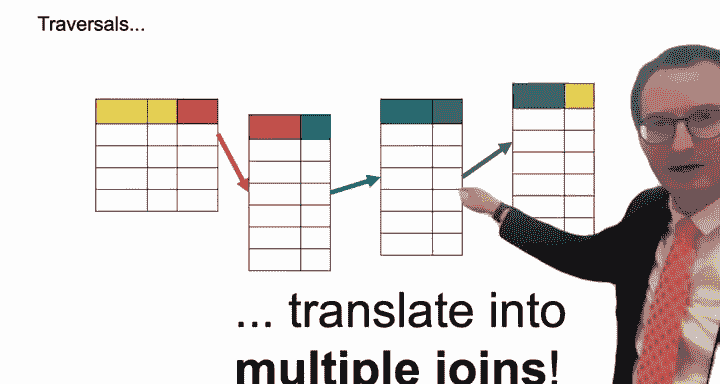

上一节我们探讨了现有方案的不足，本节中我们来看看图数据库的核心解决方案。

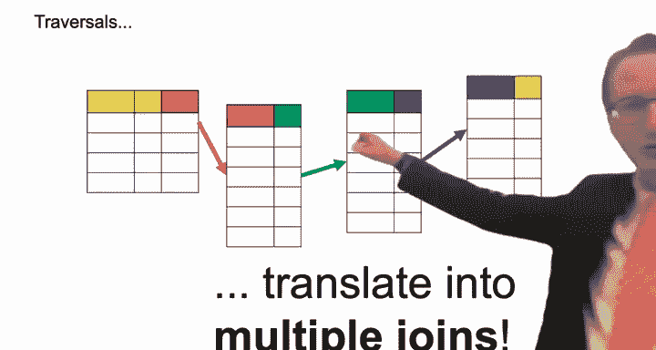

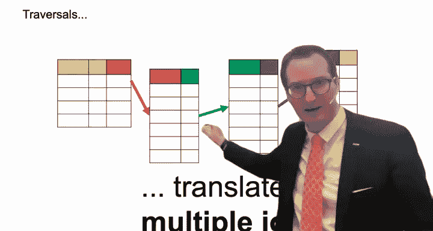

这就是为什么我们有一种方法让它更直接。在内存中，基本上找到与某些其他数据相关的数据的最直接方式是什么？在物理层面上。**指针**，正是如此。这就是图数据库的关键。它是指针。在内存中使用指针，而不是主键和外键，这在逻辑上是同一件事。想象一下，这里基本上，当我谈论外键和主键时，这不是一个指针。这不是内存中的指针，它只是我建立的一个逻辑连接，表示这些值是相关的。但如果这里，我们不仅仅是逻辑连接，而是内存中的实际物理指针，那么你明白了吗？当然，在相对意义上。但与实际进行连接和在索引中查找相比，仅仅在内存中跟随指针要快得多。谁看到了这一点？这非常重要，因为这是图数据库的核心动机。这就是我们使用内存指针连接数据，而不是主键、外键和反规范化数据的事实。这就是整个想法。

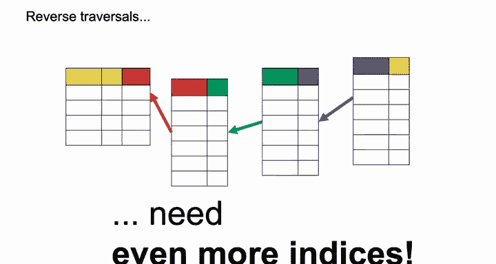

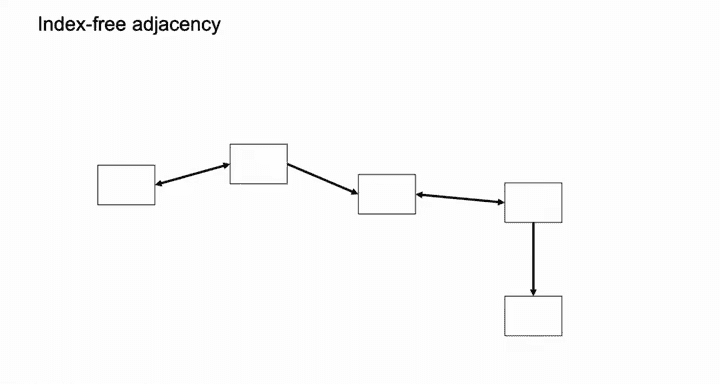

它有一个你可能想学习的很酷的名字。它叫做**索引无关邻接**。索引无关邻接只是一种花哨的说法，表示我们使用内存指针。邻接，因为它只是在内存中直接连接。现在你看到内存指针，它们双向都没有问题，你可以有两个方向的指针，这很有效。事实上，如果你想想在数据结构和算法中学到的双向链表，那正是它所做的。双向链表正是这种双向指针。但这只是这个想法的雏形，因为这很简单，你知道，我们使用内存指针。是的，但我们仍然需要小心如何设计它，因为如果我们现在开始设计这个想法，我的屏幕上有什么？我有一个图。它不是树。它不是表格。所以我们谈论的是不同的形状。这意味着我们需要一个数据模型，就像我们有关系表格的数据模型和Json、XML的树数据模型一样。我们需要一个图的逻辑数据模型。当然，这个逻辑数据模型将通过内存指针和结构在物理上实现。一旦我们有了数据模型，我们就需要一个查询语言，那个查询语言将是Cypher。这基本上与SQL和表格或Jsoniq和条目的原理相同。这就是我希望你们看到的。

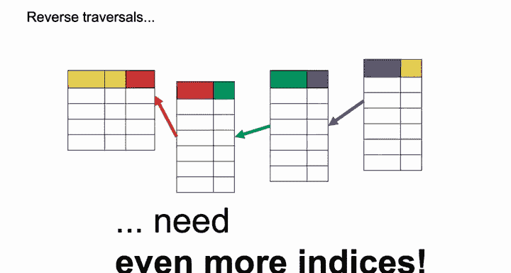

---

## 图数据模型：带标签的属性图

上一节我们介绍了图数据库使用指针的核心思想，本节中我们来看看其具体的数据模型。

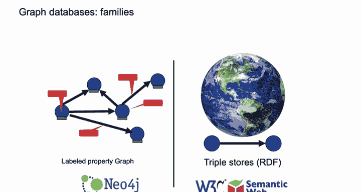

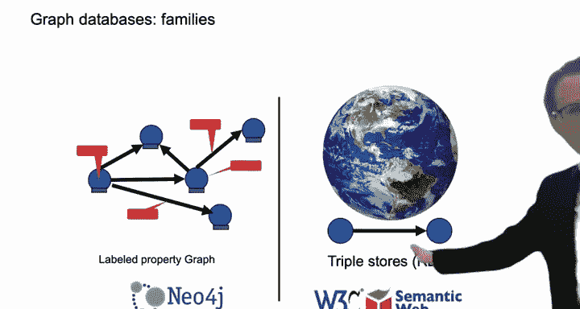

我将以Neo4j为例进行本次讲座。我们将使用的数据模型的名称是**带标签的属性图**。请记住，对于一个数据形状，并没有唯一的模型。例如，对于树，你有XML信息集，你有Json数据模型，你有带有条目序列的Jsoniq数据模型。你有很多模型，对吧？每个查询语言都有一个模型，但你可以有几个模型。在图数据库的情况下，基本上有两个高级竞争模型。基本上是带标签的属性图阵营和三重存储阵营。人们有争论。这是另一个引发论坛争论的话题。如果你问三重存储更好还是带标签的属性图更好，你会看到人们在这个话题上有多么两极分化。所以我试图同时讨论带标签的属性图和三重存储，以给你们一个概述。具体来说，我们将使用的技术是Neo4j，这是最著名的涵盖它们的数据库引擎之一。

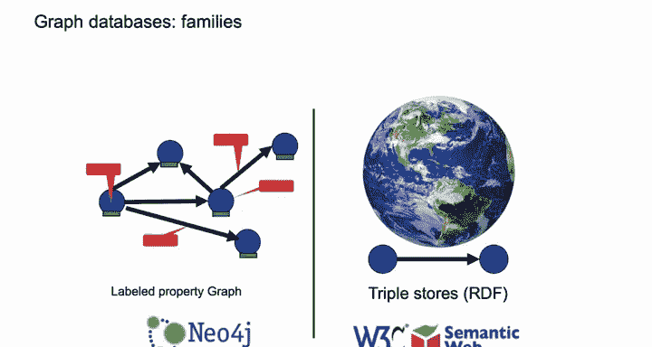

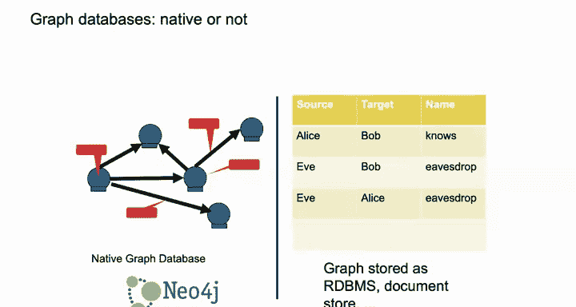

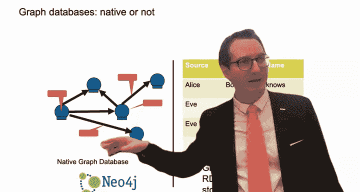

现在还有另一个概念，实际上是正交的。你有**原生图数据库**的概念，以及**在另一个数据库之上实现的数据库**的概念。这实际上是我之前讨论文档存储、查看MongoDB之前简要提到的事情。我说过，如果你有一个树的集合，为什么不尝试在关系数据库系统中实现那个树的集合，并将所有内容编译成SQL？听起来是个好主意，但非常困难。这就是为什么MongoDB选择了基于树的数据模型的原生实现。这是一个原生实现。将树放入关系表的实现实际上存在。它们效率稍低，但那不是原生实现。它基本上只是一个多层架构，在另一个数据库系统之上实现一个数据库系统。就像你可以用一种语言编译另一种语言，例如，C++编译成C。在三重存储的情况下，实际上，三重存储很容易在只有三列的关系表中实现。三重存储，三列。当我讲到时会很明显为什么，基本上是因为一个三元组基本上是一个主语、属性和宾语，就像一个非常短的句子，每个三元组对应表中的一行。所以在这种情况下，那将不是原生数据库，因为它实际上是在关系数据库之上实现的。我们下周会看到，立方体也可以在关系数据库之上实现。所以你不需要原生的数据库系统来处理立方体。你可以，但不需要。好了，但让我们首先关注Neo4j和带标签的属性图。

---

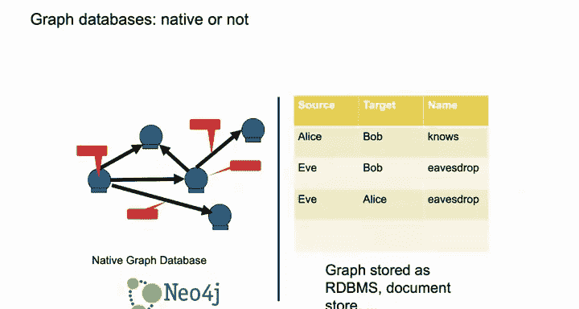

## 带标签的属性图详解

上一节我们介绍了图数据模型有两种主要类型，本节中我们深入探讨带标签的属性图。

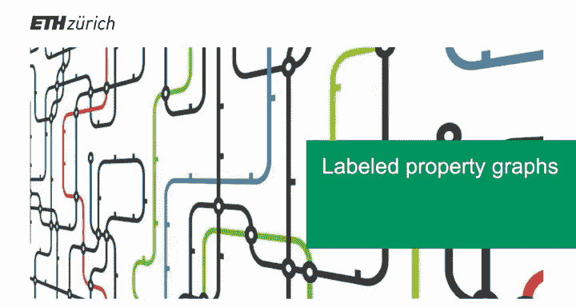

让我们稍微回顾一下，回到数据建模。当我告诉你们数据模型时，我说数据模型的要点是拥有一种描述现实的非常简单的方式。例如，在关系模型中，你说一切都是表格。一切都有行和列，非常简单，描述行和列、主键等等。在XML和Json或文档存储的情况下，那么你不是说一切都是表格，而是说一切都是树或一切都是树的集合。然后数据模型涉及树中父节点和子节点的概念等等，原子值的概念，结构化值的概念，如对象和数组或元素和属性。但仍然，解释数据模型是什么是相当简洁的。那么现在，对于带标签的属性图，你认为我们会把世界看作什么？这样一个模型的组成部分会是什么？在我展示之前，可以抛出一些想法。在图数据模型中会有什么？也许名字“带标签的属性图”对猜测有用。任何人。

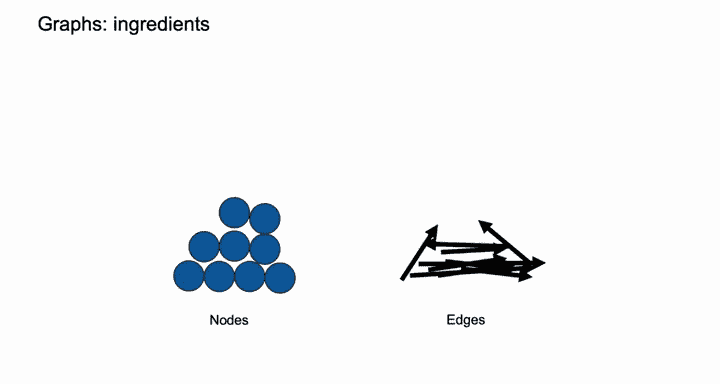

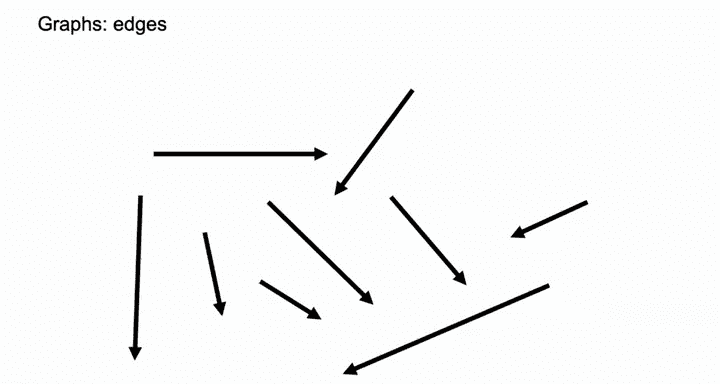

你也可以在Zoom上写。是的，我看到了你举手。是的，绝对正确。所以你基本上说了，我为Zoom上的人重复一下。你说**节点和边**。正是如此。我们需要节点和边。事实上，这就是数学家定义图的方式。这实际上很美妙，因为每当你设计一个数据模型时，你希望数学家成为你的朋友。你真的想依赖一些抽象的东西。就像对于表格，我们依赖数学关系或实际函数的集合，这是高度数学化的。

数学家将图定义为一组节点，实际上可以是任何东西，只是一组节点，他们称之为V表示顶点。然后是一组边。边是什么？只是一对节点，他们称之为E。一个图，他们称之为G，是V和E。顶点集合和边集合。这就是图的数学定义。所以现在，如果我们从这个定义开始，那么我们烹饪的原料基本上就是我们需要一些节点和一些边。然后我们将用这些边连接这些节点，得到一个有向图。现在这变成了计算机科学，因为你可以开始以多种方式在内存中实现它。但在这一点上，它是纯数学的。当然，图也可以是无向的，只是意味着你去掉箭头方向。

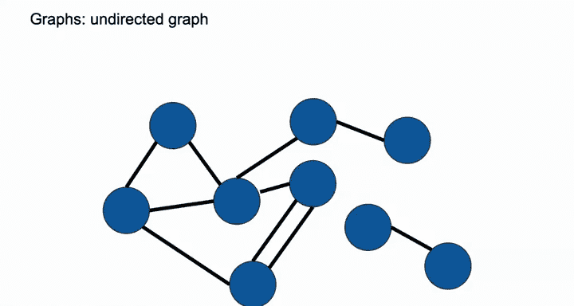

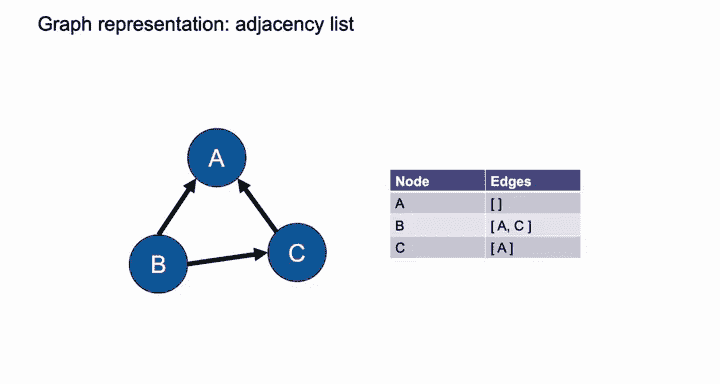

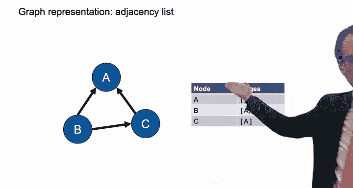

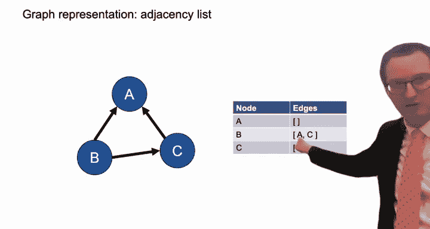

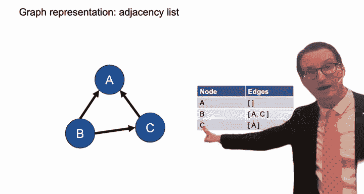

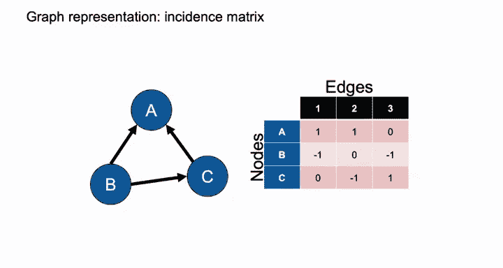

这听起来很简单，但你无法想象图论中的挑战数量。ETH有一门关于图论的完整课程，可能非常困难和正式。也许数据科学学生。是的，我看到一些举手。非常困难。你有最大流最小割问题等等。实际上ETH最近在这方面有进展。但作为计算机科学家，你想存储这样的图。例如，如果你有三个节点和三条边，你可以把它存储为节点列表。然后你有一个数组，给出所有连接到的目的地。例如，A连接到空，B连接到A和C，C连接到A。这叫做邻接表。然后你有一个邻接矩阵，你基本上有节点。在行和列上。然后当它们连接时，你放一个1。例如，A没有连接到任何东西。B连接到A和C，标记为1，C连接到A。这叫做邻接矩阵。然后你有关联矩阵，其中不是节点在行和列上，而是只有节点在行上，边在列上。基本上，每条边，-1告诉你边的源，1给你目的地。所以从B到A，从C到A，从B到C。

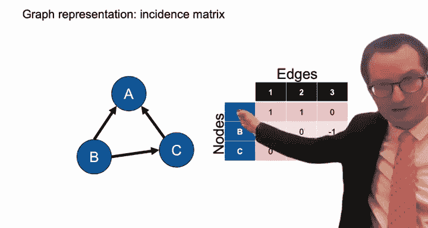

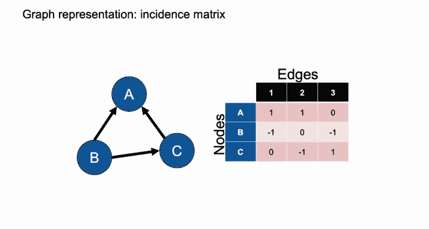

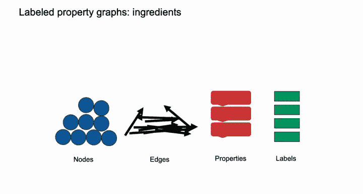

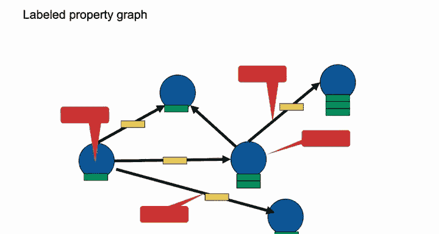

但这并不是我们实现带标签的属性图的方式。所以这些是可能的方式。事实上，对于带标签的属性图，正如名称所示，我们需要添加两样东西：标签和属性。所以现在我们正在扩展我们的成分列表。我们有节点。我们有边。我们有属性。我们看到它们实际上非常接近Json对象。但我稍后会回到这一点。然后是我们在那里放的标签。当我们把所有东西放在一起时，我们得到一个带标签的属性图的实例。现在我将更详细地介绍这一点。

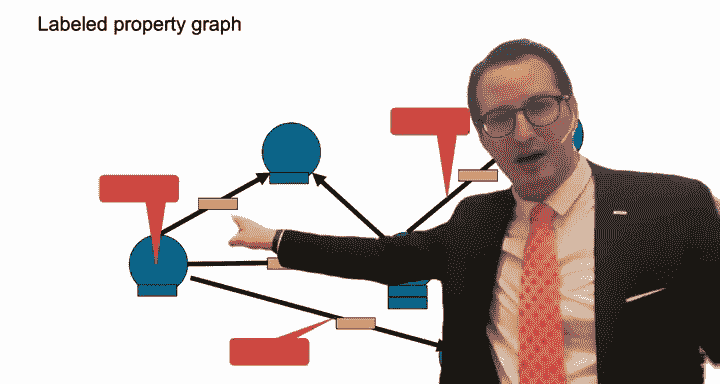

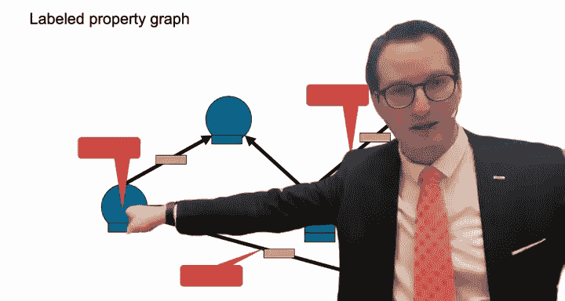

但你可能已经注意到这些是标签。基本上，标签可以在边上或节点上，属性也可以在节点上或边上。这就是这个想法。

---

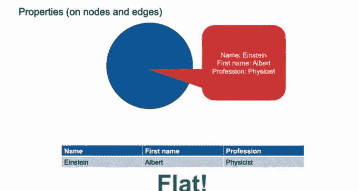

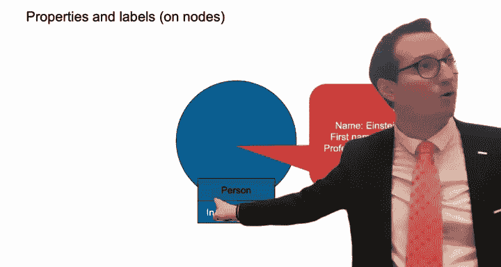

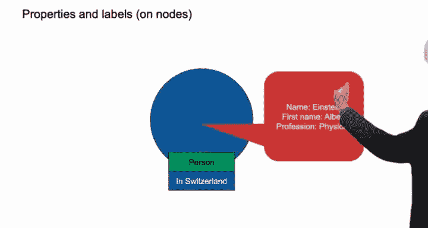

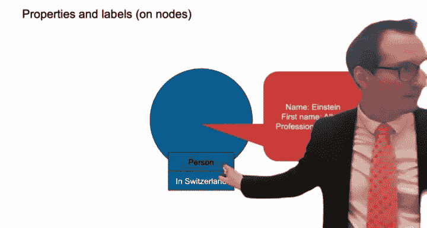

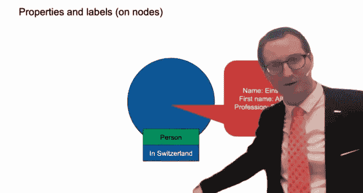

## 节点：属性与标签

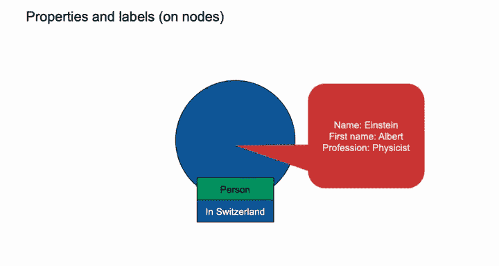

上一节我们介绍了图的基本构成，本节中我们具体看看节点的属性与标签。

现在让我们看一个属性。节点的属性应使用复数形式，节点的属性。例如，这是我们的集合V中的一个节点。它有三个属性。姓名是爱因斯坦。名字是阿尔伯特。职业是物理学家。现在，你可以从两个角度看它。也许你实际上只是看到一个像这样的数据库记录。谁看到了？希望每个人都看到了。你是对的。谁看到了一个对象？你也是对的，它可以被看作一个扁平的Json对象，但这并不新鲜，因为我们知道扁平的Json对象与扁平的关系记录相同。所以这基本上是属性的概念。重要的是什么。在这里，我把它与我们已知的东西联系起来，它是扁平的。它是扁平的。我们不允许嵌套。我们不允许具有嵌套的通用Json文档。它必须是扁平的。你只有顶层的属性。就是这样。有一个例外，我稍后会讲到。但一般来说，它是完全扁平的。所以里面没有嵌套。为什么？因为嵌套，我们通过内存指针处理并连接节点在一起。所以如果我们也允许在那里嵌套，那在我们的模型中将是冗余的。所以更容易的是只保持它扁平，并认为我们有一个扁平的结构。

现在，在同一个节点上，你将拥有属性和所谓的标签，一个或多个标签。例如，这个节点，其姓名是爱因斯坦，名字是阿尔伯特，职业是物理学家，具有标签“人”，并且具有标签“在瑞士”，例如，可能在某个特定时间点。

现在，与关系表相比，这看起来可能完全出乎意料且有点奇怪，就像这是我们在这里拥有的与Json或关系表完全不同类型的对象，但实际上我们可以在两者之间轻松建立联系。一旦你看到这一点，你就会理解图数据库背后的直觉，并理解为什么将任何关系数据库存储为图很容易，但反过来却不容易，因为图数据库实际上比关系数据库更通用。

---

## 标签与关系表的对应关系

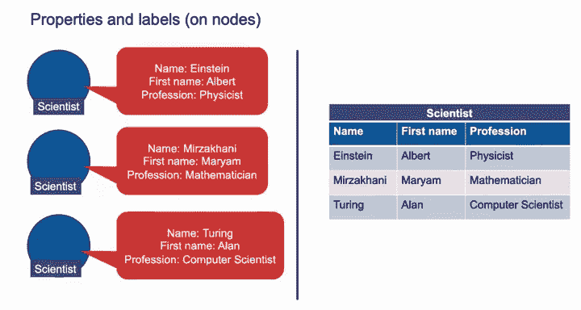

上一节我们看了单个节点的属性，本节中我们来看看多个具有相同标签的节点如何对应到关系表。

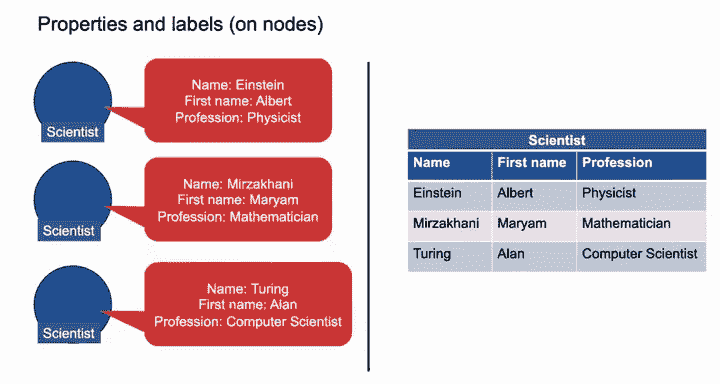

这就是我希望你们在这里看到的。当你有绿色节点，或任意数量的节点，它们共享一个标签。它们可以有比那更多的标签，但它们都共享相同的标签“科学家”。如果你看属性，你会注意到这些是相同的属性名称。当然，值可能不同，但属性名称相同。这里看起来有点像模式，一些验证等等，它们具有相同的结构。当你看到相同的标签和相同的模式时，比如说一个没有额外键的封闭模式，这实际上等同于这个关系表。谁看到了？很好。所以你在这里看到的每条记录都是一个节点，记录的值基本上在属性中，关系表名称“科学家”是标签。所以这就是你如何识别它们基本上具有相同的标签。这对应于一个关系表。谁看到了反过来行不通？你可能无法重建关系表。

我们有一个问题。我认为在Zoom上，我也看到了一些事情发生。与关系记录不同，至少我不太明白在属性中是否有主键或类似东西的等价物。现在，如果由于某种原因你有多个具有相同属性的节点，你会将它们总结为一个节点并有多个边指向该节点，还是也可以有多个具有相同属性的节点？所以这是一个设计决策。基本上，你可以，有一个自然的映射。所以有一个直接的映射，但不是唯一的，你可以用多种方式实现相同的事情。通常，想法是，以同样的方式，一个高度规范化或高范式中的记录基本上对应于现实生活中的某个事物。例如，一条记录是一个人，一条记录是一门课程，一条记录是一个国家，同样的话或节点。基本上，每个节点代表现实生活中的一个事物、一个人或一个概念。这就是你思考它的方式。然后你在将其视为记录或将其视为数据库中的节点之间存在这种二元性。但这就是它对应的方式。现在，关于主键，我们在图数据库中也有类似的东西，因为我将在语言中展示。所以在SQL中，基本上是使用SELECT FROM WHERE，你使用WHERE和主键上的谓词，如果你有一个索引，那会很快。对于图，我们将有一种语言。但与其关注表结构和主键，我们关注图中的模式。我们寻找一个模式。如果你寻找一个名为爱因斯坦的特定人，那么你可以在语言中表达你寻找节点，其属性名等于爱因斯坦的节点，然后你也可以有加速这一过程的索引。它在逻辑层面之下。所以你仍然有索引。但你仍然需要看到你有内存指针，取代了以前的连接，你不需要索引。你只需跟随指针。但图数据库中索引的作用是快速定位你正在寻找的节点。当你刚开始查询并从零开始时，你需要一种直接获取你想要开始的节点的方法。这说得通吗？我想是的。希望随着我讲解材料，它会更有意义。

有一个问题。为什么标签的概念必须是一等公民？难道不可能简单地拥有一个或多个对应于标签的属性吗？我告诉过你三重存储与带标签的属性图是两极分化的。这正是三重存储阵营的人会对带标签的属性图阵营说的话，他们正是有这个论点。所以你绝对正确。这个论点也绝对完全有效。