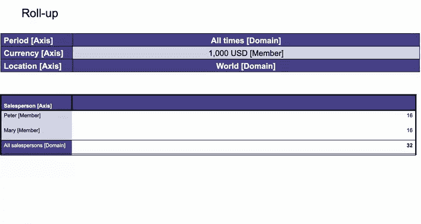

# 46：数据立方体 (1/2) 📊


在本节课中，我们将要学习数据立方体。这是本课程介绍的最后一种数据形态。我们将首先了解数据立方体的历史背景，然后深入探讨其逻辑模型和基本操作，例如切片、切块和聚合。

---


## 课程安排与回顾 📅


上一节我们介绍了图数据。本节中，我们来看看数据立方体。


今天是本学期最后一节讲授新内容的课程。明天将有一场关于向量数据库的客座讲座。下周将没有新内容，我们将一起庆祝学期结束，回顾所学知识，并举行一场大型问答游戏。


---

## OLTP 与 OLAP：两种数据处理范式 🔄


在深入了解数据立方体之前，我们需要理解两种关键的数据处理范式：**在线事务处理** 和 **在线分析处理**。


*   **OLTP** 负责公司的日常业务运营，例如管理库存、订单和客户信息。其特点是**高并发、大量写操作**，关注**单个记录**的快速读写，强调**数据一致性**。典型的系统如 PostgreSQL。
*   **OLAP** 则用于数据分析，以支持商业决策。其特点是**大量读操作、复杂查询**，关注**数据的整合与聚合**，通常处理**历史数据**。我们本学期学习的 MapReduce 和 Spark 本质上都属于 OLAP 范畴。


以下是两者的核心区别：


*   **操作类型**：OLTP 侧重**写**，OLAP 侧重**读**。
*   **数据视角**：OLTP 关注**细节**（单个记录），OLAP 关注**整体**（聚合数据）。
*   **响应时间**：OLTP 要求**即时**响应（毫秒级），OLAP 可以是**交互式**或**批处理**（分钟、小时甚至天）。
*   **数据规范化**：OLTP 需要保持**高范式**以避免更新异常；OLAP 可以接受**反规范化**以提升查询性能，因为数据通常是只读的。


简而言之，OLTP 是“运营系统”，而 OLAP 是“分析系统”。历史上，OLTP 常与**关系表**关联，OLAP 常与**数据立方体**关联。


---


## OLAP 的核心特征 🎯


OLAP 系统通常用四个特征来描述：

1.  **面向主题**：数据围绕特定分析主题（如销售、财务）组织，而非围绕应用程序。
2.  **时变性**：数据包含时间维度，用于分析历史趋势和模式。
3.  **非易失性**：数据一旦加载到分析系统中，通常不会被修改，只用于查询。
4.  **集成性**：数据来自公司内多个异构的源系统（如ERP、CRM、数据库），经过提取、转换和加载过程整合到统一的数据仓库中。


这个过程就是 **ETL**：
*   **提取**：从源系统获取数据。
*   **转换**：清洗、合并、转换数据以适应目标模型。
*   **加载**：将处理后的数据载入数据仓库。

数据仓库是一个独立的系统，专门用于存储和分析集成后的数据，避免影响日常运营的OLTP系统。

---

## 数据立方体的逻辑模型 🧊


现在，让我们正式进入数据立方体的世界。从逻辑上看，一个数据立方体是一个**多维数组**。


### 核心概念


*   **维度**：观察数据的角度，如`时间`、`产品`、`地区`。
*   **成员**：维度的具体取值，如`时间`维度的“2024年”、“2025年”；`地区`维度的“瑞士”、“德国”。
*   **事实**：在特定维度成员组合（即“单元格”）处度量的数值，如“2024年在瑞士售出的服务器数量”。


一个三维立方体可以直观地表示为 `时间 x 产品 x 地区`。更高维度（四维、五维）在数学上完全可行，只是难以可视化。


### 事实表：立方体的表格化视图


为了方便人类理解和机器处理，我们通常将立方体“扁平化”为一张**事实表**。


例如，一个 `2 x 2 x 2` 的立方体（地区：德国/瑞士，时间：2021/2022，销售员：Peter/Mary）可以表示为以下事实表：


| 地区 | 时间 | 销售员 | 销售额（美元） |
| :--- | :--- | :--- | :--- |
| 德国 | 2021 | Peter | 1000 |
| 德国 | 2021 | Mary | 2000 |
| 德国 | 2022 | Peter | 3000 |
| 德国 | 2022 | Mary | 4000 |
| 瑞士 | 2021 | Peter | 5000 |
| 瑞士 | 2021 | Mary | 6000 |
| 瑞士 | 2022 | Peter | 7000 |
| 瑞士 | 2022 | Mary | 8000 |

每一行代表立方体中的一个单元格（事实）。事实表是理解立方体操作的基础。


---


## 立方体基本操作：切片、切块与聚合 ⚙️


### 1. 切片


**切片** 是指固定一个（或几个）维度的成员，观察剩余维度的数据。这相当于在关系代数中执行**选择**操作。


例如，对上述事实表进行切片：`地区 = ‘瑞士’`。结果是一个只包含瑞士数据的新立方体（子集）。


在SQL中，这对应于：
```sql
SELECT * FROM fact_table WHERE region = 'Switzerland';
```


### 2. 切块与交叉表


**切块** 是切片的一种特殊形式，它通常保留两个维度作为分析焦点，并将其他维度固定。结果可以方便地展示为**交叉表**。


例如，在切片`地区=瑞士`且`货币=美元`后，我们只剩下`时间`和`销售员`两个维度变化。我们可以将其组织成交叉表：


| 销售员 \ 时间 | 2021 | 2022 |
| :--- | :--- | :--- |
| Peter | 5000 | 7000 |
| Mary | 6000 | 8000 |


在交叉表中：
*   放在行上的维度称为**行维度**。
*   放在列上的维度称为**列维度**。
*   被固定的维度称为**切片器**。

这就是“切片和切块”一词的由来。用户界面常通过选项卡、滑块等方式处理第三个维度。


### 3. 聚合与维度层次结构


**聚合** 是指沿某个维度计算汇总值，如总和、平均值等。这通常涉及维度的**层次结构**。


例如，`地区`维度可能具有层次：`世界 -> 欧洲 -> 瑞士 -> 苏黎世`。聚合“瑞士”意味着对“苏黎世”、“日内瓦”等城市的数据求和。


在交叉表中，聚合结果常以“小计”或“总计”行/列的形式出现，并用**L形边框**或**缩进**来直观表示层次关系。


*   **上卷**：沿层次结构向上聚合，查看更概括的数据（如从“城市”到“国家”）。
*   **下钻**：沿层次结构向下展开，查看更详细的数据（如从“国家”到“城市”）。


---


## 总结 📝


本节课中我们一起学习了数据立方体的基础知识：
1.  我们首先区分了 **OLTP** 和 **OLAP** 两种数据处理范式，理解了它们不同的设计目标和特点。
2.  我们探讨了 OLAP 系统的四个核心特征：**面向主题、时变性、非易失性和集成性**，并介绍了 **ETL** 过程和数据仓库的概念。
3.  我们深入学习了数据立方体的**逻辑模型**，包括**维度、成员、事实**等核心概念，以及用**事实表**表示立方体的方法。
4.  我们掌握了立方体的三种基本操作：**切片**（选择特定数据子集）、**切块/交叉表**（以表格形式展示两个维度的数据）以及**聚合**（沿维度或层次结构计算汇总值）。




这些概念是理解商业智能和数据分析中多维数据建模的基石。在下半部分，我们将探讨如何在 SQL 和实际系统中实现这些操作。