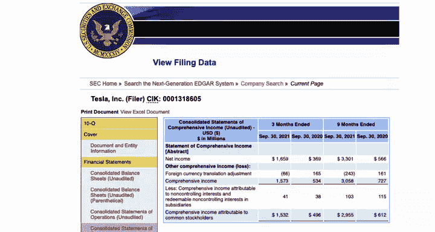

# 47：数据立方体实现与查询 🧊


在本节课中，我们将学习数据立方体的两种主要实现范式，并重点探讨如何利用关系型数据库（特别是SQL）来实现和查询数据立方体。我们将了解如何将多维逻辑模型映射到二维表格，以及如何使用SQL的扩展功能来高效地进行切片、切块、上卷、下钻等操作。


---


上一节我们介绍了数据立方体的逻辑模型及其基本操作。本节中，我们来看看数据立方体的物理实现方式。


## 实现范式概览 🏗️


在高层面上，实现数据立方体主要有两种范式：
*   **MOLAP (多维联机分析处理)**：这是一种原生实现方式，专门为多维数据形状设计。
*   **ROLAP (关系型联机分析处理)**：这是一种“取巧”的实现方式，它将数据立方体构建在关系型表格之上，并将所有操作编译为SQL查询。


本课程将重点介绍ROLAP的实现方式。


## ROLAP：基于关系表的实现 📊


为什么选择ROLAP？一个关键原因是，表示立方体的事实表可以非常自然地存储为SQL系统中的关系表。

**核心概念**：在ROLAP中，一个数据立方体通常被实现为一张**事实表**。这张表的结构是：每一列对应一个维度，最后一列则是对应的度量值。


```
| 年份 | 品牌   | 客户   | 销售额 |
|------|--------|--------|--------|
| 2023 | 苹果   | 张三   | 100    |
| 2023 | 三星   | 李四   | 150    |
```


### 多度量值与数据透视


有时，一张事实表可能包含多个度量值列（例如，收入、支出、利润）。这些共享相同维度组合的多个度量值列，可以通过**数据透视(Pivot)**和**逆透视(Unpivot)**操作进行转换。


**转换原理**：逆透视操作将多个度量值列“堆叠”起来，并添加一个新的“度量”维度列。这样就将多列结构转换成了标准的单度量值列结构，反之亦然。SQL语言甚至有专门的`PIVOT`和`UNPIVOT`扩展来完成此类操作。


### 维度表与模式设计


在事实表周围，通常会有**维度表**。事实表中的维度成员实际上是指向维度表主键的外键。

关于维度表的设计，主要有两种模式：
*   **星型模式**：每个维度对应一张维度表，直接与事实表连接。
*   **雪花模式**：在星型模式的基础上，对维度表进行进一步的规范化（例如，将地区维度拆分为城市、国家、大洲表），形成类似雪花的形状。


### 反规范化事实表

如果你不喜欢多表连接，可以选择**反规范化**。即将维度表中的属性（如国家、大洲）直接合并到事实表中。

**优点与缺点**：这样做会导致数据冗余（例如，“瑞士”和“欧洲”会重复出现）并引入函数依赖，但好处是你可以得到一个单一的表。这个表可以轻松导出为CSV文件并导入Excel，利用数据透视表功能进行直观的拖拽式分析，非常方便。


---

了解了数据立方体在数据库中的存储方式后，接下来我们看看如何查询它。

## 使用SQL查询数据立方体 🛠️


虽然存在专门的多维查询语言MDX，但本课程将展示如何用熟悉的SQL来实现数据立方体的操作。


我们以一个简单的事实表为例：


```
| 年份 | 品牌   | 客户   | 数量 |
|------|--------|--------|------|
| 2023 | 苹果   | 彼得   | 1    |
| 2023 | 苹果   | 玛丽   | 5    |
| 2023 | 三星   | 彼得   | 2    |
| ...  | ...    | ...    | ...  |
```


### 切片操作


在SQL中，**切片**操作非常简单，直接使用`WHERE`子句进行筛选即可。


```sql
-- 切片：获取2023年的数据（逻辑上得到一个 1 x 2 x 2 的子立方体）
SELECT * FROM fact_table WHERE 年份 = 2023;
```


### 上卷与下钻操作


**上卷（聚合）** 操作对应SQL的`GROUP BY`。你需要在`GROUP BY`子句中保留不想聚合的维度。


```sql
-- 上卷：按年份和品牌聚合，忽略客户维度（逻辑上挤压了客户维度）
SELECT 年份, 品牌, SUM(数量) AS 总数量
FROM fact_table
GROUP BY 年份, 品牌;
```


要**下钻**，只需在`GROUP BY`子句中添加回更细粒度的维度。


### 计算小计与总计


一个常见的需求是同时计算各维度组合的值、各维度的小计以及总计。一种朴素的方法是分别写多个查询再用`UNION`合并，并用`NULL`填充不存在的列。


```sql
-- 分别查询详细值、按年份的小计、按品牌的小计、总计，然后合并
SELECT 年份, 品牌, SUM(数量) AS 总数量 FROM fact_table GROUP BY 年份, 品牌
UNION ALL
SELECT 年份, NULL, SUM(数量) FROM fact_table GROUP BY 年份
UNION ALL
SELECT NULL, 品牌, SUM(数量) FROM fact_table GROUP BY 品牌
UNION ALL
SELECT NULL, NULL, SUM(数量) FROM fact_table;
```


### SQL的扩展：GROUPING SETS, CUBE, ROLLUP


为了方便此类操作，SQL引入了扩展语法：
*   **`GROUP BY GROUPING SETS`**：明确指定多个分组集合的并集。
*   **`GROUP BY CUBE`**：生成指定维度所有可能子集（幂集）的分组。如果有n个维度，将产生 2^n 个分组集。
*   **`GROUP BY ROLLUP`**：按层次结构上卷，生成从最详细到总计的层级分组。如果有n个层次，将产生 n+1 个分组集。


```sql
-- 使用CUBE一次性生成所有小计和总计
SELECT 年份, 品牌, SUM(数量) AS 总数量
FROM fact_table
GROUP BY CUBE(年份, 品牌);
```

### 处理维度层次结构

当维度内部存在层次结构（如年->季度）时，可以使用`GROUP BY ROLLUP`来方便地计算各层级的聚合值。

```sql
-- 按年和季度层次上卷
SELECT 年份, 季度, SUM(数量) AS 总数量
FROM fact_table
GROUP BY ROLLUP(年份, 季度);
-- 结果将包含：(2023, Q1), (2023, Q2), (2023, NULL-年合计), (NULL, NULL-总计)
```

---

最后，我们了解一下为什么需要数据立方体的标准化语法。


## 数据立方体语法：XBRL 📄


我们需要一种机器可读的语法来交换数据立方体信息，一个重要的应用场景是**财务报告**。全球许多公司都被要求以电子格式提交财务、风险或可持续发展报告。


**XBRL (可扩展商业报告语言)** 就是这样一种基于XML的语法。在XBRL报告中，财务报表（本质上是一个具有维度层次和小计的数据立方体视图）中的每个数字都被标记了其在多维空间中的坐标（公司、期间、概念/度量等）。


**工作原理**：公司可以提交外观精美的HTML报告，但通过在HTML标签内嵌入XBRL标签，使计算机能够精准识别每个数字的含义和上下文。这样，监管机构或分析工具就能自动读取和分析报告数据，无需依赖OCR或复杂解析。


---

## 总结与练习 🎯


本节课我们一起学习了数据立方体的物理实现。我们重点探讨了ROLAP范式，即如何将多维数据映射到关系表，并利用SQL及其扩展（`GROUP BY CUBE/ROLLUP`）来执行切片、切块、上卷、下钻等操作。我们还简要了解了用于标准化报告的数据立方体语法XBRL。



**动手练习建议**：尝试将一个反规范化的事实表导出为CSV，然后导入Excel或类似电子表格软件。使用**数据透视表**功能，通过拖拽维度字段到行、列区域，并利用筛选器，直观地体验切片、切块和聚合操作。这是理解数据立方体逻辑最直观的方式之一。