# 大数据课程总结与展望 🎓

在本节课中，我们将回顾本学期所学的大数据核心原则，并展望未来的技术发展趋势。课程内容涵盖了数据处理的多种形态、系统设计原则以及新兴技术方向。

---

## 回顾：大数据十大设计原则 📚

上一节我们介绍了课程的整体目标，本节中我们将系统回顾贯穿本学期的十个核心设计原则。

### 1. 学习历史经验 📖

我们需要从过去的技术发展中学习经验。例如，关系型数据库管理系统在发展过程中积累了大量关于数据独立性和查询语言设计的经验。当开发新的数据形态（如图、立方体、向量）时，借鉴这些经验至关重要。XML社区早期的错误在JSON出现时本应被吸取，但实际情况并非总是如此。

### 2. 保持设计简洁 ✨

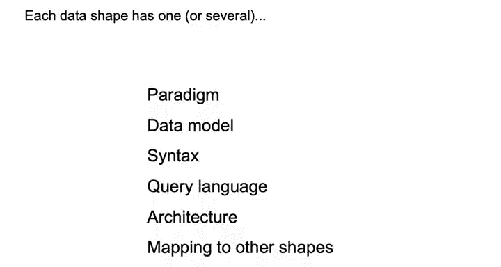

当数据规模扩展到PB甚至EB级别时，设计必须保持简单。例如，采用简单的键值模型，通过增加键值对的数量（而非增大键或值本身）来扩展，这使我们能够轻松地在集群中进行分区和分布式处理。

**核心思想**：`系统扩展应仅沿一个维度（数量）进行。`

### 3. 模块化架构 🧩

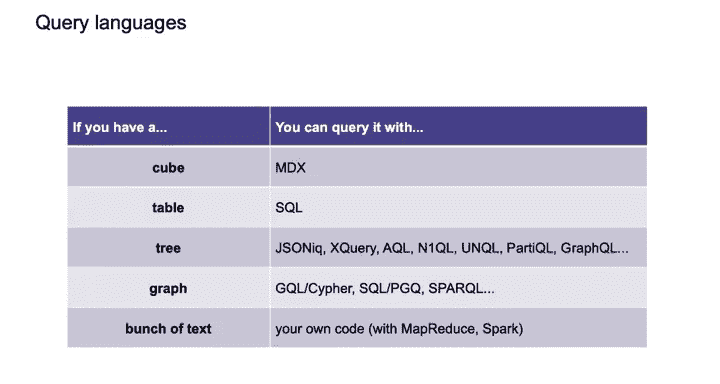

作为计算机科学学生，模块化是基本思想。由于人脑处理能力有限，我们必须将复杂系统（如从硬盘驱动到LLM交互的整个数据库管理系统）分解为多个层级。每个层级（如硬件、编码、语法、模型、验证、分布式处理、查询语言、UI）专注于特定任务，并通过上下层进行通信。

### 4. 数据形态的统一范式 🔄

所有数据形态（表、树、图、立方体、文本/向量）都遵循相似的范式结构：
*   **范式**：看待数据的方式（如行与列、节点与边）。
*   **数据模型**：对应的数学形式化描述（如JSON模型、属性图模型）。
*   **语法**：存储和传输数据的格式（如CSV、JSON、Parquet）。
*   **查询语言**：操作数据的语言（如SQL、GQL、自然语言）。
*   **系统架构**：不同形态的系统架构非常相似。

### 5. 宏观同质性与微观异质性 ⚖️

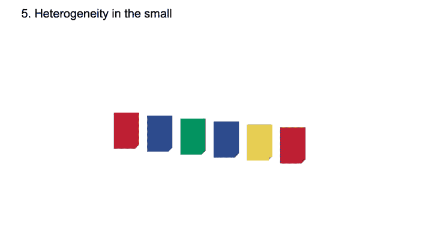

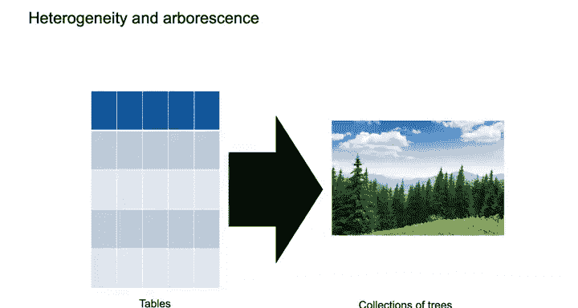

*   **宏观同质性**：在极大规模（数十亿记录）下，数据集合看起来是同质的，这便于分区和分布式处理。
*   **微观异质性**：当放大观察时，数据具有多样性。例如，文档数据库中的文档无需遵循相同模式，验证是可选的。这种灵活性使系统能够处理现实世界中多样化的数据，并为机器学习进行数据准备。

### 6. 嵌套数据结构 🌳

通过反规范化，我们可以得到嵌套数据。扁平的表行可以包含子表，从而形成树结构。因此，表可以广义地视为树的集合。

**概念映射**：`表 → 扁平树的集合`

### 7. 通用的原子数据类型 🔢

无论使用何种系统（JSON、XML、SQL、Python），底层的基本数据类型（如字符串、数字、布尔值、日期）都是相似的。学习新系统时，主要是熟悉其命名和特定限制。

### 8. 逻辑模型与物理存储分离 🛡️

数据独立性的核心是让用户只关心逻辑模型（如表、树、向量的集合），而无需关心数据在磁盘上的具体存储方式。物理存储的实现交由数据工程师负责。

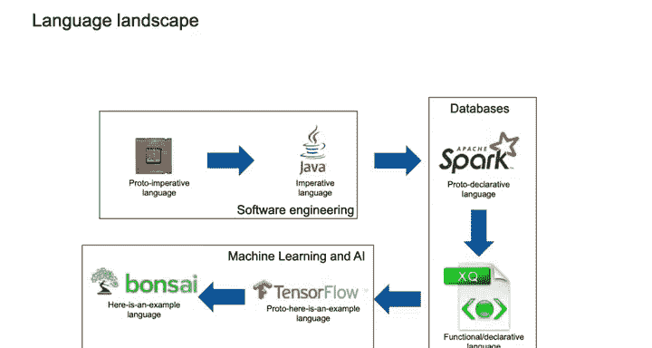

### 9. 数据形态间的相互转换 ♻️

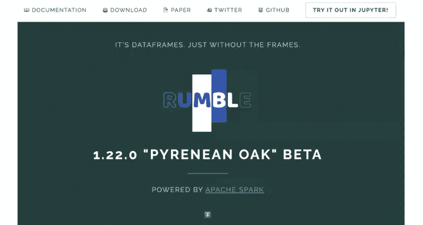

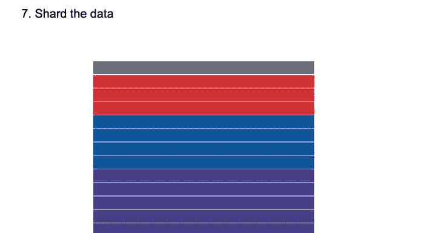

所有数据形态在表达能力上本质是等价的，可以在一定复杂度约束下相互转换：
*   立方体可以存储为关系表（事实表）。
*   表可以作为扁平树存储。
*   树可以存储为图（树是无环的图）。
*   图可以表示为三元组表（主体-属性-客体）。
*   文本正日益向量化。

### 10. 分布式处理核心策略 🚀

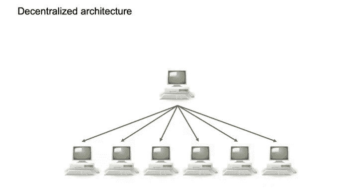

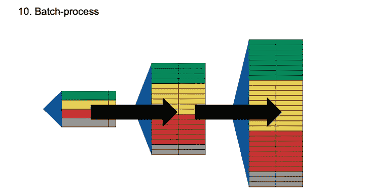

以下是实现大规模分布式处理的关键策略：

*   **分片**：将数据切割成块（分片、分区），分布到不同机器上。
*   **复制**：为避免数据丢失，将数据存储多个副本（如HDFS的块复制、MongoDB的副本集）。
*   **使用廉价硬件**：大数据处理依赖大量廉价商用硬件构成的集群，而非昂贵的超级计算机。
*   **批处理**：以批次为单位处理数据，而非逐条记录处理。这同样应用于存储层（如累积写入、刷写、合并压缩文件）。

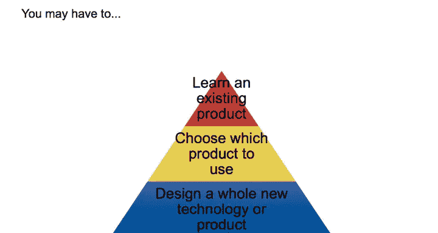

---

## 未来展望与选择指南 🔮

上一节我们总结了核心设计原则，本节中我们来看看如何应用这些知识面对未来，并为技术选型提供指导。

### 面对未来项目

未来你们可能会面临不同层级的项目：
1.  **学习现有产品**：加入已使用特定产品的公司。掌握核心概念后，学习具体产品会更容易。
2.  **进行技术选型**：需要自主选择存储、处理系统（如S3 vs HDFS，关系数据库 vs 图数据库）。
3.  **设计全新系统**：创造未来可能被教授的新技术。此时，站在巨人肩膀上并避免重复发明轮子至关重要。

### 技术选型关键问题

进行选择时，务必思考以下问题：

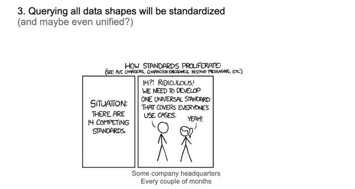

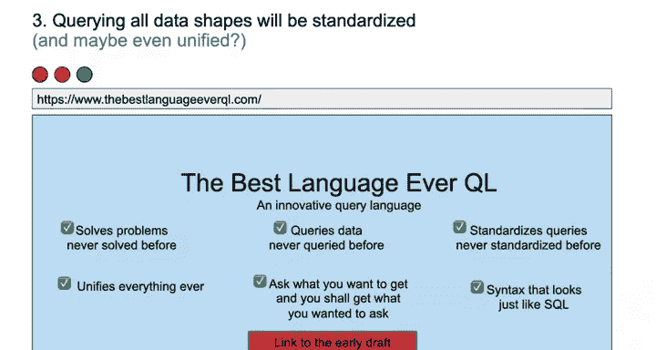

*   **数据形态**：我的数据最自然的形态是什么？（表、树、图、立方体、向量）
*   **数据规模**：数据量有多大？（GB级可在笔记本处理，TB/PB级可能需要集群）
*   **处理需求**：我想对数据做什么？（过滤、聚合、模式匹配等）
*   **生产力与性能**：需要在编写查询的便利性（生产力）和执行查询的速度（性能）之间取得平衡。
*   **是否重复造轮子**：是否有现成的、经过验证的方案可以复用？

**重要提示**：许多用例在单台笔记本电脑上即可处理，并非所有情况都需要数据中心。

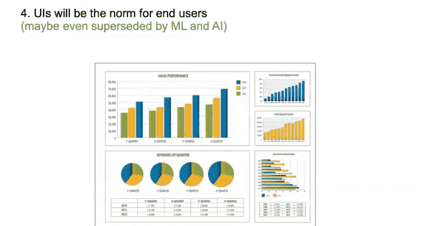

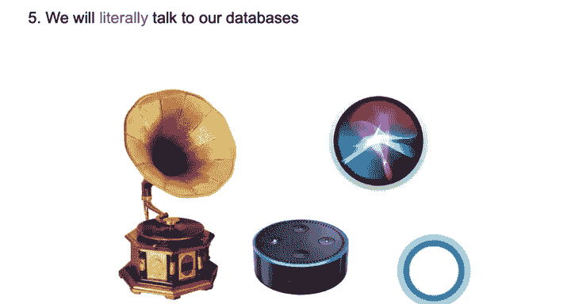

### 未来技术趋势预测

预测未来是困难的，但我们可以观察到一些趋势：

*   **底层API的隐藏**：MapReduce、Spark等底层API应被高级声明式语言甚至自然语言取代，对终端用户不可见。
*   **数据形态意识增强**：系统将更明确地支持多种数据形态，并通过扩展SQL（如用于树、立方体、向量）来统一处理。
*   **查询语言标准化**：图像查询语言GQL的成功标准化是范例。希望树状数据查询语言（如JSONiq）也能尽快实现标准化，结束目前数十种语言并存的局面。
*   **交互方式演进**：从“无代码”UI向更自然的语音交互发展。LLM需要与具备精确查询和推理能力的数据库系统结合，以克服幻觉问题。
*   **数据的可互换性**：如同水电一样，数据可能变得更加“可互换”。三元组存储和数据立方体将数据分解为原子单元（三元组、单元格），为实现标准化的数据交换提供了可能。
*   **数据主权与伦理**：数据保护法规（如GDPR）要求更严格的数据控制。技术能力伴随责任，必须考虑数据处理的合法性、伦理性。
*   **机器学习与数据库的融合**：
    *   **ML在DB之上**：如向量数据库，在DBMS之上构建AI功能。
    *   **DB在ML之中**：尝试用机器学习组件（如学习型索引）替换传统DBMS组件，形成AI增强的数据库系统。
*   **量子计算的审慎看待**：量子计算利用量子比特并行处理，但存在输出结果随机且单一的局限。目前其解决的特定问题往往缺乏实际应用场景，需理性看待相关宣传。

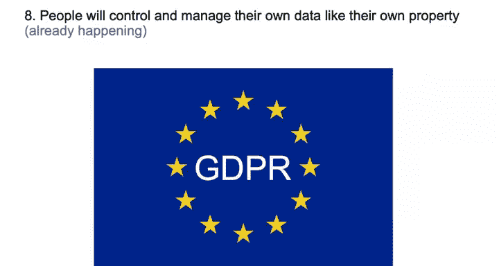

---

## 总结 📝

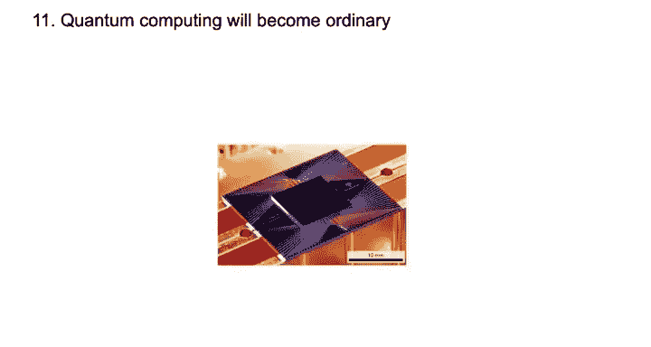

本节课中我们一起回顾了大数据处理的十大核心设计原则，包括从历史中学习、保持简洁、模块化、理解数据形态的统一范式、平衡宏观同质与微观异质、利用嵌套结构、认识通用数据类型、分离逻辑与物理、掌握形态转换以及运用分片、复制、批处理等分布式策略。我们还探讨了如何将这些知识应用于未来的项目选型，并对查询语言标准化、AI与数据库融合等未来趋势进行了展望。掌握这些基础原理，将使你们能够更快地适应具体技术，并做出明智的架构决策。