# 课程 49：展望与知识问答游戏 (2/2) 📚

在本节课中，我们将回顾课程的核心概念，了解课程评估反馈，并详细说明期末考试的形式与规则。最后，我们将通过一个紧张刺激的知识问答游戏来检验大家的学习成果。

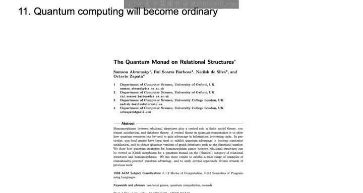

## 宇宙作为数据库与计算机 🌌

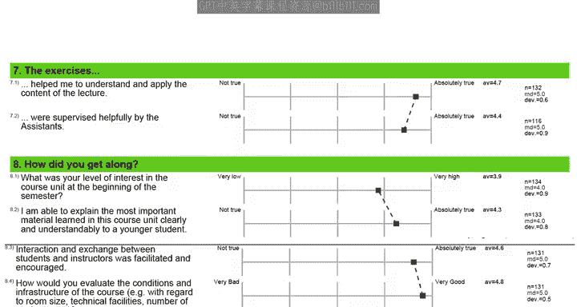

上一节我们探讨了大数据系统的各种形态。本节中，我们来看看一个更宏大的视角：将宇宙本身视为一个数据库和计算机。

这个想法源于康奈尔大学 Johannes Gehrke 关于实时策略游戏（如《文明》）实现的研究。在这些游戏中，游戏状态的更新可以被视为**数据库更新**，整个游戏系统可以看作一个数据库系统。由此引申，我们所生活的世界是否也可能是一个拥有底层数据库的虚拟现实？将宇宙视为一台计算机，这是一个融合了哲学思考的有趣观点。

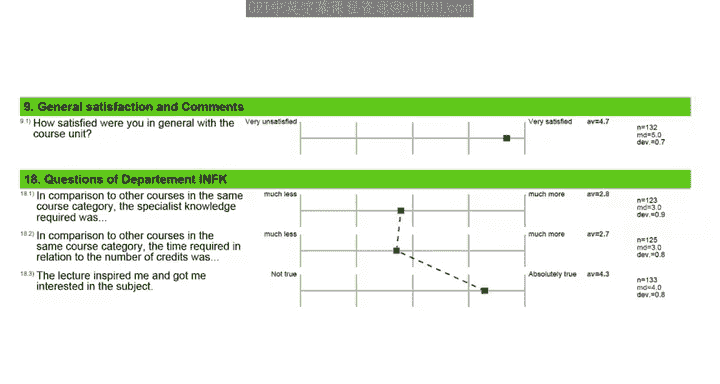

通常，熵增定律认为系统会趋向于越来越无序。但我们观察到，生命和文明却在不断构建结构。或许放眼未来数百万甚至数十亿年，宇宙实际上会变得越来越有组织。当然，这已经超出了数据库课程的范畴，仅作为一个有趣的脚注。

## 课程评估结果与反馈 📊

现在，我们来看看大家完成的课程评估结果。每年的评估重点会轮换，今年聚焦于课程本身。感谢大家的反馈，这能帮助我们未来改进。

评估结果通常会公开。作为一名教师，看到大家理解了所讲授的内容，是最好的回报。助教团队也获得了极高的评价，恭喜他们。一些助教还在评论中被点名表扬，我已经将这些积极的反馈转达给了他们。

此外，我很高兴看到大家能够向学弟学妹们解释课程材料，因为**教学是最好的学习方式**。

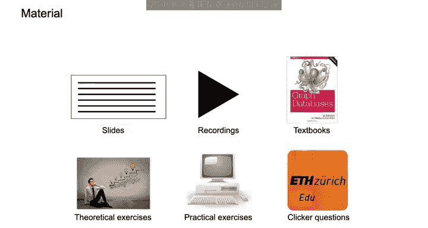

以下是评估中关于课程工作量和所需知识水平的反馈图示。我的个人目标是让课程稍微偏向“工作量较少”和“所需知识水平较低”的一侧，我对目前的结果感到满意。

我了解到大家的学习负担很重，苏黎世联邦理工学院（ETH）整体上也正在通过“Packet”改革等项目来应对这个问题，旨在调整学期安排、减轻学生压力、提高知识传授的质量。这涉及到将课程内容从14周压缩到13周等改变。

## 期末考试详细说明 📝

关于期末考试，以下是需要了解的所有信息。

**考试范围与资料**
*   学期内接触的所有材料都是考试范围，包括教科书、幻灯片、理论与实践练习以及课堂答题器问题。
*   考试将在ETH的计算机上进行，不是个人设备。系统为Windows，无需Docker，所有环境（包括PostgreSQL、Spark SQL、DataFrames、JSONiq）都已预装在虚拟机中。
*   我们会提前提供考试当天使用的Jupyter Notebook以及相关数据集，以便大家熟悉环境。

**考试形式与评分**
*   考试最多包含60道题，其中会有编程题。
*   对于编程题，我们会根据**答案的正确性**来评分。虽然要求大家粘贴查询语句，但这部分不计分，只是为了在出现多种答案时帮助我们理解思路并公正评分。
*   请尽量遵守答案格式要求（如使用英文句点而非逗号），这能帮助我们更准确高效地评卷。

**技术问题处理**
*   考试期间如遇技术问题，请立即举手。助教会提供一线支持，另有ETH数字考试团队提供二线支持。
*   我们会记录故障时间并在考试结束后补回。如果只是单个查询卡住，通常重启Jupyter内核即可解决。

**常见问题解答**
*   *可以使用不同的语言答题吗？* 可以。例如，如果题目要求用PySpark，但你用Spark SQL得出了正确答案，依然得分。但PostgreSQL题目必须用SQL连接数据库完成。
*   *会有文档吗？* 是的，我们会尽力在考试电脑上提供PostgreSQL、PySpark、JSONiq的文档（需满足50MB空间限制）。但无法进行全文搜索，因此熟悉文档结构很重要。
*   *需要死记硬背吗？* 虽然文档存在，但掌握核心语法和转换就像在脑中建立了**哈希索引**，能显著提高解题速度，因此建议熟记关键知识。

我们提供文档、数据和Notebook，是为了降低大家的考试压力，让大家在考场上更从容。

## 知识问答游戏 🎮

现在，进入轻松有趣的环节——知识问答游戏。游戏规则是：所有参与者起立，我提出问题，答错者坐下，坚持到最后的一位获胜者将获得奖品。同时，我们还将与助教团队进行对决。

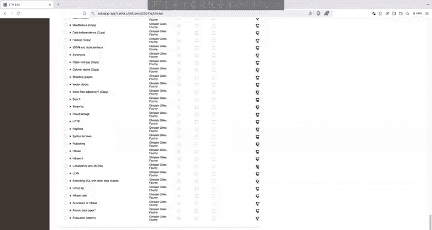

以下是游戏过程中出现的一些题目与答案，看看你能答对多少：

**题目1：JSONiq 放宽了哪些SQL条件？**
*   答案：**全部**（关系完整性、域完整性、原子性完整性）。文档存储的世界放宽了所有约束。

**题目2：哪种数据结构最适合搜索相关文本内容？**
*   答案：**向量（Vectors）**。这是上节课的内容，可以将单词和文档编码为向量空间中的嵌入，然后查找相近的文档。

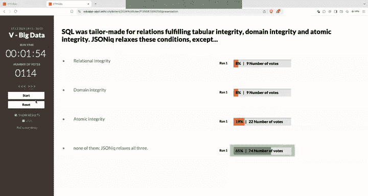

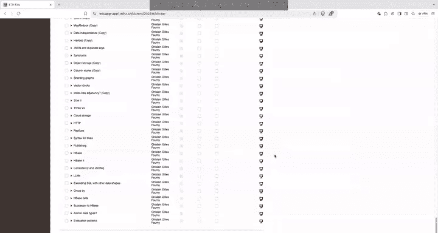

**题目3：以下哪些数据结构有对应的SQL扩展支持？**
*   答案：**全部**（树-Trees、图-Graphs、立方体-Cubes、向量-Vectors）。例如，PgSQL中的数组和对象类型、SQL/PGQ、GROUP BY CUBE以及向量数据类型。

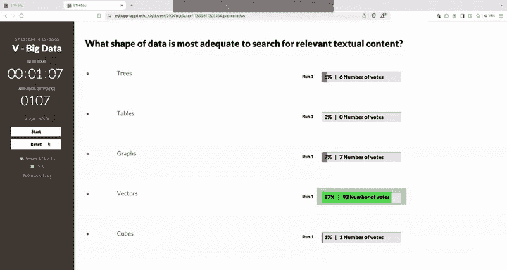

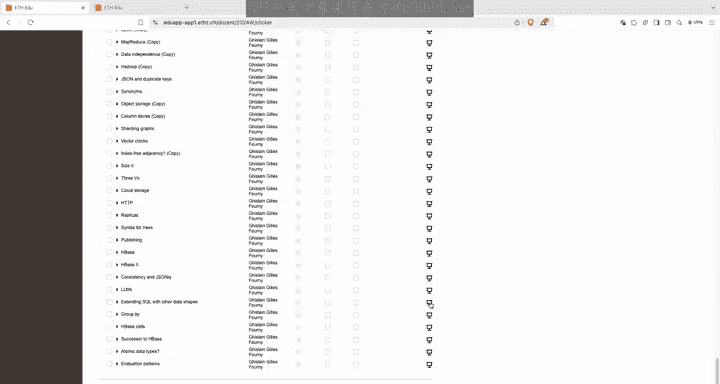

**题目4：以下哪个子句在PostgreSQL中不存在？**
*   答案：**GROUP BY GRID**。其他如CUBE、ROLLUP、GROUPING SETS均存在。

**题目5：在单个单元格中存储多大体积的数据不会导致性能问题？**
*   答案：**10兆字节（10 MB）**。通常适用于JSON、XML、视频等。

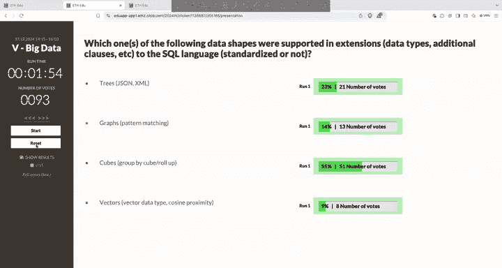

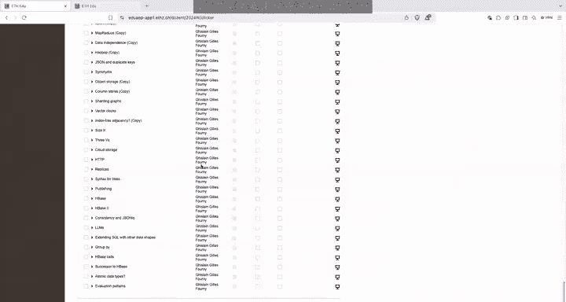

**题目6：Google继Bigtable之后使用的当前系统是什么？**
*   答案：**Spanner**。

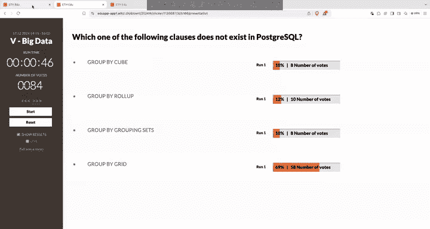

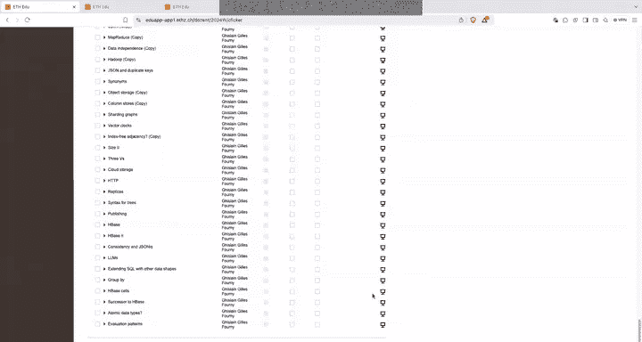

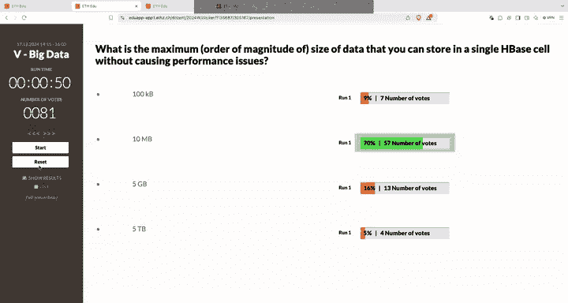

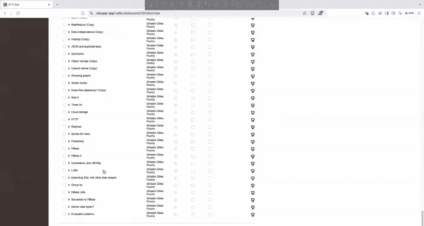

**题目7：以下哪个不是原子数据类型？**
*   答案：**数组（Array）**。

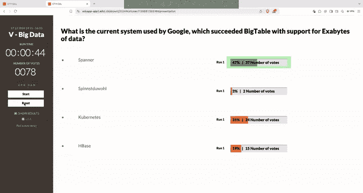

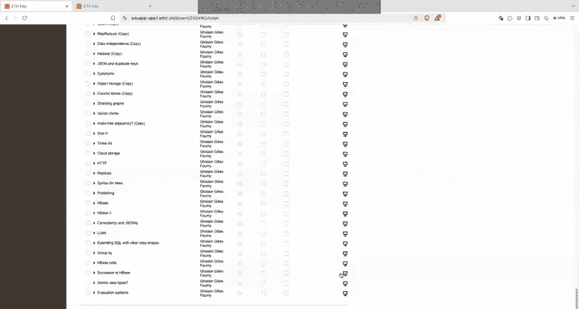

**题目8：以下哪个不是查询引擎（如MongoDB）中的物理执行模式？**
*   答案：**物化消除执行（Dematerialized Execution）**。其他如物化、流式、并行执行都是。

**题目9：2014年Spark排序100TB数据耗时多久？**
*   答案：**23分钟**。

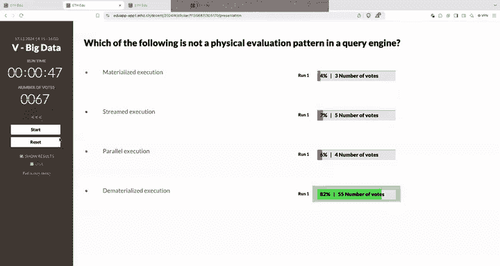

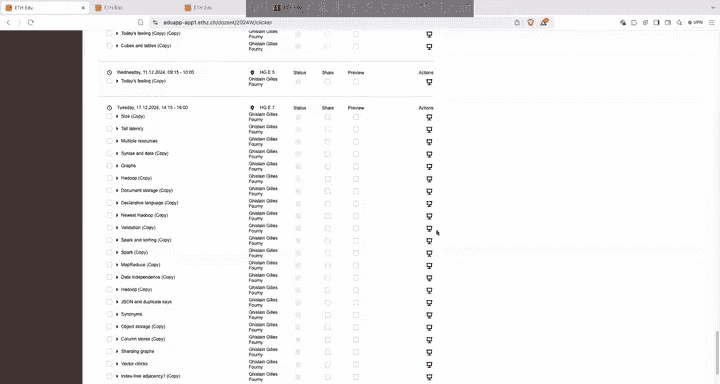

**题目10：“Hadoop”这个名字来源于？**
*   答案：**项目创始人儿子的大象玩具的名字**。

**题目11：文档存储是否需要模式（Schema）？**
*   答案：**可以拥有，甚至可以后期定义**。需要区分格式正确（Well-formed）和有效（Valid）。

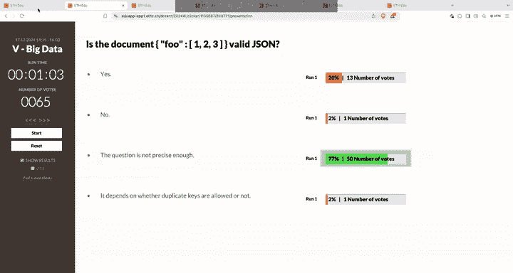

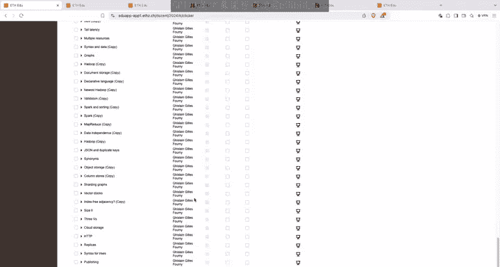

**题目12：什么是索引邻接？**
*   答案：**使用原生指针或邻接关系来构建和链接数据，以替代连接操作**。用于图数据库。

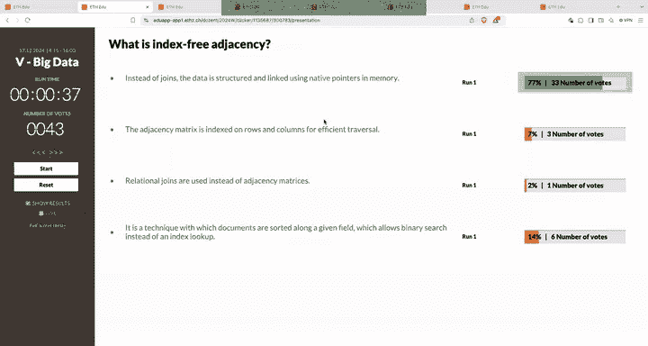

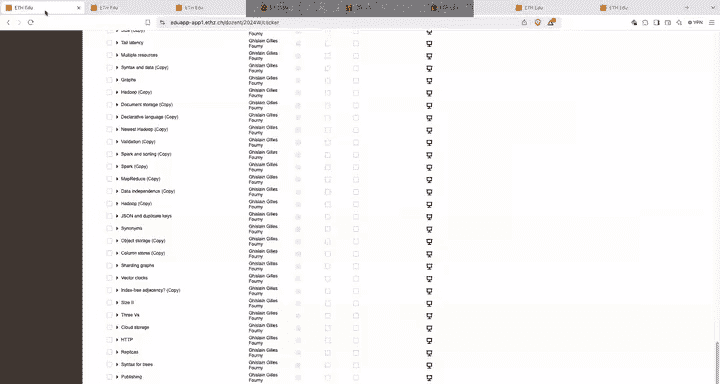

**题目13：在集群中跨多个资源（CPU、RAM、网络）进行分配的机制叫什么？**
*   答案：**主导资源公平性（Dominant Resource Fairness）**。

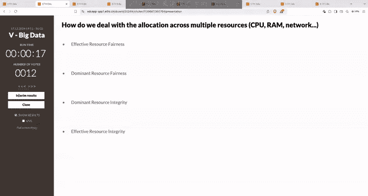

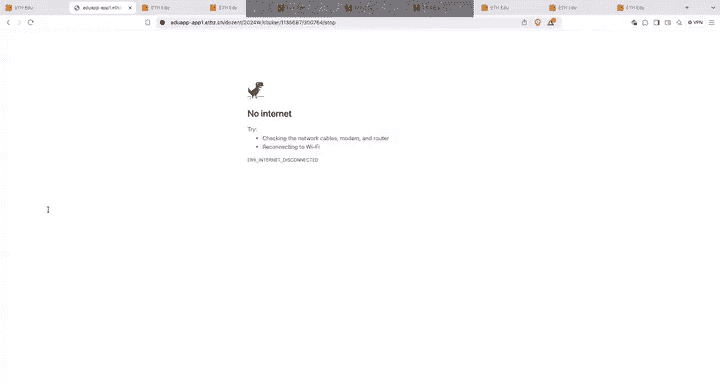

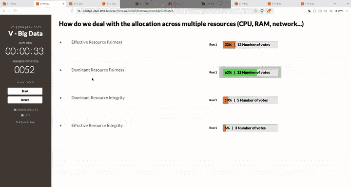

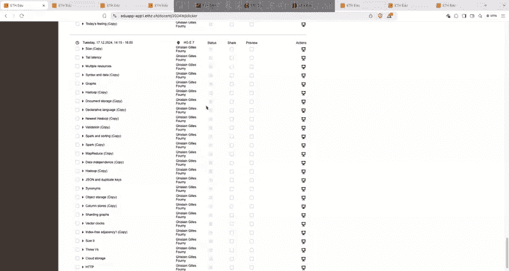

经过多轮激烈角逐，最终诞生了学生获胜者！恭喜他们。

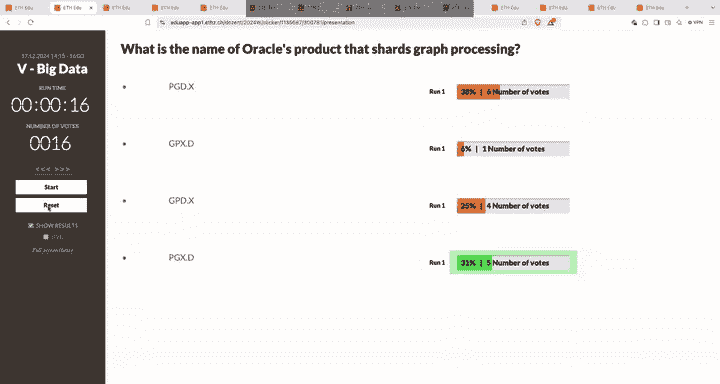

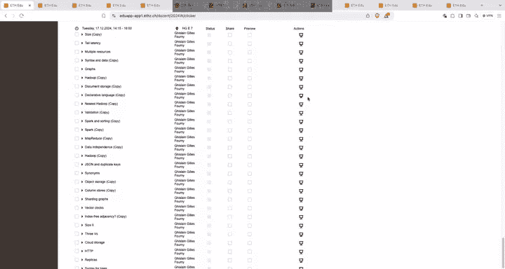

## 总结与告别 👋

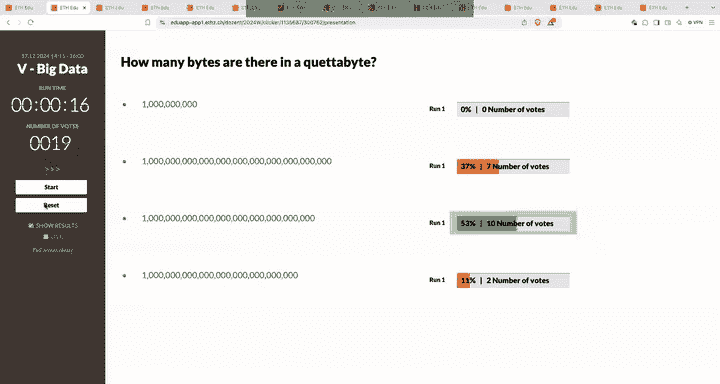

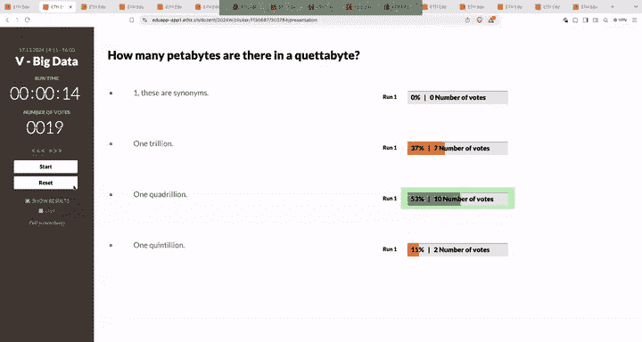

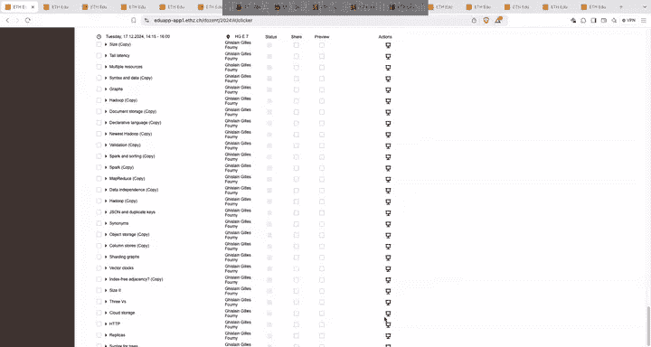

本节课中，我们一起回顾了将数据系统概念延伸至哲学思考的趣味视角，分析了课程评估的反馈结果，并详细了解了期末考试的格式、规则与备考建议。最后，通过一场精彩的知识问答游戏，在欢乐中检验了本学期的学习成果。

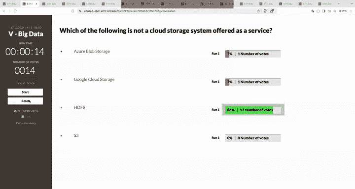

感谢大家整个学期的积极参与，这是一段非常愉快的时光。祝大家在期末考试中一切顺利，备考期间我们随时提供帮助。再见！