#  006：云存储 (3_3) 📚

在本节课中，我们将完成对云存储的讨论，重点回顾亚马逊S3的核心概念，并介绍Azure Blob存储的实现原理。我们还将探讨处理大型数据集上传的实用技巧，并简要了解键值存储与云存储的区别。

---

## 概述

上一节我们介绍了云存储的基本模型和亚马逊S3服务。本节中，我们将深入探讨使用S3存储大型数据集时的实际挑战与解决方案，并了解微软Azure Blob存储的架构设计。最后，我们会简要区分云存储与键值存储的不同应用场景。

---

## S3存储大型对象的实践技巧

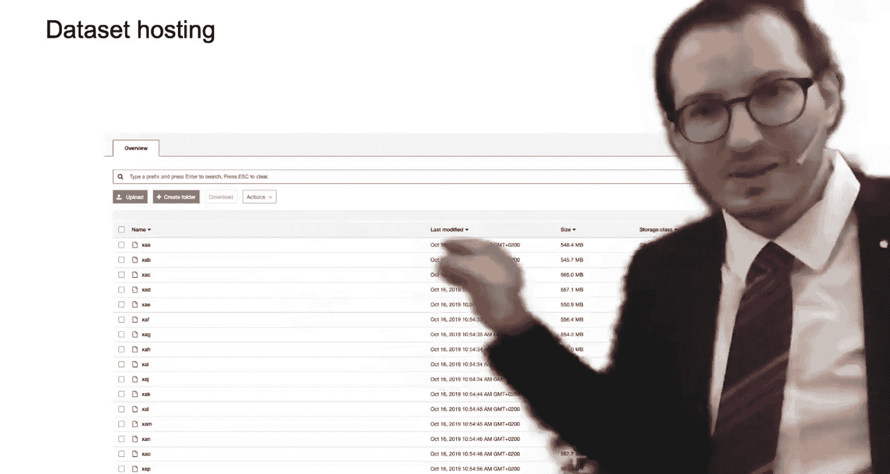

亚马逊S3允许存储的最大单个对象为5 TB。然而，在实际操作中，上传如此巨大的文件可能会遇到网络不稳定等问题，导致上传失败。

以下是解决此问题的两种方法。

### 方法一：分割为多个小对象

更可靠的做法是将大型数据集分割成许多较小的文件进行上传。例如，可以将一个5 TB的文件分割成5000个各为1 GB的对象。

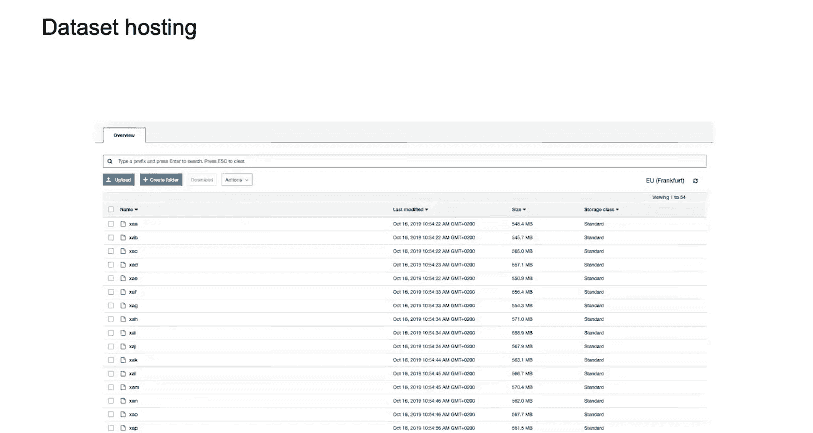

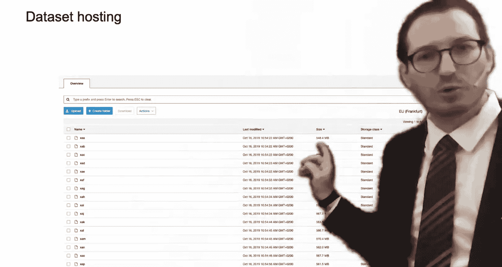

这样做的优势在于，大部分小文件的上传会成功。如果少数文件上传失败，只需重试这些特定的文件，而无需重新开始整个5 TB数据的上传过程。此外，客户端通常支持并行上传多个小文件，从而进一步提高效率。

许多数据集都采用这种分片存储的形式，每个分片大小通常在100 MB到1 GB之间。

### 方法二：使用S3分段上传API

对于确实需要存储为单个超大对象的情况，S3 API提供了一种更高级的“分段上传”功能。

其流程如下：
1.  将大文件切割成多个部分。
2.  分别上传每个部分到服务器。
3.  在所有部分上传完成后，通知S3服务将这些部分按顺序组合成一个完整的对象。

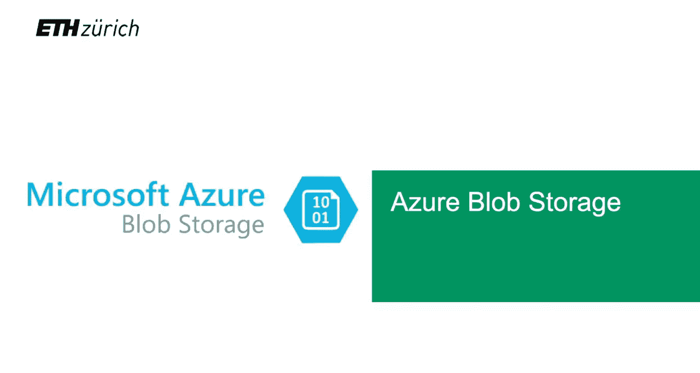

这种方法虽然更可靠，但操作相对复杂，因此更常见的做法仍是第一种。

---

## Azure Blob存储架构解析

由于亚马逊未公开S3的实现细节，我们可以通过微软Azure发布的论文来了解大型云存储系统的可能架构。Azure Blob存储与S3在高层概念上相似，但存在一些差异。

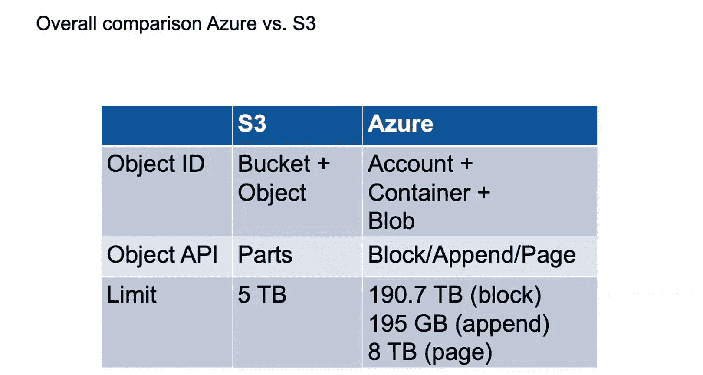

### 与S3的异同

*   **对象标识**：
    *   S3使用 **`桶ID + 对象ID`**。
    *   Azure使用 **`账户 + 容器 + Blob`** 三层结构。容器类似于S3的桶，但由于加入了账户层，全球范围内的容器名称可以重复。
*   **API与对象类型**：Azure针对不同用途提供了三种“Blob”类型：
    *   **块Blob**：适用于存储数据集，支持高效查询，单对象上限高达约190 TB。
    *   **追加Blob**：专为日志记录等只追加场景优化。
    *   **页Blob**：用于支持虚拟机运行等场景。
*   **容量限制**：Azure块Blob的单对象容量上限（190 TB）远高于S3（5 TB）。

### 内部架构：存储印记

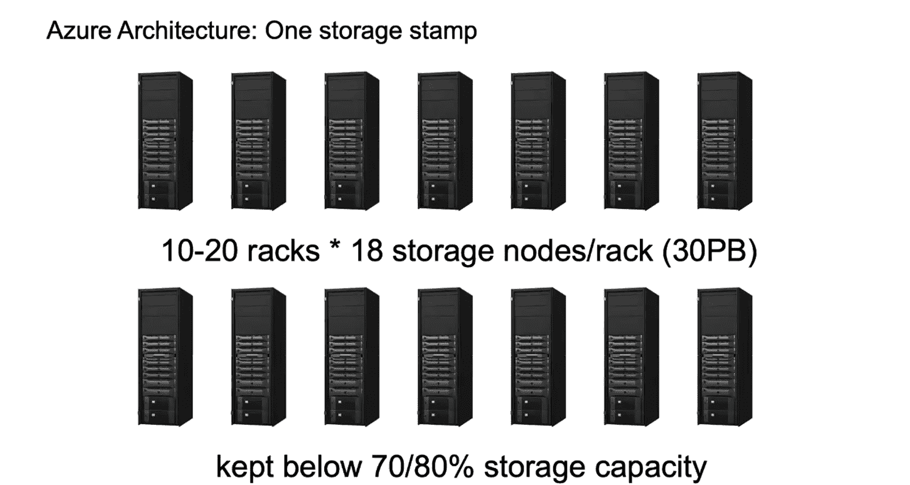

Azure的数据中心内设有许多存储房间，每个房间称为一个“存储印记”。一个印记可存储约30 PB的原始数据。

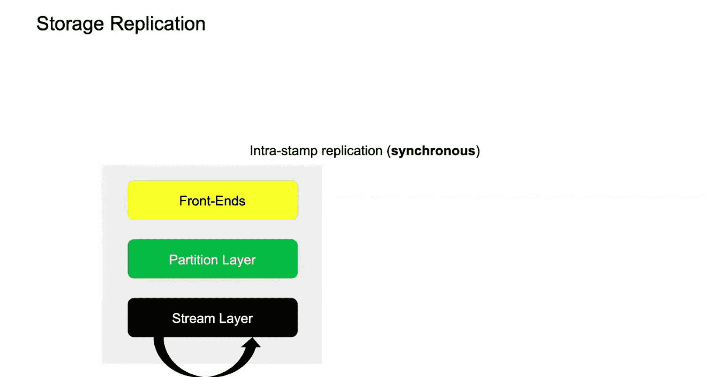

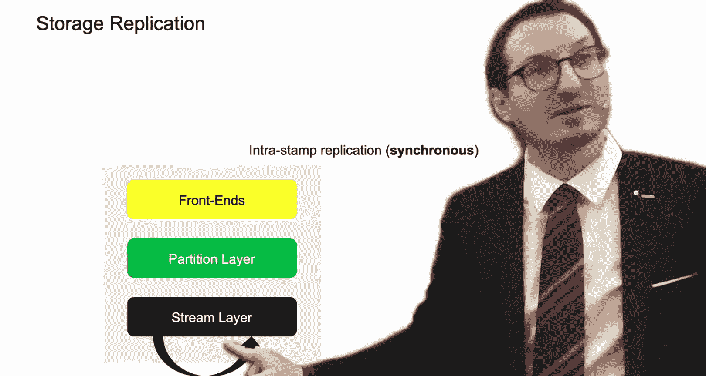

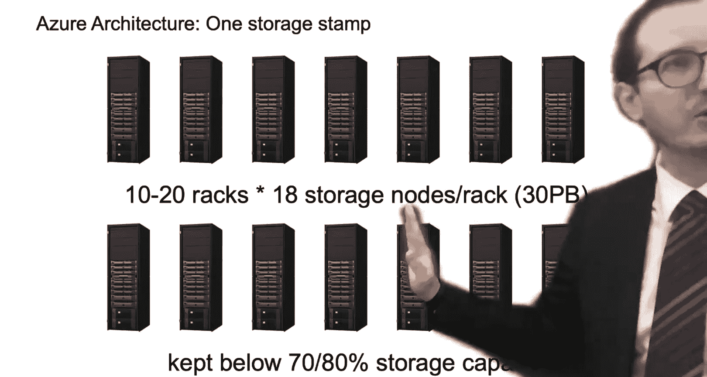

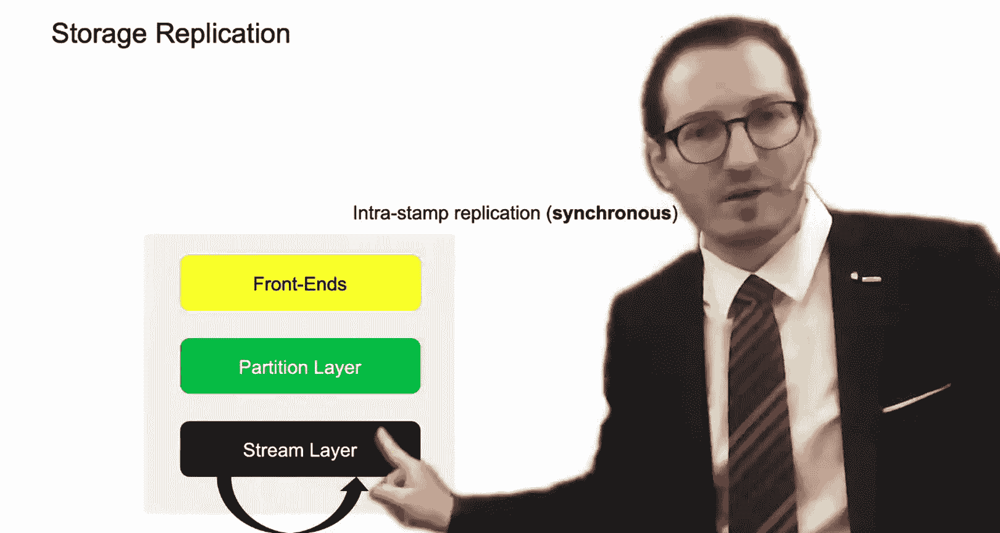

为了保证数据可靠性，系统在存储印记内部会进行**同步复制**，即将同一份数据存储多份（例如三副本）。当你上传一个新对象时，系统会等待数据在印记内成功写入多个副本后，才向你确认上传完成。

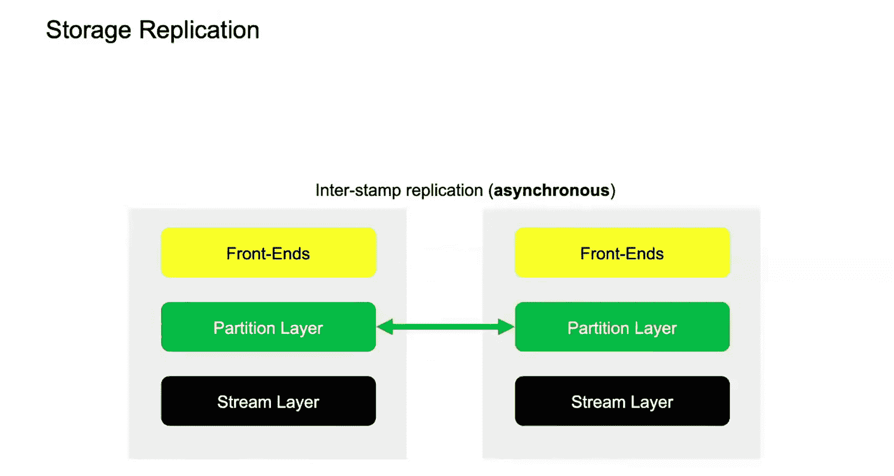

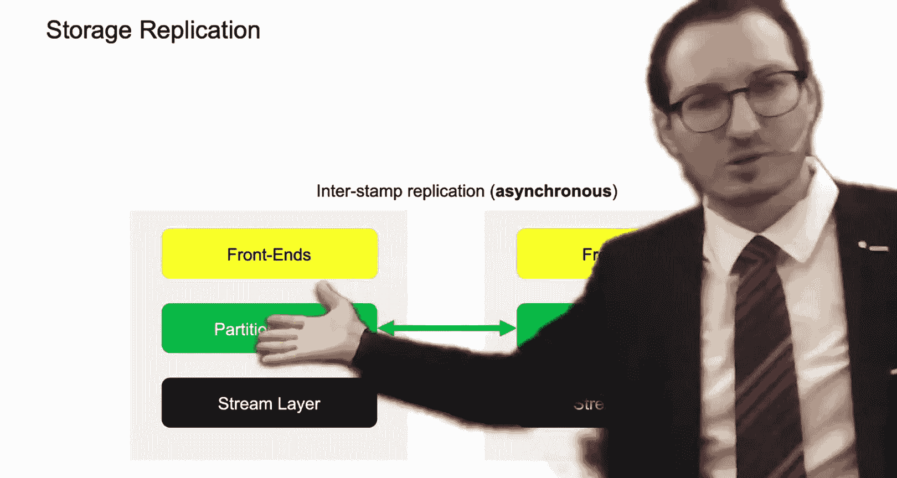

此外，系统还会在**不同地理区域的数据中心之间**进行**异步复制**。这种复制在后台进行，旨在提供灾难恢复能力和更低的访问延迟，但不会影响用户的上传确认速度。

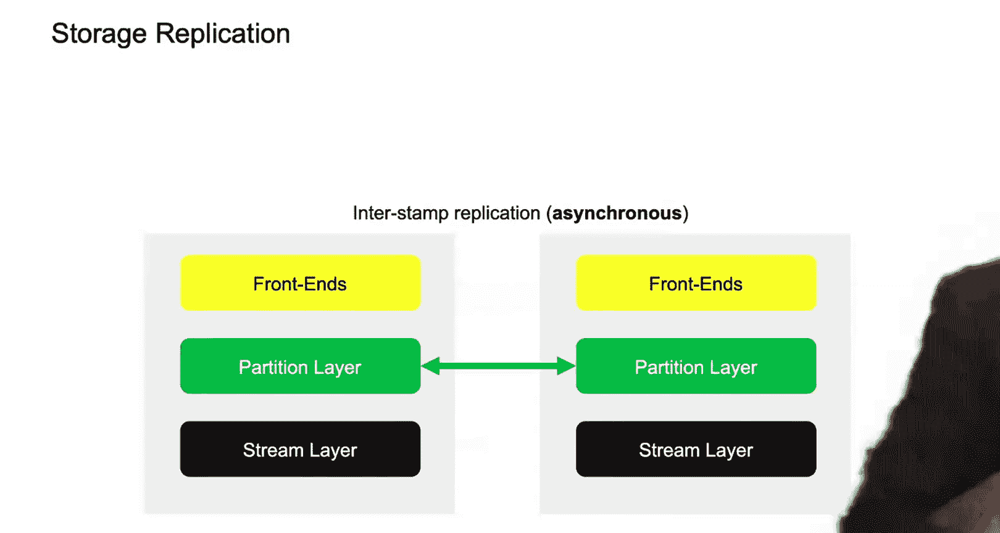

这种跨区域复制主要出于两个目的：
1.  **降低延迟**：将数据副本放置在靠近用户的地理位置，可以极大减少访问延迟，提升用户体验。
2.  **灾难恢复**：防止因火灾、地震等自然灾害导致单个数据中心数据完全丢失。

---

## 云存储与键值存储

虽然云存储（如S3）和键值存储（如DynamoDB）都使用基于键的扁平数据模型，但它们是针对不同场景设计的系统。

以下是两者的核心区别：

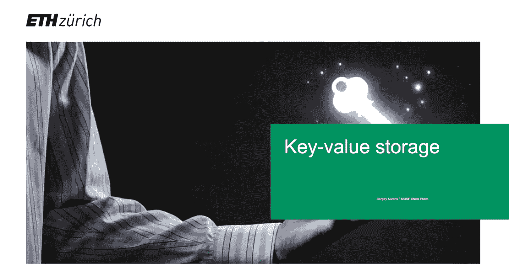

*   **对象大小**：
    *   云存储的对象通常很大，范围从**GB到TB级**。
    *   键值存储的对象通常很小，在**KB到MB级**。
*   **性能与延迟**：
    *   云存储的读写延迟较高，通常在**几百毫秒**级别。
    *   键值存储为交互式应用设计，追求极低延迟，通常在**个位数毫秒**级别。
*   **典型应用**：
    *   **云存储**：存储视频、图片、静态网站文件、大型数据集备份。
    *   **键值存储**：存储用户会话、购物车商品、社交媒体帖子和评论等需要快速读写的元数据。

简而言之，**不能直接用S3来构建需要毫秒级响应的交互式数据库**。

---

## 主要云提供商概览

市场上主要的云提供商（亚马逊AWS、微软Azure、谷歌云）在高层服务上相似，都提供虚拟机、云存储、数据库等服务，但理念略有不同：
*   **AWS**：提供极其丰富的细分服务，像“自助拼图”。
*   **Azure**：服务数量相对较少，但单个服务（如Cosmos DB）的功能往往更集成、更强大。

---

## 总结

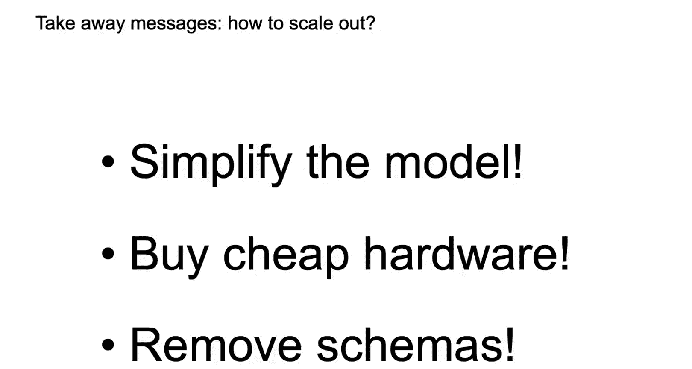

本节课中我们一起学习了：
1.  **处理大型数据集上传**的实用技巧：优先将数据**分割成多个小对象**上传以提高可靠性。
2.  **Azure Blob存储**的架构原理：了解了数据在“存储印记”内的同步复制和跨区域的异步复制机制，及其对延迟和灾备的意义。
3.  **云存储与键值存储**的根本区别：前者用于存储**大对象**，延迟较高；后者用于存储**小对象**，追求**极低延迟**，服务于不同的应用场景。

云存储是我们构建大数据处理流水线的基石。接下来，我们将在此基础上，继续探讨分布式文件系统。