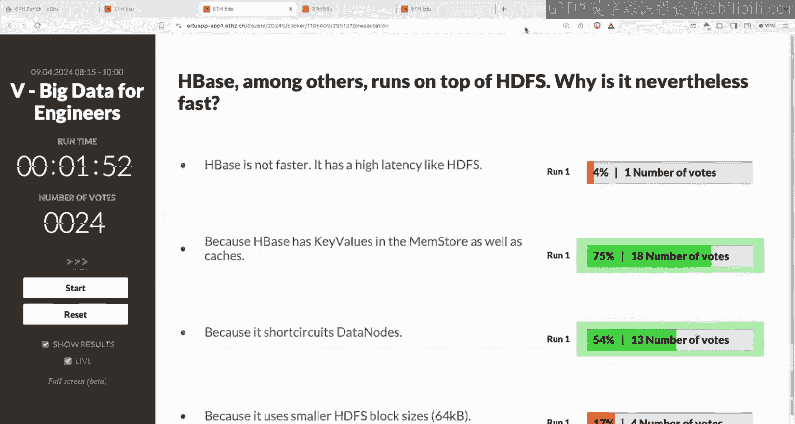
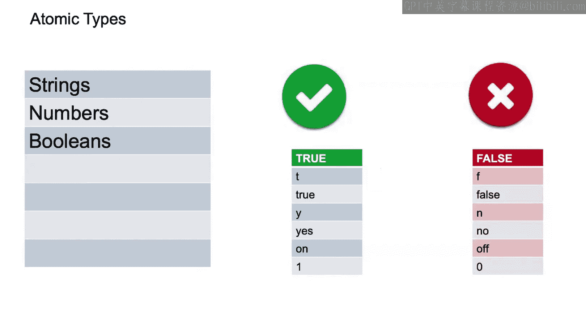

#  016：数据模型 (2/4) 🗄️


在本节课中，我们将继续学习数据模型。我们将深入探讨JSON和XML文档在内存中的树形结构表示，理解数据模型与语法的分离，并初步了解数据验证和类型系统的概念。




## 从语法到逻辑模型

上一节我们介绍了数据模型的基本概念。本节中，我们来看看JSON和XML文档是如何从文本语法转换到内存中的逻辑模型的。

当我们处理一个CSV、JSON或XML文件时，首先看到的是文本。但计算机在内存中并不直接存储这些文本，而是将其转换为一种更高效、便于查询的结构。

*   **解析**： 将文本格式（如CSV、JSON、XML）转换为内存中的逻辑表示（如表、树）的过程。
*   **序列化**： 将内存中的逻辑表示转换回文本格式的过程。

对于CSV，逻辑模型是一个由行和列组成的表格。对于JSON和XML，逻辑模型是一棵树。

## JSON与XML的树形结构

JSON和XML的文档结构在内存中都可以表示为树。理解这一点是高效查询和处理数据的关键。

### JSON数据模型

JSON有六种基本构建块：字符串、数字、布尔值、`null`（原子值），以及对象和数组（结构值）。对象是字符串到值的映射，数组是值的列表。这种嵌套结构自然形成了一棵树。

**示例**： 对于JSON文档 `{"foo": true, "bar": [{"baz": 1}, null]}`，其树形表示如下：
```
        Object (root)
        /          \
    key:"foo"    key:"bar"
       /              \
    value:true      Array
                   /      \
              Object      value:null
                 |
            key:"baz"
                 |
            value:1
```
树的根节点是一个对象。原子值（如 `true`, `1`, `null`）是树的叶子节点。对象和数组是中间节点。对象边的标签是键名，数组边则没有标签。

### XML数据模型

XML文档也表示为树。W3C的XML信息集规范定义了如何从XML文档构建树。主要节点类型包括文档、元素、属性和文本。

**示例**： 对于以下XML文档：
```xml
<?xml version="1.0"?>
<metadata>
  <title lang="en" year="2022">Systems Group</title>
  <publisher>ETH Zurich</publisher>
</metadata>
```
其树形结构如下：
```
            Document
                |
            Element: metadata
            /               \
    Element: title      Element: publisher
      /      |     \            |
Attribute: Attribute: Text:   Text:
  lang      year  Systems    ETH Zurich
   |         |     Group
 value:en  value:2022
```
元素名在节点上，属性名和文本内容是节点的属性或子节点。

**JSON与XML树的关键区别**： 在JSON中，对象键的名称位于指向子节点的边上，子节点本身不知道自己的“名字”。在XML中，元素的名字是节点自身的属性。

## 数据验证与模式

解析得到树形结构后，下一步通常是验证。验证是检查文档是否符合特定结构要求的过程，它与检查文档格式是否正确的“良构性”是两个独立的步骤。

1.  **良构性检查**： 文档是否符合JSON/XML的基本语法规则？是/否。如果否，则无法解析。
2.  **有效性验证**： 解析后的树形结构是否符合某个模式（Schema）的额外约束？是/否。

在关系型数据库中，模式是强制的，系统会阻止插入不符合模式的数据。而在JSON/XML生态中，验证是可选的。这带来了灵活性：

*   **无模式（异构集合）**： 文档结构可以各不相同，适用于数据尚未清洗或格式多样的场景（如某些机器学习数据集）。
*   **有模式（同构集合）**： 所有文档遵循相同的结构，便于进行规范化处理、高效查询和转换为数据框（如Pandas DataFrame）。

验证的一个重要功能是**类型注解**。例如，XML中的文本“2024”在解析后只是字符串。但如果模式规定该处应为整数，验证后，在内存中它会被转换为真正的整数类型（如32位二进制数），从而节省空间并提升处理效率。

## 数据类型系统概述

模式中会使用类型系统来定义约束。不同的技术（如XML Schema、JSON Schema、Python、Java）有各自的类型系统，但核心思想相通。类型通常分为原子类型和结构类型。

### 原子类型

以下是几种常见的原子类型：

*   **字符串**： 字符序列。例如 `"Hello"`。
*   **整数**： 整数值。在计算机中，整数以二进制位存储，有不同的范围：
    *   `byte` (8位): 0 到 255。
    *   `short` (16位): 约 -32,768 到 32,767。
    *   `int` (32位): 约 -21亿 到 21亿。
    *   `long` (64位): 约 -9.22×10¹⁸ 到 9.22×10¹⁸。
    *   **代码示例**： `int viewCount = 1000000;` (Java)
*   **小数**： 包含小数点的数字。涉及两个概念：
    *   **精度**： 数字的总位数。
    *   **标度**： 小数点后的位数。
    *   **公式**： `DECIMAL(precision, scale)`，例如 `DECIMAL(5,2)` 可以存储 `123.45`。
*   **浮点数**： 用于近似表示实数，采用科学计数法原理，在固定位数（32位单精度或64位双精度）内存储一个很大范围的数。这是计算机硬件广泛支持的高效格式。
    *   **公式**： `值 = 尾数 × 2^指数`



本节课中我们一起学习了JSON和XML文档在内存中的树形逻辑模型，理解了数据验证（有效性检查）与语法检查（良构性）的区别，并初步认识了数据类型系统的基本分类，特别是整数和小数的不同存储方式与约束。下一节我们将继续深入探讨结构类型和数据验证的具体实现。