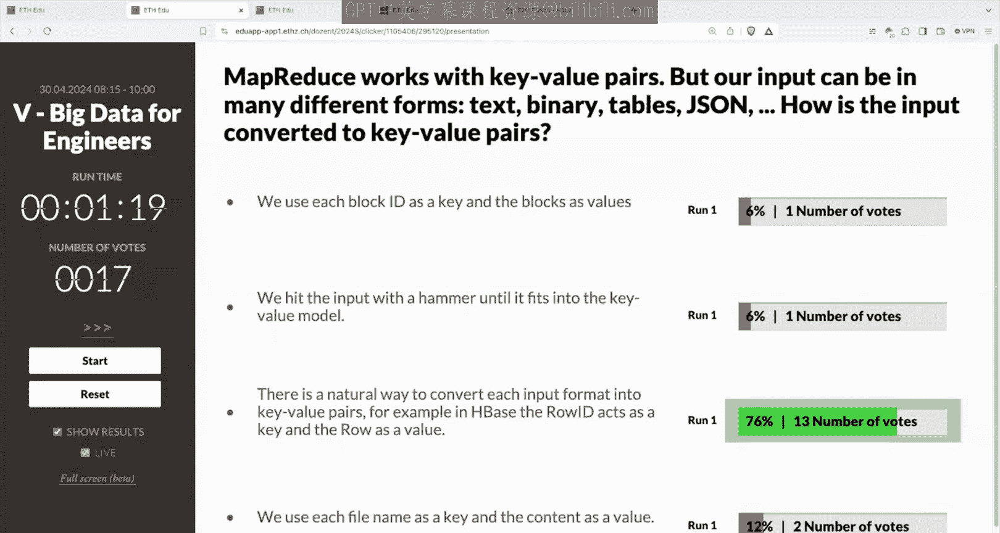
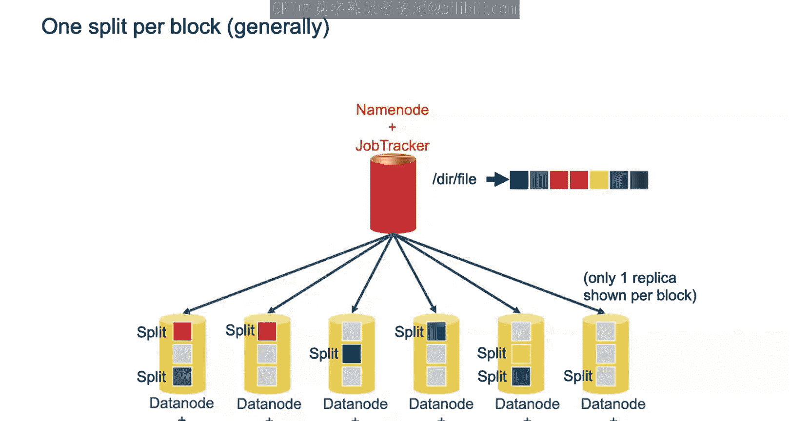
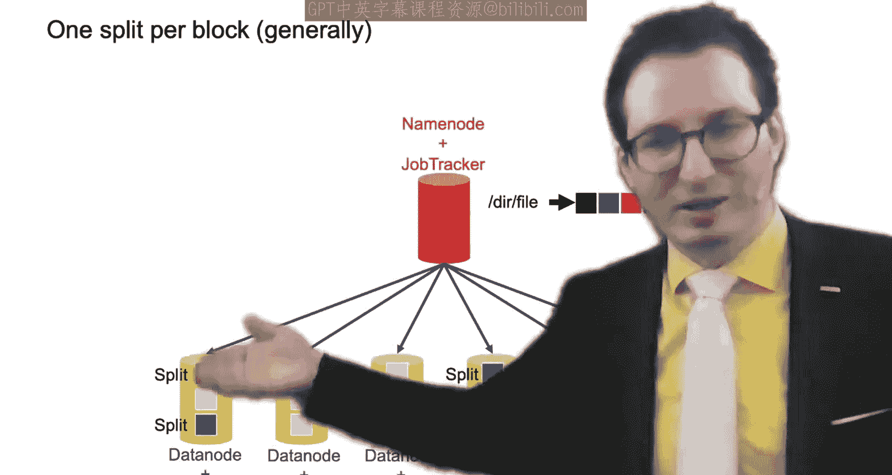
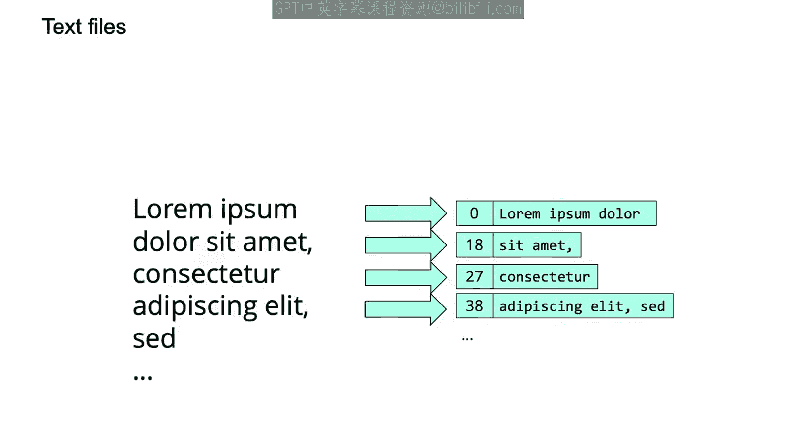
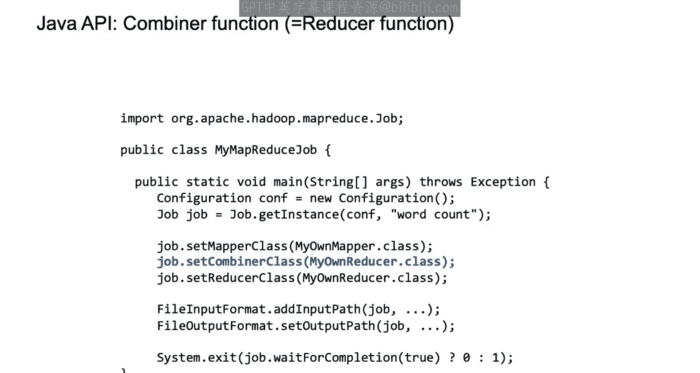
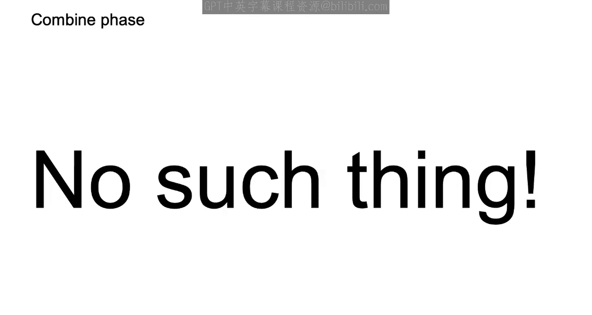

#  020：MapReduce 物理架构与核心概念 🧠

在本节课中，我们将要学习 MapReduce 的物理架构，了解其内部如何执行任务，并探讨如何将各种数据格式映射到键值对模型。我们还将学习一些关键的优化技术，如合并器（Combiner），并澄清 MapReduce 中函数、任务、槽位和阶段等核心概念的区别。

## 物理架构与执行流程

上一节我们介绍了 MapReduce 的逻辑模型（Map-Shuffle-Reduce）。本节中我们来看看它的物理架构是如何实现这一模型的。

MapReduce 采用集中式架构，类似于 HDFS 和 HBase。其核心思想是 **将计算带到数据所在之处**。

*   **主节点**：运行着 HDFS 的 NameNode 进程和 MapReduce 的 JobTracker 进程，负责协调整个作业。
*   **工作节点**：每个节点运行着 HDFS 的 DataNode 进程（存储数据块）和 MapReduce 的 TaskTracker 进程（执行具体的 Map 和 Reduce 任务）。

数据以块（Block）的形式存储在 HDFS 中，并分布在整个集群的工作节点上。MapReduce 将每个数据块（或稍作调整的“分片”，Split）作为一个独立的处理单元。这样，Map 任务可以直接在存储该数据块的本地机器上启动，避免了大量不必要的数据网络传输，极大地提高了效率。

以下是 MapReduce 作业的详细执行步骤：

1.  **Map 阶段**：每个 Map 任务槽位（Slot，可理解为 CPU 核心）读取一个分片，并对其中的每条记录调用用户定义的 `map` 函数，生成中间键值对。这些键值对首先被写入内存缓冲区。
2.  **溢写与合并**：当内存缓冲区满时，系统会将数据“溢写”（Spill）到该工作节点的本地磁盘（而非 HDFS）。在溢写前后，可以可选地使用 **合并函数** 对具有相同键的中间结果进行本地聚合（例如，将多个 `(word, 1)` 合并为 `(word, 3)`），这能减少写入磁盘和后续网络传输的数据量。多次溢写可能产生多个小文件，系统会像 LSM 树一样对它们进行合并（Compact）。
3.  **Shuffle 阶段**：这是网络密集型阶段。每个 Reduce 任务槽位需要获取所有 Map 任务产生的、其负责处理的键（例如，负责处理单词“hello”的 Reducer 会向所有 Mapper 请求标记为“hello”的键值对）。数据通过网络（通常基于 HTTP 协议）从各个 Map 节点拉取到相应的 Reduce 节点。此阶段确保所有相同键的键值对最终都汇聚到同一个 Reduce 节点上。
4.  **Reduce 阶段**：当某个键的所有值都到达 Reduce 节点后，Reduce 任务槽位会调用用户定义的 `reduce` 函数处理该组数据（例如，对所有的“1”进行求和）。处理是逐个键组顺序进行的。
5.  **输出**：每个 Reduce 任务将其输出写入 HDFS 或其他存储系统的一个独立文件中。因此，MapReduce 作业的最终输出通常是一个包含多个文件（分片）的目录。

## 数据到键值对的映射

MapReduce 处理的一切都是键值对。但原始数据（如文本、数据库表）并非天然以键值对形式存在。那么，如何映射呢？

好消息是，MapReduce 框架或相关库提供了便捷的方式来完成这种转换。其核心思想是：**任何数据集都可以被看作记录的集合，而每条记录都可以被映射为一个键值对**。

以下是几种常见数据格式的映射方式：

*   **关系型表 / HBase 表**：
    *   **键**：通常使用表的主键（关系型）或行键（HBase）。
    *   **值**：该行/记录的所有其他列数据。
    *   **公式**：`(row_key, (col1, col2, ...))`
*   **文本文件（按行）**：
    *   **键**：该行在文件中的起始字节偏移量（Offset）。
    *   **值**：该行的文本内容。
    *   **公式**：`(line_offset, line_text)`
*   **文本文件（键值分隔符）**：
    *   如果文本行本身包含特定分隔符（如制表符、逗号），则可以直接拆分。
    *   **键**：分隔符之前的部分。
    *   **值**：分隔符之后的部分。
    *   **公式**：`split(line, delimiter) -> (key_part, value_part)`
*   **结构化文件（JSON, CSV, Parquet 等）**：
    *   首先通过相应解析器将文件内容转换为记录集合。
    *   然后为每条记录分配一个键（如行号、ID）和值（记录内容）。

## 使用 MapReduce 实现基本操作

理解了映射方式后，我们可以用 MapReduce 模型实现类似数据库的操作。

*   **筛选**：在 `map` 函数中，检查每条输入记录是否满足条件。如果满足，则原样输出该键值对；否则，不输出。`reduce` 函数可以设置为恒等函数（直接输出输入），甚至可以直接省略 Reduce 阶段。
    *   **类比 SQL**：`SELECT * FROM table WHERE condition`
*   **投影**：在 `map` 函数中，解析每条记录（如 JSON 对象），只提取所需的字段，然后输出新的键值对。同样，`reduce` 阶段通常不需要。
    *   **类比 SQL**：`SELECT column1, column2 FROM table`
*   **单词计数**：
    *   **Map**：读取文本行，分割成单词，为每个单词输出 `(word, 1)`。
    *   **Shuffle**：将相同单词的 `(word, 1)` 对分组到一起。
    *   **Reduce**：对每个单词对应的所有“1”进行求和，输出 `(word, total_count)`。

## 优化：合并器

在单词计数的例子中，如果同一个 Map 任务处理的数据块中单词“hello”出现了 100 次，它会输出 100 个 `(hello, 1)`。这会在 Shuffle 阶段产生大量网络传输。

**合并器** 是一个可选的优化函数，它在 Map 端本地运行，作用类似于一个迷你的、本地的 Reduce。它会在 Map 任务将中间结果溢写到磁盘之前或合并小文件时，对相同键的值进行局部聚合。

*   **作用**：减少需要写入本地磁盘和通过网络 Shuffle 的数据量。
*   **要求**：为了不改变最终结果，合并函数必须是 **可交换** 和 **可结合** 的。例如，加法、求最大值都满足这个条件，而求平均值则不满足（因为平均值的平均值不等于总平均值）。
*   **代码示例**：在单词计数中，合并器可以将 `(hello, 1), (hello, 1), (hello, 1)` 合并为 `(hello, 3)`。通常，可以直接将 Reduce 函数用作合并器。

## 核心概念辨析

为了避免混淆，清晰区分以下概念至关重要：

*   **函数**：是纯数学或编程逻辑。
    *   `map` **函数**：`(k1, v1) -> list((k2, v2))`
    *   `reduce` **函数**：`(k2, list(v2)) -> list((k3, v3))`
    *   `combiner` **函数**：一个优化用的、符合结合交换律的 `reduce` 函数。
*   **任务**：是一个工作单元。
    *   **Map 任务**：负责对一个输入分片中的所有记录顺序调用 `map` 函数。
    *   **Reduce 任务**：负责对一组相同键的所有值顺序调用 `reduce` 函数。
    *   **不存在“Combiner 任务”**，它只是 Map 任务内部的一个优化步骤。
*   **槽位**：是硬件资源，代表一个 CPU 核心及其内存。一个槽位**顺序地**执行一个又一个任务（Map 或 Reduce）。
*   **阶段**：是并行执行的范畴。
    *   **Map 阶段**：所有 Map 任务槽位**并行地**执行各自的 Map 任务。
    *   **Reduce 阶段**：所有 Reduce 任务槽位**并行地**执行各自的 Reduce 任务。
    *   **Shuffle 阶段**：数据在网络上重新分配。

**类比**：想象你和朋友要写 50 张明信片。
*   **函数**：是“在明信片上写字”这个动作规则。
*   **任务**：是“写完这 10 张明信片”这个具体工作包。
*   **槽位**：是你们这几个“成年人”，每个人一次只能拿一个任务包顺序地写。
*   **阶段**：是“所有成年人同时开始写各自手里的明信片”这个并行过程。
*   **Combiner**：类似于你在写一个任务包的明信片时，发现有三张都是寄给 Alice 的，于是你决定把它们合并成一个包裹寄出，而不是分三封信。

本节课中我们一起学习了 MapReduce 的物理执行架构，掌握了将不同数据源映射到键值对模型的方法，并使用该模型实现了筛选、投影和聚合等基本操作。我们还探讨了通过合并器来优化作业性能的原理，并厘清了函数、任务、槽位和阶段这些核心概念的区别，这对于深入理解和高效使用 MapReduce 至关重要。