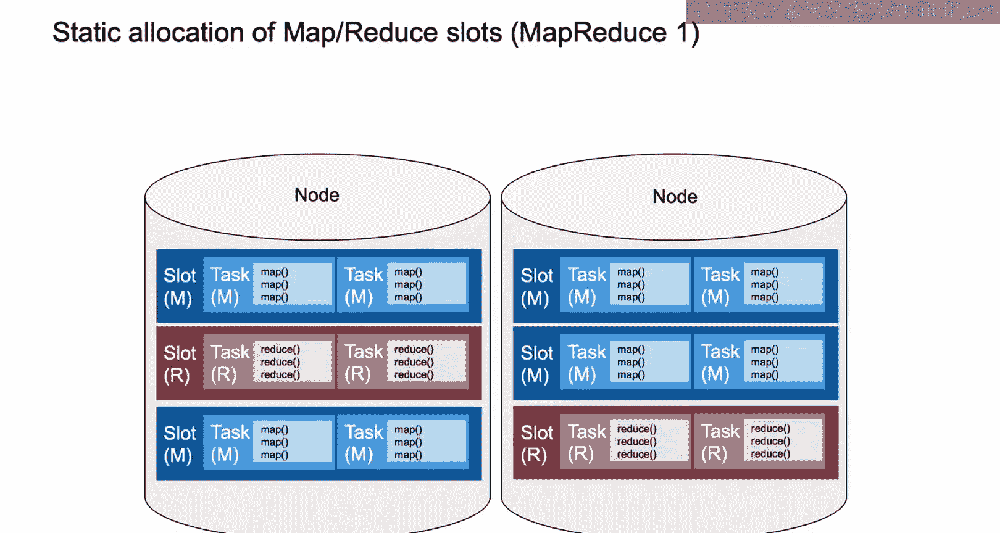
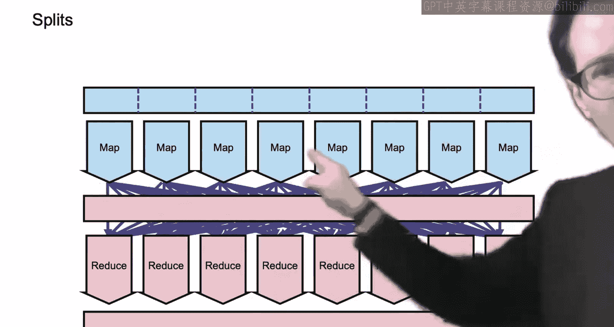
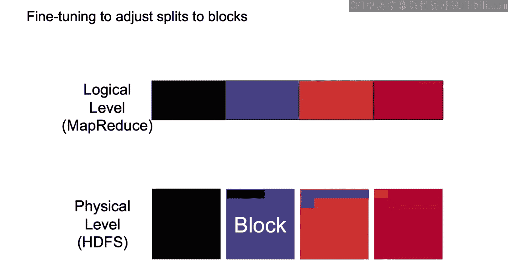

#  021：MapReduce 核心概念与实现细节 🧠

在本节中，我们将深入探讨 MapReduce 框架中一些关键但容易混淆的概念，特别是任务、槽位、函数之间的关系，以及数据分片与 HDFS 块之间的微妙差异。理解这些细节对于掌握 MapReduce 的内部工作原理至关重要。

上一节我们介绍了 MapReduce 的基本流程，本节中我们来看看其内部执行模型和一些需要特别注意的细节。

## 核心概念澄清：函数、任务与槽位

首先，必须明确区分“函数”、“任务”和“槽位”这三个概念。网络上常见的“Mapper”、“Combiner”、“Reducer”等术语容易产生误导，因为它们可能指代不同的东西。当你看到这些术语时，应该问自己：它指的是一个**函数**，一个**任务**，一个**槽位**，还是一个**处理阶段**？保持这种清晰的区分，能帮助你更好地理解在线资料。

以下是这些核心概念的定义：

*   **函数**：这是一个纯粹的数学或编程概念。在代码中，它就是一个 Java 或 Python 函数。例如，`map` 函数和 `reduce` 函数。
    *   **公式/代码表示**：`map(k1, v1) -> list(k2, v2)` 和 `reduce(k2, list(v2)) -> list(v3)`
*   **任务**：这是对一个函数的**一次顺序、重复的调用**。例如，一个 Map 任务就是对一个数据分片调用一次 `map` 函数。`Combiner` 是一个特殊的函数，它也可能被任务调用。
*   **槽位**：这是执行任务的物理或逻辑单元。一个槽位会**顺序地、一个接一个地处理任务**。当一个任务完成后，槽位会立即获取下一个任务。只有当所有任务都完成后，槽位才会进入等待状态。**在单个槽位内部，所有处理都是顺序执行的**。

真正的并行性发生在**槽位之间**。每个槽位通常对应一个 CPU 核心或虚拟核心（实际上是以线程方式运行）。因此，MapReduce 的并行是通过多个槽位同时处理不同的任务来实现的，而在单个槽位内则是串行的。

作为用户，你无需关心底层的槽位和任务调度。你的责任仅仅是：
1.  实现 `map` 和 `reduce` 函数。
2.  决定数据的读取和写入位置。
3.  （可选）实现一个 `combiner` 函数。

其余所有工作，包括任务拆分、调度、容错等，都由 MapReduce 框架自动完成。

## 系统架构视图

下图展示了 MapReduce 作业在集群中的执行视图：

*   **节点**：代表集群中的物理机器。
*   **槽位**：每台机器上有多个槽位（因为现代机器通常有多个CPU核心）。图中用蓝色和红色方块表示。
*   **任务类型**：槽位被静态地预先分配为 **Map 槽位**（蓝色）或 **Reduce 槽位**（红色）。一个 Map 任务只能在 Map 槽位中运行，Reduce 任务亦然。
*   **执行流程**：每个槽位顺序处理分配给它的任务（Map 或 Reduce）。框架动态地将任务分配给空闲的槽位，先完成任务的槽位会优先获取新任务。

## 一个关键细节：分片与 HDFS 块

现在，我们来探讨一个容易混淆但非常重要的技术细节。之前提到，每个 HDFS 块（默认128MB）通常会生成一个 MapReduce 分片，从而对应一个 Map 任务。但这并非绝对精确。

让我们先回顾基本关系：
*   每个 **Map 任务** 处理一个 **分片**。
*   每个 **分片** 通常对应一个 **HDFS 块**。

问题在于：
*   **HDFS 块** 是基于**字节**划分的。HDFS 将文件严格地按128MB（或更小，对于末尾块）的字节边界进行切割，它只看到0和1，不关心数据的逻辑结构。
*   **MapReduce 分片** 则是基于**键值对记录**划分的。一个分片必须包含完整的键值对，分片的边界必须在某个键值对结束之后。

这就导致了“阻抗不匹配”。一个键值对很可能被HDFS的字节边界切割开，横跨两个物理块。例如，一个块中的最后一个键值对可能开始于当前块，但结束于下一个块。

**那么 MapReduce 如何处理？**
1.  负责处理该分片的 Map 任务会从“主”块（即分片起始块）所在机器进行本地读取（遵循“数据本地性”原则）。
2.  为了读取那个被跨块分割的、不完整的最后一个键值对，该任务可能需要从存储下一个块的另一台机器上通过网络读取缺失的**几个字节**（而不是整个128MB的块）。

**好消息是**：这一切对 MapReduce 用户是透明的。Hadoop 和 Google 的工程师已经处理了这种复杂性。你只需要知道分片和块之间存在这种细微差别即可。

本节课中我们一起学习了 MapReduce 执行模型的核心概念，明确了函数、任务和槽位的区别，并深入了解了数据分片与物理存储块之间微妙但重要的差异。理解这些底层细节，有助于你更有效地使用和调试 MapReduce 程序。