#  022：Spark (1/5) 🔥

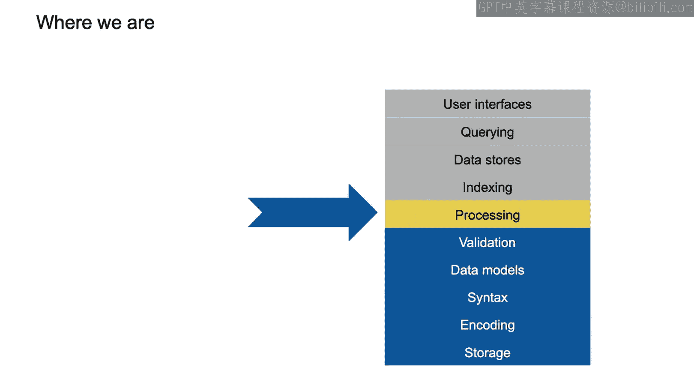

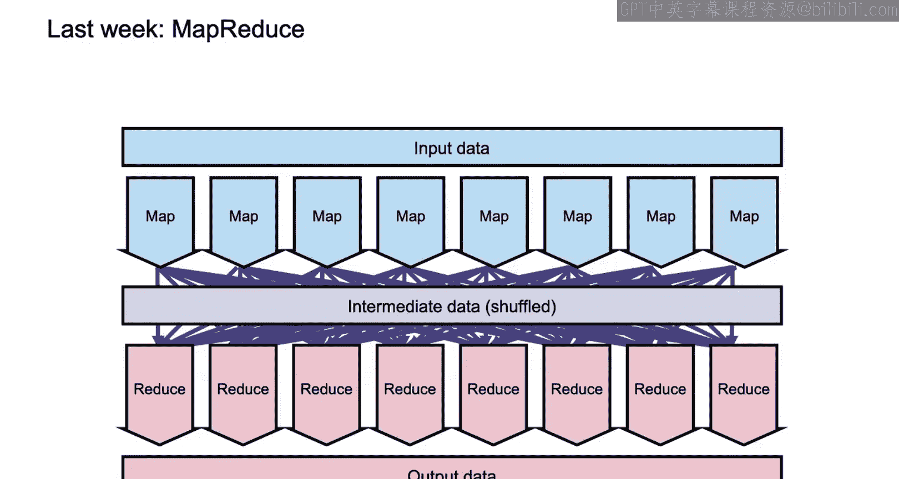

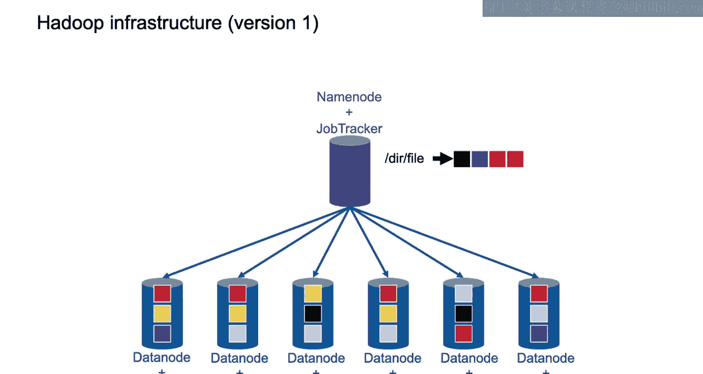

在本节课中，我们将要学习大数据处理框架的演进，从MapReduce的局限性到其下一代解决方案——Apache Spark。我们将探讨资源管理框架YARN如何解决MapReduce v1的瓶颈，并详细介绍Spark的核心概念：弹性分布式数据集（RDD）及其处理模型。

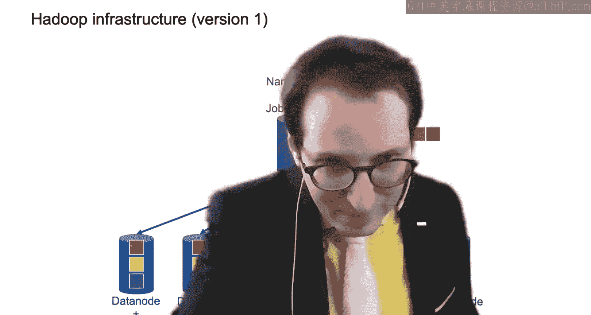

---

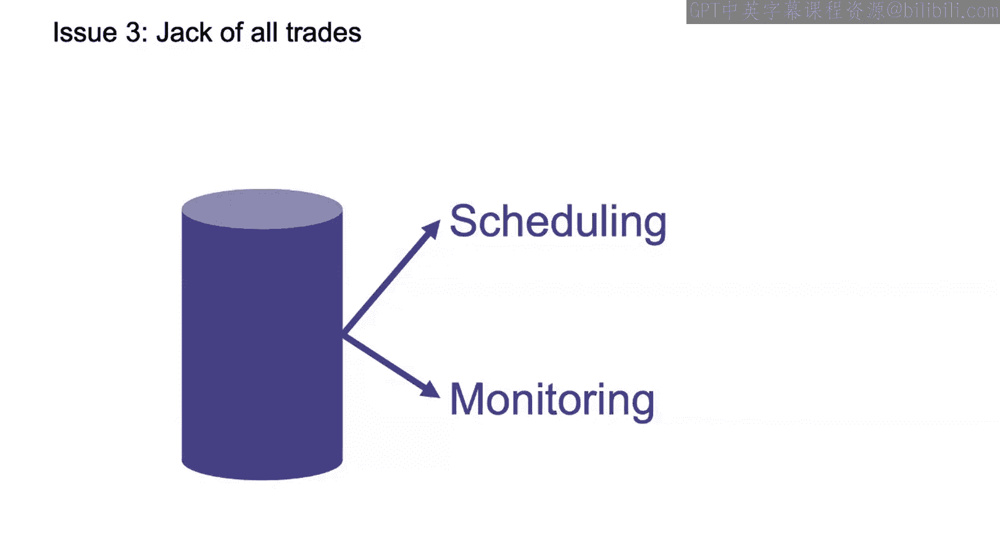

## 从MapReduce到Spark的演进 🚀

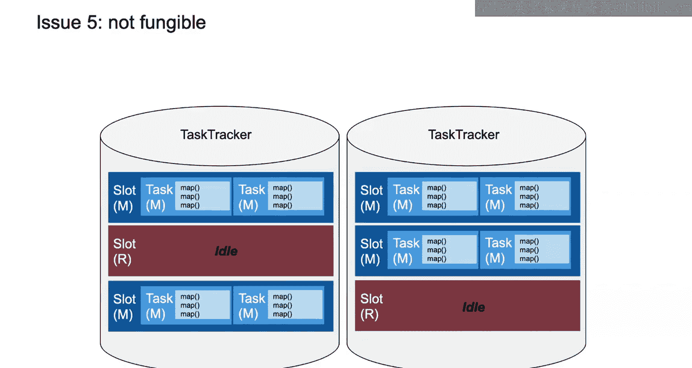

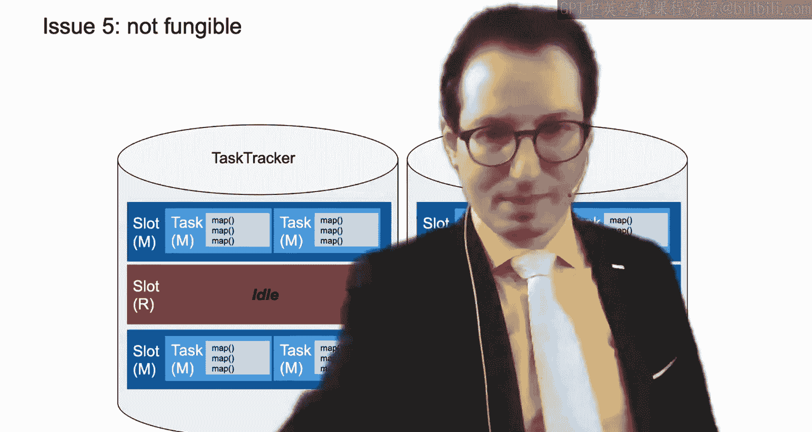

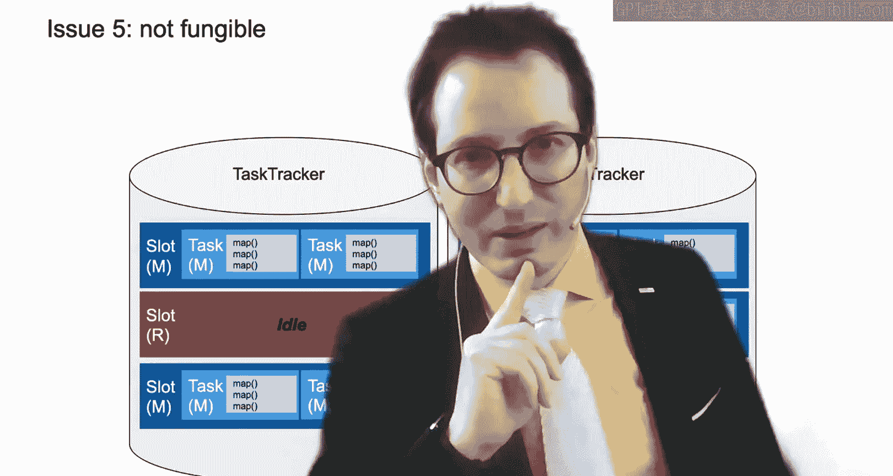

上一节我们介绍了MapReduce的基本模型。本节中我们来看看它的局限性以及后续的改进方案。

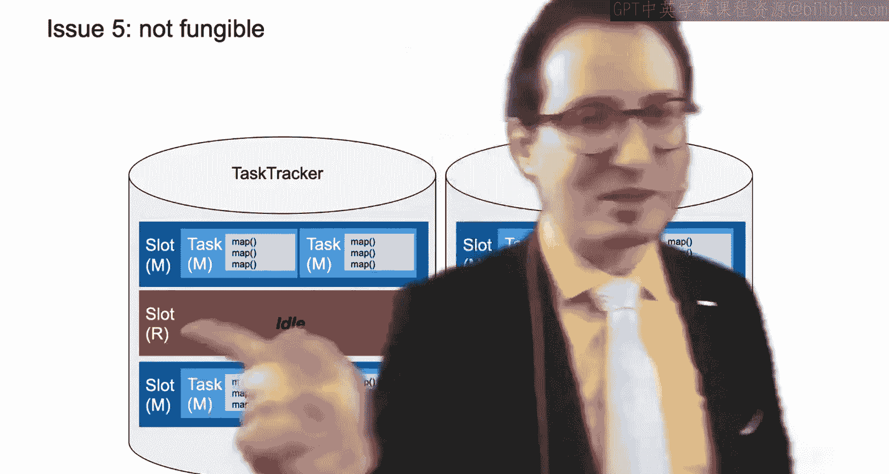

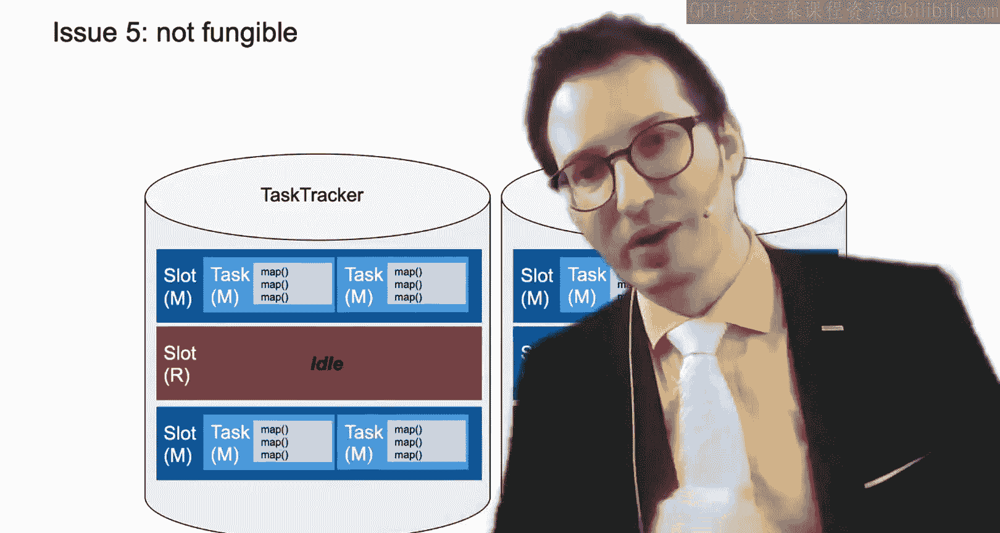

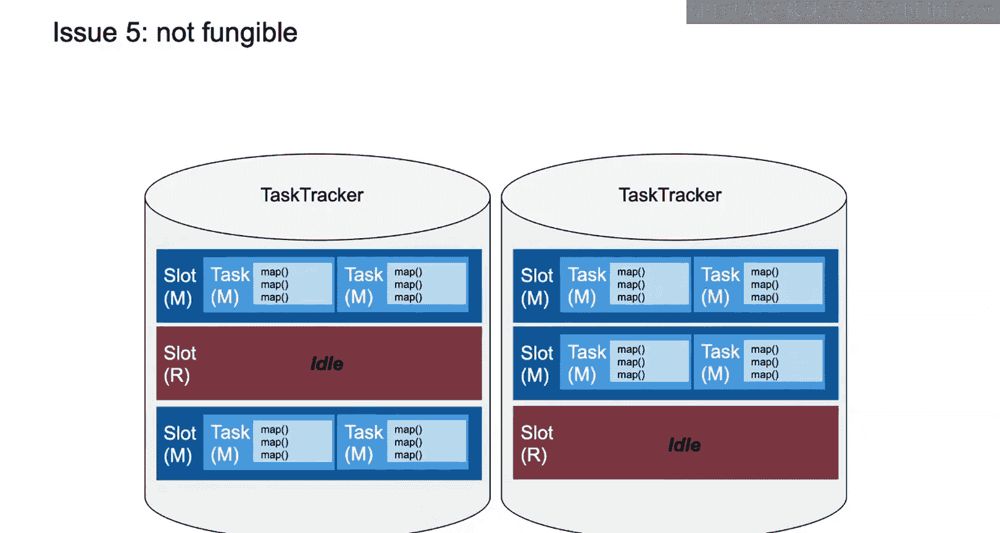

最初的MapReduce架构（称为v1）存在几个核心问题。其**作业跟踪器**承担了过多职责，包括资源管理、任务调度和监控，这使其成为单点瓶颈。此外，集群中的**映射槽**和**归约槽**数量固定，导致在映射阶段归约槽闲置，在归约阶段映射槽闲置，造成资源浪费。

一个MapReduce作业的流程可以概括为：
```
输入 -> 映射(Map) -> 洗牌(Shuffle) -> 归约(Reduce) -> 输出
```
这种模型对于复杂的数据处理流水线（如需要迭代的机器学习算法）显得笨拙，用户需要手动串联多个MapReduce作业。

## 资源管理：YARN (Yet Another Resource Negotiator) ⚙️

为了解决MapReduce v1的问题，工程师们设计了YARN。YARN采用了相同的中心化架构，但将职责进行了分离。

以下是YARN的核心组件：
*   **资源管理器**：运行在协调节点上，负责整个集群的资源管理和调度。
*   **节点管理器**：运行在每个工作节点上，负责管理本节点的资源并向资源管理器报告。
*   **容器**：资源抽象单元，代表一定量的CPU和内存资源。一个物理节点可以运行多个容器。
*   **应用主节点**：每个提交的作业（如MapReduce作业、Spark作业）会由一个专用的应用主节点管理。它负责向资源管理器申请容器来运行任务，并监控这些任务的执行。

这种架构的优势在于：
1.  **职责分离**：资源管理器只负责资源调度，作业的生命周期监控由应用主节点负责。
2.  **可扩展性**：解决了v1版本中作业跟踪器的瓶颈问题。
3.  **资源利用率高**：容器是动态申请的，在作业的映射阶段不会预先占用归约资源。
4.  **多租户与通用性**：YARN本身不关心运行的是MapReduce、Spark还是其他计算框架，它可以管理一个公司范围内被多种应用共享的集群。

YARN使用心跳机制来监控节点管理器的存活状态。关于容器调度策略，存在多种算法，例如考虑多资源（CPU、内存）公平分配的**主导资源公平性**算法。

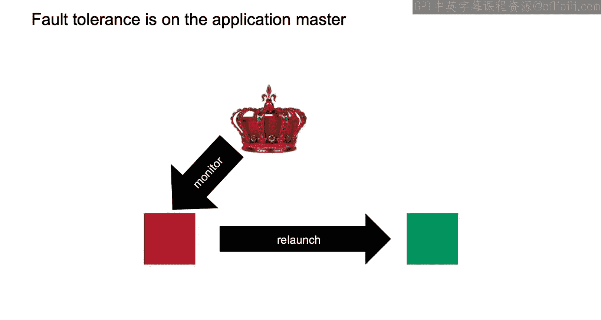


## Apache Spark 核心概念 💡

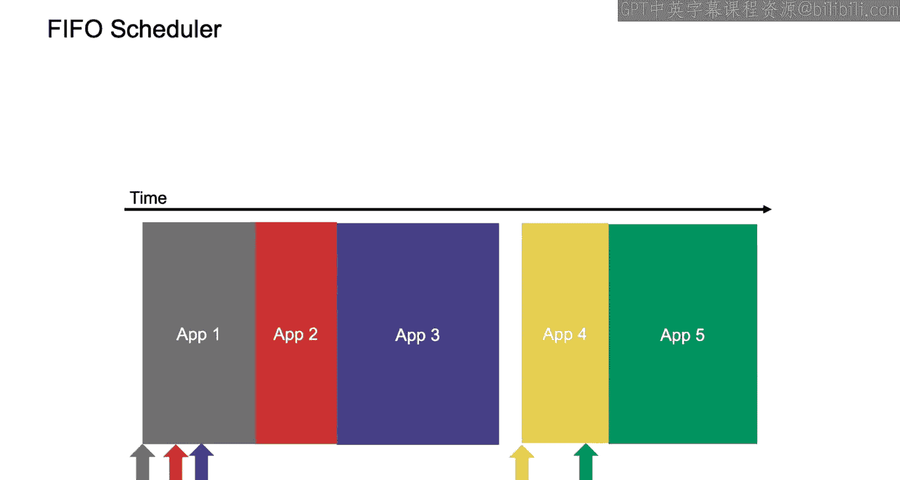

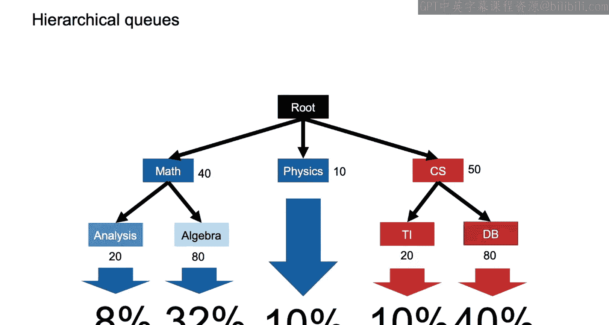

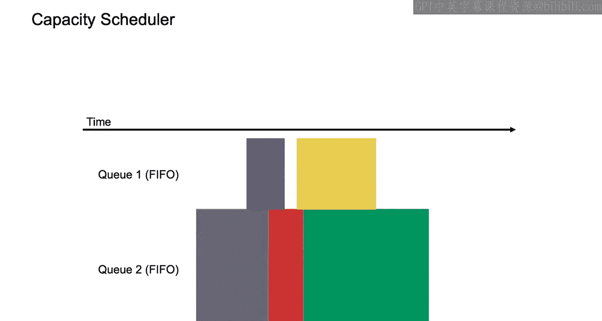


在解决了底层资源管理问题后，Apache Spark在数据处理模型上进行了重大革新。Spark可以被看作是MapReduce的通用化版本。

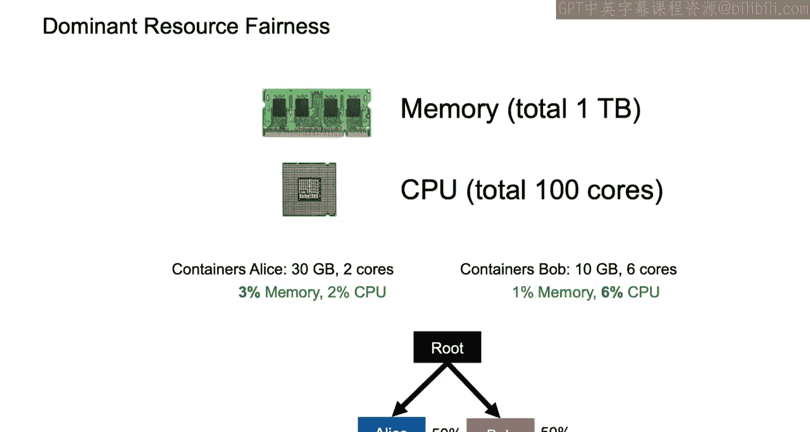


MapReduce可以看作是一个特定的有向无环图（DAG）：`映射 -> 洗牌 -> 归约`。而Spark允许用户定义**任意的有向无环图**来进行数据转换，这极大地增强了表达能力，无需手动串联多个作业。

Spark的核心抽象是**弹性分布式数据集**。
```
RDD = Resilient Distributed Dataset
```
一个RDD本质上是一个分布在集群多个节点上的大型数据集合。它具有两个关键特性：
*   **分布式**：数据被分区存储在不同机器上。
*   **弹性**：如果部分数据丢失，Spark可以根据其血缘关系图自动重新计算恢复。

与MapReduce的键值对不同，RDD可以包含**任意类型**的元素（字符串、整数、JSON对象等）。

## RDD 的生命周期与操作 🔄

RDD遵循一个清晰的生命周期，主要包括三种操作：

**1. 创建**
RDD可以通过多种方式创建：
*   从分布式存储系统（如HDFS、S3）读取。
*   从本地集合（如Python列表）并行化创建。

**2. 转换**
转换操作以一个RDD为输入，生成一个新的RDD。Spark提供了丰富的转换操作“菜单”，远不止`map`和`reduce`。例如：`filter`, `flatMap`, `groupByKey`, `join`等。这些转换会构建出RDD之间的依赖关系图（DAG）。

**3. 行动**
行动操作触发实际的计算，并返回结果给驱动程序或写入存储系统。例如：
*   `collect()`：将整个RDD数据拉取到驱动程序（仅适用于小数据集）。
*   `count()`：返回RDD中的元素个数。
*   `saveAsTextFile(path)`：将RDD写入HDFS等存储系统。

Spark采用**惰性求值**策略。当定义一系列转换时（如 `rdd.map(...).filter(...)`），Spark并不立即执行，而是记录下这个计算图（DAG）。只有当遇到一个**行动**操作（如 `collect()`）时，Spark才会根据DAG优化并执行整个计算任务。

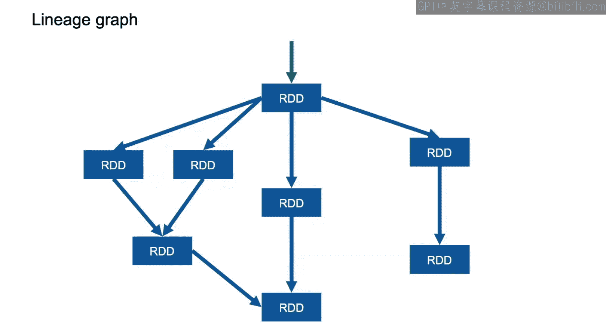

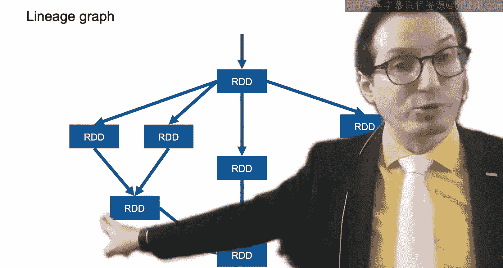


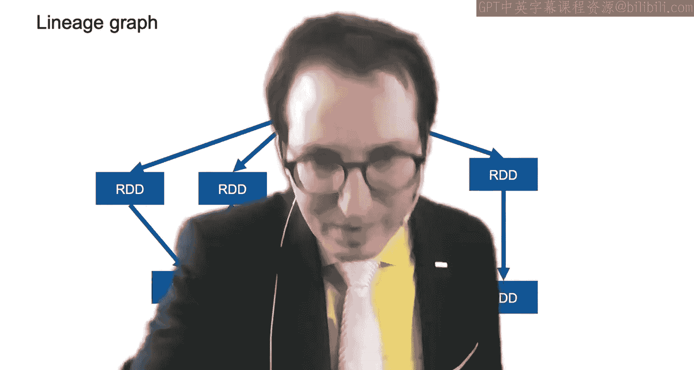

---

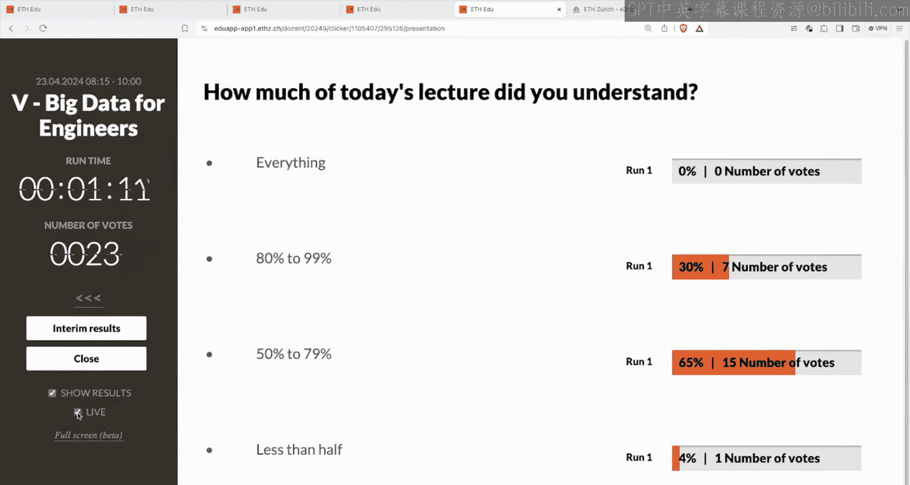

本节课中我们一起学习了大数据处理框架的演进历程。我们首先分析了MapReduce v1的架构瓶颈，然后介绍了通过YARN实现资源管理与作业监控的职责分离。最后，我们深入探讨了Apache Spark的核心思想，即通过弹性分布式数据集（RDD）和通用的有向无环图（DAG）模型，提供了比MapReduce更灵活、更强大的数据处理能力。下一节我们将继续探索Spark丰富的转换操作和编程实践。