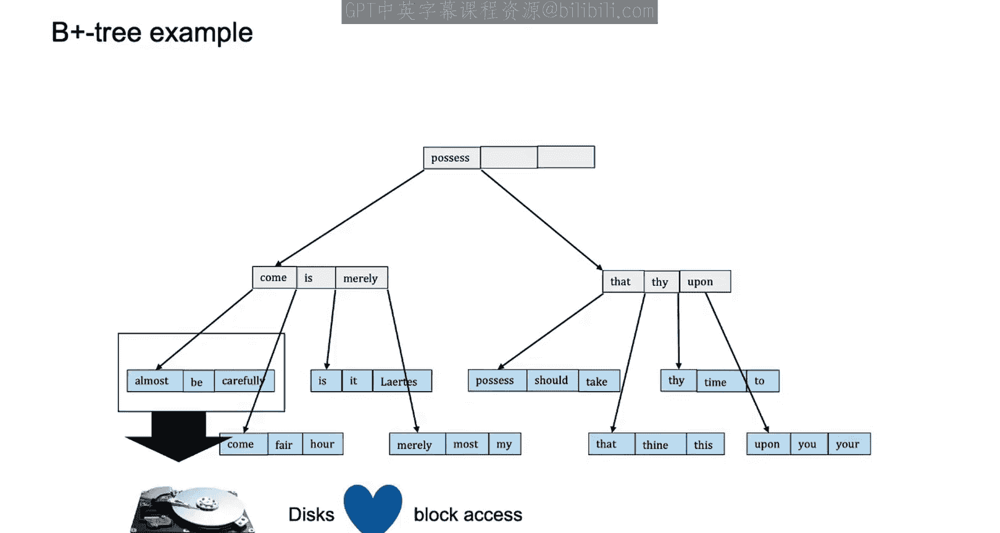
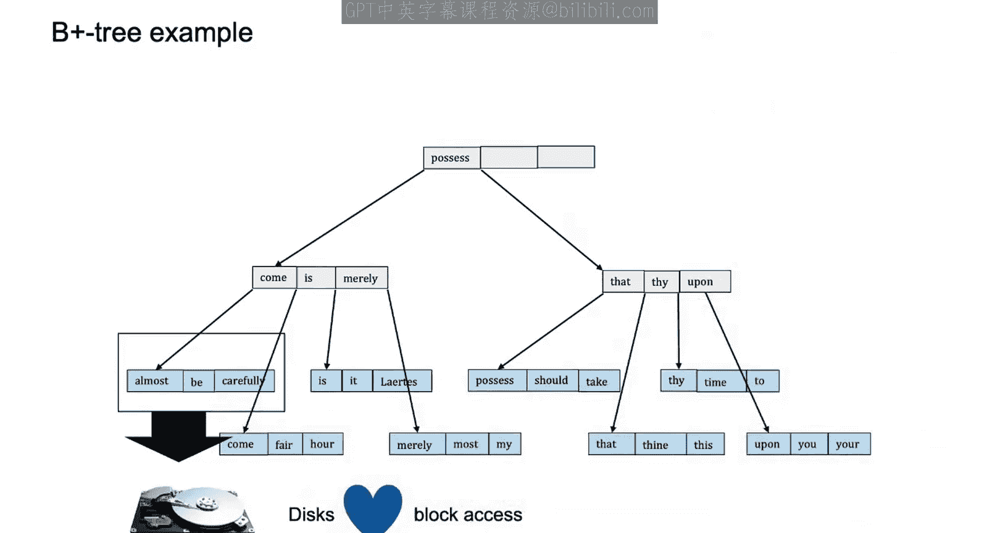
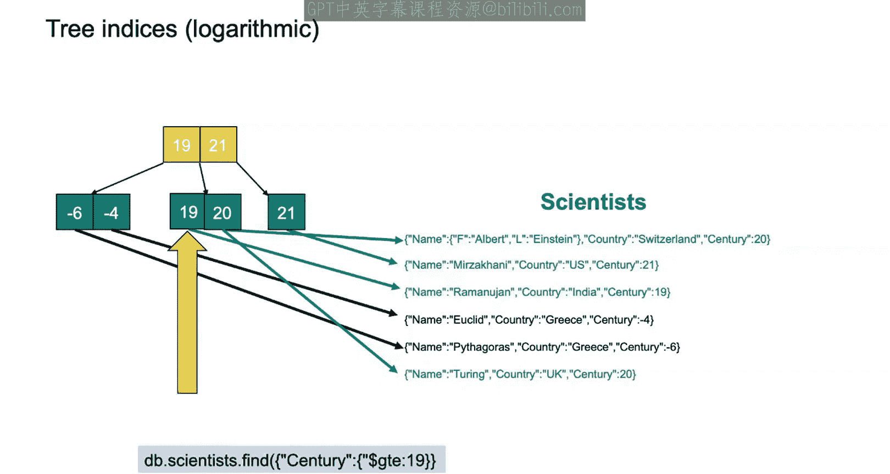
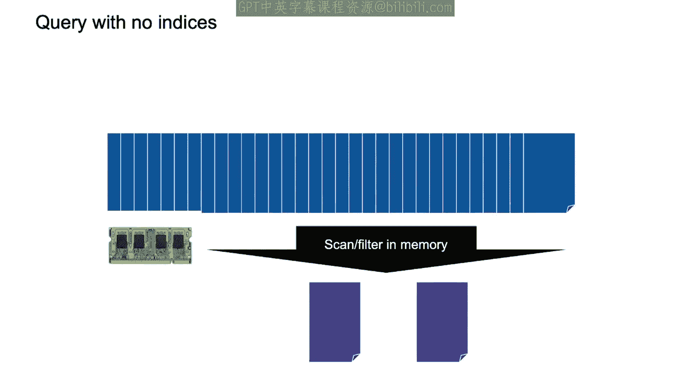
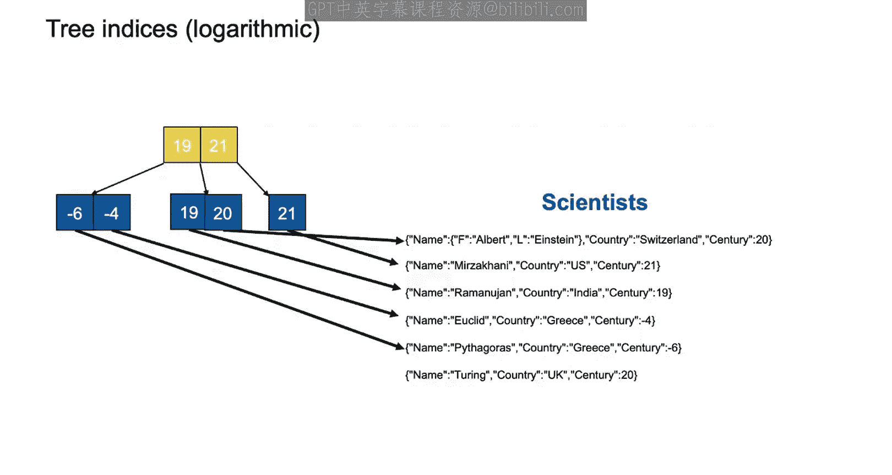
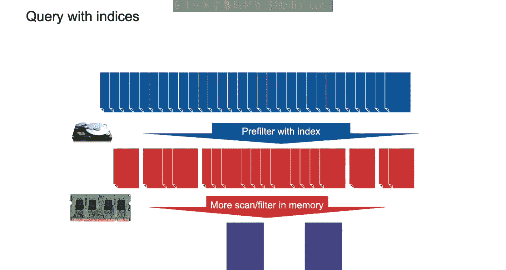
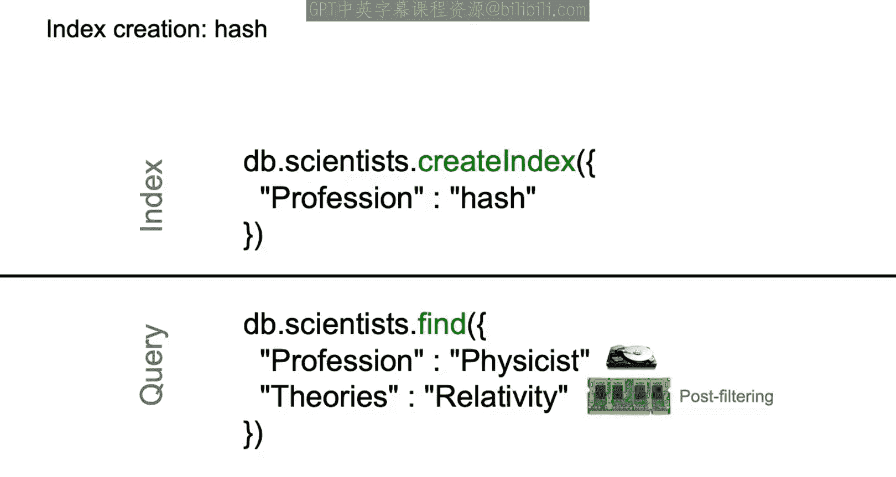
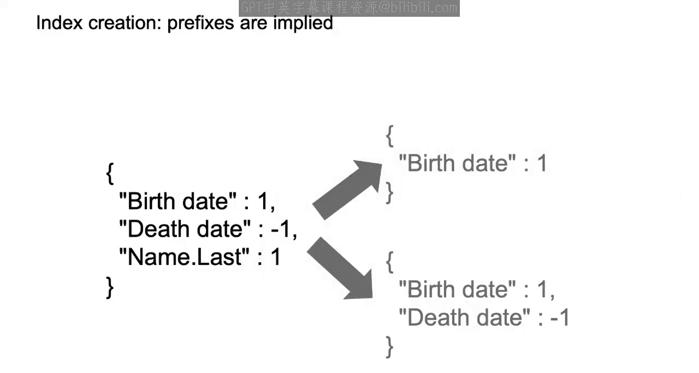

#  029：文档存储（3_3） - 索引详解 🗂️


在本节课中，我们将深入学习两种核心的数据库索引技术：哈希索引和树索引（B+树）。我们将了解它们的工作原理、各自的优缺点，以及如何在实际应用中有效地使用它们来加速数据查询。

## 哈希索引的工作原理

上一节我们提到了索引的重要性，本节中我们来看看第一种索引——哈希索引是如何构建和工作的。

我们有一个数据集合，需要为其构建一个哈希索引。如下图所示，左侧是一个类似表格的结构，但它并非关系型数据库的表，而是一种用于组织索引的数据结构。


这个结构的左列是索引的值（例如“世纪”），右列则是指向对应记录的指针。例如，对于“20世纪”，我们会存储值“20”以及指向该世纪相关记录的指针。

哈希索引的核心是一个被称为**哈希函数**的“魔法”函数。这个函数速度极快且具有确定性，其内部通常包含加法、乘法、取模等运算，最终输出一个整数。你可以输入任何想要索引的值，函数会输出一个整数，这个整数决定了该值在索引数组中的位置。

例如，输入值“20”，哈希函数 `H(20)` 输出 `0`，那么“20”及其指针就被放在数组的第0个位置（计算机科学家通常从0开始计数）。

哈希函数的一个重要特性是，尽管它是确定性的，但其输出看起来是随机的，能够将输入值均匀地“散布”在整个数组空间中。这有助于减少“碰撞”的发生，即两个不同的输入值产生了相同的输出位置。一个好的哈希函数应尽可能避免碰撞。

以下是哈希函数的一个抽象表示：
```
位置 = H(索引键值)
```

现在，我们继续构建索引。输入“19世纪”到哈希函数，得到位置4；输入“公元前世纪”，得到位置3；输入“-6世纪”，得到位置1。注意，“20”再次输入时，`H(20)` 依然输出0，这体现了哈希函数的确定性。



构建索引可能需要很长时间，特别是当集合很大时，可能需要数小时甚至一天。构建过程可以选择阻塞整个数据库系统，或者允许系统在后台缓慢构建。然而，一旦索引构建完成，查询速度将得到质的飞跃。




当有人执行点查询（例如查找“19世纪”）时，系统只需将“19”输入哈希函数 `H`，快速得到位置4，然后根据该位置的指针直接找到对应文档。这个过程非常快，几乎是瞬间完成的。


## 哈希索引的局限性

然而，哈希索引也存在一些局限性。

首先，它**不支持范围查询**。例如，查询“所有大于15的世纪”。由于哈希函数将值随机散布，你无法确定某个范围的值集中在数组的哪个连续区域。你只能分别查找15、16、17等每一个值。

其次，哈希函数并非完美，**碰撞**可能发生。为了尽量减少碰撞，需要分配一个足够大的数组，这会占用大量内存空间。

此外，在密码学等领域，哈希函数难以逆向破解的特性是其安全性的基础，但这与数据库索引的上下文不同。

## 树索引（B+树）简介



鉴于哈希索引的局限性，我们引入第二种索引——**树索引**，它特别擅长处理范围查询。这里我们主要介绍B+树。

B+树是一种复杂的物理数据结构，不同于JSON或XML的逻辑树。其底部叶子节点（通常用蓝色表示）按顺序存储了所有被索引的值。这种结构就像字典的目录，可以快速定位目标，而无需扫描全部内容。




B+树的实现非常复杂，但核心思想是：树中的每个节点都对应磁盘上的一个数据块。因为从磁盘读取数据时，按块（例如一次读取4000字节）读取远比按位读取高效。因此，树节点被设计为可以容纳尽可能多的值，以填满一个磁盘块。





## 构建B+树索引


让我们通过一个例子直观地看看B+树是如何构建的。假设我们限制每个节点最多存放两个值（仅为演示简化）。



1.  首先插入“20”，形成一个包含单个值的节点。
2.  插入“21”，节点变为 `[20, 21]`。
3.  插入“19”。由于节点已满（超过2个值），需要进行分裂。将 `[19, 20]` 放在左子节点，`[21]` 放在右子节点。根节点则存储一个边界值“21”，表示左子树所有值 `<21`，右子树所有值 `>=21`。
4.  继续插入“-4（40）”、“-6”等值，树会根据规则不断分裂和重组，以保持平衡和有序。




构建这样的索引同样耗时，但完成后，查询效率极高。例如，执行查询“世纪 >= 19”，系统可以快速在树中定位到19，然后获取其右侧的所有值（即>=19的值），并跟随指针找到对应文档。

这正是像电商网站这样的系统能够实现即时搜索的原因——它们使用了B+树这类索引结构。虽然构建索引需要时间，但之后的海量查询因此变得极快。


## 索引的维护与查询优化

如果没有索引，查询时必须扫描整个集合，在数据量巨大时（例如数十亿条记录）将非常缓慢。索引通过直接指向所需数据在磁盘上的位置，**极大地减少了需要读取的数据量**，从而提升了速度。


索引构建后，对集合的增删改操作会触发索引的更新。每次更新会导致索引发生微小调整（如节点重组），这会使写操作稍慢一些，但通常可以接受。有些系统（如早期谷歌）采用另一种策略：在后台构建全新索引，完成后替换旧索引，这会导致数据更新在索引中可见的延迟。

索引的使用可以非常灵活。以下是一些关键点：

1.  **部分过滤**：即使查询条件并非全部被索引覆盖，索引依然能加速查询。例如，索引在“职业”字段上，查询条件是“职业=物理学家 AND 理论=相对论”。系统可以先利用索引快速找到所有“物理学家”，然后在内存中从这个子集中筛选出“理论为相对论”的记录。这比全表扫描快得多。
    

2.  **复合索引**：可以在多个字段上建立树索引，例如 `(出生年份, 去世年份)`。索引首先按第一个字段排序，第一个字段相同时再按第二个字段排序。这种索引对以下查询有效：
    *   `出生年份=1987` （因为1987年的记录在索引中是连续的）
    *   `出生年份>=1946` （范围查询）
    *   `出生年份=1987 AND 去世年份=2020` （精确匹配）
    但是，对于 `去世年份=1887` 这样的查询，该复合索引**无法提供有效帮助**，因为索引的首要排序键是“出生年份”。

3.  **索引设计策略**：在实际工程中，设计索引是一门艺术。你需要分析应用程序发出的查询模式，然后创建**数量最少但覆盖最广**的索引。应避免创建冗余索引。例如，如果已有索引 `(A, B, C)`，那么索引 `(A)` 和 `(A, B)` 在很大程度上就是冗余的，因为第一个索引的前缀已经涵盖了后两者的功能。创建过多索引会浪费存储空间，并降低写操作性能。

## 总结

本节课中我们一起学习了数据库的两种核心索引技术。


*   **哈希索引**：通过哈希函数实现极快的点查询，但不支持范围查询，且可能存在碰撞问题。
*   **树索引（B+树）**：支持高效的点查询和范围查询，结构复杂但非常适合磁盘存储特性，是大多数数据库系统默认或常用的索引类型。




我们了解到，索引通过预先构建额外的数据结构，牺牲一定的存储空间和写操作性能，来换取读操作（查询）性能的巨大提升。设计良好的索引是构建高性能数据应用的关键。在实际工作中，需要根据查询负载仔细选择和设计索引，在查询速度和更新成本之间取得最佳平衡。