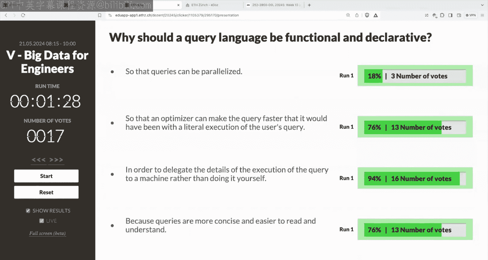
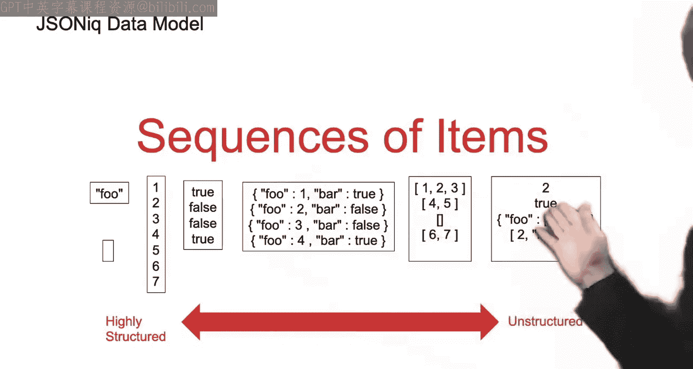
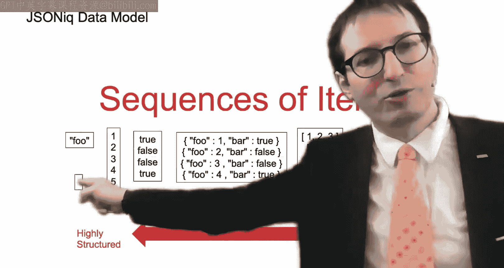
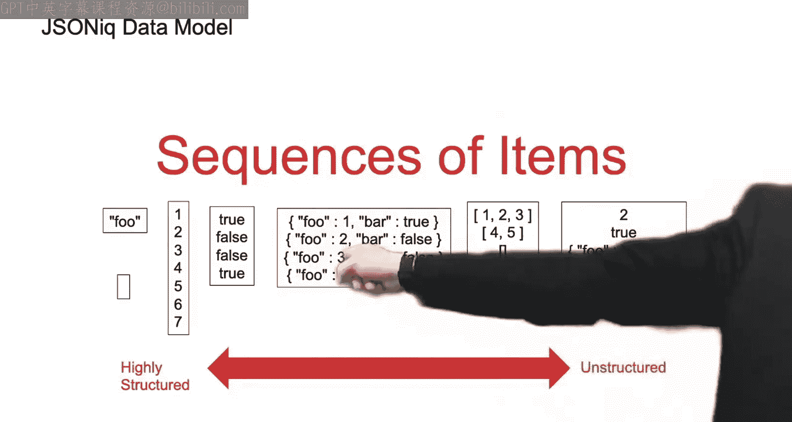
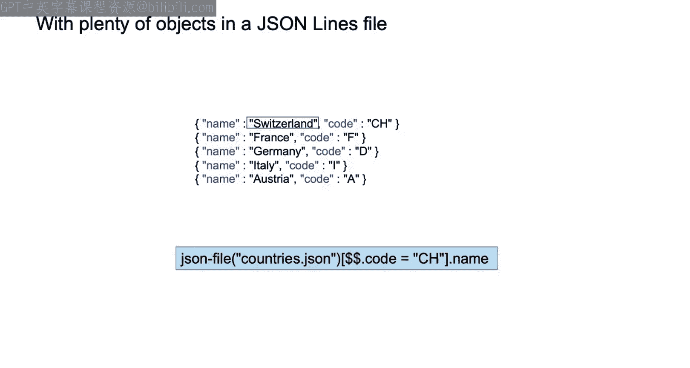
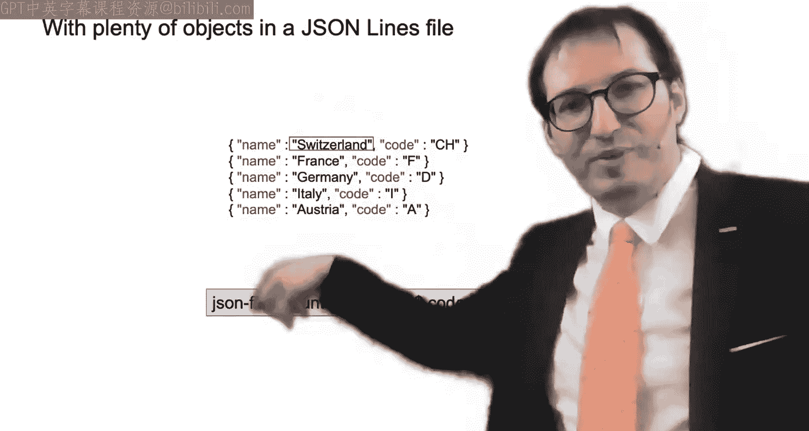
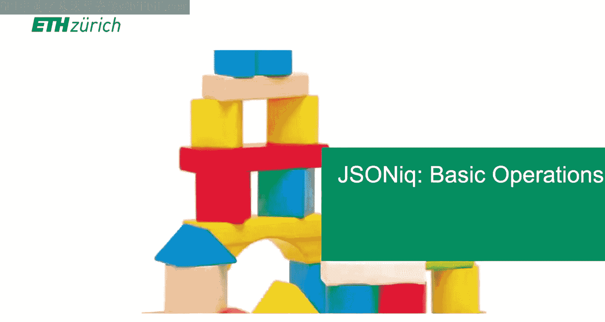
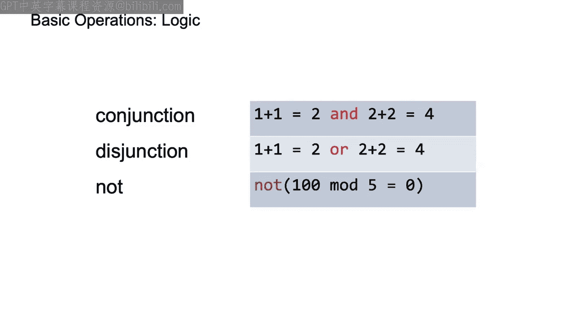

#  031：查询树结构数据 (2/4) 🌳

在本节课中，我们将学习如何查询树形结构数据，特别是使用JSONiq语言。我们将了解其数据模型、基本语法和核心操作，并理解为何它比传统SQL更适合处理半结构化数据。



---

## 数据模型：一切皆是序列

上一节我们讨论了为何需要专门的语言来查询树形数据。本节中，我们来看看JSONiq的核心基础——其数据模型。

JSONiq操作的基本单位是**序列**。一个序列是一个有序、扁平的列表，可以包含零个、一个或多个**项**。

*   **项**可以是：
    *   **原子值**：如字符串、整数、布尔值。
    *   **复杂结构**：如对象（字典）或数组（列表）。
*   **序列是扁平的**：序列不能嵌套在另一个序列中。如果你组合两个序列，结果是一个扁平的单一序列。公式表示为：`(a, b, c) + (d) = (a, b, c, d)`。
*   **异构性**：序列中的项可以是完全不同的类型，例如 `(42, “hello”, true, {“key”: “value”})` 是一个有效的序列。
*   **通用性**：关系型表格可以看作是所有项都具有相同键和类型的对象序列。因此，JSONiq的序列模型比关系模型更通用，能够处理从高度结构化到完全非结构化的所有数据。

这种设计提供了强大的数据独立性。无论数据是存储在本地文件、S3对象存储还是通过HTTP访问，无论数据规模是KB级还是PB级，查询逻辑都保持一致。

---

## 数据导航与探索

理解了数据模型后，我们来看看如何访问和探索数据。

JSONiq使用点号 `.` 来导航对象中的属性，使用双括号 `[[ ... ]]` 来展开数组。这类似于许多编程语言中访问字典和列表的方式。





以下是一个导航示例：
```jsoniq
let $doc := { "countries": [ {"code": "CH", "name": "Switzerland"}, {"code": "FR", "name": "France"} ] }
return $doc.countries[[ ]].name
```
这段代码会返回序列：`(“Switzerland”, “France”)`。




我们可以使用谓词（过滤器）来筛选数据。谓词写在 `[ ... ]` 内，使用比较运算符。变量 `$$` 代表当前正在处理的项。

例如，要查找代码为“CH”的国家名称：
```jsoniq
json-file(“data.json”)[$$.code = “CH”].name
```
这相当于在Spark中执行一个`filter`转换。

对于模式未知的大规模数据集，我们可以使用内置函数进行探索：
*   `keys($object)`：返回对象的所有键。
*   `distinct-values($sequence)`：返回序列中去重后的值。
*   `count($sequence)`：返回序列中的项数。





以下是一个数据发现查询示例，用于找出数据集中所有不同的`type`值：
```jsoniq
distinct-values(json-file(“huge_dataset.jsonl”).type)
```
无论底层数据格式是JSON还是Parquet，无论数据量多大，这个查询都保持不变。在Parquet格式下，由于存在模式信息，此类查询可能无需扫描数据本身，执行效率会高得多。

---

## 构造数据与基本运算

除了查询，我们经常需要构造新的数据或进行运算。

在JSONiq中，任何JSON值本身就是一个有效的查询，它会返回自身。例如，查询 `“Hello”` 或 `42` 会直接返回这些值。

以下是构造数据的方法：
*   **构造序列**：使用逗号 `,`。例如：`(1, “a”, true)`。
*   **构造数组**：使用方括号 `[]`。例如：`[1, 2, 3]`。
*   **构造范围序列**：使用 `to` 操作符。例如：`1 to 100` 会生成一个包含100个整数的序列。系统会自动并行化处理大型范围。

JSONiq支持丰富的运算：
*   **算术运算**：`+`, `-`, `*`, `div` (整除), `mod`。这些运算要求操作数是单一项或空序列。
*   **字符串运算**：`||` 用于连接，`concat()` 函数，`substring()`，`string-join()`（非常实用，用于在多个字符串间插入分隔符）。
*   **比较运算**：`=`, `!=`, `<`, `<=`, `>`, `>=`。
    *   当对序列进行比较时，执行的是**存在量化**。即，如果能在左序列和右序列中各找到一个项满足比较条件，则返回 `true`。例如：`(1, 2, 3) = 3` 返回 `true`。`(1, 2) > (5, 6)` 返回 `false`。
*   **逻辑运算**：`and`, `or`, `not`。



---

## 总结

本节课中，我们一起学习了JSONiq查询语言的基础知识。
1.  我们首先了解了其核心**数据模型**：一切操作都基于**序列**，序列可以包含原子值或嵌套的树形结构（对象和数组）。
2.  接着，我们学习了如何使用点号和双括号进行**数据导航**，以及如何使用谓词进行**过滤**。这对于探索未知模式的数据集至关重要。
3.  最后，我们掌握了如何**构造新数据**，并学习了包括算术、字符串、比较和逻辑运算在内的**基本运算**。特别需要注意的是，对序列的比较执行的是存在性检查。



JSONiq作为一种声明式、函数式的语言，允许我们以简洁的方式表达复杂的数据处理逻辑，同时将具体的执行细节（如并行化）委托给底层引擎（如Spark），完美体现了数据独立性的原则。在下一节中，我们将深入探讨更高级的查询组合能力。