#  032：查询树（3/4） 🧩

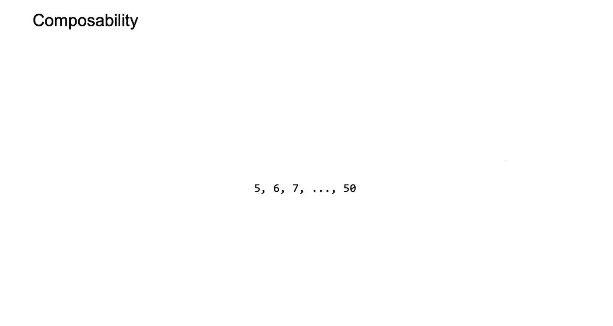

在本节课中，我们将深入学习JSONiq查询语言的核心概念，特别是如何构建复杂的表达式、理解FLWOR表达式以及执行关系型操作。我们将通过具体的例子和公式来阐明这些概念，确保即使是初学者也能跟上。

---

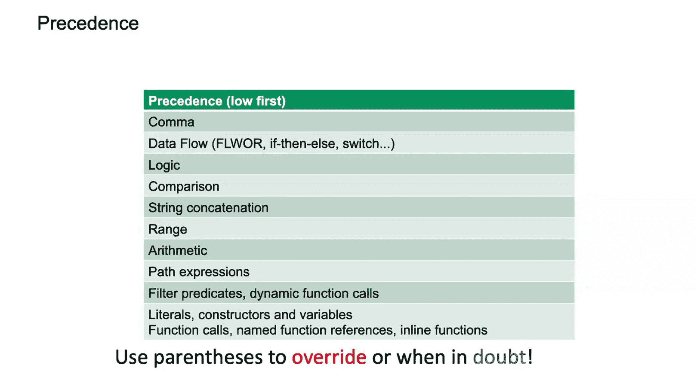

## 概述

本节课程将介绍JSONiq查询语言的高级特性。我们将看到如何像搭积木一样组合表达式，理解FLWOR表达式（类似于SQL的SELECT-FROM-WHERE）的强大功能，并探索如何在JSONiq中执行选择、投影、连接等关系型操作。最后，我们会简要了解查询在引擎内部是如何被处理和执行的。

---

## 表达式组合：像搭积木一样构建查询

上一节我们介绍了JSONiq的基本导航操作。本节中我们来看看如何将简单的表达式组合成更复杂的查询。

在JSONiq中，你可以将任何表达式嵌套在任何其他表达式中。最坏的情况是组合出的表达式没有意义，你会得到一个错误。但原则上，你可以在任何表达式中嵌套任何其他表达式。

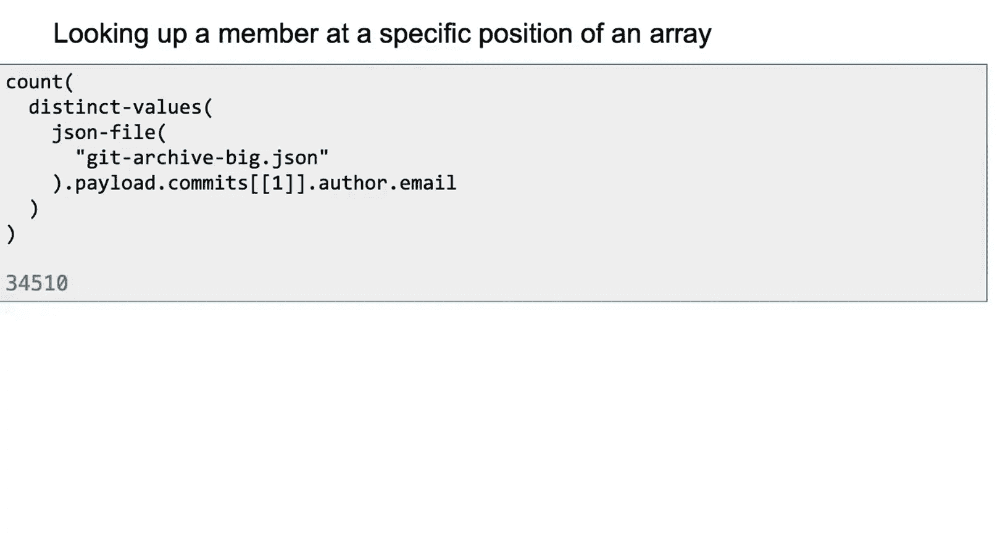

以下是一个复杂表达式的例子：
```jsoniq
2 + 2 . {"a": 4, "b": [1, 2, 4]} .b [] .a
```
这个表达式的计算步骤如下：
1.  `2 + 2` 得到 `4`。
2.  `{"a": 4, "b": [1, 2, 4]} .b` 提取出数组 `[1, 2, 4]`。
3.  `[]` 操作符（解包）打开数组。
4.  `.a` 尝试从数组元素中提取键 `"a"` 的值。由于数组元素是数字（1, 2, 4），没有 `"a"` 键，因此这一步对每个元素都返回空序列。
5.  最终结果是三个空序列的序列。


你可以像解数学公式一样，逐步计算这个表达式。

**注意运算符优先级**：与数学中乘法优先于加法类似，JSONiq也有运算符优先级规则。如果你不确定优先级，或者想覆盖默认优先级，最安全的方法是使用括号 `()` 来明确指定执行顺序。

---

## 动态JSON与FLWOR表达式

表达式组合的一个好处是你可以创建“动态JSON”。这意味着你可以构建一个看起来像JSON的结构，但在其中嵌套查询。

例如，你可以创建一个对象，其某个键的值是通过查询动态计算出来的：
```jsoniq
{
  "at": "fubar",
  "value": 6,
  "array": [ for $i in 1 to 10 return $i ]
}
```
这里，`"array"` 的值不是一个静态数组，而是一个FLWOR表达式的结果，它会生成一个包含1到10的数组。这就是一个动态JSON。

现在，让我们引入更多“积木块”。

**条件表达式 (if-then-else)**：
```jsoniq
if ($condition) then $then-value else $else-value
```
这是一个函数式的条件判断。如果条件为真，返回 `$then-value`；否则返回 `$else-value`。它类似于C++或Java中的三元运算符 `? :`。

**Switch-Case表达式**：
```jsoniq
switch ($value)
  case "I" return "Italian"
  case "F" return "French"
  default return "Unknown"
```
你可以通过一连串的 `if-then-else` 实现相同功能，但 `switch-case` 在某些情况下更方便。

**Try-Catch表达式**：
```jsoniq
try { $expression } catch * { "Recovered from error" }
```
用于从错误中恢复。例如，尝试将字符串转换为整数，如果失败则返回一个默认值。

---

## 导航、过滤与函数应用

让我们回到具体的数据集（例如Github存档数据）进行操作。

假设我们想获取所有提交记录中的作者邮箱：
```jsoniq
$github-archive.payload.commits[].author.email
```
1.  `$github-archive.payload.commits` 获取一个对象数组的序列。
2.  `[]` 解包操作符打开所有数组，将其扁平化为一个对象序列（所有提交）。
3.  `.author.email` 从每个提交对象中提取作者邮箱。

我们也可以使用函数，例如 `size()` 来获取数组大小，并进行过滤：
```jsoniq
$github-archive[][size($.payload.commits) >= 5]
```
这个查询会过滤出那些 `payload.commits` 数组大小至少为5的事件。

要访问数组中的特定元素，使用双括号 `[[index]]`：
```jsoniq
$github-archive.payload.commits[[0]].author.email
```
`[[0]]` 获取每个提交数组的第一个元素（即第一次提交），然后提取其作者邮箱。

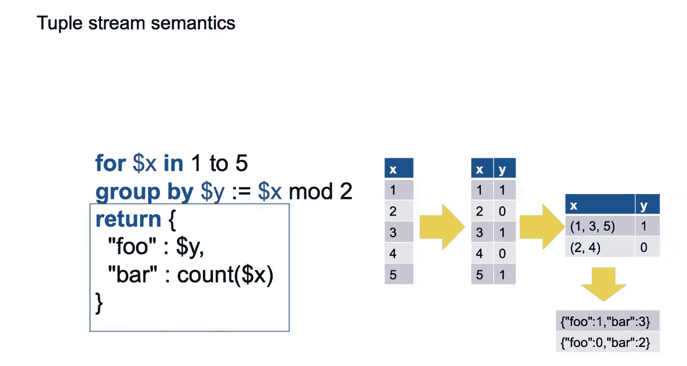

---

## 使用LET分步编写查询

对于更复杂的查询，使用 `let` 子句分步编写可以提高可读性。
```jsoniq
let $events := json-file("github-archive.json")[]
let $actors := $events.actor
let $logins := $actors.login
let $distinct-logins := distinct-values($logins)
return $distinct-logins
```
每个变量都依赖于前一个变量。这种风格与直接将表达式嵌套在一起是等价的，但更易于人类阅读和理解。许多函数式语言（如Haskell, F#）都有类似的 `let` 语法。

`for` 子句用于显式迭代：
```jsoniq
for $event in json-file("github-archive.json")[]
let $nb-commits := size($event.payload.commits)
return {"id": $event.id, "commits": $nb-commits}
```
这个查询遍历每个事件，计算其提交数量，并返回一个只包含ID和提交数量的新对象列表。

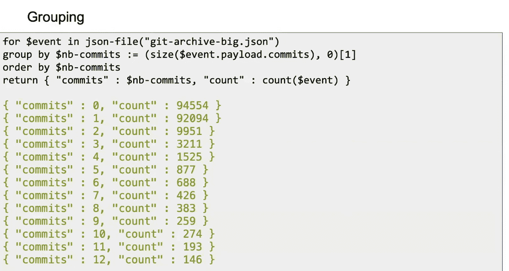

---

## 深入理解FLWOR表达式 🏵️

既然我们看到了 `for` 和 `let`，现在让我们全面了解FLWOR表达式。FLWOR代表：
*   **F**or
*   **L**et
*   **W**here
*   **O**rder by
*   **R**eturn

以下是一个包含所有子句的示例：
```jsoniq
for $x in 1 to 10
let $square := $x * $x
where $x - 2 > 5
order by $x descending
return {"number": $x, "square": $square}
```
**执行流程（直观理解）**：
1.  `for`：将 `$x` 依次绑定为1到10。
2.  `let`：为每一行绑定计算 `$square = $x * $x`。
3.  `where`：过滤，只保留满足 `$x - 2 > 5`（即 `$x > 7`）的行。所以保留 `$x` 为 8, 9, 10 的行。
4.  `order by`：按 `$x` 降序排列。
5.  `return`：为最终每一行返回指定的对象。

结果将是：
```json
[ {"number": 10, "square": 100},
  {"number": 9, "square": 81},
  {"number": 8, "square": 64} ]
```
**与SQL的关键区别**：在SQL中，子句顺序是固定的（SELECT...FROM...WHERE...）。在JSONiq的FLWOR表达式中，除了必须以 `for` 或 `let` 开头、以 `return` 结尾外，其他子句可以按任意顺序排列！这提供了极大的灵活性。

**形式化语义（元组流）**：
在引擎内部，FLWOR表达式的执行可以理解为对一个“元组流”或“数据帧”的操作。
*   `for`/`let` 子句会向流中添加列（绑定变量）。
*   `where` 子句过滤行。
*   `order by` 子句对行排序。
*   `group by` 子句将行分组，创建新的“包”序列。
*   `return` 子句基于最终的流生成输出序列。
这种实现方式使得JSONiq能够利用Spark等引擎高效处理海量数据。

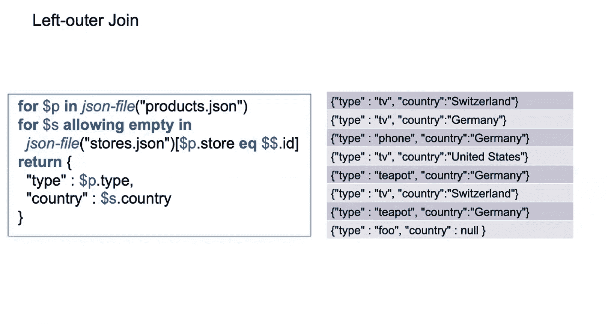

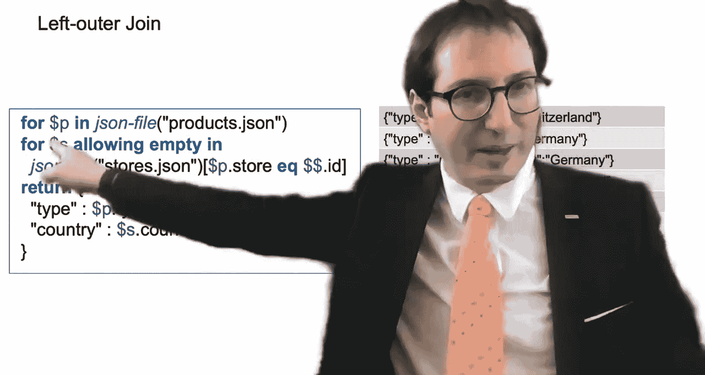

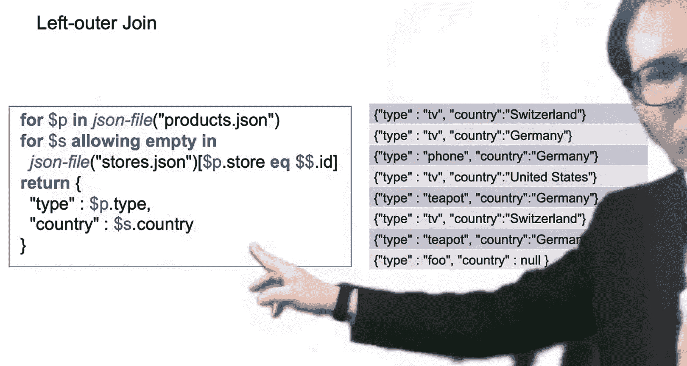

---

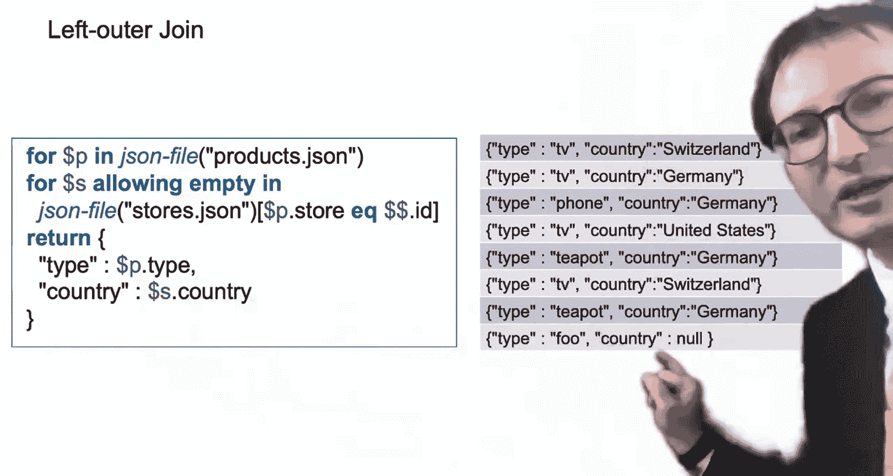

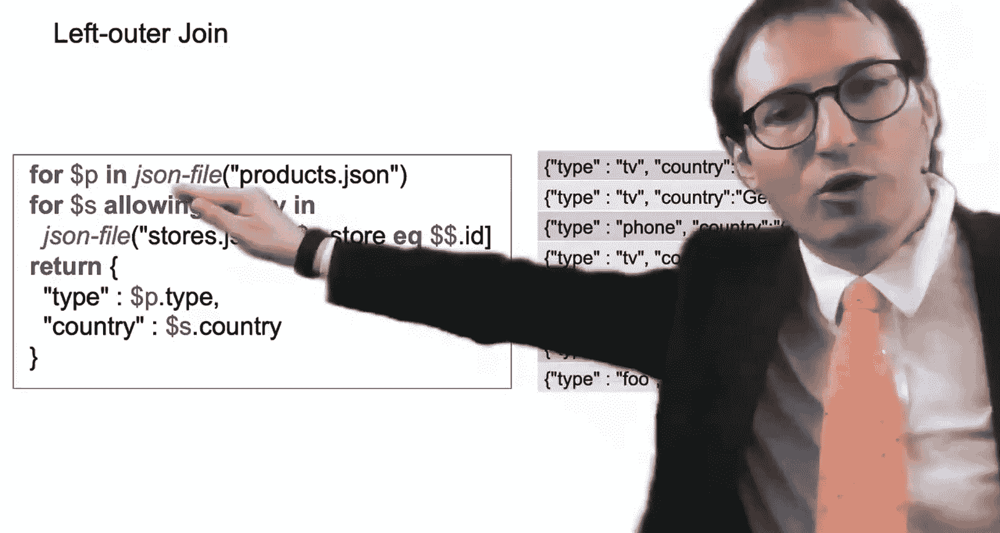

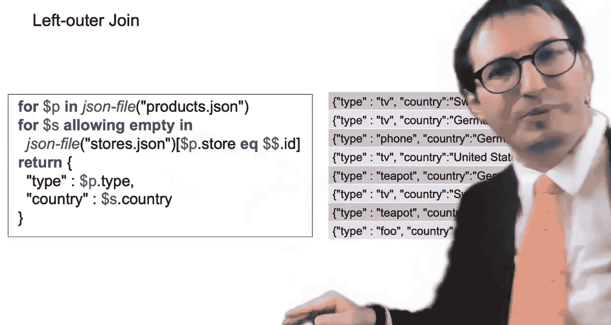

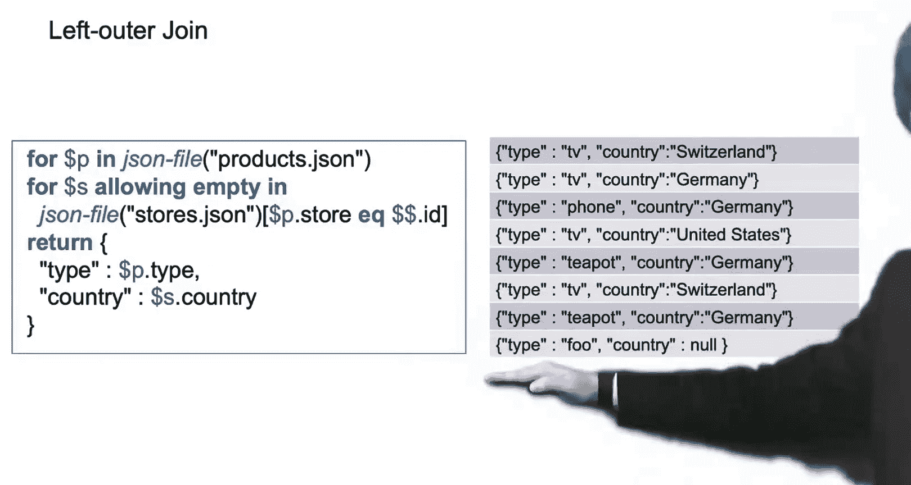

## 在JSONiq中实现关系代数

JSONiq足够强大，可以支持完整的关系代数操作。假设我们有两个类表结构的JSON集合：

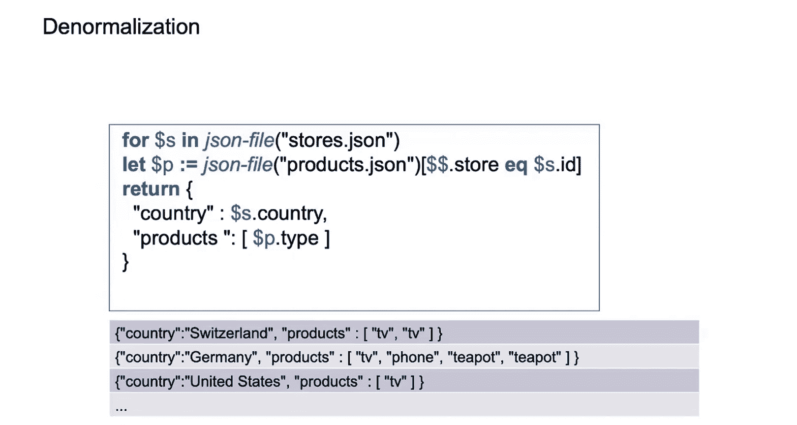

**产品 (products.json)**:
```json
[ {"id": 1, "type": "Laptop", "store": 5},
  {"id": 2, "type": "Phone", "store": 3} ]
```
**商店 (stores.json)**:
```json
[ {"id": 5, "country": "CH"},
  {"id": 3, "country": "DE"} ]
```
以下是各种关系操作在JSONiq中的实现：

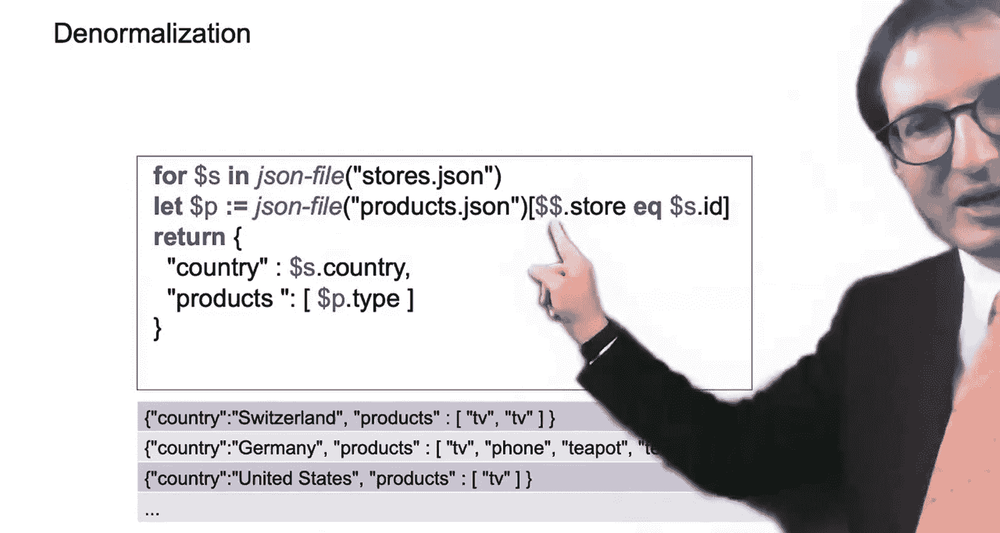

**选择 (Selection)** - 使用 `where`：
```jsoniq
for $p in collection("products.json")
where $p.type eq "Laptop"
return $p
```

**投影 (Projection)** - 使用 `project` 函数或直接构造对象：
```jsoniq
for $p in collection("products.json")
return project($p, ("id", "type"))
-- 或
for $p in collection("products.json")
return {"id": $p.id, "type": $p.type}
```

**排序 (Ordering)** - 使用 `order by`：
```jsoniq
for $p in collection("products.json")
order by $p.id
return $p
```

**分组与聚合 (Group by & Aggregation)**：
```jsoniq
for $p in collection("products.json")
group by $store := $p.store
return {"store": $store, "count": count($p)}
```
注意，在JSONiq中，你不仅限于聚合，还可以在分组后保留嵌套的原始数据，这是比SQL更灵活的地方。

**内连接 (Inner Join)** - 使用两个 `for` 和一个 `where`：
```jsoniq
for $p in collection("products.json")
for $s in collection("stores.json")
where $p.store eq $s.id
return {"type": $p.type, "country": $s.country}
```

**左外连接 (Left Outer Join)** - 使用 `allowing empty`：
```jsoniq
for $p in collection("products.json")
for $s allowing empty in collection("stores.json")[$$.id eq $p.store]
return {"type": $p.type, "country": $s.country}
```
如果某个产品没有对应的商店，`$s` 会被绑定为空序列，在结果中 `country` 字段会显示为 `null`。

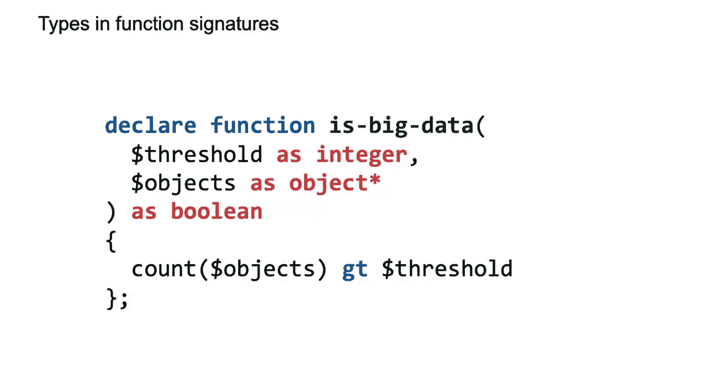

**反规范化/嵌套连接 (Denormalization/Nested Join)**：
```jsoniq
for $s in collection("stores.json")
let $products := collection("products.json")[$$.store eq $s.id]
return {
  "country": $s.country,
  "products": [ $products.type ]
}
```
这个查询将产品列表嵌套到了每个国家对象中，生成了嵌套的JSON结构，这是传统SQL难以直接实现的。

**关于 `$$`**：在过滤谓词（如 `[$$.store eq $s.id]`）中，`$$` 代表当前正在被过滤的序列中的“上下文项”。它避免了为简单的lambda函数显式定义变量。

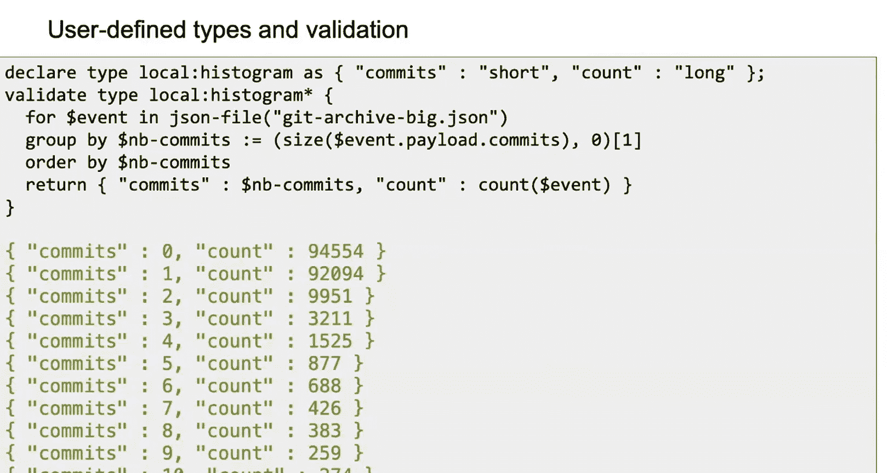

---

## 类型系统与数据验证

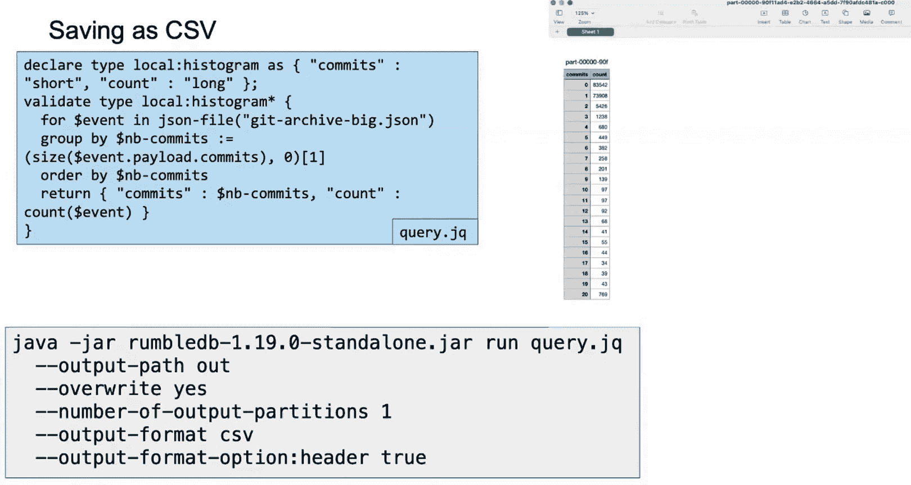

JSONiq拥有丰富的类型系统，可用于数据验证。

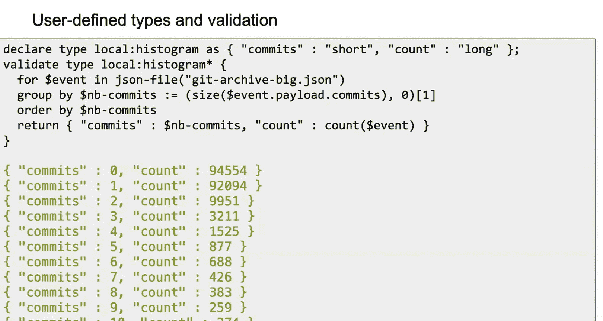


**类型声明与检查**：
```jsoniq
let $path as string := "/data/file.json"
let $events as object* := json-file($path)[]
...
```
`as` 关键字用于声明变量的预期类型。如果运行时类型不匹配，会抛出错误。类型指示符包括：
*   `integer`：恰好一个整数。
*   `boolean?`：0个或1个布尔值（`?` 表示可选）。
*   `array+`：1个或多个数组（`+` 表示至少一个）。
*   `object*`：0个或多个对象（`*` 表示任意数量）。

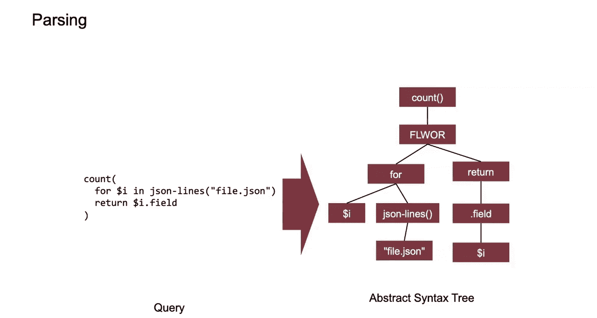

**类型测试与转换**：
```jsoniq
$value instance of integer*   -- 测试$value是否全是整数
$value castable as double     -- 测试$value能否转换为double
$value cast as double         -- 将$value转换为double
```

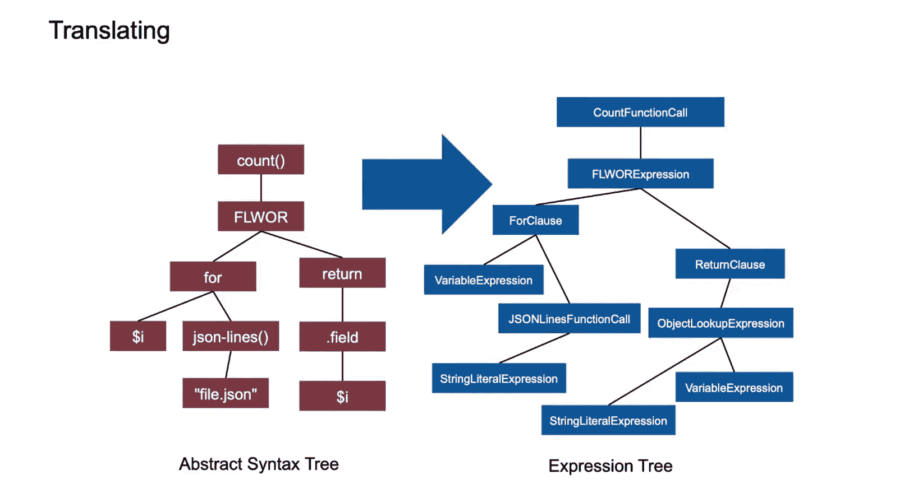

**使用模式验证数据**：
在清理数据后，可以定义模式并验证输出，这通常会将其转换为更高效的数据帧格式。
```jsoniq
validate type local:histogram {
  "commits": integer,
  "count": integer
}
{
  for $event in $github-archive[]
  let $commits := (size($event.payload.commits), 0)[1]
  group by $commits
  order by $commits
  return {"commits": $commits, "count": count($event)}
}
```
验证后的结果可以高效地保存为Parquet、CSV等格式。

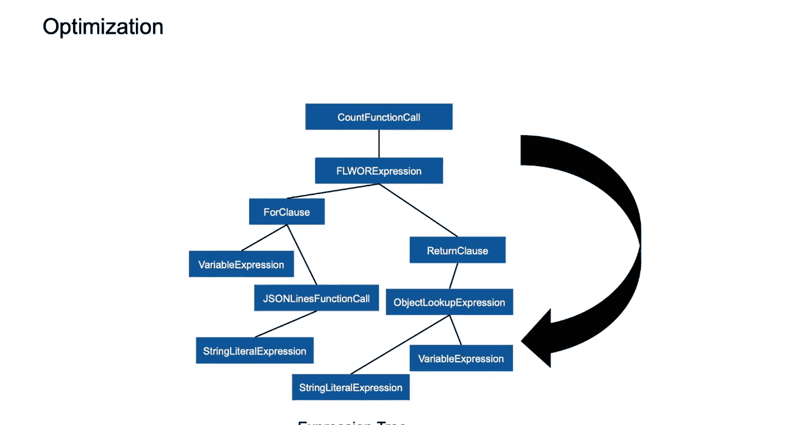

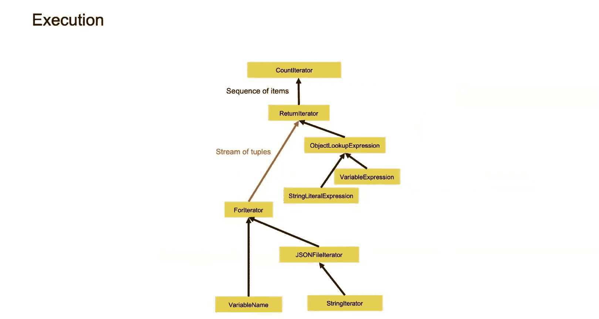

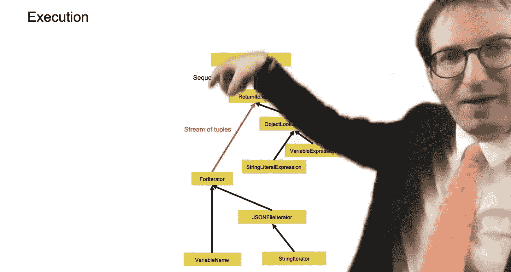

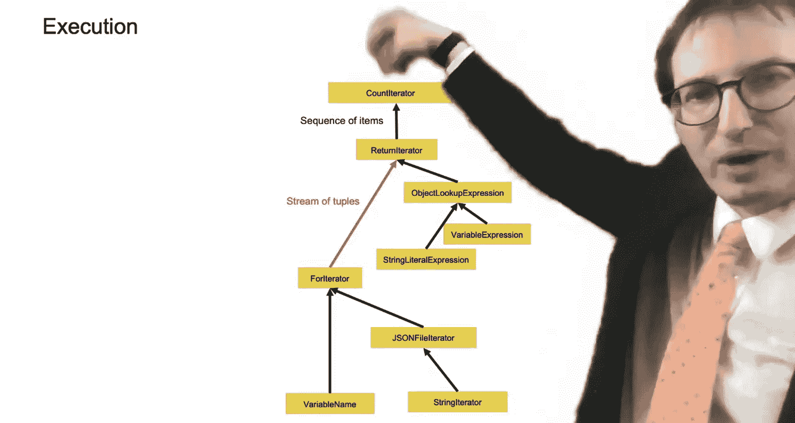

---

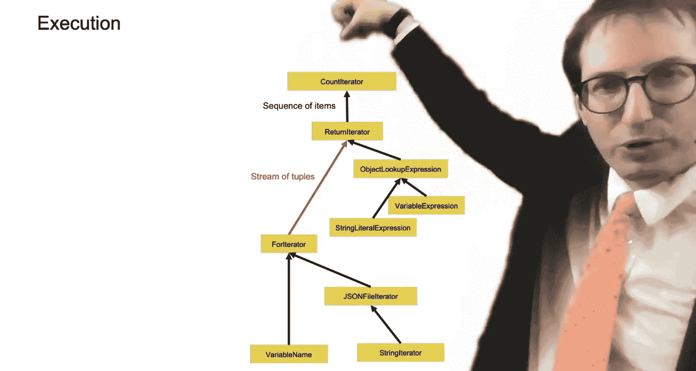

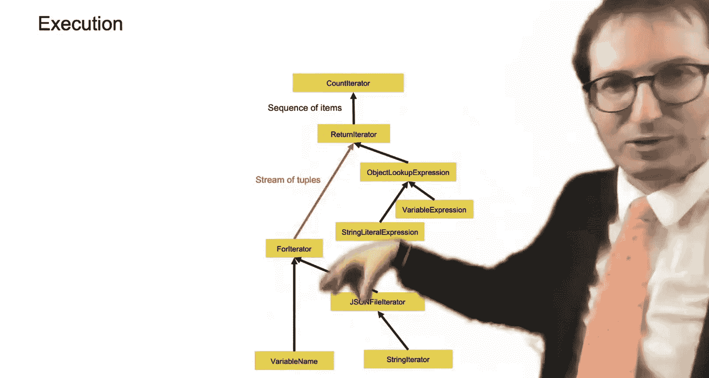

## 查询执行内部原理 ⚙️

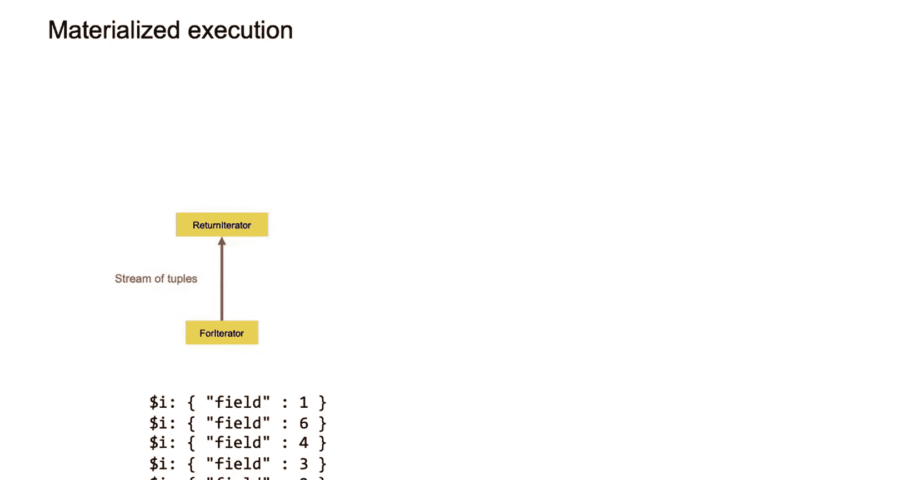

最后，我们简要了解JSONiq查询是如何被执行的。这个过程对用户透明，但有助于理解其能力。


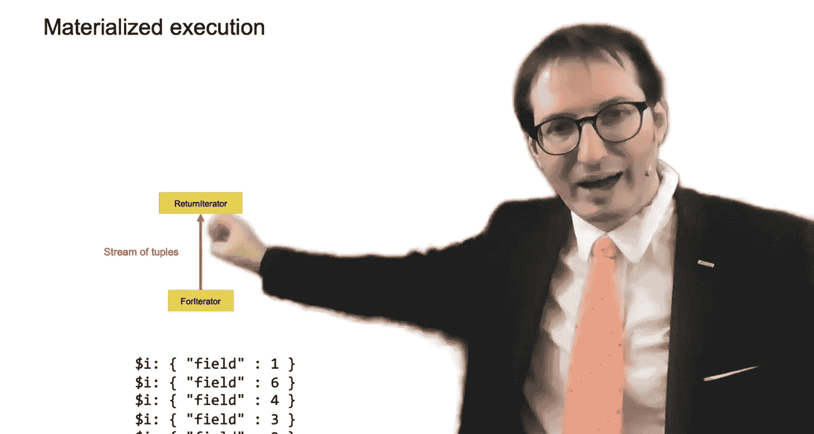

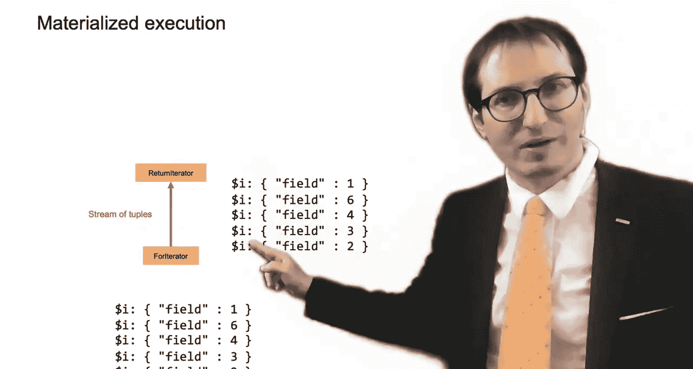

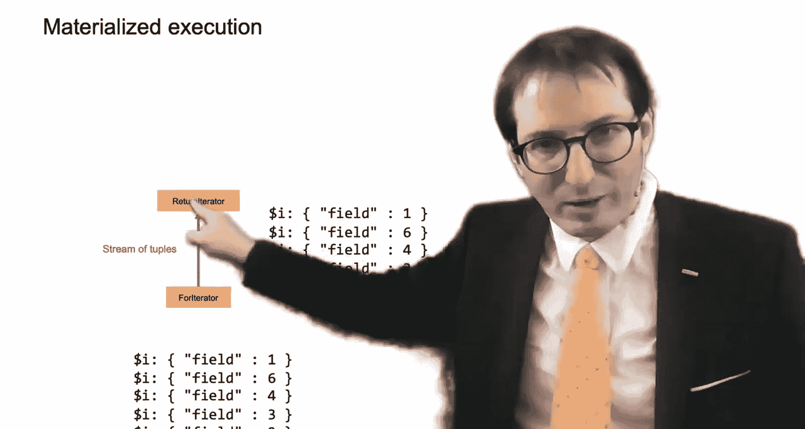

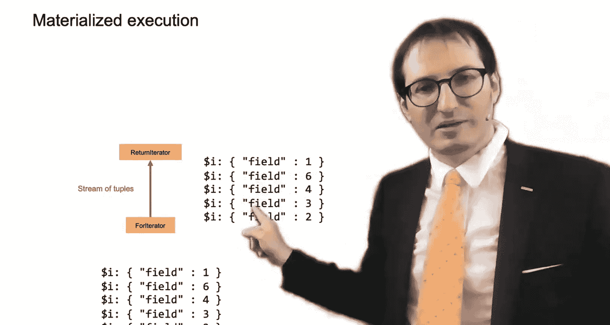

1.  **解析 (Parsing)**：查询文本首先被解析成**抽象语法树**，这是查询在内存中的结构表示。
2.  **编译 (Compilation)**：AST被转换为**表达式树**，其中每个节点对应一个JSONiq表达式（如函数调用、操作符）。
3.  **优化 (Optimization)**：引擎对表达式树进行优化，例如移除未使用的变量、简化表达式等。
4.  **代码生成 (Code Generation)**：优化后的树被转换为可执行的**迭代器树**。你可以想象每个迭代器像一个阀门，当你从最顶层的迭代器“拉取”数据时，它会递归地从下层迭代器拉取数据项，并以流式方式输出。
5.  **执行模式**：
    *   **物化执行**：将所有中间结果和最终结果一次性加载到内存。适用于小数据量。
    *   **流式执行**：数据项被逐个处理并产出，内存占用小。适用于大数据量，类似于视频流。
    *   **并行执行**：将数据和计算分布到多台机器上，同时进行流式或物化执行，以处理海量数据。

正是基于Spark等分布式计算框架，JSONiq（通过RumbleDB实现）才能在海量JSON数据上高效运行。

---

## 总结

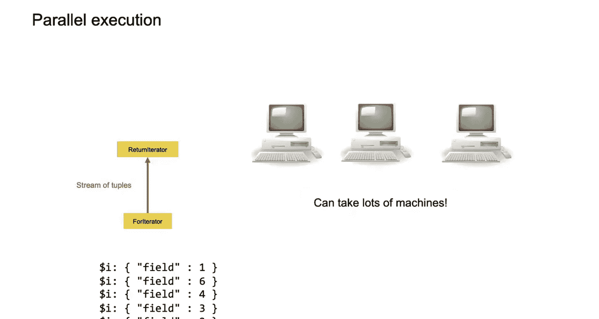


本节课中我们一起深入学习了JSONiq查询语言。
*   我们掌握了如何像组合乐高积木一样，将基础表达式嵌套成复杂的查询。
*   我们深入理解了**FLWOR表达式**的构成与强大灵活性，它能够以任意顺序组织`for`、`let`、`where`、`order by`、`group by`和`return`子句，完成迭代、绑定、过滤、排序、分组和结果构建。
*   我们探索了在JSONiq中实现**关系代数**操作（选择、投影、连接、聚合等）的方法，并看到了它超越SQL的能力，例如直接生成嵌套的、反规范化的JSON输出。
*   我们了解了JSONiq的**类型系统**，以及如何利用它进行数据验证和清洗。
*   最后，我们窥探了查询引擎内部的**执行原理**，包括解析、优化以及流式与并行执行，理解了它为何能处理大规模数据集。

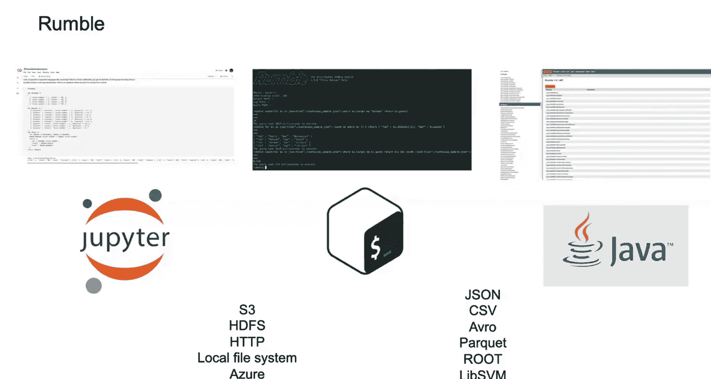

通过结合这些概念，你可以编写出强大、灵活且高效的查询，来处理各种结构化与半结构化的JSON数据。