# 苏黎世联邦理工《工程师的大数据｜Big Data for Engineers - ETH Zurich - 2024》中英字幕 p01 1 - Introduction (1_1) - .zh_en -BV17FAmeFE9K_p1-

Hello everybody in the lecture hall good morning everybody on Zoom good morning everybody from the future my name is Gi Fni and this semester we are going to explore together the evolutions of databases in the past 25 years or so what we typically call big data first just checking because it's the first week we use this room can anybody or me hear me on Zoom you hear me fine。

😊，Can put a world in the chats。Sounds like a yes。 alright， perfect。😊，So you'll be able， of course。

 to ask questions in the lecture hall。 of course， by raising your hands。

 we have microphones over there。 It's going to be regarded。 just so you're aware of it。

 If you don't want to be regarded， just ask to speak without a microphone and we repeat what you say and on Zoom。

 you can also raise your hand。 just like this， you see it' after just a few second， just doing。

This or clicking on the hands at the bottom should do the trick。All right， and then will John Howe。

 who is right here moderating the director is going to repeat your question。

So today is going to be a bit special because I'm not going to actually teach you so much material of the lecture。

 I'm going to give you a history and another of you it's more like an appetizer of what we are going to be doing in the second hour we are going to brush up on SQL so if you visited information see sensor engineer that's engineers that's just a repetition of what you know if you didn't and that's okay too and it's an opportunity to learn a SQL it's really easy to learn。

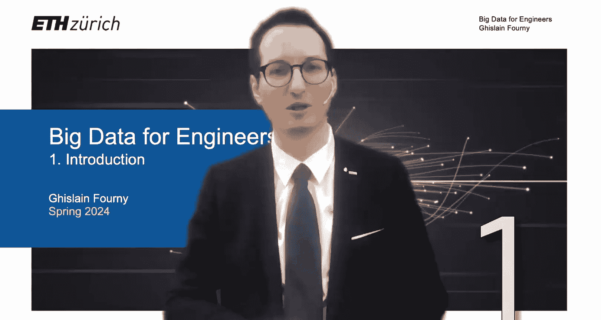

All right， so。Whether are we going to do in this class and what concretely are you going to be able to use for your projects here at TTH or in your PhD？

It's to query data that might be a bit messy， not just a table like you would have in Excel。

 but something that might be messy with missing things not not clean everywhere can also be data of gigantic scales It doesn't have to be both can be either gigantic scale or not clean data And I teach you how to query use technologies in order to to make use of it typically clean it up。

 for example， to feed it into a machine learning pipeline that kind of things right so that's just。

Pek summary， and we are going to be looking at technologies like Hadoop， Spark。

 Jsonique and Rumble DB that were developed here among others at ETH actually 20 students or more actually built Ruble DB。

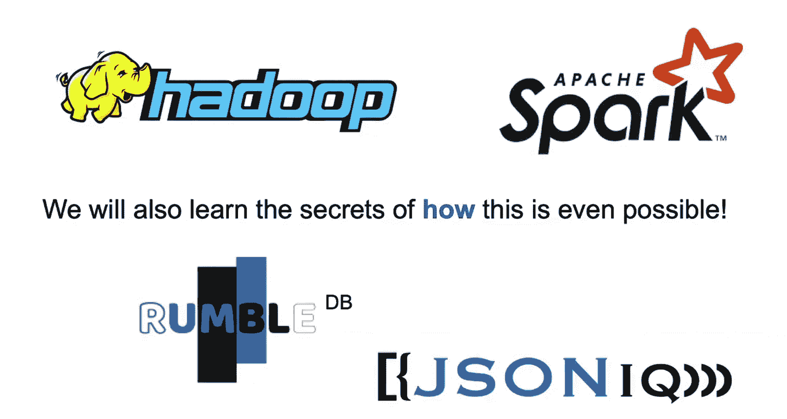

All right， but in the end， this lecture is all about scale， big data。

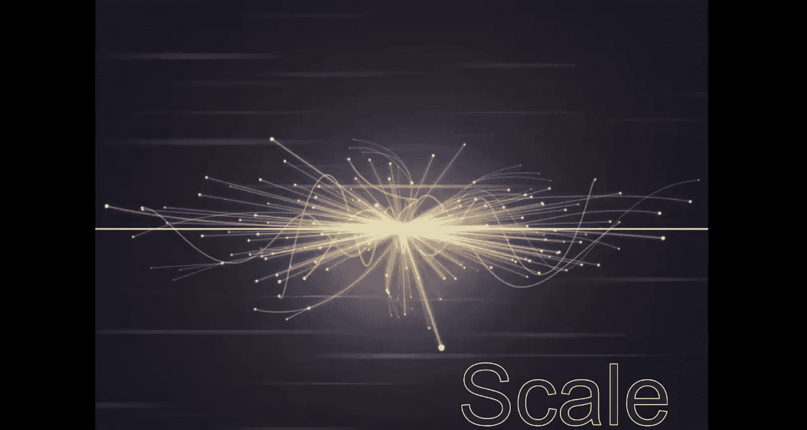

So just to give you an impression， a scale that's the typical size of a human being is the other of the meter right between one and two meters。

Now， if you zoom out， we live on a planet that the circumference of which is roughly 40。

000 kilometers and by the way， it's not a coincidence that it's around number it's actually how we defined the meter in the very early days before it was defined with the speed of light we actually have a better units to get rid of the three zeros that's called mega megameterters。

 maybe you never have memeters but you heard megabytes so that's probably not something that should surprise you。

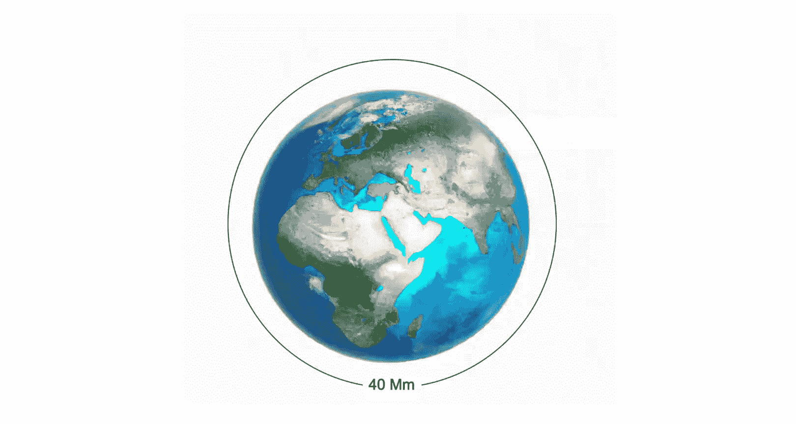

Then if we continue to zoom out， the Earth is in the solar system。

 roughly 150 million kilometers away from the Sun， but now we can use prefixes like gigabytes gig。

 so it's 150 gigters from the sun roughly。😊，嗯。And if we go to this very big planet here， Jupiter。

 it's one termeter already and the whole solar system I'm being very generous here is one tmeter right If you go a bit beyond you reach 10 p and 10 pmeter is a light here。

 what we call a light here that's what the year takes one year to to travels。

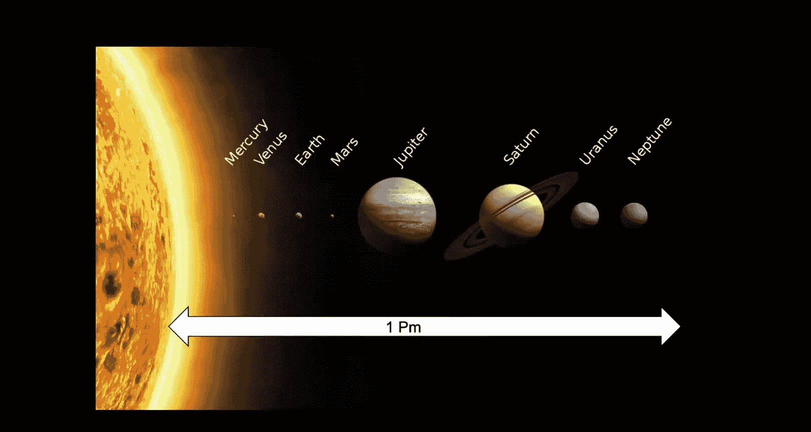

The earth is actually part of something that we call a galaxy because we realized we have not always known that but galaxies look like this。

 we used to call them nebulas nebula and now we realize that we are in one of these and the size is 1000 Xmeterters come back to the prefixes so you see we keep having new prefixes for the distances。

😊，But that's not the end of it because there's actually plenty of them。 Oh， by the way。

 I can get rid of the three zeros with yet another prefix， the Zemeter。😊。

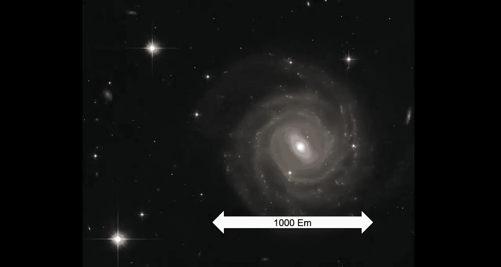

And if we continue to zoom out。There's actually billions and billions of these galaxies。

And the visible universe， what we can actually see because they actually reached us is roughly 138 yota me that's without considering the expansion of the universe because if you consider the expansion of the universe it's actually more than that。

 but basically just that the age of the universe is 20。

8 billion years that gives us roughly that so we are at the yourta meter。😊，What there is beyond that。

 we have absolutely no idea because we cannot see it。 So maybe there's something else。

 maybe maybe it's infinitefin， maybe it's finite and it just repeats。

 but the father that we can see is your parameters。 Now。

 it used to be that this is all the prefixes we had。 But as we will see now。

 we have two new prefixes that were that were a contributed that go even beyond this that I' show you do this shortly。

😊，But， basically。The idea is that in order to explore such large scales。

 we are actually now at the big bank， we have to look in a very small with the particles like the quarks。

 the electrons and so on and so on。 So the lesson here is for the very lab we have to look at the very small。

 So this is the standard model it's what the universe is made of as far as we know at least every time we try to break it。

 we don't manage to break it but hopefully someday will manage and there will be new physics。😊。

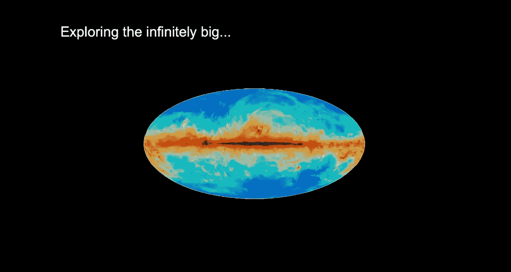

Yeah， but so that's the infinitely small。 And in fact。

 what I want to tell you with this is that the same goes for data。😊。

I like to compare data science with physics in a well， with chemistry， if you want。

 with the idea that with big data， we are reaching absolutely enormous scales。

 but in order to understand how data works at these scales。

 you have to think of it just like atoms and molecules。

 that data is also made of atoms and molecules and we need to study。😊。

These atoms and molecules of data in order to understand how we can query data at very large scales。

 right， the difference is that in one case， is's the real world。 In the other case。

 it's kind of the data world。嗯。I would like to use throughout the semester something that's known as the clicker app it's actually developed at TTH。

 you probably know it from other lectures， so let me take this to calibrate so you're supposed to go to this address right here in your browser or you can download it from your favorite app store and then look for AU app3 right I'm giving your videos time to do that if you haven't already just log in with your ET Eth credentials。

😊，Right。😊，By the way， times are changing because back then when I was a student。

 everybody had a laptop so we all had our laptop in the lecture hall and now when I observed the lecture hall。

 the progressions of laptop keeps diminishing and now people have tablets or O smartphone phones so this is very interesting to see the evolution of this。

😊，Alright。So， let me switch。Right here to。The view and if everything works。You should be able better。

😔，You see the question so the first time I'm going to wait for you to make it work if you have any issue that we cannot resolve there is a support so you can write to support by the way。

 it's not only for people in the lecture hall also on zoom you can actually use this app so it's basically everybody can can vote。

Just not people on YouTube。 That's the only thing。Alright， by the way。

 I should scroll down because there's a lot of moibilities here。

 These Albert but the only ones have electrical engineers。 We have a lot statistics。

 We have mathematicians here， robotics， mechanical engineering also we have。😊，Show them。 All right。

66。Is anybody having difficulties voting？😊，No， all good on Zoom， no difficulties。All right。

 so it seems to be working。😊，Okay， so it's very good。

 So the lecture is intended for all departments of E TH。 That's why it's called for engineers。

 There's also a big data lecture。 that's for master students。

 I assume that those of you who are computer science or data science is continuing education。

 So C S DS， who are allowed to take any of the two。😊，All right， I have another question for you。😊。

Just to get an impression， have you taken the course information system for engineers last semester or the year before？

So it's kind of half h， right？So a bit less than half actually took it yeah， it's not very fine。

 I will tell you a bit about that， but it's not very fine。😊，Okay。😊，So， now。Let me switch back。

To the slides， if I prepared everything correctly， we should。Get back exactly to where we were。

 It just needs to let zoom。Do its think， Yes， exactly。The。All right。Now， here's what it looks like。

 That's the menu of the lectures， so。There is information systems for engineers。

 big data for engineers。 They are complementary to each other。

 Information systems for engineers is the 70s，80s，90s and big data for engineers is the 200s，2010s。

 you can take it in any order already It's totally fine。 you know， like in the movie theater。

 you have the prequell of a movie and you can see it later and that's absolutely fine right So if you took it that's nice。

 you already no SQL， otherwise we learn a bit of it。 But the material is sufficiently derelated。

 I would say that you can take big data for engineers。

 even if you if you hadn't taken information systems for engineers。 Allright。

 if you are a master of students of data science or computer science。

 then you should take big data in the four， not big data for engineers industry continuing continuing education。

 don't manage to say continuing education， however， is totally fine。

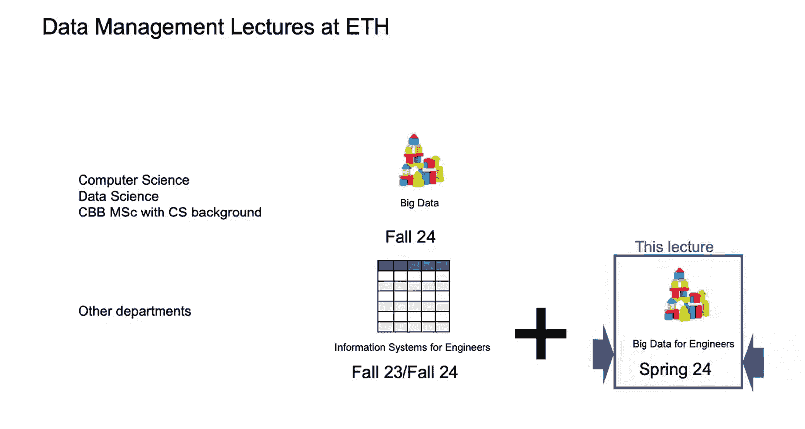

Okay。Now， if I continue what I wanted to tell you between physics and data science。

 So one analogy is with the very large， the very small and the atoms of data。

 Another analogy that I like to do is these two by two matrix。

The idea is that it used to be at least all the way to one or two centuries ago。

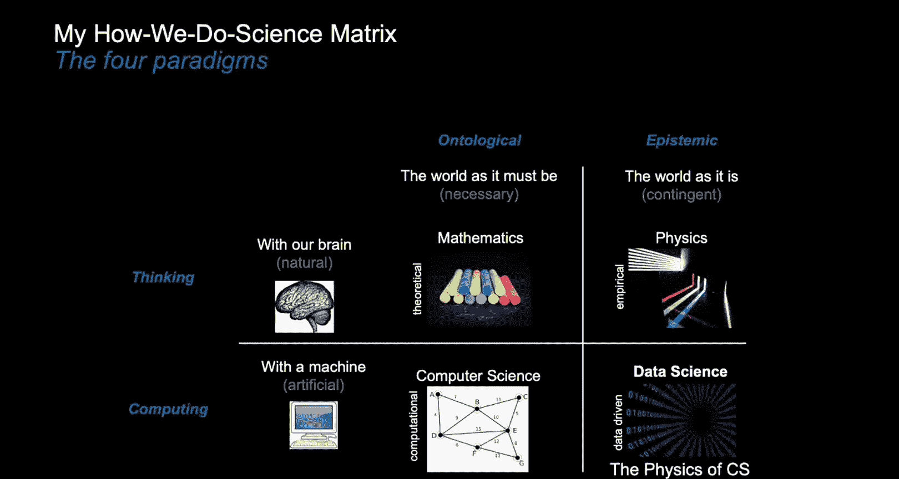

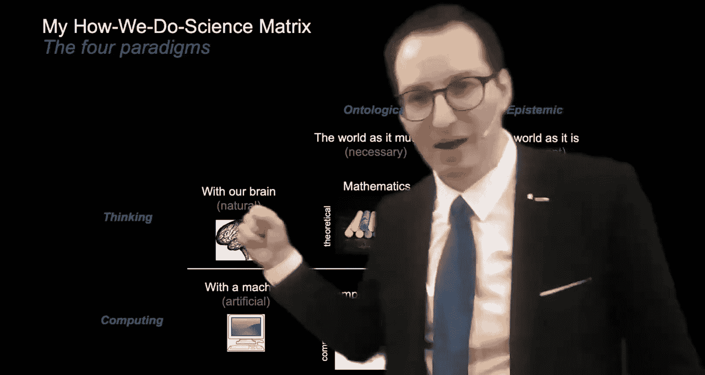

That we were doing things with our brain or writing down and we had mathematics and physics。

 So what's the difference So mathematics is kind of ontological or necessary in the sense that you can just think and derive kind of everything right philosophy might disagree and I know some disagree but basically you can you can derive a lot of things because it kind of has to be this way physics。

😊，Doesn't work that way in the sense that you have to experiment and see how things are actually working。

 right， So you design a theory and then you test it with an experimental protocol。

And here it's because the world could have been different， right。

 The laws of physics could have been different。 So we need to actually experiment in order to discover the laws of physics。

 right， However， of course， if you consider theoretical physics。

 it's amazing that you can still do a bit of physics from your armchair。

 just if you have something beautifully simple。 Then there's kind of a hints that it it might be the truth。

 But that's kind of an exception。 right Ph is both experimenting。 Now。

 what is new is that now we have machines。 So we can actually automate a lot of things。

 And all of these things with mathematics expanded into computer science。

 Now what I mean with computer science is basically theoretical computer science， Comp， Comp ability。

 algorithm and data structures and so on。😊，It's kind of also mathematical。

 right in the sense that we can also do a lot， a lot of people wouldn't believe that。

 but a lot of computer scientists actually just use a we bo， just like the theoretical physicists。😊。

And then we have data science。 So what is the difference is that in data science。

 it's kind of like computer science because we also use machines in order to query the data。

But it's kind of like physics because we gather as much data as we can in order to learn about the world。

 So in the same way we did experiments with physics。

 we kind of query data in order to figure out how things are。 The data could have been different。

 in which case， the theory we would have discovered would be different。 But that's basically the I。

 So data science is at the sweet spot between computer science and physics， right， you can think。

 for example， of hypothesisthe testing for staisticians and so。😊，All right。

 so this is how we do science in these two by two metrics。

You wouldn't believe if you read ancient texts like thousands of years old。

Everything that our ancestor has already figured out or kind of had the intuition atoms and so on and so on and Plato for example。

 said the good decision is based on knowledge， not on numbersbels。

 that's why we need to query the data and extract actual information and knowledge from it。

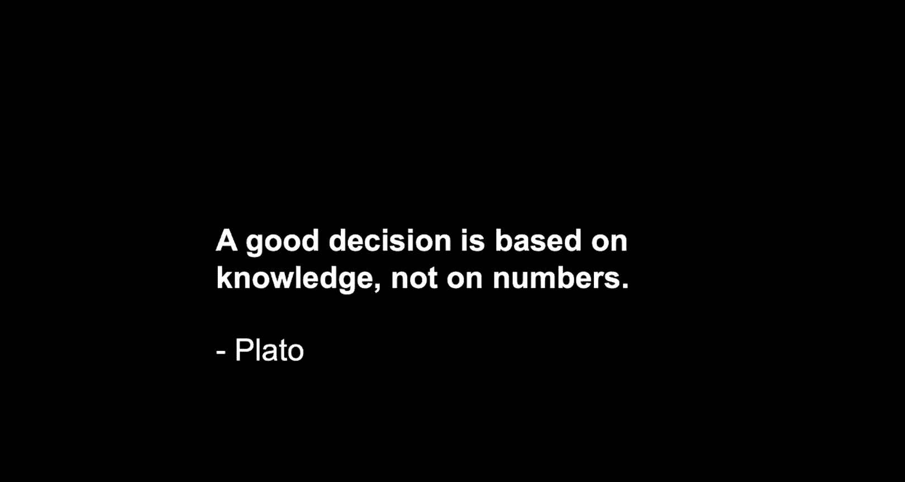

So since we are a few thousands ago， let's go through history。More or less。

 let me start with prehistory of databases。😊，So how did we。Handle knowledge。Thousands of years ago。

 so roughly humankind started settling 1012000 years ago when the temperatures rose a little bit and back then all we had was our brains and speaking so people would just tell each other the knowledge transmitted it from generation to generation some people would sing actually so that was of course a lot for the famous people like the king。

 the queens and so on， the emperors。But basically， or have that knowledge was preserved and transmitted from generation to generation。

 The problem is that you can lose information or you can distort information。 Thus。

 there was a great invention that followed。😊，Which is the rating。😊，My clicker is actually。Yeah。

 so writing was the way that we could encode information or knowledge that could be preserved for thousands of years。

 And in fact， we can see it because we discover all of these tablets today that we keep deciphering and not with artificial intelligence。

 we keep deciphering even new ones that we couldn't before So that allows us to that allows us to avoid the distort and the errors when we transmit the knowledge because we see that exactly as it was thousands of years ago。

 So that's the writing。 So this is one kind of tablets that we get with actually just text right' telling a story。

 but there is another kind of tablets， there's two big families of tablets that looks like this。

 it's not text。And in fact， when I looked at that， it felt like I was looking at a science fiction movie where people traveled back into the past and brought some ancient technology because that almost looks like an iPad。

 right， running spreadsheet software and in fact。😊。

That's the oldest relational table that I'm aware of and that's 400，4000 years，3800 years。

 so this is incredible and that's a relational table。 it has columns it has rows。

 it has everything So what we learned from this is that tables are very， very。

 very intuitive to human beings to endorsedo that even our ancestors actually knew that All right so it's called Pmton 32tu this web contains some pythagoreas troopers。

 the sides of the rectangular triangle right triangle。All right。

 then we found a way to easily duplicate information because before we had printing people needed typically monks needed to manually copy books after our books。

 when we invented the printing press go and back， for example。

 we were allowed to certainly print thousands or millions of copies of the same text。

 so that accelerated the propagation of knowledge。Then there was the， the， the。

 the the golden age of the press， for example， in the 19th century。

Where information propagates very fast， then。We automated and made things even faster with computers。

 So that's quite all It's the time where computers would take an entire room that would consume more electricity than the rest of the city。

 In fact， if you switch it on， then the power of the city goes down。😊。

Wwhichch is unfortunate and that had less power than the smartphones you had in your hands and by orders of magnitudes just to see the evolution。

 but that allowed us to automate and make things faster。

 first mechanically and then with silicone and transistitals even more right？

Now we are still in the prehistory of databases and that's the 1960s where we have five systems with directories and filess you probably are all familiar with that even though on smartphones we don't really see them。

 but on the laptop you do have still exposed the directories and filess， and in the 60s。

 this is how people were dealing with data。😊，They were storing the data as slides and they were trying to make do with it。

But it wasn't very practical and in fact it was so impractical that there was a turning point in history by somebody called Edgarcod who realized that we have to shield the users from the complexity by just giving them some simple model like a table thousands of years old with rows and Cols that they can process right so that was the fabulous idea by Edgarco and that's called data independence I'm going to keep repeating this one the whole semester because it's not just for information systems for engineers。

😊，It's also our big data for engineers。And then now we are going to focus a bit more on this。

 In the 2000s。 We had new technologies， the key value stars， the column stores， triple stores。

 document stores that kind of give new ways of handling data。

 So we'll take the time to go through this during the semester， maybe not triple stars。

 but the other the other three or liter bits。😊，Now， big data。

 let's come back to big data after all this historical perspective。 So first is the buzzwe。

 Bwes come go， for example， went out the buzzwe。 So at the moment， I think the buzz world is AI。

 artificial intelligence。 as even artificial intelligence and machine learning kind of go together。

 It used to be that the buzzw was the blockchain and Bitcoin。

 So everybody was doing blockchain before that， it was cloud computing。And so on。

 And even before that， they were at some point some point biotech。

 all your company names would end with Uron， even the B or restaurants。

 So when you see companies that sell ice tea renaming themselves as the blockchain that's actually not a new thing。

 but anyway， it's all buzz well。And when there is a buzz world。

 it's important to just stay away from the destruction right so now big data。

 the buzz world is kind of fading away even though it's still a little bit there because it's shifting to AI。

 but we need to define what we actually mean because whenever there's a buzz world。

 it's hard to define what it is。So I'm going to try to do this today Den there's going to be a lot of companies there because a lot of what happened in the past 25 years。

😊，Was driven by companies because these were the ones that had the data that they couldn't deal with anymore with all our technologies。

 So they invented all of this。 So you're going to see a lot of companies。

 It's not because they pay me or anything。 It's just that this is just what happened， right。嗯。

Now big data is often associated with something we call the three vs of big data volume variety Veity。

 there's a fourth one that sometimes we add which is veracity but I'm going to focus on these three I'm going to go one by one through this we see that looking at big data through this picture is a pretty good pair of glasses to look at things through the entire semester。

So if I start with volume， the volume of data。😡，嗯。First， we have so much data because we can。

 we can store it， we have all of the hardware that we need in order to do that。

 so it kind of happened that companies are hoarding data because they can。

I'm not going into data protection， which is a very important topic as well。 And。

 and it's not because you can doesn't mean that you are allowed to do that。

 That's you need to act responsibly。 but basically， we can store data。

Then data carries a lot of value and we can see all we extract from data can lead to decisions that can be made in an optimal way of scientific discoveries and the more data you have it's exponential so if you take two pieces of data。

😊，Together， the sum of these has even more value， why because you can join， come back on the joins。

 of course， for those who don't know that。So it's actually growing exponentially in terms of utility。

😊，And that is also why when you look at data protection。

 the concentration of data into the hands of the same entities is something that one needs to be careful about precisely because of right there is a cost called I think at TTH big data low and policy that is a guess cost that might be interesting for those of you who are interested in these aspects like ethical aspect and legal aspect of data。

And then we have a lot of products that require all the data。

 If you want to compare flights or hotels or restaurants or trains and so on。

 then you need all the data。 So that's one more reason。Now， because we accumulated so much data。

 we needed prefixes to deal with them and these are here。 you must know them byhar。

 you probably know the first ones。 If you don't knowterapeta exzeta and so on。

 think of the Greek for4，56 Sotetra Penta Hega，terrappeta ex。

 the number of groups of three zeros in Greek right So that should help you a bit actually it's on purpose that it resembles a little bit like Hona is like non and so on。

 All right， so this is something you have to know byhar。

 Hona and Queta are actually new they were not here when I started teaching big data。

 but they were added， I think the motivation was the message of Jupiter that also needed that many zeros。

 but there are also some users that starting running out of zeros running out of prefixes。

So here it is。 we don't have yet， I think maybe roadabytes or quetabits， we don't hear so much。

 but it's probably going to happen at some point。Supose to switch the slides。

 if I press again is going to switch too much。Okay， okay。Okay。

 now I have a question but they need to ask you。And here it is。From what quantity of data。

Do you consider it to be big？Would you say is gigabytes。

 terabytes that you might know because that still fits in your laptop， petabyte？100 TBabtes。

Or an exabite， a millionn。Tios。What do you think you would call big data？We have a majority。

 and in fact， this majority reflects the majority， I think of what people would commonly call big data。

Typically we think of petytes， why， because it doesn't fit on a machine and typically that's what you have in a data center。

 the size of data， but we'll come back on that。呃。Pabytes。

Could be considered the beginning of big data it still fits on your laptop right you don't need the data center for that。

 but we will see that there's many cases in fact maybe 80 or 90% of the projects that do fit on your laptop and then you should do it on a single machine much less expensive and you can optimize much more but I'd come back to that。

😊，嗯。😊，So what we are going to learn will also be usable on your single laptop without needing an expensive cluster an exabyte here we are the scale of the whole of humankind right but this is accelerating so much that now we are probably stepping into the dataytes you really need to consider that the quantity of data we create in just a few years。

 two， three years is the same order of magnitude as everything that's been created in millions of years。

😊，In just two or three years， this is telling you how the acceleration is in terms of the data that we are producing。

All right。😊，So exabytes， deabytes。I think we probably are way into the databases now， probably。

And the total quantity might even be in yourabytes by now。Sue。

Let me switch back again if I prepared correctly， we are supposed。To lend back exactly where we were。

Yep。All right，These are the prefixes and as you can see in terms of data since we started accelerating from the first computers。

 we went all the way to not only to Jupyter but almost to the B key Way right so this is what we did in just a couple of decades right so this is impressive by comparison right and by the way you should know the prefixes。

😊。

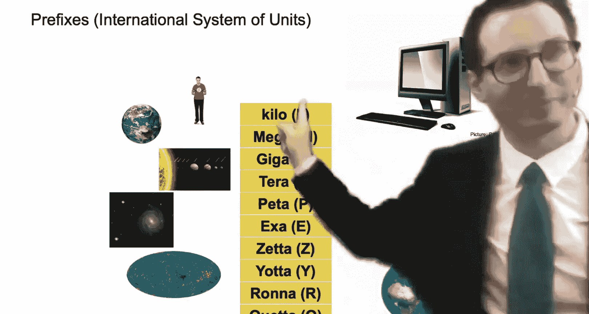

There is another series of prefixes which is for people who love powers of two you might have felt that for some computer scientists when they tell you a kilobyte it's actually 11024 bytes another thousands and somehow there was this ambiguity it was resolved eventually with different prefixes that are meant to cover the powers of two as you can see two to the power of a multi of 10 it's very close to a power of 10 but not exactly a power of 10 so two to the power of 10 is almost 10 to the power of three。

😊，It's not that much used， but you should know that these exist。

 of course you don't need to know these numbers by half。

 even though I suspect that some computer scientists might know some of those by half。

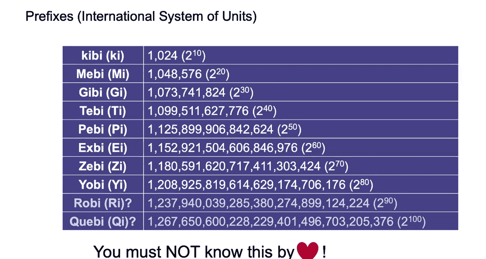

But just know that they exist basically without learning anything by heart。All right。

 so that's the volume now the variety the variety is simple paper is what we used to use in the in the 70s。

 but there are also other shapes of data trees we' are going to focus on them during the semester a lot data can be shaped like a tree。

😊，It can be shaped like a graph in a graph databases like Neo4j。

 it can be shaped like cubes that actually recover in information systems for engineers。

 it's the slice and dice of the business re that a company can find， for example。

 bad sheets and so on。And then there is text， which nowadays actually is probably growing even more popular than the rest of the databases with ChaGPT and LLMs。

 this is covered also intellectual a lecture information retrieval that I give to computer scientists。

 but this is a fifth way that the data can actually be shaped。😊，All right， so five of them paperss。

 trees， graphs， cubes and unstructure data text。The third is data velocity。

 so we keep producing the data as I told you by now we are way into the yoabytes range of what we produced。

 but I'd like to show you the challenge that disrepresent because you might think okay we just produce more data but we also have the technology to read it and process it right so why is that even a challenge we just we just can handle it。

 but no it's actually not that simple And in order to understand that I need to use returns not everybody might have the same definition。

 but I'm going to use them in this way for that purpose the capacity is how much data can use store。

 for example， hard drive has a terabyte of data that's the capacity of the hard drive。

 That's the first thing I want to look at。The second thing is the throughput it's the speed at which you can read right how many bytes per second can you read of the hard drive。

 you can also experience that at the download speed from the internet right when we see it a gigabit connectionnet write down that's typically throughput right。

And then， Latin C。Is the third one。 It's how much you need to wait until you start receiving data right because it's not instant。

 You probably notice when you're on the internet， you might have a delay of a few milliseconds or a second before the page actually appears right So that's called latency Some people use the term lat C to measure all the way until you have received everything。

 but here I just mean from the moment you start receiving something right now how did did these three evolve。

 This is where we can learn something。I tried to find the oldest commercially available hard drive。

 and I found this one， 1956， IBM Muhamd 350 was part of a computer that IBM was setting。

It had the capacity of an incredible five megabytes。It had a throughput of 12。

5000 characters per seconds， bytes character can conce all the same thing。

 And the Latin C was 600 milliseconds。The dimensions were like this was like 1 m，1 m 70。

 So so absolutely gigantic right to store all of that。

 The reason for the Latin C 600 milliseconds is that insides that there are these rotating discs that you need to read and you have a reading head that reads the bytes from it。

 But in order to access a specific byte， you need to rotate all the way。

 So you need to wait until the disk has rotated to bring the bite you want to read under the reading head。

 So this is the reason why why there is that Latin C and you need to wait until you start reading。

And how did that evolve？Well， this is what we have today， that's the largest HDD。

 the hard drive I didn't consider SSDs， you could also。

 but this is the largestHDD that I found today。And I need to zoom in because actually it's so small。

 it has 26 terabytes of data。😊，Typically used in data centers。

 I don't think many people have that for their laptop， but it has the merit of existing。

 The throughput is 261 mebytes per second。 The Latin C roughly I took it from another model。

 but that's the right order of magnitude 2。3 milliseconds it's less because it' still rotates。

 but it's much smaller and the dimension is like this right This is the software thing you have in not in your smartphone but in your laptop right。

😊，Now， how does it come down？So I ran a comparison。嗯。Thinking， do I ask you this question？

Maybe I keep it for later this one。So I run a comparison the capacity I renormalized our units of volume。

 right because otherwise it's not fair。 there was one that is huge and the other one small。

 so I renormalized by the unit of volume and I found the progress to be this。

And this is already here on the slides。 This is there。

 You have an increase of the capacity by 20 billion，20 billion times the factor throughput。

 the speed at which we can read is only 20000， that's ridiculously low compared to the increase in capacity。

 And Latin C improved Here is the opposite decreased by 250。

 That's ridiculous right So even in agoithic scale。 you can still see the difference。 And in fact。

 this is why we are in big trouble。 And just to illustrate why we are in big trouble。

 just with an example。 imagine that instead of hard drive， I use books。 So let's take a book。😊，Today。

 that has 600，000 wordss that would be the capacity instead of bitete。😊，The throughputs。

 that's how many words per minute per minute I can read。

 Let's say 1 thousand words per minute is what people can read。I wrong it， right。

 And then the Latin C， but here I care less about this one is you go to the shelf to get the book So that's one minute。

 right to to get the book and start reading it。😊，Now。

 how much time do you need to read a book well Ten0 Now Wells sounds reasonable right。

 maybe less if you if you took the latest novel by Dan Brown or something and maybe you read it even faster because you're excited。

 but10 now Well is kind of reasonable。Now， if I go to the future。

 let's say two centuries from now and we evolved。With exactly the same factors as for the hard drives。

 I'm taking factors that actually happened， right， 20 billion times capacity。

20k for the so it actually happened I'm even given two centuries for that。😊。

Then this would be the capacity of a book in two centuries。

 and the number of words per minute we can read would be 21 million with the same evolution factor。

Well， to finish the book now we need 1 thousand，100 years compared to 10 hours。

 we are in big trouble because now we produce so much we cannot even read it fast enough。

So this is why we need to come up with new ideas and this is why we parallelize。😊。

And we batch process paraizing means that instead of a single person reading the book。

 you spread it all over 200 million people， each of them reads a small part of the book and that's it。

 then you can do it in 1， that's the secret of querying data that we see in these course。

So this is why we are going to use so many machines。

 it's to fix that challenge and the distortion in the evolution of capacity and throughputs。Right。

The other one is batch processing。 I'm not going to tell so much about it today。

 but we also are going to look at how to solve for the discrepancy between these two。

 It's a bit more complicated。 So that's what is big data。 According to me。

 It's that we have a huge challenge because capacity。

 throughput and Latin C did not evolve at the same pace and that forced us to come up with new technologies in order to deal with it。

It has a huge impact in the sciences I'm going to give you just a few examples。

 one of them is shown high energy physics where they produce 50 petabytes per year。

 maybe it's even more now they have 10，000 cell， hundreds of thousands of course and you can follow the latest evolution there has an address here。

😊，In fact， they produce so much data when they collectlate the particles that a lot of it is just thrown away。

 they don't even bother to store it and they are trying to come up with machine learning based ways to select what you throw away and what you keep。

 but this on the left is what you keep it's not even the whole data generated by the collisions。😊。

Alright， and there's a link to databases， there's this paper that we wrote in in my group about the usage of why didn't it why aren' it apps。

 why are they not using SQL and and because it's a database problem really to detect the Higgs bo So yeah that's for anybody interested and after this course you should be able to understand that paper。

嗯。Next， we have Petaloing the sky， right， all the the galaxies， the planets and so on。 So here too。

 we are trying to gather our data。 that's the slo digital sky sur。 that's yet another example。😊。

Yet another example is the DNA right now we have also CRISPR RNA vaccine and so on and so on that' is bringing the data also to these very interesting molecules and in fact some people。

 including some that were here at TthH， managed to execute SQL on top of DNA。

Literally like this is hardware， this is the DNA and they execute relational queries on top of that。

 so this is this is all very exciting what's going on al right oh there's the sun。😊，You see， Faant。

 maybe remove these scar at least Sir。We have here the sun that is basically hitting the sides in the lecture hole。

 so I need to find a where where is it coming from， probably from the back。Let's see。

 that does anything。Okay， let me do the other two。That strategy It's not changing it。 Oh， yes， yes。

 Now it is。 Okay， so now the lights。He's disappearing， okay。So。The scope of the lecture。呃。

Is databases， so there's this way of looking at data information。

 knowledge wisdom as some sort of pyramids， and we are interested in databases right querying the actual data。

 not machine learning， not artificial intelligence， it's very exciting and there are connections。

 but this is not the focus of the lecture。😊，I'm going to reopen the cars in a more optimized way after break。

 don't worry。Alright， so now this is the lecture team， right， So the， the the。

 they are right there is some of， some of them。 So we have Ludo Vika with here。 We have Genha。

 You can send up if you want。 We have Johnha。 We have D K。 We have Zombo， and we have Alex song。😊。

Any other F Ts。Yes， right here back now， all right。

We also have a new TA that we hire well I'm not calling I'm not calling her a TA。

 it's Ehel that you can see right here， the reason I'm not calling her T is an AI model that you can ask questions you can connect to connect to el。

tthhz。 T， there's a link in the modelle。😊，We train her with the entire textbook of the lecture or running on ETH premises and you can chat with her all you want I recommend that you consider her a fellow students right she can make mistakes you know that chat GT also hallucinate but she's also parted of of the team。

All right， so let's applaud the TA team， we encourage them。😊。

And so you will have exercise sessions with them not this week next week they will start so no exercise sessions this week this week the goal is just to install the Docker composeos。

 you will be instructed， check that it works and if it doesn't work then there is your that is going to be organized okay。

😊，Now the overview of the lecture looks like this， we are going to look at how to store data。

 the models of data， the processing of data， even including in data centers and the management of data with query languages on the higher level right so a lot of interesting topics in there。

What is expected is that you attend the weekly lectures in the lecture hall or on Zoom that's fine too you can also watch the recording some people even binge watch the recordings at the end of the semester just a word of warning if you binge watch the recording at the end。

You might pass the exam， but then you're going to forget everything。

 The best way to remember what we are going to be learning。

So the rest of your life and your career is to really try to learn every week during the semester。

 This is how you remember in the long term。Okay， so then there's the exercise sessions。

 there's going to be some material to read even though now a lot of it is going to be the textbook to make it easier and then there's a written exam in the summer session 180 minutes for you Ill tell you more about that later we have 25 bonus points that you can get a few of them every week you have quizzes to solve every quiz that you pass gives you 0。

01 points and they are added to your exam grade at the end and。😊。

You basically before the rate is the grade is rounded to a quarter grade， right。

 So this is an opportunity to improve your grade at the exam， right。

 so we encourage you to solve the quizzes during the semester。

 If you have a disagreement on a quiz write on E。 It's totally that if I try to have a discussion。

 maybe you give arguments and maybe we accept no answers。 So it's it's totallyifying。 In fact。

 it's the goal of that to bring you at a level that you can have a discussion。

 Then we have the textbook。Here， there's a printed copy available， but it's not up to date。

 If you really want the latest， just download the PF。 I will once in a while， upload a new version。

 If you see errors， let us know。 So this is the address here。

 You can just download the P D F online just like that， right， start on the research gates website。呃。

O。And again， I insist it's free online， you don't have to buy it， you don't have to pay for it。

 The library， if you want to printed copy， the HH library has， I think a few copies of it。

 but the latest version is really the one you get on that website for free。

Then we will have Docker every week we use the setup for the programming assignments and it should just work there the Docker Com command that you run。

 try it this week and if you have any issues then the Ts are going to help you。Next。

 there is a chat using elements。 go to chats dot T dot C Al now actually using your login credentials。

 we will then invite you in a batch like batch processing。

 we invite you all to the chat room of the course。 There is also the Moodle with a forum Q and A。

 So this is where you have guaranteed on。 if you ask questions on the Moodle forum。

 This is where the material of the course is also going to be stored on the slides recordings the link to a3 is also there。

😊，And Ehel， of course this is a screenshot of what it looks like It's designed right here at TTH Garardkotemeya is in charge of it one of our former T Susie is also involved they have students writing their mastertasis with them on this It's really amazing。

 We tested it。 It's not perfect。 It does mistakes but it's really really amazing If you click on the little book image it points you to the parts of the textbooks。

 the textbook that it used to produce the answer right So again， use with care。

 but hopefully it should support you a little bit in your learning right。

Which brings us to the break so we are going to have a break of 15 minutes so I see it's one minute past nine so I'm going to see you at 16 past nine for the continuation and in the second hour we'll brush up on SQL and relational databases see you in 15 minutes thank you。

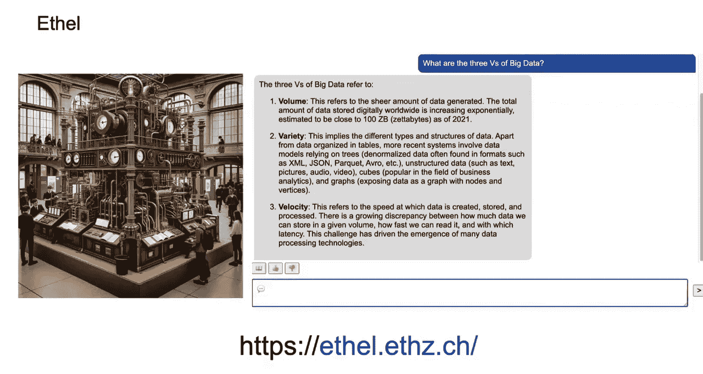