# 工程师的大数据：1：引言 (1_1)

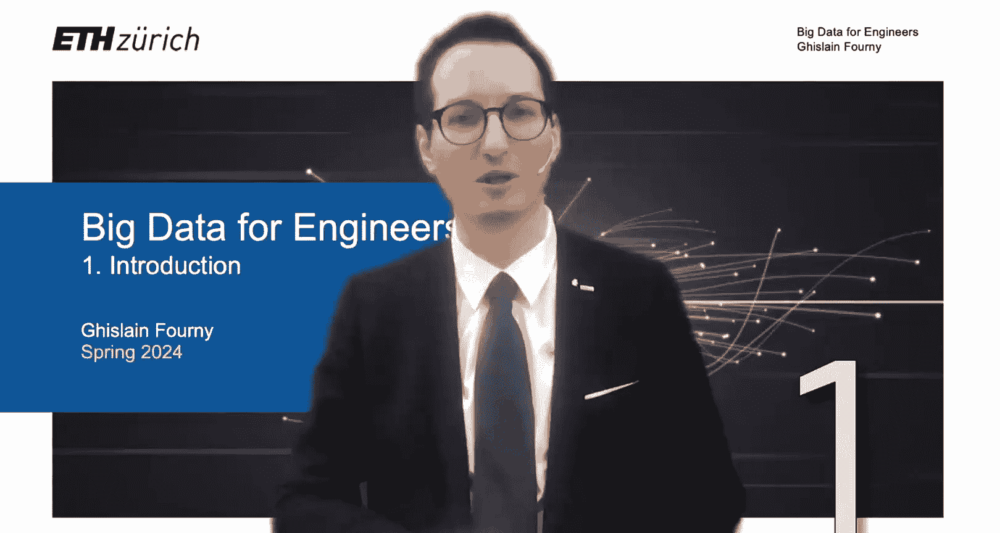

在本节课中，我们将要学习大数据领域的核心概念、历史背景以及本课程的整体安排。我们将从宏观视角理解数据规模的演变，并探讨处理海量数据所面临的挑战。

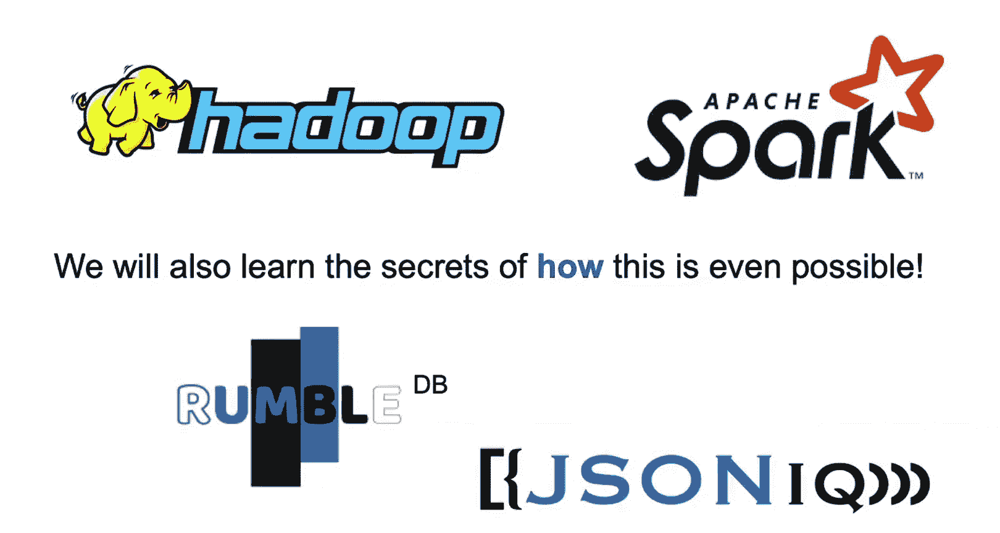

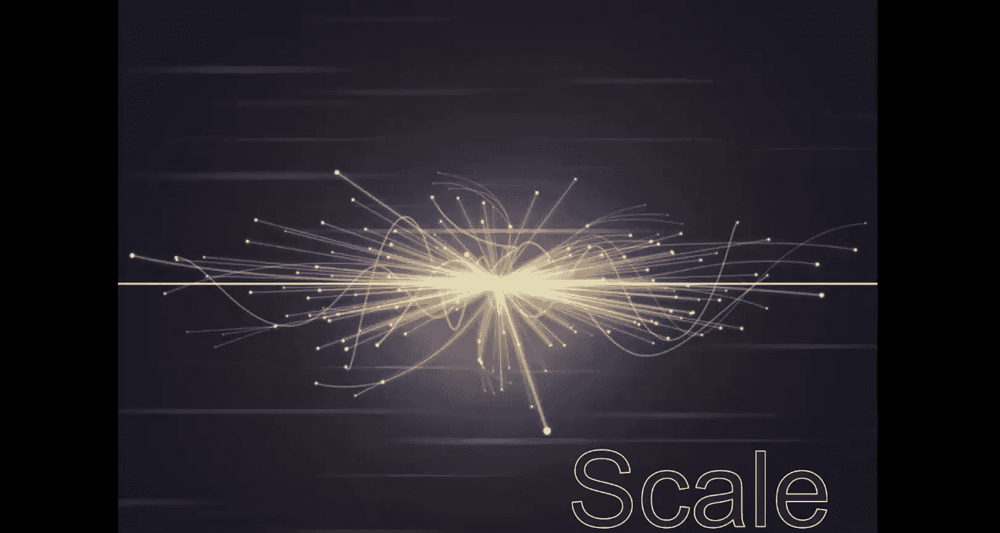

## 课程概述与历史背景

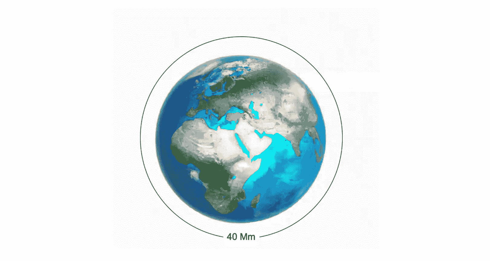

大家好。我是Gi Fni。本学期我们将共同探索过去25年左右数据库的演变，也就是我们通常所说的大数据。

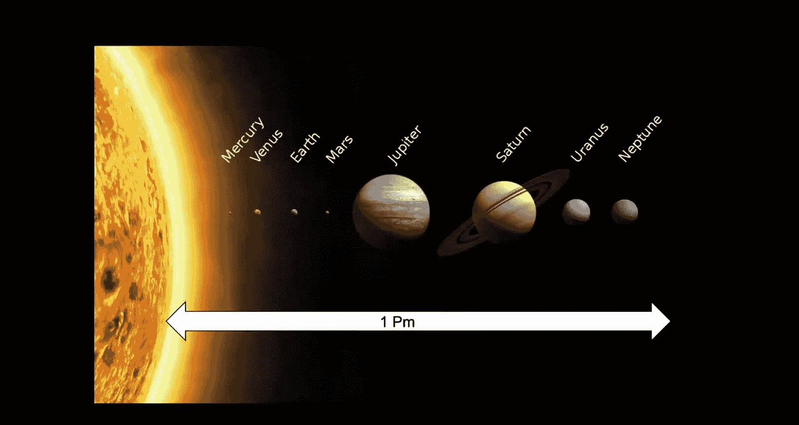

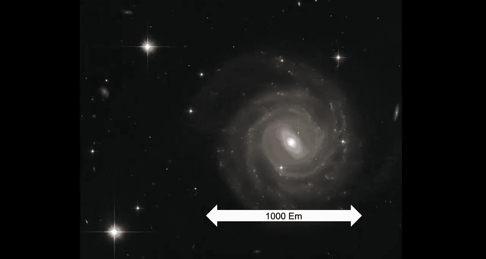

今天的内容有些特殊，更像是一个开胃菜。在第一小时，我将为大家介绍历史背景。在第二小时，我们将复习SQL。

在本课程中，你将学习如何查询可能有些“混乱”的数据。这些数据可能不像Excel表格那样规整，可能存在缺失值，或者规模极其庞大。我们将学习使用相关技术来查询和清理这些数据，例如为机器学习流程准备数据。

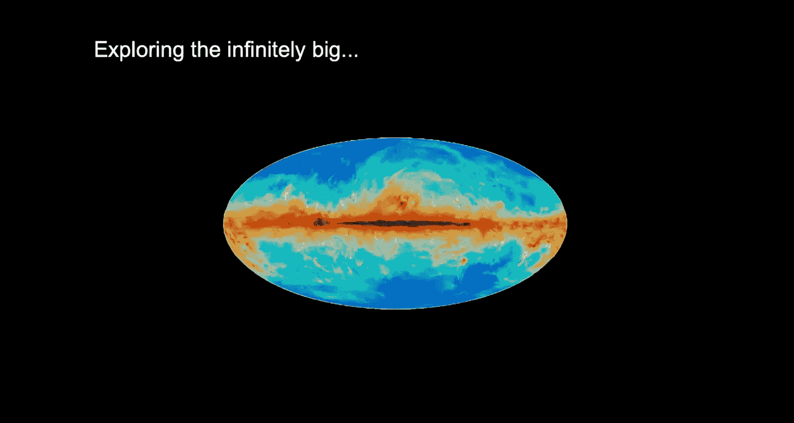

我们将研究诸如Hadoop、Spark、Jsoniq以及Rumble DB等技术。其中，Rumble DB是由20多名ETH学生在这里开发的。

归根结底，这门课程是关于**规模**的，关于**大数据**的。

为了理解这种规模，我们可以做一个类比。人类的典型尺寸是米的数量级。地球的周长大约是4万公里，也就是40兆米。地球到太阳的距离大约是1.5亿公里，即150吉米。木星的距离大约是1太米。整个太阳系的尺度大约是1拍米。再往外，1光年大约是10拍米。

我们所在的银河系，其尺度大约是1000艾米。而可见宇宙的尺度大约是138尧米。为了探索如此巨大的尺度，我们必须研究构成物质的基本粒子，如夸克和电子。

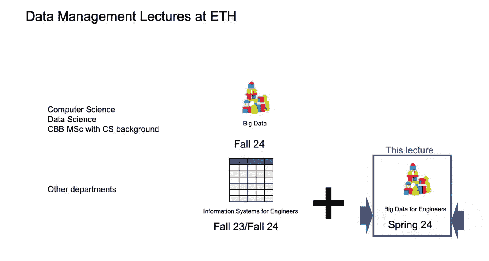

这个道理同样适用于数据科学。为了理解大数据在巨大规模下的运作方式，我们必须研究数据的“原子”和“分子”，即数据的基本构成单元。

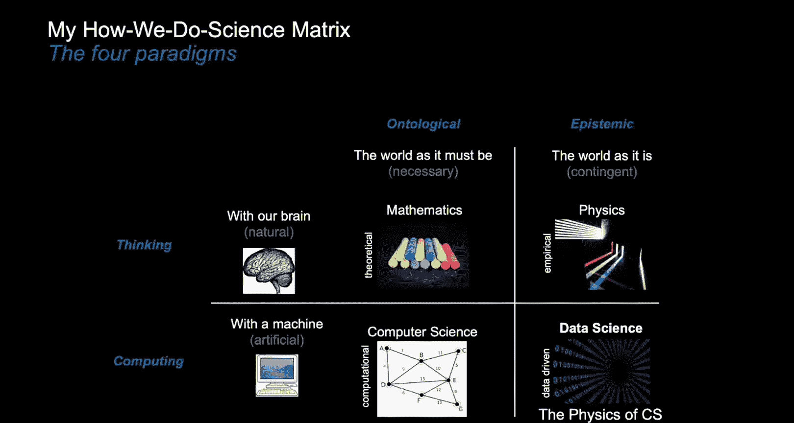

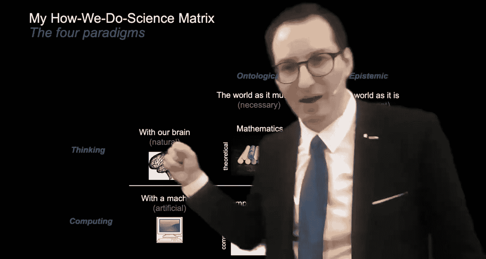

## 数据科学的定位

我们可以通过一个2x2矩阵来定位数据科学。

*   **数学**：依赖于逻辑推导，具有必然性。
*   **物理学**：依赖于实验来发现世界的规律。
*   **计算机科学**：利用机器自动化处理，其理论基础（如算法）也具有数学般的必然性。
*   **数据科学**：它像计算机科学一样使用机器，但像物理学一样，通过收集和分析数据来了解世界。数据科学处于计算机科学和物理学的交汇点。

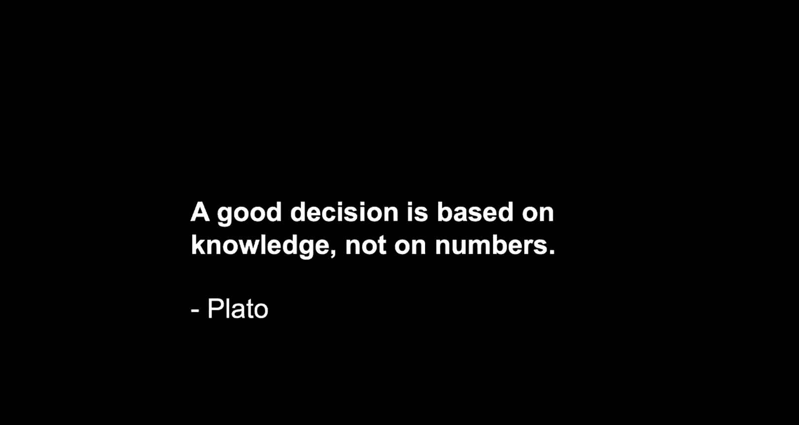

## 数据处理的历史演变

现在，让我们回顾数据处理的历史。

*   **史前时期**：知识通过口口相传或歌唱来保存和传递，但容易失真或丢失。
*   **文字的发明**：书写使得信息能够被准确记录并保存数千年。
*   **表格的出现**：考古发现了一块约3800年前的泥板，上面有行和列，这可能是已知最古老的关系表。这表明表格对人类而言是非常直观的数据组织形式。
*   **印刷术**：印刷术使得知识能够被大规模复制和快速传播。
*   **计算机的诞生**：计算机实现了信息处理的自动化，其能力呈指数级增长。
*   **文件系统（1960年代）**：早期计算机使用目录和文件来管理数据，但这种方式不够便捷。
*   **关系模型的提出（Edgar Codd）**：Edgar Codd提出了**数据独立性**的概念，即通过简单的表格模型（关系模型）将用户与底层存储的复杂性隔离开来。这是数据库领域的一个关键转折点。
*   **新型数据库（2000年代）**：出现了键值存储、列存储、文档存储等新型数据库技术，以应对多样化的数据需求。

## 理解大数据：三个V

“大数据”是一个流行词，我们需要明确其定义。大数据通常与三个“V”相关联。

### 1. 数据量 (Volume)

我们拥有如此多数据的原因如下：

*   **存储能力**：硬件技术的发展使得海量数据存储成为可能。
*   **数据价值**：数据蕴含着巨大价值，可用于优化决策和科学发现。数据的价值随着数据量的增加呈指数增长，因为不同数据可以关联（Join）产生新洞察。
*   **产品需求**：许多产品（如比价服务）需要汇集所有相关数据才能运行。

为了描述巨大的数据量，我们使用一系列前缀。以下是需要掌握的前缀：

*   Kilo (K): 10³
*   Mega (M): 10⁶
*   Giga (G): 10⁹
*   Tera (T): 10¹²
*   Peta (P): 10¹⁵
*   Exa (E): 10¹⁸
*   Zetta (Z): 10²¹
*   Yotta (Y): 10²⁴

其中，Ronna (R, 10²⁷) 和 Quetta (Q, 10³⁰) 是新增的前缀。通常，当数据量达到**拍字节(PB)**级别，即无法单机存储时，就被认为是“大数据”的起点。

### 2. 数据多样性 (Variety)

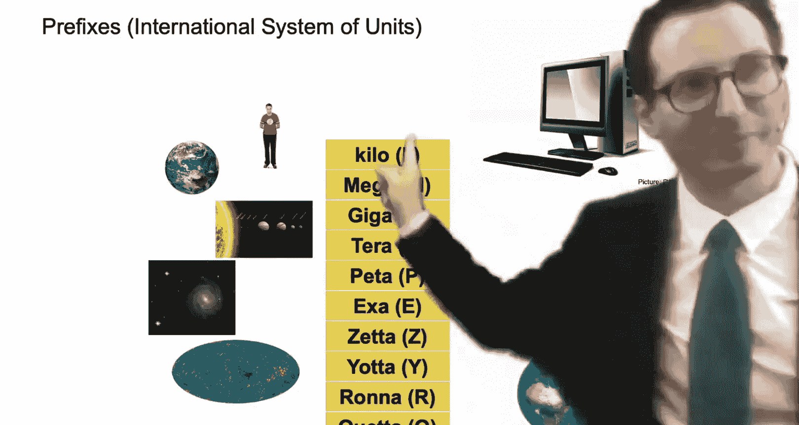

数据可以有多种形态：

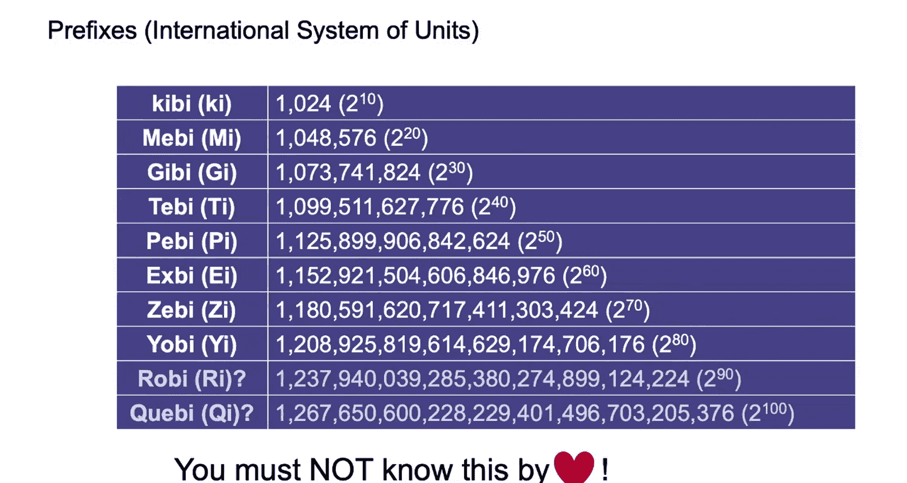

*   **表格 (Tables)**：传统的关系型数据。
*   **树形 (Trees)**：如JSON、XML文档。
*   **图形 (Graphs)**：用于表示实体间复杂的关系网络。
*   **立方体 (Cubes)**：用于多维业务数据分析。
*   **文本 (Text)**：非结构化数据，随着大语言模型(LLM)的发展愈发重要。

### 3. 数据速度 (Velocity)

数据产生的速度极快，但处理能力的发展并不均衡，这带来了核心挑战。我们可以从三个技术指标来看：

*   **容量 (Capacity)**：存储设备能容纳的数据总量。
*   **吞吐量 (Throughput)**：每秒能读取的数据量。
*   **延迟 (Latency)**：从发出读取请求到开始接收数据所需的时间。

以硬盘为例：
*   1956年，IBM 350硬盘容量5MB，吞吐量12.5KB/s，延迟600ms。
*   今天，大容量HDD容量26TB，吞吐量261MB/s，延迟约2.3ms。

比较其单位体积的演进倍数：
*   容量增长了约 **200亿** 倍。
*   吞吐量仅增长了约 **2万** 倍。
*   延迟仅改善了约 **250** 倍。

**容量增长远超吞吐量增长**，这意味着即使我们能存下海量数据，也可能没有足够的时间去读完它。这就是大数据处理的核心挑战。

解决方案是**并行化 (Parallelization)** 和**批处理 (Batch Processing)**。通过将任务分发给成千上万的机器同时处理，我们才能应对这种数据产生与处理能力之间的失衡。

## 课程范围与团队

本课程聚焦于**数据库**领域，即数据的查询与管理层，而非上层的机器学习或人工智能，尽管它们之间存在联系。

课程团队包括讲师、多位助教(TA)以及一个名为**Ethel**的AI学习助手。Ethel是基于本课程教材在ETH服务器上训练的模型，你可以像向同学提问一样与她交流，但需注意她可能犯错或产生“幻觉”。

## 课程安排与期望

以下是本课程的主要组成部分：

*   **每周讲座**：现场或在线参加，建议每周跟进学习而非期末突击。
*   **练习课**：从下周开始，由助教带领。
*   **阅读材料**：主要是免费的在线教材。
*   **编程作业**：使用Docker环境，请在本周完成环境配置。
*   **测验**：每周有小测验，正确完成可获得加分（总计最多25分），计入期末考试成绩。
*   **期末考试**：夏季学期举行，时长为180分钟的笔试。

课程沟通将通过Element聊天室和Moodle论坛进行。所有课程资料（幻灯片、录像、链接）都会放在Moodle上。

## 总结

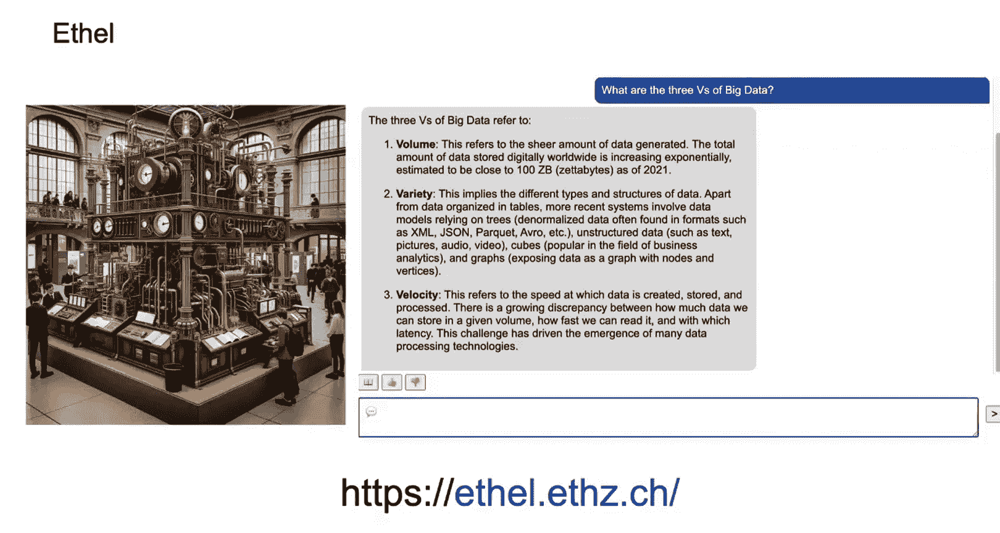

本节课中，我们一起学习了大数据课程的引言部分。我们回顾了数据处理从古至今的历史，理解了大数据定义的三个核心维度：**数据量(Volume)**、**数据多样性(Variety)**和**数据速度(Velocity)**。我们特别探讨了由于存储容量、吞吐量和延迟发展不均衡所带来的根本性挑战，并指出了**并行化**是解决这一挑战的关键。最后，我们介绍了本课程的教学团队、学习资源以及整体安排。在接下来的课程中，我们将深入这些技术细节，学习如何实际处理和分析大规模、多样化的数据集。