# 苏黎世联邦理工《工程师的大数据｜Big Data for Engineers - ETH Zurich - 2024》中英字幕 p02 2 - Lessons learnt (1_2) - .zh_en -BV17FAmeFE9K_p2-

Welcome back， so now we are going into part no the other side two of the lecture with a look back at SQL brush up so something you've already seen in information systems for engineers。

However， I I both want to give you a warning and also to make you not worry。

What's going to happen today？Is that half of you will be bored because they already know that and half of you。

Might be a bit impressed because I'm throwing at you a lot in one hour。

 You don't have to worry about that。 First， the， the main goal here is just to learn SQL。Next week。

 you're going to have exercises to learn SQL， so you're going to be able to practice and again。

 practicing practicing is the way you learn SQL SQL is easy to learn It was meant to be easy to learn so this is why you shouldn't panic right。

😊，All right， just saying that， so if you feel it's a lot， don't be discouraged。

 this is not a normal lecture， the pace to the semester is slower。

 iss just here the points to fast track you through the main ideas of relational databases right？

And I have a question for you also so that you see that。In the case that。

In the case that you did' know SQL before。So that you don't feel alone。

 I want to show you that poll that we are doing right now。

So how familiar are you with relational databases？What is this， I know the basics。

 I attended a bachelor's level database course， maybe information systems for engineers。

 or you even write video games with data in the sixth normal fold。😊，By the way， it's not a joke。

 there was research， I think it was at Car University。There was a professor， I think UNS Kker。

 who was researching how to see these real time strategy games as a database problem。

If you keep updating the database and you have the state of the world， give a look at at TthHO Y。😊。

Okay。So you see？There are quite a lot of you who never heard of SQL。

 so you see you're not alone if that's the case， some of you might know the basics but need to brush up。

 so that's good we're going to do this today。😊，If you already know SQL and attend courses。

 just sit back and enjoy the ride， you're just going to bring it back to the top of your mind。😊。

And we have one power user of the six normal form in the class， fantastic。😊，right， and by the way。

 you can interact on the forum on the chat so if if you don't know SQL。

 then you can ask on the chat if people who know SQL can also help and answer questions。

I don't know I haven't tested if Ether can actually write SQL what I know for sure is that chat GPT can produce SQL I tried to put in chat GPT the schema of an exam question so the schema with the column's attributes I pasted the exam question in English and chatGPT outputs not only the SQL query but explanations about the details of how the SQL query was produced so just a hints that if you want to learn SQL and maybe chatGT can help to again with the word warninging it can aucinate it can make mistakes but maybe that's a good way of then heing your learning。

😊，All right。But of course， the best is to interact among each other right if there's no better way to learn than to teach so if those of you who feel comfortable enough can explain to others。

 that's a great way to mess out the material even more。😊，All right。

I'm going to switch back to the slides。

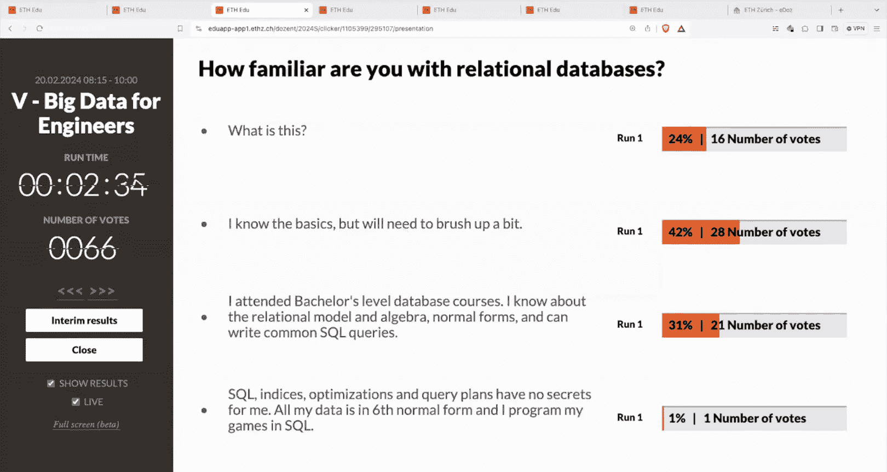

All right。By the way， encourage you to try it， I mean send us screenshots。

 try to take the exam questions of the past few years。

 put the schema in the question and see what CGP does share the screenshots。

 it would be fun to look at this。All right， so now。

Let me go through this very special and unusual lecture because again。

 I'm going to throw at you all the relational and SQL path。😊，Going to be careful though。

 to do it with a reasonable speed。This here。Is Ed yak。

He's considered to be the father of modern databases。

 He is the one who had this brilliant idea called data independence。

 which is the idea that the only thing the users should ever see is something extremely simple papers。

 the ones that you saw in laterts thousands of years ago。Everybody understands the table。 In fact。

 there has been social science studies。That ask people like， what do you understand best。

 So they give them tables， They give them pie charts， like all the things you find in infographics。

 right in newspapers。 The one thing people understand the best is tables。

So this is why users should see tables。While the rest is hidden。

 the physical storage here should be a hidden detail。In fact， it's so hidden that you can swap it。

 This， I said， is also a relational database。 It might be a bit slower because whenever you have an update。

 you need a scribe who actually modifies the clay tablet might be very slow。

 but it is still a relational database。😊，You might have in some way， some spreadsheets software。

 probably not the best way to deal with a relational database。

 but it kind of still has Roses and columns。You could have a it stored on a hard drive could be a cluster of machines。

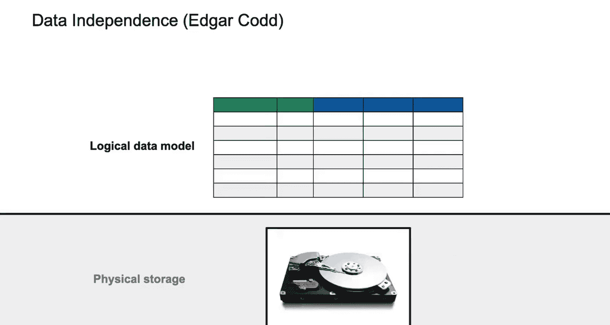

Could be DNA， I told you some people manage， but do you notice something here。

 The upper path never changes。 It's always the same。 This is the beauty of data independence。

 You can swap the way you implement it。 The look and feel to the user is the same。

 It's a table with Rosen Collins curious。

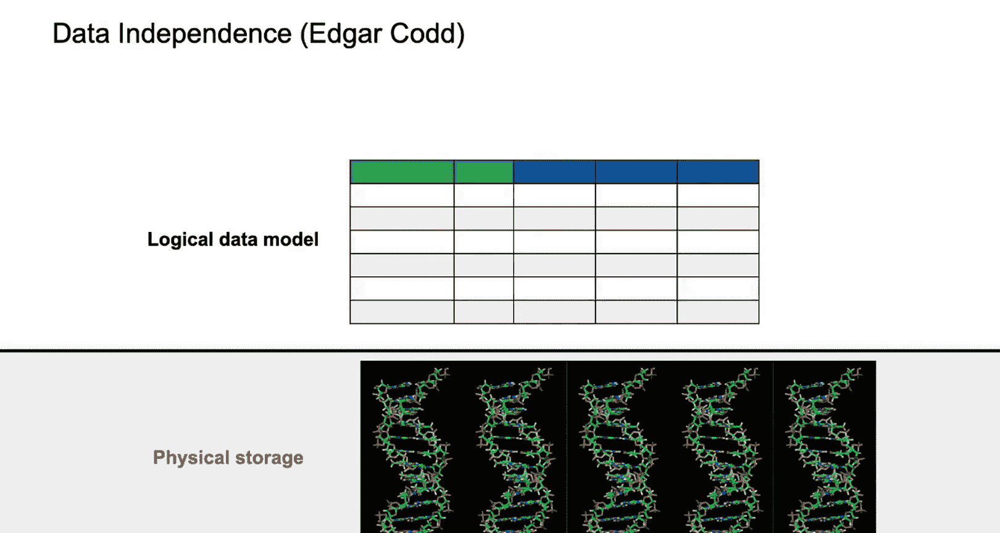

This is the beauty of data independence。Then I told you about variety and data shapes。

 the five fundamental data shapes， tables， trees， cubes， graphs and unstructured。 by the way。

 somebody asked it's a very good question。 I tend to put images and videos and audio also together with the text right This is all the things that go into the chat GPT box with with what you can do with geneative AI。

😊，This might evolve， right， because the way you， so for example， behind the text。

 you might have who heard the world embedding。Maybe not a lot of you if you're not computer scientist。

 so there is a technology behind the text that uses linear algebra and vectors to represent the data。

 you could almost consider that it's a shape of its own right so maybe one year I update with a six shape I'm not sure yet。

 but for now I put images， videos text all over in the unstructure books。

 but anyway parenthes is closed。 The one thing we're interested in today is tables right so I'm going to focus on tables。

😊。

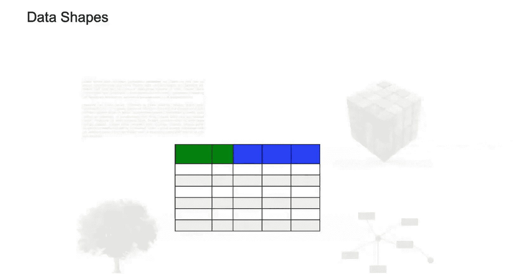

The one thing that is the same across all shapes is that we need to store it somewhere as zeros and ones on some hard drive eventually we need to compute so it needs to go through some processors。

 CPUs and so on。嗯。There needs to be a model。 I'm going to come back to that。

 essentially says there's Rosen Collins。 There needs to be a language that's sQel that we are going too long to process it。

 that might change with the different shape。 but for tables that least this is what we have。

 So now what is a model。 So that third level。

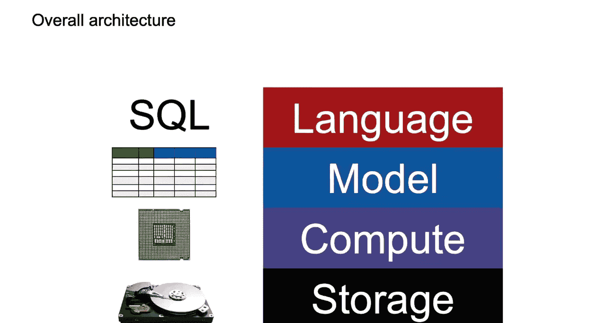

The model tells you what the data looks like like a table。😊，And what you can do with it， project。

 select and so on。 going to come back on that。嗯。It's a little bit like when you cook。

You have a model that says what do you use for cooking the slide comes back。

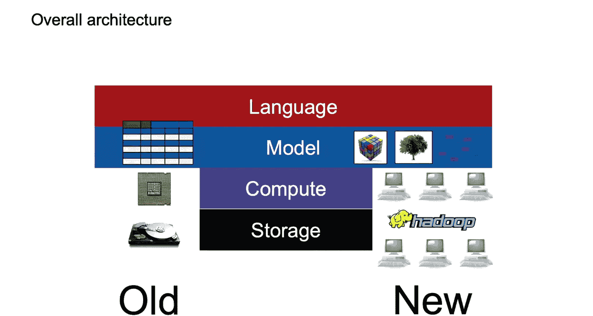

It's the ingredients。Like salt sugar， eggs and so on and so on。

 something that can be eaten and what you can do with it you can mix pour break。

 dry baked grill melt mins， mix and so on and so on right so in essence it's just an analogy with cooking This is the idea right except that here we are talking about data So what it looks like is going to be a table with rose and curs and what you can do with it is going to have different verbs than this。

 but this is the idea。

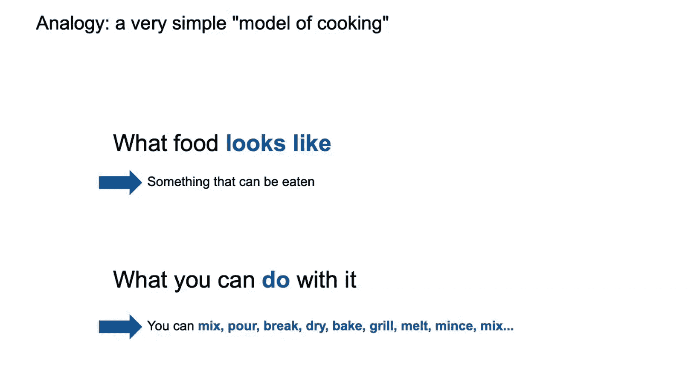

Now the magic with this four lever storage compute model language。😊。

Is that the data independence limit is in the middle。 This here is the data independence。Level here。

Everything above it model language is the same。😊，And what we swap and we will do during this lecture is the lever here。

 we can in the information systems for engineers， we had a single computer that was your laptop。😊。

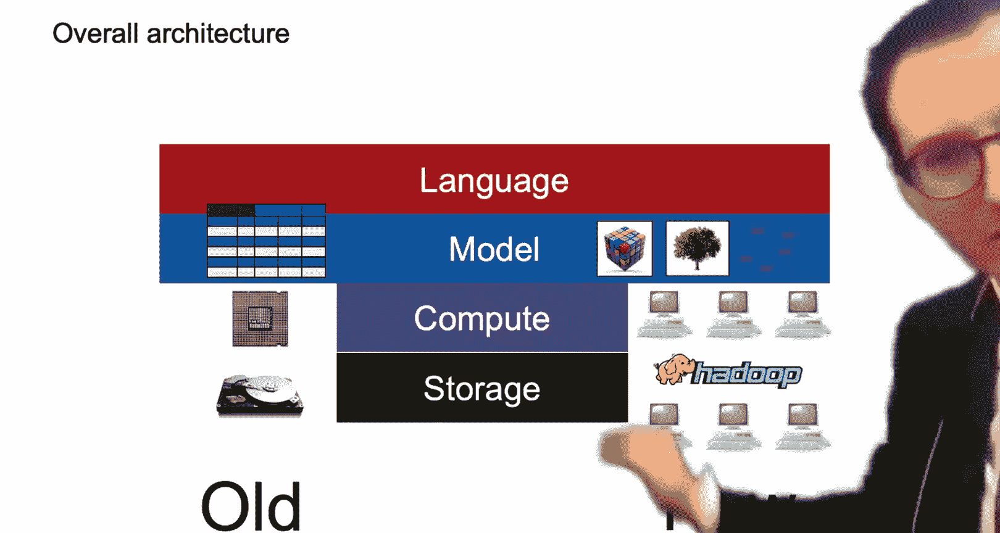

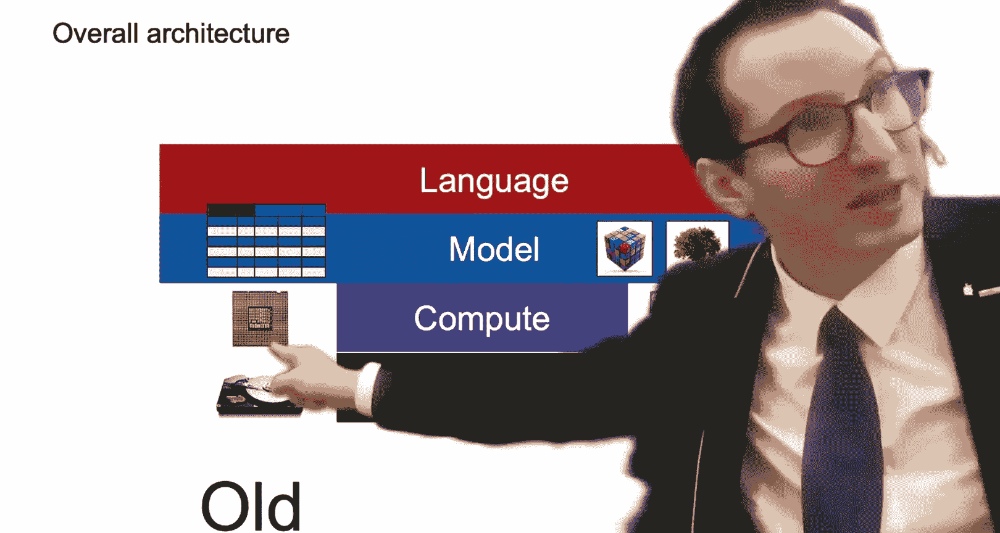

In this lecture， we are going to swap that with a gigantic data center with thousands of machines。

 What's incredible is that what's up there doesn't change。 So this is why。

 what I'm teaching to you today will not only be true for one laptop。

 It's also true for a data center。 So I'm going to focus on that part。😊。

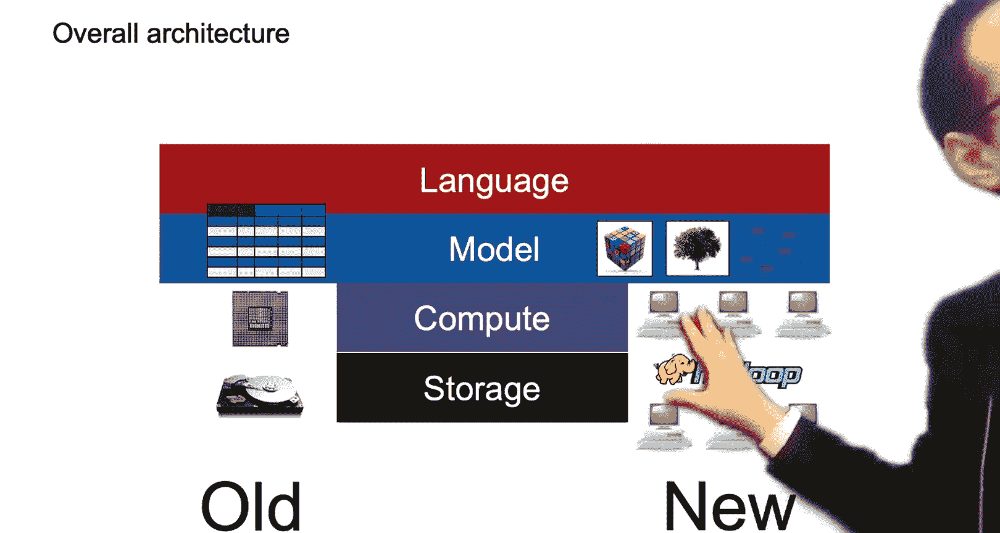

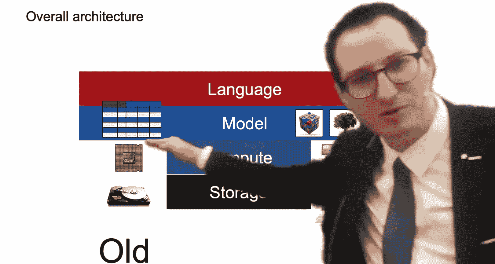

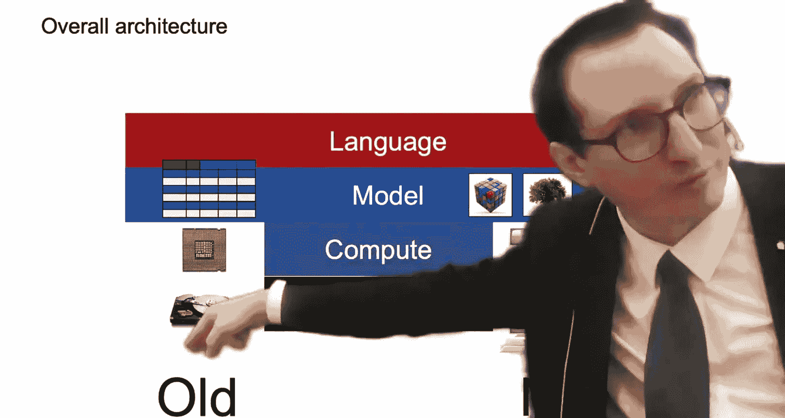

Now here are the takeaway concepts， again， very high level。

 you would see it's extrain really intuitive。😊，So for the model， we need to describe what we see。

What do you see here， it's a table right looks like also what you can open in some spreadsheets software like the clay tablets。

There might be other wells。Some people might call it connection， relation。

 relational table and so on。 right， You might see a table as a collection of rows， for example。

So these are all synonys， but I put in bold the one that I'm going to be using table correction relation。

 relational table。😊，It looks like this。 Now if you look closer。

 you have rows or lines or records or tos or entities or items， the business people。

 they call it business object that I love right so when they are talking to or a business object business object。

 they actually mean one line of of your relational table right or a row right So these are all pseudoyms is one record for example。

 if you have a list of people， let's say the list of all students who are registered in that class。

 every business object is one students right。😊，Okay， and again， these are all synonyms。

 record perar document， these are all the the all the same thing， It's just a name for that。

You could also look at the columns right so here too we can call this an attribute a column a feed the property a key and so on and so on This is for example。

 the first name of each student the last name of each student。

 the legal number of each student and so on the ahafo number。

 the Social Security number these are all attribute so you see we have row。We have columns。

Then some of the columns might actually be special。Because they identify somebody， for example。

 the legging number at TthH identifies you so the legging number column is actually special right if I have it I know what student it is this is how we deal with bonus points at the exam right we do a join where we use the legging number in order to match the bonus points with the exam grade right？

😊，It's very common to see something ID so PID would be person ID then you can have CID for course ID and so on。

 but this is just what we call a primary key because it identifies somebody the Social security number is also one way to identify somebody the ao number right AV in French。

So it's not true for every column， for example， the first name doesn't identify somebody if I tell you pet then you don't know who this is right the first name is not enough。

 but the legging number is actually enough you can also see synonyms like row ID name key might also be used in that context so again be careful in some cases like Jason a key might be any attribute in some other cases the key match specifically designate a primary key that identify somebody。

All right， so we have row columns， special columns that actually identify the business object。😊。

And then we have the values。 This is a single cell， one cell of your spreadsheets， right。

 so you can also some people call it a sc， maybe because they have vector spaces in mind while there's the vectors and the scs。

 real numbers， complex numbers。 But you could call it a sc if you want or an atom or a cell or a characteristic or a fact。

 It's just what you have in a single cell like this。

 You can also view that as the intersection of a column and a row。😊，That gives you a singleed value。

Who is following？Okay， that should be simple enough， right。

 It's a high level view that I'm giving to you。 It sounds trivial。

 but do not underestimate how important it is that a model is simple if you want to actually deal with it。

 That's why we have data independence。

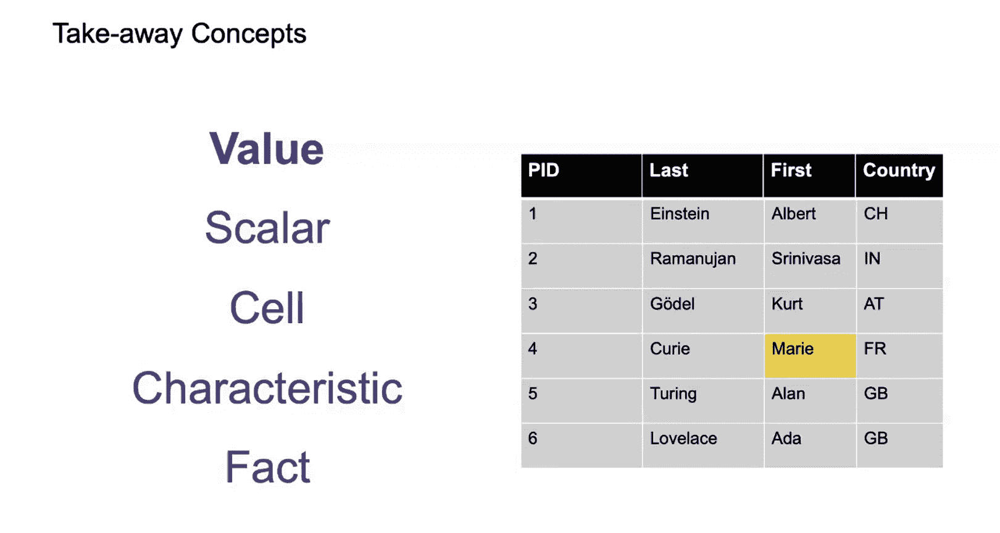

Okay， so that's the first part of my model， what the data looks like， the ingredients for cooking。😊。

Now the second part is the verbs， what do you do to transform or modify or query that data？

There is a very fancy name for that。 I love it。 I mean， I love mathematics。

 So the relational algebra。 So just like you have algebra， you know。

 with vector spaces and scar products and so on， like the beautiful mathematics。😊。

You can actually treat tables just like mathematical objects。

 and you can define a whole algebra on that。😊，I don't mean so if there are mathematicians just one in you algebra has a very specific meaning。

 I think if I correctly remember it's a vector space that is ended with an additional multiplication like operation here it's meant in a more generic way that we say this but let me show you so if we want to make it a bit more mathematical。

😊，One way to look at the table。Is to see it as a mathematical relation。

 it's something that establishes a relation between the attributes。

 There's a relation between your leg number， your first name， your last name。

 your date of birth and so on。😊，Mathematicically， what is a relation is just a set of toppers。

 not all of them， some of the toppers and you can list them explicitly right for example you can have a relation between a university and a city wet toppers are going to be in there ETH Zuric Zuric。

😊，APPFL Lozan， uniggen Geneva and so on and so on， you can list them one by one。

Each tu in your relation is a rule in your table。So if you know what a mathematical relation is for you。

 if you don't forget that slide immediately and don't be bothered by the complexity。

 I'm just saying mathematically you can view a relational table as a relation in this way。

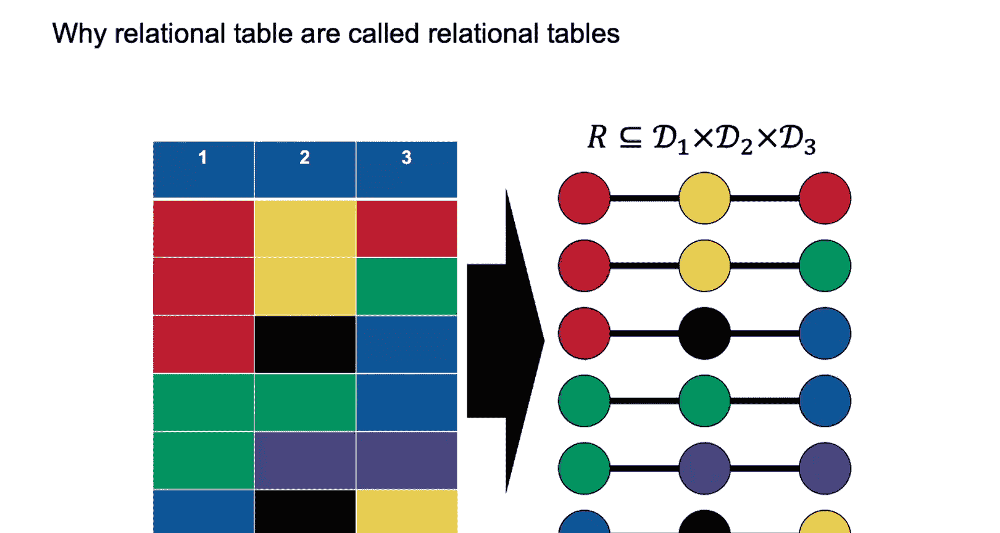

Now， I prefer to look at this in this other way because it's more intuitive and that's also much easier to go into big data from there。

So it to define a relational table first what you see the set of attributes。

 it's the headers if you want of your spreadsheet， so legging number， first name， last name。

 date of birth and so on and so on。So that's called what we call the schema， E leadss。

 what columns are going to have， and then the rest of the table。Is basically going to be。

Let me see let you say a list of toppers， a list of business objects right。

 a list of persons in that case， right every work correspond to a person So if you ask me what is that table。

 it's just a list of toppers。😊，How many six there are six stops， six passes， right？

Why did I say set bag lift？Well， it depends if the order matters to you。

 Do you have a specific order in the people and if you allow the duplicates or not。

 are you fine if you have twice the same row in the table。If the order matters。

 then you need a list of topers， if the audio doesn't matter and you don't want duplicates。

 then you have a set of topperpers and you don't care about the order and you don't have duplicates。

 a bag is if you don't care about the order， but you still allow of duplicates。Alright。

 so this is where you can have a set bag or a list of。Toper， And that's the extension。

This is a table， mathematic。We swallow。Great。Formally。

 a tople for the computer scientist is what you could also call a map。

Mathematicians might not call it a map， they would call it a partial function from strings to values。

Like this。I'm taking here the second triple to Ramanujan Knivaza India， right？I can also view that。

 second tu。Ptition。Now I'm using the function symbols from mathematics。

 this is a partial function that maps some strings， four of them。

 not all of them just four of them EID that first country。

 I'm mapping some of the strings to values EID is mapped to two last is mapped to Ramanujan first is mapped to Srini Va country is mapped to India。

😊，So this is a P function， P function y， because it's not associating a value to every possible string。

 but only to this form， right？

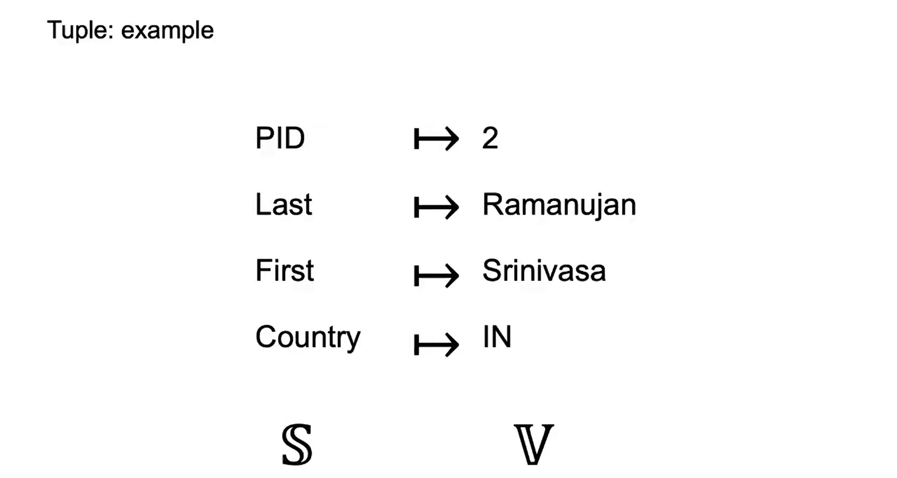

So again this this this this corresponds to this maps to this this map to this this map to this and this maps to this just the same thing。

 So this is how you can see that a row in my table can be seen as a mathematical partial function and again computer scientists call that a map because it's mapping the attributes on the left to values on the right so every row here has its own partial function that looks like this。

😊。

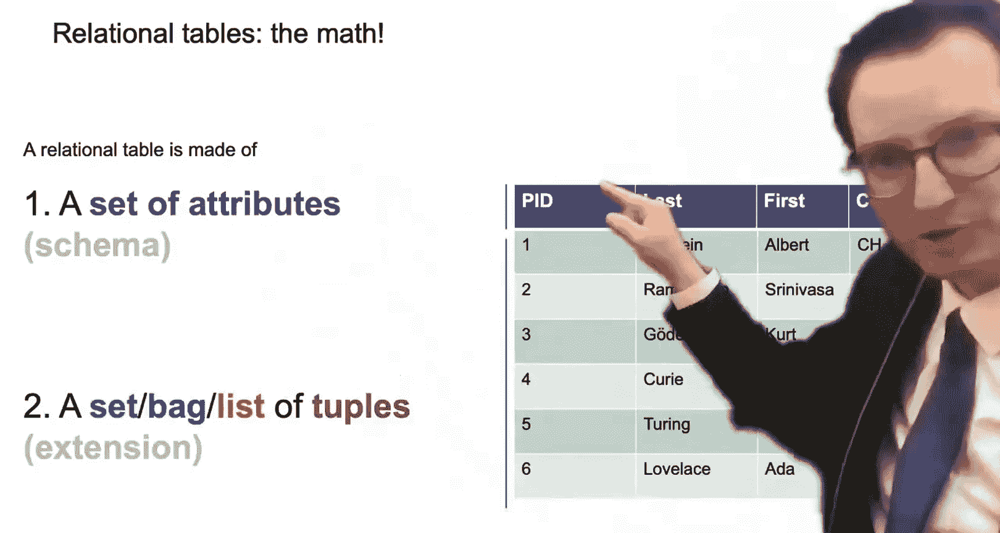

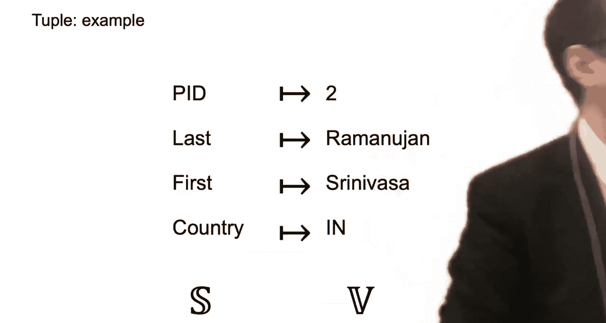

Who would be able to， if you give you this one to give me the other five very easily。

 who would be able to do that？Exactly the same slide， just replace the values with those of adults。

 right it's that simple。😊，Now。Computer scientists， when they want to start that in the text file。

They have another way of doing that， and that's actually something we'll cover in that lecture that looks more like this。

😊，It's technically the same thing。 Its just something that we do in computer science。

 Who knows what syntax that is。Yesterday。Jason， exactly。 and that will be covered in that lecture。

 So this is Jason。 This is how we store as text in a text form， some one of the rows in the。😊。

That are easy enough to see the second one， okay。But again。

 for the purpose of tables you don't actually do this that will do later in the semester you actually do this。

 this is the way that the database people look at one of these record right it has the headers。

 the name of the attributes and then it has the values in there in my case just for a single record and then you assemble many record into into a table。

 the order of the attribute is totally relevant just like in a mathematical function。

 there is no particular order in which you map the input to the out。

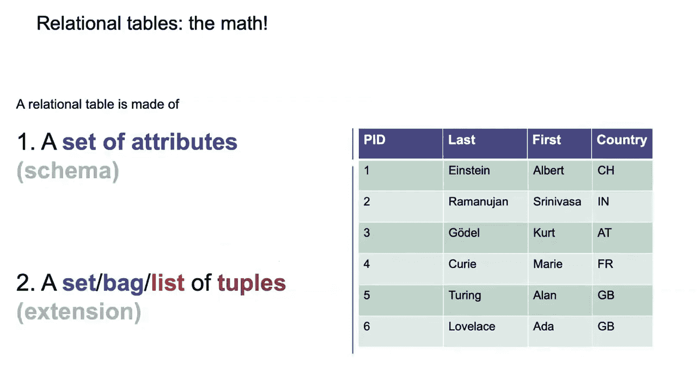

Now what do we do if you have several records， let me take three records that are just these partial functions。

 I have four of them。😊。

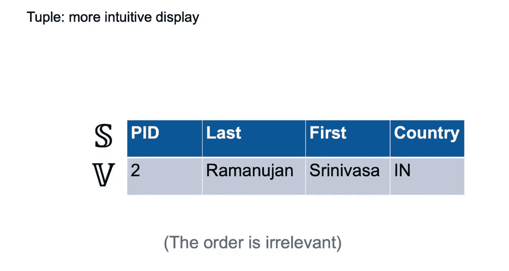

Do you notice something， They actually map exactly the same attributes in there。 So what can you do。

 You can merger them like this， right。This is technically how you obtain a table。

 It's merging all of these， all of these records because they have exactly the same attributes。

 You merge them into a single table。😊。

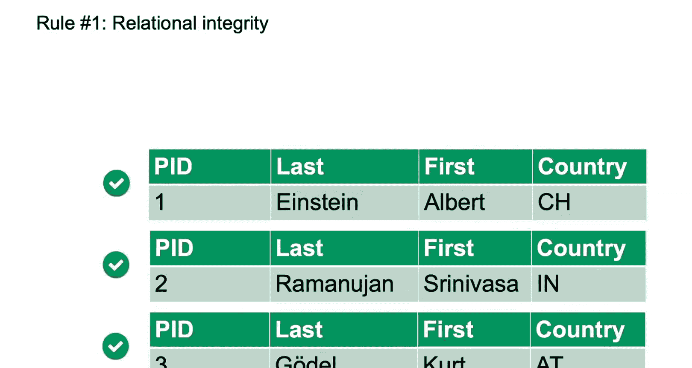

If you cannot do this then it's not a table， that's an example where it's broken in that case I have these three records。

 but you can see they don't all have the same attributes。

 the first the first one has name first name physicists year。

 the second one only has first name physicist here and the third one has a country a name a first name it doesn't have a physicist value and year that here is not a table。

😊，It's still a list of records， a list of partial functions。

 but they don't have the same attributes so you cannot paste it into a nice table here we say that the relational integrity is broken right so here it's working it's it's a table it's all the same attributes here it's broken。

😊。

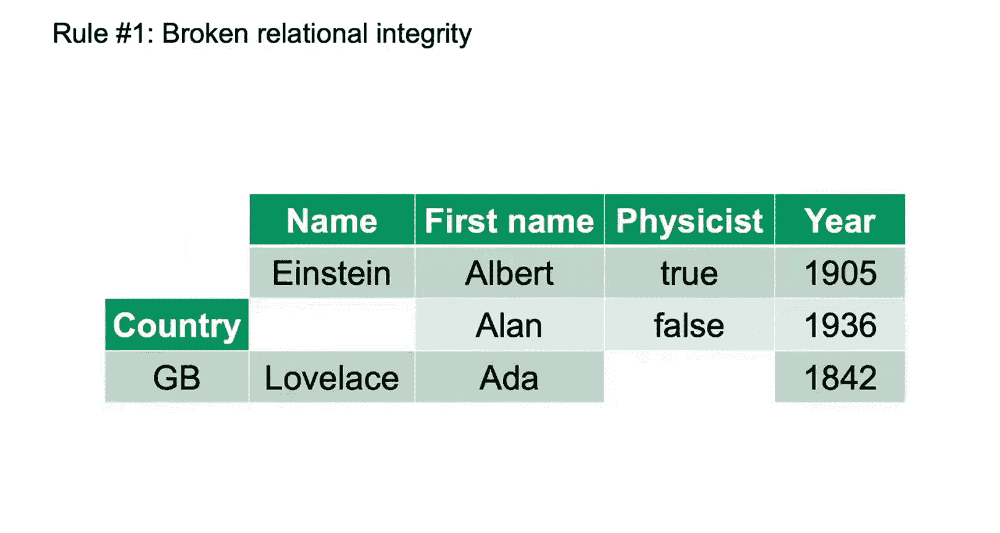

What else can we break in a table so that it's no longer a table。 So this is a table。

 This is not a table。So what is happening here？That it's no longer a table where we have a table in a table。

 do you see the blue， the blue things here？Here， here and here。

 I have a table in a table that is breaking another rule of tables that you cannot have a table in a table。

 You can only have atoms like atomic values， right strings， numbers， dates and so on。

 You cannot have a table in a table。 It's like the inception movie。

 right a dream in a dream in a dream in a dream。 You can have a table in a table in the table in a table。

 Well you cannot have that in the relational model。 you cannot have a table in a table。

 That's called atomic integrity。 So this is forbidden and this is a root， right。

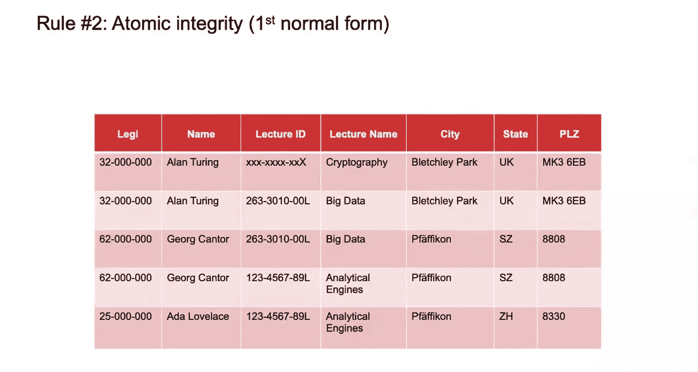

And there is a third rule that you can break or a table no longer to be a table relational table。

 it's called domain integrity do you notice how in the same column the values look the same in the first column it' all names these are strings。

 the second column its first name these are strings， the third column are booleans true and false。😊。

And the year is an integer， 1905， 1936， 1842， this is called domain integrity where within a column you always have the same kinds of values which are quote types Here it's broken。

😊，Why is it broken， Well you can see in the physicist column。

 They are Booleans and they are integers。 So this is broken。 It doesn't have domain integrity。

 The same goes into the last column。 It's broken because two of them are integer。

 and the the the third one is is is text。 Of course， as a human， you can recognize that。

 You can convert it to an integer。 But the computer cannot do that。Right。

 so you would need to clean it up if you want。 You might clean up the minus-1 to true and you can clean up the 42 to 1942 if you want。

 then you have domain integrity。So we have these three rules， relational integrity。

 atobic integrity and domain integrity that all relational tables have to respect if you fulfill these three rules。

 then you have a relational table。Who needs that here？All right。So the intersection of that is SQel。

 this is what we are discussing right now， What happens if you break the rules？😊。

Well you enter the fabulous world of no sQL in fact。

 we are going to be breaking these rules throughout the semester。

 but not today today I'm going to stick to the three rules fulfill and we'll break the rules the in the rest of the semester。

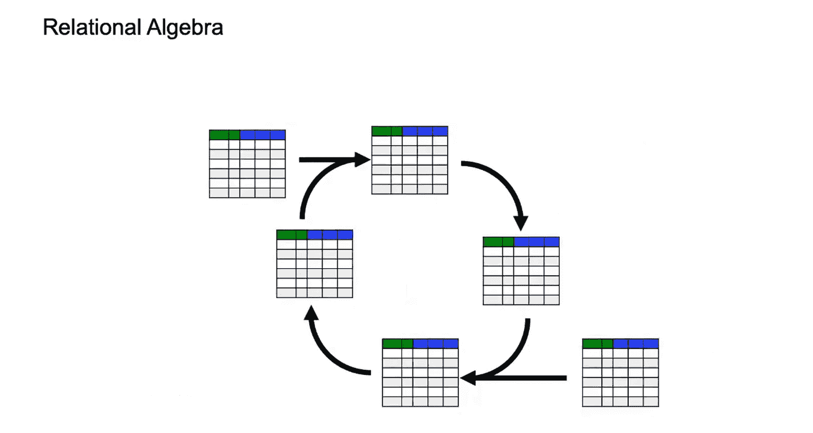

O。So we have a relational table defined in this way now we can manipulate it with an algebra。

 So what can we do So in for example， in mathematics， you have addition multiplication。

 scalar product in our product， outdoor product and so on and so on， right。😊，So when you have tables。

 instead what you can do is union intersection， subtraction， selection projection。

 rename an attribute or relation grouping sorting Cartesian product， joints and so on and so on。

 you have an entire toolbox of things that you can do with relational tables so I'm going to show you a few of them and you'll see it's very intuitive。

😊。

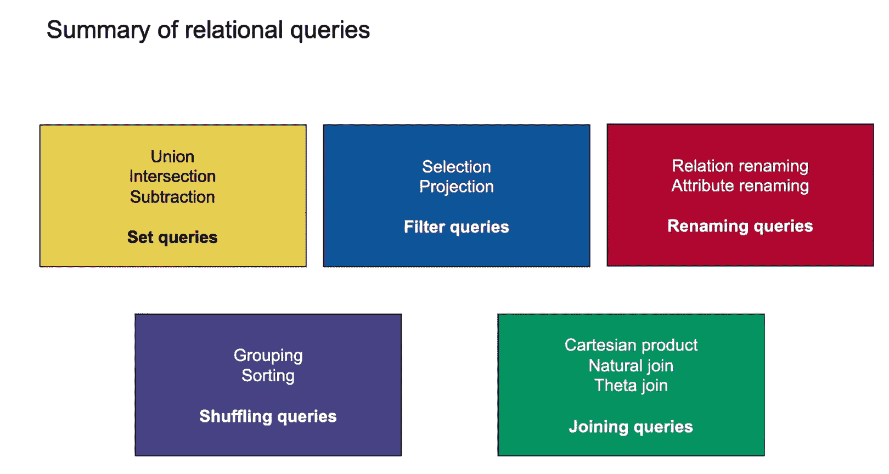

This is one thing you can do to a relational table， you can select some of the rules。

 for example you can select everybody who is in the UK right so it's Alan Ting and Addaloles and you select them。

😊，By the way， this is something you can do in a spreadsheet software right you can select a table then you can click。

 I think on filter data and then you click on a header and then you select the values you want and it's going to filter on these specific row specific records who already need that。

😊，Some of you， right？Well， this is one thing you can do to relational table。

 you're basically taking a subset of the records and filtering specifically in that case。

 the people who are in Great Britain， that is called selection。😊，Now that's on the row。

 What if we do it on the columns， Well it has another name。 If you do it on the columns。

 this is called projection。 By the way， you can also do it in a spreadsheet software。

 All you need to do is click on the columns that you want to get rid of and click on hide in the menu hide hide hide。

 So if you hide P I D and hide country， you end up with that1 first。 This is called。😊，Projection。

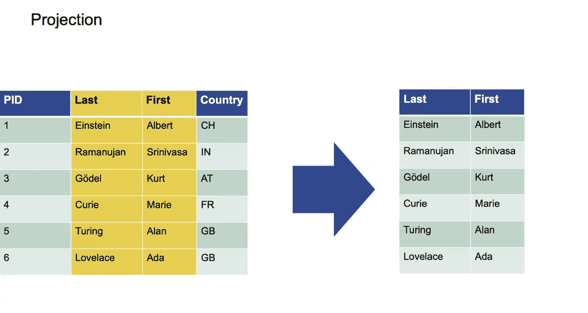

It's very visual， very intuitive to understand。Then there is grouping grouping means that you notice that the values on the left they repeat。

 you have food food food and you have ba， bar， bar， bar and you have fu bar and Fuber。

Then you can group。All the foods， all the bars all the fubar and some of other values an example of that is imagine I give you a list of all cities in Switzerland all towns game together with the number of inhabitants and the canton that it is in then I can group by content and some of the inhabitants of the gameder in each count that is a group by then I end up with a list of 26 contents together with the total population need every content So Fubar and Fubar here would be the contents and a would be the inhabitants。

😊，给。This is called grouping， aggregation is another way you can call it。

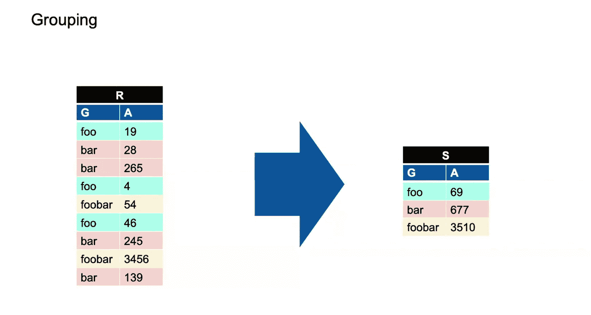

Another thing you can do is called sorting， but here it assumes you have a list of records that the order is actually important。

 you can sort by first name， sort by birth date and so on again。

 this is something you do very easily in spreadsheet again you select the table filter data you click on the header and then you click on ascing or descending and it reorders your rows very intuitive。

😊。

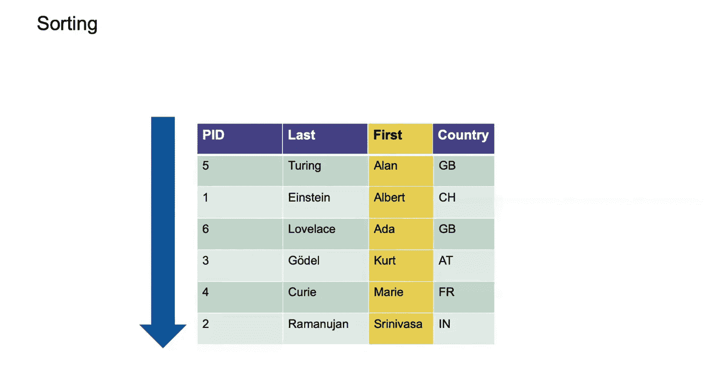

Then here is a bit fancier。Itless， you can do it also in scratchy software。

 It's just a bit more complicated。It's called the Ca product。

What happens here is we're going to make all possible combination of a records coming from R and of the records coming from S。

 So there's two rows in R and three rows in S gives me two times three combination six possible combinations that's called the carn products right You try to match every row on R with every row on S and get all possibilities listed。

😊，Then we have the join。It's very close to this， except that you filter。 what is the difference？

Is that in a join， you don't match any row with any row。

 You only match the rows if they actually match on some video。 What I mean is。That。

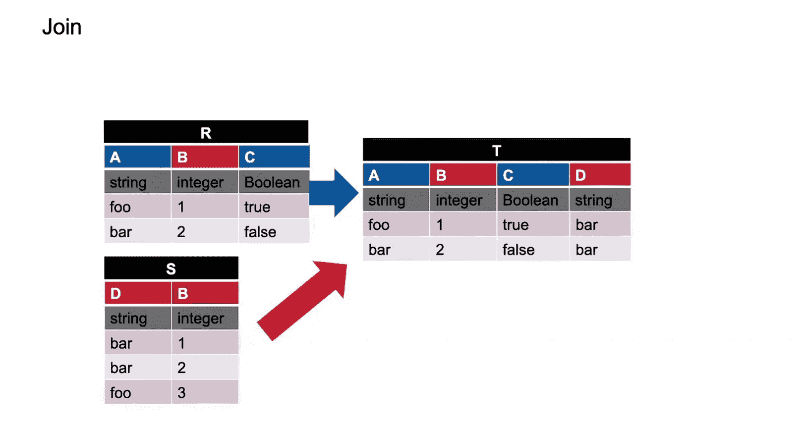

This row right here。As B equals when。

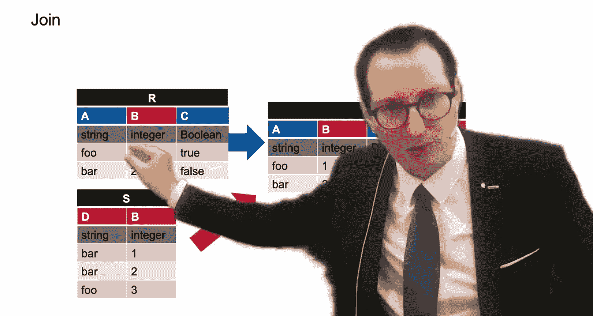

So we are only going to match it with this row here because it also have B equals one。

 We do not match it with this one and this one because they have a different value Here we do here we match 1 with 1 to。

3。 But if it's a giant， we really pay attention to these values being the same。 I get this。

 then two is matched with2。 I get that。 And 3 here is not matched with anything。

 So that's why it's not them。 But whom is that here。

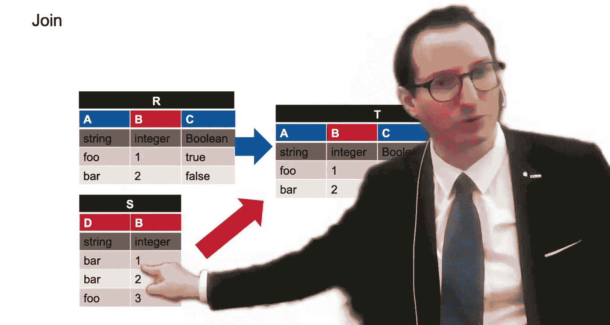

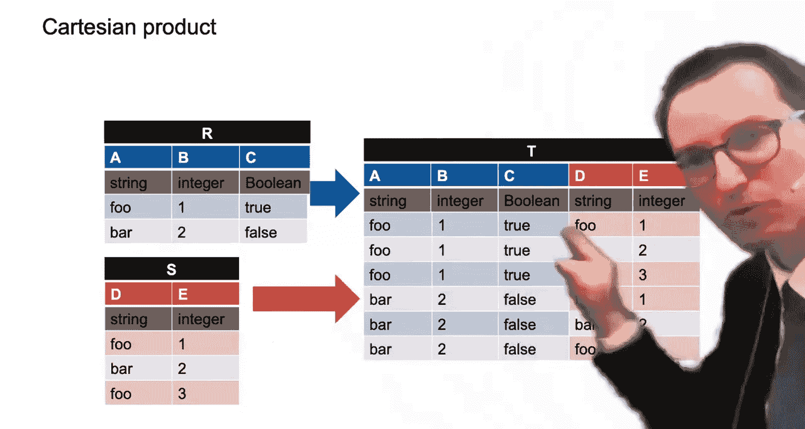

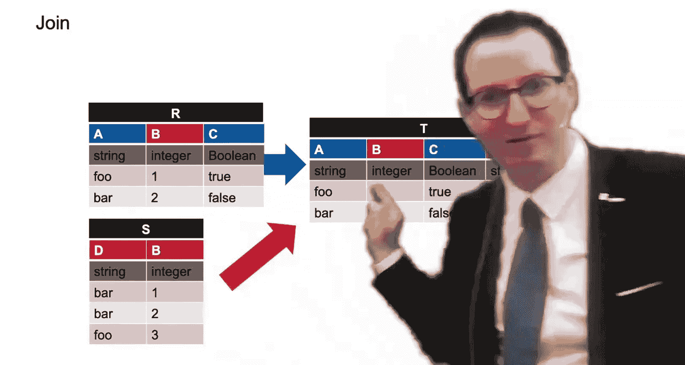

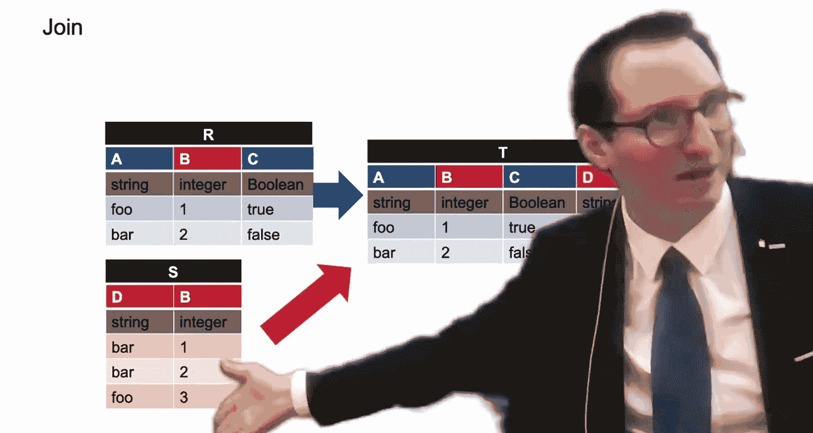

That's called the join， it's extremely powerful Jo is when you have several data sets and you're putting it together to learn even more information。

 extremely powerful。😊。

No。The next thing I want to tell you。Is that。When you decide on the data that you want to store。

 you typically have to design your schema， you need to decide what columns you're going to have。

 how many tables you're going to have and what columns they have。Now， if you get it wrong。😮。

But things are going to happen。 They are called anomalies。

 delete anomalies of data anomalies in anomalies。 I'm not going into the details of that。

 but basically， if you're not careful about the way you design your skias。

Then you're going to end up with duplicates， you're going to end up with discrepancies like you update here and you forget to update there and then you have disagreements between the same data two different places。

 these are called anmalities and there is a whole theory that we studied in information system for engineers on how to avoid the anmalities。

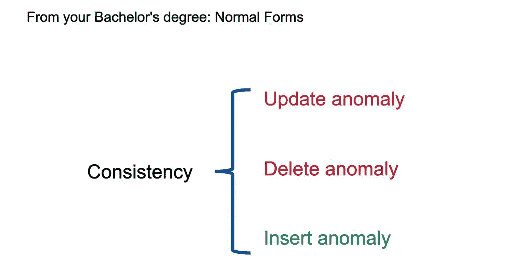

And this is called normal forms， so the idea is that there is a concept called functional dependency that tells you that some very new sum column might depend on another column an example of that is the name of a lecture at TTH depends on the idea of the lecture every lecture at TTH every course at TTH has a cost a code that looks like that you probably see it in my studies。

😊，If I give you the lecture ID， then you can tell me the name of the lecture that's called the functional dependency。

 right？😊。

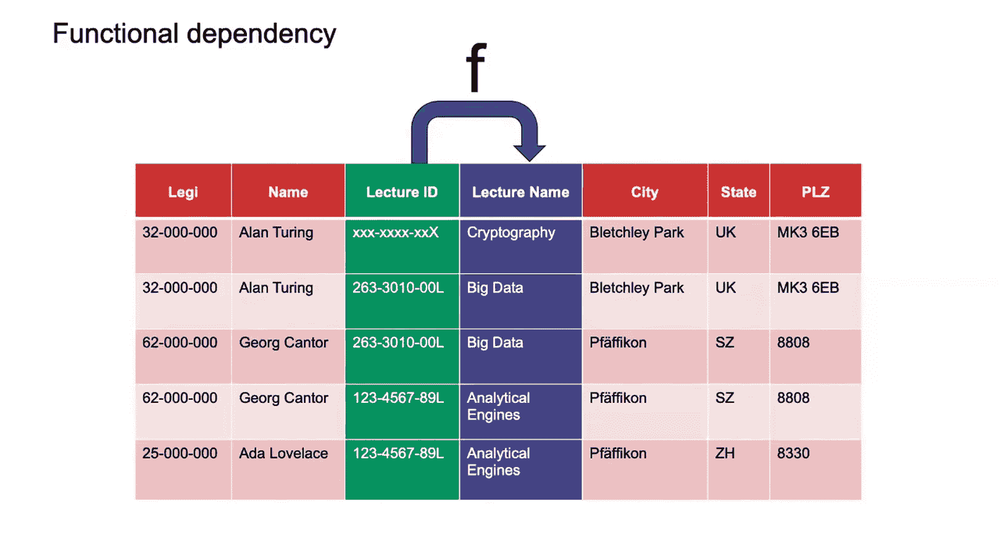

Based on that。I can have functional dependencies that if I know the value of some columns。

 like if I know the leg number， the name， the lecture ID。

 then I can infer the name of the other columns。 that's called a super key when it's in enough to identify everything then。

You can try to remove some of the columns and you can still identify everybody in here and if you manage to take a minimum of that now you can not remove anything anymore。

 that's called a candidate key and one of them there can be several of them and one of them is going to be a primary key。

An the example of that is what I said before the social Security number of a person。

 the legal number of a person and so on。So the idea is that then when you have all of these fancysy mathematical stuff。

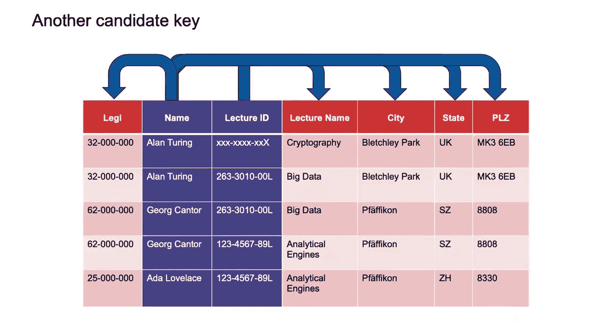

That you define on papers， you are basically able to define what is called a normal form。

 a normal form。😊，Is a constraint。On a table that it must fulfill if you don't want to run into problems。

The first normal form it's easy because I've already told you about it it's when you cannot have a table in a table in a table that's what we also called atomic consistency it turns out that another name for that is first normal form but it's really the same thing as what I told you before you cannot have a table in a table in a table that's called the first normal form。

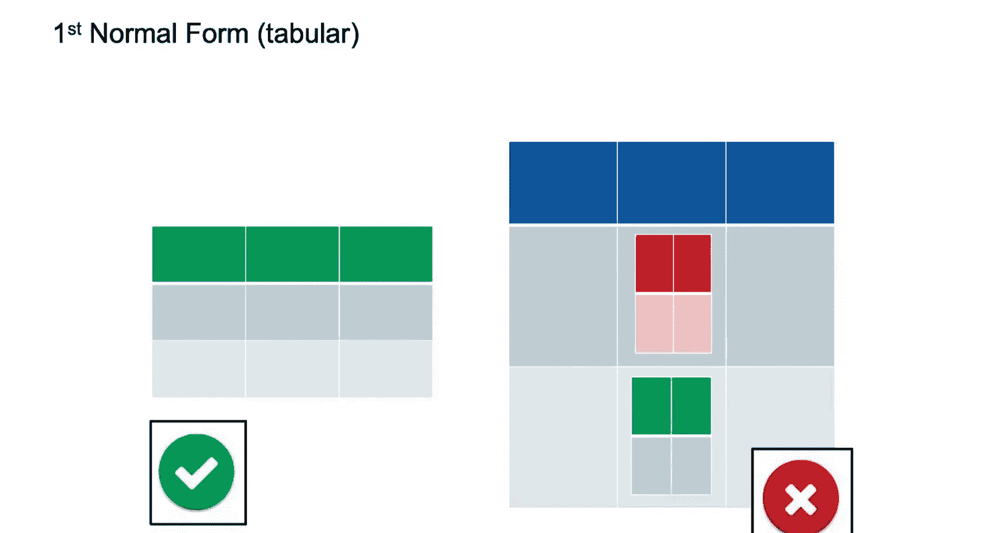

And in information system for engineers， we also， so this is a counter example。😊。

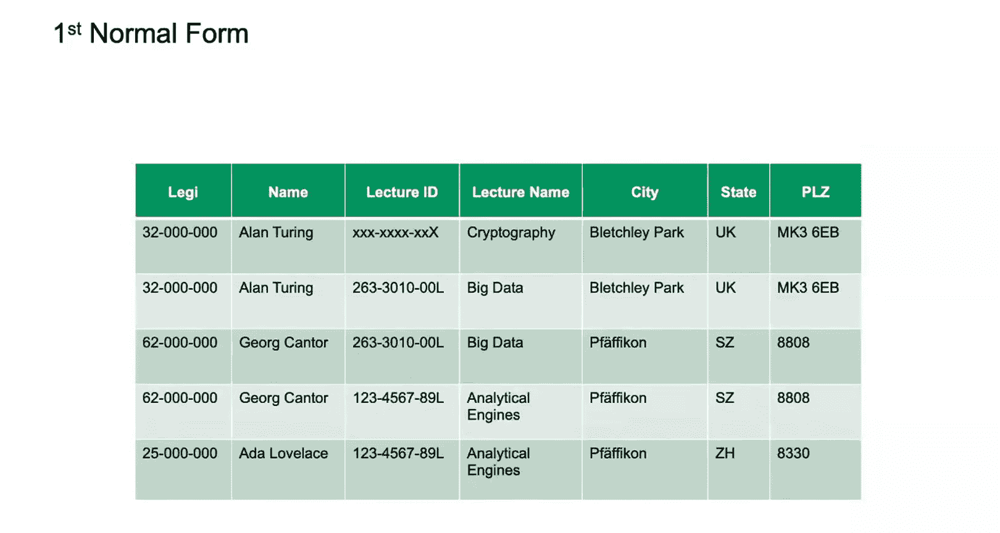

This is an example in information system for engineers。

 we study another normal form called the Boycott No form。

That basically says that it's not allowed to have dependencies from something that's not a super key。

Computer scientists also know other normal form， that the second normal form。

 there's the third normal form， there's the fourth， the fifth， the sixth normal form。

 and probably many others。And you're supposed to respect that in the relational database then you're supposed to actually obey all of these ruless。

Who understood what I told you about normal phones？

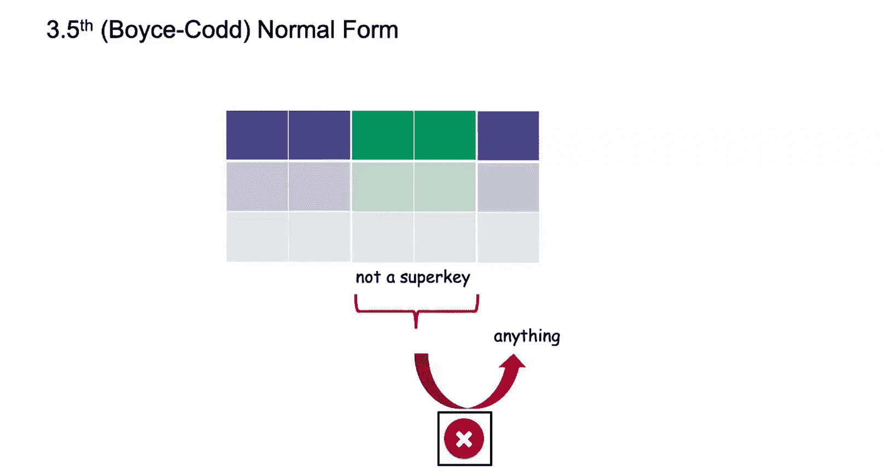

Who did not， who is lost with the normal fo？Please raise your hand。 I want to see more hands。

 Who is lost with the normal force。Yes。😊，这见。It is for the like。对。It would have dispose to top。5。

そです撮成。Yes， exactly。Oh， it's just a choice of how much you want to achieve。

 So basically the sixth normal form is extremely strict。The second or third are a bit less strict。

 It's like security levels， if you want， can you can choose your security level。嗯。

I can't I break the。So basically， yes， if you are in the first normal form。

 but not in the second one， then you break the rules of the second normal form。That's the idea。

Like the6 is the old。か。Maybe there's even more than six。 I mean， people keep inventing them。

 at some point， it's a compromise。 Most people are going to be in the third normal form。

Most databases target the third one and they don't try to be in the fourth or fifth or6 if I think the third one is a quite reasonable compromise in the end。

 it's a compromise right if you go high like five， six normal form。

 it becomes difficult to implement and it's a compromise between how easy it is to actually do and how much guarantee it gives you。

The idea of the normal forms is that you use them in a database where you modify the data all the time。

 you have an online shop， people place orders， you ship items。😊，The inventory keeps changing。

 then you need the normal forms， otherwise you're going to go crazy because you're going to have duplicates in your data inconsistencies and so on this is what the normal forms are for。

Right。Yeah， thank you。So now everybody raise your head if you're lost with normal forms。

You're not just。Okay， I see， I see someone hands moving like that because I have great news for you。

 I have great news for you is that we are going to throw away the normal forms in that lecture。😊。

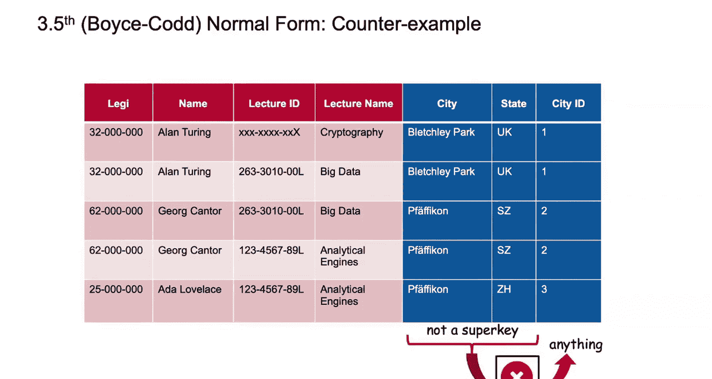

All of that just in order to throw them away well， there's a reason in fact。

 it's that the normal forms they are really again this online shop thing you have a database system and you have customers your website is alive right there are people placing orders you need the normal forms because you're updating your database all the time。

😊，But in a case of big data， we don't care about modifying the data。

 what happens when you have a data， you download it and then you query it。

 this is pretty much what happens， but your data doesn't change。

 it's just the fact you download it from the internet right and then you're analyzing it。

So for this reason in this lecture， big data for engineers。

 we are going to throw away the normal forms， we don't care about them anymore， they're gone。

 we might even throw away the first normal form by the way we see tables in the tables in the tables in that lecture and that's not going to be a problem at all right so this is what's going to happen and this is basically why I didn't take the time to go into the details of normal forms and you actually don't really need to understand I'll tell you whatever you need to understand but again the reason is we're throwing them away。

😊。

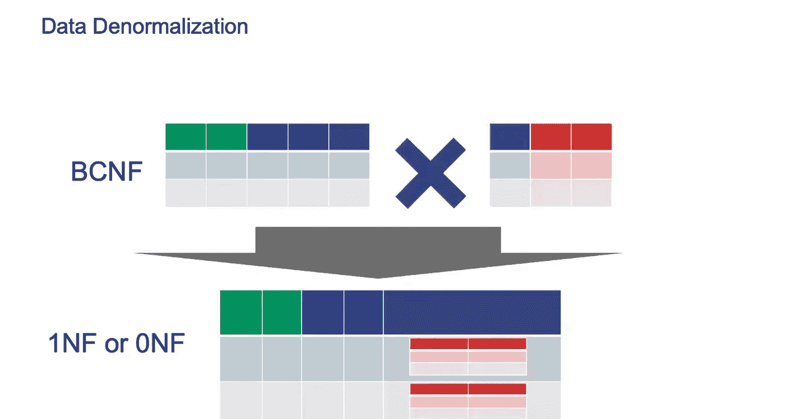

But technically， when you throw them away， you first need to know that they exist in order to throw them away。

 something that you need to be aware of that you're actually doing。

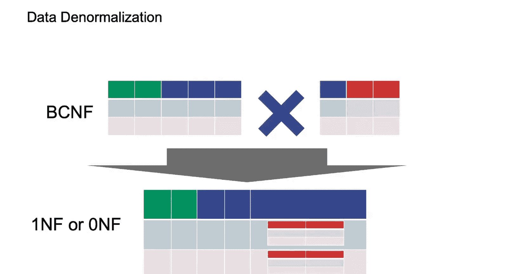

Okay。😊，So we are throwing away to normal forms， that's one less thing that you need to worry about。

But for those of you who didn't take information systems or engineers。

 the one thing you can remember because that's easy is the first normal form says you don't have a table in the table in the table getting rid of the first normal form。

Means that you accept to have a table in the table。In know table okay。

Who feels better now that I've told you we're throwing away the normal faults？Okay， very good。

All right， now I'm going to SQL SQL， you're going to have an exercise next week。

 so you're going to have the opportunity， the opportunity to practice it to understand the construct you sees relatively easy to learn。

So I'm going to just drop。A little bit of these at you。 First。

 it's part of the whole language landscape。 There's the languages for programming。

 like you might know， Java， C Python and so on。 That's the first category of languages。

Then you have the query languages on the right that are functional。

 typically you have SQL and so on and so on， we' are going to go into them。

 then you would have the machine learning section that's not part of this lecture。

 but you also have languages for machine learning right you can do it on the low level or on the high level but we are going to be looking at at this lecture is the right part with database。

 both the lowle languages like Sp Mareduce and so on and some higherle languages including SQL。😊，Now。

 sQL。Was invent invented shortly after Edgar code actually invented the， the， the， the。

 the data dependence。 So we have Don Chamberin and Raymond Boyce。

 Boce is the same as in the boycott normal for。 by the way， He gave his name to the normal phone。

And all of that happened in San Jose in California， in the US。 Actually， the。

 the the place still exists。 I don't know if it's still called the same。

 but it's there's still an IBM laboratory in the in there in San Jose。

And so in the 70s there was this first commercially available relational database software that basically implemented the ideas of Ed Gco。

 they got their first customer in 1977 and now I don't think there's a single company in the world that doesn't have a relational database like everybody has a relational database now。

😊，You might know Oracle， there's also IDM， Microsoft， these are the big three。

 and then there's many open source database like open no not open SQl， or PostgsQl， MysQl and so on。

Right。😊，Now all these database， relational database systems， they implement a language called SQL。😊。

It used to be called SQL like this S EQ UEL structured English query language。

 the goal was to be easy， but they ended up with a trademark issue because somebody wasn't happy that it was called SQL like this。

 so they rename it as SQL， but you still have people from the older generation who still say SQL out of habit。

You can say either S QL SQL。 just know that it's the same。 basically。 If you hear me say SQL。

 because I interacted with some of these people。 So I kind of got into this habit bit。

 just don't this uprze SQL， S QL， that's the same thing。

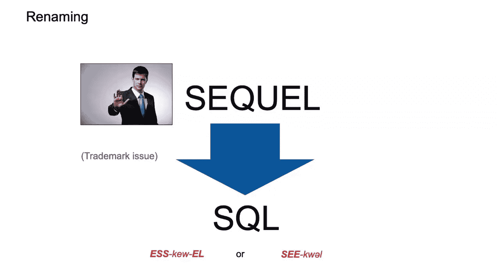

Okay， so the idea of squeing is that it's declarative。😊。

Declarative means you go to the men's eye and ask for the veggie menu。😊。

Imative would be you go home and you cook。 That's the difference In Python or in C or in R。

 you need to cook yourself in CQel， you just go there and ask for the veg menu。

 that's called the declarative language。And the nice thing about the declarative language is that you don't care how it's implemented。

 And we see that we can swap here to a data center and the language still remains the same because it's declarative。

😊。

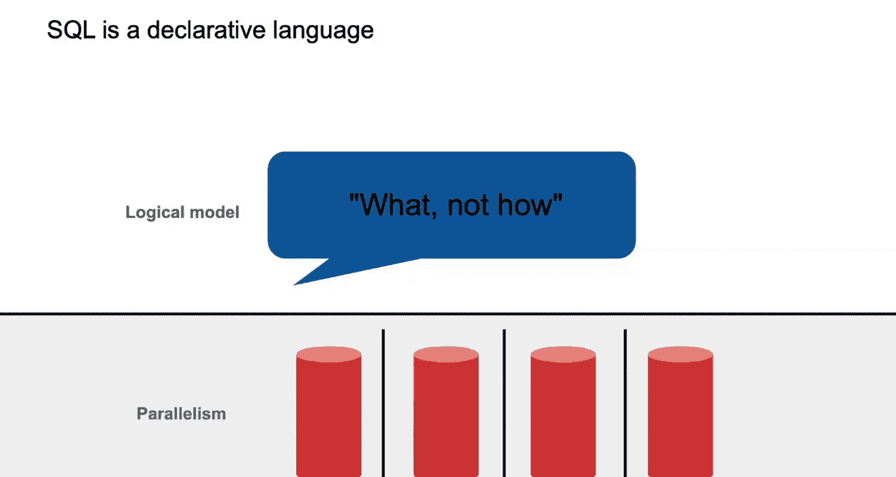

And then it's functional。 We'll come back in a few weeks to exactly the details of that。

 It's the I of expressions， thatness， just like you have a table in a table in a table。

 you can have an expression in an expression in an expression。😊，Now you might not know it。

 but you've been doing that since primary school when you have a multiplication inside an addition inside a multiplication with parentheesis。

 you've done that in primary school， it's exactly the same idea。

 except that you might have something else than addition and multiplication。

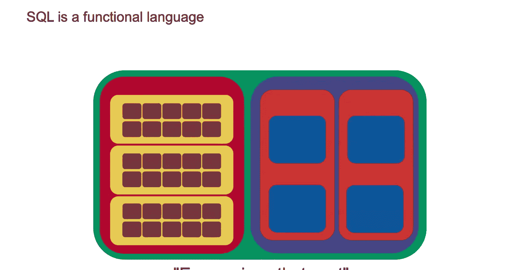

Okay， so let me show you some SQel and again you're going to have next week as exercises to go through that。

😊，In order to select。Specific rows。 all you need to write is select star means all columns from persons。

 That's the name of the table where and your criteria， Last name must be equal to crusher。

 And you see that the only row in the original table over there。

That matches this criterion here is this one here in the middle。 You see， last name pressure。

 So what this does is that it only selects this one and outputs this。 Oh who is that there。

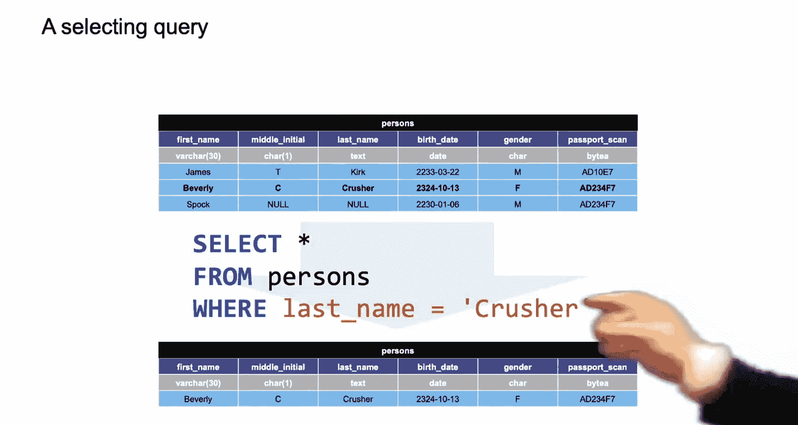

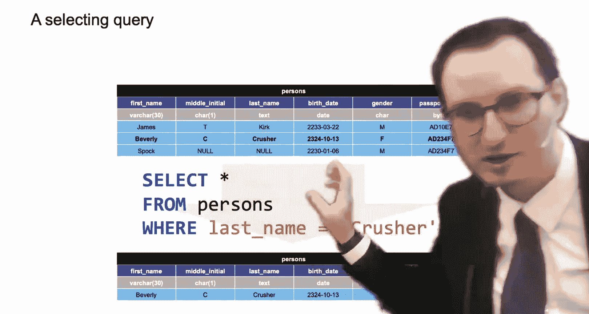

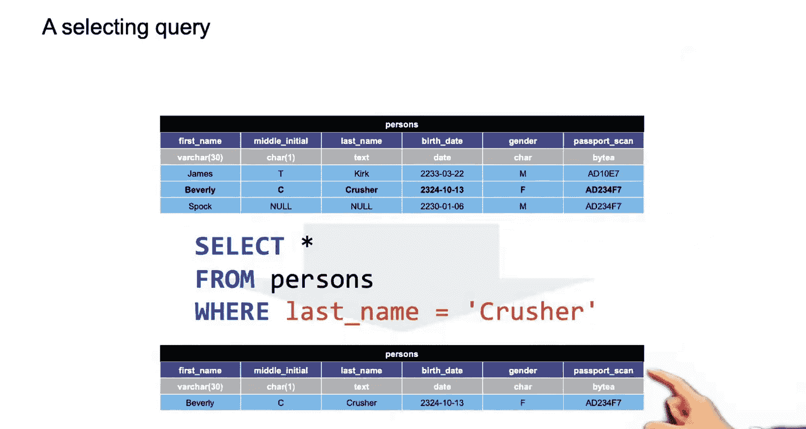

That's a selection that's sQel how do I project when instead of the star you just write the columns you want。

 I only want first name and birth date， for example。

 so this one and this one so I replace the star with their names and I get that table。

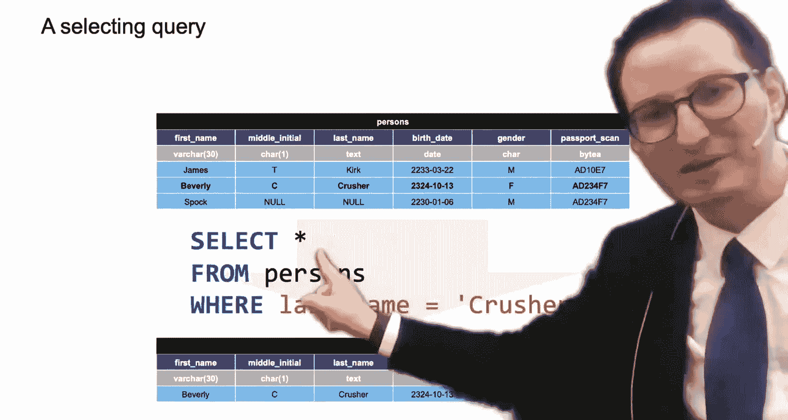

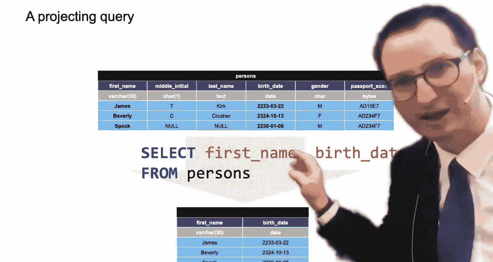

You can also rename using as first name as who and birth date as when you just rename the the columns in here。

 you can order， just say select from order by birth date and now you have it in the right order。

 you can do it ascending， descending just like in spreadsheetets， you can say ascending。

 descending as well， right。

You can also group， for example， how many per century so you say group by century and then here you count for every century you see 23。

 there's two of them， 24 there's two of them with the account and now you have two and you have two that's a group by you're gonna to have plenty of exercises to practice that。

😊。

After the group by， you can also further filter， for example you might group and you only keep those that have more than a certain count here I change the data I have three times 24th century and 123rd I'm only keeping the groups where the count is more than two that only keeps that group 24 right。

The one thing you need to learn by heart。Is basically this。 There is a specific order in the close。

 It's always， always， always select from where group by having order by limit offset set。

 limit of set is just to pagin。 You basically only want the first 10， the next 10， the next 10。

 the next 1， just like the Google results。 So that's what limit and offset do。😊，Long that by help。

 select fromware Good by having order by limit of set。

That's already 80% of the way through knowing SQL right and you're gonna to have plenty of exercises next week to get you used to doing that。

 So again， for many of you you already know that for the others。

 you will be surprised how easy it is to actually learn and you do it interactively you have a Jupyter notebook type your query and you see the results it's much smaller than in in a spreadsheet much faster than in a spreadsheet in a spreadsheet you need to click at a lot of places but with a language like that you just type what you want and you immediately see the results of the query。

Right。Who feels comfortable with that has an intuition or what that does？Allright。

 so in that case we are considering all the game mind then， the cities in Switzerland。

 you have a list of everybody in Switzerland， we are grouping by the city they live in。

 we only keep the cities where with less than 100，000 inhabitants ordering by population descending the larger affairs。

 the smaller then we are skipping the first 10， the first 20 sorry of set 20 we' are skipping the first 20 and outputting the next 10 right。

So I don't know what to end the with， maybe in， I don't know。Okay。Again。

 there's nothing that beats practical experience， so I really recommend solve the exercises that the Ts will prepare for you next week and you will completely master SQL and be able to write the queries。

😊，Okay。😊，嗯。I think I have a few more slides， but it's already it's already 10。

 So I'm going to stop here。 I will finish a few more slides that I have。

 And next week we are going to have a first real lecture with actual material specific to big data。

 We are going to see how we can store。😊，Enormous quantities of data in the cloud as a cloud service。

 so cloud storage。So。Thank you very much for attending today's lecture this week there are no exercises all we ask you is to test the Docker compost setup that the Ts will show to you if you have issues go to the Ts that will help you the first exercise sessions will be next week right but you can already register to the groups for the continuing education students this year we put a special flag on one of them on Fridays to say this is continuing education friendly in the sense that you can converge to the same one and the work together right。

😊。

Okay， so thank you very much everybody， enjoy the semester and see you next week at 8 a， thank you。😊。

