# 苏黎世联邦理工《工程师的大数据｜Big Data for Engineers - ETH Zurich - 2024》中英字幕 p04 3 - Cloud storage (1_3) - .zh_en -BV17FAmeFE9K_p4-

So welcome back I will start off。 So that part of the lecture with a question on clicker。

 I would like。To rescue。A few things packed already now。嗯。

What do you think there is in the data center。 You probably heard of data centers on television。 Now。

 its it's all over the place that there are all these big companies with these gigantic data centers。

 What is there in the data center。 What do you think。

Is it top secret like this is just some place that does computations and brings LLMs alive。

 or is it a really big machine with 100 co CPU， 100 petabyte disk and a petabyte of memory。

 or is it plenty of small cheap machines， or is it a giant quantum computer with an array of 54 qubits？

😊，I thought of Scamore， but I think that one of the qubits failed and it went down to 53 in the weird experiments。

 but 54 was the intense。I do z in。Right？You see what you say。

There is a majority and the majority is even correct。

So it might be something very disappointing if you imagined or idealized what a data center is。

 but in fact， yes， it is just。Rooms filled with cheap machines， this is what it's about。

So cheap machines， some of them are basically can can be pretty much like your laptop。 in fact。

 it's a slight exagger because the machines in the data center might be a bit more powerful than your laptops。

 but it's nowhere near a petabyte of memory or 100 petabyte of these， in fact。

 that doesn't even exist。 a petabyte of memory doesn't exist today。

100 petabyte of these doesn't exist today。 The only thing we know to do is plenty of machines with small amounts of memory。

 small disks and so on。 All right， so this is what there is。 And I will tell you more。😊。

Just a few minutes。But at least Denis sies， probably。For you what the data center is。

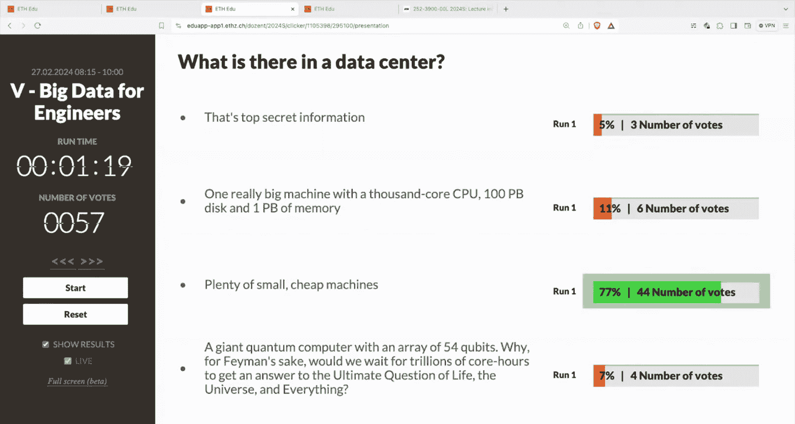

P。😊，So cloud storage。嗯。So what is on the agenda for this lecture， It's big data。

 So we need to query large amounts of data， what kind of data。

 one example is the data that we gather with experiments like， for example。

 the Sloan digital Sky Sur。I took a look at it， the phase4 that last until 2020。

 and I tried to see how much data there is in there。

 And I found out that there is 273 terytes of data。😊，And it's organized in 680。

000 directories with 176 million bys right That's a lot of data。

 this is what we have in and now we want to analyze it because this is data that can be queried with SQL with other languages in order to discover。

 I don't know black holes， neutron stars， Quasar and so on。No。The first question that arises is。好。

And where do we store that？Because that's a lot of data。 Well， for sure。

 that will not fit on your laptop。Right， so we need another way。 Now， what do we have。

 We have relational databases， But the problem of the relational databases。

 at least in the early 2000s， is that a relational database system fits on one machine。

So if you thought that you could just put these 200 terabytes in a radiational database， think again。

 it just doesn't work because that's only one single machine。So that's not an option。

 and in fact that's exactly what happened in the early 2000s is that the companies run out of options because the data that they needed just didn't fit anymore in the systems that we had。

So we need another solution， sorry I have a delay whenever I click。

 somehow it takes a few seconds until the things appear。

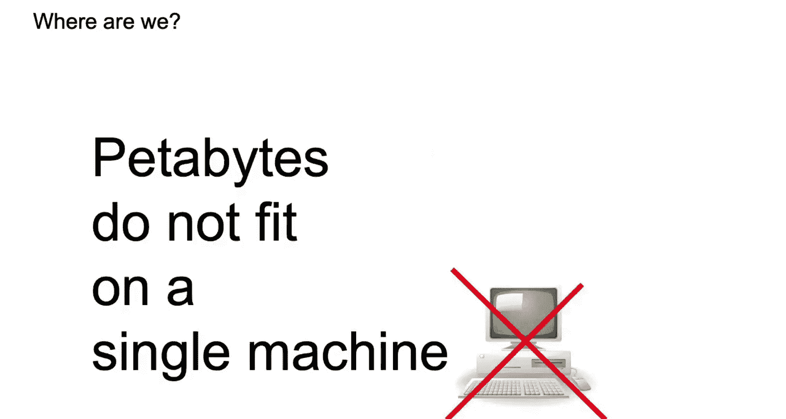

All right， but I have good news for you。I have good news is that everything that has happened in the past 50 years since the 1970s and if you wantt even earlier。

Can still be reused， even with the new technologies。 So the notion of selection projection。

 grouping sorting joining that I threw at you last week and this week will still apply。

Language is declar functional with optimizations， query plans that the Greek letters indnts on。😊。

We still apply。 We can still have that。 But the table is made of tables， rose Cols， primary keys。

That also， we will since。But we might not have only that we will expand to other concepts。

 but it means that a lot of what we've learned can be reused。 That's very， very good news。

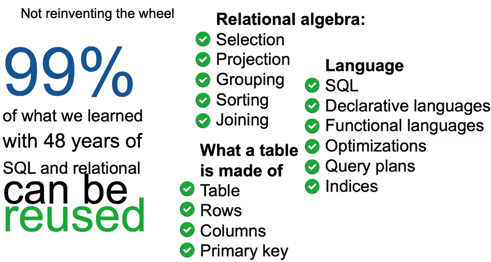

But there are things that will drop and that shouldn't surprise you because I told you the normal forms this is going away so the second normal form third normal form boycott normal form this is all going away all you need to know for the purpose of that course is that a normal form is kind of the opposite of a joint normal form means splitting the data dropping the normal forms means that you put it back in the giant table。

Tabular integrity， domain integrity， atomic integrity。

 This is basically what brings the table nest to a table， right。

 The fact that you have the same columns， values for the same columns in every row within a column。

 all the data has the same type。 You don't have a table in a table in a table。

 So everything that makes a table a table。We are throwing that away。

 and we see things that are not paperss。Instead， we are going to see data that's heterogeneous because it might be that you have in the same color data with different types。

We are going to see data that is nested， tables in tables in tables。

 and we are seeing we are going to see data that is de normalizedmalized。

 meaning that it's not in a high normal form。 it's just a giant table that we are going to query。

That beautiful world was known as the buzz world。 It was a buzz world now a little bit less。

 And that buzz world was no sequel， not on sequel。 And everybody was like no sequel， no sqel。

 no sequel at the time。 That was the chat GT of maybe 15 years ago。😊。

So this is actually what's going to be new and we spend weeks on that。

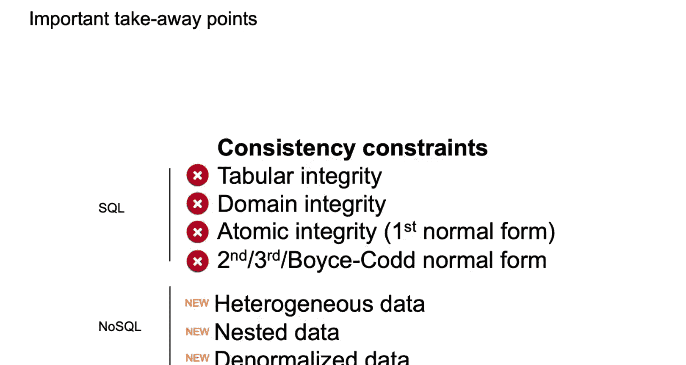

So what's going to happen in the coming weeks is that we'll have。To rebuild the whole stack。

What do I mean with that。Is that if you look at a relational database system。

 the good old ones of the 70s， they fit on a single machine。

 It's just a piece of software that to install。 In， In fact， Post Gql is exactly that。

 It's like a black box。 You just download it， install it。 and that's it。 then you interact with it。😊。

We need to rebuild all of the components to break it apart and rebuild it layer after layer。

 It's like building a house。 you have the foundations， you have the world， the electricity。

 the primary and so on and so on right So we are going to do exactly that like we build the home。

 we are going to build the big data technology stack So these are all the levels of the stack We spend the entire semester doing that。

 The first level is the storage。 That's what I'm telling you about today with the cloud storage。

 that's plenty of fancy technology names。 It's where you put the data see。Then you have a level。

That's called the encoding。 This is how you convert the data to zeros and once。

 not very relevant for that lecture。 It's more like I'm mentioning it。

 but we don't actually spend too much time on it。 You might have heard of UTF， who heard of UTF 8。

Okay， U TF 8， if you create text files， you should go for UTF 8。

 This is basically the way you get all the international。

 all the languages and all the special characters to actually work as opposed to Eki or Io 88509 thats saw the European characters。

 But there's many others。 UTF8 today is the way to go。😊，So this is how you encode it。 But this is。

 again， we not spend too much time on that。Intex is。How do you represent data？😮。

As texts that you can then store on your disk。Examples are X， M， L， Jason， C， SV， CS S V。

 I'm show you help。 Who heard about CS SV。Alright， it's all of the other web。

 When you can download data， it's going to have the CSV option， just a way to represent tables。

 It's table represented as text， right XMM Jason that's trees represent it as text。

 R F XM tutles that's graphs represent as text and XBR， its cubes represent it as text。

 So this is all syntax to store data as text。 why， because you want to transmit it those other web。

 you want to download details so on。 So this is why we need syntax。Then， we have。

If my computer would be so。 Yeah， so we have data models， which is how you model the data。

 So in the case of tables that rose columns and so on that I told you last week， for trees。

 we will see that graphs cubes， it's not in that cross。

 but it's basically just the model behind the data。

 the representation of your data right that would then manipulate。Then there is validation。

 validationidation is the process of putting constraints on the structure of the data， for example。

The fact that in a column， all the values are strings or all the values are dates and so on disease validation。

That's something we don't hear about in relational database systems like PostgresQL just because it's mandatoryda。

 you cannot even start working with data if you don't already have a schema that ensures that the data is structured。

 but we see that in big data we actually make it optional rather than manda and so it appears a bit more explicitly so we spend a whole week doing that。

Processing the data is when the data。 that's the best part of the lecture。

 It's when the data flows in the data center across thousands of machines and。

 and just in a way that they develop the result at the end。 So this is my favorite part。

 So we look at map produceuce and Apaches back。😊，Then ind that can be very convenient to very quickly looking up data。

 I tell you all about that again in the special week， then we have the data store。

 So here it starts looking like like a product that you sell to people right so a data store is basically a technology and you might have helped some names here Mongo Db who heard MongoDb。

😊，Right this is now almost becoming。 it was already a buzzword years ago。

 But now I hear people again talk about this。 It's a database company that is that is selling a Nosql product based on trees。

 Couchb El It's all based on trees as well。 hive based on cubes H based。 That's the big table。

 That's actually the open source version of Google's big table。 Maclog is also a Nosql product。

 Cassandra would be metta or Facebook's alternative to H base and so on。

 So this is called the data store。 This is basically what you sell or put for people to download and and use that's the the wrapper of of everything else。

😊，And then。The top that you can achieve on top of the data store is if you have a real query language like SQL。

 there are others for other shapes， but when you have a query language。

 you are basically making the user's life much easier because they can use that language to query the data。

And finally， the ultimate level and you you can have user interfaces。 And in fact， I should。

 I forgot to add it。 But this is where you put the LLMs and GT and so on。

 like the natural language interface that is going to be part of the ecosystem as well。

 But that would not be part of the of the lecture。 But just so you know that it is in there。

 And in fact， since GPT is so good that's writing SQL。

 then you can imagine that it can actually be of help。😊，For people who don't know sequel。Right。

So this is the stack it's one semester's worth of of the work here so this is we need to stuff somewhere of course and this is why today we just start at the bottom of the stack with the storage so as I told you we need to start the data somewhere and particular this is the astrophysics data for example。

 so there is always a storage level in fact I hear a lot from physicists that information is physical so whatever information you have must be in the end with atoms and molecules somewhere。

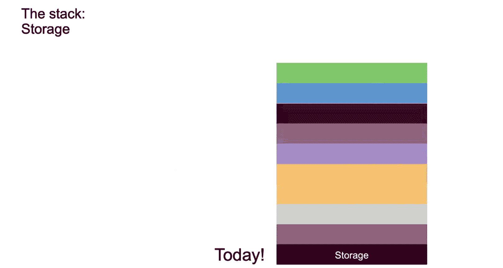

But we need to figure out where。

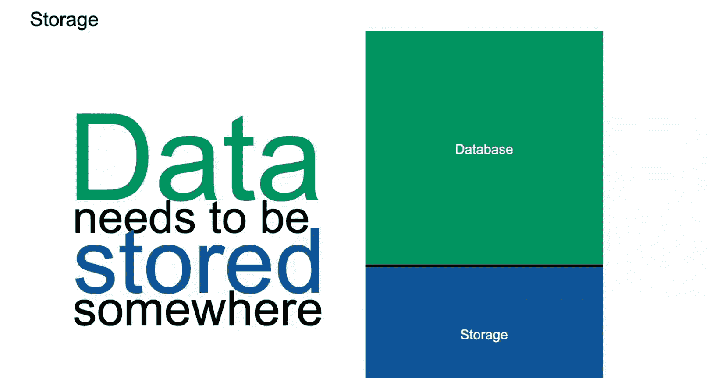

I can tick again， but then it's going to go by two， oh okay。😊，嗯。Now。

 here's a very important point to on stand that's absolutely fundamental。

There are two kinds of systems， two kit。One kind of system is like post Re。

It's basically a system that is monolithic。That handles everything for you。

RightSo it means that you need to import the data in it and then it's going to figure out how to store it all by itself and how to query the data and so on that's called ETL。

 So these are the traditional databases right It's really just a closed system and you can only interact from outside。

What it means is that it's hiding the complexity from you， but it also means you cannot see inside。

But in the 2000s， something emerged or it would be more precise to say re emergeer because that's actually pretty much how it was in the 60s。

 but in some cases， this is what you need。That's called the data leak。

A data lake is some sort of fight system with directories and files。

And you just drop your data in there， as files。But the difference with the one on the left is that you see the files。

 you see the directories， you see the files， we can copy them over， download them。

 put them on the internet and so on。 So you actually read files from a file system。

 that's also called in C2 because you basically query the data from。Where it is。嗯。

So what you will have in there is TV files， adjacent filess， XMl filess and sos， all kinds of files。

 And you probably heard of these but as well like when you sit in front of a Python notebook using a numpi。

 Possyche and so on。 and typically you are working with a data In fact， for some use cases。

 it's great right but you need to know that it's not the only thing in there are the systems that hide everything from you and you don't even see any files because that's only hidden it's highly optimized And then there are the systems called data for whom is the difference clear。

😊，Okay， so now we are actually focusing on data lakes or two day， but the data lakes in the cloud。

 not just your on your laptop。

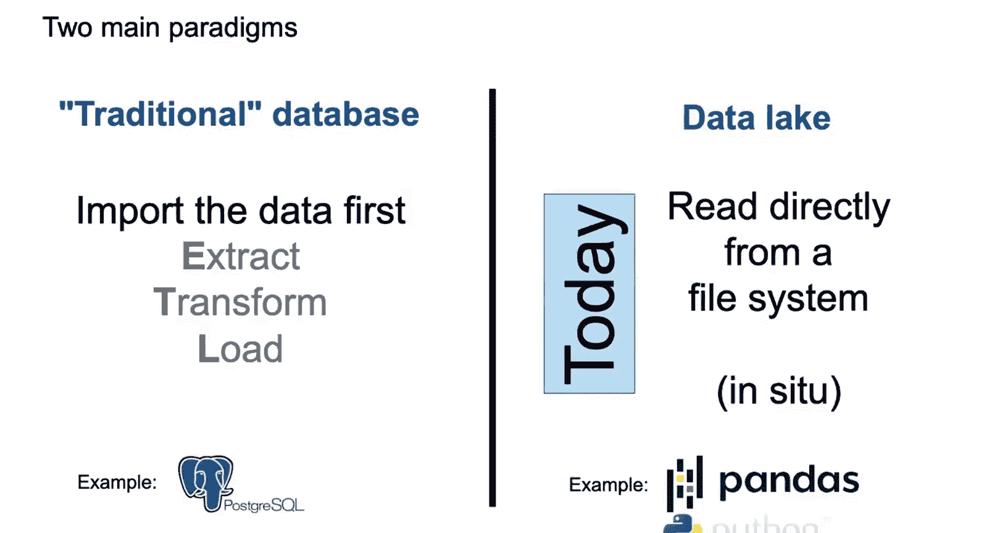

Now， if you start from the 70s， if we wanted to stock things on a single disk。

 this is a hard drive already， I think you probably saw that already right。

 this is what the hard drive looks like who never saw that。Okay， most of you saw it。 Okay。

 so that's a hard drive。 It has a rotating part here。 make an equal drive。

 These are the cheaper ones that we still like to use today。

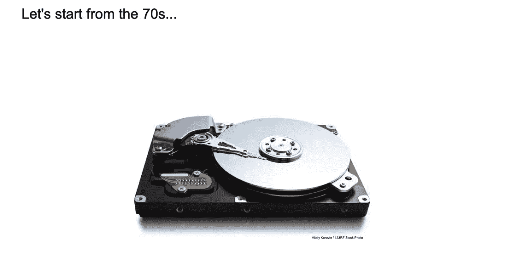

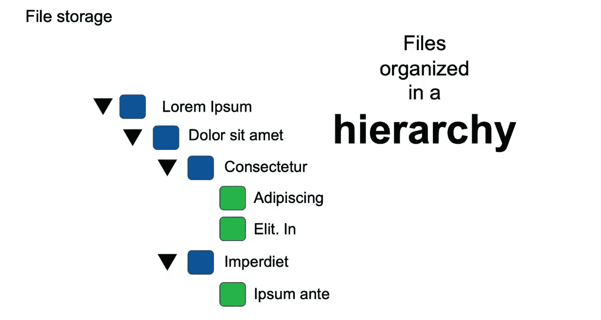

The files there are organized in a hierarchy， you can have directories and files in there。😊。

And moreover， the files are actually split in blocks。 So if you have a file on your laptop。

 all these laptops right there， you might have files that are a few megabytes， let's say。

They are not stored just as a megabyte on disk， in fact。

 the laptop is splitting them into 4 kilobyte blocks，4 kilobyte blocks。

 a lot of these blocks and it start block by block on your disk whenever you read or your write it's block byte block So this is called block storage roughly4 kilobytes on your laptops。

 the data in there。

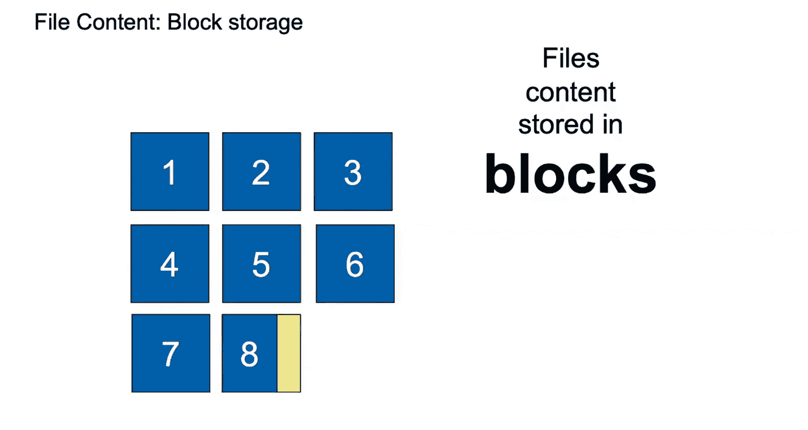

Now， if you use that local storage and thought that you can squeeze the the astrophysic data sets。

 if you hit it strong enough with a hammer， then you're wrong because this kind of storage with with the hard drives it's going to work on a local machine。

 it's going to work maybe with your local network， maybe some of you have at home a hard drive that you access remotely right but it's not going to work if a million people are going to connect to it remotely。

 It only works because it's just you right WAN is one is a wide area network。

 this is where things start breaking right and in terms of the number of files to I don't know if some of you did backups So if you do backups you see the number of files you might have thousands of files。

 maybe millions of files you surely do not have billions of files on your laptop because this is also breaking the boundaries of what we have。

 but the problem is that。

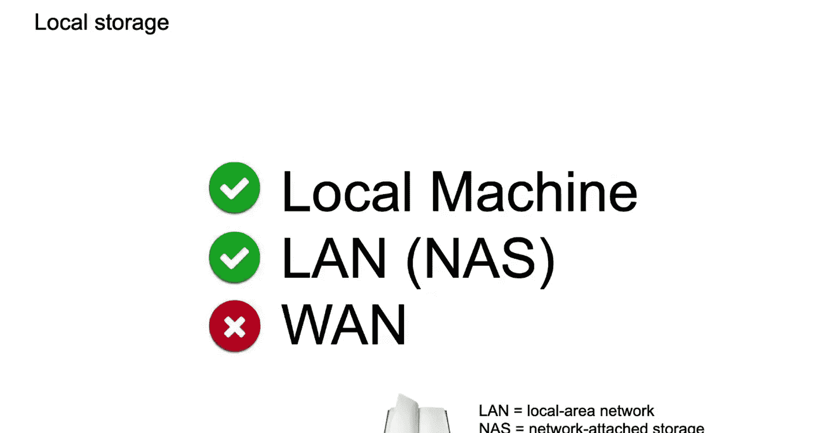

For big data， we do need that kind of numbers， right， So how do we solve that with cloud storage。

 And this is what we see right after the break at 15 past 9。

